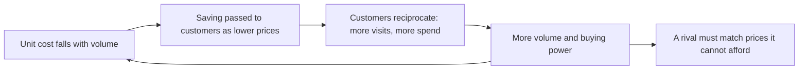

# The Nomad Letters: Gems and Mental Models — A Study Report

2026-10-22 · Prepared for Karthik Gajjala · Source: Nick Sleep and Qais Zakaria, *The Full Collection of the Nomad Investment Partnership Letters to Partners, 2001–2014* ([approved version, IGY Foundation](https://igyfoundation.org.uk/nomad-partnership-letters/)) · Companion to the [Mauboussin study](Mauboussin-frameworks-study-2026-10-07.md) and the [valuation and mental models study](Valuation-and-mental-models-study-2026-10-07.md); the gap table in section 10 continues their numbering at row 53.

Nomad compounded at about 21% a year before fees for twelve years against 6.5% for the world index, and the letters explain how without a single trick in them. **Their method reduces to five habits: find the rare business models in which size becomes an asset rather than an anchor; judge the people by whether they do the right thing or the popular one; buy when the market's short horizon prices those businesses as if they will not last; then do almost nothing for years, because the only risk worth managing is misreading where a business will end up. Everything else in the letters is about the psychology that stops people doing those five things.** The letters are also a record of two investors changing their minds in public, from buying cheap assets to holding a few compounders almost permanently, and that change is the most useful lesson in them.

## 0. How to use this report

**What was read.** The whole collection, cover to cover: 25 letters to partners from January 2002 to January 2014, the April 2006 transition letter, Zakaria's 2006 note on the fee structure, the reprinted Global Investment Review essays (on commitment bias, September 2004; *Measuring the Moat*, May 2005; Zimbabwe, February 2005), Sleep's September 2005 speech to The Investment Fund for Foundations, the 2007 reply to a partner on divestment, and the 2021 preamble and postamble. That is 218 pages and about 110,000 words, extracted from the PDF in your library.

**Quotation policy.** Everything below is paraphrase in my own words, attributed to the letter it comes from. Short concept names the authors coined (*scale economies shared*, *robustness ratio*, *destination analysis*) are used as names. The authors ask that anyone citing the letters link to the approved version above, which is the one to read for their actual wording; the letters are funny, and the paraphrase loses that.

**How it is organized.**
- Section 1: the record, and what it teaches before any single idea does.
- Sections 2–3: the business models Nomad bought, led by the one that made most of the money.
- Sections 4–8: mental models, grouped by what they help you think about: time, risk, people, information and yourself.
- Section 9: fifty gems, one line each.
- Section 10: what this means for our framework, as a gap table with a Decision column.
- Sections 11–12: exercises on our own tickers, and sources.

Letters are cited by date, for example (Dec 2004) for the annual letter covering 2004 and (Jun 2005) for the interim letter.

### The ideas on one page

1. **A business that passes its scale savings to customers turns size into a moat.** Customers reciprocate with more spending, which brings more scale and more savings. It is rare because it defers profit, and Wall Street punishes deferred profit (section 2).
2. **Measure the moat by who gets the surplus.** The *robustness ratio* is customer savings divided by what shareholders keep; Costco's was about 5 to 1, GEICO's about 1 to 1 (section 2.3).
3. **Business outcomes are more predictable five years out than one.** That is the *equity yield curve*: patience both raises and de-risks the return, and almost nobody competes at the long end (section 4.1).
4. **Great companies can stay cheap for decades** because the market applies the average company's failure rate to every company, including the few that won't fail (section 4.3).
5. **The costliest mistake is selling a compounder early**, not owning a bankruptcy. Opportunity costs never appear in a performance record, so nobody learns from them (section 4.5).
6. **Risk means value per share lost for good.** Price volatility is not risk; misanalysing the destination is. Dilution at the bottom of a cycle is the quiet way per-share value is lost (section 5).
7. **Character is the asset that compounds.** Prefer companies that behave well because they want to over those that do because they have to. Fewer than one in twenty listed firms, in Nomad's estimate, put the right long-term decision ahead of the one that pleases Wall Street and the press (section 6).
8. **Many small advantages beat one big one.** A culture that saves a little on a thousand things daily is harder to copy than a patent (section 6.4).
9. **Information has a sell-by date.** Weight it by shelf life; a forecast of next quarter's earnings is useless once the quarter is reported, while how a customer feels about low prices hasn't changed in centuries (section 7.1).
10. **Read the price as a statement**, then ask whether you believe it. A share price that values growth spending at zero, or an airline below the value of its planes, is saying something checkable (section 7.3).
11. **The enduring edge is behavioural.** Information edges vanish; analytical edges erode; temperament and a patient capital base last (section 8).
12. **Do nothing, deliberately.** Each day you don't sell is a decision. Once you own the businesses you always wanted, activity mostly destroys value (section 4.6).

## 1. The record, and what it teaches before any idea does

Calendar-year returns, Nomad before fees against the MSCI World Index (net, US$), in percent:

| | 2001* | 2002 | 2003 | 2004 | 2005 | 2006 | 2007 | 2008 | 2009 | 2010 | 2011 | 2012 | 2013 |
|---|---|---|---|---|---|---|---|---|---|---|---|---|---|
| Nomad | +10.1 | +1.3 | +79.6 | +22.1 | +9.2 | +13.6 | +21.2 | −45.3 | +71.5 | +43.9 | −9.9 | +39.8 | +62.2 |
| MSCI World | +3.6 | −19.9 | +33.1 | +14.7 | +9.5 | +20.1 | +9.0 | −40.7 | +30.0 | +11.8 | −5.5 | +15.8 | +26.7 |
| Difference (pts) | +6.5 | +21.2 | +46.5 | +7.4 | −0.3 | −6.5 | +12.2 | −4.6 | +41.5 | +32.1 | −4.4 | +24.0 | +35.5 |

\*From 10 September 2001. To 31 December 2013, one dollar became **$10.21 before fees against $2.17** for the index: 20.8% a year against 6.5%, and 18.4% a year after fees (Dec 2013). The partnership closed early in 2014 and returned the money.

Four things in this table matter more than any single idea in the letters.

- **The best record of its era lagged the index in four years out of thirteen**, including 2008. The authors had told partners in 2002, borrowing from Buffett's 1960 letter, to expect outperformance in weak markets and lag in strong ones. That held until 2008, when a concentrated portfolio fell further than the index, and it failed again in 2011.
- **For five years the record showed nothing.** At the end of 2008 the five-year return was +0.4% against −2.5% for the index (Dec 2008). A five-year horizon, which is what we use, has to survive a five-year stretch in which the method looks broken.
- **The excess came in lumps.** Five years (2003, 2009, 2010, 2012, 2013) produced almost all of it, and the two biggest followed the two most frightening moments to buy. Anyone who judged the manager on a smooth annual series would have left at the wrong time; the letters return to this point again and again.
- **The strategy changed, and the change made the money.** The journey ran in four phases:

| Phase | Years | What they owned | What changed in their thinking |
|---|---|---|---|
| Cigar butts and turnarounds | 2001–2004 | Asian cement and property, UK buses (Stagecoach), Xerox, Lucent preferreds, unlisted Weetabix, Thai and Hong Kong media | Bought dollars for 50 cents in three buckets: franchises, discounted assets, workouts. The franchises won and the workouts lost. Returns came from other investors' fear receding, not from the businesses improving. |
| The pivot | 2004–2007 | Costco grows to about 10% of the fund; Amazon arrives and is about a sixth by mid-2007; Berkshire; a Zimbabwe basket | Named *scale economies shared*, the *robustness ratio* and the *equity yield curve*. Left Marathon in 2006. Learned that selling Stagecoach early cost more than Conseco's bankruptcy. |
| The test | 2008 | Down 45% in the calendar year | Learned about dilution risk (MBIA) and the value of slack. Reopened at the bottom. Partners barely redeemed. |
| Near-permanent holdings | 2009–2013 | About ten companies, roughly 80% in the top ten and about 30% in a single holding; Amazon, Costco, Berkshire, AirAsia, Asos, Carpetright, Games Workshop | The many-small-things advantage, path-dependent odds, information shelf life, inactivity as value added. Closed in 2014 with the portfolio intact. |

The cheap assets, they found, tended to stay cheap when they were wrong: mistakes atrophied rather than collapsed (Dec 2003). The compounders did the heavy lifting, which by 2009 they described as the businesses' work, not the managers'. In their final letter they argued that fund management as a whole only moves wealth around, and that the wealth itself comes from the relationship between a company's employees and its customers (Dec 2013).

## 2. Mental model 1: scale economies shared

This is the idea that made most of Nomad's money. By mid-2009, companies running it were more than half the portfolio, and about 60% on a broader count (Jun 2009).

### 2.1 The mechanism

Most companies chase economies of scale. Very few give them away. The model works like this: as volume grows, unit costs fall; the company passes the saving to customers as lower prices instead of keeping it as margin; customers reciprocate by spending more; the extra volume brings further savings, which are passed on again.

The authors called it retail's version of perpetual motion (Dec 2002) and listed its users across a century: Ford's Model T, whose price fell from about $950 to about $300 while volume rose to two million cars a year; Wal-Mart in the 1970s; Southwest in the 1990s; GEICO, Nebraska Furniture Mart, Ryanair, Direct Line, Costco, Amazon, AirAsia and Carpetright (Jun 2009, Jun 2012). Its power is that it **turns size, normally a drag on growth and returns, into an asset**: the moat deepens as the firm grows.

At the centre is a paradox: the company grows by giving more back. The authors made a habit of asking managers what they would do with a windfall. Almost all said they would spend it or return it to shareholders; almost none said they would give it to customers (Dec 2004). That answer is the screen.

### 2.2 How it shows up in the numbers (Costco, Dec 2004)

- **A capped markup.** Costco marked goods up by no more than about 14% over cost. When a buyer found designer jeans that could have carried a far bigger margin, the founder, Jim Sinegal, refused to break the cap, on the grounds that one exception would become a habit.
- **Suppliers compete to serve the customer, not the store.** About 4,000 product slots were filled by whichever supplier offered the shopper the best value, where a typical supermarket rents its shelves to the highest bidder. Ordinary grocers make money buying from suppliers; Costco makes money selling to customers.
- **Old stores benefit from new ones.** Scale savings from expansion lower prices everywhere, so mature stores keep growing. Sales per square foot ran about 50% above Sam's Club in 2004 and about four times a typical supermarket's by 2008 (Dec 2008).
- **Costs measured in basis points.** Operating cost was under 10% of sales against roughly 25% at hypermarkets.

**Under-earning hidden in averages.** Costco's oldest stores earned about 16.5% on assets and its youngest about 6%. As the young stores matured, aggregate profit would rise about 50% before any new openings. Adding store maturation (about 4% a year), same-store growth at mature stores (about 4%) and unit growth funded from cash flow (about 5%), they estimated normalized growth of about 13% a year, at a price that implied 5–6% (section 7.3).

### 2.3 The robustness ratio: measuring the moat by who gets the surplus

The *robustness ratio* (May 2005) is what customers (and, where relevant, employees) gain from a company's scale, divided by what shareholders keep. A high ratio means a competitor must give away a great deal to match the offer.

| | GEICO (2004) | Costco (2004, per cardholder per year) |
|---|---|---|
| Customer gain | About $1B saved against the next-cheapest insurer | About $175 saved against a supermarket basket, less a $23 fee |
| Employee gain | Profit-share bonus | Pay and benefits about 55% above rivals: about $26 |
| Shareholder take | About $1B underwriting profit | About $32 pre-tax |
| Ratio | **About 1 : 1** | **About 5 : 1** |

Two things follow. First, matching Costco's prices and pay would have cost Sam's Club about $2B a year, against Wal-Mart's whole profit of $9B; the gap widens as Costco grows. Second, a high ratio means the business is **under-earning against its potential**, which is an opportunity for anyone willing to look past reported margins. The ratio is not a magic number: a 1:1 ratio can be an ample defence, and a falling ratio means the moat is not being widened as fast as it could be, not that it is shrinking.

**The lifecycle rule.** Early in a company's life it should over-reward customers, because referrals and repeat business build the franchise. With maturity, shareholders can take more. Take too much and the moat drains. The letters name harvesting at Coca-Cola (leaning on bottlers), Gillette (cutting advertising) and Home Depot (raising gross margins), and warn that harvesting leads to a kind of growth purgatory: growth slows just as investors realise the profits were overstated (May 2005).

**The pressure to harvest, and the right answer.** When Costco's share price went nowhere for six years, management began nudging the split toward shareholders. The authors argued that the right response to a share price famine was to buy back shares cheaply and let free cash flow per share do the work, not to change the bargain with customers, because once changed for investors it would be changed again (May 2005). That is still the best test of whether a scale-sharing company means it.

### 2.4 Why the market misprices it

The authors listed the heuristics investors misapplied to Costco (Dec 2004), and they apply to every company running the model:

| Heuristic | Why it misleads |
|---|---|
| "Margins are low" | That is the strategy. Profit is deferred to lengthen the franchise. |
| "It's expensive at 24 times earnings" | Net income is a small residual. At Wal-Mart's margins the same business would trade at about 11 times. The question is whether raising prices would make it a better business; it would not. |
| "It has a cost problem" | Costs had risen with new distribution capacity built ahead of growth. That is investment, and it is cyclical. A famous investor who held only 1% for that reason was wrong by about $20 a share. |

Jeff Bezos described the same choice in Amazon's 2005 letter, which the authors reprinted (Dec 2006): price elasticity data always says that raising prices pays this quarter, but the long-term effect of steadily lowering them cannot be calculated and has to be judged. Bezos later put the alternatives plainly (Dec 2011): a company can labour to persuade customers to accept high margins, or labour to become efficient enough to charge low ones. Both work. The first is the Coca-Cola, Nike and Colgate model, built on advertising and line extensions; the second is Costco and Amazon. Nomad preferred the second because only it deepens the moat with size.

### 2.5 It works best when times are worst

Low-cost sharers take permanent share in recessions. In December 2008, Amazon's orders on its busiest day rose 16% while US retail sales fell almost 10%, and AirAsia's revenue per seat rose a third while its unit costs excluding fuel fell (Dec 2008). Amazon's operating costs plus its margin, per dollar of sales, were lower than many high-street rivals' costs alone, so those rivals could not undercut Amazon even at break-even. If Amazon took one dollar in ten of its US high-street rivals' roughly $150B of sales over a decade, its US revenue would quadruple. At the time, the market priced Amazon as if it would not grow.

## 3. The other models on the whiteboard

The authors kept a whiteboard of the few investment models they believed worked and understood (Dec 2004). By mid-2009 the portfolio sorted into four (Jun 2009):

| Model | Share of portfolio (mid-2009) | Example | Key test |
|---|---|---|---|
| Scale economies shared | More than half | Costco, Amazon, AirAsia, Carpetright | Are savings going to price or to margin? |
| Deep discount to replacement cost, with latent pricing power | About 15% | Asian and southern African cement | Will prices have to rise to justify replacing the assets? |
| Hated agencies | About 15% | Not explained in the letters | — |
| *Super-high-quality thinkers* | Just under 10% | Not named; Berkshire fits the description | Could you hand them your capital allocation for decades? |

### 3.1 Deep discount to replacement cost, with latent pricing power

A capital-heavy industry whose shares trade far below the cost of rebuilding its plants must eventually charge prices that pay for replacement, or the country goes without (Jun 2005). The examples were striking: Zimbabwe's largest cement maker at about one-seventieth of replacement cost; Siam Cement up twentyfold in eight years from the Asian-crisis trough; Pretoria Portland Cement bought at about $20 per ton of capacity and later valued at $180.

The model has three conditions. No one may add discretionary capacity (a low share price usually ensures that, since nobody builds what the market values at a quarter of cost). The assets must not be confiscated. And there must be enough time. Because nationalisation risk is never zero, these positions were kept small. The Zimbabwe basket was marked at zero in 2008 when the exchange stopped settling, then sold in 2013 for three to eight times its cost in dollars, after hyperinflation and the abandonment of the currency. The authors said they would not do it again: compounders were less stressful (Dec 2013).

### 3.2 Super-high-quality thinkers and the terminal portfolio

In 2004 the office kept a list of about fifteen companies run by the intellectually honest and economically rational, which had out-thought their competitors and allocated capital with discipline for many years (Jun 2004). They called it the *terminal portfolio*: where they wanted to end up. Two rules governed admission:

- **Want to, not have to.** Companies behave well either because they want to or because they are forced to. Firms behaving well only with their backs to the wall were excluded, however good the behaviour looked in the moment.
- **Good capital allocation need not mean growth.** National Indemnity wrote insurance only when prices were good and let revenue fall by as much as 80% for years when they were not. Stagecoach made Nomad's money by shrinking. The authors made a practice of asking managers of poor-economics businesses why they wanted to grow, and found the question met with disbelief.

Why weren't these companies already the portfolio? Price. But share prices swing far more than business values, so given time every business is mispriced; even Berkshire traded at about half its value in early 2000. The job was to do the work early, so as to be ready when the price came (Jun 2004). Five years later they bought exactly these businesses in the crisis.

### 3.3 The jewel inside, and the honest mea culpa

Two turnaround patterns recur.

- **Cancer surgery.** Many companies have a jewel at their heart that has been used to fund weaker ventures. Cutting the weak businesses away reveals it. Coca-Cola once owned a shrimp farm and a film studio; Stagecoach's UK buses had been neglected while management ran a debt-funded US roll-up. When the founder returned, sold the weak parts and repaid debt, the shares rose from Nomad's purchase price of 14p to about 90p, and later to more than £2.50 (Dec 2002, Dec 2007).
- **The firm that admits its error.** Nomad deliberately bought companies that had made mistakes: Games Workshop, Dell, Sony, Ford, Liberty Global. Two things are needed: an honest admission and a low price. The market supplies the price; the admission is rare. Games Workshop's chairman wrote that the company's slump came from its own complacency, not from video games or the economy. Self-inflicted problems are usually within a company's power to fix (Jun 2008).

## 4. Thinking about time

### 4.1 The equity yield curve

In bonds, longer maturities pay more because more can go wrong. In equities, the authors argued (Dec 2006), the opposite can hold: they had no idea where markets would end the year, but given a company's strategy, capital allocation and starting price, they had a reasonable idea of where it would be in five years. **Time both raises and de-risks the equity return** when the business is good, and the short end of the curve is where all the competition is.

Their own data showed the slope. Holdings owned for more than four years had higher annual returns than those owned for three to four years, and so on down to the most recent purchases, which included several losses: a slope of more than 1,000 basis points a year, with the caveat that survivorship flattered it (Dec 2006). Other investors held Nomad's stocks for about 20 weeks on average; Nomad expected to hold for about 260 (Dec 2006). By 2008 the average holding period for Nomad's US stocks was 51 days, about one twenty-fifth of Nomad's, which the authors called, in a nutshell, the whole investment case (Jun 2008).

**Mental model: time arbitrage.** A colleague's thought experiment (Jun 2002): suppose you knew for certain that a share would rise tenfold next January. A long-term investor buys today. A manager judged quarterly ignores it until December, because a flat share for eleven months risks his job. Both agree it is a great investment; only one buys.

### 4.2 Whether, not when

The market decides *when* you are right; your analysis decides *whether* you are right. The order in which annual returns arrive does not change where you end up, so judge results compounded over many years, not in annual slices (Jun 2003, Dec 2003). The authors pointed out that the same five annual returns feel worse in descending order than ascending, though the destination is identical, and that investors routinely prefer a steady small gain with an occasional large loss to the reverse even when the reverse pays more (Dec 2005). Travelling comfortably crowds out thinking about the destination.

Their target made the point: turn one dollar into sixteen over twenty years. Whether it takes eighteen years or twenty-two matters, but securing the destination matters more, and trying to beat the index every year makes the destination harder to secure (Dec 2005).

### 4.3 Cheap for decades: the longevity of compound

Why did nobody but the Walton family hold Wal-Mart all the way through? The authors' chart (Jun 2009) answered with arithmetic: an investor reading the twelve-page annual report in 1972 could have paid more than 150 times the prevailing share price, a P/E above 1,500, and still earned 10% a year to 2009. A decade on, a buyer could still have paid more than 200 times earnings and done as well. The market recognised the success only incrementally, although its causes never changed.

They gave three reasons for the error, and each is a trap we can fall into:

1. **The wrong model.** Investors expect a company with one great product to struggle to repeat it (they called this the Barbie problem, after Mattel). Applied to Wal-Mart, it misses that the engine of success, thrift with the savings shared, was the same every year. Culture is hard to quantify, so it is undervalued. And valuation models assume regression to the mean starts in year three or five, from the moment the analyst starts typing.
2. **Structure and career.** Active managers must look active; selling an expensive-looking winner for a cheap-looking stock looks like work; a ten-year view is a hostage to fortune; marketing needs new stories; winners are trimmed to look diversified.
3. **Mis-weighted odds.** Investors don't believe in what Sleep's first boss called the *longevity of compound*. On average they are right: only one growth stock in five stays a growth stock for five years, and one in ten for ten. But the failure discount is applied to every company, including those that won't fail, and that is what leaves the great ones cheap.

**Mental model: large is not old.** If an online retailer's growth depends on how fast consumers change habits rather than on how many buildings it has, its size tells you little about how long it can grow (Jun 2011). Two years of 40% growth doubles revenue; a fade model would be wrong by almost half.

### 4.4 Path dependence: odds that improve as you go

A share price is, in effect, the probability-weighted value of every branch of a company's future. But a company doesn't travel every branch at once; it travels one, then the next (Jun 2010, citing the Santa Fe physicist Ole Peters). For most companies the odds at each fork are independent. For a few, each favourable branch makes the next more likely. AirAsia's sequence: a low-cost culture makes it the cheapest airline; staff take pride and suggest savings; savings exceed rivals' and become lower fares; customers fly more; scale brings further savings; the network crowds out less efficient carriers. The market, uninterested in anything beyond its horizon, leaves this compounding of odds largely unpriced. That is the core of the long-term investor's edge.

### 4.5 The biggest mistake is selling too soon

The authors repeated this more than any other lesson. Selling a Wal-Mart or Microsoft early costs far more than putting the same money into a bankruptcy, but opportunity costs never appear in a performance record, so the industry doesn't learn from them (Jun 2007). A large Baltimore manager sold its IBM, found decades later that the stake would have been worth more than the whole firm, resolved to learn the lesson, and at about the same time sold its Wal-Mart (Dec 2004, Jun 2009).

Nomad's own ledger made it concrete (Dec 2007): Conseco's bankruptcy cost about $5M directly and about $10M including the forgone returns; selling Stagecoach at about 90p, when it later traded above £2.50, cost about $12M and counting. Their worst mistake was a success. And the lessons paid: what Conseco taught kept them out of US banks in 2007, and what Stagecoach taught kept them in Amazon, together worth about $60M to partners that year, which they called a return on prior-year losses.

### 4.6 Inactivity as a decision

There are two ways to invest (Dec 2009). The first is to buy something cheap, sell it higher and repeat, which can take hundreds of decisions a year. The second is to buy a great business at a sensible price and leave it to compound, which looks like one decision but is really a decision every day not to sell. Almost nobody does the second, because it takes patience and because inactivity is the enemy of fees.

By 2012–13 trading had all but stopped, and the authors called that a source of value added (Jun 2013). Their companies had been about 15 years old when bought, against roughly 25 years for the average S&P 500 member's time in the index, so the runway was long. If you didn't buy the companies you always wanted when they were on fire sale, they asked, when exactly would you (Dec 2012)? And they quoted Seth Klarman's answer to whether Buffett's record was statistically significant given how little he traded: each day he chose to do nothing was a decision too (Jun 2009).

**Mental model: inversion for portfolio building.** Most managers build positions up from 1%, 2%, 3%, so weights anchor small and only outliers reach double digits. Start instead from a 100% weight and work down, and you will end up with a very different portfolio (Jun 2007). (Our framework does not size positions, R3; the lesson worth keeping is the anchoring point.)

## 5. Thinking about risk

### 5.1 What risk is

The authors defined risk as **the permanent loss of value per share** (Jun 2008), and price volatility as close to its opposite, since it creates the low prices long-term buyers want (Dec 2007). The only real long-term risk is misanalysing a company's destination. Over-diversification increases that risk: it reduces the work done per holding, raises fees, and breeds the complacency that lets you ignore the one risk that matters (Dec 2007).

Two corollaries follow:

- **If knowledge adds value, more stocks add risk.** The diversification church, they argued, holds many stocks because managers have few insights, not many. Index funds already offer real diversification, far more cheaply. The great fortunes (Walton, Gates, Carnegie, Rockefeller, Li Ka-shing, Buffett) were made in essentially one company each (Jun 2009).
- **Stocks are not like children.** Each extra holding gets less attention and care, so nobody polices management, capital allocation and accounting. Would a manager tolerate a bad board if the holding were 20% of the fund instead of 0.2%? (Jun 2004)

### 5.2 Dilution risk: how a cheap stock becomes an expensive one

Nomad sold MBIA in 2008 even though it looked cheap against anything but the worst-case loss estimates. The reason is the most transferable risk lesson in the letters (Jun 2008). A company that must raise equity to cover losses at a depressed price destroys value per share for the holders who don't participate, and the lower the price, the faster the destruction. An illustration with my own numbers:

| Raise $500M at… | New shares | Value per share after the raise | A buyer at $12 paid… |
|---|---|---|---|
| (no raise; normal value $3.0B, 100M shares) | — | $30.00 | 0.4× value |
| $20 | 25M | $24.00 | 0.5× |
| $10 | 50M | $20.00 | 0.6× |
| $5 | 100M | $15.00 | 0.8× |
| $2 | 250M | $8.57 | 1.4× |
| $1 | 500M | $5.00 | **2.4×** |

A buyer at 40 cents on the dollar ends up paying more than twice value. Hence the principle: **if you cannot count the shares, you cannot value the business**, however cheap it looks. Dilution risk, the authors wrote, comes from doubt about one's own analysis: holders who are unsure what the company is worth won't back a capital raise, short sellers know it, and the doubt pushes the price down, which makes the dilution worse. The defences are rights issues underwritten by large holders who know what the business is worth (Wilbur Ross's backstop of Assured Guaranty kept it near book while uncommitted rivals traded far below), or keeping positions small wherever a company's survival depends on outside capital.

The costs of short-termism fall early in a holding period, and the gains come later. A holder who bought 10% of the company at $15 and then took 10% of a rescue raise at $1 would show a book loss of more than 90% at the raise and still, in the authors' example, make a large profit in the end (Jun 2008).

### 5.3 The real risks are not in the newspapers

The long-term risks to a company are rarely the crises dominating the headlines (Dec 2011). They are two other kinds:

- **A dishonest response to a problem.** A data breach or a plane crash will not ruin a company; a disingenuous response that breaks customers' trust can. Candour, making good and learning can even strengthen the bond. When the authors asked AirAsia's founder what he would do if a plane crashed, he raised his hands to show he had nothing to hide; they found that healthy.
- **The by-products of success.** Bubble valuations, antitrust pressure and political risk, such as a tax on online sales above the rate on shops.

### 5.4 Things the market treats as risk that are not

- **Illiquidity.** Institutions prize liquidity so they can escape a poor holding without explaining it. Owning the wrong stock is a failure of analysis; calling it a liquidity problem disguises that. When fellow holders of the Thai newspaper Matichon asked Nomad to sell with them into a low bid backed by the prime minister, the reasons were all institutional (the price had risen, peers were selling, the stock was illiquid), not investment reasons. Nomad declined; the company then began buying back shares (Dec 2005).
- **Short-term rate and currency moves.** Accounting rules asked how Nomad managed the next twelve months of Thai interest-rate risk. The authors replied that their job was to control the risk of misanalysing value per share many years out, not to guess the wiggles along the way, and that everyone else was guessing wiggles (Jun 2008).
- **An unmeasured holding.** When Zimbabwe's exchange stopped settling, they marked the holdings at zero rather than at a value they couldn't pay out, while saying plainly the businesses were worth more. Almost all valuations are wrong; honest marks matter more than precise ones (Dec 2008, Dec 2011).

### 5.5 Slack

The 2008 crisis showed a system without slack (Dec 2008). Following Nassim Taleb, the authors observed that capitalism teaches optimisation, not slack: borrowing capacity must be used, cash must be put to work, diaries must be full. Putting money to work immediately assumes every opportunity set is available now. In skilled hands cash is worth more than cash: a plan sponsor earning 2% on deposit who expected to deploy it at 12% in a future crisis was right to count it as earning about 10%, though no auditor would agree. That argues for a buffer, not for hoarding. Munger's advice on getting rich made the same point: wait for the opportunity, then invest the spare cash you have.

They applied it to themselves: Zakaria could run Nomad alone, so the firm ran at under half capacity on a normal day and could gear up in a crisis. They wanted to be right, not busy.

### 5.6 The capital cycle

High valuations attract capital, and the new capacity eventually ruins the returns the valuation assumed (Jun 2006). The authors watched it happen in Thai cement in the 1990s, where once the first producer built enough for the whole country every rival built anyway, and in 2006 commodity stocks. Phelps Dodge was held for an average of three months while its price assumed record cash flow for a decade; the mismatch between a multi-decade forecast and a three-month holding suggested the holders didn't believe it themselves. Managers understate capital spending plans, and spending tends to keep rising until share prices fall. When there is a frenzy in one corner of the market, look for the anti-bubble elsewhere: in 2006 it was large, high-quality growth companies, which is when Nomad's largest holdings became growth stocks.

## 6. Thinking about people, incentives and culture

### 6.1 The right decision or the popular one

By 2009 the authors estimated that fewer than one listed company in twenty puts what it believes is right for the long term ahead of what will please the media and Wall Street, and that almost all of Nomad's did (Dec 2009). They came to think a firm's character, its ability to resist what Munger called the locker-room culture of winning at any cost, mattered more than they had first realised, and in the long run perhaps more than anything. One founder told them his staff should not come to work thinking about beating the top three competitors; the company started from the customer and worked backwards, kept a restless dissatisfaction with its own standards, and accepted being misunderstood (Dec 2009).

**Mental model: companies get the investors they deserve, and vice versa.** A shareholder base of short-term funds will push a company toward short-term outputs, and a company with earnings to hit will welcome them. Both take from the long term, and both deny it (Dec 2009). A meaningful, long-term commitment breaks the salesman's spell, including the salesman in your own head.

### 6.2 Founders, and the deep reality of markets

By 2007 more than 85% of the portfolio was in companies run by founders or first-generation management, a by-product of judging people, not a plan; by 2008 it was about 90%, with insiders owning about 20% on average (Jun 2007, Jun 2008). Nomad's results, the authors argued, came from the mismatch between owners planning five years out and quarterly renters setting the price. That gap between principals and agents was, in their words, the dominant reality of the markets in their careers.

In Asia the same gap ran between a gambling-minded retail market and dynastic family owners who thought like principals; the winning bet was to think like the tycoons, and their main competition when buying was trade buyers paying three times the market price for control (Sep 2005 speech).

### 6.3 Capital allocation: the questions that matter

From the 2003 letters, the three questions they asked of every company: what is the return on incremental capital and how long will it last; is management paid to allocate capital well; and what does the price already assume? Around them sit several sub-models:

- **Per-share discipline.** US companies issue shares at more than 3% a year. Paying for something temporary, such as a manager on a one-year contract, with shares that stay outstanding forever mismatches durations, as any bond investor would see (Jun 2003). Their one screen in twelve years looked for companies with no change in share count over ten years; only seven US companies above $50M qualified. One insurer's management replied that it hadn't issued a share since 1925.
- **A discount is an asset, and someone will harvest it.** When a listed company trades well below its worth, management should buy shares for all holders; human nature means insiders will try to buy the company for themselves instead. Private-equity bids alongside management amounted, the authors argued, to insider trading using takeover rules as a bulk-purchasing facility (Dec 2003, Dec 2006). When the founders of a struggling headhunter declined to put money into a rescue rights issue and then bid for the whole company at almost the same price, Nomad joined the dissenting group that blocked compulsory purchase: it would be bullish when management was (Dec 2006).
- **Management marking emotions to market.** Lucent's managers, urged by Marathon to retire debt and preferred shares with the cash on hand, chose instead to issue shares at the bottom: the sleep-at-night choice, at the expense of common holders (Jun 2003).
- **Diworsification and the jewel.** The most common capital-allocation mistake Nomad made was trusting a company that promised buybacks and debt repayment and then made acquisitions instead (Reader's Digest; Dec 2003).

### 6.4 Many small things beat one big thing

A Welsh motor insurer selling a commodity product had decades of excellent results. Asked for its secret, an executive said there wasn't one: it did a great many things slightly better than everyone else. Sleep admitted he had dismissed that answer as a fig leaf for twenty years and had been wrong (Jun 2010). Costco's low costs come not from cheap land or wages but from thousands of small daily decisions not to spend money; Amazon set 452 goals with owners in 2010, and one employee saved $20,000 a year by removing the light bulbs from vending machines. Dave Brailsford's cycling teams called it the aggregation of marginal gains (Dec 2012).

The insight is about fragility. A drug company with a patent need not be good at anything else, so one better molecule can displace it. To beat a firm whose advantage is a million small actions, a rival must be better at all of them. Such firms are more predictable, so less risky, so more valuable. The authors filed their own earlier mistake under framing: they had looked for a vivid explanation (a brand, a patent, a clever contract) and stopped looking when they didn't find one.

Two cautions: such cultures are nearly impossible to create later if absent at the founding (Bezos's view), and companies that cut costs only in a crisis tend to cut good costs with bad ones.

**Good costs and bad costs.** Zakaria's family ran a children's soft-play centre (Dec 2012). They paid a little above the minimum wage and got staff who cared about children. They asked customers who decided to come (parents, not children), and so spent on clean toilets, fittings and decent coffee rather than the newest slide. They priced just below rivals rather than ruinously low, funded it with equity and ran it themselves. Two rivals closed, one run by hired managers with debt. Then Zakaria's advice was to cut prices again, because super-normal profits invite the next entrant: **better to earn less for much longer.**

### 6.5 Incentives, and their limits

The letters return to incentives repeatedly (the 2008 letter repeats the word three times as a heading).

- **Incentives shape customers too.** High-low pricing trains customers to shop around and wait for the deal; a steady low price rewards loyalty. Customers returning the favour is among the most powerful forces in business performance (Dec 2008).
- **Positive incentives can turn a culture.** A failed London school Sleep governed went from an 85% exam failure rate to an 85% pass rate with no extra money, through a new head, new governors, attendance and results bonuses for teachers, and more rewards than penalties for pupils. Results came from choices, not budgets (Dec 2008, Dec 2011).
- **Money is not the only motive.** Dan Ariely's experiments showed people build far more for less pay when their work is kept rather than broken up, and value their own imperfect work above better professional work (Jun 2013). The best founders, Bezos and Buffett among them, care little about their pay terms. Pay matters, but it does not by itself bring out the best in people, and rules can demoralise them.

Nomad built its own structure on these principles, which is part of why the letters can be trusted. The management fee reimbursed costs and was not a profit centre, so it fell from about 50 basis points to under 10 as the fund grew, saving partners about $15M a year against a 1% fee. The performance fee was 20% of gains above 6% each year, paid into a reserve that was refunded when returns fell short and paid out over about five years to match the holding period; in 2008 it was refunded. The firm was structured so that the authors could not sell it to another manager. They admitted the 6% hurdle worked out well above 6% in practice, and said they would never lower it (Apr 2006, Dec 2006, Jun 2013).

### 6.6 Quiet companies

Truths tend to be spoken softly and weak arguments shouted, the authors noted after rereading Darwin's modest introduction to *On the Origin of Species* (Jun 2009). Their companies were quiet: Amazon and Costco hardly advertised; Berkshire and Games Workshop gave no earnings guidance; the price give-backs were themselves a humble strategy. Bezos had just told his annual meeting that advertising is what you pay for an unremarkable product. GM spent $5.3B on advertising in 2008, about $630 a car, enough over five years to retire half its debt. Their largest holdings grew revenue more than 10% in the recession; Sam Walton had once said of a recession that he had decided not to take part in it.

### 6.7 The response matters more than the mistake

MDC and an unnamed European bank were both hurt by the early-1990s property crash (Dec 2007). MDC's family learned the right lesson: keep the land bank small, borrow reluctantly, fund the next project with equity. The shares rose tenfold in a decade. The bank concluded it could not do commercial property and diversified into investment banking and asset management; its shares returned about 1% a year. **Companies misclassify mistakes by output ("commercial property") instead of input (how they thought and how they were paid)**, and so leave the real error in place. The diversification response, which the authors likened to taking three wives just in case, keeps a company alive but rarely makes its shareholders money.

## 7. Thinking about information

### 7.1 Information as food: weight it by shelf life

The authors borrowed an analogy (Jun 2012): information is like food. Some is distilled nutrition, some raw ingredients; most of it carries no label for its fact content; and, as Clay Shirky put it, there is no information overload, only failed filters. Above all, information has a sell-by date: a view on next quarter's earnings expires the day the quarter is reported. **Weight information by how long it will stay true, and give the most weight to what is close to axiomatic**, such as the fact that customers will not wish in ten years that prices were higher, selection smaller or delivery slower.

They paired this with Attenborough's remark about Darwin, that the greatest naturalist travelled for four years and spent the rest of his life thinking: the mind, given time, makes more of the world than endless data collection. They described their own working day as re-reading annual reports, trying to kill their own companies, and sifting a few new ideas (Dec 2012).

### 7.2 The filter: does it change the customer relationship?

Their sieve for news flow (Dec 2011): does this change, in any way that matters, the bond between our companies and their customers? Holding Colgate for thirty years, and enjoying a fiftyfold rise, required weighting two things correctly, the economics of line extensions and the psychology of advertising, through every country, market and management crisis along the way. The discipline to keep weighting the right things despite the news is what gets rewarded.

The corresponding scorecard, they said, is simple, as a bank CFO had once told Sleep: it is all cash in and cash out (Dec 2011). Cash in was the customer relationship, which they read through revenue growth: over 30% a year organically, with falling prices, across Nomad's companies in 2011. Cash out was return on capital, more than twice the competition's.

### 7.3 Prices are a language

A price is a statement about the future that you can test (Jun 2006). The letters read prices this way repeatedly:

| Company and date | What the price said | What the authors thought |
|---|---|---|
| Costco, 2004 | At $39, 5–6% growth; $43 implied 7%, $62 implied 10%, $85–90 implied 15% | A business that would struggle not to grow 10% |
| Amazon, 2006 | About $26: the value of the business as a cash cow, if it stopped its roughly $500M a year of discretionary growth spending | The market was saying the growth spending was worth nothing, for a company growing over 20% |
| Phelps Dodge, 2006 | Record free cash flow for most of a decade, with no fall in terminal value | Held for three months by investors who apparently didn't believe it |
| AirAsia and Games Workshop, 2008 | Below the value of their planes, or their plant | The market was saying they shouldn't exist |
| Wal-Mart, 1972 onward | A normal growth stock | Worth more than 150 times the price |

The method: work out what the price implies, then ask whether you believe it. The 2006 Amazon case adds a refinement worth copying. Separate maintenance spending from discretionary growth spending (capex, R&D, shipping subsidies, marketing and price give-backs), value the business as if it stopped growing, and see whether the price gives any credit for the growth.

### 7.4 Inputs, not outputs

Most investors study a company's accounting outputs as a guide to the next price move; the authors studied the inputs to future value (Dec 2006). The 2005 speech made the point with Wittgenstein: the description frames the thinking. Advertising and R&D are expensed, so the accounts value them at nil, and the small residual that becomes profit is what the market prices. When Estée Lauder announced more brand spending, its shares fell 15%; the question to ask was what the money had bought (Jun 2002, Sep 2005). Their own techniques included covering up a company's name and analysing the business; comparing share of advertising spend with share of market (Weetabix outspent its share, and market share tends to follow; Jun 2003); and asking what auditors ignore entirely: product integrity, product life cycles and management character (Dec 2005).

Amazon's 2010 letter, which the authors quoted, says the same from inside a company: concentrate on the controllable inputs and the financial outputs will follow (Jun 2010).

### 7.5 Value, without the heuristics

A business is worth the cash it will throw off from now until judgment day, discounted at a sensible rate. Growth is part of value, not a separate style, and price-to-book, P/E and EV/EBITDA are shortcuts that do half the work (Dec 2004). Two tests sharpen the point: ask a value investor what in his approach would have kept him out of Kmart for twenty years, and a growth investor what would have stopped him selling Wal-Mart. The answer is to analyse the engine of a business, not its outputs, and to see a company as an evolving, compounding machine rather than a static balance sheet. Be wary, too, of anyone justifying an investment with what they "believe", especially when the belief rests on a heuristic.

Accounting needs reading, not trusting. Xerox booked lease profits upfront; cash flow, which was what Nomad valued, never changed (Jun 2002). Monsanto taught the opposite lesson. Nomad missed an indemnity buried in the notes that could tie the company's value to an Alabama court case. Unable to value it, they sold at about their cost; the shares then halved (Jun 2002).

### 7.6 Probabilities and calibration

Munger once held up Richard Zeckhauser's bridge playing as the model for how to think; it took Sleep a year to find out what that meant (Dec 2005). Zeckhauser thinks in decision trees, puts probabilities on the branches, and changes them as the facts change. Most people are bad at this: a 99%-accurate test for a disease that affects one person in a thousand means a positive result is right only about one time in eleven. Zeckhauser's classes ask for estimates of things like the area of Norway, with 1st, 25th, 75th and 99th percentiles; almost everyone's ranges are far too narrow (Dec 2008).

One self-criticism matters for our own work. Their analytical mistakes at Conseco and Stagecoach came partly from relying on price-to-value analysis, which implies a tighter range of outcomes than reality offers. They concluded, with Keynes, that it is better to be roughly right than precisely wrong (Dec 2007).

### 7.7 Don't announce your conclusions

Once you publicly defend a holding, you start to convince yourself (Sep 2004 essay, after Munger's account of commitment and consistency bias). The authors grew wary of discussing holdings and moved the holdings list out of the letters into a separate mailing. Sleep recalled asking a fellow manager at a cocktail party for his largest holding, being refused, and deciding a year later that the refusal was the best possible answer. Hold the philosophy with conviction; hold views on individual stocks loosely, because you control how you think but not how companies behave. Frequent reporting creates mental chains on both sides. Sales and size, after plain lack of ability, are the two biggest enemies of long-term performance.

### 7.8 Making time to think

They borrowed Murray Gell-Mann's account of creative thinking (Jun 2007): gather data until saturated and stuck; retreat and let it simmer; the answer surfaces while doing something else; then go and verify it. A long holding period gives time to simmer. Busyness, Taleb's sign of incompetence, means the limbic brain is deciding (Dec 2008). Life and investing are not separate, the authors decided; what one teaches helps the other (Dec 2007, Dec 2012).

## 8. Thinking about yourself: the behavioural edge

### 8.1 Where edge comes from

Following Bill Miller, the authors named three possible advantages: informational (knowing a fact others don't), analytical (cutting the same facts better) and behavioural (Jun 2005). Information edges have largely disappeared through regulation and instant data. Analytical edges are real but erode as others learn. **The behavioural edge lasts**, and Nomad's main one was a patient base of partners whose temperament matched the managers'. Partners signed a form acknowledging the fund wasn't suitable for anyone with a horizon shorter than five years, partly to put the money in a different mental space from their other savings (Sep 2005 speech). Their trust paid: voting to delist from the Irish exchange so Nomad could hold larger positions added about 20% to NAV, and not redeeming in 2008 earned about 70% on that decision alone (Dec 2009).

Probabilistic winners in any field, Mauboussin wrote and the authors quoted, have more in common with each other than with others in their own field (Sep 2005): they focus on process over outcome, look for favourable odds, and understand the role of time. A poker champion's version: know when the odds favour you, size the bet sensibly, and understand your own temperament.

### 8.2 The four big misjudgements

From the 2005 letter and speech, the four they thought caused more errors than any others, especially in combination:

| Bias | What it looks like in markets | Nomad's counter |
|---|---|---|
| Social proof | Crowds look up because others look up; Thai cement makers all built capacity because one did; tech in 1999 | Own a "told you so" portfolio of stocks everyone knows are bad ideas (Dec 2005) |
| Availability (vividness) | Over-weighting what is measurable or recent; missing the gorilla in the video; whatever is in the headlines is already in the price | Look at what the accounts expense and the auditors ignore |
| Poor probability thinking | Clients asked about Northwest Airlines, a small actual loss, not about the sale of Apple, a larger opportunity cost | Decision trees, base rates and opportunity cost |
| Impatience | Holding periods falling from about seven years in the 1950s to under one (Bogle) | A capital base and a fee structure built for five years |

### 8.3 Denial, anchoring, drift, judging and ego

From the 2007 letter on mistakes:

- **Denial**: reinventing reality because the truth hurts.
- **Anchoring**: Conseco and Stagecoach were both mistakes of a static view formed at purchase that didn't evolve as facts changed. With Conseco the thesis was held too long; with Stagecoach the 14p purchase case was used to justify selling at 90p, rather than asking where the business was heading.
- **Drift**: small changes that add up to a big mistake. Bank robbers start by stealing sweets. The language companies use drifts first ("negative growth" for decline, "market turbulence" for their own bad loans); short reporting periods hide the drift (Dec 2008). Buffett refused a $10 bet against $10,000 on a hole-in-one, because indiscipline in small things becomes indiscipline in big ones (Dec 2007).
- **Judging**: condemning or exalting stops thought. The authors proposed meeting mistakes with non-judgmental forgiveness: once the lesson is learned, the mistake is worth one year's cost and the better behaviour is worth many, so mistakes become NPV-positive. Markets' anger at companies that err may be investors admitting they bought an organisation that can't learn.
- **Ego**: leave it behind if you want rational decisions (Jun 2008).

Bill Miller analysed his mistakes more than his successes, because winners flatter us whatever the reason they rose. Losses hurt more than gains please, which is why Nomad wrote about Conseco before Stagecoach, although Stagecoach paid for Conseco six times over (Dec 2003).

### 8.4 Delayed feedback

The brain learns from immediate feedback: you want to know the plant is poisonous now, not in a week (Jun 2007). Traders get immediate feedback; long-term investors don't, so they can keep eating hemlock for years without knowing it. That makes intellectual honesty about cause and effect harder, and perhaps the hardest challenge in investing. The authors' remedies were to spend time with people cleverer than themselves (they joined the Santa Fe Institute) and to destroy at least one cherished idea a year, as Munger advises. Two of theirs fell: that a low share price is always better (it weakened shareholders' hand in the Conseco recapitalisation) and that high insider ownership is always good (at Northwest Airlines it stiffened union resistance to a needed bankruptcy; Jun 2005).

### 8.5 Control the inputs; score with price-to-value

The serenity prayer, credited by some to Ignatius of Loyola, framed the job (Dec 2007): research quality is controllable and decides whether results come; their timing is not. So:

- **Score with the price-to-value ratio, not the price.** Nomad's internal measure was the portfolio's price as a fraction of their appraisal of its value: 51 cents in 2002, 65 cents in 2003, high 60s in 2006, below 50 cents in 2009. In the first half of 2005 the partnership rose 2% while the ratio fell from 73 to 68 cents. Partners, they said, were richer twice over: once from the price and once from the larger gap between price and value (Jun 2005). In 2008 the price fell 45% while the gap widened enormously, which is why the bottom felt like the best of times.
- **Shuffle the years.** Mentally move surplus from good years to bad ones, and drop the adjectives, so that results are just numbers (Dec 2007).
- **Emotions follow outputs; work on inputs.** In bad markets the hard analytical and psychological work fills the portfolio with future gains (Jun 2008).
- **Momentum is emotional.** Sleep bid for a monogrammed fitting at the Savoy hotel auction: prices rose through each day as supply shrank and others' bids endorsed the value, and he bought on the last day and overpaid, with no idea what it was worth (Jun 2008).
- **Someone will always have done better.** With tens of thousands of stocks, your choices will almost always lag some alternative. Too much choice breeds disappointment (Dec 2013).

### 8.6 Your capital base is part of your behaviour

The authors treated partners' patience as part of the investment process, the last piece of an ecosystem that ran from founders who invested for seven years, through two managers, to partners who didn't redeem (Dec 2011). They reopened only when new money would lower the portfolio's price-to-value ratio, and they built the power to return capital if opportunities shrank (Dec 2005, Jun 2006). They opened at the bottom in October 2008, when the two of them were the second and third largest subscribers, and when they reopened in January 2012 the fund filled in two weeks. The analogue for an individual is to keep money that must be long-term somewhere it can't be pulled by short-term fear, and to write down in advance what you will do in a crash.

## 9. Fifty gems

Paraphrased, one line each, with the letter that carries the idea.

**On businesses**
1. The few models in which growth begets growth are worth more than all the rest; learn them and wait for them (Jun 2009).
2. Ask managers what they would do with a windfall; the rare answer, give it to customers, marks the rare business (Dec 2004).
3. A company that controls its own markup controls its own destiny (Dec 2004).
4. A low margin can be a moat, not a weakness; ask what the company would earn at its competitors' margins (Dec 2004).
5. The moat is measured by how much a rival would have to give away to match you (May 2005).
6. Reward customers early; let shareholders take more only as the franchise matures, and never enough to drain the moat (May 2005).
7. Harvesting a franchise looks like success right up to the moment it becomes stagnation (May 2005).
8. A business that never needs to raise equity, and keeps its share count flat, is rarer and more valuable than its growth rate suggests (Jun 2003).
9. Building value slowly is often what makes it last (Jun 2003).
10. Self-funded growth is safer than rented growth (Dec 2004).
11. Complexity is the main reason companies fail as they grow; prefer a simple skeleton that can grow from mouse to elephant (Jun 2007).
12. Most companies hide a jewel under their worst diversification (Dec 2002).
13. Self-inflicted problems are the fixable kind (Jun 2008).
14. A thousand small savings beat one secret, because a rival must match them all (Jun 2010).
15. Know the difference between good costs and bad ones, then spend on the good (Dec 2012).
16. When you've won, consider cutting prices again; earning less for longer is the better trade (Dec 2012).
17. Low-cost providers that share their savings take permanent share in recessions (Jun 2009).
18. Value is the cash a business will produce until judgment day; growth is part of that, not a style (Dec 2004).

**On people**
19. Prefer managers who behave well because they want to over those who behave well because they must (Jun 2004).
20. Ask a poor business why it wants to grow (Jun 2004).
21. Character, the ability to resist the popular short-term move, may in the long run be all that matters (Dec 2009).
22. Judge an error by how management classifies it: by the inputs that caused it, or the outputs that hurt (Dec 2007).
23. A candid response to a disaster can strengthen trust; a disingenuous one can break it (Dec 2011).
24. Be bullish when management is bullish with its own money (Dec 2006).
25. A discount to value belongs to all shareholders; watch for insiders trying to take it (Dec 2003).
26. Companies get the investors they deserve, and investors the companies (Dec 2009).
27. The best founders care more about the work than about their pay terms (Jun 2013).

**On time and price**
28. The market decides when you are right; your analysis decides whether (Jun 2003).
29. Good businesses are more predictable five years out than one (Dec 2006).
30. The longest-lived information deserves the most weight (Jun 2012).
31. A great company's success is recognised incrementally, though its causes are constant; that lag is the opportunity (Jun 2009).
32. Large is not the same as old; ask what limits growth before assuming it fades (Jun 2011).
33. Read the price as a forecast, then ask whether you believe it (Jun 2006).
34. As prices rise, prospective returns fall; there are few certainties in investing, but that is one (Dec 2003).
35. Every business will eventually be mispriced, because prices swing more than values; do the work in advance (Jun 2004).
36. Quotes swing far more than the businesses behind them; anchor on what lasts (Jun 2009).

**On risk**
37. Risk is losing value per share for good, not seeing a low quote (Jun 2008).
38. Selling a future Wal-Mart early costs more than owning a bankruptcy (Jun 2007).
39. If you can't count the shares, you can't value the business (Jun 2008).
40. If you can't value it, sell it, even at cost (Jun 2002).
41. The risks that matter are rarely the ones in today's headlines (Dec 2011).
42. Cash held for the next opportunity is worth more than cash (Dec 2008).
43. Rules that ask about the next twelve months bend a five-year investor out of shape (Jun 2008).

**On yourself**
44. Patience is the edge that doesn't get competed away (Jun 2005).
45. Each day you don't sell is a decision (Jun 2009).
46. Score yourself on price-to-value, not on price (Jun 2005).
47. Don't announce your stock conclusions; you'll start believing your own pitch (Sep 2004).
48. Destroy one of your favourite ideas every year (Jun 2005).
49. Little lapses of discipline become large ones; watch for drift (Dec 2007).
50. Be busy less and right more; make room to think (Dec 2008).

## 10. What this means for our process

Rows continue the [valuation and mental models table](Valuation-and-mental-models-study-2026-10-07.md#7-gap-table-rows-2752). Row 41 there, *scale economies shared*, is already in place: `moat-management-edge.md` section 2 states whether scale gains go to price or to margin. The Decision column is for our working session.

| # | Idea (letter; report section) | Our treatment today | Coverage | Proposed change | Home | Priority | Merges with | Decision |
|---|---|---|---|---|---|---|---|---|
| 53 | Robustness ratio (May 2005; 2.3) | Shared vs. harvested, read qualitatively | Partial | Where the data allow, add the ratio to the Trend row: customer surplus (and employee surplus) ÷ shareholder profit, with its direction over five years | `moat-management-edge.md` §2 | Medium | 41 | Proposed |
| 54 | Longevity of compound (Jun 2009; 4.3) | Base-rate line for the Bull; scenario terminal multiple; Trim from PW EV | Partial | On Widening-moat pages with a shared-scale Trend, add a history check (what you could have paid ten years ago and still earned 13%) and state when the scenario fade starts; Trim only if spot is still in the Trim zone after re-running the scenarios with the fade starting two years later | `valuation.md`, CLAUDE.md R8 | Decision | 50 | Proposed |
| 55 | Information shelf life and the customer filter (Dec 2011, Jun 2012; 7.1–7.2) | Workflow B scans the §11 event list; every material event can move the model | Partial | Tag each event in an update note by shelf life (quarter / year / decade) and by whether it changes the customer relationship; only decade-shelf-life evidence moves `model.json` inputs, the rest moves spot and the note | CLAUDE.md §7, `deep-dive-style.md` | Medium | 39 | Proposed |
| 56 | Dilution at the trough (Jun 2008; 5.2) | R16 dilution rows; per-case share count in the model | Partial | Where the Bear needs outside capital, its share count assumes the raise at the Bear price; if the raise size is unknowable, the verb is Watch however cheap the stock looks | `moneyball.md`, `valuation.md` | Medium | 34, 47 | Proposed |
| 57 | Mistakes classified by input or output, and drift in language (Dec 2007, Dec 2008; 6.7, 8.3) | Guidance grade, promises ledger | Partial | After any miss, one line in Management: did management blame inputs (its own decisions, incentives) or outputs (the market, the segment), and did its wording drift ("headwinds", "normalisation")? | `moat-management-edge.md` §4 | Low | — | Proposed |
| 58 | Want to vs. have to (Jun 2004; 3.2) | Outsider grade anchored on countercyclical buybacks | Partial | The Outsider evidence sentence says whether the good behaviour predates pressure or followed it | `outsiders.md`, R12 | Low | 36 | Proposed |
| 59 | Price-to-value of the book (Dec 2003–Jun 2009; 8.5) | Ranking by PW EV vs. price per ticker | Missing | One dated line at the top of `watchlist.md`: median spot ÷ PW EV across Active tickers. It reads the opportunity set, not positions (R3 still applies) | `watchlist.md` | Low | — | Proposed |
| 60 | Discretionary growth spending (Dec 2006; 7.3) | Owner earnings; SBC; Priced-in diagnostic | Partial | For reinvesting compounders, the Priced-in line also states the cash-cow value with discretionary growth spending removed, and whether spot credits the growth spending at all | `valuation.md` §11 | Low | 40 | Proposed |
| 61 | Already in place: destination analysis (the year-ten sentence), the equity yield curve (the 5-year lens), trying to kill your companies (the premortem and three kill criteria), price-implied expectations, per-share discipline (dilution rows), inactivity (the quiet-week rule leaves pages untouched), base rates, the capital cycle (rivals' capacity in the Trend row) | — | In place | No change | — | — | 29, 30, 52 | Proposed |

**What not to adopt.**
- **Concentration and sizing.** Nomad's Kelly-style argument, building portfolios down from 100%, and owning 10% of a company to block bids are all position sizing or ownership, which our framework excludes (R3).
- **Ignoring results between reviews.** Nomad could stay silent for six months. Our record depends on scoring tests in every window (R13), and that discipline is the guard against the commitment bias the letters warn about (7.7): our written verdicts are public commitments, and the scorecard is what makes us change them.
- **Zimbabwe-style deep value.** The authors themselves concluded that compounders gave better results with less stress.

**One coincidence worth recording.** Nomad's 2003 return arithmetic lands exactly on our hurdle. Buy at 50 cents; let value compound 10% a year, to $1.61 in five years; if the price closes the gap, that is about 26% a year. If half the portfolio's ideas are dead money, averaging the two rates gives about 13% a year; compounding the dollars gives about 16%. The lesson for our R8 entry rule is that the hurdle is reachable with a high miss rate, but only if the entry discount is large, the value per share keeps compounding, and the mistakes stay flat rather than collapsing. That is why the letters spend so long on what makes mistakes collapse: dilution, leverage and dishonest managements.

**Suggested order:**
1. Row 55, because it changes every weekly update and costs nothing.
2. Rows 54 and 50 together, since both are decisions about selling compounders early.
3. Row 56, with row 34, on the next page whose Bear needs outside capital (RIVN is the obvious first).
4. The Low rows as pages need them.

Every change follows CLAUDE.md §15: edit where the concept lives, replace rather than append, and apply on each page's next material touch.

## 11. Exercises on our own tickers

Each takes under an hour and turns a section into practice.

1. **Robustness ratio for AMZN** (2.3). Estimate what Prime members save against the next-best alternative (price, shipping, time) and divide by Amazon's retail operating profit. Is the ratio rising or falling since 2019, and what does that say about whether retail is being harvested to fund AWS and capex?
2. **Cheap for decades, for a compounder we cover** (4.3). For BKNG or MSFT, work out the price an investor could have paid in 2016 and still earned 13% a year to today. If it is far above the 2016 price, ask which of the three errors (wrong model, structure, mis-weighted odds) kept it cheap, and whether our scenario fade repeats it.
3. **Shelf-life triage** (7.1). Take the last TSLA update note and sort every fact in it into quarter, year and decade shelf lives. How many decade-shelf-life facts moved the model, and how many quarter-shelf-life facts did?
4. **Calibration test** (7.6). Before the next earnings season, write 50% and 90% ranges for revenue on five tickers. Score them afterwards. If more than one in ten lands outside the 90% range, the scenario spreads are too narrow.
5. **Input or output?** (6.7). Read the last two NKE and LULU explanations of their sales declines. Did management describe what it did wrong, or what the market did to it? Compare that with the Games Workshop chairman's admission (3.3).
6. **Dilution table** (5.2). Rebuild the table in 5.2 for RIVN with its real share count and its funding need under the Bear. At what raise price does today's price stop being a discount?

## 12. Sources

- Sleep, N. and Zakaria, Q., *The Full Collection of the Nomad Investment Partnership Letters to Partners, 2001–2014*, with 2021 preamble and postamble ([approved version, IGY Foundation](https://igyfoundation.org.uk/nomad-partnership-letters/)). The PDF read for this report sits in the owner's library and is not stored in `raw/`, since the letters are copyrighted and the authors ask readers to use the approved version.
- Green, W., *Richer, Wiser, Happier* (2021), which the authors recommend as further reading on Nomad [link pending].
- Companion studies: [Mauboussin's frameworks](Mauboussin-frameworks-study-2026-10-07.md) and [valuation methods and mental models](Valuation-and-mental-models-study-2026-10-07.md).
- Framework homes referenced in section 10: [`compounding.md`](../frameworks/compounding.md), [`powers.md`](../frameworks/powers.md), [`moneyball.md`](../frameworks/moneyball.md), [`outsiders.md`](../frameworks/outsiders.md), [`moat-management-edge.md`](../../skills/kg-investment-analysis/references/moat-management-edge.md), [`valuation.md`](../../skills/kg-investment-analysis/references/valuation.md).
- Works the letters draw on, cited as the authors cite them: Buffett Partnership letter (1960); Berkshire Hathaway annual reports (1992, 2004); Munger, *The Psychology of Human Misjudgment* (Harvard, 1995); Amazon shareholder letters (2005, 2010); Keynes, *The General Theory* (1936); Taleb, *Fooled by Randomness* (2001); Cialdini, *Influence* (1984); Schwartz, *The Paradox of Choice* (2004); Bogle's work on holding periods; Ariely's TED talk on meaning and motivation (2012); Ole Peters, *SFI Bulletin* (2009); Sol Price's 1967 Fed-Mart memo, as reproduced by Jim Sinegal.
