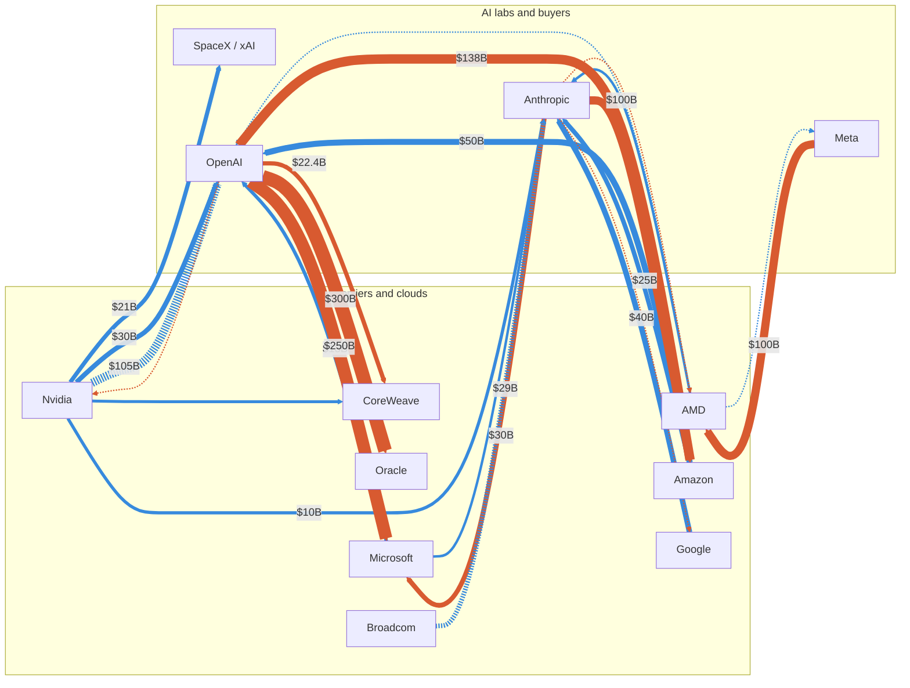

# AI circular deals (snapshot, Oct 2026)

Circular deals are arrangements where a supplier or cloud provider funds a customer (equity, warrants, guarantees), and the money returns as chip or cloud revenue.

- **Scale:** Nvidia reported $99B of equity investments plus $25B of commitments as of Jul 26, 2026 (10-Q).
- **Scale:** Bloomberg reported more than $540B of Nvidia financing arrangements disclosed in 2026, before the reported OpenAI guarantee talks.
- **Stress signal:** Nvidia's 5-year CDS hit a record 82bp on Jul 27, 2026. The IMF and BIS flagged circular financing as a systemic risk.

## Deal table

| Who is giving | Who is receiving | How much | Exchanged for | Commentary |
|---|---|---|---|---|
| Nvidia | OpenAI | ~$30B (from a $100B pledge never finalized) | Equity | OpenAI committed to 5GW on Nvidia systems, so the equity works like a customer rebate. |
| Nvidia | OpenAI's data-center lessor | Up to $105B (Aug 2026, reported) | Guarantee (contingent debt) | Bigger than the equity. Nvidia becomes credit support for its largest customer. |
| AMD | OpenAI and Meta | Up to 160M shares each at $0.01 (~10% of AMD each) | Warrants | Reverse circle: supplier pays the customer in equity. Vesting follows GPU purchases (up to 6GW each) and AMD share-price targets. None vested at Jun 27, 2026. |
| AMD | Anthropic | Up to $5B (Jul 2026) | Investment (instrument not specified in sources) | Anthropic deploys 2GW of MI450 GPUs, first GW due 1H 2027. |
| Microsoft and Nvidia | Anthropic | Up to $15B combined (Microsoft up to $5B) | Equity | Matched by a $30B Azure compute commitment, about 2:1 returning to the investors. |
| Amazon | Anthropic | $5B now plus up to $20B milestone-based (on top of $8B earlier) | Equity | Anthropic commits $100B+ to AWS over 10 years for up to 5GW. About 4:1 spend to investment. |
| Google | Anthropic | Up to $40B ($10B cash, $30B milestone-based) | Equity | 5GW of TPU capacity over five years. Sources disagree on timing (late 2025 vs Apr 2026); Alphabet confirmed in Apr 2026. |
| Amazon | OpenAI | $50B ($15B upfront, $35B conditional) | Equity | OpenAI expands its AWS deal by $100B over 8 years and commits to 2GW of Trainium. Amazon now funds both frontier labs. |
| Microsoft | OpenAI | $13B+ cumulative | Equity | OpenAI committed $250B to Azure. About 19:1, the most lopsided ratio here. |
| OpenAI | Oracle | ~$300B over ~5 years from 2027 (reported) | Compute contract, no equity | No equity loop. The risk is concentration: Oracle borrows to build, and S&P cut it to BBB-. |
| Nvidia | CoreWeave | $2B more (Jan 2026), ~7% stake | Equity | Nvidia also agreed to buy $6.3B of CoreWeave capacity, a backstop for unsold capacity. CoreWeave debt priced 9+ points over benchmark. |
| Nvidia | AI cloud partners (new model, FQ2 2027) | ~$36B in cloud service agreements (aggregator figure) | Purchase commitments | The clouds can unilaterally stop serving Nvidia and sell that capacity at better rates. Nvidia carries the downside. |
| Nvidia | xAI (now SpaceX) | $10B converted into a ~$21B stake | Equity | SpaceX builds its AI data centers exclusively on Nvidia chips. Stake fell to ~$17.2B by Aug 19. |
| Nvidia | SSI, Naver, Nebius, Nscale, Mistral, Cohere, Perplexity | $5B (SSI), $1B (Naver), ~$2B (Nebius), others undisclosed | Equity | Spread of bets that lock in demand for Nvidia silicon. |
| Broadcom (with Apollo, Blackstone, banks) | Anthropic (chip lease) | Up to $29B backstop on a $35B package (Jun 2026) | Guarantee / lease financing | Supplier backstops its customer's lease, same pattern as Nvidia, with third-party lenders in front. |
| Six asset managers (Apollo, BlackRock, Blackstone, Brookfield, Goldman, KKR) | AI buyers of Nvidia chips | $500B securitization program | Asset-backed debt | Nvidia may still backstop up to 25% via residual-value support. Collateral is GPUs that depreciate quickly. |

## Network (line width scaled by square root of dollars)

- Blue: investment or backstop flowing in. Coral: spend commitment flowing back.
- Dashed: guarantee, or dollar value not disclosed (drawn thin).
- Edge labels shown only for amounts of $10B or more. Rendered with Mermaid, so layout is automatic.

## Flow list used for the network

| From | To | $B | Note |
|---|---|---|---|
| Nvidia | OpenAI | 30 | Equity, Feb 2026 round |
| Nvidia | OpenAI lessor | 105 | Lease guarantee (reported), contingent |
| Nvidia | SpaceX / xAI | 21 | Equity stake |
| Nvidia | Anthropic | ~10 | Implied from the $15B joint pledge less Microsoft's up to $5B |
| Nvidia | CoreWeave | 8.3 | $2B equity plus $6.3B capacity purchase |
| AMD | OpenAI, Meta | n/d | Warrants, value not stated |
| AMD | Anthropic | 5 | Up to, Jul 2026 |
| Meta | AMD | 100 | 6GW MI450, deal valued above $100B |
| OpenAI | Nvidia | n/d | 5GW of systems |
| Anthropic | AMD | n/d | 2GW MI450 |
| OpenAI | Oracle | 300 | Reported, no equity |
| OpenAI | CoreWeave | 22.4 | Single aggregator source |
| Microsoft | OpenAI | 13 | Cumulative equity |
| OpenAI | Microsoft | 250 | Azure commitment |
| Microsoft | Anthropic | 5 | Up to |
| Anthropic | Microsoft | 30 | Azure commitment |
| Amazon | OpenAI | 50 | $15B upfront, $35B conditional |
| OpenAI | Amazon | 138 | $38B existing plus $100B over 8 years |
| Amazon | Anthropic | 25 | $5B now plus up to $20B, on top of $8B earlier |
| Anthropic | Amazon | 100 | 10-year AWS spend |
| Google | Anthropic | 40 | $10B cash plus $30B milestone-based |
| Anthropic | Google | n/d | 5GW TPU over five years |
| Broadcom | Anthropic lease | 29 | Backstop on a $35B package |

## Caveats

- Several figures are "up to" amounts or milestone-contingent. Equity stakes move with share prices.
- The Oracle $300B figure is press-reported (WSJ/Reuters), not company-confirmed.
- Nvidia's ~$10B into Anthropic is implied, not separately disclosed. OpenAI to CoreWeave ($22.4B) and Nvidia's ~$36B AI-cloud agreements come from aggregator summaries.
- Anthropic is a party to several deals above. This page was drafted by Claude (made by Anthropic); treat commentary as analysis, not a recommendation.

## Sources

- [AI build-out financing (Wikipedia, citing Bloomberg, WSJ, CNBC)](https://en.wikipedia.org/wiki/AI_build-out_financing)
- [Nvidia Form 10-Q, quarter ended Jul 26, 2026](https://www.sec.gov/Archives/edgar/data/0001045810/000104581026000075/nvda-20260726.htm)
- [Anthropic and Amazon: up to 5GW of new compute (Apr 20, 2026)](https://www.anthropic.com/news/anthropic-amazon-compute)
- [OpenAI $110B round (Tom's Hardware, Reuters-based coverage)](https://tomshardware.com/tech-industry/artificial-intelligence/openai-raises-110-billion-in-largest-ever-private-tech-funding-round)
- [Circular financing overviews (Built In, vlsi.kr, penchan.co)](https://builtin.com/articles/ai-circular-financing)
