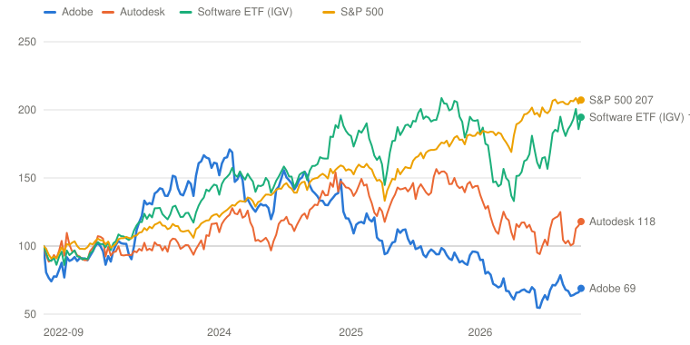
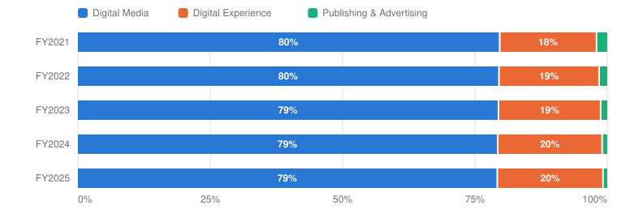

# ADBE — Adobe Inc.

> **Schema** v7.0 · **Updated** 2026-10-21 · **Status** Active
> **Price** $255.69 verified Oct 21, 2026, 1:04 PM EDT (intraday; StockAnalysis $255.97 at 1:00 PM) ([Yahoo](https://finance.yahoo.com/quote/ADBE/)) · 52-wk $190.12–$363.70 · 38th %ile · −29.7% from high
> **Type** Software — subscription creative, document and customer-experience platform · **Stage** Mature compounder, decelerating · **Cyclical** No · **Competence** Edge

## Verdict

**Adobe still beats its own guidance, but it has paused price increases and is giving its creative tools away to defend the seat against AI; at $256 the probability-weighted case pays 9.2% a year, close to half of it from the buyback, and clears 13% only at $216.**

🟡 **Non-holder: Watch (entry ≤$216)** · 🟡 **Holder: Hold**

| PW EV | PW return/yr | Compounding/yr | R/R | Entry | Trim | Avoid | FY26E P/E (non-GAAP / owner earnings) | Yield | BAIT | Moat | Next |
|---|---|---|---|---|---|---|---|---|---|---|---|
| **$398** | **9.2% (<13%)** | 10.2% | 5.9:1 | ≤$216 | $398–$704 | ≥$704 | ≈10.4× / 12.7× | 0.0% | Double (B+A) | Wide, narrowing | 📅 MAX Nov 10–12; Q4 + FY27 targets Dec 9 |

**Breaks if**: the FY2027 ARR guide on December 9, the new CEO's first, implies organic growth below ~8%. The buyback can carry per-share earnings for a while, but not for a book of business slowing toward GDP growth.

## The Call

At $256 the market is pricing Adobe's creative business as a melting asset. The price implies Bear odds of 36% at a 9% discount rate, almost exactly the 35% I assign, and it needs owner earnings per share to grow only about 6.9% a year, mostly from the buyback. The market isn't wrong. Organic ARR growth is slowing toward 8%. Q3 net new ARR of $0.40B was down roughly 37% from a year earlier. And the Creative Cloud price increases that carried 2024–25 were deferred in June so that a freemium funnel could run, with no conversion rate disclosed. The CEO-designate built the customer-experience business, not the creative one. What keeps the case alive is cash: about $8.5B of owner earnings a year, nearly all of it spent retiring ~7% of the shares. That turns ~6% revenue growth into 10.2% compounding at a flat multiple. It is a good return, but not 13%. The verb is not probability-fragile: break-even Bear odds are 13% against 35% assigned. The price that clears the hurdle is $216, where the stock traded as recently as June.

## What I'd Have To Be Wrong About

1. **That freemium converts.** Test: the FY2027 total ARR growth target (Dec 9) at or above 9% excluding acquisitions, and a disclosed free-to-paid conversion rate or paid Firefly subscriber count by the Q1 FY2027 print (mid-March 2027). **If Fail →** move 10 points from Base to Bear (PW EV $370, 7.7%/yr) → stays **Watch**, entry falls to $201; with no conversion data by March, the Bull is cut to 10% as well.
2. **That the creative franchise holds through a CEO change centred on customer experience.** Test: reported Creative & Marketing Professionals subscription growth of at least 11% in Q4 FY2026 (Dec 9) and Q1 FY2027 (March), against 13% in Q3, about 3 points of which is SEMrush until April 2027, with no further senior creative-product departures. **If Fail →** Base Creative revenue held flat for five years (Base value $428; PW EV $382, 8.4%/yr) → stays **Watch**, entry $208; moat trend recorded as narrowing faster.
3. **That AI costs don't take the margin.** Test: the FY2027 non-GAAP operating-margin target (Dec 9) at or above 42%, against ~45% for FY2026 and ~44% guided for Q4. **If Fail →** Base terminal margin cut ~3 points to ~41% (Base value $421; PW EV $379, 8.2%/yr) → stays **Watch**, entry $206; per-share growth then rests almost wholly on the buyback.

## Latest update: 2026-10-21 · Two downgrades, a Nvidia deal and a 7% bounce

- Freemium converts — 🟡 Pending — resolves with the FY2027 ARR target on Dec 9; no conversion metric disclosed yet
- Creative franchise holds through the CEO change — 🟡 Pending — Q4 Creative & Marketing Professionals growth, Dec 9; no further creative departures since Wadhwani (Sep 27)
- AI costs don't take the margin — 🟡 Pending — FY2027 margin target, Dec 9

The stock rose 7% in the two weeks to October 21, to $255.69, and it did so through two downgrades. On October 12 Wells Fargo cut Adobe to Underweight with a $225 target ([247 Wall St.](https://247wallst.com/investing/2026/10/12/adobe-falls-4-as-wells-fargo-cuts-to-underweight-with-225-target-servicenow-climbs-3-intuit-ticks-up/)). It estimated that organic net new ARR fell more than 40% in Q3, argued that Q4 has to nearly double it to hit the 10.2% target, and cited a survey of IT buyers that showed Adobe losing budget share to AI infrastructure. The next day HSBC moved to Hold with a $267 target, pointing to open-source creative tools. The stock fell 4% on the first and recovered within days.

The bounce came on October 15 (+4.6%), when Adobe and Nvidia expanded the partnership they signed in March. Photoshop, Premiere and Substance 3D are being optimized for Nvidia's new RTX Spark chip, and Brand Concierge is being rebuilt on Nvidia's Nemotron models, with Nvidia.com as a customer ([TV Technology](https://www.tvtechnology.com/production/adobe-nvidia-expand-their-ai-partnership)). No economics were disclosed. A further 3.9% on October 20 came with no company news.

Nothing in the window touches a test. There was no 8-K and no executive appearance, and the seven Form 4s filed on October 19 are tax withholding on October 15 vesting. Adobe confirmed December 9 for Q4 results and fiscal 2027 targets, which is when all three tests resolve. The Wells Fargo arithmetic is close to my own in the essay below, about $0.78 billion needed in Q4 against $0.40 billion in Q3, and it is already inside the 35% Bear.

At the higher price the probability-weighted return falls to 9.2% a year and the entry that clears 13% is $216. The verbs stay Watch and Hold.

---

## Deep Dive: Adobe, Giving It Away

*Adobe has stopped raising prices and started giving its creative tools away to win the next generation of users, and it has handed the company to the man who built its smaller business. At $256 the stock prices in almost no growth. Is that a bargain, or is the market right about the creative seat?*

**Contents**: [Business Overview](#business-overview) · [The Creative Seat: Giving It Away to Keep It](#the-creative-seat-giving-it-away-to-keep-it) · [Customer Experience, and the Man Who Built It](#customer-experience-and-the-man-who-built-it) · [Narayen, Capital Allocation and Incentives](#narayen-capital-allocation-and-incentives) · [Valuation and Model Assumptions](#valuation-and-model-assumptions) · [Final Words](#final-words) · [Appendix: The Numbers](#appendix-the-numbers) · [Sources](#sources)

On September 15, 2022, Adobe agreed to pay $20 billion for Figma, a ten-year-old design tool that ran in a web browser and expected to end that year with about $400 million of annual recurring revenue. Adobe's stock fell 17% that day, from $371.52 to $309.13. Investors were not only objecting to the price, about 50 times Figma's revenue. They were reacting to what the deal admitted: that the company that owned professional creative software felt it had to buy the tool that was replacing it.

Regulators in Britain and Europe decided for Adobe. The deal was abandoned in December 2023, and Adobe paid Figma a $1 billion break fee. Then it got on with the job. Revenue has grown from $17.6 billion in fiscal 2022 to a targeted $26.6 billion this year. Non-GAAP EPS has gone from $13.71 to a targeted $24.45–24.50, helped by retiring about a sixth of the shares. Free cash flow was $9.9 billion last year. In each quarter of fiscal 2026, Adobe has beaten the top of its own revenue guidance.

The stock is $256. A buyer at the close on the day before the Figma announcement has lost 31%. The S&P 500 has returned 107% since then, the software ETF 95%. Autodesk, the closest thing to Adobe among listed design-software companies, has returned 18%.

*Total return including dividends, weekly, September 14, 2022 (the day before the Figma deal was announced) = 100, through October 21, 2026. Source: Yahoo Finance adjusted closes via prices.py.*

| Date | Adobe | Autodesk | Software ETF (IGV) | S&P 500 |
|---|---|---|---|---|
| 2022-09-14 | 100 | 100 | 100 | 100 |
| 2023-05-19 | 100 | 96 | 111 | 107 |
| 2024-01-19 | 165 | 119 | 149 | 125 |
| 2024-09-27 | 139 | 130 | 159 | 150 |
| 2025-06-06 | 112 | 143 | 189 | 158 |
| 2026-02-13 | 71 | 111 | 147 | 181 |
| 2026-10-21 | 69 | 118 | 195 | 207 |

The fear has changed shape since 2022. Then it was a better design tool. Since 2024 it has been generative AI: if anyone can describe an image and get it in seconds, what is a Photoshop seat worth? The market's current answer is about 10 times this year's non-GAAP earnings. At the end of 2023 it was about 36 times.

This year the fear moved from the share price into the company's own plans. In June, Adobe deferred the Creative Cloud price increases it had planned for the second half, began steering web traffic toward free versions of its apps, and lowered what it expected to sell to individual subscribers. In September the board named Anil Chakravarthy, who built Adobe's customer-experience business, as the next CEO, and the executive who ran the creative business left.

So the question for the next five years is narrower than "will AI kill Adobe". It is whether giving the product away to win the next generation of users will pay for itself, while the professional franchise that funds everything holds its ground. This piece starts with the business and a few accounting points. Then it takes the creative debate head on: what management says the freemium move will do, where the numbers disagree, and what a free user would have to be worth. After that come the customer-experience business and the man who built it, Shantanu Narayen's record on capital allocation and the incentive plan, and finally valuation, which asks what $256 already assumes and what it would take to earn 13% a year. Adobe hosts its MAX conference on November 10–12 and reports Q4 with its fiscal 2027 targets on December 9, the new CEO's first. Some of this will be tested quickly.

### Business Overview

Adobe sells three things. The first is creative software: Photoshop, Illustrator, Premiere, Lightroom and InDesign for professionals, and now Firefly, an AI studio for creators that generates images, video and audio with Adobe's own models and those of partners. The second is document software, Acrobat and the free Reader, plus Express, a simple design app, sold to business professionals and consumers. The third is a customer-experience suite (Experience Manager, Experience Platform, GenStudio, Workfront, Marketo and now SEMrush) that large companies use to run websites, campaigns and the content behind them. Ninety-six percent of revenue is subscription.

From fiscal 2026 Adobe reports subscription revenue by two customer groups. Business Professionals & Consumers is mostly Acrobat and Express. Creative & Marketing Professionals combines Creative Cloud with the customer-experience suite. The creative business, the one the debate is about, is therefore no longer visible on its own.

| $ Million | FY2023 | FY2024 | FY2025 | Q3 FY2026 | Q3 YoY |
|---|---|---|---|---|---|
| **Creative & Marketing Professionals subscription** | 13,425 | 14,749 | 16,303 | 4,650 | +13% |
|  Growth | — | 9.9% | 10.5% | — | 12% cc |
| **Business Professionals & Consumers subscription** | 4,744 | 5,662 | 6,495 | 1,910 | +16% |
|  Growth | — | 19.4% | 14.7% | — | 15% cc |
|  Product, services, other and Publishing & Advertising | 1,240 | 1,094 | 971 | 200 | — |
| **Total revenue** | 19,409 | 21,505 | 23,769 | 6,760 | +13% |
| **Legacy view: Digital Media revenue** | 14,216 | 15,864 | 17,649 | n/r | — |
|  Gross margin | 95% | 96% | 95% | n/r | — |
| **Legacy view: Digital Experience revenue** | 4,893 | 5,366 | 5,864 | n/r | — |
|  Gross margin | 67% | 70% | 72% | n/r | — |
|  GAAP operating margin (company) | 34.3% | 31.3% | 36.6% | 34.8% | — |

*Fiscal years end late November or early December. Customer-group revenue covers Digital Media and Digital Experience subscriptions; Creative & Marketing Professionals mixes Creative Cloud with the customer-experience (marketing) business. Q3 FY2026 includes ~3 points from SEMrush (~$480M ARR, closed April 28) [Estimate]. n/r = no longer reported in releases from FY2026. FY2024 GAAP margin includes the $1B Figma termination fee. Source: [FY2025 10-K](https://www.sec.gov/Archives/edgar/data/796343/000079634326000003/adbe-20251128.htm) MD&A and segment note; [Q3 FY2026 release](https://www.sec.gov/Archives/edgar/data/796343/000079634326000147/adbeex991q326.htm).*

The documents business has been the fastest grower for three years, at 15–19%. The Creative & Marketing group has grown 10–11%, and its 13% in Q3 includes about three points from SEMrush, which Adobe bought for $1.9 billion and closed on April 28. The legacy segment view, still in the 10-K, shows the shape of the profit. Digital Media (creative plus documents) earns a 95% gross margin; Digital Experience earns 72%.

*Gross profit by reportable segment; Adobe does not report segment operating income. Digital Experience includes Workfront from FY2021. Source: segment notes in the [FY2022](https://www.sec.gov/Archives/edgar/data/796343/000079634323000007/adbe-20221202.htm) and [FY2025](https://www.sec.gov/Archives/edgar/data/796343/000079634326000003/adbe-20251128.htm) 10-Ks.*

| Period | Digital Media | Digital Experience | Publishing & Advertising | Total ($M) |
|---|---|---|---|---|
| FY2021 | 11,091 (80%) | 2,546 (18%) | 283 (2%) | 13,920 |
| FY2022 | 12,281 (80%) | 2,920 (19%) | 240 (2%) | 15,441 |
| FY2023 | 13,551 (79%) | 3,290 (19%) | 214 (1%) | 17,055 |
| FY2024 | 15,184 (79%) | 3,777 (20%) | 186 (1%) | 19,147 |
| FY2025 | 16,808 (79%) | 4,239 (20%) | 171 (1%) | 21,218 |

A few accounting points matter before the debate.

First, non-GAAP earnings exclude stock-based compensation, which ran at $2.07 billion over the last twelve months, about 8% of revenue. It is a real cost; the shares it issues absorb about a quarter of what the buyback spends. I value Adobe on owner earnings, non-GAAP net income minus after-tax SBC. On that basis the stock is about 12.7 times this year's earnings rather than 10.4.

Second, Adobe redefined its headline metric this year. "Total Adobe ARR" now covers both customer groups. It was revalued up $460 million entering fiscal 2026, mostly for currency, to $25.66 billion, and SEMrush added about $480 million in Q2. Any growth rate that spans the acquisition needs that amount taken out.

Third, contracted revenue is slowing. Remaining performance obligations grew 8% in Q3, the first single-digit rate since early fiscal 2023. Interim CFO Steve Day put it down to "our focus to accelerate new user acquisition through the freemium business model."

Fourth, two one-offs distort the five-year record in the Appendix. Fiscal 2024 GAAP results include the $1 billion Figma fee. Fiscal 2023 operating cash flow absorbed about $1.1 billion of extra cash tax when R&D costs had to be capitalized for tax purposes.

### The Creative Seat: Giving It Away to Keep It

Let me start with where things stand.

| Metric | Q3 FY2025 | Q3 FY2026 | Read |
|---|---|---|---|
| Total Adobe ARR | ~$24.7B | **$27.50B** (+11.2%) | ~9% organic; SEMrush added ~$480M from April |
| Net new ARR in the quarter | ~$0.63B | **$0.40B** | Down ~37% year over year |
| FY2026 net new ARR target | — | $2.62B (10.2% on $25.66B) | $1.84B year to date incl. SEMrush; Q4 needs ~$0.78B |
| Monthly active users (creativity + productivity) | — | >1 billion (+20%) | Acrobat + Express >900M (+25%) |
| Creative freemium MAU | ~59M | **>100M** (+70%) | Conversion rate not disclosed |
| AI-first ARR | ~$260M | >$650M (+150%) | 2.4% of total ARR |
| Firefly app + credit-pack ARR | — | +40% QoQ | After ~+50% QoQ in Q2 |
| Creative & Marketing Professionals subscription growth | — | 13% (12% cc) | ~3 points are SEMrush, a full quarter for the first time; organic ~9–10% [Estimate] |
| Remaining performance obligations | ~$20.5B | $22.16B (+8%) | First single-digit growth since early FY2023; cRPO +9% |

*Q3 FY2025 ARR, RPO and net new ARR are [Derived] from Q3 FY2026 growth rates; the ~37% decline in net new ARR is the figure Evercore ISI put to management on the call, which did not dispute it. ARR was revalued +$460M (mostly FX) entering FY2026. Source: [Q3 FY2026 release](https://www.sec.gov/Archives/edgar/data/796343/000079634326000147/adbeex991q326.htm), [Q3 call](https://transcripts.platformaeronaut.com/transcripts/ADBE-3Q26-transcript), [Q4 FY2025 release](https://www.sec.gov/Archives/edgar/data/796343/000079634325000135/adbeex991q425.htm).*

#### Management's narrative

Management's case was laid out on the Q2 call on June 11, and it is coherent. Narayen argued that AI had changed how people start creative work. They expect to try a tool free, and AI-first competitors offer exactly that. "AI-first applications that will serve broader audiences need to provide free, intuitive onboarding that drive usage and monetization through paywalls," he said. "Big picture, the immediate opportunity for Adobe is to accelerate new user acquisition and lifetime value through a freemium offering." Traffic to Adobe.com from creators was up more than 50% a year, and much of it came from people who wanted a task done, not a Creative Cloud subscription. So Adobe would route that traffic to free versions of Firefly, Express, Photoshop and Premiere on the web and mobile, and it would "defer previously planned Creative Cloud second-half line optimizations," Adobe's term for the price and packaging changes that had lifted revenue per subscriber in 2024–25. He did not pretend it was free:

> "This shift will come at the cost of short-term ARR, but will accelerate user acquisition in MAU while building the foundation for long-term growth by removing friction from user onboarding."
> — Shantanu Narayen, CEO, Q2 FY2026 earnings call, June 11, 2026

Asked why pricing had to wait, he leaned on the strength of the professional base:

> "It also is based on a complete confidence that we have that the creative business is extremely stable. The amount of innovation that we have delivered in that space continues to make us a category of one … And so that one we can defer. It's not going away."
> — Shantanu Narayen, Q2 FY2026 earnings call, June 11, 2026

He split the ARR cost roughly in half between the deferred pricing and the traffic sent to free products, and he pointed to the precedent Adobe knows best. The payback "will play out, I think, over 2027," and the larger customer base, "like we've done with Reader, … then pays off for decades."

Three months later he had not changed his mind. Asked on the Q3 call how much of the headwind came from pricing and when the increases would return, he said:

> "I'm actually really happy that we didn't, you know, focus on the pricing actions because that, while it may have provided some short-term relief, would not be as critical as continuing to drive new user adoption."
> — Shantanu Narayen, Q3 FY2026 earnings call, September 10, 2026

Chakravarthy described the conversion machinery in the same call. Adobe would "prove value first," watch engagement and "the intensity of AI usage," and decide "what is the best conversion point" and "what kind of paywall tuning" to apply, using the data-driven operating model Adobe has run "for well over a decade."

Management is right about several things. The Reader precedent is real. Adobe gave Reader away for thirty years, and the business it feeds, Business Professionals & Consumers, grew 16% in Q3. Monthly active users across creativity and productivity passed one billion. Creative freemium users passed 100 million, up 70%. Firefly's app and credit-pack ARR grew about 50% quarter on quarter in Q2 and 40% in Q3. And the professional base looks stable for now. Excluding the roughly three points SEMrush adds, Creative & Marketing growth is still running near 9–10%, and 85% of the films at this year's Sundance festival were made with Creative Cloud tools. A company that walled Firefly off behind a subscription would hand the next generation of creators to OpenAI, Google and Canva.

#### Poking holes in it

The first hole is the arithmetic. In December, Adobe guided to 10.2% total ARR growth for fiscal 2026, about $2.6 billion of net new ARR, which it called "our highest beginning of year guide for total net new ARR." It has kept the 10.2% all year. But that number now contains about $480 million of acquired SEMrush ARR. Organically, Adobe has added $1.36 billion in three quarters. Q3's $0.40 billion was down about 37% from a year earlier, a figure an analyst put to management on the call and management did not dispute. To hit the target, Q4 needs about $0.78 billion, nearly twice Q3. Q4 is Adobe's biggest enterprise quarter, so that may well happen. Even if it does, organic ARR growth for the year will be about 8%, against 11.5% in fiscal 2025.

The second hole is how quickly the pricing story changed. On the Q4 call in December 2025, David Wadhwani, who ran the creative business, said: "We continue to see a lot of value to pricing opportunity with creative professionals, and I think there's a lot more ahead of us on that." Six months later the increases were deferred. Something changed in between, and the Q1 call in March hinted at what. Adobe Stock, the stock-photo business, "saw a steeper decline than we expected. This shift is playing out more quickly than we had planned for." Stock is small, but it is the first Adobe product where generative AI visibly replaced paid demand. It would be odd if the low end of the creative seat were immune to the same force. Deferring a price increase is the rational response to softening demand at the margin. It is also evidence of it.

The third hole is that Firefly is not Reader. Reader was free because a PDF had to open everywhere. Every free reader made Acrobat, the paid tool that creates and edits PDFs, more valuable to the person sending the file. Adobe owned the format, and the free product spread it. A free Firefly user gets image and video generation, much of it from partner models that Adobe pays to run and that the same user can reach free in ChatGPT, Gemini or Canva. No format is spreading, and no one else needs that user to pay. Conversion has to come from workflow: editing precision, brand safety, the move from Firefly into Photoshop and Premiere. That pull is strong for someone becoming a professional and weak for someone making a birthday card.

The fourth hole is that we have no number. Adobe has not disclosed a conversion rate, paid Firefly subscribers or cohort retention. On the Q3 call, analysts asked four separate times how the trade-off between free users and revenue was going. Each answer described the funnel and none quantified it. Adobe reports AI-first ARR and Firefly ARR growth rates, which are useful, but a 40% quarterly growth rate on a base of a few hundred million dollars cannot yet tell us whether the funnel replaces the $500 million it cost.

So let me build the economics of a free user from what we know. Adobe doesn't disclose them, and every input below is my estimate.

| Illustrative, per year | Low | Mid | High |
|---|---|---|---|
| Free creative users added in a year | 40M | 40M | 40M |
| **Paid conversion within 12 months** | **2%** | **4%** | **6%** |
| New paying subscribers | 0.8M | 1.6M | 2.4M |
| **Blended revenue per paying user** | **$180** | **$180** | **$180** |
| New ARR created | $144M | $288M | $432M |
| **Cost to serve free users (inference, $2/user)** | **−$80M** | **−$80M** | **−$80M** |
| Net annual contribution | $64M | $208M | $352M |
| ARR given up in H2 FY2026 (deferred pricing + rerouted traffic) | ~$500M | ~$500M | ~$500M |
| **Years to recoup** | **~8** | **~2.4** | **~1.4** |
| Reported check | Firefly app + credit-pack ARR +40% QoQ in Q3; total net new ARR $0.40B against ~$0.63B a year earlier |  |  |

*Author's estimates [Estimate]. Free users added = >100M creative freemium MAU at +70% (≈59M a year earlier). Revenue per paying user assumes a mix weighted to Firefly's entry plans (US list ~$10–20 a month) with some upgrades to Creative Cloud; inference cost is a placeholder. The ~$500M is the analyst figure put to management on the Q2 call; Narayen split it roughly half deferred pricing, half freemium routing. Bold cells are inputs.*

At a 4% conversion rate and $180 a year per paying user, the 40 million free creative users Adobe added in the past year would create about $290 million of new ARR. Net of a guess at what it costs to serve the free users, that recovers the half-billion dollars of ARR given up in the second half in about two and a half years. That would be ordinary for freemium software, and it would vindicate Narayen. At 2% it takes eight years, and the strategy has simply bought users at a high price. The plan is not reckless, but it only works if conversion lands in the middle of the normal range, and Adobe has not told us where it is landing.

Where I come out: management is probably right that a free tier was necessary, and right that the professional base is stable today. But this is a defensive move, made sooner than management expected to make it. So far the numbers show the cost, in the net new ARR and contracted-revenue figures above, without the benefit. My Base assumes the creative business grows only about 3% a year for five years: price increases eventually return, the free funnel converts at an ordinary rate, and fewer people pay for skills that AI makes easier.

#### Four rings of profit

It helps to sort Adobe's profit by how exposed it is to that problem.

| Ring | Share of revenue | Share of segment profit (est.) | Main threat | Exposure |
|---|---|---|---|---|
| **1 · Documents & Express** (Acrobat, Reader funnel) | 28% | 32% | Copilot and ChatGPT reading and drafting documents; free PDF tools | Moderate; growing 16% |
| **2 · Creative professionals** (Creative Cloud apps, enterprise licences) | 36% | 42% | AI lowers the skill premium; Figma owns UI design; price increases paused | Moderate to high |
| **3 · Creators and content** (Firefly, single apps, Stock) | 12% | 14% | Free generation from OpenAI, Google, Midjourney and Canva; Stock already shrinking | High |
| **4 · Customer experience** (AEM, AEP, GenStudio, SEMrush) | 23% | 12% | Salesforce and Microsoft; budgets shifting to AI infrastructure | Low to moderate; lower margin |

*Revenue shares from the FY2026 model base; profit shares apply the author's segment-margin estimates (55% / 55% / 25%, before 3% corporate costs) and split Creative 75/25 between professionals and creators [Estimate]. Source: author's model; FY2025 10-K segment gross margins.*

The rings show the risk is real but concentrated. Generative AI hits the creators-and-content ring first, and Stock is already shrinking there. That ring is about a seventh of profit. The professional ring is the largest at about 42%. It is protected by file formats, plug-ins, trained skills and enterprise licences, which slow erosion without stopping it. The documents ring is a third of profit and still growing mid-teens on a freemium model that already works. Customer experience is lower-margin and sold to enterprises on multi-year contracts. Even in my Bear case, the documents and customer-experience rings keep growing. What the Bear assumes is that the professional ring starts to behave like the creators ring.

### Customer Experience, and the Man Who Built It

On September 3 Adobe announced that Chakravarthy would become president and CEO on December 1, with Narayen, CEO since December 2007, becoming executive chair. The 8-K also disclosed that Wadhwani, president of the creativity and productivity business, would step down on September 27. The CFO, Dan Durn, had left in June for a job outside software; Steve Day, who had been CFO of the customer-experience business, is interim CFO. In July the board gave the Chief Legal Officer a retention letter running to twelve months after the new CEO starts. The stock fell 6.7% on September 4, to $266.51.

Chakravarthy joined in January 2020 to run Digital Experience, Adobe's name at the time for the customer-experience business, after running Informatica, the data-management company. By the end of 2020 he also ran worldwide field operations, so for six years he has been the person who sells all of Adobe to its largest customers. Here is how his business did.

| $ Million | FY2020 | FY2021 | FY2022 | FY2023 | FY2024 | FY2025 |
|---|---|---|---|---|---|---|
| **Digital Experience revenue** | 3,125 | 3,867 | 4,422 | 4,893 | 5,366 | 5,864 |
|  Growth | — | 23.7% | 14.4% | 10.7% | 9.7% | 9.3% |
|  Gross margin | 64% | 66% | 66% | 67% | 70% | **72%** |
|  Share of Adobe gross profit | 17.9% | 18.3% | 18.9% | 19.3% | 19.7% | 20.0% |
|  Digital Media revenue growth, for comparison | — | 24.8% | 11.5% | 10.7% | 11.6% | 11.3% |

*Chakravarthy joined in January 2020 as president of Digital Experience. FY2021 includes Workfront ($1.5B, closed December 2020). Source: segment notes in the [FY2021](https://www.sec.gov/Archives/edgar/data/796343/000079634322000032/adbe-20211203.htm), [FY2023](https://www.sec.gov/Archives/edgar/data/796343/000079634324000006/adbe-20231201.htm) and [FY2025](https://www.sec.gov/Archives/edgar/data/796343/000079634326000003/adbe-20251128.htm) 10-Ks.*

It is a respectable record. Digital Experience grew about as fast as Digital Media over the period, 9–10% a year for the last three years, and its gross margin rose eight points to 72%. It is also a smaller and lower-margin business. It produces about a fifth of Adobe's gross profit, and it is a number two or three behind Salesforce in marketing clouds.

The strategy he inherits and will extend is what Adobe now calls CX Enterprise. Every large brand needs far more content than it used to, in more versions for more channels, and increasingly for AI search engines as well as people. Adobe sells both ends of that loop: Firefly Services and Firefly Foundry to make on-brand content at scale, and Experience Manager, Experience Platform and GenStudio to deliver and measure it. The ARR of each of those three customer-experience franchises grew more than 20% in Q3. SEMrush has been folded into a "brand visibility" product for generative search, and the number of paying customers doubled in the quarter. The bull's version of the succession goes like this. Enterprise is where Adobe's commercially safe, licensed-data AI has its clearest edge, and the person who sells the whole loop to the Disneys and IKEAs should run the company.

On the Q3 call Narayen described the board's choice:

> "I'm really thrilled that we were able to have somebody internal who understood the company. We had two great internal candidates, so that was, I think, important for the board."
> — Shantanu Narayen, Q3 FY2026 earnings call, September 10, 2026

Chakravarthy framed the opportunity as a platform shift Adobe had lived through before: "every SaaS company will be going through the transformation to agentic software, just like the software companies went from on-prem to SaaS many years ago that Adobe executed very successfully."

I see three holes here. The first is the obvious one. The board picked the leader of a fifth of the gross profit at the moment the other four-fifths faces its hardest question, and the other internal candidate, who ran the creative business, left. The second is that the new CEO has not yet said what he will do with the creative business. Asked for his two priorities on the Q3 call, he named closing fiscal 2026 strongly, MAX, and building his leadership team. That is fair for someone who doesn't take over until December 1, but it means the creative strategy is still Narayen's. The third is that enterprise software budgets are not immune either. Wells Fargo's October survey of IT buyers read Adobe as losing budget share to AI infrastructure, and the HSBC downgrade a day later pointed to open-source creative tools.

Where I come out: the choice is defensible, and Chakravarthy's record in the business he ran is solid. But the market is right to treat it as a risk to the creative franchise, which is why my second test watches Creative & Marketing growth and senior creative departures through the next two prints.

### Narayen, Capital Allocation and Incentives

Narayen leaves with a record few software CEOs can match. Adobe's revenue grew from less than $1 billion when he joined in 1998 to more than $26 billion. In 2012–13 he moved the company from boxed software to Creative Cloud subscriptions, one of the best business-model transitions in the industry. The deal record of his last decade is mostly sensible and mostly mid-sized, with one large swing.

| Year | Deal | Price | What happened | Verdict |
|---|---|---|---|---|
| 2018 | Magento (commerce) | $1.68B | Became Adobe Commerce; lost the mid-market to Shopify | Mixed |
| 2018 | Marketo (B2B marketing automation) | $4.75B | Folded into Digital Experience; a solid number two | Mixed |
| 2020 | Workfront (work management) | $1.5B | The workflow layer of GenStudio, now growing >20% | Good |
| 2021 | Frame.io (video review) | $1.28B | Central to video workflows; assets under management doubled in a year | Good |
| 2022–23 | Figma (collaborative design) | $20B, abandoned | Blocked by UK and EU regulators; $1B termination fee; Figma kept UI design | Poor |
| 2026 | SEMrush (search and AI visibility) | $1.9B | ~$480M ARR; brand-visibility paying customers doubled in Q3 | Too early |
| 2026 | Topaz Labs (AI image and video enhancement) | ~$340M | Signed June 24; closing expected in Q4 FY2026 | Too early |

*Source: Adobe deal announcements and 10-Ks; Topaz price from the [Q3 FY2026 10-Q](https://www.sec.gov/Archives/edgar/data/796343/000079634326000156/adbe-20260828.htm).*

The swing was Figma, and the lesson cuts both ways. Adobe correctly saw the threat. But $20 billion for roughly $400 million of ARR was a price an owner-minded allocator would not pay, and shareholders were spared by regulators, not by discipline. The deals since have been priced more modestly: SEMrush at about four times its ARR, Topaz at about $340 million.

#### The cash

| $ Billion | Revenue | YoY | Non-GAAP EPS | OCF | SBC | Capex | FCF | FCF margin | Buybacks | % FCF | Acquisitions | Total debt | Dil. shares (M) |
|---|---|---|---|---|---|---|---|---|---|---|---|---|---|
| FY2021 | 15.79 | 22.7% | $12.48 | 7.23 | 1.07 | 0.35 | 6.88 | 43.6% | 3.95 | 57% | 2.68 | 4.12 | 481 |
| FY2022 | 17.61 | 11.5% | $13.71 | 7.84 | 1.44 | 0.44 | 7.40 | 42.0% | 6.55 | 89% | 0.13 | 4.13 | 471 |
| FY2023 | 19.41 | 10.2% | $16.07 | 7.30 | 1.72 | 0.36 | 6.94 | 35.8% | 4.40 | 63% | 0 | 3.63 | 459 |
| FY2024 | 21.51 | 10.8% | $18.42 | 8.06 | 1.83 | 0.18 | 7.87 | 36.6% | 9.50 | 121% | 1.00 (Figma fee) | 5.63 | 450 |
| FY2025 | 23.77 | 10.5% | $20.94 | 10.03 | 1.94 | 0.18 | 9.85 | 41.4% | 11.28 | 115% | 0.02 | 6.21 | 427 |
| 9M FY2026 | 19.78 | 12.5% | $18.15 | 7.65 | 1.58 | 0.18 | 7.47 | 37.8% | 6.82 | 91% | 1.56 | 6.36 | 403 |
| **Cumulative** | — | — | — | 48.10 | 9.58 | 1.69 | **46.41** | — | **42.50** | **92%** | 5.39 | — | −16% |

*No dividend. FY2023 operating cash flow absorbed ~$1.1B of extra cash tax from R&D capitalization; FY2024 includes the $1B Figma fee in operating cash flow. Average buyback price: $543 in FY2024 (17.5M shares), $366 in FY2025 (30.8M), ~$261 in 9M FY2026 (26.1M) [Derived]. Source: [SEC XBRL company facts](https://data.sec.gov/api/xbrl/companyfacts/CIK0000796343.json); non-GAAP EPS from releases; FY2025 10-K Note 14.*

From fiscal 2021 through Q3 of fiscal 2026, Adobe generated $46.4 billion of free cash flow and spent $42.5 billion of it, 92%, on buybacks. Another $5.4 billion went to acquisitions and the Figma fee. Net debt went from about $1.1 billion of net cash to about $1.1 billion of net debt. Adobe pays no dividend. The diluted share count fell 16%, from 481 million to 403 million. About $9.6 billion of SBC over the same period means nearly a quarter of the buyback only offset new issuance.

The timing is mixed. Adobe paid an average of $543 a share in fiscal 2024, when it was about 30 times earnings, $366 in fiscal 2025, and about $261 so far this year. The buyback tracks free cash flow rather than value, so the number of shares retired rose as the price fell, while the dollars spent did not. That is good discipline without being opportunistic. I grade Adobe **Outsider-leaning**: a large, steady buyback, no dividend and a near-zero balance sheet, held back from the top grade by pro-cyclical timing and a Figma bid no Outsider would have made. The $1 retention test is moot here, because Adobe retains almost nothing.

Here is how the larger promises of the last few years turned out.

| Promised | Where, when | Outcome |
|---|---|---|
| Acquire Figma for $20B | Deal announcement, Sep 15, 2022 | 🔴 Abandoned Dec 2023; $1B termination fee |
| "We continue to see a lot of value to pricing opportunity with creative professionals, and I think there's a lot more ahead of us" | Wadhwani, Q4 FY2025 call, Dec 10, 2025 | 🔴 Creative Cloud price increases deferred six months later (June 11, 2026) |
| FY2026 total ARR growth of 10.2%, ~$2.6B of net new ARR, "our highest beginning of year guide" | FY2026 targets, Dec 10, 2025 | 🟡 Held only with ~$480M of SEMrush ARR; organic $1.36B through Q3; resolves Dec 9 |

*Also kept: AI-first ARR above $250M by FY2025 exit, exceeded (>$650M by Q3 FY2026). Source: [Q4 FY2025 call](https://transcripts.platformaeronaut.com/transcripts/ADBE-4Q25-transcript), [Q4 FY2025 release](https://www.sec.gov/Archives/edgar/data/796343/000079634325000135/adbeex991q425.htm).*

The guidance record is better than the promises. Adobe is a consistent beater. In each quarter of fiscal 2026 revenue came in above the top of the range: $6.40 billion against $6.25–6.30 billion in Q1, $6.62 billion against $6.43–6.48 billion in Q2, $6.76 billion against $6.67–6.72 billion in Q3. The blemish is June's reset of organic ARR, which was a strategy change more than a forecasting miss.

#### The incentives

From the [2026 proxy](https://www.sec.gov/Archives/edgar/data/796343/000079634326000043/adbe-20260227.htm):

| Component | Weight / size | What it pays for | Latest outcome |
|---|---|---|---|
| **Annual cash incentive** | Target % of salary | Revenue and non-GAAP EPS (95% threshold for any payout), ±25 points for strategic goals | FY2025 paid 104% (110% financial, −6 points) |
| **Performance shares: relative TSR** | 50% of PSP | Three-year TSR against the Nasdaq-100; 55th percentile pays 100%; capped at 100% if absolute TSR is negative | 2023–25 cycle paid 45% |
| **Performance shares: Net New Sales** | 50% of PSP | Annual net new Digital Media ARR plus Digital Experience subscription bookings, excluding acquisitions and FX; FY2025 target $2.43B | FY2025 paid 99%; the FY2026 tranche absorbs the freemium shift |
| **Restricted stock units** | Time-based | Retention; vest quarterly | Vesting |
| **Return on invested capital** | **0%** | — | — |

*Source: [2026 proxy (DEF 14A)](https://www.sec.gov/Archives/edgar/data/796343/000079634326000043/adbe-20260227.htm), CD&A.*

Two things stand out. Half of the performance shares pay on Net New Sales, which excludes acquisitions. That is the metric the freemium move depresses, so management chose a strategy that cuts the payout on this year's tranche. I take that as evidence the bet is sincere. The rest of the plan pays on revenue, non-GAAP EPS and relative TSR. Non-GAAP EPS excludes SBC and is lifted by the buyback, and nothing in the plan measures return on capital. That matters less for a company that reinvests almost nothing on its balance sheet. It would have mattered had the Figma deal closed.

Is Chakravarthy the right manager? On enterprise execution the record says yes. On the creative business there is no record, and his first test is whether he keeps the professional base while the free funnel matures. On capital allocation he inherits a machine that works, as the cash table shows. The worst thing he could do is spend that cash on a large AI acquisition to change the story. Nothing he has said suggests he will, but it is the risk I would watch.

### Valuation and Model Assumptions

Adobe is a mature, high-return business, so I value it on owner earnings times an exit multiple, five years out, and ask two questions. What does $256 already assume at a 9% cost of equity? And what has to be true to earn 13% a year? The model builds three businesses (Creative, Documents & Express, and customer experience), each with revenue growth and a margin, then deducts corporate costs and tax to non-GAAP net income and subtracts after-tax SBC to get owner earnings. Adobe doesn't report profit by business, so the split is my estimate, calibrated to this year's $24.45–24.50 non-GAAP EPS target. The Base exit multiple is 14 times owner earnings, about 11.6 times non-GAAP EPS. That is below the market and below anything Adobe traded at between 2018 and 2023. Here is the Base case, with inputs in bold:

| $ Billion | FY2026E | FY2027E | FY2028E | FY2029E | FY2030E | FY2031E |
|---|---|---|---|---|---|---|
| **Creative (Creative Cloud, Firefly, Stock) revenue** | 12.9 | 13.3 | 13.7 | 14.1 | 14.5 | 15.0 |
|  YoY growth | 3.0% | **3.0%** | **3.0%** | **3.0%** | **3.0%** | **3.0%** |
|  Operating margin | 55.0% | 54.4% | 53.8% | 53.2% | 52.6% | **52.0%** |
|  Operating profit | 7.10 | 7.23 | 7.36 | 7.50 | 7.64 | 7.78 |
| **Documents & Express (Business Professionals & Consumers) revenue** | 7.5 | 8.2 | 8.9 | 9.7 | 10.6 | 11.5 |
|  YoY growth | 9.0% | **9.0%** | **9.0%** | **9.0%** | **9.0%** | **9.0%** |
|  Operating margin | 55.0% | 55.2% | 55.4% | 55.6% | 55.8% | **56.0%** |
|  Operating profit | 4.11 | 4.50 | 4.92 | 5.39 | 5.89 | 6.44 |
| **Customer experience (marketing professionals, incl. SEMrush) revenue** | 6.2 | 6.7 | 7.1 | 7.6 | 8.2 | 8.7 |
|  YoY growth | 7.0% | **7.0%** | **7.0%** | **7.0%** | **7.0%** | **7.0%** |
|  Operating margin | 25.0% | 25.4% | 25.8% | 26.2% | 26.6% | **27.0%** |
|  Operating profit | 1.55 | 1.69 | 1.84 | 2.00 | 2.17 | 2.36 |
| Corporate and other | (0.80) | (0.84) | (0.89) | (0.94) | (1.00) | (1.06) |
| **Total revenue** | 26.6 | 28.1 | 29.7 | 31.4 | 33.2 | 35.2 |
| **Operating profit** | 11.97 | 12.58 | 13.23 | 13.94 | 14.70 | 15.52 |
|  Operating margin | 45.0% | 44.8% | 44.6% | 44.4% | 44.2% | 44.1% |
| Net income | 9.81 | 10.29 | 10.80 | 11.35 | 11.94 | 12.57 |
| Diluted shares (B) | 0.401 | 0.383 | 0.366 | 0.349 | 0.334 | 0.319 |
|  Net share change | — | -4.5% | -4.5% | -4.5% | -4.5% | -4.5% |
|  SBC (% of revenue) | 8.0% | 7.9% | 7.8% | 7.7% | 7.6% | 7.5% |
| **Non-GAAP EPS** | $24.47 | $26.86 | $29.52 | $32.49 | $35.79 | $39.47 |
|  YoY growth | — | 9.8% | 9.9% | 10.0% | 10.2% | 10.3% |
| **Owner earnings per share (after SBC)** | $20.12 | $22.12 | $24.36 | $26.85 | $29.64 | $32.76 |

*Base case. FY2026 is calibrated to the $24.45–24.50 non-GAAP EPS target; the split of revenue and margin into three businesses is the author's estimate, since Adobe reports subscription revenue by customer group and gross profit by legacy segment but no segment operating income. Margins move linearly from FY2026 to the FY2031 input. Owner earnings deduct after-tax SBC, which non-GAAP EPS excludes. Source: author's model (model.json). Bold cells are model inputs.*

In the Base case, Creative grows about 3% a year, Documents & Express 9% and customer experience 7%, so revenue reaches about $35 billion in fiscal 2031, growing a little under 6% a year. Margin drifts from 45% to about 44% as AI inference costs rise. The buyback retires about 4.5% of the shares a year, net of SBC. Owner earnings per share grow about 10.2% a year to $32.76, and at 14 times the stock is worth about $459 in 2031, a return of 12.4% a year.

| Case | Prob. | 3P | Creative (Creative Cloud, Firefly, Stock) growth / margin | Documents & Express (Business Professionals & Consumers) growth / margin | Customer experience (marketing professionals, incl. SEMrush) growth / margin | Net shares/yr | Per-share earnings FY2031 | CAGR | Exit multiple | Value | Return/yr | Implied g | Driving assumption |
|---|---|---|---|---|---|---|---|---|---|---|---|---|---|
| **Bull** | 15% | Plausible | +7.0% / 55.0% | +11.0% / 57.0% | +9.0% / 30.0% | -4.0% | $39.09 | 14.2% | 18.0× owner earnings | $704 | 22.4% | 3.3% | Freemium converts through 2027 and the deferred Creative Cloud price increases land: Creative back to ~7%/yr, Acrobat compounding at 11%, margin held near 46%; 18× owner earnings. |
| **Base** | 50% | Probable | +3.0% / 52.0% | +9.0% / 56.0% | +7.0% / 27.0% | -4.5% | $32.76 | 10.2% | 14.0× owner earnings | $459 | 12.4% | 1.7% | AI attach offsets seat pressure: Creative ~3%/yr, Documents 9%, CX 7%, about 6% in total; margin drifts to ~44% on inference costs; the buyback retires ~4.5% net a year; 14× owner earnings. |
| **Bear** | 35% | Probable | -3.0% / 45.0% | +5.0% / 52.0% | +3.0% / 22.0% | -3.0% | $19.93 | -0.2% | 9.0× owner earnings | $179 | -6.8% | -1.9% | AI tools commoditize the creative seat: Creative shrinks 3%/yr with price cuts to hold users, Acrobat slows to 5%, margin falls to ~39%; buybacks continue; 9× owner earnings, a no-growth multiple. |
| **Priced-in (9%/yr)** | — | diagnostic | +1.1% / 49.8% | +7.7% / 54.7% | +5.7% / 25.4% | -4.0% | $28.10 | 6.9% | 14.0× owner earnings | $393 | 9.0% | 1.7% | Solved along Bear → Base for 9%/yr |
| **Hurdle (13%/yr)** | — | diagnostic | +3.6% / 52.5% | +9.3% / 56.2% | +7.3% / 27.5% | -4.4% | $33.65 | 10.8% | 14.0× owner earnings | $471 | 13.0% | 1.7% | Solved along Base → Bull for 13%/yr |
| **Probability-weighted** | 100% |  |  |  |  |  |  |  |  | $398 | 9.2% |  |  |

*Values are FY2031 owner earnings per share × the exit multiple; annual return is the price change to that value (no dividend). Probabilities apply to Bull, Base and Bear. The Priced-in row is solved along Bear→Base and the Hurdle row along Base→Bull, both at a 14× owner-earnings exit. Source: author's model.*

| Return math |  |
|---|---|
| PW return/yr vs. hurdle | **9.2% (<13%)**, of which 0.0% is the dividend yield. Entry ≤$216. 10-year Treasury 5.12%; the hurdle sits 7.9 points above it. |
| Compounding at a flat multiple | Base per-share earnings growth 10.2% + 0.0% dividend = **10.2%**. Re-rating adds 2.2 points to the Base return (17% of it). |
| Optionality | None valued separately. Freemium conversion and resumed pricing are the Bull; Topaz Labs (~$340M) is too small to move the value. |
| Price-implied expectations | At 9%, spot needs $28.10 of owner earnings per share in FY2031 (6.9% a year) at 14×: revenue up ~4% a year, margin ~42%, ~4% net buyback. Perpetual cross-check: trailing owner earnings of $8.5B are 8.5% of the ~$101B enterprise value, so g ≈ 9% − 8.5% ≈ 0.5%. |
| EPV floor | About $176 per share on five-year average owner earnings ($6.2B ÷ 9%, 391M shares), or ≈$239 on trailing owner earnings of $8.5B after ~$1.1B of net debt. On current earnings, only ~7% of the price pays for growth. The Bear ($179) sits below trailing EPV because it names the damage: creative revenue shrinking 3% a year and margin down ~6 points. EPV ÷ invested capital ≈ 7, so the business is still a franchise. |
| Base rate / 3P | The Bull needs ~8.7% nominal (~6% real) revenue growth for five years from $26.6B. Of companies above $25B, 31.8% reach ≥5% real growth and 13.7% reach ≥10%, so the Bull is plausible. The Base's ~5.8% nominal sits near the middle of the class (probable); the Bear is probable for a franchise under technology attack. |
| Terminal-growth check | Implied perpetual growth on owner earnings at 9%: Bull 3.3%; Base 1.7%; Bear -1.9%. All below the risk-free rate. |
| Break-even and price-implied Bear odds | Break-even 13% against 35% assigned; price-implied 36% at 9%. |
| Year ten | Documents and customer experience should still grow high single digits at year ten; Creative is the open question. At 14× owner earnings (1.7% implied perpetual growth), the terminal multiple isn't doing the work; the buyback is. |
| R/R | **5.9:1** (Bull +175% / Bear −30%). The figure is large because the multiple is already low, not because the Bull is likely. |

*Computed rows come from model.json; EPV, base rate and year ten are the author's. 10-year Treasury from [Treasury.gov daily par yields](https://home.treasury.gov/resource-center/data-chart-center/interest-rates/TextView?type=daily_treasury_yield_curve&field_tdr_date_value=2026), Oct 20, 2026.*

The striking thing about Adobe is how little the price asks for. To earn an ordinary 9% at a 14 times exit, owner earnings per share need to reach about $28.10 in 2031, growth of about 6.9% a year. That sits about two-thirds of the way from my Bear to my Base. With the buyback doing about four points of it, the price assumes revenue grows about 4% a year and the margin settles near 42%. In scenario terms, the price implies Bear odds of 36%, almost exactly the 35% I assign. Mr. Market and I agree on the odds; we would both earn about 9%.

To earn 13% a year, owner earnings per share would need to reach about $33.65, growth of 10.8% a year: revenue up about 6% a year with the margin held near 44.5%, slightly better than my Base. The Base alone comes close to the hurdle. What pulls the weighted case below it is the Bear, which I give 35% because the evidence from the creative debate points that way: net new ARR is falling, pricing is paused, and conversion is undisclosed. Weighting the cases 15% Bull, 50% Base and 35% Bear gives a value of about $398 and a return of 9.2% a year. The price at which the same case clears 13% is about $216.

The earnings-power value frames the debate from the other side. Capitalizing trailing owner earnings of about $8.5 billion at 9%, with no growth, gives about $239 a share, so on current earnings the price pays for almost no growth at all. That is the whole bull case in one number. The bear reply is that the earnings power itself is what AI threatens, and my Bear, at $179, sits below it for exactly that reason.

A confidence note, because my competence here is Edge rather than Core: I cannot judge how fast image and video models will close the gap with professional tools, or whether licensed, indemnified training data stays a reason to pay once rivals offer the same. The probabilities carry that uncertainty.

### Final Words

Adobe is still a very good business. It turns more than all of its net income into free cash flow, earns very high returns on the capital it uses, beats its own guidance every quarter and buys back about 7% of itself a year. If the creative seat erodes no faster than my Base assumes, the business compounds at about 10.2% a year per share with no help from the multiple, and you are buying it at roughly its no-growth value.

But the market is not being foolish. Organic ARR growth has lost about three points in a year. The price increases that carried the last two years have been deferred in favour of a free funnel whose conversion rate Adobe will not disclose. The first product AI visibly replaced, Stock, shrank faster than planned. And the company is being handed to the leader of its smaller business just as the larger one faces its hardest question. A 35% chance that the creative seat erodes seems about right to me, and at that weight the stock returns about 9.2% a year, an acceptable return but not 13%.

What would change my mind? December 9 gives most of the answers: a fiscal 2027 ARR target at or above 9% before acquisitions, Creative & Marketing growth holding up in Q4, and a margin target that doesn't give away more than a few points to AI costs. A conversion number by March would settle the first test either way. Until then I'll watch. The price at which the numbers work for me is about $216, where the stock traded as recently as June.

Here are the three tests written as kill criteria, each with its consequence fixed in advance:

*The three tests, with their pre-committed consequences, are listed at the top of this report under [What I'd Have To Be Wrong About](#what-id-have-to-be-wrong-about).*

### Appendix: The Numbers

The tables below carry the framework's required numbers. The argument for each is made in the chapters above.

#### Five-year record

| $B, except per share | FY2021 | FY2022 | FY2023 | FY2024 | FY2025 |
|---|---|---|---|---|---|
| Revenue | 15.79 | 17.61 | 19.41 | 21.51 | **23.77** |
| Operating margin (GAAP / non-GAAP) | 36.8% / ~45% | 34.6% / ~45% | 34.3% / ~45% | 31.3% / ~46% | 36.6% / ~46% |
| Non-GAAP EPS | $12.48 | $13.71 | $16.07 | $18.42 | **$20.94** |
| GAAP EPS | $10.02 | $10.10 | $11.82 | $12.36 | $16.70 |
| Free cash flow | 6.88 | 7.40 | 6.94 | 7.87 | 9.85 |
| SBC | 1.07 | 1.44 | 1.72 | 1.83 | 1.94 |
| **Owner earnings** (FCF − SBC) | 5.81 | 5.96 | 5.22 | 6.04 | **7.91** |
| Owner earnings per share | $12.08 | $12.65 | $11.37 | $13.42 | **$18.52** |
| Owner-earnings conversion (÷ non-GAAP NI) | 97% | 92% | 71% | 73% | 88% |
| Net debt incl. leases | −1.13 | −1.47 | −3.76 | −1.83 | 0.05 |
| Invested capital | 13.7 | 12.6 | 12.8 | 12.3 | 11.7 |
| **ROIC** | 35.9% | 38.4% | 41.6% | 44.1% | **60.9%** |
| **3-yr incremental ROIC** | — | — | — | — | **n/m**: NOPAT +$2.3B on −$0.9B of capital |
| Net reinvestment ÷ NOPAT (capex − D&A + acquisitions) | 46% | −6% | −10% | −12% | −9% |
| SBC % of revenue | 6.8% | 8.2% | 8.9% | 8.5% | 8.2% |
| FCF conversion (FCF ÷ GAAP NI) | 143% | 156% | 128% | 142% | 138% |
| Interest coverage | 51× | 54× | 59× | 40× | 33× |
| SBC-adjusted accruals ÷ assets | −4.9% | −6.0% | −0.5% | −2.2% | −3.3% |
| Diluted shares (M) | 481 | 471 | 459 | 450 | **427** |
| Net share change | −0.8% | −2.1% | −2.5% | −2.0% | **−5.1%** |
| Buybacks ÷ SBC | 3.7× | 4.5× | 2.6× | 5.2× | 5.8× |
| SBC ÷ owner earnings | 18% | 24% | 33% | 30% | 25% |

*Source: [SEC XBRL company facts](https://data.sec.gov/api/xbrl/companyfacts/CIK0000796343.json); non-GAAP EPS and margins from releases. Capital rows are [Derived]: invested capital = equity + debt + operating leases − cash and short-term investments (it includes ~$12.9B of goodwill; tangible capital is negative); NOPAT = GAAP operating income × (1 − effective tax rate); owner earnings treat all capex as maintenance. FY2024 owner earnings are after the $1B Figma fee ($7.04B before it). Not cyclical: GAAP operating margin has stayed within 31–37% for five years.*

#### Growth levers

| Lever | Contribution now | Runway | Evidence | Management intent | Stage |
|---|---|---|---|---|---|
| Market growth | ~3–4 pts | Long | AI lowers the barrier to making content; 1B MAU | "Empower everyone to create" | Proven |
| Share gain | **Negative at the low end** | — | Canva, Figma and AI-native generators take entry users; Stock declining faster than planned | Freemium as defence | Contested |
| Price and mix | ~0 now | Deferred | Creative Cloud Pro migration carried FY2025; increases deferred June 2026 | "We can defer. It's not going away" | Option |
| Attach / AI products | ~2–3 pts | 5+ yrs | AI-first ARR >$650M (+150%); Acrobat AI Assistant MAU doubled QoQ; Firefly ARR +40% QoQ | Primary vector | Scaling |
| New users (freemium) | Negative now | Payback 2027+ | >100M free creative users (+70%); agents inside ChatGPT, Claude and Copilot | Convert through 2027 | Option |
| New geographies | ~1 pt | Long | EMEA +13% in FY2025; Saudi national Firefly/Express partnership | Next-generation creators globally | Scaling |
| M&A | ~2 pts in FY2026 (one-time) | — | SEMrush $1.9B; Topaz ~$340M | Bolt-ons | Done |
| Margin | **Negative**: ~46% → ~44% | — | Inference costs and free users | Invest | — |
| Share count | **−7% a year** (outstanding) | As long as FCF holds | $24.55B authorization left; ~9.5M shares a quarter | Continuous | Proven |

*The Base rests on attach plus the buyback; the Bull needs freemium conversion and resumed pricing together; both are valued inside the Bull, not as optionality lines. SEMrush and Topaz pass the Zook adjacency test (same buyers and workflows). Source: releases and calls, FY2025 10-K.*

#### Moat, customer and profit pool

| Read | Call | Evidence |
|---|---|---|
| Mechanism | **Switching costs** + **scale economies** + branding | PSD, PDF, AI and INDD formats and decades of trained skills; 1B MAU; Firefly's licensed training data is the enterprise-safe claim. EPV ÷ invested capital ≈ 7 |
| Trend | **Narrowing** | Organic ARR ~9% against 11–13% in FY2023–24; net new ARR down ~37%; price increases deferred; Stock shrinking. AI erodes the skill premium Photoshop monetized |
| Profit pool | Shifting to the model layer | Generation is captured by OpenAI and Google; Adobe now puts its agents inside their chat apps and bets on owning workflow, brand safety and orchestration |
| Customer | Creative pros, marketers, knowledge workers (Acrobat), 20,000+ enterprises | Job: produce and manage content to a professional, brand-safe standard. Retention, NRR and CAC not disclosed. Last price move: the 2025 Creative Cloud Pro repricing held; the next was deferred |

*7 Powers vocabulary (Helmer). Rating: **wide, narrowing**. The document and enterprise layers hold; the individual creative seat is where the narrowing shows.*

#### Competitors

| Competitor | Position | Threat |
|---|---|---|
| **Canva** (private) | ~$3.5B revenue, ~260M MAU `[Estimate]` | Owns SMB and non-professional creation; caps Express and entry-level pricing |
| **Figma** (FIG) | Collaborative UI/UX design | Owns product design; Adobe XD is gone |
| **OpenAI / Google / Midjourney / Runway** | Image and video generation | Remove the skill premium at the low end; weaker on enterprise workflow and indemnified training data. Adobe partners with them |
| **Microsoft** | Copilot and Designer in Microsoft 365 | The most credible bundling threat to Acrobat and Express |
| **Salesforce / HubSpot** | Marketing clouds | Customer experience is a #2–3 position |

*Canva figures from [Sacra](https://sacra.com/c/canva/) `[Estimate]`. Wells Fargo's October CIO survey read Adobe as losing AI-era budget share `[Analyst consensus]`.*

#### Risks and triggers

| Risk | Impact | Prob. | Priced in? | Would break the thesis if… |
|---|---|---|---|---|
| ⚠️ **AI commoditizes the creative seat** | High | Med | Largely: price-implied Bear odds ≈ assigned | Creative & Marketing Professionals growth below 11% reported, ~8% organic (test 2) |
| ⚠️ **Freemium cannibalizes instead of converting**; pricing stays deferred | High | Med | Partly | FY2027 ARR target below 9% ex-acquisitions with no conversion data (test 1) |
| ⚠️ **Leadership transition**: CEO from customer experience, creative head gone, CFO interim since June | Med | High (occurring) | Partly | Further senior creative departures, or no permanent CFO by Q1 FY2027 |
| **AI inference costs take margin**: ~46% → ~44% | Med | Med | No | FY2027 non-GAAP margin target below 42% (test 3) |
| **SBC at ~8% of revenue** flatters non-GAAP EPS | Med | Certain | Partly; valued on owner earnings | SBC above 9% of revenue while the buyback slows |
| **Microsoft bundles document and design tools into Copilot** | High | Low–Med | No | An explicit Acrobat or Express replacement offer to enterprises |

*Item 1A has carried AI competition since the FY2023 10-K ("competitors … may incorporate AI into their offerings more successfully than we do"). The FY2025 filing sharpens it `[NEW in FY2025 10-K]`: "we face increasing competition from companies offering generative and agentic AI solutions, including but not limited to prompt-based and multi-modal creation and editing," and it adds "AI or cloud-native companies" to the competitor list. M&A regulatory risk has been permanent since Figma. Source: [FY2025 10-K](https://www.sec.gov/Archives/edgar/data/796343/000079634326000003/adbe-20251128.htm) and [FY2023 10-K](https://www.sec.gov/Archives/edgar/data/796343/000079634324000006/adbe-20231201.htm), Item 1A.*

No reflexive loop: Adobe has no funding need and doesn't pay for acquisitions with stock, though SBC at 8% of revenue means a falling price costs more shares per dollar of pay. No ruin path: $6.4 billion of senior notes against $5.6 billion of cash and about $10 billion of annual operating cash flow, with $1.6 billion due within a year.

#### Catalysts

| Date | Event | What to watch |
|---|---|---|
| 📅 Nov 10–12 | Adobe MAX, Miami Beach | Chakravarthy's first MAX; any paid-conversion metric; Topaz and Nvidia integrations |
| 📅 Dec 1 | Chakravarthy becomes CEO; Narayen executive chair | Leadership team, CFO |
| 📅 Dec 9 | Q4 FY2026 results and FY2027 targets | Tests 1–3: ARR target, Creative & Marketing growth, margin |
| 📅 Q4 FY2026 | Topaz Labs closes (~$340M) | — |
| 📅 Jan 2027 | FY2026 10-K | Item 1A changes; Net New Sales payout in the 2027 proxy |
| 📅 Mid-Mar 2027 | Q1 FY2027 results | Conversion disclosure (test 1); Creative & Marketing growth (test 2) |

*Source: [Adobe IR calendar](https://www.adobe.com/investor-relations/calendar.html), [Q3 FY2026 10-Q](https://www.sec.gov/Archives/edgar/data/796343/000079634326000156/adbe-20260828.htm).*

#### Sentiment and positioning

| Signal | Read |
|---|---|
| Analysts | Hold consensus (39), mean target $272; Wells Fargo cut to Underweight, $225 (Oct 12); HSBC to Hold, $267 (Oct 13) `[Analyst consensus]` |
| Short interest | 17.7M shares, ~4.6% of float (Sep 30), down 4% from mid-September; 3.5 days to cover |
| Insiders (90 days, Form 4) | No open-market purchases. Narayen sold 125,000 shares (~$31M) at $246–254 on Sep 16–17; the Oct 15 filings are tax withholding on vesting |
| Appearances | Q3 call (Sep 10) and the CEO announcement (Sep 3); no conference, media or podcast appearance by Narayen, Chakravarthy or Day found since. MAX is the next |
| BAIT | Double (B+A): behavioural (the market extrapolates AI disruption into a ~10× multiple) and analytical (owner earnings and buyback arithmetic); no informational or technical edge |

*Context only; none of it moves a verb. Source: [StockAnalysis](https://stockanalysis.com/stocks/adbe/forecast/), [FINRA via Curvedtrading](https://curvedtrading.com/stocks/adbe/short-interest/), [EDGAR Form 4](https://www.sec.gov/cgi-bin/browse-edgar?action=getcompany&CIK=0000796343&type=4).*

### Sources

[FY2025 10-K](https://www.sec.gov/Archives/edgar/data/796343/000079634326000003/adbe-20251128.htm) · [FY2024 10-K](https://www.sec.gov/Archives/edgar/data/796343/000079634325000004/adbe-20241129.htm) · [FY2023 10-K](https://www.sec.gov/Archives/edgar/data/796343/000079634324000006/adbe-20231201.htm) · [FY2022 10-K](https://www.sec.gov/Archives/edgar/data/796343/000079634323000007/adbe-20221202.htm) · [FY2021 10-K](https://www.sec.gov/Archives/edgar/data/796343/000079634322000032/adbe-20211203.htm) · [Q3 FY2026 10-Q](https://www.sec.gov/Archives/edgar/data/796343/000079634326000156/adbe-20260828.htm) · [Q3 FY2026 release](https://www.sec.gov/Archives/edgar/data/796343/000079634326000147/adbeex991q326.htm) · [Q2 FY2026 release](https://www.sec.gov/Archives/edgar/data/796343/000079634326000109/adbeex991q226.htm) · [Q1 FY2026 release](https://www.sec.gov/Archives/edgar/data/796343/000079634326000048/adbeex991q126.htm) · [Q4 FY2025 release and FY2026 targets](https://www.sec.gov/Archives/edgar/data/796343/000079634325000135/adbeex991q425.htm) · [Q3 FY2026 call](https://transcripts.platformaeronaut.com/transcripts/ADBE-3Q26-transcript) · [Q2 FY2026 call](https://transcripts.platformaeronaut.com/transcripts/ADBE-2Q26-transcript) · [Q2 FY2026 call (Motley Fool via Globe and Mail)](https://www.theglobeandmail.com/investing/markets/markets-news/motley/2431660/adobe-adbe-q2-2026-earnings-transcript/) · [Q1 FY2026 call](https://transcripts.platformaeronaut.com/transcripts/ADBE-1Q26-transcript) · [Q4 FY2025 call](https://transcripts.platformaeronaut.com/transcripts/ADBE-4Q25-transcript) · [Official Q3 FY2026 transcript (FactSet PDF)](https://www.adobe.com/cc-shared/assets/investor-relations/pdfs/adbe-q3fy26-transcript.pdf) · [CEO appointment 8-K](https://www.sec.gov/Archives/edgar/data/796343/000079634326000144/adbe-20260902.htm) · [CFO departure 8-K](https://www.sec.gov/Archives/edgar/data/0000796343/000079634326000109/adbe-20260608.htm) · [CLO retention 8-K](https://www.sec.gov/Archives/edgar/data/796343/000079634326000120/adbe-20260714.htm) · [2026 proxy (DEF 14A)](https://www.sec.gov/Archives/edgar/data/796343/000079634326000043/adbe-20260227.htm) · [SEC XBRL company facts](https://data.sec.gov/api/xbrl/companyfacts/CIK0000796343.json) · [Narayen Form 4 (Sep 2026)](https://www.sec.gov/Archives/edgar/data/796343/000122415426000003/) · [Wells Fargo downgrade (247 Wall St.)](https://247wallst.com/investing/2026/10/12/adobe-falls-4-as-wells-fargo-cuts-to-underweight-with-225-target-servicenow-climbs-3-intuit-ticks-up/) · [Adobe–Nvidia expansion (TV Technology)](https://www.tvtechnology.com/production/adobe-nvidia-expand-their-ai-partnership) · [Adobe IR calendar](https://www.adobe.com/investor-relations/calendar.html) · [StockAnalysis statistics](https://stockanalysis.com/stocks/adbe/statistics/) · [StockAnalysis forecast](https://stockanalysis.com/stocks/adbe/forecast/) · [Yahoo Finance quote](https://finance.yahoo.com/quote/ADBE/) · [Treasury daily par yield curve](https://home.treasury.gov/resource-center/data-chart-center/interest-rates/TextView?type=daily_treasury_yield_curve&field_tdr_date_value=2026) · Base rates: Mauboussin, The Base Rate Book (Credit Suisse HOLT, 2016)

---

*Analysis, not personal investment advice. Every figure traces to a linked primary source or carries a tag ([Estimate], [Analyst consensus], [Management guidance], [Derived]). No position sizing by design. Built from [report/](report/) by kg-investment-analysis v7; edit the sources there, not this file.*
