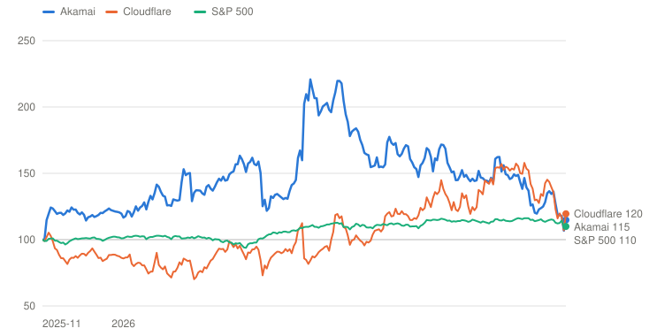
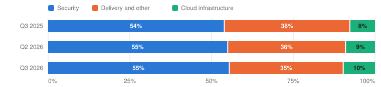

# AKAM — Akamai Technologies, Inc.

> **Schema** v7.0 · **Updated** 2026-11-06 · **Status** Active
> **Price** $84.00 verified Nov 6, 2026, about 1:07 pm ET ([Yahoo](https://finance.yahoo.com/quote/AKAM/)) · 52-wk $76.75–$165.45 · 8th %ile · −49.2% from high
> **Type** Distributed cloud and security platform: security, content delivery and cloud infrastructure services · **Stage** Mid-pivot: a mature core funding a capital-heavy cloud build · **Cyclical** No · **Competence** Edge

## Verdict

**The $14B of signed AI-cloud contracts are real and should add about $2.2B of revenue by 2028, but they earn roughly the hurdle at best-case pricing, and the probability-weighted case compounds at 7.2% a year against the 13% hurdle.**

🟡 **Non-holder: Watch (entry ≤$64)** · 🟡 **Holder: Hold**

| PW EV | PW return/yr | Compounding/yr | R/R | Entry | Trim | Avoid | FY26E non-GAAP P/E | Yield | BAIT | Moat | Next |
|---|---|---|---|---|---|---|---|---|---|---|---|
| **$119** | **7.2% (<13%)** | 22.4% | 3.2:1 | ≤$64 | $119–$219 | ≥$219 | ≈12.8× (33× GAAP) | 0.0% | Single (B) | Narrow, mixed | 📅 Feb 2027 (Q4 + FY27 guide) |

**Breaks if**: Cloud infrastructure revenue is below about $180M a quarter by the Q2 2027 print, or the FY2027 cloud guide of $1.1–1.3B is cut, which would put the >$7.0B FY2028 revenue target out of reach.

## The Call

Akamai has signed $14B of seven-year contracts to rent out compute, led by an $11.6B Anthropic deal, and the stock has gone from $165 in May to $84. I think that is roughly the right price, not a bargain. Management's own numbers put the after-tax return on those contracts at about 13%, and that is the floor price for the biggest customer, while capex this year is $3.5B against $1.5B of operating cash flow. Non-GAAP EPS of about $6.57 also leaves out roughly $3 a share of stock compensation, and owner earnings after SBC and capex fell from $657M in 2021 to $240M in 2025. To earn an ordinary 9% a year the stock needs $7.18 of GAAP EPS in 2031, a shade above my Base of $6.92, and the price implies a Bear weight of about 20% against the 30% I assign, so the market is slightly more optimistic than I am. No Bear weight, however small, earns 13% from $84, so the verb is Watch, and the case clears the hurdle at $64. The number that will settle it: cloud infrastructure revenue of about $180M a quarter by mid-2027, with non-GAAP operating margin stabilising in the mid-20s.

## What I'd Have To Be Wrong About

1. **That the $14B of contracts ramp on schedule.** Test: Q4 2026 cloud infrastructure revenue of at least $120M (February 2027 print), the FY2027 guide of $1.1–1.3B held, and quarterly cloud revenue of at least $180M by the Q2 2027 print (August 2027). **If Fail →** move 10 points from Bull to Bear (PW EV $101, 3.8%/yr) → stays **Watch**, entry falls to $55; a second slip also removes the $7.0B FY2028 target from my Base.
2. **That margins bottom in the first half of 2027 and then expand.** Test: FY2027 non-GAAP operating margin guided at or above 24% in February 2027, and a GAAP operating margin above 9% in Q4 2027. **If Fail →** cut Base FY2031 GAAP EPS to about $5.50 from the model's Base (PW EV $106, 4.8%/yr) → stays **Watch**, entry $58.
3. **That the build is funded without a dilutive or downgraded financing.** Test: the $1.15B 0.375% notes due September 1, 2027 repaid from cash, no more than $2B of new debt or equity-linked paper raised through the FY2027 10-K, and no sub-investment-grade rating. **If Fail →** move 10 points from Base to Bear (PW EV $111, 5.7%/yr) → **Watch**; the Outsider grade is cut to Anti-Outsider if buybacks resume while raising.

## Latest update: 2026-11-06 · Q3: $14B of commitments, a cut to this year, and a 2028 target of $7B

- Contracts ramp on schedule — 🟡 Pending — two of three large deals billing; about $30M slips from Q4 into 2027; resolves February and August 2027
- Margins bottom in 1H27 then expand — 🟡 Pending — non-GAAP margin 25% in Q3, Q4 guided 24%; resolves February 2027 guide
- Funding without a dilutive financing — 🟡 Pending — $4.2B cash and securities; management expects 'measured incremental financing'; 2027 notes due Sept 1, 2027

Akamai reported the third quarter on November 5 and, in the same release, gave specific revenue targets for 2027 and 2028. Revenue was $1.122 billion, up 6% (7% in constant currency), inside the $1,105–1,130 million guide. Non-GAAP EPS was $1.77, at the top of the $1.60–1.80 range but down 5% from a year ago. GAAP EPS was $0.77, down 21%. Non-GAAP operating margin was 25%, down six points, and GAAP operating margin 9.7% ([release](https://www.sec.gov/Archives/edgar/data/0001086222/000108622226000097/exhibit991-q32026.htm)).

By solution, security grew 9% to $622 million, delivery fell 3% to $391 million, and cloud infrastructure services grew 34% to $109 million. Capex was $464 million on an accrual basis, 41% of revenue. Cash from operations was $433 million, but cash and securities rose to $4.24 billion only because of the $3.5 billion of convertible notes issued in May. The company did not buy back stock. It paid $191 million for LayerX, an AI-usage data-leak control product.

The news was in the guidance. FY2026 revenue is now $4.44–4.465 billion (it had been $4.445–4.53 billion), with non-GAAP EPS of $6.47–6.68 (from $6.40–7.05). Q4 revenue is guided to $1.145–1.17 billion, with about $30 million of cloud revenue shifting into 2027 because of "modest supply chain and third-party data center delays" on two deals, in Leighton's words. FY2026 cloud growth is 40–42% in constant currency. Capex for the year is $3.46–3.66 billion, including $2.45–2.65 billion in Q4. For 2027, cloud revenue is $1.1–1.3 billion and total growth 17–22% in constant currency; 2028 revenue is "projected to exceed $7.0 billion," assuming no use of the $9 billion Anthropic option.

Management's three points were these. First, the contracts: more than $14 billion signed this year, about $2.2 billion of annual revenue at full ramp, a 75% adjusted EBITDA margin, a 30% non-GAAP operating margin, a 13% after-tax IRR and a 15% adjusted ROIC. Second, the build: all space and power for the $11.6 billion contract is secured, about 70% of the hardware is bought, and a price-adjustment clause covers the rest. Third, the funding: the plan is to pay for the build and the 2027 convertible maturity "primarily from our existing cash balance and expected operating cash flows, which may be supplemented by measured incremental financing activities."

The Q&A was more revealing than the script. Piper Sandler's James Fish said "we've kind of missed compute or only been in line on virtually every quarter that you've had this business," and McGowan replied that he was "not going to go litigate the past" and pointed to signed contracts and secured power. Several analysts asked whether Anthropic's pricing dragged down the 13% IRR; McGowan said it was the floor and other deals "are coming in higher." Oppenheimer's question on revenue per dollar of capex went essentially unanswered. McGowan also said margin should bottom in the first half of 2027, "maybe a point or so lower from where we are now," with 25–30% of 2027 cloud revenue in the first half and 70–75% in the second ([call](https://www.fool.com/earnings/call-transcripts/2026/11/06/akamai-akam-q3-2026-earnings-call-transcript/)).

The stock fell 9% on November 5, before the after-close report, to about $78, and rose about 8% to $84 on November 6, the first session after it. Five analysts cut targets that day, including RBC (to $85, Hold) and UBS (to $90), while the consensus mean sits at $154 `[Analyst consensus]`. Insider activity in the last 180 days was six small sales and no buys.

What it does to the debate: the print narrows the first debate to execution and financing. The returns are what management said they were, no better, and the revenue targets are now specific enough to be tested. Nothing in the quarter moved my scenarios, except that spot is $84 and the probability-weighted case is $119, a return of 7.2% a year against the 13% hurdle. The stock reaches the hurdle at $64. The three tests on this page start now: the contracts' ramp (Q4 cloud revenue of at least $120 million, February), the margin bottom (FY2027 guide, February) and the funding (September 2027 notes). All three are pending.

**Verdict**: Watch for someone who does not own it, and Hold for someone who does. This is the first note on this page, so there is no earlier verb to defend and no bias check to run.

---

## Deep Dive: Akamai, Betting the Cash Machine on AI

*A security-and-delivery business that earned $1.5B of operating cash flow a year has signed $14B of seven-year contracts to rent out computers, and is spending $3.5B this year to build them. The stock has halved from May. What does $84 assume about whether the build pays?*

**Contents**: [Business Overview](#business-overview) · [Cloud Infrastructure: A Business or a Financing?](#cloud-infrastructure-a-business-or-a-financing) · [The Cash Machine Underneath](#the-cash-machine-underneath) · [Leighton, Capital Allocation and Incentives](#leighton-capital-allocation-and-incentives) · [Valuation and Model Assumptions](#valuation-and-model-assumptions) · [Final Words](#final-words) · [Appendix: The Numbers](#appendix-the-numbers) · [Sources](#sources)

On May 7, 2026, Akamai told investors that a frontier AI company had committed $1.8 billion over seven years to rent computing capacity on its cloud. The stock rose 26.6% the next day, its biggest one-day gain in this window, and kept going. On May 13 it closed at about $161, up more than 120% from where it stood in November. Akamai had been the content-delivery company, the one that makes websites load fast, and the security company that protects them from attack. Now Mr. Market was being asked to see it as an AI infrastructure provider.

The story kept getting bigger. In September, Akamai announced an $11.6 billion seven-year commitment from Anthropic. After the close on November 5 it said it had signed more than $14 billion of such contracts this year and guided revenue growth to accelerate to 17–22% in 2027 and past $7.0 billion in 2028, from $4.2 billion last year. The stock had already fallen 9% that day, with the market's worries about AI infrastructure, which Leighton said on the call had "dragged" Akamai down with it. On November 6, the first session after the report, it rose about 8% to $84. That is 49% below the May high.

The business and the stock have gone in different directions. Revenue in the first nine months of 2026 is up 6%. GAAP operating income is down 36%, because the company is paying for data-centre space before the contracts bill. Non-GAAP earnings per share fell 5% in the third quarter. Over a full year Akamai has returned 14.8% to a holder from last November, against 19.5% for its closest peer Cloudflare and 9.9% for the S&P 500, but the ride in between is a round trip from 100 to 221 and back to 115.

*Total return including dividends, daily, November 5, 2025 (the close before the Q3 2025 print) = 100, through November 6, 2026. Akamai peaked at 220.8 on May 13, 2026. Source: Yahoo Finance adjusted closes via `prices.py`. Built with Claude.*

| Date | Akamai | Cloudflare | S&P 500 |
|---|---|---|---|
| 2025-11-05 | 100 | 100 | 100 |
| 2026-01-07 | 121 | 89 | 102 |
| 2026-03-10 | 143 | 91 | 100 |
| 2026-05-08 | 202 | 86 | 110 |
| 2026-07-10 | 173 | 118 | 112 |
| 2026-09-09 | 152 | 138 | 114 |
| 2026-11-06 | 115 | 120 | 110 |

The question for the next five years is whether this build earns its keep. Management says the contracts return about 13% after tax, the same number I use as my hurdle. The company is spending $3.5 billion on capex this year against about $1.5 billion of operating cash flow, and it has borrowed $7.6 billion in convertible notes to bridge the gap. The market has moved from "this changes everything" to "who pays for it", and I think both are partly right.

I begin with the business and how to read its accounts. The key debate follows: is the cloud build a business or a financing? A second debate is about the cash machine underneath, whose owner earnings have fallen while its profits looked stable. Then management, capital allocation and incentives, and finally valuation, asking what $84 already assumes and what has to be true to earn 13% a year from here. Akamai reports again in February with the full 2027 guide, so some of this will be tested soon.

### Business Overview

Akamai runs one of the world's largest distributed networks: more than 4,000 points of presence in 130 countries, according to CEO Tom Leighton on the Q3 call. It reports a single operating segment, but since January 2026 it splits revenue into three solution categories. Security (about 55% of revenue) protects customers' web applications, APIs and internal networks, including the Guardicore microsegmentation and API-security products it bought. Delivery and other cloud applications (about 36%) is the original business of caching and delivering content, including video, for media, commerce and software customers. Cloud infrastructure services, which Akamai calls CIS (about 9% but rising fast), rents out virtual machines, Kubernetes, storage and networking, mostly from the Linode platform it bought in 2022.

| $ Million | Q3 2025 | Q2 2026 | Q3 2026 | 9M 2025 | 9M 2026 |
|---|---|---|---|---|---|
| **Security** | 568 | 604 | 622 | 1,651 | 1,816 |
|  YoY growth | 10% | 10% | 9% | 9% | 10% |
| **Delivery and other cloud applications** | 405 | 396 | 391 | 1,242 | 1,176 |
|  YoY growth | −5% | −6% | −3% | −4% | −5% |
| **Cloud infrastructure services (CIS)** | 81 | 99 | 109 | 220 | 303 |
|  YoY growth | 39% | 39% | 34% | 33% | 37% |
| **Total revenue** | 1,055 | 1,100 | 1,122 | 3,113 | 3,295 |
| **GAAP income from operations** | 166 | 80 | 109 | 472 | 303 |
|  GAAP operating margin | 15.7% | 7.3% | 9.7% | 15.2% | 9.2% |
|  Non-GAAP operating margin | 31% | 25% | 25% | 30% | 25% |
|  GAAP diluted EPS | $0.97 | $0.52 | $0.77 | $2.50 | $2.00 |

*Revenue by solution is recast for the three-category reporting begun in 2026. Source: [Q3 2026 release](https://www.sec.gov/Archives/edgar/data/0001086222/000108622226000097/exhibit991-q32026.htm) and [Q2 2026 10-Q](https://www.sec.gov/Archives/edgar/data/1086222/000108622226000086/akam-20260630.htm). Margins computed from reported figures. Built with Claude.*

The table tells the story in three lines. Security grows 9–10% and is the engine. Delivery shrinks 3–6% a year as renewals reprice lower and large media customers optimise traffic. CIS grows in the mid-30s but is still only $109 million a quarter. Together that is 6% growth, with operating margin falling from 15% to 9% on a GAAP basis in a year.

*Share of revenue (Akamai does not report profit by solution). Source: [Q3 2026 release](https://www.sec.gov/Archives/edgar/data/0001086222/000108622226000097/exhibit991-q32026.htm). Built with Claude.*

| Period | Security | Delivery and other | Cloud infrastructure | Total ($M) |
|---|---|---|---|---|
| Q3 2025 | 568 (54%) | 405 (38%) | 81 (8%) | 1,054 |
| Q2 2026 | 604 (55%) | 396 (36%) | 99 (9%) | 1,099 |
| Q3 2026 | 622 (55%) | 391 (35%) | 109 (10%) | 1,122 |

A few accounting points matter before the debate. Akamai guides on non-GAAP numbers that exclude stock-based compensation, amortisation of acquired intangibles and the amortisation of capitalised stock compensation. In Q3 that was a 16-point gap between the 25% non-GAAP margin and the 9.7% GAAP margin. I use GAAP margins, which charge stock compensation as the real cost it is, in the model. The company also reports capex on an accrual basis in its supplemental table ($464 million in Q3) and on a cash basis in the cash-flow statement ($605 million), so I quote which one I use. And the share count has two faces: 144 million shares are outstanding, but GAAP diluted EPS uses 151 million because the convertible notes count as if converted. Remaining performance obligations were $5.2 billion at the end of 2025, with about 55% due within a year (10-K), a figure that predates the 2026 contracts.

### Cloud Infrastructure: A Business or a Financing?

Let me start with where things stand. Here is what management has told us about the contracts signed this year.

| The large CIS contracts signed in 2026 | Management's figure | Source |
|---|---|---|
| Total commitments signed in 2026 | More than **$14B** over mostly seven years, of which Anthropic is $11.6B (Sept 24) plus an earlier ~$1.8B deal | [Q3 call](https://www.fool.com/earnings/call-transcripts/2026/11/06/akamai-akam-q3-2026-earnings-call-transcript/), [Anthropic 8-K](https://www.sec.gov/Archives/edgar/data/1086222/000119312526401048/d288154dex991.htm) |
| Annual revenue at full ramp | About **$2.2B**, ramping from Q4 2026 and complete by end of 2028 | Q3 call (CFO) |
| Revenue per megawatt of contracted power | About **$22M** | Q3 call (CEO) |
| Capex to serve the $11.6B deal | About **$5.5B**, of which $1.7B is pre-purchased in Q4 2026 | [Anthropic 8-K](https://www.sec.gov/Archives/edgar/data/1086222/000119312526401048/d288154dex991.htm) |
| Adjusted EBITDA / non-GAAP operating margin at full ramp | About **75%** / about **30%** | Q3 call |
| After-tax IRR / average annual adjusted ROIC | About **13%** / about **15%** | Q3 call (CFO, IR slide) |
| Pricing | Anthropic is the lowest-price, longest-term, largest-volume deal: 'the lowest prices you're going to see' | Q3 call (CFO) |
| Hardware status | Space and power contracted for the whole $11.6B; about 70% of hardware secured; price-adjustment clause for the rest | Q3 call (CFO) |
| Customer incentive | Warrant for up to ~5% of the stock at $111.33; ~2% vests on the $11.6B, ~1% per further $3B bought | [Anthropic 8-K](https://www.sec.gov/Archives/edgar/data/1086222/000119312526401048/d288154dex991.htm) |

*All figures are management's, stated on the November 5, 2026 call or in the September 24 8-K; none is audited. Source: [Q3 call transcript](https://www.fool.com/earnings/call-transcripts/2026/11/06/akamai-akam-q3-2026-earnings-call-transcript/) (Motley Fool, LLM-assisted; quoted figures cross-checked to the release where it states them). Built with Claude.*

#### Management's narrative

Management's case is that it is not building a bare-metal GPU farm. It is selling a cloud of ordinary CPU servers, packed into many small leased data-centre footprints that it can get when large sites are scarce, on contracts that guarantee revenue for seven years. Here is how Leighton put it on the Q3 call:

> "We sell compute capacity through our Infrastructure as a Service platform, which consists of virtual machines, managed Kubernetes, storage and networking. This keeps our capacity elastic across customers and generates substantially more revenue per megawatt or dollar of CapEx than a bare metal contract. In particular, we expect to generate about $22 million of revenue per megawatt of contracted power for the large deals we signed this year."
> — Tom Leighton, CEO, Q3 2026 earnings call, November 5, 2026

CFO Ed McGowan then gave the return numbers that investors had asked for, posted on a slide: about $2.2 billion of annual revenue from the $14 billion of contracts, a 75% adjusted EBITDA margin, a 30% non-GAAP operating margin, a 13% after-tax IRR and an average adjusted return on invested capital of about 15%. His answer on the pricing was the most revealing part of the call:

> "These are the lowest prices you're going to see on a unit economic basis. So look at that as sort of your floor as far as what pricing is. So somebody is going to commit to half the amount or 1/3 of the amount and 1/10 of the volume, they're not going to get anywhere near those prices."
> — Ed McGowan, CFO, Q3 2026 earnings call, November 5, 2026

And on funding, he said Akamai expects "to fund our CIS expansion and broader growth investments through 2028 as well as address our 2027 convertible note maturity, primarily from our existing cash balance and expected operating cash flows, which may be supplemented by measured incremental financing activities as appropriate."

I take much of this at face value. The company has secured the data-centre space and power for the whole $11.6 billion contract, about 70% of the hardware, and a price-adjustment clause for the rest. Two of the first three large deals are billing. The 2028 revenue target excludes any use of the $9 billion Anthropic option. Management also says it is walking away from deals that do not meet its return threshold. This is a more careful build than the AI infrastructure story the market has been worrying about.

#### Poking holes in it

The first hole is that the return is the hurdle, not above it. A 13% after-tax IRR on the largest customer's best price is a fair return on capital, and I fully believe management that smaller deals pay more. But the biggest deals are where the money is: $11.6 billion of the $14 billion. Using management's own ratios, I build the return on a dollar of capex below. The as-guided case needs servers to be worth 15 cents on the dollar after seven years to reach 12.7%.

| Illustrative return on $1.00 of capex | What changes | After-tax IRR | vs. 13% hurdle |
|---|---|---|---|
| **As guided** | $0.30 of revenue a year for 7 years, 75% adjusted EBITDA, 7-year straight-line depreciation, 20% tax, servers worth 15 cents at year 7 | **12.7%** | Just under |
| No residual value | Servers worth nothing at year 7 | 10.6% | Below |
| Price 10% lower | Same costs, 10% less revenue per dollar of capex | 9.4% | Below |
| Price 10% higher | Later deals 'coming in higher' | 15.9% | Above |
| Hardware 20% dearer, no pass-through | Memory prices rise on the unordered ~30% | 8.6% | Below |
| Operating costs 20% higher | Colocation and power escalators | 11.1% | Below |
| Price −10% and hardware +20% | Both at once | 5.7% | Far below |

*Built from management's disclosed ratios: $11.6B over 7 years against ~$5.5B of capex is $0.30 of revenue per capex dollar a year; 75% EBITDA less depreciation gives a 28% operating margin, close to management's ~30%. The 7-year life, 20% tax rate and 15% residual are my estimates `[Estimate]`; with them the as-guided case reproduces management's ~13%. Source: [Q3 call](https://www.fool.com/earnings/call-transcripts/2026/11/06/akamai-akam-q3-2026-earnings-call-transcript/), [Anthropic 8-K](https://www.sec.gov/Archives/edgar/data/1086222/000119312526401048/d288154dex991.htm). Built with Claude.*

A 10% price cut takes the return to 9.4%. A 20% rise in hardware costs without a pass-through takes it to 8.6%. The price-adjustment clause protects the roughly 30% of hardware not yet ordered, and memory prices are the thing everyone is watching. There is upside too: later deals "coming in higher" lift the return to 15.9% at a 10% price premium. But there is little margin of safety in the base contract, and the company is paying for that capex up front.

The second hole is the financing. Capex guidance for 2026 is $3.46–3.66 billion. Operating cash flow was $1.07 billion in the first nine months. Cash and securities were $4.24 billion on September 30, and Q4 capex alone is guided to $2.45–2.65 billion, including $1.7 billion to pre-buy memory for the Anthropic contract. By my arithmetic cash falls to about $2 billion at year-end. Convertible notes stand at $7.64 billion in par value across five issues, at coupons of 0–1.125%, with $1.15 billion due on September 1, 2027. The notes carry hedges and warrants that offset dilution only up to a point. If Akamai's stock is still below $93.01 in May 2031, holders of the $1.725 billion 2033 notes can demand cash back. The CFO's "measured incremental financing" is a polite phrase for more of this, and it comes with a goal to "maintain investment grade as long as we certainly can."

The third hole is the counterparty. Anthropic is 83% of the signed commitments, is privately held, and the 8-K describes the $11.6 billion as "subject to termination terms and service delivery requirements." At about $1.66 billion of revenue a year, it would be roughly a quarter of 2028's $7.0 billion, in a company that reported no customer above 10% of revenue in 2023–2025. The warrant is a clever structure: Anthropic gets up to 5% of the stock at $111.33, with 2% vesting on the commitment and about 1% for each further $3 billion bought. McGowan said the warrant gives Anthropic "an incentive for them as our stock goes higher," so he does not expect them to exercise the $9 billion option soon. That is honest, and it tells you the equity value is a bargaining chip.

The fourth hole is the track record. Piper Sandler's James Fish said it directly on the call: "we've kind of missed compute or only been in line on virtually every quarter that you've had this business." The company's FY2026 CIS growth guide has gone from at least 50% in May (secondary reports) to 40–42%, and about $30 million of Q4 revenue now slips into 2027 because of supply-chain and third-party data-centre delays. Management says the delays are a "punch list on a construction project" and I believe it, but the 2027 CIS guide of $1.1–1.3 billion requires 70–75% of the year's revenue in the second half.

Where I come out: management is right that this is a better-designed build than most, and probably right that it will deliver the 2028 revenue. But a fair return is not a bargain, and the financing, concentration and execution risk all sit with shareholders. The burden of proof is on the next four quarters.

#### Three rings of profit

Akamai gives no profit by solution, so I sort revenue by how exposed it is to this debate.

| Ring | Share of revenue | What it earns | Main threat | Exposure to the debate |
|---|---|---|---|---|
| **1 · Security** | 55% of FY2026E | The profit engine: +9–10% cc, 'adding $12–13M a quarter' sequentially | Platform competitors; AI-driven attack volume is a tailwind | Low: funds the build and is the reason a customer trusts the cloud |
| **2 · Delivery and other cloud apps** | 36% | Cash cow in slow decline: −3% to −6%; 'stable... down a point or 2 or 3' | Price cuts at renewal, hyperscaler cost pressure, media traffic optimisation | Medium: shrinks as capacity is redirected to cloud |
| **3 · Cloud infrastructure, existing customers** | 9% | Developer and enterprise compute: +34–41% a year | Hyperscaler pricing | Medium: the proof the platform sells without a megadeal |
| **4 · Large AI contracts** | ~0% now; ~30% of FY2028 | $2.2B a year at ~75% EBITDA, ~30% non-GAAP margin, ~13% IRR | Counterparty, hardware cost, execution, financing | **High: the whole debate** |

*Akamai reports one segment and no segment profit, so rings are by revenue. FY2026E shares from Q3 guidance (security ~2.45B, delivery ~1.58B, CIS ~0.42B, `[Derived]`); ring 4 is $2.2B ÷ the >$7.0B FY2028 target. Source: [Q3 release](https://www.sec.gov/Archives/edgar/data/0001086222/000108622226000097/exhibit991-q32026.htm) and call. Assessments are the author's. Built with Claude.*

Rings 1 and 2 are 91% of today's revenue and nearly all of today's profit. They are not exposed to the AI build except that they pay for it. Ring 4 is zero today and about 30% of 2028 revenue. The whole question is whether a new ring earning a 28% operating margin (before SBC) on heavy capital is worth more or less than the old rings it is displacing in the mix. Delivery capacity is already being redirected: "we're much better off investing that CapEx into our CIS business," Leighton said.

### The Cash Machine Underneath

The second debate is quieter and I think it matters just as much. Is the core still the cash machine it looks like?

Akamai's non-GAAP earnings suggest a steady company. Non-GAAP EPS was $6.99 in 2025 and is guided to $6.47–6.68 in 2026, a dip. At $84 that is 12.8 times. Cheap, if you believe it. But non-GAAP excludes stock compensation, which is now 10.9% of revenue, up from 5.9% in 2021. In 2026 it will be about $540 million, roughly $3 a share after tax, or close to half of non-GAAP EPS. The GAAP profit looks very different: $3.07 per share in 2025, down from $3.93 in 2021, and about $2.50 this year. At $84 that is 33 times.

Free cash flow tells the same story from another side. Reported free cash flow was $0.70 billion in 2025, a healthy 1.55 times net income. But subtract stock compensation, which is a real cost paid in shares that the company then spends cash buying back, and owner earnings were $0.24 billion. In 2021 they were $0.66 billion.

| $B, except per share | FY2021 | FY2022 | FY2023 | FY2024 | FY2025 |
|---|---|---|---|---|---|
| **Revenue** | 3.46 | 3.62 | 3.81 | 3.99 | **4.21** |
|  YoY | 8.2% | 4.5% | 5.4% | 4.7% | 5.4% |
|  GAAP operating income | 0.78 | 0.68 | 0.64 | 0.53 | 0.57 |
|  GAAP operating margin | 22.6% | 18.7% | 16.7% | 13.4% | 13.5% |
|  Diluted EPS (GAAP) | $3.93 | $3.26 | $3.52 | $3.27 | $3.07 |
| **Cash and reinvestment** |  |  |  |  |  |
|  Operating cash flow | 1.41 | 1.28 | 1.35 | 1.52 | 1.52 |
|  Capex (incl. capitalised software) | 0.55 | 0.46 | 0.73 | 0.69 | 0.82 |
|  Free cash flow | 0.86 | 0.82 | 0.62 | 0.83 | 0.70 |
|  Stock-based compensation | 0.20 | 0.22 | 0.33 | 0.39 | 0.46 |
|  SBC % of revenue | 5.9% | 6.0% | 8.6% | 9.8% | 10.9% |
| **Owner earnings** (OCF − SBC − capex) `[Derived]` | 0.66 | 0.60 | 0.29 | 0.44 | **0.24** |
|  Owner earnings per diluted share | $3.96 | $3.75 | $1.87 | $2.86 | $1.63 |
|  FCF ÷ net income | 1.32× | 1.56× | 1.13× | 1.65× | 1.55× |
| **Returns on capital** `[Derived]` |  |  |  |  |  |
|  Invested capital (equity + convert par + leases − cash and securities) | 5.55 | 6.12 | 6.87 | 7.66 | 8.77 |
|  NOPAT (GAAP operating income × 80%) | 0.63 | 0.54 | 0.51 | 0.43 | 0.45 |
|  ROIC (year-end capital) | 11.3% | 8.8% | 7.4% | 5.6% | 5.2% |
|  3-year ROIIC | — | — | — | −9.5% | −3.3% |
|  Reinvestment rate (net capex + acquisitions ÷ NOPAT) | 95% | 136% | 76% | 142% | 43% |
| **Survivability and dilution** |  |  |  |  |  |
|  Net debt (convert par − cash and securities) | 0.13 | 0.87 | 1.27 | 1.69 | 2.22 |
|  Net debt ÷ EBITDA (operating income + D&A) | 0.1× | 0.7× | 1.1× | 1.4× | 1.7× |
|  Nearest maturity |  |  |  |  | $1.15B Sept 1, 2027 |
|  Diluted shares (M) | 166 | 160 | 155 | 154 | 147 |
|  Year-end shares outstanding, change | −1.4% | −2.5% | −3.4% | −0.8% | −3.5% |
|  Buybacks ÷ SBC | 2.6× | 2.8× | 2.0× | 1.4× | 1.7× |

*Invested capital is built as equity + convertible-note par + operating-lease liabilities − cash − marketable securities (`[Derived]`; note carrying values are within 2% of par). 3-year ROIIC = change in NOPAT ÷ change in invested capital over three years. The pivot has not yet shown up in returns: 2026 capex of ~$3.5B is not in this table. Cycle position: not cyclical, though media and gaming traffic moves delivery revenue. Source: [SEC XBRL company facts](https://data.sec.gov/api/xbrl/companyfacts/CIK0001086222.json), [FY2025 10-K](https://www.sec.gov/Archives/edgar/data/1086222/000108622226000022/akam-20251231.htm), [FY2022 10-K](https://www.sec.gov/Archives/edgar/data/1086222/000108622223000078/akam-20221231.htm). Built with Claude.*

The five-year table has three uncomfortable numbers. Return on invested capital, built from equity, convertible debt and leases less cash, fell from 11.3% to 5.2%. Three-year incremental ROIC is negative. And the reinvestment rate was 95%, 136%, 76%, 142% and 43% of NOPAT, which means that Akamai has been putting most of its profits into acquisitions and servers for five years while its NOPAT fell from $0.63 billion to $0.45 billion. Some of this was deliberate and good. Guardicore and Noname gave Akamai the security products now growing 10%. Restructuring charges ($95 million in 2024, $58 million in 2025) and rising amortisation also depressed GAAP profit. But the pivot to AI compute is the third big reinvestment in five years, and the first two have not yet shown up in returns.

This is why I do not flag Akamai as a compounder. It fails the ROIC test in all five years and the ROIIC test in both years that can be computed. The business still earns a real return on its older capital, which is why security can be a 20% margin business, but it has not earned a return on the new capital. The AI contracts are the bet that fixes that. If they earn the 13% that management says, the new capital will earn more than the 5.2% the old capital is earning now.

Delivery, the oldest ring, still pays. It is shrinking by a low-to-mid single digit each year, but management says "we're probably holding pricing better now than we have for a long period of time." Security adds $12–13 million of sequential revenue every quarter. If that is the pattern, the core grows about 6% a year, with margins that depend on how much of the cost base the AI build absorbs. I model that.

### Leighton, Capital Allocation and Incentives

Tom Leighton co-founded Akamai and has been CEO since 2013. He draws a $1 salary, takes his bonus in stock, and owned 1.9% of the company in February (2,759,456 shares), so he is paid in the stock, not around it. The company has pivoted before, from content delivery to security and now to cloud. This is his biggest bet, and he has been consistent in public about it: "I've never been more confident in Akamai's ability to power and protect an AI-driven world." I have not found a prior-tenure record elsewhere to chart, so the test is what he has done with the cash.

#### The deals

| Year | Deal | Price | What happened | Verdict |
|---|---|---|---|---|
| 2021 | Guardicore (microsegmentation) | ≈$0.6B cash `[Derived]` | 'Still growing at a very healthy clip' with low penetration of the base (CFO, Q3 2026 call) | Good |
| 2022 | Linode (developer cloud) | ≈$0.9B cash `[Derived]` | Became Akamai Cloud and the platform for the 2026 pivot; the 'next billion-dollar business' arrived years late but is now guided to $1.1–1.3B in 2027 | Good, long fuse |
| 2024 | Noname Security (API security) | ≈$0.4B cash `[Derived]` | API Security named by management as a lead growth driver in Q3 2026 | Good so far |
| 2024 | Edgio, Lumen and StackPath customer contracts | $0.13B asset deals | 'Incremental traffic from contracts acquired' (10-K); delivery revenue still falling | Unclear |
| 2026 | LayerX (AI-use data-leak control) | $0.19B cash (Q3) | 'Already a lot of sales', including a large US streaming company (CEO) | Too early |

*Prices are cash paid for acquisitions in the cash-flow statement for the year (2021: $599M; 2022: $872M; 2024: $434M plus $133M of asset deals; Q3 2026: $191M); they may include smaller deals, so treat them as bounds. Source: [FY2025 10-K](https://www.sec.gov/Archives/edgar/data/1086222/000108622226000022/akam-20251231.htm), [FY2022 10-K](https://www.sec.gov/Archives/edgar/data/1086222/000108622223000078/akam-20221231.htm), [Q3 call](https://www.fool.com/earnings/call-transcripts/2026/11/06/akamai-akam-q3-2026-earnings-call-transcript/). Built with Claude.*

Four of the five deals have worked or are working, which is a better record than most acquisitive software companies. The biggest, Linode, took four years to become the foundation of a business that is growing in line with the pivot. The deal list is not where my worry sits.

#### The cash

| $ Billion | Revenue | YoY | GAAP EPS | OCF | Capex | FCF | SBC | Buybacks | % FCF | Acquisitions | Converts (par) | Dil. shares (M) |
|---|---|---|---|---|---|---|---|---|---|---|---|---|
| FY2021 | 3.46 | 8% | $3.93 | 1.41 | 0.55 | 0.86 | 0.20 | 0.52 | 61% | 0.60 | 2.30 | 166 |
| FY2022 | 3.62 | 5% | $3.26 | 1.28 | 0.46 | 0.82 | 0.22 | 0.61 | 74% | 0.87 | 2.30 | 160 |
| FY2023 | 3.81 | 5% | $3.52 | 1.35 | 0.73 | 0.62 | 0.33 | 0.65 | 106% | 0.11 | 3.57 | 155 |
| FY2024 | 3.99 | 5% | $3.27 | 1.52 | 0.69 | 0.83 | 0.39 | 0.56 | 67% | 0.43 | 3.57 | 154 |
| FY2025 | 4.21 | 5% | $3.07 | 1.52 | 0.82 | 0.70 | 0.46 | 0.80 | 114% | 0.06 | 4.14 | 147 |
| 9M 2026 | 3.30 | 6% | $2.00 | 1.07 | 1.02 | 0.05 | 0.41 | 0.62 | n/m | 0.19 | 7.64 | 152 |
| **FY2021–25** | 19.09 |  |  | 7.07 | 3.24 | 3.83 | 1.60 | 3.14 | 82% | 2.07 |  |  |

*Capex is purchases of property and equipment plus capitalised internal-use software (cash basis); FCF = OCF − capex. Acquisitions are cash paid for businesses. Convertible par: 2021–22 two issues, 2025 three, 9M 2026 five. Dil. shares are GAAP weighted-average diluted. Source: [FY2025 10-K](https://www.sec.gov/Archives/edgar/data/1086222/000108622226000022/akam-20251231.htm), [FY2022 10-K](https://www.sec.gov/Archives/edgar/data/1086222/000108622223000078/akam-20221231.htm), [SEC XBRL company facts](https://data.sec.gov/api/xbrl/companyfacts/CIK0001086222.json), [Q3 2026 release](https://www.sec.gov/Archives/edgar/data/0001086222/000108622226000097/exhibit991-q32026.htm). Built with Claude.*

From 2021 to 2025 Akamai generated $3.83 billion of free cash flow, spent $2.07 billion on acquisitions, paid $1.60 billion of stock compensation and bought back $3.14 billion of stock, or 82% of free cash flow. Diluted shares fell 11%, from 166 million to 147 million, which is a good result. But owner earnings per share still fell from $3.96 to $1.63, because the stock compensation, capex and acquisitions grew faster than the buyback shrank the count.

2026 changed the pattern. In the first half the company repurchased about 5 million shares for $616 million at an average of $123.19, higher than today's price. It spent nothing in the third quarter as the price dropped below $100 and capex rose. That is pro-cyclical: it bought at the top and stopped at the bottom. It also issued $3.5 billion of new convertibles in May, with note hedges and warrants. I grade capital allocation Steward, not Outsider, because buybacks followed the price rather than the value. The rest of the discipline is intact. Debt is cheap, with an effective rate on the new notes of 0.23–0.35%, and capex is tied to signed contracts. It does leave a $565 million authorisation and no plan to use it before 2028.

#### The incentives

From the [2026 proxy](https://www.sec.gov/Archives/edgar/data/1086222/000108622226000042/akam-20260330.htm):

| Component | Size / weight | What it pays for | Latest outcome |
|---|---|---|---|
| **Base salary (CEO)** | $1 | Nothing: Leighton has taken $1 since 2013 | Unchanged |
| **Annual bonus** | Target $1.5M for the CEO; paid in stock | 50% FX-adjusted revenue, 50% non-GAAP operating income; ±10% ESG modifier | 2025 funded at 151.3% of target ($2.27M); non-GAAP operating income paid at 190% |
| **PRSUs** | Annual tranches, 0–200% | 50% FX-adjusted revenue, 50% non-GAAP EPS | 2025 tranche earned 154%; EPS $6.99 vs. $6.19 target |
| **Relative-TSR RSUs** | 0–200%, 3 years to Dec 31, 2027 | TSR rank in an index group: 0% below the 25th percentile, 100% at the 50th, 200% at the 75th | Stock −48% from the May high; a poor 2027 rank pays little |
| **Time-vesting RSUs** | Rest of long-term award | Retention | — |
| **Return on invested capital** | **0%** | Not in any plan | No metric charges management for the $3.5B capex or the converts |

*Metrics, weights and 2025 outcomes from the 2026 proxy. Non-GAAP operating income and EPS exclude stock-based compensation and acquired-intangible amortisation. Source: [DEF 14A](https://www.sec.gov/Archives/edgar/data/1086222/000108622226000042/akam-20260330.htm). Built with Claude.*

Every financial metric in the plan is non-GAAP: revenue, non-GAAP operating income and non-GAAP EPS. None charges management for the capital it uses or the stock it issues. The 2025 bonus paid at 151% of target, with the operating income leg paying 190%, in a year in which owner earnings fell by almost half. The relative-TSR grant is the best-aligned piece, since it pays only if Akamai's stock beats peers through 2027, but it measures the stock rather than the returns behind it. A manager paid on revenue and non-GAAP EPS will take $14 billion of revenue at a 13% return more readily than shareholders would at the same price. That does not make it a bad decision. It means the check on the decision has to come from the board and from investors.

So is Leighton the right manager for this build? The operating plan looks careful and the commercial wins are real. What I cannot see yet is the discipline on capital: the proxy contains no return-on-capital goal, the buyback followed the price, and the financing comes after the contracts, not before. The three tests on my page are aimed at exactly that.

### Valuation and Model Assumptions

As with other pages, I ask what has to be true to earn 13% a year from today's price, and what the price already assumes at a 9% cost of equity. The model builds security, delivery and cloud infrastructure separately, each with revenue growth and a GAAP operating margin after stock compensation, then deducts corporate and net financing costs, tax and the share count. 2026 is calibrated to guidance and nine-month results, at GAAP EPS of about $2.52. The 2031 value is GAAP EPS times an exit multiple. Here is the Base case, with inputs highlighted:

| $ Billion | FY2026E | FY2027E | FY2028E | FY2029E | FY2030E | FY2031E |
|---|---|---|---|---|---|---|
| **Security revenue** | 2.4 | 2.6 | 2.9 | 3.1 | 3.3 | 3.6 |
|  YoY growth | 8.0% | **8.0%** | **8.0%** | **8.0%** | **8.0%** | **8.0%** |
|  Operating margin | 16.0% | 16.8% | 17.6% | 18.4% | 19.2% | **20.0%** |
|  Operating profit | 0.39 | 0.44 | 0.50 | 0.57 | 0.64 | 0.72 |
| **Delivery and other cloud applications revenue** | 1.6 | 1.5 | 1.5 | 1.4 | 1.4 | 1.4 |
|  YoY growth | -3.0% | **-3.0%** | **-3.0%** | **-3.0%** | **-3.0%** | **-3.0%** |
|  Operating margin | 6.0% | 6.0% | 6.0% | 6.0% | 6.0% | **6.0%** |
|  Operating profit | 0.09 | 0.09 | 0.09 | 0.09 | 0.08 | 0.08 |
| **Cloud infrastructure services revenue** | 0.4 | 0.6 | 1.0 | 1.4 | 2.1 | 3.2 |
|  YoY growth | 50.0% | **50.0%** | **50.0%** | **50.0%** | **50.0%** | **50.0%** |
|  Operating margin | -8.0% | -1.6% | 4.8% | 11.2% | 17.6% | **24.0%** |
|  Operating profit | -0.03 | -0.01 | 0.05 | 0.16 | 0.38 | 0.77 |
| Corporate and other | (0.06) | (0.07) | (0.09) | (0.11) | (0.13) | (0.17) |
| **Total revenue** | 4.5 | 4.8 | 5.3 | 6.0 | 6.9 | 8.2 |
| **Operating profit** | 0.39 | 0.45 | 0.55 | 0.71 | 0.97 | 1.40 |
|  Operating margin | 8.8% | 9.4% | 10.4% | 11.9% | 14.1% | 17.2% |
| Net income | 0.37 | 0.40 | 0.47 | 0.58 | 0.79 | 1.13 |
| Diluted shares (B) | 0.148 | 0.151 | 0.154 | 0.157 | 0.160 | 0.163 |
|  Net share change | — | +2.0% | +2.0% | +2.0% | +2.0% | +2.0% |
|  SBC (% of revenue) | 12.4% | 12.4% | 12.4% | 12.4% | 12.4% | 12.4% |
| **GAAP EPS** | $2.52 | $2.66 | $3.03 | $3.72 | $4.91 | $6.92 |
|  YoY growth | — | 5.8% | 13.8% | 22.7% | 32.0% | 40.8% |

*Base case. Highlighted cells are inputs; margins move linearly from the FY2026 estimate to the FY2031 input. Margins are GAAP operating margins after stock-based compensation and acquired-intangible amortisation; segment margins are my allocation of the consolidated GAAP margin `[Estimate]` because Akamai reports none. Corporate and net financing costs sit in one line. Source: author's model (model.json). Built with Claude. Bold cells are model inputs.*

In the Base, security grows 8% a year with its margin rising to 20%, delivery shrinks 3% a year at a 6% margin, and cloud infrastructure grows to about $3.2 billion by 2031 at a 24% margin, which is the $2.2 billion of signed contracts holding plus another $1 billion of other cloud revenue. Revenue reaches about $8.2 billion, close to the $7.0 billion 2028 target plus a few years of ordinary growth. GAAP EPS grows 22.4% a year to $6.92, though that starts from a 2026 year depressed by costs running ahead of revenue. Net shares rise about 2% a year, since buybacks resume only partly and stock compensation continues. At 18 times, which I think is fair for a security business attached to a capital-heavy infrastructure one, the stock is worth about $124 in 2031.

| Case | Prob. | 3P | Security growth / margin | Delivery and other cloud applications growth / margin | Cloud infrastructure services growth / margin | Net shares/yr | Per-share earnings FY2031 | CAGR | Exit multiple | Value | Return/yr | Implied g | Driving assumption |
|---|---|---|---|---|---|---|---|---|---|---|---|---|---|
| **Bull** | 20% | Possible | +10.0% / 23.0% | -1.0% / 7.0% | +60.0% / 27.0% | +1.0% | $10.44 | 32.9% | 21.0× GAAP EPS | $219 | 21.2% | 4.0% | Large contracts deliver on time and the Anthropic option is partly exercised: cloud infrastructure reaches about $4.4B in FY2031 at a 27% GAAP margin, security compounds at 10%, and the market pays 21× for a business that is growing again. |
| **Base** | 50% | Probable | +8.0% / 20.0% | -3.0% / 6.0% | +50.0% / 24.0% | +2.0% | $6.92 | 22.4% | 18.0× GAAP EPS | $124 | 8.2% | 3.3% | The $14B of signed contracts ramp as guided to about $2.2B a year and hold; other cloud revenue and security grow, delivery shrinks 3% a year. Cloud infrastructure is about $3.2B in FY2031 at a 24% GAAP margin; 18× GAAP EPS for a capital-heavy infrastructure business. |
| **Bear** | 30% | Plausible | +5.0% / 17.0% | -6.0% / 5.0% | +41.5% / 12.0% | +3.6% | $3.26 | 5.3% | 13.0× GAAP EPS | $42 | -12.8% | 1.2% | Contracts are delivered but returns are thin: cloud infrastructure stops at about $2.2B on a 12% GAAP margin (hardware cost overruns, short useful lives, the Anthropic floor price on the largest deal), refinancing costs rise, buybacks stay off and the stock is paid out as SBC; 13×. |
| **Priced-in (9%/yr)** | — | diagnostic | +8.2% / 20.2% | -2.8% / 6.1% | +50.5% / 24.7% | +1.9% | $7.18 | 23.3% | 18.0× GAAP EPS | $129 | 9.0% | 3.3% | Solved along Bear → Base for 9%/yr |
| **Hurdle (13%/yr)** | — | diagnostic | +9.0% / 21.6% | -2.0% / 6.5% | +55.2% / 25.6% | +1.5% | $8.60 | 27.8% | 18.0× GAAP EPS | $155 | 13.0% | 3.3% | Solved along Base → Bull for 13%/yr |
| **Probability-weighted** | 100% |  |  |  |  |  |  |  |  | $119 | 7.2% |  |  |

*Annual return = price change to the FY2031 value; there is no dividend. Probabilities apply to Bull, Base and Bear; the Priced-in row is solved along the Bear→Base path and the Hurdle row along the Base→Bull path, both at 18×. Source: author's model. Built with Claude.*

| Return math |  |
|---|---|
| PW return/yr vs. hurdle | **7.2% (<13%)**, of which 0.0% is the dividend yield. Entry ≤$64. 10-year Treasury 4.90%; the hurdle sits 8.1 points above it. |
| Compounding at a flat multiple | Base per-share earnings growth 22.4% + 0.0% dividend = **22.4%**. Re-rating subtracts 14.2 points from the Base return: the multiple compresses. |
| Optionality | None valued. |
| Price-implied expectations | At 9%, spot needs $7.18 of per-share earnings in the terminal year (23.3% a year) at 18×. |
| EPV floor | $30–40 per share (five-year average owner earnings of $0.45B ÷ 9% ≈ $5.0B on 144M shares, about $35). Roughly 40% of the price pays for today's earnings power after SBC and capex; the rest pays for the contracts. The Bear ($42) sits just above EPV because it keeps the contracts but earns thin returns on them. |
| Base rate / 3P | The Base takes revenue from $4.45B to $8.2B, 13% a year nominal, roughly 10% real; for companies of $4.5–7B sales, 21% have done 10% real over five years, and ~16% a year to FY2028 is already guided and largely signed. The Bull (17% nominal, ~14% real) is a one-in-ten outcome for the size bucket. |
| Terminal-growth check | Implied perpetual growth on owner earnings at 9%: Bull 4.0%; Base 3.3%; Bear 1.2%. All below the risk-free rate. |
| Break-even and price-implied Bear odds | Break-even <0% against 30% assigned; price-implied 20% at 9%. |
| Year ten | Mixed. The seven-year contracts end in 2033–34 and have to be renewed on hardware that is by then 7–10 years old; security still grows at year ten in the Base, delivery has shrunk by a third. The terminal multiple (18×) is below the market's for software and above it for infrastructure, so it is not carrying the value; the contract renewals are. |
| R/R | **3.2:1** (Bull +161% / Bear −50%) |

*Computed rows come from model.json; EPV, base rate and year ten are the author's. Base rates from Mauboussin, The Base Rate Book. Built with Claude.*

The market's expectations are close to my Base, and slightly above it. To earn an ordinary 9% a year at an 18 times exit, Akamai needs 2031 GAAP EPS of about $7.18, 23.3% growth a year from $2.52, a shade more than my Base. Put in scenario terms, the price implies a Bear weight of about 20%. I give the Bear 30%: the contracts are delivered but returns are thin, cloud revenue stops near $2.2 billion, and refinancing dilutes. So the market is ten points more optimistic than I am, and this is not a stock to buy on the theory that the sell-off over-reacted.

To earn 13% a year, Akamai would need about $8.60 of GAAP EPS in 2031, 27.8% growth a year, halfway between my Base and my Bull. That requires cloud revenue around $3.8 billion at a 25% margin with buybacks restarting, which means a second set of large contracts. Weighting the cases 20% Bull, 50% Base and 30% Bear gives a value of about $119 and an annual return of 7.2%. The R/R is 3.2:1: the Bull is worth $219 and the Bear $42. The price at which the same case clears 13% is about $64. Even with no Bear weight at all (break-even <0%) the stock would not clear 13%. The compounding rate at a flat multiple, 22.4%, looks high but is mostly the recovery from a depressed 2026, and the multiple itself compresses from 33 to 18 times, taking -14.2 pts off the return.

The earnings-power value is a useful floor to look at. Capitalising five-year average owner earnings of $0.45 billion at 9% gives about $5.0 billion, or $35 a share. That says about 40% of the price pays for what Akamai earns today after stock compensation and capex, and 60% pays for the contracts. Management is asking for the 60% to be real, and so far the bill for it is on the balance sheet.

Confidence note: this is an Edge case. I can read the security and delivery businesses and the financing. I cannot judge how long AI-compute demand and pricing hold, Anthropic's ability to pay for seven years, or where memory prices go. The scenario ranges are wide for that reason. The funding need is real: roughly $2–3 billion of new capital through 2027 on my numbers `[Estimate]`.

### Final Words

Akamai is better than the market gave it credit for in November 2025 and not as good as the market thought in May. The security business is growing 10%. The cloud business has landed customers that matter, on contracts with real take-or-pay features, at returns near 13%, with space and power secured. The management team has been candid about the economics. If you asked me whether I would rather own Akamai's business in 2031 than today's, I would say yes.

But what I would be buying is a company that has changed from an unlevered cash machine into a levered builder, and the price of $84 already pays for most of the likely outcome. At 33 times GAAP earnings, with owner earnings at a five-year low, a 13% project return, a single large counterparty and a financing plan I can describe only as "measured," the probability-weighted case compounds at 7.2%, not 13%. A buyer at today's price is paid for taking the execution and financing risk with a good chance of a fair return and a poor chance of an excellent one. The stock reaches my hurdle at $64, about 23% below the price. Until then I will watch.

What would change my mind? Three things, each with a date. Cloud revenue of at least $120 million in Q4 and $180 million a quarter by Q2 2027 would show the contracts ramp as promised. A margin guide for 2027 at or above 24% non-GAAP, with GAAP margin turning up by Q4 2027, would show costs peaking in the first half as management says. And the $1.15 billion of notes repaid from cash in September 2027, without more than $2 billion of fresh paper, would show the build is funded. Failing any one moves the numbers by an amount I have fixed in advance:

*The three tests, with their pre-committed consequences, are listed at the top of this report under [What I'd Have To Be Wrong About](#what-id-have-to-be-wrong-about).*

### Appendix: The Numbers

The tables below carry the framework's required numbers. The argument for each is made in the chapters above.

#### Growth levers

| Lever | Contribution now | Runway | Evidence | Management intent | Stage |
|---|---|---|---|---|---|
| Market growth | +1–2 pts | 5+ years | Security spend follows AI use and attack volume; delivery traffic growth 'moderated' (10-K) | 'AI continues to be a tailwind for our security solutions' | Proven |
| Share gain | +2–3 pts | 5+ years | Security +9–10% cc: API Security, Guardicore, LayerX cross-sell | Add customers 'at a faster clip' | Proven |
| Price and mix | −1 to −2 pts | Ongoing drag | Delivery −3% to −6%; renewals reprice lower; 'holding pricing better now' | Selective on big media; skip low-end deals | Proven (negative) |
| Attach / new products | +3 pts now; +15 pts by 2028 | 3–7 years | CIS +34% in Q3; Inference, Agent Sandbox launched; $14B signed | 'Full AI stack' | Scaling |
| New geographies | +0.5 pt | 5+ years | International +9% cc vs. US +5%; ~50% of revenue | — | Proven |
| M&A | +0.5 pt | Opportunistic | LayerX $191M; Noname, Guardicore | Tuck-ins in security | Proven |
| Margin | −6 pts of non-GAAP margin in a year | Down to 1H27, then up | Colocation ahead of revenue; 1–2 pts non-cash straight-line rent; 30% on full ramp | 'Bottom out... first half of next year' | Option |
| Share count | −1% a year to +2% | Reversed | Buybacks paused since Q2; Anthropic warrant up to ~5%; SBC $0.5B | 'Highly disciplined' capital allocation; ~$565M authorisation left | Negative |

*Contributions are rough shares of the ~6% growth in FY2026 and the 17–22% guided for FY2027, `[Estimate]`. The Base case rests on attach/new products (CIS) and security; the Bull adds the Anthropic option and later deals at higher prices; margin is an option, not a given. Source: [Q3 call](https://www.fool.com/earnings/call-transcripts/2026/11/06/akamai-akam-q3-2026-earnings-call-transcript/), [FY2025 10-K](https://www.sec.gov/Archives/edgar/data/1086222/000108622226000022/akam-20251231.htm). Built with Claude.*

#### Moat, customer and profit pool

| Read | Call | Evidence |
|---|---|---|
| Mechanism | **Switching costs** (security) + **scale economies** (delivery); none yet proven in cloud infrastructure | Security is embedded in customers' applications and sold on multi-year terms; the CDN's 4,000+ points of presence in 130 countries are a scale asset, but ~90% of new servers are commodity CPUs anyone can buy. Cloud infrastructure wins on being 'close to users' and 'one platform', not on a cost advantage that the 13% IRR confirms |
| Trend | **Security stable-to-widening; delivery narrowing; cloud unproven** | Security +9–10% cc for eight quarters; delivery −5% in 9M 2026 and price cuts at renewal; non-GAAP margin 31% → 25% in a year |
| Profit pool | In AI infrastructure the buyer captures the margin | The largest buyer received 'the lowest prices you're going to see' and a warrant; component makers (memory) take the rest, hence the price-adjustment clause |
| Customer | Concentration is new | No customer reached 10% of revenue in 2023–2025 (10-K); the Anthropic deal is ~$1.66B a year, about a quarter of FY2028's >$7.0B |

*7 Powers vocabulary (Helmer). Source: [FY2025 10-K](https://www.sec.gov/Archives/edgar/data/1086222/000108622226000022/akam-20251231.htm), [Q3 call](https://www.fool.com/earnings/call-transcripts/2026/11/06/akamai-akam-q3-2026-earnings-call-transcript/); assessments are the author's. Built with Claude.*

#### Competitors

| Competitor | Position | Threat |
|---|---|---|
| **Cloudflare** | Closest peer in security, delivery and edge compute; stock +19.5% over the year to Nov 6 against Akamai +14.8% (total return) | High in delivery and application security; low in contracted AI compute |
| **Hyperscalers (AWS, Microsoft, Google)** | Sell delivery, security and compute; per the CEO 'even the hyperscalers use Akamai cloud' for latency-sensitive work; the 10-K blames 'market dynamics driven by the hyperscalers' for rising colocation costs | High: price-setter in compute and delivery |
| **Neoclouds (GPU renters)** | Different model: bare metal, GPUs, short-term contracts; management says it is 'not in the business of training the big frontier models' | Indirect: set the market price for compute and compete for the same power and memory |
| **Security platforms (Palo Alto, Zscaler, CrowdStrike, Cisco)** | Compete in segmentation, zero trust and API security | Medium: Akamai's security growth is share gain against them |

*Total-return comparison from Yahoo Finance adjusted closes, Nov 5, 2025 to Nov 6, 2026 (`prices.py`). I did not read competitors' filings for this ingest; threat reads are the author's. Source: [Q3 call](https://www.fool.com/earnings/call-transcripts/2026/11/06/akamai-akam-q3-2026-earnings-call-transcript/), [FY2025 10-K](https://www.sec.gov/Archives/edgar/data/1086222/000108622226000022/akam-20251231.htm). Built with Claude.*

#### Promises ledger

| Promised | Where, when | Outcome |
|---|---|---|
| Cloud computing to be 'the next billion-dollar business'; the CEO later put a $1B cloud segment at 2027 (secondary report) | Shareholder letter after the Linode deal (Feb 2022); Q4 2024 call per [CIO Dive](https://www.ciodive.com/news/akamai-public-cloud-infrastructure-revenue-growth/740700/) `[link pending: primary]` | 🟡 Late. Cloud revenue was $630M in 2024 (infrastructure $230M); CIS alone is now guided to $1.1–1.3B in 2027, but only because of three contracts |
| FY2026 CIS growth of at least 50% cc; revenue ~$4.5B; non-GAAP EPS ~$6.78 (midpoints, per secondary reports) | Q1 2026 call, May 7, 2026; [Q1 release](https://www.sec.gov/Archives/edgar/data/0001086222/000108622226000054/exhibit991-q12026.htm) not re-read | 🔴 Cut within six months: CIS 40–42%, revenue $4.44–4.465B, EPS $6.47–6.68 |
| Q3 revenue $1,105–1,130M and non-GAAP EPS $1.60–1.80; FY revenue $4.445–4.53B | [Q2 2026 release](https://www.sec.gov/Archives/edgar/data/0001086222/000108622226000083/exhibit991-q22026.htm), Aug 6, 2026 | ✅ Q3 delivered $1,122M and $1.77 (top of the EPS range); FY midpoint then lowered by ~$30M in revenue and 15 cents in EPS |

*Guidance grade over the last three prints: **Mixed**. The deciding number is the FY2026 CIS cut from at least 50% to 40–42% after a year of 'missed compute or only in line' (Piper's James Fish, Q3 call). Source: releases and calls as linked. Built with Claude.*

#### Risks and triggers

| Risk | Impact | Prob. | Priced in? | Would break the thesis if… |
|---|---|---|---|---|
| ⚠️ **One customer carries the build**: $11.6B of the $14B is Anthropic, a private company; the 8-K makes the commitment 'subject to termination terms and service delivery requirements' | High | Low–Med | 🟡 Partly: the stock is 49% below its May high | Anthropic delays, renegotiates or terminates a project plan (test 1) |
| ⚠️ **Returns are at the hurdle with no slack**: ~13% IRR at the best-case price; hardware +20% with no pass-through cuts it to ~9% | High | Med | 🟡 Partly | Component costs rise on the ~30% of hardware not yet ordered and the clause fails to bite |
| ⚠️ **Financing**: $7.64B of converts; $1.15B due Sept 1, 2027; a holder put on the $1.725B 2033 notes in May 2031 at a $93.01 conversion price; cash and securities fall from $4.2B toward ~$2B by year-end after Q4 capex of ~$2.5B | High | Med | 🔴 **No**: the call says only 'measured incremental financing' | More than $2B of new paper raised by the FY2027 10-K, or a rating cut (test 3) |
| **Earnings quality**: SBC is 10.9% of revenue (about $3 a share against $6.57 of non-GAAP EPS); both bonus and PRSU metrics exclude it | Med | High | 🟡 Partly: the stock trades at 33× GAAP, 13× non-GAAP | Owner earnings per share stay below $2 while the cloud ramps |
| **Delivery erosion** and hyperscaler cost pressure ('market dynamics driven by the hyperscalers', 10-K) | Med | High | ✅ In the Base | Delivery declines faster than 6% a year |
| **Execution and credibility**: data-centre and supply-chain delays pushed ~$30M of Q4 into 2027; Piper: 'missed compute or only been in line' every quarter | Med | Med | 🟡 Partly | Q4 CIS revenue below $120M (test 1) |
| **Dilution**: Anthropic warrant for up to ~5% at $111.33; $0.5B a year of SBC at a lower price means more shares; buybacks paused | Med | High | 🟡 Partly | Net share count rises faster than 2% a year |
| **AI-capex sentiment**: management said the post-midterm market scrutiny 'dragged' the stock down | Med | Med | n/a | Not a thesis break on its own; it moves the price, not the cash flows |

*Filtered for materiality; new in the FY2025 10-K are the AI-initiatives risk factor and the debt-obligations factor (compare Item 1A headings). Assessments are the author's. Source: [FY2025 10-K](https://www.sec.gov/Archives/edgar/data/1086222/000108622226000022/akam-20251231.htm), [Q2 2026 10-Q](https://www.sec.gov/Archives/edgar/data/1086222/000108622226000086/akam-20260630.htm), [Anthropic 8-K](https://www.sec.gov/Archives/edgar/data/1086222/000119312526401048/d288154dex991.htm), [Q3 call](https://www.fool.com/earnings/call-transcripts/2026/11/06/akamai-akam-q3-2026-earnings-call-transcript/). Built with Claude.*

There is a reflexive loop: the financing depends on the stock and on the credit rating, and the customer warrant is worth more if the stock rises. A stranded-capex ruin path exists only in the Bear, where contracts are delivered on thin returns and financing costs rise; with $4.2 billion of cash and securities, $1.5 billion of annual operating cash flow and coupons near zero, I see no ruin path inside the five-year window.

#### Catalysts

| Date | Catalyst | Why it matters |
|---|---|---|
| ✅ Sep 24, 2026 | $11.6B Anthropic agreement, warrant for up to ~5% ([8-K](https://www.sec.gov/Archives/edgar/data/1086222/000119312526401048/d288154dex991.htm)) | Turns CIS from an option into the revenue plan |
| ✅ Nov 5, 2026 | Q3 print, FY2027 and FY2028 revenue guidance ([release](https://www.sec.gov/Archives/edgar/data/0001086222/000108622226000097/exhibit991-q32026.htm)) | FY2027 +17–22% cc, FY2028 >$7.0B |
| 📅 Nov 2026 | Q3 10-Q (not yet filed when this was written) | Debt, lease and customer-concentration notes |
| 📅 Feb 2027 | Q4 2026 print, full FY2027 guide `[date pending]` | Tests 1 and 2: Q4 CIS ≥$120M, margin guide ≥24% |
| 📅 Aug 2027 | Q2 2027 print | Test 1 second leg: ≥$180M a quarter |
| 📅 Sep 1, 2027 | $1.15B 0.375% convertible notes mature | Test 3: repaid from cash? |
| 📅 May 15, 2031 | Holders may put the 2033 notes if the stock is below $93.01 | $1.725B call on cash if the stock is still below $93 |

*Source: company announcements and the [Q2 2026 10-Q](https://www.sec.gov/Archives/edgar/data/1086222/000108622226000086/akam-20260630.htm) debt note. Built with Claude.*

#### Sentiment and positioning

| Signal | Read |
|---|---|
| Analysts | Consensus Buy from 24 analysts (11 Strong Buy, 4 Buy, 8 Hold, 1 Strong Sell), mean target $154.24; Nov 6 cuts include RBC to $85 (Hold) from $135, UBS to $90 from $100, Craig-Hallum to $170 from $190, D.A. Davidson to $125 from $150 `[Analyst consensus]` |
| Short interest | 18.7M shares, 13.0% of shares outstanding, about 3 days to cover (StockAnalysis, Nov 6); prior-month change not retrieved |
| Insiders (180 days, Form 4 via OpenInsider) | Six open-market sales, none above $1M (largest: Mani Sundaram, EVP Security, 7,022 shares at $125.62 on Sept 25 ≈ $0.9M); no purchases; no CEO or CFO trades |
| Holders and rates | Vanguard 12.7%, BlackRock 6.9%, officers and directors 2.3% (Feb 2026); 10-year Treasury 4.90% (Nov 4) as context only |

*Context only; none of it moves a verb. Source: [StockAnalysis forecast](https://stockanalysis.com/stocks/akam/forecast/) and [statistics](https://stockanalysis.com/stocks/akam/statistics/), [OpenInsider](http://openinsider.com/screener?s=AKAM), [DEF 14A](https://www.sec.gov/Archives/edgar/data/1086222/000108622226000042/akam-20260330.htm), [FRED DGS10](https://fred.stlouisfed.org/series/DGS10). Built with Claude.*

Appearances: in the window I found no conference or media appearances by Leighton or McGowan beyond the Q1, Q2 and Q3 calls and the September 24 Anthropic call. I could not retrieve the investor-relations events page. Akamai publishes no shareholder letter; the proxy and the 10-K are the substitutes.

### Sources

[Q3 2026 earnings release (8-K Ex. 99.1), Nov 5, 2026](https://www.sec.gov/Archives/edgar/data/0001086222/000108622226000097/exhibit991-q32026.htm) · [Q3 2026 earnings call transcript (Motley Fool)](https://www.fool.com/earnings/call-transcripts/2026/11/06/akamai-akam-q3-2026-earnings-call-transcript/) · [Anthropic agreement press release (8-K Ex. 99.1), Sept 24, 2026](https://www.sec.gov/Archives/edgar/data/1086222/000119312526401048/d288154dex991.htm) · [Q2 2026 earnings release, Aug 6, 2026](https://www.sec.gov/Archives/edgar/data/0001086222/000108622226000083/exhibit991-q22026.htm) · [Q2 2026 10-Q (debt note: convertible notes)](https://www.sec.gov/Archives/edgar/data/1086222/000108622226000086/akam-20260630.htm) · [FY2025 10-K](https://www.sec.gov/Archives/edgar/data/1086222/000108622226000022/akam-20251231.htm) · [FY2022 10-K (capex for FY2020–22)](https://www.sec.gov/Archives/edgar/data/1086222/000108622223000078/akam-20221231.htm) · [2026 proxy statement (DEF 14A)](https://www.sec.gov/Archives/edgar/data/1086222/000108622226000042/akam-20260330.htm) · [SEC XBRL company facts (AKAM)](https://data.sec.gov/api/xbrl/companyfacts/CIK0001086222.json) · [Yahoo Finance: AKAM](https://finance.yahoo.com/quote/AKAM/) · [StockAnalysis: AKAM statistics](https://stockanalysis.com/stocks/akam/statistics/) · [StockAnalysis: AKAM forecast](https://stockanalysis.com/stocks/akam/forecast/) · [OpenInsider: AKAM Form 4 screener](http://openinsider.com/screener?s=AKAM) · [FRED: 10-year Treasury (DGS10)](https://fred.stlouisfed.org/series/DGS10) · [CIO Dive: Akamai cloud revenue goal (secondary)](https://www.ciodive.com/news/akamai-public-cloud-infrastructure-revenue-growth/740700/)

---

*Analysis, not personal investment advice. Every figure traces to a linked primary source or carries a tag ([Estimate], [Analyst consensus], [Management guidance], [Derived]). No position sizing by design. Built from [report/](report/) by kg-investment-analysis v7; edit the sources there, not this file.*
