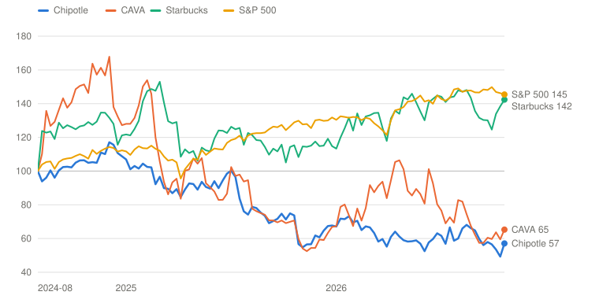
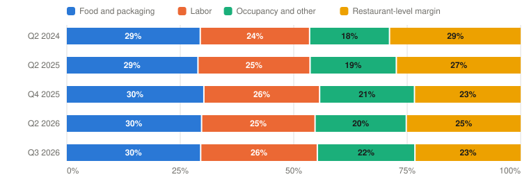

# CMG — Chipotle Mexican Grill, Inc.

> **Schema** v7.0 · **Updated** 2026-10-31 · **Status** Active
> **Price** $31.89 verified Oct 30, 2026 close, matched on Yahoo Finance and StockAnalysis ([Yahoo](https://finance.yahoo.com/quote/CMG/)) · 52-wk $27.31–$41.42 · 32nd %ile · −23.0% from high
> **Type** Company-operated fast-casual restaurants (unit: restaurant; AUV and restaurant-level margin) · **Stage** Mature compounder in a traffic reset · **Cyclical** No · **Competence** Core

## Verdict

**A debt-free restaurant compounder with 7,000 locations of runway delivered a third quarter of positive traffic and a margin miss; the probability-weighted case pays 5.6% a year against the 13% hurdle, so the price is fair-to-full until the two-year traffic stack turns and price catches beef.**

🟡 **Non-holder: Watch (entry ≤$23)** · 🟡 **Holder: Hold**

| PW EV | PW return/yr | Compounding/yr | R/R | Entry | Trim | Avoid | FY26E P/E | Yield | BAIT | Moat | Next |
|---|---|---|---|---|---|---|---|---|---|---|---|
| **$42** | **5.6% (<13%)** | 12.1% | 2.7:1 | ≤$23 | $42–$68 | ≥$68 | ≈30× | 0.0% | Single (B) | Narrow, narrowing | 📅 Early Feb (Q4 + FY27 guide) |

**Breaks if**: Q4 transactions fall short of the +1.5% the first test needs (the guide implies about +0.5%) and the 2027 guide implies a restaurant margin under 24%. Then the 2026 recovery was price, and 10 points move from the Base to the Bear.

## The Call

Chipotle's third quarter answered the question the stock was asking and raised another. Comps were +2.1% against a +1% guide, transactions grew 0.8% against −0.8%, and the stock gained 16% in a week from a three-year low. But restaurant margin was 23.3% against my 24.0% bar, the fourth quarter is guided just under 22%, and October softened. The market is right that traffic is back and too quick to forget that price now only matches inflation, with 2027 inflation guided low to mid single digits. At $31.89 the price needs EPS growth of about 13.9% to earn 9% and implies only 8% Bear odds; I assign 30%. My Base caps the restaurant margin at 24% and earns 7.2% a year; the weighted case earns 5.6%, short of 13% and now below the 12.1% the business compounds at a flat multiple, because the multiple falls from today's 30× to 24×. No debt, 350 openings a year and about 60% second-year cash-on-cash returns make this a business to own at $23, not at $32.

## What I'd Have To Be Wrong About

1. **That the traffic recovery is a turn, not a compare (Q4 leg).** Test: Q4 transactions ≥+1.5% against −3.2% in the Q4 release (February), so the two-year transaction stack improves again. The Q3 leg passed (+0.8% against −0.8%). The Q4 comp guide of about +2% with about 3% of price implies transactions near +0.5%. **If Fail →** move 10 points from Base to Bear (PW EV $39, 4.2%/yr) → **Watch**, entry $21.
2. **That restaurant margin stabilizes once price matches inflation.** Test: Q4 restaurant-level margin at least 21.8% (guide: just under 22%) and an FY2027 guide, or first-half 2027 margin, consistent with at least 24%. **If Fail →** move 10 points from Bull to Bear (PW EV $37, 2.9%/yr) → **Watch**, entry $20; the Base margin cap drops from 24% to 23%.
3. **That new units are not eating the old ones.** Test: trailing-12-month AUV at or above $3.10M in the FY2026 10-K (February; Q3: $3.106M), and year-two cash-on-cash returns still about 60% for the 2025 class. **If Fail →** move 10 points from Bull to Bear (PW EV $37, 2.9%/yr) → **Watch**; the $4M AUV goal comes out of the Bull.

## Latest update: 2026-10-31 · Traffic held, margin missed, and the stock rebounded 16%

- Traffic recovery is a turn, not a compare — 🟡 Pending — Q3 leg passed: transactions +0.8% against −0.8%, comps +2.1%. Q4 leg resolves in February; the guide implies transactions near +0.5% against the +1.5% bar
- Pricing catches up with beef — 🔴 Fail — Q3 restaurant margin 23.3% against the 24.0% bar; Q4 guided just under 22%. Base margin capped at 24%
- New units are not eating the old ones — 🟡 Pending — AUV $3.106M, above $3.10M, resolves in the FY2026 10-K

Chipotle reported the third quarter on October 28 after the close and the stock rose 8.9% the next day to $31.28, then $31.89 on Friday. That is 16% above the $27.52 close of October 23 and about 14% under the September high. The move says the market expected something worse than traffic growth of 0.8% and a comp of 2.1%. The margin missed my bar, though, and that is the result that cuts value.

| | Q3 2026 | Q3 2025 | Against expectations |
|---|---|---|---|
| Revenue | $3,293M (+9.6%) | $3,003M | Beat the revenue consensus `[Analyst consensus]` |
| Comparable sales | +2.1% | +0.3% | Guide was about +1%; consensus ≈+1.5% `[Analyst consensus]` |
| Transactions | +0.8% | −0.8% | Third positive quarter in a row |
| Restaurant-level margin | **23.3%** | 24.5% | Test bar 24.0%; the guide implied about 24% |
| Adjusted EPS | $0.27 (−7%) | $0.29 | Missed by two cents `[Analyst consensus]` |
| Average restaurant sales | $3.106M | $3.132M | Up from $3.102M in Q2 |
| Buyback | $110M at $34.05 | n/d | $631M in Q2 |

Sources: [Q3 release](https://www.sec.gov/Archives/edgar/data/1058090/000105809026000103/cmg-20261028xex991.htm), [call](https://www.fool.com/earnings/call-transcripts/2026/10/29/chipotle-cmg-q3-2026-earnings-call-transcript/), [Investing.com](https://www.investing.com/news/transcripts/earnings-call-transcript-chipotle-beats-revenue-in-q3-2026-shares-jump-after-hours-93CH-4981040).

The traffic leg did what I asked. Transactions rose 0.8% against a 0.8% decline a year earlier, so the two-year stack went from −3.9% in Q2 to about zero, and comps beat the guide even with a Cyclospora drag that the company put at about 200 bps in July. CFO Adam Rymer said momentum slowed from mid-July and returned by late August, and CEO Scott Boatwright said September comps were up 3.8% with little promotion. Digital reached 38.8% of sales and loyalty a record 33% of sales.

The margin leg did not. Restaurant margin fell 120 bps to 23.3%: food cost improved 50 bps on price and tariff relief, labor rose 50 bps on volume, wages and promotional staffing, and other operating costs rose 100 bps on marketing, delivery mix and utilities. The fourth quarter is guided lower, and Rymer was direct about it:

> "Altogether, this will put Q4 margins at just under 22%, which is roughly 150 basis points lower than last year."
> — Adam Rymer, CFO, Q3 2026 earnings call, October 28, 2026

Half of that gap is a prior-year gift-card benefit and about 30 bps is the Smoked Brisket marketing push, so the underlying drop is smaller. But the quarter's cost lines show that price at about 2.7% in Q3 and 3% in Q4 is only matching inflation, which the CFO said runs low to mid single digits again in 2027. Q4 comps are guided to about +2%, with an exit rate of 3–4% that depends on Brisket. October "softened, consistent with the broader industry," in Rymer's words, though Boatwright said transactions have turned positive again.

David Palmer of Evercore asked the question the market had been asking, which is whether October was down, and he did not get a number. I read Q4 comps of +2% with about 3% of price as transactions near +0.5%, which is under the +1.5% my first test requires. I expect that leg to fail.

**Scorecard.** The first test (turn, not compare) is half resolved: its Q3 leg passed and its Q4 leg is pending. The second test (price catches beef) failed on the number, 23.3% against a 24.0% bar, and the fourth-quarter guide adds to it, so I apply its consequence as written: the Base restaurant margin is capped at 24% and Base value falls. The model's cap gives $45 against the $44 I pre-committed, the difference being the lower base year and fewer shares. The third test (AUV at or above $3.10M) is pending to February; $3.106M passes for now.

**Return math.** The probability-weighted value moves from $43 to $42, and at $31.89 the return falls from 9.5% to 5.6% a year, against the 13% hurdle. The entry is $23. Two things happened and they point the same way. My value fell 3% on the margin cap. The price rose 16% on a print that beat on traffic. The verdict is unchanged (Watch for a non-holder, Hold for a holder), so no bias check is needed, and the change is price and evidence in about equal parts.

**Buyback.** Chipotle bought back $110 million in Q3 at $34.05 because a blackout kept it out of the market for part of the quarter, and Rymer said it will return after the blackout. Year to date it has spent $1.4 billion at an average $34.32 with about $1.6 billion authorized. Cash and investments are $1.0 billion, up from $0.78 billion in June, and there is no debt.

**Appearances.** The Q3 call is the only management appearance I found between October 23 and today. Insiders: no filings since the controller's August sale. Short interest is 3.05% of float.

Next: Smoked Brisket launches the week of the call; the fourth quarter, the 2027 guide and the 10-K come in early February.

**Earlier updates**: [2026-10-23 · A 26% fall in five weeks, and why the price is fair rather than cheap](report/updates/2026-10-23.md)

---

## Deep Dive: Chipotle: Traffic Came Back, the Stock Didn't

*Chipotle beat on traffic for the third quarter running and missed on margin, and the stock rebounded 16% from a three-year low. Is $31.89 a recovery or a pause in a brand that has lost its edge?*

**Contents**: [Business Overview](#business-overview) · [Traffic: A Turn or a Compare?](#traffic-a-turn-or-a-compare) · [Margin: Can Price Catch Beef?](#margin-can-price-catch-beef) · [Management, Capital Allocation and Incentives](#management-capital-allocation-and-incentives) · [Valuation and Model Assumptions](#valuation-and-model-assumptions) · [Final Words](#final-words) · [Appendix: The Numbers](#appendix-the-numbers) · [Sources](#sources)

On July 29 Chipotle did what it had failed to do for most of 2025: it raised its guidance. Second-quarter comparable sales rose 2.2%, transactions grew for the second quarter in a row, and the full-year outlook moved from "about flat" to low-single-digit growth. The stock closed at $34.25 and traded at $36.25 after hours. It peaked at $37.03 on September 14.

By October 23 it was $27.50, the lowest since January 2023. In five weeks it had lost 26% while CAVA, the competitor investors worry about most, lost 2% and consumer stocks were flat. Nothing in the business had been reported since July. What changed was a run of signals around it. Industry traffic data for August came in weak. A takeover rumor arrived and was withdrawn. A respected analyst said October looked soft. Then the third quarter came out on October 28: comps of 2.1% and a third straight quarter of growing transactions, with a restaurant margin of 23.3% and a fourth-quarter margin guided under 22%. The stock rose 9% the next day and closed at $31.89 on Friday.

*Total return including dividends, weekly, August 12, 2024 (the last close before Brian Niccol's move to Starbucks was announced) = 100. Source: Yahoo Finance adjusted closes. Built with Claude. Through October 30, 2026.*

| Date | Chipotle | CAVA | Starbucks | S&P 500 |
|---|---|---|---|---|
| 2024-08-12 | 100 | 100 | 100 | 100 |
| 2024-12-20 | 111 | 132 | 116 | 112 |
| 2025-05-09 | 89 | 104 | 106 | 107 |
| 2025-09-26 | 72 | 70 | 112 | 126 |
| 2026-02-06 | 70 | 78 | 134 | 132 |
| 2026-07-10 | 63 | 80 | 145 | 145 |
| 2026-10-30 | 57 | 65 | 142 | 145 |

The chart starts on August 12, 2024, the last day before Brian Niccol's move to Starbucks was announced. Since then Chipotle shareholders have lost about 43% of their money, CAVA's about 35%, while Starbucks and the S&P 500 are up 42% and 45%. Over the same period Chipotle's revenue grew from $11.3 billion in 2024 to $12.7 billion over the last twelve months, and EPS went from $1.11 to $1.07. So the whole loss is the multiple, which fell from about 54 times trailing earnings to 30. Mr. Market used to price Chipotle as a company that would compound for decades at 20%. He now prices it as a good restaurant chain with a traffic problem.

The question this piece tries to answer is which of those is closer to the truth, and whether $31.89 pays you for the uncertainty. I start with the business, then spend most of the time on traffic: whether the 2026 recovery is a turn or a compare. Then comes the margin, where beef and freight have run ahead of price. Then management, including a buyback that has spent most of the company's cash and a takeover rumor that came and went. I finish with valuation and the three things that would change my answer. Two of the three have been read once, on October 28, and the next reading is in February.

### Business Overview

Chipotle owns and runs all of its roughly 4,200 restaurants in the United States, Canada and Europe, plus a handful of partner-operated restaurants in the Middle East. It has no franchisees, no debt and one reportable segment. Its unit of value is the restaurant. The average one does $3.1 million of sales a year at a restaurant-level margin of about 24%, and about 80% of new ones include a Chipotlane, the drive-through pickup window for digital orders.

| $ Million | FY2023 | FY2024 | FY2025 | 9M 2025 | 9M 2026 |
|---|---|---|---|---|---|
| **Total revenue** | 9,872 | 11,314 | 11,926 | 8,942 | 9,730 |
|  YoY | +14.3% | +14.6% | +5.4% | +6.4% | +8.8% |
| Comparable restaurant sales | +7.9% | +7.4% | −1.7% | ≈−1.4% | ≈+1.6% |
| Transactions | +5.0% | +5.3% | −2.9% | ≈−2.7% | ≈+0.8% |
| Average restaurant sales (AUV, $M) | 3.018 | 3.213 | 3.104 | 3.132 (Q3) | 3.106 (Q3) |
| Company-owned restaurants opened | 271 | 304 | 334 | 202 | 233 |
| **Restaurant-level margin** | 26.2% | 26.7% | 25.4% | 25.9% | 23.9% |
| Food, beverage and packaging | 29.5% | 29.8% | 29.6% | 29.4% | 29.6% |
| Labor | 24.7% | 24.7% | 25.1% | 25.0% | 25.6% |
| **Operating margin (GAAP)** | 15.8% | 16.9% | 16.2% | 16.9% | 14.1% |
| **Diluted EPS (GAAP)** | $0.89 | $1.11 | $1.14 | $0.89 | $0.82 |
| Digital share of food and beverage sales | 37.4% | 35.1% | 36.7% | 36.7% (Q3) | 38.8% (Q3) |

*EPS adjusted for the June 2024 50-for-1 split. Nine-month comps and transactions are simple averages of the quarterly figures `[Derived]`; nine-month margins are 100% less the four restaurant cost lines in the release. Source: [FY2025 10-K](https://www.sec.gov/Archives/edgar/data/1058090/000105809026000009/cmg-20251231.htm), [Q3 2026 release](https://www.sec.gov/Archives/edgar/data/1058090/000105809026000103/cmg-20261028xex991.htm). Built with Claude.*

Two things in the table matter for what follows. Revenue growth has been carried by new restaurants: 334 opened in 2025 and about 350–370 this year. The comparable restaurants have done much less. Comps went from +7.4% in 2024 to −1.7% in 2025, the first annual decline since the 2016 food-safety crisis, and back to about +1.6% in the first nine months of 2026. Meanwhile restaurant-level margin has fallen from 26.7% to 23.9% over the same nine months, and the average restaurant now sells less than it did two years ago.

*Each bar is one quarter's revenue. Occupancy and other operating costs combined. Source: quarterly releases. Built with Claude.*

| Period | Food and packaging | Labor | Occupancy and other | Restaurant-level margin | Total (%) |
|---|---|---|---|---|---|
| Q2 2024 | 29 (29%) | 24 (24%) | 18 (18%) | 29 (29%) | 100 |
| Q2 2025 | 29 (29%) | 25 (25%) | 19 (19%) | 27 (27%) | 100 |
| Q4 2025 | 30 (30%) | 26 (26%) | 21 (21%) | 23 (23%) | 100 |
| Q2 2026 | 30 (30%) | 25 (25%) | 20 (20%) | 25 (25%) | 100 |
| Q3 2026 | 30 (30%) | 26 (26%) | 22 (22%) | 23 (23%) | 100 |

A few accounting points. Chipotle reports restaurant-level margin as a non-GAAP measure. It is revenue less food, labor, occupancy and other restaurant costs, before G&A and depreciation. The company owns no real estate; its $5.4 billion of operating leases are the main fixed obligation. Q1 and Q2 2026 included legal reserves and restructuring costs, which is why GAAP operating margin dropped to 12.9% in Q1 while the adjusted restaurant margin was 23.7%. EPS here is GAAP and includes stock compensation, which is about 1% of revenue. All per-share figures reflect the 50-for-1 split in June 2024.

### Traffic: A Turn or a Compare?

Let me start with where things stand. The Q3 column is the new one, and it is the best traffic number Chipotle has printed since 2024.

| Year over year | Q3 2025 | Q4 2025 | Q1 2026 | Q2 2026 | Q3 2026 | Q4 2026 guide |
|---|---|---|---|---|---|---|
| Comparable restaurant sales | +0.3% | −2.5% | +0.5% | +2.2% | **+2.1%** | ≈+2% |
| Transactions | −0.8% | −3.2% | +0.6% | +1.0% | **+0.8%** | ≈+0.5% implied |
| Average check | +1.1% | +0.7% | −0.1% | +1.2% | +1.3% | — |
| Menu price | n/d | n/d | ≈+1.0% | +1.6% | ≈+2.7% | ≈+3% |
| **Two-year transactions** | — | — | −1.7% | −3.9% | **0.0%** | ≈−2.7% implied |
| Restaurant-level margin | 24.5% | 23.4% | 23.7% (adj.) | 25.2% | **23.3%** | just under 22% |
| Diluted EPS (GAAP) | $0.29 | $0.25 | $0.23 | $0.32 | $0.27 | — |

*Two-year transactions compound the current quarter with the same quarter a year earlier. Q4 transactions are implied from the comp guide and about 3% of price `[Derived]`. Source: quarterly releases, [Q3 2026 release](https://www.sec.gov/Archives/edgar/data/1058090/000105809026000103/cmg-20261028xex991.htm), [Q3 call](https://www.fool.com/earnings/call-transcripts/2026/10/29/chipotle-cmg-q3-2026-earnings-call-transcript/). Built with Claude.*

#### Management's narrative

Management's case is that the "Recipe for Growth" plan launched in February is working. It has five parts: better throughput, more menu innovation, a relaunched Rewards program, hospitality, and group and catering occasions. On the July 29 call, CEO Scott Boatwright said Chipotle had "taken share in each month of 2026" and saw its "highest year-over-year gains in wallet share last quarter since 2024." He pointed to affordability scores "better in Q2 than they've been in probably the past couple of years," and to a younger and lower-income customer base that had improved the most, the cohort that had been hurt worst in 2025. On value, he made the point that matters for the margin debate: "value isn't just about discounting and price point." His argument is that a faster line, bigger portions and new items do more for perceived value than price cuts.

CFO Adam Rymer gave the near-term picture. Traffic improved through the second quarter and into early July. Then an industry-wide Cyclospora outbreak, in produce Chipotle doesn't serve, hit restaurant visits broadly: "we did see a softening, call it about 200 basis points or so right around the issue." He guided Q3 comps to "somewhere around a plus 1%" assuming that drag continued, which implies an underlying trend near 3%. He also said "comparisons become more difficult in the third quarter as we lap increased promotional activity in the prior year."

The supporting evidence is real. Linebackers, a staff member who helps the line move at peak, are deployed in over 70% of restaurants. Restaurants with the new equipment package serve two to three more entrees in their peak 15 minutes. General-manager turnover is at a multiyear low. Rymer said limited-time offers typically deliver "hundreds of basis points of trans lift," and Boatwright said a guest who tries an LTO is worth materially more over their lifetime.

#### Poking holes in it

The first hole is the base. Q3 transactions rose 0.8% against a 0.8% decline a year earlier, so the two-year stack went from −3.9% to about zero. That is real progress, and CEO Scott Boatwright said September comps were up 3.8% with very little promotion. But the compare was easy, the quarter needed promotional labor and marketing to hold through the mid-July industry slump, and "October trends have softened, consistent with the broader industry," as CFO Adam Rymer put it. The fourth quarter is guided to comps of about +2% with about 3% of that from price, which leaves transactions near +0.5% against a −3.2% compare that should be the easiest of the year. TD Cowen made this point on October 21 when it downgraded the stock, and the company's own guide now agrees with it.

The second hole is cost. David Palmer of Evercore put it plainly on the call: "it feels like Chipotle is doing a lot and spending a lot to get the 1% to 2% same-store sales growth lately." Boatwright's answer was that the initiatives are showing "green shoots of positive momentum." That is probably true, but labor rose to 25% of revenue from 24.7% partly because of extra hospitality staff, and the LTO calendar now has to keep running to hold traffic. Boatwright himself said of LTOs, "I do think there's a point of diminishing returns."

The third hole is CAVA. In the quarter ended July 12, CAVA's same-restaurant sales rose 9.0% with traffic up 5.3%. Chipotle's traffic grew 1.0%. CAVA is about a ninth of Chipotle's size, so this is not a story of customers being taken in bulk. It is a sign that the fast-casual bowl, a format Chipotle invented, is growing and Chipotle is not getting its share of the growth. The share that CAVA wins at the edge is exactly the incremental customer Chipotle needs to grow traffic.

The fourth hole is the restaurant itself. Average restaurant sales fell 3.4% in 2025 and another 1.3% in the year to June. Rymer said new openings take about 100 basis points a year from comparable sales through cannibalization. That is the right trade if each new restaurant earns about 60% cash-on-cash in year two, which it does. But it also means the long-term goal of $4 million AUVs set in February 2024 is getting further away, not closer.

| Illustrative average restaurant, per year | Q2 2024 | Q3 2025 | Q3 2026 | FY2031 Base | Management's long-term goal |
|---|---|---|---|---|---|
| AUV (trailing 12 months) | ≈$3.1M | $3.13M | $3.11M | ≈$3.42M (+2% a year) | **$4.0M** |
| Restaurant-level margin | 28.9% | 24.5% | **23.3%** | 24.0% | "approaching 30%" |
| **Restaurant-level profit** | ≈$900K | $767K | **$724K** | ≈$820K | ≈$1.15M |
| Change vs. Q3 2026 | +24% | +6% | — | +13% | +59% |
| What closes the gap | — | — | — | Price matching food inflation; traffic flat | AUV +29% on traffic; margin +6 pts |
| **New restaurant, year two (Q2 2026 disclosure)** |  |  | ≈60% cash-on-cash |  |  |

*Source: company filings, author's estimates. Restaurant-level profit = AUV × restaurant-level margin applied to an average comparable restaurant; Q2 2024 AUV approximated. Long-term goals from the [February 2024 release](https://www.sec.gov/Archives/edgar/data/1058090/000105809024000006/cmg-20240206xex99_1.htm). Built with Claude.*

The illustration is the debate in one row. An average Chipotle earned about $900,000 of restaurant-level profit in mid-2024 and about $725,000 in Q3 2026, with nearly all of the difference coming from margin. My Base gets back to about $820,000 by 2031 through price that matches food inflation and flat traffic. Management's long-term goal of a $4 million AUV at a margin "approaching 30%" would be worth about $1.15 million, 59% more than today. That goal needs roughly 29% more sales per restaurant. In a format where traffic has fallen for two years, it is a Bull assumption, not a Base.

Where I come out: the traffic recovery is real, no longer thin by the two-year measure, and still dependent on a heavy promotional and marketing calendar. The Q3 leg of my first test passed. The Q4 leg asks for transactions of at least +1.5% against −3.2%, and the guide implies less than that. If Q4 comes in near +0.5%, 2026 will have been a turn that needed spending to hold, and I will move weight to the Bear.

#### Three rings of profit

| Ring | Share of restaurant-level profit | Margin | Main threat | Exposure to the traffic debate |
|---|---|---|---|---|
| **1 · Comparable U.S. restaurants (≈3,800)** | ≈88% | ≈25% | Traffic share loss to CAVA and value chains; beef; food safety | **High**; this is the debate |
| **2 · New U.S. restaurants and Chipotlanes (opened since 2025, ≈480)** | ≈10% | Ramping; year-two cash-on-cash ≈60% | Cannibalization of ring 1; site quality at 350+ a year | Moderate |
| **3 · International company-owned and partner-operated** | ≈2% | n/d | Execution; partner quality | Low |

*Shares are the author's estimates from restaurant counts and the Q2 2026 10-Q's sales bridge (restaurants opened in 2025 and 2026 added $228M of Q2 revenue). Source: [Q2 2026 10-Q](https://www.sec.gov/Archives/edgar/data/1058090/000105809026000066/cmg-20260630.htm). Built with Claude.*

The rings make the risk clear. Almost all of the profit sits in the comparable U.S. restaurants, which is where the traffic debate lives. New restaurants are earning well and international is a small option. Unlike Starbucks or McDonald's, Chipotle has no royalty stream or licensed business to cushion a traffic problem. That is the cost of owning every restaurant, and it is why the multiple moves so much with the comp.

### Margin: Can Price Catch Beef?

The second debate is narrower and more mechanical. Restaurant-level margin was 27.4% in Q2 2025 and 25.2% in Q2 2026. The 10-Q gives the walk. Food, beverage and packaging rose 0.8 points of revenue: 1.4 points of inflation, mostly beef and freight, and 0.5 points of richer portions and produce usage, offset by 0.5 from menu price and 0.5 from cheaper avocados and dairy. Labor rose 0.3 points and other operating costs 0.9 points.

Management chose not to price for it. Rymer said pricing ran "around 1.6%" in Q2, would rise to "the mid-2% range in Q3," and that "from Q4 forward, we expect those 2 to match," meaning price and food inflation. For the year he expects pricing near the high end of 1–2%. That is a deliberate choice: Chipotle's 2022–24 price increases were large, traffic fell in 2025, and Boatwright doesn't want to repeat it while the recovery is fragile. I think it is the right choice for the long run. It is also why EPS has been flat for two years while revenue grew 10%.

The arithmetic is simple. Each point of restaurant margin is worth about $130 million of pre-tax profit at this year's revenue, or about 8 cents of EPS, about 7% of earnings. Getting from 24% back to the 26.7% of 2024 is worth about 21 cents. My Base assumes the margin gets back to 24% and stays there; the Q3 miss took the 25% I had before out of it. The Bull assumes 27% with traffic growth on top. The Bear assumes 21.5%, which would be the margin of a Chipotle that keeps paying for traffic it doesn't get.

The risk is that matching inflation isn't enough. Beef prices have been rising for three years on a shrinking U.S. herd, and tariffs on Mexican produce and packaging are flagged in the 10-K. Labor is the other half. Several states have raised restaurant minimum wages, and the hospitality model adds labor by design. Q3 came in at 23.3% against 24.5% a year earlier, and the fourth quarter is guided just under 22%, about 150 bps lower than last year. Half of that gap is a prior-year gift-card benefit and about 30 bps is the Smoked Brisket marketing push, so the underlying fall is smaller. But Rymer also said pricing is now only "in line with inflation," about 3% in Q4 and about 2% for the year, and that 2027 inflation should run low to mid single digits. My second test asked for 24.0% in Q3 and it failed, so the Base margin is capped at 24% from here. Margin recovery now has to come from transactions, which Rymer said will expand margins "as we drive additional transaction growth," and not from price.

### Management, Capital Allocation and Incentives

Scott Boatwright became CEO in November 2024, after Niccol left. He ran restaurant operations from 2017 and through Niccol's tenure, which makes him the architect of much of what worked: throughput, the Chipotlane rollout and the operations playbook behind the 2018–24 recovery. His first two years as CEO were hard. 2025 guidance was cut three times, from "low to mid-single digit" comp growth to a 1.7% decline, and the stock lost a third of its value. 2026 has been better so far. Adam Rymer is CFO. Chipotle also has a new chief brand officer and chief digital officer this year, and in September it added Sabir Sami, the former CEO of KFC, to the board.

The obvious comparison is Niccol's own record at Chipotle (2018–24), covered in my Starbucks piece. It was a 768% total return built almost entirely on earnings: margin from 6% to 17%, and revenue more than doubled. Boatwright inherited that machine at its peak margin and has so far defended unit growth while margin and traffic slipped.

#### The cash

| $ Billion | Revenue | YoY | Diluted EPS | CFO | SBC | Capex | FCF | FCF margin | Buybacks | % FCF | Cash + investments | Debt | Dil. shares (B) |
|---|---|---|---|---|---|---|---|---|---|---|---|---|---|
| FY2021 | 7.55 | +26.1% | $0.46 | 1.28 | 0.18 | 0.44 | 0.84 | 11.1% | 0.47 | 55% | 1.35 | 0 | 1.42 |
| FY2022 | 8.64 | +14.4% | $0.64 | 1.32 | 0.10 | 0.48 | 0.84 | 9.8% | 0.83 | 98% | 1.29 | 0 | 1.40 |
| FY2023 | 9.87 | +14.3% | $0.89 | 1.78 | 0.12 | 0.56 | 1.22 | 12.4% | 0.59 | 48% | 1.86 | 0 | 1.39 |
| FY2024 | 11.31 | +14.6% | $1.11 | 2.11 | 0.13 | 0.59 | 1.51 | 13.4% | 1.00 | 66% | 2.29 | 0 | 1.38 |
| FY2025 | 11.93 | +5.4% | $1.14 | 2.11 | 0.12 | 0.67 | 1.45 | 12.1% | 2.43 | 168% | 1.25 | 0 | 1.34 |
| 9M 2026 | 9.73 | +8.8% | $0.82 | 1.92 | 0.09 | 0.64 | 1.28 | 13.2% | 1.46 | 114% | 1.00 | 0 | 1.27 |
| **Cum. FY2021–25** | 49.31 |  |  | 8.61 | 0.65 | 2.74 | 5.87 | 11.9% | 5.32 | 91% | −0.10 | 0 | −5.8% |

*FCF = CFO − capex. No acquisitions and no dividends in the period; operating leases ($5.4B at June 30) are the only fixed obligations. Source: [SEC XBRL company facts](https://data.sec.gov/api/xbrl/companyfacts/CIK0001058090.json), 10-Ks, [Q3 2026 release](https://www.sec.gov/Archives/edgar/data/1058090/000105809026000066/cmg-20260630.htm). Built with Claude. 9M 2026 from the [Q3 2026 release](https://www.sec.gov/Archives/edgar/data/1058090/000105809026000103/cmg-20261028xex991.htm).*

Chipotle is simple to read. Over 2021–25 it generated $5.9 billion of free cash flow after funding about 1,360 new restaurants from its own cash, and returned $5.3 billion of it through buybacks. It has no debt and pays no dividend. The share count fell 5.8%. That is a model of restaurant capital allocation: the business funds its own growth and returns the rest.

What changed in 2025 is the pace. Chipotle bought back $2.4 billion in 2025 and $1.35 billion in the first half of 2026, well above free cash flow. Cash and investments fell from $2.29 billion at the end of 2024 to $0.78 billion in June.

| Repurchases | Q1 2025 | Q2 2025 | Q3 2025 | Q4 2025 | Q1 2026 | Q2 2026 | Q3 2026 | Total |
|---|---|---|---|---|---|---|---|---|
| $ Million | 591 | 436 | 687 | 742 | 701 | 631 | 110 | **3,898** |
| Average price | $54.78 | $50.16 | $42.39 | $34.14 | $36.14 | $32.55 | $34.05 | **≈$39.2** |
| Value at $31.89 |  |  |  |  |  |  |  | ≈$3.17B (−19%) |
| **Cash and investments at period end ($B)** |  |  |  | 1.25 |  | 0.78 | **1.00** | from 2.29 at YE2024 |

*Q1 2025 average price from the 10-Q equity roll-forward. Q3 2026 from the [release](https://www.sec.gov/Archives/edgar/data/1058090/000105809026000103/cmg-20261028xex991.htm): $110M at $34.05, with a blackout that kept the company out of the market for part of the quarter (CFO). Total shares ≈99.4M `[Derived]`. Built with Claude.*

The pattern is countercyclical in the good sense: Chipotle bought more as the price fell, $742 million at $34 in Q4 2025 against $436 million at $50 in Q2. That is how a buyback should behave. But the average cost of about $39 is well above today's $31.89, so the $3.9 billion has lost about $0.7 billion of value so far. In Q3 the company bought only $110 million at $34.05 because a blackout kept it out of the market, and cash and investments rebuilt to $1.0 billion. From here buybacks can run only at the pace of free cash flow, about $1.5 billion a year, or Chipotle has to borrow. That is still 4% of the market value a year, which is a good deal at 25 times earnings. But the extra support the stock got from spending the cash pile is over.

I grade capital allocation **Outsider-leaning**. The buybacks were sized against weakness, there is no M&A and no debt, and the growth capex earns the returns described above. It falls short of Outsider because the buyback outran free cash flow and drained the cash pile at prices that now look high.

Then there was October 8. The Financial Times reported that Starbucks had worked with advisers on a possible bid for Chipotle, and the stock rose 6% to $32.68 in a day. Four days later a Starbucks spokesperson told CNBC the company is "not buying Chipotle," and the stock gave it all back within two sessions. Chipotle itself said nothing. I don't think the episode tells us much about Chipotle's value. It does show that the stock had been carrying a little takeover hope, and that is now gone. Niccol knows this business better than anyone and judged it cheap enough to look at. That counts for something too.

#### The incentives

From the [2026 proxy](https://www.sec.gov/Archives/edgar/data/1058090/000114036126017294/ny20063214x1_def14a.htm):

| Component | Size / weight | What it pays for | Latest outcome |
|---|---|---|---|
| **Annual bonus: company factor (75%)** | 40% | Comparable restaurant sales | 2025 company factor paid 40% of target |
|  | 40% | Restaurant cash-flow margin |  |
|  | 20% | Site assessment requests (development pipeline) |  |
| **Annual bonus: individual (25%)** | 25% | Individual goals, capped by the company factor; food-safety modifier can cut the whole bonus |  |
| **Performance share units** | 90% | Three-year cumulative restaurant cash-flow dollars from restaurants open before the grant year | 2023–25 grant paid 273% |
|  | 10% | New restaurant openings (threshold 1,075 over 2025–27) |  |
|  | cap | Payout capped at 100% if three-year TSR is below the S&P 500's 25th percentile | Likely to bind on the 2025 grant |
| **Stock appreciation rights and RSUs** | — | Vest 50/50 on the second and third anniversaries |  |
| **Return on invested capital** | **0%** | Not measured anywhere in the plan | — |

*CEO Scott Boatwright's 2025 summary compensation was $15.5M; compensation actually paid was −$16.0M as equity values fell. Source: [2026 proxy statement](https://www.sec.gov/Archives/edgar/data/1058090/000114036126017294/ny20063214x1_def14a.htm). Built with Claude.*

The plan is well aimed at restaurant economics. The annual bonus pays equally on comparable sales and restaurant cash-flow margin, which is precisely the tension in the margin chapter: management is paid to grow traffic and to protect the margin, and can't simply buy one with the other. The performance shares pay on cash flow from the existing base, excluding new restaurants, so management can't hit the target just by opening more. A TSR cap stops a big payout if the stock lags. The 2023–25 grant paid 273% on the strong 2023–24 years, and the 2025 company factor paid 40% in a bad year. That is how pay should move.

What is missing is return on capital. That matters less at Chipotle than at most companies, because new restaurants are funded from cash and earn very high returns. It would matter more if management ever needed to choose between a buyback and a remodel program. Boatwright has hinted at "between $100,000 and $300,000 per restaurant" for the first aesthetic remodels in the brand's history.

#### The promises

| Promised | Where, when | Outcome |
|---|---|---|
| 7,000 restaurants in North America | [February 2024 release](https://www.sec.gov/Archives/edgar/data/1058090/000105809024000006/cmg-20240206xex99_1.htm); reiterated on the Q4 2025 and Q2 2026 calls | 🟡 On pace: 4,042 company-owned at YE2025, 350–370 openings a year → mid-2030s |
| $4 million AUVs | February 2024; reiterated on the Q4 2025 call | 🔴 Moving away: $3.21M (2024) → $3.11M (Q3 2026) |
| Restaurant margins "approaching 30%" | Q4 2025 call | 🔴 23.3% in Q3 2026 (−120 bps); Q4 guided just under 22% |
| 2025 comps "low to mid-single digit" growth | Q4 2024 release, February 2025 | 🔴 Cut three times; delivered −1.7% |
| 2026 comps "about flat" | Q4 2025 release, February 2026 | ✅ Raised to low single digits in July; 9M ≈+1.6%, Q4 guided ≈+2% |

*Source: company releases and calls. Built with Claude.*

**Guidance grade: Mixed.** 2025 was a miss: comp guidance was cut three times and ended at −1.7% against an initial low-to-mid-single-digit growth target. 2026 has been a beat so far, raised from flat to low single digits. The long-term promises are going the wrong way. Unit growth is on track, but AUV and margin are both moving away from the 2024 targets.

Is Boatwright the right manager? On operations and unit growth, I think yes. He built much of the system that made Chipotle what it is, and the 2026 metrics, turnover, throughput and new-unit returns, are improving. The open question is brand. Can he make the bowl feel worth $13–15 to a younger customer who now has CAVA down the street, without paying for traffic with margin? The next two quarters will say a lot.

### Valuation and Model Assumptions

I model Chipotle as one restaurant business. Revenue grows from units and comps. Restaurant-level margin is the main margin input, and G&A, depreciation and pre-opening costs come off as "corporate and other" at about 9.5–10% of revenue. Then come interest income, tax at 24.5% and buybacks. FY2026 is calibrated to about $12.9 billion of revenue, a 23.4% restaurant margin (nine months actual, Q4 at the guided just under 22%) and $1.06 of EPS. The exit multiple in the Base is 24 times, today's forward multiple. Here is the Base:

| $ Billion | FY2026E | FY2027E | FY2028E | FY2029E | FY2030E | FY2031E |
|---|---|---|---|---|---|---|
| **Restaurants (restaurant-level margin) revenue** | 12.9 | 14.0 | 15.1 | 16.3 | 17.6 | 19.0 |
|  YoY growth | 8.0% | **8.0%** | **8.0%** | **8.0%** | **8.0%** | **8.0%** |
|  Operating margin | 23.4% | 23.5% | 23.6% | 23.8% | 23.9% | **24.0%** |
|  Operating profit | 3.03 | 3.28 | 3.57 | 3.87 | 4.20 | 4.56 |
| Corporate and other | (1.27) | (1.36) | (1.46) | (1.57) | (1.68) | (1.80) |
| **Total revenue** | 12.9 | 14.0 | 15.1 | 16.3 | 17.6 | 19.0 |
| **Operating profit** | 1.76 | 1.92 | 2.11 | 2.30 | 2.52 | 2.75 |
|  Operating margin | 13.6% | 13.8% | 14.0% | 14.1% | 14.3% | 14.5% |
| Net income | 1.35 | 1.47 | 1.61 | 1.76 | 1.92 | 2.10 |
| Diluted shares (B) | 1.265 | 1.233 | 1.203 | 1.172 | 1.143 | 1.115 |
|  Net share change | — | -2.5% | -2.5% | -2.5% | -2.5% | -2.5% |
|  SBC (% of revenue) | 1.0% | 1.0% | 1.0% | 1.0% | 1.0% | 1.0% |
| **GAAP EPS** | $1.06 | $1.19 | $1.34 | $1.50 | $1.68 | $1.88 |
|  YoY growth | — | 12.1% | 12.1% | 12.1% | 12.1% | 12.1% |

*Bold cells are model inputs.*

The Base assumes about 2% comps a year, essentially price with flat traffic, and about 7% from new restaurants, so revenue grows 8% a year. Restaurant margin recovers only to 24%, the cap from the failed second test, and buybacks shrink the share count about 2.5% a year net of dilution, funded from free cash flow. EPS grows about 12.1% a year to $1.88, and at 24 times the stock is worth about $45 in 2031. That is a return of 7.2% a year, well under what the business compounds at a flat multiple, because the multiple compresses from about 30 times this year's EPS to 24.

| Case | Prob. | 3P | Restaurants (restaurant-level margin) growth / margin | Net shares/yr | Per-share earnings FY2031 | CAGR | Exit multiple | Value | Return/yr | Implied g | Driving assumption |
|---|---|---|---|---|---|---|---|---|---|---|---|
| **Bull** | 20% | Plausible | +10.0% / 27.0% | -3.0% | $2.62 | 19.8% | 26.0× GAAP EPS | $68 | 16.4% | 5.0% | Comps +4% a year with traffic +2%, 350+ openings a year; restaurant margin back to 27% (2024 level) as price catches beef; 26×, capped so implied growth stays under the 10-year Treasury. |
| **Base** | 50% | Probable | +8.0% / 24.0% | -2.5% | $1.88 | 12.1% | 24.0× GAAP EPS | $45 | 7.2% | 4.6% | Comps about +2% (price only), ~7% unit contribution; restaurant margin capped near 24% because price only matches inflation; buyback ~3% a year from free cash flow; 24×. |
| **Bear** | 30% | Probable | +4.0% / 21.5% | -1.5% | $1.16 | 1.7% | 16.0× GAAP EPS | $19 | -10.3% | 2.6% | Traffic keeps leaking to CAVA and value chains (comps −1.5% a year), openings slowed to ~250; restaurant margin 21.5%; EPS flat on 2025 for five years; 16×. |
| **Priced-in (9%/yr)** | — | diagnostic | +8.7% / 24.5% | -2.7% | $2.04 | 13.9% | 24.0× GAAP EPS | $49 | 9.0% | 4.6% | Solved along Bear → Base for 9%/yr |
| **Hurdle (13%/yr)** | — | diagnostic | +9.6% / 26.3% | -2.9% | $2.45 | 18.1% | 24.0× GAAP EPS | $59 | 13.0% | 4.6% | Solved along Base → Bull for 13%/yr |
| **Probability-weighted** | 100% |  |  |  |  |  |  | $42 | 5.6% |  |  |

| Return math |  |
|---|---|
| PW return/yr vs. hurdle | **5.6% (<13%)**, of which 0.0% is the dividend yield. Entry ≤$23. 10-year Treasury 4.99%; the hurdle sits 8.0 points above it. |
| Compounding at a flat multiple | Base per-share earnings growth 12.1% + 0.0% dividend = **12.1%**. Re-rating subtracts 4.9 points from the Base return: the multiple compresses. |
| Optionality | None valued. |
| Price-implied expectations | At 9%, spot needs $2.04 of per-share earnings in the terminal year (13.9% a year) at 24×. |
| EPV floor | ≈$12–14 per share: five-year average owner earnings of ≈$1.3B (FY2021–25), or FY2025's $1.47B, capitalized at 9% with no growth, plus $1.0B of cash, on 1.27B shares. About 58% of today's price pays for growth. The Bear ($19) sits above EPV because it keeps unit growth and buybacks while EPS goes nowhere. |
| Base rate / 3P | The Bull needs ≈10% nominal (≈7.5% real) revenue growth for five years from $13B; for companies of $10–25B, roughly a quarter sustain ≥7.5% real. Plausible, given visible unit growth. The Base's 8% nominal is in line with the unit pipeline alone. |
| Terminal-growth check | Implied perpetual growth on owner earnings at 9%: Bull 5.0%; Base 4.6%; Bear 2.6%. All below the risk-free rate. |
| Break-even and price-implied Bear odds | Break-even <0% against 30% assigned; price-implied 8% at 9%. |
| Year ten | Still growing at year ten: 7,000 North American restaurants is about a decade of openings at 350 a year, plus international. The exit multiple is not doing the work in the Base, which ends at today's 24×. |
| R/R | **2.7:1** (Bull +114% / Bear −42%) |

To earn an ordinary 9% a year at 24 times, Chipotle needs 2031 EPS of about $2.04, growth of about 13.9% a year. That is a little better than my Base, with the margin back near 25% and traffic growing. In scenario terms the price now implies a Bear probability of only about 8%, well under the 30% I assign. After the rebound Mr. Market is less worried than I am.

To earn 13% a year, Chipotle needs about $2.45 of EPS in 2031, growth of 18.1% a year, which is most of the way to my Bull: revenue growth near 9.4% and the margin back near 26%. Weighting the cases 20% Bull, 50% Base and 30% Bear gives about $42 and a return of 5.6% a year. The price at which the same case clears 13% is about $23. Capitalizing owner earnings with no growth gives only $12–14 a share, so about 58% of today's price is paying for the restaurants still to be opened. I am comfortable with that, because the unit pipeline is the most proven thing about the company.

**Bias check.** The previous page said "Watch / Initiate (scaled $27–32)" for a non-holder at $28.70. That page used a margin-of-safety entry 20% below its value. The new verb is Watch with entry at $23. (1) Incentive: the inputs come from company filings; TD Cowen's downgrade is context and moves no case. (2) Consistency: with no previous page I would write Watch at this return. (3) Social proof: the analyst consensus target is $43.55, so I am leaning against it, not with it. (4) Deprival: no fresh loss drives this. (5) Availability: the five-year record carries the case, and one quarter does not. The change comes from **method and evidence**, not price. The hurdle-derived entry replaced a margin-of-safety discount, the two-year traffic stack is weaker than the headline comps, and the margin fell 220 bps.

### Final Words

Chipotle is a better business than its stock price says, and a worse one than it was two years ago. It has no debt and funds about 350 new restaurants a year from its own cash at very high returns. It still earns 22% on its capital and has a decade of growth ahead in North America alone. But its average restaurant now sells less than in 2024, its margin is more than three points lower, and its traffic over two years is down while a smaller rival's is growing fast. Mr. Market has gone from paying 54 times earnings for the first story to about 30 times for the second.

At $31.89 he is paying more than I would. The probability-weighted return is 5.6% a year, below the 12.1% the business compounds at a flat multiple because the multiple falls from about 30 times to 24, and well short of the 13% hurdle. The rebound since October 23 has made Chipotle fairly priced to full, not cheap. The entry is about $23, about 29% below today. For a holder the answer is Hold. The balance sheet removes ruin risk, and the business will keep growing even if traffic stays flat.

What would change my mind? The next answer comes in February. Q4 transactions of at least +1.5% against −3.2% would make 2026 a turn and not a promotion-supported compare. A Q4 restaurant margin of at least 21.8% and a 2027 margin consistent with 24% or better would say price has stopped losing to beef. And AUV holding at $3.10 million or better, against $3.106 million now, would show that 350 openings a year are not eating the old restaurants. All three make the case for more than $31.89. Any one failing makes it for less.

Here are the three tests written as kill criteria, each with its consequence fixed in advance:

*The three tests, with their pre-committed consequences, are listed at the top of this report under [What I'd Have To Be Wrong About](#what-id-have-to-be-wrong-about).*

### Appendix: The Numbers

The tables below carry the framework's required numbers. The argument for each is made in the chapters above.

#### Five-year record

| $B, except per share | FY2021 | FY2022 | FY2023 | FY2024 | FY2025 |
|---|---|---|---|---|---|
| Revenue | 7.55 | 8.64 | 9.87 | 11.31 | **11.93** |
| Comparable restaurant sales | +19.2% | +7.9% | +7.9% | +7.4% | **−1.7%** |
| AUV ($M) | n/d | n/d | 3.02 | 3.21 | **3.10** |
| Restaurants opened | 215 | 236 | 271 | 304 | 334 |
| Operating margin (GAAP) | 10.7% | 13.4% | 15.8% | 16.9% | 16.2% |
| Diluted EPS (GAAP) | $0.46 | $0.64 | $0.89 | $1.11 | **$1.14** |
| Cash from operations | 1.28 | 1.32 | 1.78 | 2.11 | 2.11 |
| Capex | 0.44 | 0.48 | 0.56 | 0.59 | 0.67 |
| Maintenance capex (Greenwald) | 0.09 | 0.24 | 0.29 | 0.27 | 0.53 |
| **Owner earnings** | 1.01 | 0.99 | 1.37 | 1.70 | **1.47** |
| Owner earnings per share | $0.71 | $0.70 | $0.99 | $1.24 | **$1.09** |
| Owner-earnings conversion (÷ net income) | 155% | 110% | 112% | 111% | 95% |
| Buybacks | 0.47 | 0.83 | 0.59 | 1.00 | **2.43** |
| Cash and investments | 1.35 | 1.29 | 1.86 | 2.29 | 1.25 |
| Operating lease liabilities | 3.52 | 3.73 | 4.05 | 4.54 | 5.08 |
| Invested capital | 4.47 | 4.81 | 5.25 | 5.91 | 6.66 |
| **ROIC** | 14.5% | 18.4% | 22.5% | 24.8% | **22.2%** |
| **3-yr incremental ROIC (FY22→25)** | — | — | — | — | **32%** |
| Reinvestment rate (capex − D&A ÷ NOPAT) | 29% | 22% | 20% | 18% | 21% (51% incl. new leases) |
| SBC % of revenue | 2.3% | 1.1% | 1.3% | 1.2% | 1.0% |
| SBC ÷ owner earnings | 17% | 10% | 9% | 8% | 8% |
| FCF conversion (FCF ÷ net income) | 129% | 94% | 99% | 99% | 94% |
| Debt; interest coverage | None; n/m | None; n/m | None; n/m | None; n/m | None; n/m |
| Diluted shares (B) | 1.42 | 1.40 | 1.39 | 1.38 | **1.34** |
| Net share change | — | −1.5% | −1.3% | −0.6% | **−2.5%** |

*Split-adjusted. Source: [SEC XBRL company facts](https://data.sec.gov/api/xbrl/companyfacts/CIK0001058090.json), 10-Ks. [Derived]: invested capital = equity + operating-lease liabilities − cash and investments (no debt); NOPAT at the reported effective tax rate; owner earnings = CFO − SBC − maintenance capex, with maintenance = capex − 0.223 × Δ revenue (five-year average PP&E ÷ revenue). Cycle position: operating margin 16.2% in FY2025 against a FY2021–25 range of 10.7–16.9%; not cyclical, but the margin has turned down from its peak. Built with Claude.*

#### Growth levers

| Lever | Contribution now | Runway | Evidence | Management intent | Stage |
|---|---|---|---|---|---|
| Market growth | ≈1–2 pts | Indefinite | U.S. limited-service spending grows low single digits; dining visits −2.4% in August (Placer.ai) | — | Proven, slowing |
| Share gain (traffic) | **+1.0%** transactions | ? | Positive two quarters, but −3.9% on two years; CAVA traffic +5.3% | "Taken share in each month of 2026" | Unproven |
| Price and mix | +1.2% check (price +1.6%, mix −0.4%) | Ongoing | Pricing lagged beef and freight in H1; mid-2% in Q3 | Price to match inflation from Q4 | Proven, held back |
| Attach / new products | LTOs (Honey Chicken), catering, Rewards relaunch | 2–3 yrs | "Hundreds of basis points" of traffic lift from LTOs, with diminishing returns | Menu innovation, group occasions | Scaling |
| New units | **≈7 pts** of revenue growth | **8–10 yrs** | 350–370 a year to 7,000+; 80% with Chipotlanes; ≈60% year-two cash-on-cash | One restaurant a day | **Proven** |
| New geographies | <1 pt | 10+ yrs | Canada and Europe owned (Europe comps high single digits in Q2); Middle East, Mexico, Asia partner-operated | Partner-led | Option |
| M&A | None | — | Never an acquirer; the Starbucks rumor ran the other way | — | n/a |
| Margin | −220 bps restaurant margin YoY | 2–3 yrs | Beef, freight, labor and hospitality spending; HEEP equipment and throughput | "Approaching 30%" long term | Reversing |
| Share count | **−4 to −5% a year** (2025–26) | Limited | $3.8B repurchased in 18 months; cash down to $0.78B | "Opportunistically repurchase" | Slowing to FCF pace |

*Source: [Q2 call](https://www.fool.com/earnings/call-transcripts/2026/08/07/chipotle-cmg-q2-2026-earnings-call-transcript/), [Q2 2026 10-Q](https://www.sec.gov/Archives/edgar/data/1058090/000105809026000066/cmg-20260630.htm), [Placer.ai via Yahoo Finance](https://finance.yahoo.com/markets/stocks/articles/chipotle-slides-6-dining-traffic-200807189.html). Built with Claude.*

#### Moat, customer and profit pool

| Read | Call | Evidence |
|---|---|---|
| Mechanism | **Branding** + **scale economies** (supply chain, real estate, digital) | Only fast-casual chain of its size that owns all U.S. units; 38% digital mix; 22% ROIC on a no-debt balance sheet |
| Trend | **Narrowing** | Couldn't price for beef without hurting traffic; AUV down 3.4% in 2025 and 1.3% in the year to Q2; CAVA growing traffic about five times faster |
| Profit pool | Shifting toward labor, food and value-led rivals | Labor and food up 1.1 pts of revenue in Q2; hospitality and LTO spending to hold traffic |
| Customer | Lunch and dinner bowl buyers; younger and lower-income cohorts the most pressured, and the most improved in Q2 | Job: fast, customizable, perceived-healthy meal for about $12–15. Retention and cohort data n/d; Rewards scans only ≈20% of in-store transactions |

*7 Powers vocabulary (Helmer). Source: company filings and calls; assessments are the author's. Built with Claude.*

#### Competitors

| Competitor | Position | Threat |
|---|---|---|
| **CAVA** | Q2 same-restaurant sales +9.0%, traffic +5.3%, 476 restaurants, revenue +31% ([Q2 release](https://www.sec.gov/Archives/edgar/data/0001639438/000162828026055709/earningsrelease2026q2.htm)); stock −2% since Sep 14 | Rising; the clearest share-taker in the bowl format |
| **Taco Bell (Yum)** | Value-led Mexican QSR | Medium; the price ceiling in a trade-down |
| **McDonald's** | Value menus and promotions | Medium; competes for the lower-income lunch |
| **Starbucks (Niccol)** | Explored a bid per the FT; then "not buying Chipotle" | Not a competitor for diners; a possible floor for the stock that has now been withdrawn |

*Source: company filings and press; threat reads are the author's. Built with Claude.*

#### Risks and triggers

| Risk | Impact | Prob. | Priced in? | Would break the thesis if… |
|---|---|---|---|---|
| ⚠️ **Traffic recovery is only a compare**: Q3 transactions +0.8% against −0.8%, but October softened and the Q4 guide implies about +0.5% | High | Med | Partly | Q4 transactions below +1.5% against −3.2% (test 1) |
| ⚠️ **Margin squeeze**: price only matches inflation; Q3 23.3%, Q4 guided just under 22% | High | Med | Partly | An FY2027 guide or first-half margin below 24% (test 2) |
| ⚠️ **Food safety** `[recurring]`: an industry Cyclospora episode cost ≈200 bps of Q3 comps; a salmonella probe of a jalapeño lot (company not implicated, Aug 4 8-K) | High | Low-Med | Partly | Any outbreak attributed to Chipotle; the 2015–16 episode cut comps by 20%+ |
| **Cannibalization**: AUV falling while 350+ restaurants open each year | Med | Med | No | AUV below $3.10M at FY2026 (test 3) |
| **Buyback runway**: $3.9B in 21 months; cash and investments back to $1.0B | Med | Observed | Partly | Borrowing to buy back, or buybacks above FCF in 2027 |
| **Labor and wage regulation**: California and other state minimums; unionization efforts | Med | Med | Partly | Labor above 26% of revenue for a year |
| **CEO execution**: Boatwright's first two years include three guidance cuts | Med | Low | Partly | Another FY guide cut in 2027 |

*No reflexive loop: no debt, no stock-funded growth. No ruin path: operating leases are the only fixed obligation and are covered about 4× by restaurant cash flow. Source: 10-K Item 1A, author's assessments. Built with Claude.*

#### Catalysts

| Date | Catalyst | Why it matters |
|---|---|---|
| ✅ Jul 29 | Q2: comps +2.2%, FY guide raised; Q3 ≈+1% with a ≈200 bps Cyclospora drag ([release](https://www.sec.gov/Archives/edgar/data/1058090/000105809026000063/cmg-20260729xex991.htm)) | Old Q2 test passed |
| ✅ Aug 4 | 8-K: salmonella investigation of a jalapeño lot; Chipotle not implicated by Minnesota health officials ([8-K](https://www.sec.gov/Archives/edgar/data/1058090/000105809026000069/cmg-20260804.htm)) | Food-safety overhang |
| ✅ Sep 14–15 | Former KFC CEO Sabir Sami joins the board ([release](https://www.sec.gov/Archives/edgar/data/1058090/000105809026000088/cmg-20260914xex991.htm)); Placer.ai August data hit restaurants, CMG −6% | Board adds operator depth; sector traffic |
| ✅ Oct 8–12 | FT: Starbucks explored a bid (+6%); Starbucks: "not buying Chipotle" (−7% over two sessions) | Takeover premium in and out |
| ✅ Oct 21 | TD Cowen downgrade to Hold, target $44 → $32 ([report summary](https://finance.yahoo.com/markets/stocks/articles/cmg-stock-drops-td-cowen-182322640.html)) | October trends; below-consensus Q4 and 2027 comps |
| ✅ Oct 28 | Q3 2026: comps +2.1%, transactions +0.8%, restaurant margin 23.3%; Q4 margin guided just under 22% ([release](https://www.sec.gov/Archives/edgar/data/1058090/000105809026000103/cmg-20261028xex991.htm)) | Test 1 Q3 leg passed; test 2 failed |
| 📅 Early Nov | Smoked Brisket launch; buyback resumes after the blackout | Carries the 3–4% exit-rate claim |
| 📅 Early February 2027 | Q4, FY2027 guide, FY2026 10-K | Tests 1, 2 and 3 |

*Source: company releases, filings and press reports. Built with Claude.*

#### Sentiment and positioning

| Signal | Read |
|---|---|
| Analysts | Buy (35), mean target $40.58 `[Analyst consensus]` ([StockAnalysis](https://stockanalysis.com/stocks/cmg/statistics/)); TD Cowen Hold $32 (Oct 21) before the print |
| Short interest | 38.32M shares, 3.05% of float (Oct 30) |
| Insiders (Form 4, 90 days) | No open-market purchases; the last Form 4 is the controller's sale of 2,675 shares at $35.75 on Aug 21 |
| Appearances (Oct 23 – Oct 31) | The Q3 call (Oct 28) is the only management appearance located; no conference, podcast or earnings-day media interview found |
| BAIT | Single (B): a 26% fall into a downgrade, then a 16% rebound on the print; the analytical read (margin guide under 22%, October soft) does not support adding. I and T Weak |

*Context only; none of it moves a verb. Source: [StockAnalysis](https://stockanalysis.com/stocks/cmg/statistics/), [EDGAR Form 4](https://www.sec.gov/cgi-bin/browse-edgar?action=getcompany&CIK=0001058090&type=4), [24/7 Wall St.](https://247wallst.com/investing/2026/10/21/chipotle-falls-5-as-td-cowen-downgrades-cuts-target-to-32-mcdonalds-and-yum-brands-slip/). Built with Claude.*

### Sources

[Q3 2026 earnings release (8-K Ex-99.1, Oct 28)](https://www.sec.gov/Archives/edgar/data/1058090/000105809026000103/cmg-20261028xex991.htm) · [Q3 2026 call transcript (Motley Fool)](https://www.fool.com/earnings/call-transcripts/2026/10/29/chipotle-cmg-q3-2026-earnings-call-transcript/) · [Q3 2026 call notes](../../../raw/CMG/transcripts/2026-10-28_Q3-2026_call-notes.txt) · [Q3 2026 release extract](../../../raw/CMG/press-releases/2026-10-28_Q3-2026-results.txt) · [Investing.com: Q3 2026 call transcript](https://www.investing.com/news/transcripts/earnings-call-transcript-chipotle-beats-revenue-in-q3-2026-shares-jump-after-hours-93CH-4981040) · [Q2 2026 earnings release (8-K Ex-99.1)](https://www.sec.gov/Archives/edgar/data/1058090/000105809026000063/cmg-20260729xex991.htm) · [Q2 2026 10-Q](https://www.sec.gov/Archives/edgar/data/1058090/000105809026000066/cmg-20260630.htm) · [Q2 2026 call transcript (Motley Fool)](https://www.fool.com/earnings/call-transcripts/2026/08/07/chipotle-cmg-q2-2026-earnings-call-transcript/) · [Q2 2026 call transcript (Investing.com cross-check)](https://www.investing.com/news/transcripts/earnings-call-transcript-chipotle-beats-q2-2026-estimates-as-stock-jumps-93CH-4821911) · [Q1 2026 release](https://www.sec.gov/Archives/edgar/data/1058090/000105809026000027/cmg-20260429xex991.htm) · [Q4 and FY2025 release](https://www.sec.gov/Archives/edgar/data/1058090/000105809026000007/cmg-20260203xex991.htm) · [Q3 2025 release](https://www.sec.gov/Archives/edgar/data/1058090/000105809025000086/cmg-20251029xex991.htm) · [Q2 2025 release](https://www.sec.gov/Archives/edgar/data/1058090/000105809025000055/cmg-20250723xex991.htm) · [FY2025 10-K](https://www.sec.gov/Archives/edgar/data/1058090/000105809026000009/cmg-20251231.htm) · [FY2024 10-K](https://www.sec.gov/Archives/edgar/data/1058090/000105809025000014/cmg-20241231.htm) · [2026 proxy statement](https://www.sec.gov/Archives/edgar/data/1058090/000114036126017294/ny20063214x1_def14a.htm) · [8-K, Aug 4, 2026 (food safety)](https://www.sec.gov/Archives/edgar/data/1058090/000105809026000069/cmg-20260804.htm) · [Board appointment release, Sep 14, 2026](https://www.sec.gov/Archives/edgar/data/1058090/000105809026000088/cmg-20260914xex991.htm) · [February 2024 release (7,000 restaurants, $4M AUV)](https://www.sec.gov/Archives/edgar/data/1058090/000105809024000006/cmg-20240206xex99_1.htm) · [SEC XBRL company facts (CMG)](https://data.sec.gov/api/xbrl/companyfacts/CIK0001058090.json) · [CAVA Q2 2026 release](https://www.sec.gov/Archives/edgar/data/0001639438/000162828026055709/earningsrelease2026q2.htm) · [Bloomberg Government: Chipotle jumps on Starbucks report (Oct 8)](https://news.bgov.com/mergers-and-acquisitions/chipotle-jumps-on-report-starbucks-has-explored-takeover-1) · [CNBC: Starbucks denies Chipotle takeover (Oct 12)](https://www.cnbc.com/amp/2026/10/12/starbucks-denies-chipotle-takeover.html) · [Yahoo Finance: TD Cowen downgrade (Oct 21)](https://finance.yahoo.com/markets/stocks/articles/cmg-stock-drops-td-cowen-182322640.html) · [24/7 Wall St.: TD Cowen downgrade (Oct 21)](https://247wallst.com/investing/2026/10/21/chipotle-falls-5-as-td-cowen-downgrades-cuts-target-to-32-mcdonalds-and-yum-brands-slip/) · [Yahoo Finance: dining traffic report hits restaurant stocks (Sep 15)](https://finance.yahoo.com/markets/stocks/articles/chipotle-slides-6-dining-traffic-200807189.html) · [Bloomberg: Chipotle cuts outlook for third time in 2025](https://news.bgov.com/antitrust/chipotle-cuts-outlook-for-third-time-in-2025-on-weak-traffic-1) · [StockAnalysis statistics](https://stockanalysis.com/stocks/cmg/statistics/) · [Yahoo Finance](https://finance.yahoo.com/quote/CMG/)

---

*Analysis, not personal investment advice. Every figure traces to a linked primary source or carries a tag ([Estimate], [Analyst consensus], [Management guidance], [Derived]). No position sizing by design. Built from [report/](report/) by kg-investment-analysis v7; edit the sources there, not this file.*
