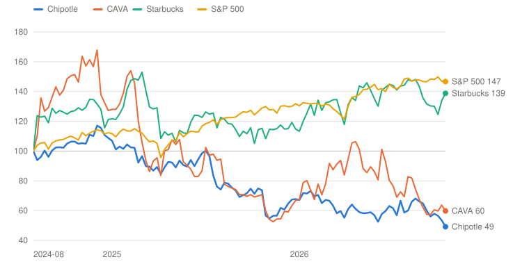
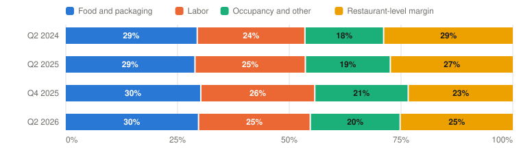

# CMG — Chipotle Mexican Grill, Inc.

> **Schema** v7.0 · **Updated** 2026-10-23 · **Status** Active
> **Price** $27.50 verified Oct 23, 2026, 12:15 PM ET (StockAnalysis $27.52) ([Yahoo](https://finance.yahoo.com/quote/CMG/)) · 52-wk $27.45–$42.19 · 0th %ile · −34.8% from high
> **Type** Company-operated fast-casual restaurants (unit: restaurant; AUV and restaurant-level margin) · **Stage** Mature compounder in a traffic reset · **Cyclical** No · **Competence** Core

## Verdict

**A debt-free restaurant compounder with 7,000 locations of runway is at a three-year low on traffic, margin and food-safety worries; the probability-weighted case pays 9.5% a year against the 13% hurdle, so the price is fair rather than cheap until the two-year traffic stack turns positive.**

🟡 **Non-holder: Watch (entry ≤$23)** · 🟡 **Holder: Hold**

| PW EV | PW return/yr | Compounding/yr | R/R | Entry | Trim | Avoid | FY26E P/E | Yield | BAIT | Moat | Next |
|---|---|---|---|---|---|---|---|---|---|---|---|
| **$43** | **9.5% (<13%)** | 12.1% | 4.5:1 | ≤$23 | $43–$68 | ≥$68 | ≈24× | 0.0% | Single (B) | Narrow, narrowing | 📅 Oct 28 (Q3) |

**Breaks if**: Q4 2026 transactions are not positive against last year's −3.2%, with October already soft. Then the 2026 recovery was a compare, not a turn, and 10 points move from the Base to the Bear.

## The Call

Chipotle has fallen 26% since September 14 while CAVA fell 2% and consumer stocks were flat. Four things did it: August dining-traffic data that hit the whole group on September 15; a Starbucks takeover report on October 8 that added 6% and a denial four days later that took it back; TD Cowen's October 21 downgrade on a soft October; and a restaurant margin squeezed 220 basis points by beef and freight. The market is right that the recovery is thinner than the headlines. Q2 transactions rose 1.0% against −4.9% a year earlier, so over two years traffic is still down about 4%, AUV is falling, and CAVA's traffic grew five times as fast. It is too gloomy about the machine underneath: no debt, 350 openings a year at about 60% second-year cash-on-cash returns, and a 22% ROIC. At $27.50 the price needs EPS growth of about 9.3% to earn 9% and implies 33% Bear odds; I assign 30%. That earns 9.5%, close to the 12.1% the business compounds at a flat multiple but short of 13%. Entry is $23, or a positive two-year traffic stack.

## What I'd Have To Be Wrong About

1. **That the traffic recovery is a turn, not a compare.** Test: Q3 (Oct 28) comps ≥+1% with transactions ≥0% against −0.8%, then Q4 (February) transactions ≥+1.5% against −3.2%, so the two-year transaction stack improves in both quarters. **If Fail →** move 10 points from Base to Bear (PW EV $40, 7.9%/yr) → **Watch**, entry $22.
2. **That pricing catches up with beef.** Test: Q3 restaurant-level margin ≥24.0% (the guide implies about 24%), Q4 pricing at or above food-cost inflation as the CFO promised, and FY2027 guidance consistent with a restaurant margin of at least 25%. **If Fail →** Base restaurant margin capped at 24%, value cut to $44 (PW EV $41, 8.4%/yr) → **Watch**, entry $22.
3. **That new units are not eating the old ones.** Test: trailing-12-month AUV at or above $3.10M in the FY2026 10-K (February), and year-two cash-on-cash returns still about 60% for the 2025 class. **If Fail →** move 10 points from Bull to Bear (PW EV $38, 6.9%/yr) → **Watch**; the $4M AUV goal comes out of the Bull.

## Latest update: 2026-10-23 · A 26% fall in five weeks, and why the price is fair rather than cheap

- Q2 2026 comps at or above +1% — ✅ Pass — +2.2%, transactions +1.0%; FY guide raised to low single digits
- Restaurant-level margin stays above 22% — ✅ Pass — 25.2% in Q2 (−220 bps YoY); Q3 guide implies about 24%
- New-unit returns stay above 15%; no CEO departure — ✅ Pass — year-two cash-on-cash ≈60%; Boatwright in place

My last page on Chipotle was written on June 3 at $28.70. The stock rallied to $37.03 by September 14 on a good second quarter and has since fallen 26% to $27.50, a new 52-week low. The page never logged the July print, so this note covers both.

**What the July print said.** Q2 comps rose 2.2%, transactions 1.0% and revenue 9.3%, and full-year comp guidance went from "about flat" to low single digits ([release](https://www.sec.gov/Archives/edgar/data/1058090/000105809026000063/cmg-20260729xex991.htm)). Restaurant-level margin fell to 25.2% from 27.4% as beef and freight inflation outran a 1.6% price increase, and EPS was flat at $0.32. Q3 was guided to about +1%, including a roughly 200 bps drag from an industry Cyclospora outbreak that does not involve Chipotle's menu. A week later an 8-K disclosed a salmonella investigation involving a jalapeño lot; Minnesota health officials said they had no ongoing concerns with Chipotle ([8-K](https://www.sec.gov/Archives/edgar/data/1058090/000105809026000069/cmg-20260804.htm)). Buybacks were $631 million at $32.55.

**What drove the 26%.** Four things, none of them a Chipotle report.

- *September 15, −6%.* Placer.ai's August index showed visits to brick-and-mortar dining chains down 2.4% year over year. Wingstop fell 12% and CAVA 9% that day, so this one was the sector ([Yahoo Finance](https://finance.yahoo.com/markets/stocks/articles/chipotle-slides-6-dining-traffic-200807189.html)).
- *Late September to early October, about −10%.* A slow drift with margin worries (beef, freight) and no specific news; CAVA recovered its September 15 loss over the same weeks and Chipotle did not.
- *October 8–12, +6% then −7%.* The FT reported that Starbucks had explored a bid; four days later Starbucks said it is "not buying Chipotle." The premium came and went.
- *October 21, −5%.* TD Cowen downgraded to Hold and cut its target to $32 from $44, saying October sales are missing the Q4 inflection it expected even against an easy compare, and modeling below-consensus comps for Q4 and 2027 ([Yahoo Finance](https://finance.yahoo.com/markets/stocks/articles/cmg-stock-drops-td-cowen-182322640.html)). Wells Fargo trimmed to $40.

**Scorecard.** The June page carried thesis-break triggers rather than tests. All the ones that resolved, passed. Q2 comps beat the +1% bar at +2.2%. Restaurant margin stayed well above the 22% floor at 25.2%. Year-two cash-on-cash returns on new restaurants are about 60%. Boatwright remains CEO. CAVA posted +9.0% comps, but Chipotle was positive in both quarters, so the "share transfer confirmed" trigger did not fire. It came close in spirit, since CAVA's traffic grew five times as fast. The new tests are in the front matter: the two-year traffic stack at Q3 and Q4, restaurant margin back to at least 24% with price matching inflation, and AUV holding at $3.10 million.

**What it does to the case.** The move to the current framework changes the frame more than the facts. The June page set its entry 20% below its probability-weighted value. Today's entry is the price at which the probability-weighted case earns 13% a year, and the five-year cases are built from units, margin and buybacks. The PW value is $43, against $41.50 in June. It is higher because the Base now carries five years of unit growth and buybacks. But it returns 9.5% a year, short of the hurdle. The Bear gets 30% because two-year traffic is still −3.9% and AUV is falling.

**The verdict.** Non-holder: Watch, entry about $23. Holder: Hold. The selloff has moved Chipotle from expensive to fair. Q3 on October 28 is the first of three readings that would make it cheap enough to buy at 13%.

---

## Deep Dive: Chipotle: Traffic Came Back, the Stock Didn't

*Chipotle raised its guidance in July, has grown transactions for two quarters and is buying back stock as fast as its cash allows. The stock is at its lowest since January 2023. Is $27.50 the price of a scare that will pass, or of a brand that has lost its edge?*

**Contents**: [Business Overview](#business-overview) · [Traffic: A Turn or a Compare?](#traffic-a-turn-or-a-compare) · [Margin: Can Price Catch Beef?](#margin-can-price-catch-beef) · [Management, Capital Allocation and Incentives](#management-capital-allocation-and-incentives) · [Valuation and Model Assumptions](#valuation-and-model-assumptions) · [Final Words](#final-words) · [Appendix: The Numbers](#appendix-the-numbers) · [Sources](#sources)

On July 29 Chipotle did what it had failed to do for most of 2025: it raised its guidance. Second-quarter comparable sales rose 2.2%, transactions grew for the second quarter in a row, and the full-year outlook moved from "about flat" to low-single-digit growth. The stock closed at $34.25 and traded at $36.25 after hours. It peaked at $37.03 on September 14.

Today it is $27.50, the lowest since January 2023. In five weeks it has lost 26% while CAVA, the competitor investors worry about most, lost 2% and consumer stocks were flat. Nothing in the business has been reported since July. What changed was a run of signals around it. Industry traffic data for August came in weak. A takeover rumor arrived and was withdrawn. A respected analyst said October looked soft. And the margin pressure everyone already knew about started to look like a trend rather than a quarter.

*Total return including dividends, weekly, August 12, 2024 (the last close before Brian Niccol's move to Starbucks was announced) = 100. Source: Yahoo Finance adjusted closes. Built with Claude.*

| Date | Chipotle | CAVA | Starbucks | S&P 500 |
|---|---|---|---|---|
| 2024-08-12 | 100 | 100 | 100 | 100 |
| 2024-12-13 | 116 | 138 | 128 | 114 |
| 2025-04-25 | 93 | 101 | 111 | 104 |
| 2025-09-05 | 74 | 74 | 114 | 123 |
| 2026-01-09 | 72 | 79 | 120 | 132 |
| 2026-05-22 | 59 | 89 | 141 | 143 |
| 2026-10-09 | 56 | 60 | 125 | 150 |
| 2026-10-23 | 49 | 60 | 139 | 147 |

The chart starts on August 12, 2024, the last day before Brian Niccol's move to Starbucks was announced. Since then Chipotle shareholders have lost about half their money, CAVA's about 40%, while Starbucks and the S&P 500 are up 39% and 47%. Over the same period Chipotle's revenue grew from $11.3 billion in 2024 to $12.4 billion over the last twelve months, and EPS went from $1.11 to $1.09. So the whole loss is the multiple, which fell from about 54 times trailing earnings to 25. Mr. Market used to price Chipotle as a company that would compound for decades at 20%. He now prices it as a good restaurant chain with a traffic problem.

The question this piece tries to answer is which of those is closer to the truth, and whether $27.50 pays you for the uncertainty. I start with the business, then spend most of the time on traffic: whether the 2026 recovery is a turn or a compare. Then comes the margin, where beef and freight have run ahead of price. Then management, including a buyback that has spent most of the company's cash and a takeover rumor that came and went. I finish with valuation and the three things that would change my answer. The first of them arrives on October 28, when Chipotle reports Q3.

### Business Overview

Chipotle owns and runs all of its roughly 4,200 restaurants in the United States, Canada and Europe, plus a handful of partner-operated restaurants in the Middle East. It has no franchisees, no debt and one reportable segment. Its unit of value is the restaurant. The average one does $3.1 million of sales a year at a restaurant-level margin of about 25%, and about 80% of new ones include a Chipotlane, the drive-through pickup window for digital orders.

| $ Million | FY2023 | FY2024 | FY2025 | H1 2025 | H1 2026 |
|---|---|---|---|---|---|
| **Total revenue** | 9,872 | 11,314 | 11,926 | 5,939 | 6,437 |
|  YoY | +14.3% | +14.6% | +5.4% | +6.4% | +8.4% |
| Comparable restaurant sales | +7.9% | +7.4% | −1.7% | −2.3% | +1.4% |
| Transactions | +5.0% | +5.3% | −2.9% | −3.7% | +0.8% |
| Average restaurant sales (AUV, $M) | 3.018 | 3.213 | 3.104 | 3.142 (Q2) | 3.102 (Q2) |
| Company-owned restaurants opened | 271 | 304 | 334 | 118 | 149 |
| **Restaurant-level margin** | 26.2% | 26.7% | 25.4% | 26.8% | 24.5% |
| Food, beverage and packaging | 29.5% | 29.8% | 29.6% | 29.0% | 29.6% |
| Labor | 24.7% | 24.7% | 25.1% | 24.8% | 25.5% |
| **Operating margin (GAAP)** | 15.8% | 16.9% | 16.2% | 17.4% | 14.4% |
| **Diluted EPS (GAAP)** | $0.89 | $1.11 | $1.14 | $0.60 | $0.55 |
| Digital share of food and beverage sales | 37.4% | 35.1% | 36.7% | ≈35.5% | ≈38.4% |

*EPS adjusted for the June 2024 50-for-1 split. H1 2025 restaurant-level margin is the reported Q1 and Q2 figures weighted by revenue. Source: [FY2025 10-K](https://www.sec.gov/Archives/edgar/data/1058090/000105809026000009/cmg-20251231.htm), [FY2024 10-K](https://www.sec.gov/Archives/edgar/data/1058090/000105809025000014/cmg-20241231.htm), [Q2 2026 10-Q](https://www.sec.gov/Archives/edgar/data/1058090/000105809026000066/cmg-20260630.htm). Built with Claude.*

Two things in the table matter for what follows. Revenue growth has been carried by new restaurants: 334 opened in 2025 and about 350–370 this year. The comparable restaurants have done much less. Comps went from +7.4% in 2024 to −1.7% in 2025, the first annual decline since the 2016 food-safety crisis, and back to +1.4% in the first half of 2026. Meanwhile restaurant-level margin has fallen from 26.7% to 24.5% in the first half, and the average restaurant now sells less than it did two years ago.

*Each bar is one quarter's revenue. Occupancy and other operating costs combined. Source: quarterly releases. Built with Claude.*

| Period | Food and packaging | Labor | Occupancy and other | Restaurant-level margin | Total (%) |
|---|---|---|---|---|---|
| Q2 2024 | 29 (29%) | 24 (24%) | 18 (18%) | 29 (29%) | 100 |
| Q2 2025 | 29 (29%) | 25 (25%) | 19 (19%) | 27 (27%) | 100 |
| Q4 2025 | 30 (30%) | 26 (26%) | 21 (21%) | 23 (23%) | 100 |
| Q2 2026 | 30 (30%) | 25 (25%) | 20 (20%) | 25 (25%) | 100 |

A few accounting points. Chipotle reports restaurant-level margin as a non-GAAP measure. It is revenue less food, labor, occupancy and other restaurant costs, before G&A and depreciation. The company owns no real estate; its $5.4 billion of operating leases are the main fixed obligation. Q1 and Q2 2026 included legal reserves and restructuring costs, which is why GAAP operating margin dropped to 12.9% in Q1 while the adjusted restaurant margin was 23.7%. EPS here is GAAP and includes stock compensation, which is about 1% of revenue. All per-share figures reflect the 50-for-1 split in June 2024.

### Traffic: A Turn or a Compare?

Let me start with where things stand.

| Year over year | Q2 2025 | Q3 2025 | Q4 2025 | Q1 2026 | Q2 2026 | Q3 2026 guide |
|---|---|---|---|---|---|---|
| Comparable restaurant sales | −4.0% | +0.3% | −2.5% | +0.5% | **+2.2%** | ≈+1% |
| Transactions | −4.9% | −0.8% | −3.2% | +0.6% | **+1.0%** | n/d |
| Average check | +0.9% | +1.1% | +0.7% | −0.1% | +1.2% | — |
| Menu price | +1.9% | n/d | n/d | ≈+1.0% | +1.6% | mid-2% |
| **Two-year transactions** | — | — | — | −1.7% | **−3.9%** | ≈−1% if flat |
| Restaurant-level margin | 27.4% | 24.5% | 23.4% | 23.7% (adj.) | 25.2% | ≈24% implied |
| Diluted EPS (GAAP) | $0.32 | $0.29 | $0.25 | $0.23 | $0.32 | $0.29 consensus |

*Two-year transactions compound the current quarter with the same quarter a year earlier (Q1 2025 transactions −2.3%). Q3 2026 margin implied from the CFO's cost guide (cost of sales just under 30%, labor mid-25%, other operating costs mid-15%, occupancy ≈5.2%). Source: quarterly releases ([Q2 2025](https://www.sec.gov/Archives/edgar/data/1058090/000105809025000055/cmg-20250723xex991.htm), [Q3 2025](https://www.sec.gov/Archives/edgar/data/1058090/000105809025000086/cmg-20251029xex991.htm), [Q4 2025](https://www.sec.gov/Archives/edgar/data/1058090/000105809026000007/cmg-20260203xex991.htm), [Q1 2026](https://www.sec.gov/Archives/edgar/data/1058090/000105809026000027/cmg-20260429xex991.htm), [Q2 2026](https://www.sec.gov/Archives/edgar/data/1058090/000105809026000063/cmg-20260729xex991.htm)), [Q2 call](https://www.fool.com/earnings/call-transcripts/2026/08/07/chipotle-cmg-q2-2026-earnings-call-transcript/). Built with Claude.*

#### Management's narrative

Management's case is that the "Recipe for Growth" plan launched in February is working. It has five parts: better throughput, more menu innovation, a relaunched Rewards program, hospitality, and group and catering occasions. On the July 29 call, CEO Scott Boatwright said Chipotle had "taken share in each month of 2026" and saw its "highest year-over-year gains in wallet share last quarter since 2024." He pointed to affordability scores "better in Q2 than they've been in probably the past couple of years," and to a younger and lower-income customer base that had improved the most, the cohort that had been hurt worst in 2025. On value, he made the point that matters for the margin debate: "value isn't just about discounting and price point." His argument is that a faster line, bigger portions and new items do more for perceived value than price cuts.

CFO Adam Rymer gave the near-term picture. Traffic improved through the second quarter and into early July. Then an industry-wide Cyclospora outbreak, in produce Chipotle doesn't serve, hit restaurant visits broadly: "we did see a softening, call it about 200 basis points or so right around the issue." He guided Q3 comps to "somewhere around a plus 1%" assuming that drag continued, which implies an underlying trend near 3%. He also said "comparisons become more difficult in the third quarter as we lap increased promotional activity in the prior year."

The supporting evidence is real. Linebackers, a staff member who helps the line move at peak, are deployed in over 70% of restaurants. Restaurants with the new equipment package serve two to three more entrees in their peak 15 minutes. General-manager turnover is at a multiyear low. Rymer said limited-time offers typically deliver "hundreds of basis points of trans lift," and Boatwright said a guest who tries an LTO is worth materially more over their lifetime.

#### Poking holes in it

The first hole is the base. Q2 transactions rose 1.0% against a 4.9% decline a year earlier. Compounded over two years, traffic is still down about 3.9%. Q1 was −1.7% on the same basis. The recovery so far is mostly getting back customers lost in 2025. That doesn't make it fake, but it means Q3, against −0.8%, is the first quarter where growth has to come from somewhere other than an easy compare. Q4, against −3.2%, should be easy again. If October is soft against that compare, as TD Cowen said on October 21 when it downgraded the stock, that is a bad sign. The firm now expects below-consensus comps for Q4 and for 2027, about 2.5% against 3.4%.

The second hole is cost. David Palmer of Evercore put it plainly on the call: "it feels like Chipotle is doing a lot and spending a lot to get the 1% to 2% same-store sales growth lately." Boatwright's answer was that the initiatives are showing "green shoots of positive momentum." That is probably true, but labor rose to 25% of revenue from 24.7% partly because of extra hospitality staff, and the LTO calendar now has to keep running to hold traffic. Boatwright himself said of LTOs, "I do think there's a point of diminishing returns."

The third hole is CAVA. In the quarter ended July 12, CAVA's same-restaurant sales rose 9.0% with traffic up 5.3%. Chipotle's traffic grew 1.0%. CAVA is about a ninth of Chipotle's size, so this is not a story of customers being taken in bulk. It is a sign that the fast-casual bowl, a format Chipotle invented, is growing and Chipotle is not getting its share of the growth. The share that CAVA wins at the edge is exactly the incremental customer Chipotle needs to grow traffic.

The fourth hole is the restaurant itself. Average restaurant sales fell 3.4% in 2025 and another 1.3% in the year to June. Rymer said new openings take about 100 basis points a year from comparable sales through cannibalization. That is the right trade if each new restaurant earns about 60% cash-on-cash in year two, which it does. But it also means the long-term goal of $4 million AUVs set in February 2024 is getting further away, not closer.

| Illustrative average restaurant, per year | Q2 2024 margin | Q2 2025 | Q2 2026 | FY2031 Base | Management's long-term goal |
|---|---|---|---|---|---|
| AUV (trailing 12 months) | ≈$3.1M | $3.14M | $3.10M | ≈$3.42M (+2% a year) | **$4.0M** |
| Restaurant-level margin | 28.9% | 27.4% | **25.2%** | 25.0% | "approaching 30%" |
| **Restaurant-level profit** | ≈$900K | $861K | **$782K** | ≈$855K | ≈$1.15M |
| Change vs. Q2 2026 | +15% | +10% | — | +9% | +47% |
| What closes the gap | — | — | — | Price matching food inflation; traffic flat | AUV +29% on traffic; margin +4–5 pts |
| **New restaurant, year two (Q2 2026 disclosure)** |  |  | ≈60% cash-on-cash |  |  |

*Source: company filings, author's estimates. Restaurant-level profit = AUV × restaurant-level margin applied to an average comparable restaurant; Q2 2024 AUV approximated. Long-term goals from the [February 2024 release](https://www.sec.gov/Archives/edgar/data/1058090/000105809024000006/cmg-20240206xex99_1.htm) and the Q4 2025 call. Built with Claude.*

The illustration is the debate in one row. An average Chipotle earned about $900,000 of restaurant-level profit in mid-2024 and about $780,000 today, with nearly all of the difference coming from margin. My Base gets back to about $855,000 by 2031 through price that matches food inflation and flat traffic. Management's long-term goal of a $4 million AUV at a margin "approaching 30%" would be worth about $1.15 million, 47% more than today. That goal needs roughly 29% more sales per restaurant. In a format where traffic has fallen for two years, it is a Bull assumption, not a Base.

Where I come out: the traffic recovery is real but thin, and the stock is right not to trust it yet. What I'd want to see is the two-year stack improving at both remaining prints this year. That means transactions at least flat in Q3 against −0.8%, and at least +1.5% in Q4 against −3.2%. If that happens, 2026 was a turn. If not, it was a compare, and the Bear deserves more weight.

#### Three rings of profit

| Ring | Share of restaurant-level profit | Margin | Main threat | Exposure to the traffic debate |
|---|---|---|---|---|
| **1 · Comparable U.S. restaurants (≈3,800)** | ≈88% | ≈25% | Traffic share loss to CAVA and value chains; beef; food safety | **High**; this is the debate |
| **2 · New U.S. restaurants and Chipotlanes (opened since 2025, ≈480)** | ≈10% | Ramping; year-two cash-on-cash ≈60% | Cannibalization of ring 1; site quality at 350+ a year | Moderate |
| **3 · International company-owned and partner-operated** | ≈2% | n/d | Execution; partner quality | Low |

*Shares are the author's estimates from restaurant counts and the Q2 2026 10-Q's sales bridge (restaurants opened in 2025 and 2026 added $228M of Q2 revenue). Source: [Q2 2026 10-Q](https://www.sec.gov/Archives/edgar/data/1058090/000105809026000066/cmg-20260630.htm). Built with Claude.*

The rings make the risk clear. Almost all of the profit sits in the comparable U.S. restaurants, which is where the traffic debate lives. New restaurants are earning well and international is a small option. Unlike Starbucks or McDonald's, Chipotle has no royalty stream or licensed business to cushion a traffic problem. That is the cost of owning every restaurant, and it is why the multiple moves so much with the comp.

### Margin: Can Price Catch Beef?

The second debate is narrower and more mechanical. Restaurant-level margin was 27.4% in Q2 2025 and 25.2% in Q2 2026. The 10-Q gives the walk. Food, beverage and packaging rose 0.8 points of revenue: 1.4 points of inflation, mostly beef and freight, and 0.5 points of richer portions and produce usage, offset by 0.5 from menu price and 0.5 from cheaper avocados and dairy. Labor rose 0.3 points and other operating costs 0.9 points.

Management chose not to price for it. Rymer said pricing ran "around 1.6%" in Q2, would rise to "the mid-2% range in Q3," and that "from Q4 forward, we expect those 2 to match," meaning price and food inflation. For the year he expects pricing near the high end of 1–2%. That is a deliberate choice: Chipotle's 2022–24 price increases were large, traffic fell in 2025, and Boatwright doesn't want to repeat it while the recovery is fragile. I think it is the right choice for the long run. It is also why EPS has been flat for two years while revenue grew 10%.

The arithmetic is simple. Each point of restaurant margin is worth about $130 million of pre-tax profit at this year's revenue, or about 8 cents of EPS, about 7% of earnings. Getting from 25% back to the 26.7% of 2024 is worth about 13 cents. My Base assumes the margin gets back to 25% and stays there. The Bull assumes 27% with traffic growth on top. The Bear assumes 21.5%, which would be the margin of a Chipotle that keeps paying for traffic it doesn't get.

The risk is that matching inflation isn't enough. Beef prices have been rising for three years on a shrinking U.S. herd, and tariffs on Mexican produce and packaging are flagged in the 10-K. Labor is the other half. Several states have raised restaurant minimum wages, and the hospitality model adds labor by design. In Q3 the guide implies a restaurant margin of about 24%, against 24.5% a year earlier. The second test asks for at least that, plus a FY2027 guide consistent with 25% or better.

### Management, Capital Allocation and Incentives

Scott Boatwright became CEO in November 2024, after Niccol left. He ran restaurant operations from 2017 and through Niccol's tenure, which makes him the architect of much of what worked: throughput, the Chipotlane rollout and the operations playbook behind the 2018–24 recovery. His first two years as CEO were hard. 2025 guidance was cut three times, from "low to mid-single digit" comp growth to a 1.7% decline, and the stock lost a third of its value. 2026 has been better so far. Adam Rymer is CFO. Chipotle also has a new chief brand officer and chief digital officer this year, and in September it added Sabir Sami, the former CEO of KFC, to the board.

The obvious comparison is Niccol's own record at Chipotle (2018–24), covered in my Starbucks piece. It was a 768% total return built almost entirely on earnings: margin from 6% to 17%, and revenue more than doubled. Boatwright inherited that machine at its peak margin and has so far defended unit growth while margin and traffic slipped.

#### The cash

| $ Billion | Revenue | YoY | Diluted EPS | CFO | SBC | Capex | FCF | FCF margin | Buybacks | % FCF | Cash + investments | Debt | Dil. shares (B) |
|---|---|---|---|---|---|---|---|---|---|---|---|---|---|
| FY2021 | 7.55 | +26.1% | $0.46 | 1.28 | 0.18 | 0.44 | 0.84 | 11.1% | 0.47 | 55% | 1.35 | 0 | 1.42 |
| FY2022 | 8.64 | +14.4% | $0.64 | 1.32 | 0.10 | 0.48 | 0.84 | 9.8% | 0.83 | 98% | 1.29 | 0 | 1.40 |
| FY2023 | 9.87 | +14.3% | $0.89 | 1.78 | 0.12 | 0.56 | 1.22 | 12.4% | 0.59 | 48% | 1.86 | 0 | 1.39 |
| FY2024 | 11.31 | +14.6% | $1.11 | 2.11 | 0.13 | 0.59 | 1.51 | 13.4% | 1.00 | 66% | 2.29 | 0 | 1.38 |
| FY2025 | 11.93 | +5.4% | $1.14 | 2.11 | 0.12 | 0.67 | 1.45 | 12.1% | 2.43 | 168% | 1.25 | 0 | 1.34 |
| H1 2026 | 6.44 | +8.4% | $0.55 | 1.33 | ≈0.07 | 0.40 | 0.93 | 14.5% | 1.35 | 145% | 0.78 | 0 | 1.28 |
| **Cum. FY2021–25** | 49.31 |  |  | 8.61 | 0.65 | 2.74 | 5.87 | 11.9% | 5.32 | 91% | −0.10 | 0 | −5.8% |

*FCF = CFO − capex. No acquisitions and no dividends in the period; operating leases ($5.4B at June 30) are the only fixed obligations. Source: [SEC XBRL company facts](https://data.sec.gov/api/xbrl/companyfacts/CIK0001058090.json), 10-Ks, [Q2 2026 10-Q](https://www.sec.gov/Archives/edgar/data/1058090/000105809026000066/cmg-20260630.htm). Built with Claude.*

Chipotle is simple to read. Over 2021–25 it generated $5.9 billion of free cash flow after funding about 1,360 new restaurants from its own cash, and returned $5.3 billion of it through buybacks. It has no debt and pays no dividend. The share count fell 5.8%. That is a model of restaurant capital allocation: the business funds its own growth and returns the rest.

What changed in 2025 is the pace. Chipotle bought back $2.4 billion in 2025 and $1.35 billion in the first half of 2026, well above free cash flow. Cash and investments fell from $2.29 billion at the end of 2024 to $0.78 billion in June.

| Repurchases | Q1 2025 | Q2 2025 | Q3 2025 | Q4 2025 | Q1 2026 | Q2 2026 | Total |
|---|---|---|---|---|---|---|---|
| $ Million | 591 | 436 | 687 | 742 | 701 | 631 | **3,787** |
| Average price | $54.78 | $50.16 | $42.39 | $34.14 | $36.14 | $32.55 | **≈$39.4** |
| Value at $27.50 |  |  |  |  |  |  | ≈$2.65B (−30%) |
| **Cash and investments at period end ($B)** |  |  |  | 1.25 |  | **0.78** | from 2.29 at YE2024 |

*Q1 2025 average price from the 10-Q equity roll-forward (10.8M shares for $591M). Source: quarterly releases and 10-Qs, [Q2 2026 10-Q](https://www.sec.gov/Archives/edgar/data/1058090/000105809026000066/cmg-20260630.htm). Built with Claude.*

The pattern is countercyclical in the good sense: Chipotle bought more as the price fell, $742 million at $34 in Q4 2025 against $436 million at $50 in Q2. That is how a buyback should behave. But the average cost of $39.40 is well above today's $27.50, so the $3.8 billion has lost about $1.1 billion of value so far. More importantly, there is little cash left. From here buybacks can run only at the pace of free cash flow, about $1.5 billion a year, or Chipotle has to borrow. That is still 4% of the market value a year, which is a good deal at 25 times earnings. But the extra support the stock got from spending the cash pile is over.

I grade capital allocation **Outsider-leaning**. The buybacks were sized against weakness, there is no M&A and no debt, and the growth capex earns the returns described above. It falls short of Outsider because the buyback outran free cash flow and drained the cash pile at prices that now look high.

Then there was October 8. The Financial Times reported that Starbucks had worked with advisers on a possible bid for Chipotle, and the stock rose 6% to $32.68 in a day. Four days later a Starbucks spokesperson told CNBC the company is "not buying Chipotle," and the stock gave it all back within two sessions. Chipotle itself said nothing. I don't think the episode tells us much about Chipotle's value. It does show that the stock had been carrying a little takeover hope, and that is now gone. Niccol knows this business better than anyone and judged it cheap enough to look at. That counts for something too.

#### The incentives

From the [2026 proxy](https://www.sec.gov/Archives/edgar/data/1058090/000114036126017294/ny20063214x1_def14a.htm):

| Component | Size / weight | What it pays for | Latest outcome |
|---|---|---|---|
| **Annual bonus: company factor (75%)** | 40% | Comparable restaurant sales | 2025 company factor paid 40% of target |
|  | 40% | Restaurant cash-flow margin |  |
|  | 20% | Site assessment requests (development pipeline) |  |
| **Annual bonus: individual (25%)** | 25% | Individual goals, capped by the company factor; food-safety modifier can cut the whole bonus |  |
| **Performance share units** | 90% | Three-year cumulative restaurant cash-flow dollars from restaurants open before the grant year | 2023–25 grant paid 273% |
|  | 10% | New restaurant openings (threshold 1,075 over 2025–27) |  |
|  | cap | Payout capped at 100% if three-year TSR is below the S&P 500's 25th percentile | Likely to bind on the 2025 grant |
| **Stock appreciation rights and RSUs** | — | Vest 50/50 on the second and third anniversaries |  |
| **Return on invested capital** | **0%** | Not measured anywhere in the plan | — |

*CEO Scott Boatwright's 2025 summary compensation was $15.5M; compensation actually paid was −$16.0M as equity values fell. Source: [2026 proxy statement](https://www.sec.gov/Archives/edgar/data/1058090/000114036126017294/ny20063214x1_def14a.htm). Built with Claude.*

The plan is well aimed at restaurant economics. The annual bonus pays equally on comparable sales and restaurant cash-flow margin, which is precisely the tension in the margin chapter: management is paid to grow traffic and to protect the margin, and can't simply buy one with the other. The performance shares pay on cash flow from the existing base, excluding new restaurants, so management can't hit the target just by opening more. A TSR cap stops a big payout if the stock lags. The 2023–25 grant paid 273% on the strong 2023–24 years, and the 2025 company factor paid 40% in a bad year. That is how pay should move.

What is missing is return on capital. That matters less at Chipotle than at most companies, because new restaurants are funded from cash and earn very high returns. It would matter more if management ever needed to choose between a buyback and a remodel program. Boatwright has hinted at "between $100,000 and $300,000 per restaurant" for the first aesthetic remodels in the brand's history.

#### The promises

| Promised | Where, when | Outcome |
|---|---|---|
| 7,000 restaurants in North America | [February 2024 release](https://www.sec.gov/Archives/edgar/data/1058090/000105809024000006/cmg-20240206xex99_1.htm); reiterated on the Q4 2025 and Q2 2026 calls | 🟡 On pace: 4,042 company-owned at YE2025, 350–370 openings a year → mid-2030s |
| $4 million AUVs | February 2024; reiterated on the Q4 2025 call | 🔴 Moving away: $3.21M (2024) → $3.10M (Q2 2026) |
| Restaurant margins "approaching 30%" | Q4 2025 call | 🔴 25.2% in Q2 2026, down 220 bps |
| 2025 comps "low to mid-single digit" growth | Q4 2024 release, February 2025 | 🔴 Cut three times; delivered −1.7% |
| 2026 comps "about flat" | Q4 2025 release, February 2026 | ✅ Raised to low single digits in July; H1 +1.4% |

*Source: company releases and calls. Built with Claude.*

**Guidance grade: Mixed.** 2025 was a miss: comp guidance was cut three times and ended at −1.7% against an initial low-to-mid-single-digit growth target. 2026 has been a beat so far, raised from flat to low single digits. The long-term promises are going the wrong way. Unit growth is on track, but AUV and margin are both moving away from the 2024 targets.

Is Boatwright the right manager? On operations and unit growth, I think yes. He built much of the system that made Chipotle what it is, and the 2026 metrics, turnover, throughput and new-unit returns, are improving. The open question is brand. Can he make the bowl feel worth $13–15 to a younger customer who now has CAVA down the street, without paying for traffic with margin? The next two quarters will say a lot.

### Valuation and Model Assumptions

I model Chipotle as one restaurant business. Revenue grows from units and comps. Restaurant-level margin is the main margin input, and G&A, depreciation and pre-opening costs come off as "corporate and other" at about 9.5–10% of revenue. Then come interest income, tax at 24.5% and buybacks. FY2026 is calibrated to about $12.9 billion of revenue, a 24% restaurant margin and $1.13 of EPS, close to consensus. The exit multiple in the Base is 24 times, today's forward multiple. Here is the Base:

| $ Billion | FY2026E | FY2027E | FY2028E | FY2029E | FY2030E | FY2031E |
|---|---|---|---|---|---|---|
| **Restaurants (restaurant-level margin) revenue** | 12.9 | 14.0 | 15.1 | 16.3 | 17.6 | 19.0 |
|  YoY growth | 8.0% | **8.0%** | **8.0%** | **8.0%** | **8.0%** | **8.0%** |
|  Operating margin | 24.2% | 24.4% | 24.5% | 24.7% | 24.8% | **25.0%** |
|  Operating profit | 3.13 | 3.40 | 3.70 | 4.02 | 4.37 | 4.75 |
| Corporate and other | (1.25) | (1.35) | (1.45) | (1.56) | (1.68) | (1.80) |
| **Total revenue** | 12.9 | 14.0 | 15.1 | 16.3 | 17.6 | 19.0 |
| **Operating profit** | 1.87 | 2.05 | 2.25 | 2.46 | 2.69 | 2.94 |
|  Operating margin | 14.5% | 14.7% | 14.9% | 15.1% | 15.3% | 15.5% |
| Net income | 1.44 | 1.57 | 1.72 | 1.88 | 2.05 | 2.25 |
| Diluted shares (B) | 1.270 | 1.238 | 1.207 | 1.177 | 1.148 | 1.119 |
|  Net share change | — | -2.5% | -2.5% | -2.5% | -2.5% | -2.5% |
|  SBC (% of revenue) | 1.0% | 1.0% | 1.0% | 1.0% | 1.0% | 1.0% |
| **GAAP EPS** | $1.13 | $1.27 | $1.42 | $1.60 | $1.79 | $2.01 |
|  YoY growth | — | 12.1% | 12.1% | 12.1% | 12.1% | 12.1% |

*Bold cells are model inputs.*

The Base assumes about 2% comps a year, essentially price with flat traffic, and about 7% from new restaurants, so revenue grows 8% a year. Restaurant margin returns to 25%, and buybacks shrink the share count about 2.5% a year net of dilution, funded from free cash flow. EPS grows about 12.1% a year to $2.01, and at 24 times the stock is worth about $48 in 2031. That is a return of 11.9% a year, almost exactly what the business compounds at a flat multiple.

| Case | Prob. | 3P | Restaurants (restaurant-level margin) growth / margin | Net shares/yr | Per-share earnings FY2031 | CAGR | Exit multiple | Value | Return/yr | Implied g | Driving assumption |
|---|---|---|---|---|---|---|---|---|---|---|---|
| **Bull** | 20% | Plausible | +10.0% / 27.0% | -3.0% | $2.62 | 18.2% | 26.0× GAAP EPS | $68 | 19.9% | 5.0% | Comps +4% a year with traffic +2%, 350+ openings a year; restaurant margin back to 27% (2024 level) as price catches beef; 26×, capped so implied growth stays under the 10-year Treasury. |
| **Base** | 50% | Probable | +8.0% / 25.0% | -2.5% | $2.01 | 12.1% | 24.0× GAAP EPS | $48 | 11.9% | 4.6% | Comps about +2% (price only), ~7% unit contribution; restaurant margin rebuilds to 25%; buyback ~3% a year from free cash flow; 24×, today's multiple. |
| **Bear** | 30% | Probable | +4.0% / 21.5% | -1.5% | $1.16 | 0.5% | 16.0× GAAP EPS | $19 | -7.6% | 2.6% | Traffic keeps leaking to CAVA and value chains (comps −1.5% a year), openings slowed to ~250; restaurant margin 21.5%; EPS flat on 2025 for five years; 16×. |
| **Priced-in (9%/yr)** | — | diagnostic | +7.0% / 24.1% | -2.2% | $1.76 | 9.3% | 24.0× GAAP EPS | $42 | 9.0% | 4.6% | Solved along Bear → Base for 9%/yr |
| **Hurdle (13%/yr)** | — | diagnostic | +8.4% / 25.4% | -2.6% | $2.11 | 13.3% | 24.0× GAAP EPS | $51 | 13.0% | 4.6% | Solved along Base → Bull for 13%/yr |
| **Probability-weighted** | 100% |  |  |  |  |  |  | $43 | 9.5% |  |  |

| Return math |  |
|---|---|
| PW return/yr vs. hurdle | **9.5% (<13%)**, of which 0.0% is the dividend yield. Entry ≤$23. 10-year Treasury 4.99%; the hurdle sits 8.0 points above it. |
| Compounding at a flat multiple | Base per-share earnings growth 12.1% + 0.0% dividend = **12.1%**. Re-rating subtracts 0.3 points from the Base return: the multiple compresses. |
| Optionality | None valued. |
| Price-implied expectations | At 9%, spot needs $1.76 of per-share earnings in the terminal year (9.3% a year) at 24×. |
| EPV floor | ≈$12–14 per share: five-year average owner earnings of ≈$1.3B (FY2021–25), or FY2025's $1.47B, capitalized at 9% with no growth, plus $0.78B of cash, on 1.27B shares. About half of today's price pays for growth. The Bear ($18) sits above EPV because it keeps unit growth and buybacks while EPS goes nowhere. |
| Base rate / 3P | The Bull needs ≈10% nominal (≈7.5% real) revenue growth for five years from $13B; for companies of $10–25B, roughly a quarter sustain ≥7.5% real. Plausible, given visible unit growth. The Base's 8% nominal is in line with the unit pipeline alone. |
| Terminal-growth check | Implied perpetual growth on owner earnings at 9%: Bull 5.0%; Base 4.6%; Bear 2.6%. All below the risk-free rate. |
| Break-even and price-implied Bear odds | Break-even 9% against 30% assigned; price-implied 33% at 9%. |
| Year ten | Still growing at year ten: 7,000 North American restaurants is about a decade of openings at 350 a year, plus international. The exit multiple is not doing the work in the Base, which ends at today's 24×. |
| R/R | **4.5:1** (Bull +147% / Bear −33%) |

To earn an ordinary 9% a year at 24 times, Chipotle needs 2031 EPS of about $1.76, growth of about 9.3% a year. That sits three-quarters of the way from my Bear to my Base. It is a Chipotle that keeps opening restaurants but never gets its margin back, with traffic flat. In scenario terms, the price implies a Bear probability of about 33%, above the 30% I assign. Mr. Market is a little more worried than I am.

To earn 13% a year, Chipotle needs about $2.11 of EPS in 2031, growth of 13.3% a year, a little better than my Base: revenue growth near 8.4% and the margin back to about 25.4%. Weighting the cases 20% Bull, 50% Base and 30% Bear gives about $43 and a return of 9.5% a year. The price at which the same case clears 13% is about $23. Capitalizing owner earnings with no growth gives only $12–14 a share, so about half of today's price is paying for the restaurants still to be opened. I am comfortable with that, because the unit pipeline is the most proven thing about the company.

**Bias check.** The previous page said "Watch / Initiate (scaled $27–32)" for a non-holder at $28.70. That page used a margin-of-safety entry 20% below its value. The new verb is Watch with entry at $23. (1) Incentive: the inputs come from company filings; TD Cowen's downgrade is context and moves no case. (2) Consistency: with no previous page I would write Watch at this return. (3) Social proof: the analyst consensus target is $43.55, so I am leaning against it, not with it. (4) Deprival: no fresh loss drives this. (5) Availability: the five-year record carries the case, and one quarter does not. The change comes from **method and evidence**, not price. The hurdle-derived entry replaced a margin-of-safety discount, the two-year traffic stack is weaker than the headline comps, and the margin fell 220 bps.

### Final Words

Chipotle is a better business than its stock price says, and a worse one than it was two years ago. It has no debt and funds about 350 new restaurants a year from its own cash at very high returns. It still earns 22% on its capital and has a decade of growth ahead in North America alone. But its average restaurant now sells less than in 2024, its margin is two points lower, and its traffic over two years is down while a smaller rival's is growing fast. Mr. Market has gone from paying 54 times earnings for the first story to 25 times for the second.

At $27.50 he is roughly right. The probability-weighted return is 9.5% a year, close to the 12.1% the business compounds at today's multiple but short of the 13% hurdle. The selloff since September has made Chipotle fairly priced rather than cheap. It is not an opportunity to add yet, but it is close: the entry is about $23, about 15% below today. For a holder the answer is Hold. The balance sheet removes ruin risk, and the business will keep growing even if traffic stays flat.

What would change my mind? The first answer comes on October 28. Comps of at least 1% with transactions at least flat against −0.8% would mean the third quarter held without the help of an easy compare. A Q4 update showing October-to-date transactions positive against last year's −3.2% would answer TD Cowen's worry. In February, a 2027 guide consistent with a restaurant margin of at least 25% and AUV holding at $3.10 million or better would put me back toward the Bull. Any of those makes the case for $27.50. All three make the case for more.

Here are the three tests written as kill criteria, each with its consequence fixed in advance:

*The three tests, with their pre-committed consequences, are listed at the top of this report under [What I'd Have To Be Wrong About](#what-id-have-to-be-wrong-about).*

### Appendix: The Numbers

The tables below carry the framework's required numbers. The argument for each is made in the chapters above.

#### Five-year record

| $B, except per share | FY2021 | FY2022 | FY2023 | FY2024 | FY2025 |
|---|---|---|---|---|---|
| Revenue | 7.55 | 8.64 | 9.87 | 11.31 | **11.93** |
| Comparable restaurant sales | +19.2% | +7.9% | +7.9% | +7.4% | **−1.7%** |
| AUV ($M) | n/d | n/d | 3.02 | 3.21 | **3.10** |
| Restaurants opened | 215 | 236 | 271 | 304 | 334 |
| Operating margin (GAAP) | 10.7% | 13.4% | 15.8% | 16.9% | 16.2% |
| Diluted EPS (GAAP) | $0.46 | $0.64 | $0.89 | $1.11 | **$1.14** |
| Cash from operations | 1.28 | 1.32 | 1.78 | 2.11 | 2.11 |
| Capex | 0.44 | 0.48 | 0.56 | 0.59 | 0.67 |
| Maintenance capex (Greenwald) | 0.09 | 0.24 | 0.29 | 0.27 | 0.53 |
| **Owner earnings** | 1.01 | 0.99 | 1.37 | 1.70 | **1.47** |
| Owner earnings per share | $0.71 | $0.70 | $0.99 | $1.24 | **$1.09** |
| Owner-earnings conversion (÷ net income) | 155% | 110% | 112% | 111% | 95% |
| Buybacks | 0.47 | 0.83 | 0.59 | 1.00 | **2.43** |
| Cash and investments | 1.35 | 1.29 | 1.86 | 2.29 | 1.25 |
| Operating lease liabilities | 3.52 | 3.73 | 4.05 | 4.54 | 5.08 |
| Invested capital | 4.47 | 4.81 | 5.25 | 5.91 | 6.66 |
| **ROIC** | 14.5% | 18.4% | 22.5% | 24.8% | **22.2%** |
| **3-yr incremental ROIC (FY22→25)** | — | — | — | — | **32%** |
| Reinvestment rate (capex − D&A ÷ NOPAT) | 29% | 22% | 20% | 18% | 21% (51% incl. new leases) |
| SBC % of revenue | 2.3% | 1.1% | 1.3% | 1.2% | 1.0% |
| SBC ÷ owner earnings | 17% | 10% | 9% | 8% | 8% |
| FCF conversion (FCF ÷ net income) | 129% | 94% | 99% | 99% | 94% |
| Debt; interest coverage | None; n/m | None; n/m | None; n/m | None; n/m | None; n/m |
| Diluted shares (B) | 1.42 | 1.40 | 1.39 | 1.38 | **1.34** |
| Net share change | — | −1.5% | −1.3% | −0.6% | **−2.5%** |

*Split-adjusted. Source: [SEC XBRL company facts](https://data.sec.gov/api/xbrl/companyfacts/CIK0001058090.json), 10-Ks. [Derived]: invested capital = equity + operating-lease liabilities − cash and investments (no debt); NOPAT at the reported effective tax rate; owner earnings = CFO − SBC − maintenance capex, with maintenance = capex − 0.223 × Δ revenue (five-year average PP&E ÷ revenue). Cycle position: operating margin 16.2% in FY2025 against a FY2021–25 range of 10.7–16.9%; not cyclical, but the margin has turned down from its peak. Built with Claude.*

#### Growth levers

| Lever | Contribution now | Runway | Evidence | Management intent | Stage |
|---|---|---|---|---|---|
| Market growth | ≈1–2 pts | Indefinite | U.S. limited-service spending grows low single digits; dining visits −2.4% in August (Placer.ai) | — | Proven, slowing |
| Share gain (traffic) | **+1.0%** transactions | ? | Positive two quarters, but −3.9% on two years; CAVA traffic +5.3% | "Taken share in each month of 2026" | Unproven |
| Price and mix | +1.2% check (price +1.6%, mix −0.4%) | Ongoing | Pricing lagged beef and freight in H1; mid-2% in Q3 | Price to match inflation from Q4 | Proven, held back |
| Attach / new products | LTOs (Honey Chicken), catering, Rewards relaunch | 2–3 yrs | "Hundreds of basis points" of traffic lift from LTOs, with diminishing returns | Menu innovation, group occasions | Scaling |
| New units | **≈7 pts** of revenue growth | **8–10 yrs** | 350–370 a year to 7,000+; 80% with Chipotlanes; ≈60% year-two cash-on-cash | One restaurant a day | **Proven** |
| New geographies | <1 pt | 10+ yrs | Canada and Europe owned (Europe comps high single digits in Q2); Middle East, Mexico, Asia partner-operated | Partner-led | Option |
| M&A | None | — | Never an acquirer; the Starbucks rumor ran the other way | — | n/a |
| Margin | −220 bps restaurant margin YoY | 2–3 yrs | Beef, freight, labor and hospitality spending; HEEP equipment and throughput | "Approaching 30%" long term | Reversing |
| Share count | **−4 to −5% a year** (2025–26) | Limited | $3.8B repurchased in 18 months; cash down to $0.78B | "Opportunistically repurchase" | Slowing to FCF pace |

*Source: [Q2 call](https://www.fool.com/earnings/call-transcripts/2026/08/07/chipotle-cmg-q2-2026-earnings-call-transcript/), [Q2 2026 10-Q](https://www.sec.gov/Archives/edgar/data/1058090/000105809026000066/cmg-20260630.htm), [Placer.ai via Yahoo Finance](https://finance.yahoo.com/markets/stocks/articles/chipotle-slides-6-dining-traffic-200807189.html). Built with Claude.*

#### Moat, customer and profit pool

| Read | Call | Evidence |
|---|---|---|
| Mechanism | **Branding** + **scale economies** (supply chain, real estate, digital) | Only fast-casual chain of its size that owns all U.S. units; 38% digital mix; 22% ROIC on a no-debt balance sheet |
| Trend | **Narrowing** | Couldn't price for beef without hurting traffic; AUV down 3.4% in 2025 and 1.3% in the year to Q2; CAVA growing traffic about five times faster |
| Profit pool | Shifting toward labor, food and value-led rivals | Labor and food up 1.1 pts of revenue in Q2; hospitality and LTO spending to hold traffic |
| Customer | Lunch and dinner bowl buyers; younger and lower-income cohorts the most pressured, and the most improved in Q2 | Job: fast, customizable, perceived-healthy meal for about $12–15. Retention and cohort data n/d; Rewards scans only ≈20% of in-store transactions |

*7 Powers vocabulary (Helmer). Source: company filings and calls; assessments are the author's. Built with Claude.*

#### Competitors

| Competitor | Position | Threat |
|---|---|---|
| **CAVA** | Q2 same-restaurant sales +9.0%, traffic +5.3%, 476 restaurants, revenue +31% ([Q2 release](https://www.sec.gov/Archives/edgar/data/0001639438/000162828026055709/earningsrelease2026q2.htm)); stock −2% since Sep 14 | Rising; the clearest share-taker in the bowl format |
| **Taco Bell (Yum)** | Value-led Mexican QSR | Medium; the price ceiling in a trade-down |
| **McDonald's** | Value menus and promotions | Medium; competes for the lower-income lunch |
| **Starbucks (Niccol)** | Explored a bid per the FT; then "not buying Chipotle" | Not a competitor for diners; a possible floor for the stock that has now been withdrawn |

*Source: company filings and press; threat reads are the author's. Built with Claude.*

#### Risks and triggers

| Risk | Impact | Prob. | Priced in? | Would break the thesis if… |
|---|---|---|---|---|
| ⚠️ **Traffic recovery is only a compare**: two-year transactions −3.9%; TD Cowen sees October missing the Q4 inflection | High | Med | Partly | Q4 transactions not positive against −3.2% (test 1) |
| ⚠️ **Margin squeeze**: beef and freight inflation ahead of price; restaurant margin −220 bps | High | Med | Partly | Q3 restaurant margin below 24% or a FY2027 guide below 25% (test 2) |
| ⚠️ **Food safety** `[recurring]`: an industry Cyclospora episode cost ≈200 bps of Q3 comps; a salmonella probe of a jalapeño lot (company not implicated, Aug 4 8-K) | High | Low-Med | Partly | Any outbreak attributed to Chipotle; the 2015–16 episode cut comps by 20%+ |
| **Cannibalization**: AUV falling while 350+ restaurants open each year | Med | Med | No | AUV below $3.10M at FY2026 (test 3) |
| **Buyback runway**: $3.8B in 18 months; cash and investments down to $0.78B | Med | Observed | Partly | Borrowing to buy back, or buybacks above FCF in 2027 |
| **Labor and wage regulation**: California and other state minimums; unionization efforts | Med | Med | Partly | Labor above 26% of revenue for a year |
| **CEO execution**: Boatwright's first two years include three guidance cuts | Med | Low | Partly | Another FY guide cut in 2027 |

*No reflexive loop: no debt, no stock-funded growth. No ruin path: operating leases are the only fixed obligation and are covered about 4× by restaurant cash flow. Source: 10-K Item 1A, author's assessments. Built with Claude.*

#### Catalysts

| Date | Catalyst | Why it matters |
|---|---|---|
| ✅ Jul 29 | Q2: comps +2.2%, FY guide raised; Q3 ≈+1% with a ≈200 bps Cyclospora drag ([release](https://www.sec.gov/Archives/edgar/data/1058090/000105809026000063/cmg-20260729xex991.htm)) | Old Q2 test passed |
| ✅ Aug 4 | 8-K: salmonella investigation of a jalapeño lot; Chipotle not implicated by Minnesota health officials ([8-K](https://www.sec.gov/Archives/edgar/data/1058090/000105809026000069/cmg-20260804.htm)) | Food-safety overhang |
| ✅ Sep 14–15 | Former KFC CEO Sabir Sami joins the board ([release](https://www.sec.gov/Archives/edgar/data/1058090/000105809026000088/cmg-20260914xex991.htm)); Placer.ai August data hit restaurants, CMG −6% | Board adds operator depth; sector traffic |
| ✅ Oct 8–12 | FT: Starbucks explored a bid (+6%); Starbucks: "not buying Chipotle" (−7% over two sessions) | Takeover premium in and out |
| ✅ Oct 21 | TD Cowen downgrade to Hold, target $44 → $32 ([report summary](https://finance.yahoo.com/markets/stocks/articles/cmg-stock-drops-td-cowen-182322640.html)) | October trends; below-consensus Q4 and 2027 comps |
| 📅 **Oct 28**, after the close | Q3 2026 results and the Q4-to-date update | Tests 1 and 2 |
| 📅 Oct 29 | Starbucks Q4 FY2026 | Any change in Niccol's appetite for deals |
| 📅 Early February 2027 | Q4, FY2027 guide, FY2026 10-K | Tests 1, 2 and 3 |

*Source: company releases, filings and press reports. Built with Claude.*

#### Sentiment and positioning

| Signal | Read |
|---|---|
| Analysts | Buy (35), mean target $43.55 `[Analyst consensus]`, still carrying pre-cut targets; TD Cowen Hold $32 (Oct 21), Wells Fargo Overweight $40 (from $45) |
| Short interest | 37.8M shares, 3.0% of float, down from 39.7M a month earlier |
| Insiders (Form 4, 90 days) | No open-market purchases at three-year lows; August filings are tax withholding on vesting; the controller sold 2,675 shares at $35.75 (Aug 21) |
| Appearances (Jul 29 – Oct 23) | The Q2 call (Jul 29) is the only management appearance located; no conference, podcast or earnings-day media interview found. The board added Sabir Sami on Sep 14 |
| BAIT | Single (B): a 26% fall in five weeks into a takeover round-trip and a downgrade, with peers flat. The analytical read (two-year traffic, falling AUV) points the wrong way for a buyer; I and T Weak |

*Context only; none of it moves a verb. Source: [StockAnalysis](https://stockanalysis.com/stocks/cmg/statistics/), [EDGAR Form 4](https://www.sec.gov/cgi-bin/browse-edgar?action=getcompany&CIK=0001058090&type=4), [24/7 Wall St.](https://247wallst.com/investing/2026/10/21/chipotle-falls-5-as-td-cowen-downgrades-cuts-target-to-32-mcdonalds-and-yum-brands-slip/). Built with Claude.*

### Sources

[Q2 2026 earnings release (8-K Ex-99.1)](https://www.sec.gov/Archives/edgar/data/1058090/000105809026000063/cmg-20260729xex991.htm) · [Q2 2026 10-Q](https://www.sec.gov/Archives/edgar/data/1058090/000105809026000066/cmg-20260630.htm) · [Q2 2026 call transcript (Motley Fool)](https://www.fool.com/earnings/call-transcripts/2026/08/07/chipotle-cmg-q2-2026-earnings-call-transcript/) · [Q2 2026 call transcript (Investing.com cross-check)](https://www.investing.com/news/transcripts/earnings-call-transcript-chipotle-beats-q2-2026-estimates-as-stock-jumps-93CH-4821911) · [Q1 2026 release](https://www.sec.gov/Archives/edgar/data/1058090/000105809026000027/cmg-20260429xex991.htm) · [Q4 and FY2025 release](https://www.sec.gov/Archives/edgar/data/1058090/000105809026000007/cmg-20260203xex991.htm) · [Q3 2025 release](https://www.sec.gov/Archives/edgar/data/1058090/000105809025000086/cmg-20251029xex991.htm) · [Q2 2025 release](https://www.sec.gov/Archives/edgar/data/1058090/000105809025000055/cmg-20250723xex991.htm) · [FY2025 10-K](https://www.sec.gov/Archives/edgar/data/1058090/000105809026000009/cmg-20251231.htm) · [FY2024 10-K](https://www.sec.gov/Archives/edgar/data/1058090/000105809025000014/cmg-20241231.htm) · [2026 proxy statement](https://www.sec.gov/Archives/edgar/data/1058090/000114036126017294/ny20063214x1_def14a.htm) · [8-K, Aug 4, 2026 (food safety)](https://www.sec.gov/Archives/edgar/data/1058090/000105809026000069/cmg-20260804.htm) · [Board appointment release, Sep 14, 2026](https://www.sec.gov/Archives/edgar/data/1058090/000105809026000088/cmg-20260914xex991.htm) · [February 2024 release (7,000 restaurants, $4M AUV)](https://www.sec.gov/Archives/edgar/data/1058090/000105809024000006/cmg-20240206xex99_1.htm) · [SEC XBRL company facts (CMG)](https://data.sec.gov/api/xbrl/companyfacts/CIK0001058090.json) · [CAVA Q2 2026 release](https://www.sec.gov/Archives/edgar/data/0001639438/000162828026055709/earningsrelease2026q2.htm) · [Bloomberg Government: Chipotle jumps on Starbucks report (Oct 8)](https://news.bgov.com/mergers-and-acquisitions/chipotle-jumps-on-report-starbucks-has-explored-takeover-1) · [CNBC: Starbucks denies Chipotle takeover (Oct 12)](https://www.cnbc.com/amp/2026/10/12/starbucks-denies-chipotle-takeover.html) · [Yahoo Finance: TD Cowen downgrade (Oct 21)](https://finance.yahoo.com/markets/stocks/articles/cmg-stock-drops-td-cowen-182322640.html) · [24/7 Wall St.: TD Cowen downgrade (Oct 21)](https://247wallst.com/investing/2026/10/21/chipotle-falls-5-as-td-cowen-downgrades-cuts-target-to-32-mcdonalds-and-yum-brands-slip/) · [Yahoo Finance: dining traffic report hits restaurant stocks (Sep 15)](https://finance.yahoo.com/markets/stocks/articles/chipotle-slides-6-dining-traffic-200807189.html) · [Bloomberg: Chipotle cuts outlook for third time in 2025](https://news.bgov.com/antitrust/chipotle-cuts-outlook-for-third-time-in-2025-on-weak-traffic-1) · [StockAnalysis statistics](https://stockanalysis.com/stocks/cmg/statistics/) · [Yahoo Finance](https://finance.yahoo.com/quote/CMG/)

---

*Analysis, not personal investment advice. Every figure traces to a linked primary source or carries a tag ([Estimate], [Analyst consensus], [Management guidance], [Derived]). No position sizing by design. Built from [report/](report/) by kg-investment-analysis v7; edit the sources there, not this file.*
