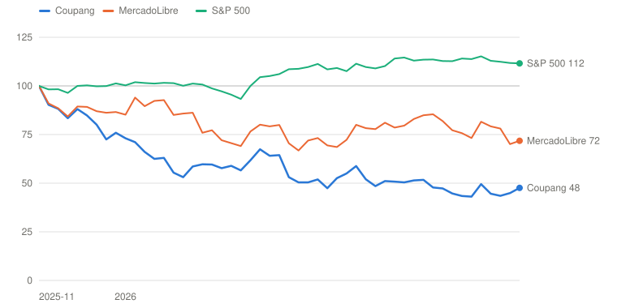
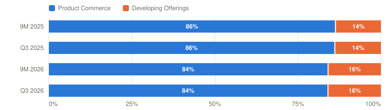

# CPNG — Coupang, Inc.

> **Schema** v7.0 · **Updated** 2026-11-04 · **Status** Active
> **Price** $15.23 verified Nov 3, 2026 regular close (pre-print), Yahoo chart API; the overnight session showed about $14.54 ([Yahoo](https://finance.yahoo.com/quote/CPNG/)) · 52-wk $13.35–$32.14 · 10th %ile · −52.6% from high
> **Type** Vertically integrated e-commerce: Korean 1P retail, WOW membership, logistics · **Stage** Turnaround · **Cyclical** No · **Competence** Edge

## Verdict

**The customers are back and Q3 landed on guidance, but the cash, the Taiwan bill and the regulator all moved the wrong way, and at $15.23 the probability-weighted case pays 4.7% a year against the 13% hurdle: Watch.**

🟡 **Non-holder: Watch (entry ≤$10.42)** · 🟡 **Holder: Hold**

| PW EV | PW return/yr | Compounding/yr | R/R | Entry | Trim | Avoid | EV / FY25 adj EBITDA | Yield | BAIT | Moat | Next |
|---|---|---|---|---|---|---|---|---|---|---|---|
| **$19.20** | **4.7% (<13%)** | — | 2.5:1 | ≤$10.42 | $19.20–$34.50 | ≥$34.50 | ≈16× (0.65× sales) | 0.0% | Single (B) | Wide, stable; profit pool contested | 📅 KFTC Eats/WOW decisions · late Feb (Q4) |

**Breaks if**: The regulator reaches the operating model rather than the cash balance: a KFTC order that separates the Eats benefit from WOW or caps how Coupang shares coupon and price-match costs with suppliers removes the mechanism the mid-2027 margin recovery depends on.

⚠️ **Terminal-growth check**: implied perpetual growth exceeds the risk-free rate in Bull, Base, Bear.

## The Call

Coupang printed the quarter it guided to: revenue of $9.96B, up 11% in constant currency against a guide of 8–9%, and an adjusted EBITDA margin of 1.2%, down 329 bps against a guide of 300–400. The customers are the good news. Korean WOW membership is at a record, the members who left have come back to their old spending, and Taiwan's WOW base doubled. The stock closed at $15.23 into the print, 53% below its high, and the PW return is 4.7% a year, not the 13% a holder needs. The cash is why. Trailing free cash flow is $(409)M, the $750M revolver draw is repaid, but the company bought back $1.05B in nine months and net cash fell to $3.68B. The Developing Offerings loss guide went up again, and the October KFTC hearings on Eats and WOW put a remedy on the table that could split the membership bundle. Management says Q3 is the low point and Product Commerce margins return to pre-incident levels by mid-2027. I accept the date and price it in at an 8.5% terminal margin, half a point short. What the market has right is the multiple: ≈16× FY2025 EBITDA already prices recovery. What it has too little of is the order from Seoul. The verb is not probability-fragile; the number that settles it is the KFTC decision on WOW.

## What I'd Have To Be Wrong About

1. **That the KFTC fight stays a fine.** Test: The KFTC decisions on the Eats merchant-terms case and the WOW tying case (hearings were held in October; fines of up to ₩360B were reported possible in Q4 2026, with the rest by H1 2027), plus the large-retail and dominance probes. A purely monetary sanction passes. A corrective order that separates the Eats benefit from WOW or caps cost-sharing with suppliers, or criminal charges against Coupang Corp., fails. **If Fail →** 15 points Base → Bear (PW EV $17.43, 2.7%/yr) → **Watch / Hold**, entry ≤$9.46, and the Bear becomes the working case for the margin.
2. **That margin returns with the volume.** Test: Product Commerce segment adjusted EBITDA margin of at least 8.0% in the Q2 2027 results (early August 2027), against 9.0% before the incident and 4.6% in Q3 2026. The interim check is the Q4 2026 consolidated margin inside the guided 1.7–2.7% in the late-February release. **If Fail →** 10 points Base → Bear (PW EV $18.02, 3.4%/yr) → **Watch / Hold**, entry ≤$9.78.
3. **That the buyback is paid for by the business.** Test: Net cash (cash less all borrowings, leases excluded) of at least $3.0B at the FY2026 10-K (February 2027) and at the Q1 2027 10-Q, with no revolver draw while trailing free cash flow is at or below zero. It was $3.68B on September 30, after the $750M revolver draw was repaid in September. **If Fail →** The Base buyback goes to zero and the Outsider grade drops from Outsider-leaning to Reinvestor (PW EV about $18.6, 4.1%/yr, entry about $10.1) → **Watch / Hold**.

## Latest update: 2026-11-04 · Q3: on guidance, off the cash, and a remedy on the table

- KFTC fight stays a fine — 🟡 Pending — Hearings on the Eats and WOW cases were held in October; the 10-Q says outcomes can include separating the Eats benefit from WOW. PIPC approved six installments
- Margin returns with the volume (Q4 2026 PC margin ≥7%) — 🟡 Pending — Q3 PC margin was 4.6% and the CEO called it the low; the Q4 guide of +50–150 bps on a 1.2% consolidated margin makes ≥7% unlikely in February, so the test moves to Q2 2027
- Buyback paid for by the business — 🟡 Pending — Revolver repaid and short-term borrowings $988M vs $1,985M; but TTM FCF is $(409)M, so the FCF leg needs a +$0.63B Q4 and will not pass

Coupang reported the third quarter on November 3 after the close. The stock had closed that day at $15.23, up 3.6%, and traded near $14.54 overnight. The quarter hit its guide on both revenue and margin, the customers look healthy, and the cash and the regulator both moved the wrong way. It settled none of the three tests I set on October 2, and it changed the date and the wording of one.

| | Q3 2026 | Q3 2025 | Against expectations |
|---|---|---|---|
| Revenue | **$9,962M** (+7%, +11% CC) | $9,267M | Above the 8–9% CC guide |
| Gross margin | 25.7% (26.7% ex fire) | 29.4% | −270 bps ex fire |
| Adjusted EBITDA | **$116M** (1.2%) | $413M (4.5%) | Inside the guided −300 to −400 bps |
| Product Commerce adj EBITDA margin | 4.6% | 8.8% | −424 bps; the CEO calls it the low |
| Developing Offerings adj EBITDA | $(269)M | $(292)M | FY loss guide top end raised $50–100M |
| Net loss to Coupang | $(501)M ($(321)M ex fire) | $95M | EPS $(0.28) |
| Free cash flow | $(72)M; TTM $(409)M | $442M; TTM $1,268M | TTM down $1.7B in a year |
| Net cash, ex leases | $3.68B | | Revolver repaid in September |
| Buyback | $201M, 12.7M shares at ≈$15.83 | | $706M of authorization left |

Sources: [Q3 release](https://www.sec.gov/Archives/edgar/data/0001834584/000183458426000084/cpng-09302026ex991.htm), [10-Q](https://www.sec.gov/Archives/edgar/data/1834584/000183458426000086/cpng-20260930.htm), [call transcript](https://www.investing.com/news/transcripts/earnings-call-transcript-coupang-q3-2026-revenue-beats-loss-widens-93CH-4996932). I did not find consensus figures for the quarter, so I make no beat or miss claim against analysts.

**Guidance.** Q4 revenue growth of 13–14% in constant currency, an acceleration. Consolidated adjusted EBITDA margin up 50–150 basis points from Q3, which puts it at 1.7–2.7%. Product Commerce margin back to "levels approximating those we generated prior to the data incident" by mid-2027, unchanged. The Developing Offerings loss guide, $950 million to $1 billion, now has its top end raised by $50–100 million on the Taiwan build-out.

**Management's points.** Bom Kim said the members who left and returned are spending at their old levels, the members who stayed are spending at records, and the non-returning cohort drops out of the year-over-year comparison next year. He named three temporary items behind the margin, supply chain dislocation, fixed-cost deleverage and elevated marketing, and said "We do not believe any of these items are structural." On Q3: "We believe Q3 represents the low point for our Product Commerce adjusted EBITDA margins." On Taiwan, where WOW membership is up more than 100% in a year: "we expect Taiwan to be a meaningful contributor to consolidated cash flow in the years to come."

**Pushback and non-answers.** Goldman asked for the cadence of the margin recovery and whether the Developing Offerings loss peaks; Kim said the pace "may vary quarter-to-quarter" and did not say whether losses have peaked. JPMorgan asked whether the loss guide includes Japan Eats and how Eats is funded into 2027; Anand said Korea and Japan Eats run around break-even and deferred 2027 to February. Morgan Stanley asked if the marketing is a competitive response; Kim said it is not. Nobody asked about the KFTC, the privacy fine, the tax assessment or the revolver, and management did not raise them. They are in the 10-Q.

**What the 10-Q adds.** The $750 million revolver draw from H1 was fully repaid in September, so short-term borrowings fell from $1,985 million to $988 million. Coupang sued over the privacy fine on October 7 and the commission approved six installments on October 8. The KFTC held hearings in October on the Eats merchant-terms case and the WOW tying case, and the filing says outcomes can include fines and a requirement to separate the Eats benefit from WOW. The Korea Times reports fines of up to ₩360 billion could land in Q4. The tax service assessment is about $208 million, of which $102 million was paid in Q3. No insurance recovery is booked for the fire.

**Scorecard.**

1. *The KFTC fight stays a fine.* Pending. The hearings are done and the decision is not, and the remedy list in the 10-Q is wider than a fine. The consequence is now 15 points of weight from Base to Bear.
2. *Margin returns with the volume.* Pending, and I am moving it. The old test asked for a Product Commerce margin of at least 7% in Q4. The Q4 guide, new since October, puts consolidated margin near 1.7–2.7%, so the February print would answer a question management has already answered. The test is now at the date management set, at least 8.0% in the Q2 2027 results, with the Q4 guide as the interim check.
3. *The buyback is paid for by the business.* Pending. The borrowing leg passed: the revolver is repaid. The free cash flow leg will not: trailing free cash flow is $(409) million and the year would need a Q4 of about +$630 million. I replace the test with one on net cash, because that is what the buyback is now being asked of.

**What it does to the debate.** The customer half of the margin argument is stronger than it was in October, since returning and staying members are both spending at or above prior levels. The cost half is not: property and equipment is up 14% in nine months against 2% more customers, and the Q4 guide implies a Product Commerce margin near 5.5–6% at year-end. The regulator half is larger, because the 10-Q puts a remedy that could split WOW and Eats in front of the investor, and the call did not mention it.

**Verdict.** Unchanged at Watch for a non-holder and Hold for a holder. The model moves to a PW EV of $19.2 from $20.30 and a return of 4.7% a year from 7.9%, at a spot that is $1.36 higher and a Base I trimmed for a lower margin path and a larger Taiwan bill. The entry is $10.4, from $11.02. Bias check: the verb did not change, so none was run.

---

## Deep Dive: Coupang: The Customers Came Back. Who Decides What They Pay For?

*Revenue grew 11% in the quarter the fire, the fines and the margin all landed together. The stock is 53% off its high. What does $15 assume about the margin, and how much of it does Korea's regulator get to keep?*

**Contents**: [Business Overview](#business-overview) · [The Margin: Q3 Is the Low, Says Management](#the-margin-q3-is-the-low-says-management) · [The Regulator: What Korea Will Let Coupang Earn](#the-regulator-what-korea-will-let-coupang-earn) · [Management, Capital Allocation and Incentives](#management-capital-allocation-and-incentives) · [Valuation and Model Assumptions](#valuation-and-model-assumptions) · [Final Words](#final-words) · [Appendix: The Numbers](#appendix-the-numbers) · [Sources](#sources)

On the afternoon of November 3, 2026, Coupang reported a quarter that landed almost exactly where management said it would. Revenue was $9.96 billion, up 11% in constant currency against a guide of 8–9%. The adjusted EBITDA margin was 1.2%, down 329 basis points against a guide of 300–400. The July fire at an Incheon fulfillment center cost another $248 million, and the net loss was $501 million. The stock had closed that day at $15.23, up 3.6%, and traded near $14.54 in the overnight session. It is 53% below its 52-week high of $32.14.

Coupang is the company that taught Korea to expect everything by tomorrow morning. It was founded by Bom Kim in 2010, and revenue has roughly doubled since 2021, from $18.4 billion to $36.2 billion over the last twelve months. A year ago it earned $413 million of adjusted EBITDA in a single quarter. Then the data incident, which exposed the accounts of 33.7 million people, set off a chain of events: about $1.2 billion of vouchers handed to customers, a $410 million privacy fine, a tax assessment, antitrust raids, and an inspection that Coupang refused to let in. Customers left, most came back, and the margin did not.

*Total return, weekly, November 3, 2025 = 100, through November 3, 2026. Source: Yahoo Finance adjusted closes. Built with Claude.*

| Date | Coupang | MercadoLibre | S&P 500 |
|---|---|---|---|
| 2025-11-03 | 100 | 100 | 100 |
| 2025-12-26 | 76 | 87 | 101 |
| 2026-02-20 | 59 | 86 | 101 |
| 2026-04-24 | 64 | 79 | 105 |
| 2026-06-26 | 55 | 72 | 108 |
| 2026-08-28 | 52 | 85 | 114 |
| 2026-10-23 | 44 | 78 | 112 |
| 2026-11-03 | 48 | 72 | 112 |

Over the last year the stock is down 52%, MercadoLibre, the nearest listed comparison for a regional e-commerce and logistics platform, is down 28%, and the S&P 500 is up 12%. Coupang has not been treated as a company with a weak business. Customers are at a record by management's account. It has been treated as a company whose profits are now partly the state's to decide.

The question this piece tries to answer has two parts. First, does the Product Commerce margin return to its pre-incident level, and when? Management says by mid-2027, and says the third quarter was the low. Second, if it does, how much of that profit will Korea's regulators let Coupang keep? I start with the business and the Q3 numbers. The first debate takes the margin, with management's case in its own words and four holes in it. The second takes the regulator. Then I look at management and the capital-allocation record, which changed this quarter, and finish with valuation: what $15.23 assumes, and what 13% a year would need. Coupang reports Q4 and gives its 2027 outlook in late February, and the Korea Fair Trade Commission (KFTC) has held hearings on two cases that could be decided before then.

### Business Overview

Coupang reports two segments. Product Commerce is the Korean retail machine: first-party retail, Rocket delivery, the WOW membership, a marketplace and ads. Developing Offerings is everything still being built: Taiwan, the Eats food-delivery business in Korea and Japan, and Farfetch. The unit of value is the Product Commerce active customer, of whom there were 25.2 million in Q3.

| $ Million | Q3 2025 | Q4 2025 | Q1 2026 | Q2 2026 | Q3 2026 |
|---|---|---|---|---|---|
| **Total revenue** | 9,267 | 8,835 | ≈8,500 | ≈8,900 | **9,962** |
| Growth, constant currency | +18% | +14% | +8% | +10% | **+11%** |
| Product Commerce revenue | 7,980 | n/d | n/d | n/d | 8,374 |
| Developing Offerings revenue | 1,287 | n/d | n/d | ≈1,400 | 1,588 |
| Gross margin | 29.4% | 28.8% | 27.0% | 28.2% | 25.7% (26.7% ex fire) |
| Product Commerce adj EBITDA margin | 8.8% | 7.7% | n/d | 5.1% | **4.6%** |
| Developing Offerings adj EBITDA | (292) | n/d | n/d | (219) | (269) |
| **Adjusted EBITDA** | 413 | 267 | 29 | 163 | **116** |
| Operating income (GAAP) | 162 | n/d | n/d | (556) | (450) |
| Net income to Coupang | 95 | (26) | (266) | (570) | (501) |
| Free cash flow | 442 | (283) | n/d | n/d | (72) |
| Share repurchases | — | n/d | 391 | 459 | 201 |

*Q3 2025 gross margin and Q4 2025 free cash flow are `[Derived]` from the release and the FY2025 and nine-month totals. Q4 2025 and Q1/Q2 2026 figures are from the earlier releases cited in the Sources. Q2 2026 net loss includes the $410M PIPC fine; Q3 2026 includes $248M of fire costs excluded from the adjusted lines. Source: [Q3 2026 release](https://www.sec.gov/Archives/edgar/data/0001834584/000183458426000084/cpng-09302026ex991.htm), [10-Q](https://www.sec.gov/Archives/edgar/data/1834584/000183458426000086/cpng-20260930.htm). Built with Claude.*

The table carries the story. Revenue has accelerated for two straight quarters, from +8% to +10% to +11% in constant currency, while adjusted EBITDA has not followed: $116 million against $413 million a year ago. Product Commerce earned a segment margin of 4.6% against 8.8%. Developing Offerings lost $269 million on revenue of $1.6 billion, up 27% in constant currency. Management raised the top end of the full-year loss guide by $50–100 million, "primarily driven by our Taiwan build-out."

*Share of revenue. Source: [Q3 2026 10-Q](https://www.sec.gov/Archives/edgar/data/1834584/000183458426000086/cpng-20260930.htm), [release](https://www.sec.gov/Archives/edgar/data/0001834584/000183458426000084/cpng-09302026ex991.htm). Built with Claude.*

| Period | Product Commerce | Developing Offerings | Total ($M) |
|---|---|---|---|
| 9M 2025 | 22,184 (86%) | 3,515 (14%) | 25,699 |
| Q3 2025 | 7,980 (86%) | 1,287 (14%) | 9,267 |
| 9M 2026 | 22,975 (84%) | 4,347 (16%) | 27,322 |
| Q3 2026 | 8,374 (84%) | 1,588 (16%) | 9,962 |

Developing Offerings is 16% of revenue and growing three times as fast as the core. That mix matters for the margin argument below, because Taiwan and Eats absorb about $0.8 billion of Product Commerce's profit over nine months.

A few accounting points. Adjusted EBITDA excludes the $248 million of fire costs ($95 million in cost of sales and $153 million in operating, general and administrative expense) and the $410 million of privacy fines booked in Q2, but it does not exclude the roughly $1.2 billion of vouchers, which were recorded as reductions to revenue from January to mid-April. It also excludes stock compensation, about $0.5 billion a year, which I treat as a real cost; that is why my owner earnings sit below every adjusted figure. The Q3 tax line shows a $13 million benefit on a $514 million pre-tax loss, because losses in Taiwan and Japan earn no offsetting benefit, and the company warns it may need a valuation allowance on US deferred tax assets within twelve months.

### The Margin: Q3 Is the Low, Says Management

Let me start with where things stand, per customer.

| Per active customer | Q3 2025 | Q3 2026 | Change |
|---|---|---|---|
| Product Commerce active customers | 24.7M | **25.2M** | +2% |
| Revenue per active customer, quarter | $323 | **$332** | +3% (+6% constant currency) |
| Segment adj EBITDA per customer, quarter `[Derived]` | $28.5 | **$15.3** | −46% |
| Segment adj EBITDA margin | 8.8% | 4.6% | −424 bps |
| Gross margin ex fire | 32.1% | 29.5% | −260 bps |
| WOW membership, Korea | — | **Record** (CEO) | count not disclosed |
| WOW membership, Taiwan | — | +100% YoY, +14% QoQ (CEO) | Dawn Delivery reaches over half the population |
| Developing Offerings revenue / adj EBITDA | $1,287M / $(292)M | **$1,588M / $(269)M** | +27% CC; FY loss guide raised |
| Acquisition cost | n/d | n/d | Re-acquisition marketing elevated, tapering (CEO) |

*Unit of value: the Product Commerce active customer. Segment EBITDA per customer is segment adjusted EBITDA ÷ active customers; it excludes depreciation and stock compensation. Source: [Q3 2026 release](https://www.sec.gov/Archives/edgar/data/0001834584/000183458426000084/cpng-09302026ex991.htm), [call](https://www.investing.com/news/transcripts/earnings-call-transcript-coupang-q3-2026-revenue-beats-loss-widens-93CH-4996932). Built with Claude.*

#### Management's narrative

Management's case is that the customers are fine and the margin is a matter of three temporary items. Bom Kim, the founder and chief executive, put the customer evidence first:

> "The members who did return, despite being away and allocating their retail wallets elsewhere for a period, have not only returned to their prior levels of spend, but they have continued to compound this quarter at normalized rates consistent with what we saw last quarter."
> — Bom Kim, CEO, Q3 2026 earnings call, November 3, 2026

He then named the three items and said none of them is structural:

> "The supply chain dislocation normalizes as our volumes rebuild, and the volume-based savings we are missing this year come back. Capacity utilization catches up as demand better aligns with the cost base we have built, and the marketing step-up is already beginning to taper, which we expect to continue in the quarters ahead. We do not believe any of these items are structural."
> — Bom Kim, CEO, Q3 2026 earnings call, November 3, 2026

Asked by Goldman Sachs for the cadence, Kim said the pace "may vary quarter-to-quarter" and repeated the destination: "We believe Q3 represents the low point for our Product Commerce adjusted EBITDA margins." Gaurav Anand, the chief financial officer, guided the fourth quarter to consolidated margin up 50 to 150 basis points from Q3, "as well as reduced levels of marketing spend," and reaffirmed that Product Commerce margins return "by mid-next year to levels approximating those we generated prior to the data incident."

The case is better than it sounds. Revenue per active customer rose 6% in constant currency. Product Commerce grew about 9% once the Chuseok holiday shift is removed, in a market growing around 6%. Members who stayed are spending at record levels. Rocket Fresh volumes grew at over twice the pace of the segment. And Taiwan, which is where the losses are going, is behaving like Korea did at the same stage: WOW membership there is up more than 100% in a year.

#### Poking holes in it

The first hole is the slope. Product Commerce margin was 9.0% in the second quarter of 2025, 7.7% in the fourth, 5.1% in the second quarter of 2026 and 4.6% in the third. The Q4 guide moves the consolidated margin from 1.2% to somewhere between 1.7% and 2.7%. If Product Commerce moves with it, it exits the year near 5.5–6%, and then has to gain roughly three more points in the first half of 2027. That can happen, since three temporary items reversing at once is arithmetic. But Kim declined to say whether the path is a ramp or a step, and the one date management gives is the one that is hardest to check.

The second hole is that two of the three items are partly choices. The chief financial officer's own numbers split the 420-basis-point fall in segment margin into 260 basis points at gross margin, which he attributes to supply chain headwinds and "elevated levels of promotional spend," and about 160 below it, in marketing and fixed-cost deleverage. Promotional spend and marketing are decisions, and the evidence that the marketing is tapering is a sentence, not a number. Management also said the spend is "not a competitive response," which I believe, but it means the company can turn it down whenever it likes and has chosen not to.

The third hole is the fixed-cost base. Net property and equipment rose from $3.72 billion in December to $4.23 billion in September, up 14%, while active customers grew 2%. Nine months of capital spending were $897 million, level with last year. The company says the base is "sized for a pre-incident demand curve." That is a statement that capacity ran ahead of the customers, and building Taiwan adds to it. The deleverage reverses only if volume catches up with capacity, and volume is growing 8–9%.

The fourth hole is that the cohort that has not returned is still the weak spot, and the 25.2 million is 2% above last year. Kim says that "new members have been more than filling in the gap in member count, though they naturally begin at the early part of the spend curve." Revenue per customer in constant currency is up 6%, while the core cohort's spend was up 16% in Q2, so the drag from new, low-spend members is real.

| Per active customer, per quarter | Q3 2025 actual | Q3 2026 actual | Mid-2027 Base | Order-capped Bear |
|---|---|---|---|---|
| Revenue per customer | $323 | $332 | $332 | $332 |
| Segment adj EBITDA margin | 8.8% | 4.6% | 8.5% | 5.5% |
| **Segment adj EBITDA per customer** | $28.5 | $15.3 | $28.2 | $18.3 |
| Annualized, at 25.2M customers `[Estimate]` | — | $1.5B | $2.8B | $1.8B |
| Gap to the year-ago $28.5 | — | −$13.2 | −$0.3 | −$10.2 |
| What has to be true | Peak margin, pre-incident | Q3 is the low (CEO) | Supply chain, utilization and marketing all normalize; ≈0.5 pt of residual enforcement cost | Supplier cost-sharing capped or Eats split from WOW; no recovery past 5.5% |

*Illustrative. The two right-hand columns are the author's scenarios `[Estimate]`: 8.5% is the Base terminal margin, half a point under the 9% management calls pre-incident, and 5.5% is the Bear terminal margin. Revenue per customer is held at the Q3 2026 level to isolate margin. Source: [Q3 2026 release](https://www.sec.gov/Archives/edgar/data/0001834584/000183458426000084/cpng-09302026ex991.htm). Built with Claude.*

Here is the arithmetic. At 25.2 million customers and a flat $332 of revenue per customer, the Base margin of 8.5% earns about $2.8 billion of segment EBITDA a year, against $1.5 billion at the 4.6% run-rate and $1.8 billion in the Bear. The distance between my Base and my Bear on this one segment is about $1 billion a year, and it comes from the margin, not from the customers.

Where I come out: the customer evidence is stronger than I expected in October, and the margin guidance is the same as in August. I accept management's destination in my Base, 8.5% instead of 9%, and I do not accept the path as a given. The Q4 print in February is a weak test because the Q4 guide already tells me the answer. The test that matters is the Q2 2027 result.

#### Rings of profit

The profit and cash sort by what each depends on.

| Ring | Reported figure | The threat | Exposure |
|---|---|---|---|
| **1 · Korea Product Commerce** (retail, Rocket, WOW fees, marketplace) | Segment adj EBITDA $385M in Q3, $1,125M in nine months; 4.6% margin | Supplier cost-sharing (large-retail act), abuse of dominance, and the WOW tying case; the split inside the segment is not disclosed | **High; this is the debate** |
| **2 · The cash** | Cash $5.44B less $1.76B of borrowings = $3.68B net cash, ex leases | TTM free cash flow $(409)M; the $410M PIPC fine and ≈$208M NTS assessment still to pay; $706M of buyback authorization left | Medium; funds the other two rings |
| **3 · Developing Offerings** (Taiwan, Eats, Farfetch) | Revenue +27% CC; adj EBITDA $(817)M in nine months; FY loss guide raised by $50–100M | Not a regulatory exposure; a cash one, paid for by Ring 1 | High; discretionary |
| **Consolidated** | Adj EBITDA $308M in nine months |  |  |

*Coupang does not disclose profit below the two segments, so the rings sort the segment and balance-sheet numbers by what each depends on. Source: [Q3 2026 release](https://www.sec.gov/Archives/edgar/data/0001834584/000183458426000084/cpng-09302026ex991.htm), [10-Q](https://www.sec.gov/Archives/edgar/data/1834584/000183458426000086/cpng-20260930.htm). Built with Claude.*

The first ring is the one that has to work, and it is also the one the regulator is looking at. The second ring is the cushion: $3.68 billion of net cash, ex leases, and a revolver now repaid. The third ring is a discretionary bet paid for by the first.

### The Regulator: What Korea Will Let Coupang Earn

The second debate matters as much as the first, because the margin that management is promising is partly a margin on the supplier relationship, and the supplier relationship is what Korea's antitrust agency is investigating.

None of this came up on the call. No analyst asked about the KFTC, the privacy fine or the tax assessment, and management's only reference was to "the data incident." The place to read it is the 10-Q, which says three things that were not in the release. In Q2 the Personal Information Protection Commission (PIPC) fined Coupang about $410 million, of which $278 million relates to the incident. Coupang sued on October 7 and asked for a stay, and the next day the PIPC approved payment in six installments over two years. The National Tax Service has assessed about $208 million for transfer pricing, of which Coupang paid $102 million in Q3 and is appealing. And the KFTC held hearings in October on two cases, one on the terms Eats imposes on restaurants and one on whether bundling the Eats benefit into WOW is illegal tying. The filing says the outcomes can include fines and a requirement to separate the Eats benefit from WOW, and that Coupang cannot estimate the penalty.

#### The state's narrative

The agency's case, as the Korean press reports it, is that Coupang used its size to push costs onto suppliers and restaurants and to bundle services so that customers could not leave. The Korea Times reports that fines of up to ₩360 billion, about $250 million at the Q3 exchange rate `[Derived]`, could arrive in the fourth quarter, and that the KFTC rejected a ₩60 billion voluntary corrective plan from Coupang. Earlier this fall Coupang refused an on-site inspection, was raided a second time under the Fair Trade Act, lost its bid for an injunction in Seoul High Court on September 23, and now faces a new KFTC investigations bureau.

#### Poking holes in it

I should say first that I cannot judge much of this from outside. I can read a filing. I cannot predict how a Korean regulator weighs a company that is the country's dominant online retailer, in the middle of a trade negotiation with the United States, and that publicly declined to let inspectors in. That is why I treat this as an Edge case, and why the scenarios widen.

The first hole is that a fine is the benign outcome and the filing lists a worse one. A monetary penalty of ₩360 billion would cost about two months of Product Commerce's current EBITDA once, and the company can pay it. A requirement to separate the Eats benefit from WOW changes what the membership offers. WOW is the retention engine of the whole business and the reason the returning customers came back, and Eats is where Coupang is spending to extend it.

The second hole is that the pattern is extraction, and the pattern continues. The privacy fine, the tax assessment and the KFTC cases arrive from three different agencies within five months, and the 10-Q lists a US securities class action, two derivative suits and a possible valuation allowance as well. I wrote in October that a fourth distinct regulatory action within twelve months would fail my first test, and it did. Nothing in the quarter reverses that pattern.

The third hole is that the margin recovery quietly depends on the supplier relationship. The margin bridge in the unit table assumes the volume rebates and supplier terms come back as volume rebuilds. If a remedy caps how Coupang shares coupon and price-match costs with suppliers, that is the 5.5% case in the table, not an extra fine.

The fourth hole runs the other way, and I should keep it in view. The state also has reasons to be careful. The dispute is on the agenda of the US–Korea investment talks, and the customers who left after the incident have mostly come back and are spending at prior levels. The most likely outcome, in my view, is a large fine with conditions, which is the Base.

Where I come out: the regulator is the reason the multiple stays at 26× earnings in the Base and not higher, and it is the Bear's whole mechanism. I give a remedy that changes the operating model a 35% weight in total. The probability is not precise, and the first test is written to resolve it.

### Management, Capital Allocation and Incentives

Bom Kim founded Coupang in 2010 and has run it since, and he controls the vote through Class B shares. The company has not had a chief executive change; the chief financial officer, Gaurav Anand, runs the capital plan. Harold Rogers, the interim Korea chief executive, was cleared of perjury by police in September, and three other current and former executives were referred to prosecutors.

The prior-tenure test is the record since the 2021 listing. Revenue has about doubled. Free cash flow over the period, from FY2021 through the first nine months of 2026, adds up to $1.81 billion, about the same as the $1.75 billion of stock compensation paid over FY2021–FY2025. The business reached a free cash flow of $1.76 billion in 2023 and has fallen every year since: $1.01 billion, $0.52 billion, and now $(0.13) billion in nine months. The fall is not all the incident, since FY2025 was already half of FY2023. It is what a business looks like that has spent its operating leverage on capacity, price and Taiwan.

The deal list is short. Farfetch, acquired in 2024, is luxury fashion that shares few customers and costs with a Korean grocery and electronics business, and it sits inside the loss-making Developing Offerings. I grade it too early to tell, with a diversification discount.

| $B, except per share | FY2021 | FY2022 | FY2023 | FY2024 | FY2025 | 9M 2026 | Cumulative |
|---|---|---|---|---|---|---|---|
| Revenue | 18.41 | 20.58 | 24.38 | 30.27 | 34.53 | 27.32 | — |
| Growth | +54% | +12% | +18% | +24% | +14% | +6% | — |
| Diluted EPS | −$1.08 | −$0.05 | $0.75 | $0.08 | $0.11 | −$0.74 | — |
| Operating cash flow | −0.41 | 0.57 | 2.65 | 1.89 | 1.77 | 0.76 | 6.63 |
| Capex | 0.67 | 0.82 | 0.90 | 0.88 | 1.25 | 0.90 | 5.42 |
| **Free cash flow** | −1.09 | −0.26 | 1.76 | 1.01 | 0.52 | −0.13 | **1.81** |
| Stock compensation | 0.25 | 0.26 | 0.33 | 0.43 | 0.48 | n/d | 1.75 (to FY2025) |
| Buybacks | 0 | 0 | 0 | 0.18 | 0.24 | **1.05** | **1.47** |
| Buybacks ÷ FCF | — | — | 0% | 18% | 47% | n/m (FCF < 0) | 81% |
| Acquisitions, net of cash acquired | 0 | 0 | 0 | −0.07 | 0 | 0 | — |
| Borrowings (short- and long-term) | 0.29 | 0.71 | 0.81 | 1.47 | 1.61 | 1.76 | — |
| Weighted diluted shares (M) | 1,424 | 1,765 | 1,803 | 1,826 | 1,855 | 1,795 (Q3, basic) | — |

*FCF = operating cash flow − purchases of property and equipment `[Derived]`. 9M 2026 buybacks are the cash-flow figure. Source: [XBRL company facts](https://data.sec.gov/api/xbrl/companyfacts/CIK0001834584.json), [Q3 2026 release](https://www.sec.gov/Archives/edgar/data/0001834584/000183458426000084/cpng-09302026ex991.htm), [10-Q](https://www.sec.gov/Archives/edgar/data/1834584/000183458426000086/cpng-20260930.htm). Built with Claude.*

The cumulative column says two things. First, buybacks of $1.47 billion consumed 81% of the free cash generated in the whole period, and most of it came in 2026, when free cash flow was falling. Second, the share count barely moved: 1,765 million weighted shares in FY2022, 1,787 million outstanding in September. The buyback has offset stock compensation. It has not shrunk the company.

The timing is the thing I would not forgive in an outsider. Coupang repurchased $391 million in Q1 at about $19.17 and $459 million in Q2 at about $19.78, while drawing $750 million on its revolver. In Q3, with the stock at $15.83 on average, it bought $201 million, less than half the Q2 amount, and repaid the revolver in September. A countercyclical buyer buys more when the price falls, and Coupang bought most when the price was highest and when it had to borrow to do it. Over nine months the average price paid was $18.63 `[Derived]`, 22% above today's.

In fairness, the cash balance held. Net cash ex leases is $3.68 billion, up from about $3.5 billion at June 30 on my restated basis, and short-term borrowings halved to $988 million. Authorization of $706 million remains. I grade Coupang **Outsider-leaning, qualified**: large repurchases and a fast repair of the balance sheet, but the buying was procyclical and funded in part by debt. The third test is written to settle whether the business can pay for it.

#### The incentives

| Component | Size | What it pays for | Status |
|---|---|---|---|
| **Founder CEO pay (2025)** | $1.1M salary, no stock award | Nothing performance-linked | Alignment is ownership and Class B control, not the plan ([2026 DEF 14A](https://www.sec.gov/Archives/edgar/data/1834584/000114036126017102/ny20063059x1_def14a.htm)) |
| **Executive equity** | Multi-year vesting awards | Retention; no metric identified in the CD&A | Not re-read in this update |
| **Employee stock compensation** | ≈$0.5B a year, 1.4–1.8% of revenue | Retention | Offset by buybacks only since 2026 |
| **Return on invested capital** | 0% | Not a stated metric | — |

*Source: the proxy as linked and the [XBRL company facts](https://data.sec.gov/api/xbrl/companyfacts/CIK0001834584.json). Built with Claude.*

Kim's 2025 pay was a $1.1 million salary and no stock award. His alignment is that he owns a lot of the company, which is a good form of alignment, and it also means nothing in the plan pays for return on capital, free cash flow or margin. Executives and employees are paid in stock that vests over several years, so a lower price means more shares for the same pay. I read the plan as paying for staying, which fits a founder-led company, and as silent on the questions this page cares about.

### Valuation and Model Assumptions

I value Coupang at the end of FY2031 on earnings per share, built from the two segments. Each has a revenue growth rate and a margin on adjusted EBITDA, and a single line takes off depreciation, stock compensation and other corporate cost as a share of revenue. FY2026 is the base year at about $37 billion of revenue (nine months actual plus a Q4 consistent with the +13–14% constant-currency guide), a Product Commerce margin of about 5.2% and a Developing Offerings loss of about 18% of its revenue. Interest income on the cash balance is added, tax is 30% at the end, and the share count follows each case's buybacks against stock pay.

| $ Billion | FY2025A | FY2026E | FY2027E | FY2028E | FY2029E | FY2030E | FY2031E |
|---|---|---|---|---|---|---|---|
| **Product Commerce revenue** | 28.9 | 31.0 | 33.3 | 35.8 | 38.5 | 41.4 | 44.5 |
|  YoY growth | — | 7.3% | **7.5%** | **7.5%** | **7.5%** | **7.5%** | **7.5%** |
|  Operating margin | 6.6% | 5.2% | 5.9% | 6.5% | 7.2% | 7.8% | **8.5%** |
|  Operating profit | 1.90 | 1.61 | 1.95 | 2.34 | 2.77 | 3.25 | 3.78 |
| **Developing Offerings revenue** | 5.0 | 6.0 | 6.9 | 7.9 | 9.1 | 10.5 | 12.1 |
|  YoY growth | — | 20.0% | **15.0%** | **15.0%** | **15.0%** | **15.0%** | **15.0%** |
|  Operating margin | -20.0% | -17.8% | -14.4% | -11.1% | -7.7% | -4.4% | **-1.0%** |
|  Operating profit | -1.00 | -1.07 | -1.00 | -0.88 | -0.70 | -0.46 | -0.12 |
| Corporate and other | (1.03) | (1.30) | (1.39) | (1.50) | (1.61) | (1.73) | (1.87) |
| **Total revenue** | 33.9 | 37.0 | 40.2 | 43.8 | 47.6 | 51.9 | 56.6 |
| **Operating profit** | -0.13 | -0.75 | -0.44 | -0.04 | 0.45 | 1.05 | 1.80 |
|  Operating margin | -0.4% | -2.0% | -1.1% | -0.1% | 0.9% | 2.0% | 3.2% |
| Net income | 0.21 | -0.65 | -0.32 | 0.05 | 0.45 | 0.88 | 1.33 |
| Diluted shares (B) | 1.855 | 1.790 | 1.790 | 1.790 | 1.790 | 1.790 | 1.790 |
|  Net share change | — | — | +0.0% | +0.0% | +0.0% | +0.0% | +0.0% |
|  SBC (% of revenue) | — | 1.8% | 1.8% | 1.8% | 1.7% | 1.7% | 1.7% |
| **EPS ex fire and fines** | $0.11 | $-0.36 | $-0.18 | $0.03 | $0.25 | $0.49 | $0.74 |
|  YoY growth | — | -430.6% | -51.6% | -116.7% | 755.3% | 94.4% | 51.1% |

*Bold cells are model inputs.*

In the Base, Product Commerce grows 7.5% a year to $44.5 billion and its margin returns to 8.5% from mid-2027. Developing Offerings grows 15% a year to $12 billion and gets to break-even, with Taiwan close behind. Revenue compounds about 9% a year to $57 billion, and earnings per share go from a loss of $0.36 in FY2026 to $0.74 in FY2031, at 26 times earnings that is $19.27. As a cross-check, that equity value is about 8× FY2031 adjusted EBITDA after $4 billion of cash `[Estimate]`, below the 11× I used in October, because the margin path is lower and Taiwan is larger.

| Case | Prob. | 3P | Product Commerce growth / margin | Developing Offerings growth / margin | Net shares/yr | Per-share earnings FY2031 | CAGR | Exit multiple | Value | Return/yr | Implied g | Driving assumption |
|---|---|---|---|---|---|---|---|---|---|---|---|---|
| **Bull** | 20% | Plausible | +9.0% / 10.0% | +20.0% / 3.0% | -1.5% | $1.44 | n/m | 24.0× EPS ex fire and fines | $34.50 | 17.8% | 5.6% | PC margin back to the old 10% target and Taiwan at a profit by FY2031; revenue about $62B (+11%/yr); KFTC outcomes are fines only; buybacks run at 3% of shares a year. |
| **Base** | 45% | Probable | +7.5% / 8.5% | +15.0% / -1.0% | +0.0% | $0.74 | n/m | 26.0× EPS ex fire and fines | $19.27 | 4.8% | 5.9% | PC margin back to 8.5% from mid-2027 (about half a point below the pre-incident 9%, for residual enforcement cost); Taiwan near break-even; revenue about $57B (+9%/yr); buybacks only offset stock pay. |
| **Bear** | 35% | Probable | +4.0% / 5.5% | +10.0% / -4.0% | +1.6% | $0.06 | n/m | override | $7.50 | -13.2% | 9.1% | A KFTC order caps supplier cost-sharing or splits Eats from WOW; PC margin stalls at 5.5% on 4% growth (about $47B of revenue); earnings near zero, so value is 8x adjusted EBITDA plus about $2.5B of net cash on 1.8B shares. |
| **Priced-in (10%/yr)** | — | diagnostic | +8.0% / 9.0% | +16.7% / 0.3% | -0.5% | $0.94 | n/m | 26.0× EPS ex fire and fines | $24.53 | 10.0% | 5.9% | Solved along Base → Bull for 10%/yr |
| **Hurdle (13%/yr)** | — | diagnostic | +8.3% / 9.3% | +17.7% / 1.1% | -0.8% | $1.08 | n/m | 26.0× EPS ex fire and fines | $28.06 | 13.0% | 5.9% | Solved along Base → Bull for 13%/yr |
| Option: Taiwan as a second Korea beyond the Base | 20% | possible |  |  |  |  |  |  | $5.00 |  |  | valued as probability × value, outside the core |
| **Probability-weighted** | 100% |  |  |  |  |  |  |  | $19.20 | 4.7% |  |  |

The Bull is the old 10% margin with Taiwan profitable, $62 billion of revenue and a 3% buyback, worth $34.50. The Bear is a KFTC order that caps supplier cost-sharing or splits Eats from WOW, with Product Commerce stuck at 5.5%, worth $7.50 at 8× EBITDA plus $2.5 billion of net cash. I add one optionality line outside the core: Taiwan becoming a second Korea beyond the Base, at 20% probability and $5 a share. That is $1.00 of the PW value, and the core alone is worth $18.20.

| Return math |  |
|---|---|
| PW return/yr vs. hurdle | **4.7% (<13%)**, of which 0.0% is the dividend yield. Entry ≤$10.42. 10-year Treasury 4.90%; the hurdle sits 8.1 points above it. |
| Optionality | Taiwan as a second Korea beyond the Base: 20% × $5.00 = $1.0 |
| Price-implied expectations | At 10% a year the stock must reach about $24.5 by 2031 (15.23 × 1.10^5), which sits between the Base and the Bull. Even with no Bear at all, the Base-and-Bull mix is worth less than that before the optionality line. |
| EPV floor | Earnings power today is negative on reported numbers. On FY2025 adjusted EBITDA of ≈$1.5B, less ≈$0.5B of stock pay and ≈$0.5B of depreciation, about $0.5B of pre-tax earnings power capitalized at 12× gives ≈$6B against a $27B market value, so roughly four-fifths of the price pays for recovery and growth `[Estimate]`. |
| Base rate / 3P | Revenue of ≈$37B puts Coupang in the largest size bucket, where about 32% of companies sustain at least 5% real growth for five years and about 14% reach 10% ([`compounding.md`](../../frameworks/compounding.md)). The Base's ≈9% nominal (about 6–7% real) is a top-quarter outcome and the Bull's ≈11% sits near the 14%. Tiers: Bull plausible, Base probable, Bear probable. |
| Terminal-growth check | On EPS, the 24× and 26× exits imply perpetual growth of about 5.6% and 5.9% at a 10% discount rate, above the 4.9% Treasury, so the multiples lean on growth continuing past 2031. The Base is still growing about 9% in FY2031, which the Taiwan lever has to supply. The Bear's $7.5 is set on EBITDA, not EPS. |
| Break-even and price-implied Bear odds | Break-even <0% against 35% assigned; price-implied <0% at 10%. |
| Year ten | The Base is still growing mid-single digits at year ten on online penetration, attach and Taiwan, against a population that peaks around 2030, so the terminal multiple is not doing all the work. |
| R/R | **2.5:1** (Bull +127% / Bear −51%) The downside is a regulatory order, not a weak quarter: the Bear sits about half below spot. |

*Computed rows come from model.json. The Bear's terminal value is set outside the engine at 8× FY2031 adjusted EBITDA plus ≈$2.5B of net cash because its earnings are near zero. EPV, base rate and year ten are the author's. Built with Claude.*

Here is where the price stands. To earn an ordinary 10% a year from $15.23, the stock has to reach about $24.5 by 2031, which needs $0.94 of earnings per share at 26 times, about a third of the way from the Base to the Bull. To earn 13% a year, it would need $1.08, past the midpoint between them. Weighted 20% Bull, 45% Base and 35% Bear, and adding the optionality, the value is $19.20 and the annual return is 4.7%. The price at which the same case returns exactly 13% is $10.42. The break-even Bear probability is <0%, so the verb is not probability-fragile: no weight shifted out of the Bear gets the return to 13% from here.

I should also say what I cannot judge. This is an Edge case. I can judge a retailer's unit economics and a balance sheet. I cannot judge how a Korean regulator treats the country's largest online retailer in a trade negotiation, which is why the Bear has a 35% weight and why the first test carries the largest consequence.

### Final Words

Coupang is a better business than the stock price implies and a worse investment than the business implies. The customers came back, revenue is accelerating and the Taiwan evidence is strong. The market has the multiple right: at roughly 16 times FY2025 adjusted EBITDA the price already assumes the recovery, and the recovery has to come with the margin. What it has too little of is the state, and the cash. Free cash flow has been falling for three years, the business spent more than it earned on buybacks, and the one thing that would let it keep spending, a stable relationship with Seoul, is not something Coupang controls.

The verb is Watch for someone who does not own it, with an entry at $10.42, and Hold for someone who does, because the stock sits between that entry and my probability-weighted value. The case for being wrong is real. The margin could be back sooner and the KFTC could settle for a fine. Both are in the Bull, and the Bull is 20%.

What would change my mind has dates. The KFTC decisions on the Eats and WOW cases, due between now and mid-2027, show whether the state wants a fine or a new business model. The Product Commerce margin of at least 8% in the Q2 2027 results in August shows whether the recovery is real. And net cash of at least $3.0 billion at the 10-K and the Q1 2027 10-Q, with no further revolver draw, shows the buyback is paid for. Here are the three tests, with their consequences fixed in advance:

*The three tests, with their pre-committed consequences, are listed at the top of this report under [What I'd Have To Be Wrong About](#what-id-have-to-be-wrong-about).*

### Appendix: The Numbers

The tables carry the framework's required numbers. The argument for each is in the chapters above.

#### Five-year record

| $B, except per share | FY2021 | FY2022 | FY2023 | FY2024 | FY2025 | TTM Q3 2026 |
|---|---|---|---|---|---|---|
| Revenue | 18.41 | 20.58 | 24.38 | 30.27 | **34.53** | 36.16 |
| Operating income (GAAP) | −1.49 | −0.11 | 0.47 | 0.44 | **0.47** | −1.24 (fire, fines) |
| Adjusted EBITDA | n/d | ≈0.17 | ≈1.10 | ≈1.37 | **≈1.50** | **0.58** |
| Adjusted EBITDA margin | n/d | ≈0.8% | ≈4.5% | ≈4.5% | ≈4.3% | 1.6% |
| Operating cash flow | −0.41 | 0.57 | 2.65 | 1.89 | 1.77 | 0.85 |
| Capex | 0.67 | 0.82 | 0.90 | 0.88 | 1.25 | ≈1.25 |
| **Free cash flow** | −1.09 | −0.26 | 1.76 | 1.01 | **0.52** | **−0.41** |
| Stock compensation | 0.25 | 0.26 | 0.33 | 0.43 | 0.48 | n/d |
| **Owner earnings** (OCF − SBC − capex at D&A) | −0.86 | 0.07 | 2.05 | 1.02 | **0.78** | n/d |
| Owner earnings per diluted share | n/m | $0.04 | $1.14 | $0.56 | **$0.42** | n/d |
| SBC % of revenue | 1.4% | 1.3% | 1.3% | 1.4% | 1.4% | ≈1.8% (Q2) |
| Equity raised (cash) | IPO year | 0 | 0 | 0 | 0 | 0 |
| Diluted weighted shares (M) | 1,424 | 1,765 | 1,803 | 1,826 | 1,855 | 1,795 (Q3 basic) |
| Net share change per year | n/m | n/m | +1.0% | +0.7% | +1.3% | −1.7% (9M) |
| Buybacks ÷ SBC | 0% | 0% | 0% | 41% | 51% | ≈2× `[Estimate]` |
| Net cash ex leases | 3.20 | 2.80 | 4.43 | 4.41 | 4.71 | **3.68** |
| Invested capital `[Derived]` | 0.47 | 1.18 | 1.43 | 1.88 | 2.94 | 2.45 |
| **ROIC** (NOPAT = 75% of operating income, average capital) | n/m | n/m | 27% | 20% | **15%** | n/m (loss) |
| 3-year ROIIC (FY2022 → FY2025) |  |  |  |  | **≈25%** | — |
| Reinvestment (Δ invested capital) | — | 0.71 | 0.25 | 0.45 | 1.06 | −0.49 |
| FCF ÷ adj EBITDA | n/m | n/m | 160% | 74% | 35% | n/m |
| Net debt ÷ EBITDA | net cash | net cash | net cash | net cash | net cash | net cash |

*Invested capital = equity + short- and long-term borrowings + operating leases − cash `[Derived]`; it is small because suppliers finance inventory (payables $7.5B against inventory $2.4B), so ROIC swings with one year's profit. Owner earnings use D&A as the maintenance-capex proxy `[Estimate]`. TTM operating income is the 9M 2026 loss plus Q4 2025, approximate. Adjusted EBITDA for FY2022–FY2025 is from the earlier releases. Interest coverage is not meaningful with net cash; the nearest maturities are $119M of long-term debt within a year and Korean facilities maturing in 2027, undrawn. Cycle position: demand is not cyclical; the margin trough is incident- and regulation-driven. Source: [XBRL company facts](https://data.sec.gov/api/xbrl/companyfacts/CIK0001834584.json), [Q3 2026 release](https://www.sec.gov/Archives/edgar/data/0001834584/000183458426000084/cpng-09302026ex991.htm), [10-Q](https://www.sec.gov/Archives/edgar/data/1834584/000183458426000086/cpng-20260930.htm). Built with Claude.*

#### Growth levers

| Lever | Contribution now | Runway | Evidence | Management intent | Stage |
|---|---|---|---|---|---|
| Market growth | ~6 pts | 10 yrs, capped by demographics | Korean e-commerce growing 6–8%; online ≈38% of retail | — | Proven |
| Share gain | ~2 pts | 5+ yrs | PC +8% CC (about 9% ex Chuseok) in a ~6% market, while a minority cohort has not returned | The non-returning cohort drops out of the comp next year | Proven, impaired |
| Price and mix | ~0 now | — | WOW fee rose 58% in 2024 with no churn; 2026 is spent on re-acquisition | No price action signalled | Proven, paused |
| Attach / new products | +1–2 pts | 5+ yrs | Rocket Fresh volume growing at over twice the pace of PC; Try Now, Pay Later; Eats into non-food | "Still very early" on non-food Eats (CEO) | Scaling |
| New geographies | ~+3 pts consolidated | 10 yrs | DO revenue +27% CC; Taiwan WOW +100% YoY | Taiwan "a meaningful contributor to consolidated cash flow in the years to come" | Scaling |
| M&A | ~0 | — | Farfetch (2024) shares few customers or costs with Korea | Silent | Option (diversification) |
| Margin | **The Base case** | 3–5 yrs | PC margin 8.8% → 4.6% in a year: supply chain, fixed-cost deleverage, marketing | Pre-incident levels by mid-2027; Q3 the low | Proven, interrupted |
| Share count | ~+1 pt/yr of per-share value | $0.7B left | 56.4M shares repurchased in nine months; 1,787M outstanding vs 1,823M a year ago | Authorization +$1B in May 2026; $706M left | Proven |

*Source: [Q3 2026 release](https://www.sec.gov/Archives/edgar/data/0001834584/000183458426000084/cpng-09302026ex991.htm), [10-Q](https://www.sec.gov/Archives/edgar/data/1834584/000183458426000086/cpng-20260930.htm), [call](https://www.investing.com/news/transcripts/earnings-call-transcript-coupang-q3-2026-revenue-beats-loss-widens-93CH-4996932). Built with Claude.*

The Base rests on market growth, share gain and the margin lever. The Bull adds a profitable Taiwan. Taiwan beyond the Base is the optionality line in the Valuation chapter, and Farfetch fails the adjacency test.

#### Moat, customer and profit pool

| Read | Call | Evidence |
|---|---|---|
| Mechanism | **Scale economies** (logistics density) plus **switching costs** (WOW habit) | ≈70% of Koreans within seven miles of a center; Dawn Delivery unmatched; WOW at a record after the largest breach in Korean history; Taiwan repeating the pattern |
| Trend | **Stable** | Members who left and returned spend at prior levels and members who stayed spend at record levels (CEO); the rest of the cohort is the open question |
| Profit pool | Coupang captures it from suppliers; **the state is contesting that** | KFTC cases on coupon cost-shifting, abuse of dominance, Eats merchant terms and WOW tying; the Eats and WOW hearings were held in October |
| Customer | 25.2M households, buying everything by tomorrow morning | Retention: full membership recovery; last price rise +58% in 2024 with volume up; CAC and LTV not disclosed |

*7 Powers vocabulary (Helmer). Scale economies shared: savings go to price first (lowest prices, free Dawn Delivery), which is also what the regulator is probing. Source: [call](https://www.investing.com/news/transcripts/earnings-call-transcript-coupang-q3-2026-revenue-beats-loss-widens-93CH-4996932), [10-Q](https://www.sec.gov/Archives/edgar/data/1834584/000183458426000086/cpng-20260930.htm). Built with Claude.*

#### Competitors

| Competitor | Position | Threat |
|---|---|---|
| **Naver** | ≈15–17% share; search-led marketplace | The only scaled rival; would need logistics it does not own |
| **AliExpress–Gmarket** (Alibaba–Shinsegae JV) | Cross-border plus domestic | Price wedge in commodity categories |
| **Baemin** (Delivery Hero) | Food delivery leader | Eats' rival, and a co-defendant in the delivery-app antitrust case |
| **Shopee, Momo** | Taiwan incumbents | Logistics-light; speed is Coupang's wedge |

*Scuttlebutt: management said the elevated marketing is "not a competitive response" (Q&A, Q3 call). Competitor results were not re-pulled in this update. Source: [call](https://www.investing.com/news/transcripts/earnings-call-transcript-coupang-q3-2026-revenue-beats-loss-widens-93CH-4996932). Built with Claude.*

#### Promises ledger

| Promised | Where, when | Outcome |
|---|---|---|
| Product Commerce adj EBITDA margin of 10%+ long-term | [Q4 2022 release and call](https://www.sec.gov/Archives/edgar/data/1834584/000183458423000016/cpng-12312022ex991.htm), Mar 2023 | 🔴 Peaked at 9.0% (Q2 2025); 4.6% in Q3 2026 |
| Q3 2026 revenue +8–9% CC and adj EBITDA margin down 300–400 bps | Q2 2026 call, Aug 4 | ✅ +11% CC and −329 bps |
| 2026 Developing Offerings loss $950M–$1B | [Q4 2025 script](https://s206.q4cdn.com/919117365/files/doc_financials/2025/q4/Q4-25-Earnings-Call-Script_Final.pdf), Feb 2026 | 🔴 Top end raised by $50–100M on Nov 3 (nine months: $817M) |

*Guidance grade: **Mixed.** Near-term revenue and margin guides are met or beaten (Q3 on both); the multi-year margin target and the loss guide have both moved the wrong way. Source as linked and the [call](https://www.investing.com/news/transcripts/earnings-call-transcript-coupang-q3-2026-revenue-beats-loss-widens-93CH-4996932). Built with Claude.*

#### Risks and triggers

| Risk | Impact | Prob. | Priced in? | Would break the thesis if… |
|---|---|---|---|---|
| ⚠️ **Regulation reaches the operating model**: KFTC hearings on Eats merchant terms and WOW tying (a remedy could separate the Eats benefit from WOW), the large-retail and dominance probes, the new investigations bureau | High | 45% | Partly: the multiple | A corrective order on supplier terms or WOW bundling, or charges against Coupang Corp. (test 1) |
| ⚠️ **Recurring extraction**: PIPC $410M (suit filed, six installments approved), NTS ≈$208M (appealed, $102M paid), KFTC fines of up to ₩360B reported possible | High | 50% | Partly | Another ≥$200M assessment from a new front within 12 months |
| ⚠️ **Margin recovery slips past mid-2027** | High | 35% | Partly | Q2 2027 PC margin below 8% (test 2) |
| **Cash**: TTM FCF $(409)M, and $1.05B of buybacks in nine months ran ahead of cash generated | Med | 40% | No | Net cash below $3.0B, or a revolver draw with FCF ≤ 0 (test 3) |
| **Taiwan build-out** keeps raising the loss guide | Med | 40% | Partly | FY2027 DO loss guide above $1.1B without a margin path |
| **US legal and tax**: securities class action and derivative suits; possible valuation allowance on US deferred tax assets | Med | 25% | Partly | A formal SEC inquiry, or a restated breach disclosure |
| **Incheon fire**: $248M recognized, no insurance recovery booked | Med | Sized | Mostly | Recovery well below half, or remediation penalties |

*Filtered for materiality. The FY2025 Item 1A diff and the Q3 10-Q Item 1A were not read (logged). The ₩360B figure is from [The Korea Times](https://www.koreatimes.co.kr/business/companies/20261104/coupangs-mounting-losses-threaten-growth-model-amid-regulatory-pressure) and is not in the filing. Source: [10-Q](https://www.sec.gov/Archives/edgar/data/1834584/000183458426000086/cpng-20260930.htm). Built with Claude.*

Reflexive loops: the stock compensation and the buyback, which mean a lower price brings more shares for the same pay and a procyclical buyback; the regulator, since a larger fine or a worse remedy lowers the price at which the next dollar of equity or debt would be raised. Ruin path: none within five years with $3.68 billion of net cash, undrawn facilities of about $2.2 billion and no maturity wall; the real exposure is flexibility, not solvency.

#### Catalysts

| Date | Catalyst | Why it matters |
|---|---|---|
| ✅ Nov 3 | Q3 results and Q4 guide ([release](https://www.sec.gov/Archives/edgar/data/0001834584/000183458426000084/cpng-09302026ex991.htm)) | Tests 1–3 scored against it |
| 📅 Q4 2026 – H1 2027 | KFTC decisions on the Eats merchant-terms and WOW tying cases (hearings held in October) | Test 1 |
| 📅 Q4 2026 | PIPC stay ruling; first installment of the $410M | Cash and the injunction |
| 📅 Late Feb 2027 | Q4/FY2026 results; 2027 outlook and Developing Offerings guide | Interim margin read; Taiwan loss path; FY2026 free cash flow |
| 📅 Early Aug 2027 | Q2 2027 results | Test 2: PC margin back toward pre-incident |
| 📅 Ongoing | Fire insurance claim; NTS appeal; US securities suits | Cash and tail risk |

*Source: [10-Q](https://www.sec.gov/Archives/edgar/data/1834584/000183458426000086/cpng-20260930.htm), [call](https://www.investing.com/news/transcripts/earnings-call-transcript-coupang-q3-2026-revenue-beats-loss-widens-93CH-4996932). Built with Claude.*

#### Sentiment and positioning

| Signal | Read |
|---|---|
| Price | Closed at $15.23 on Nov 3 (+3.6%) into the print; the overnight session showed ≈$14.54 (−4.5%) on a Yahoo page with an error banner. 52-week range $13.35–$32.14 |
| Analysts | Mean target ≈$25 across 12 analysts before the print, range $17–$40 (MarketBeat summary, undated) `[Analyst consensus]`; post-print revisions were not published at retrieval |
| Short interest | 69.0M shares, 3.3 days to cover on Aug 14, down from 80.5M on Jul 31 (Curved Trading, FINRA data); no October settlement found |
| Insiders (90 days) | Form 4s were filed Aug 11 (two) and Oct 5, and Form 144s on Aug 10 and Oct 2; the XML could not be opened, so direction and size are unread `[gap]`. The company, at $201M in Q3, is the buyer of size |
| Appearances (Oct 3 – Nov 4) | The Q3 call (Nov 3) and Korean press write-ups of it; no conference, media or podcast appearance found. The IR events page was not opened |
| BAIT | Single (B): −53% from the high, a sell side split from $17 to $40. Analytical and informational edges are Moderate at best because the state's terms cannot be estimated from outside |

*Context only; none of it moves a verb. Source: [Yahoo Finance](https://finance.yahoo.com/quote/CPNG/), [Curved Trading](https://curvedtrading.com/stocks/cpng/short-interest/), [MarketBeat](https://www.marketbeat.com/stocks/NASDAQ/CPNG/forecast/), [EDGAR filing index](https://data.sec.gov/submissions/CIK0001834584.json). Built with Claude.*

### Sources

[Q3 2026 release (8-K Ex. 99.1, Nov 3)](https://www.sec.gov/Archives/edgar/data/0001834584/000183458426000084/cpng-09302026ex991.htm) · [Q3 2026 release extract](../../../raw/CPNG/press-releases/2026-11-03_Q3-2026_earnings.txt) · [Q3 2026 10-Q](https://www.sec.gov/Archives/edgar/data/1834584/000183458426000086/cpng-20260930.htm) · [Q3 2026 10-Q extract](../../../raw/CPNG/filings/2026-11-03_10-Q_Q3-2026_extract.txt) · [Q3 2026 call transcript (Investing.com)](https://www.investing.com/news/transcripts/earnings-call-transcript-coupang-q3-2026-revenue-beats-loss-widens-93CH-4996932) · [Q3 2026 call excerpts](../../../raw/CPNG/transcripts/2026-11-03_Q3-2026_earnings-call.txt) · [Coupang's mounting losses, The Korea Times](https://www.koreatimes.co.kr/business/companies/20261104/coupangs-mounting-losses-threaten-growth-model-amid-regulatory-pressure) · [Kim on lingering customer departures, FNnews](https://en.fnnews.com/news/202611040920394714) · [Q3 results announcement](https://s206.q4cdn.com/919117365/files/doc_news/Coupang-to-Announce-Third-Quarter-2026-Results-on-November-3-2026-2026.pdf) · [XBRL company facts](https://data.sec.gov/api/xbrl/companyfacts/CIK0001834584.json) · [Price and 52-week range, Yahoo Finance](https://finance.yahoo.com/quote/CPNG/) · [Short interest, Curved Trading](https://curvedtrading.com/stocks/cpng/short-interest/) · [Analyst forecasts, MarketBeat](https://www.marketbeat.com/stocks/NASDAQ/CPNG/forecast/) · [10-year Treasury yield, FRED DGS10](https://fred.stlouisfed.org/series/DGS10) · [Q2 2026 release](https://www.sec.gov/Archives/edgar/data/1834584/000183458426000070/cpng-06302026ex991.htm) · [Q2 2026 call script](https://s206.q4cdn.com/919117365/files/doc_financials/2026/q2/Q2-26-Earnings-Call-Script_.pdf) · [Q2 2026 transcript, Motley Fool](https://www.fool.com/earnings/call-transcripts/2026/08/11/coupang-cpng-q2-2026-earnings-call-transcript/) · [Q4 2025 release](https://www.sec.gov/Archives/edgar/data/1834584/000183458426000022/cpng-12312025ex991.htm) · [Q4 2025 call script](https://s206.q4cdn.com/919117365/files/doc_financials/2025/q4/Q4-25-Earnings-Call-Script_Final.pdf) · [Q1 2026 10-Q](https://www.sec.gov/Archives/edgar/data/1834584/000183458426000042/cpng-20260331.htm) · [FY2025 10-K](https://www.sec.gov/Archives/edgar/data/1834584/000183458426000024/cpng-20251231.htm) · [FY2024 10-K](https://www.sec.gov/Archives/edgar/data/1834584/000183458425000030/cpng-20241231.htm) · [FY2023 10-K](https://www.sec.gov/Archives/edgar/data/1834584/000183458424000023/cpng-20231231.htm) · [FY2022 10-K](https://www.sec.gov/Archives/edgar/data/1834584/000183458423000023/cpng-20221231.htm) · [FY2021 10-K](https://www.sec.gov/Archives/edgar/data/1834584/000183458422000015/cpng-20211231.htm) · [Q4 2022 release](https://www.sec.gov/Archives/edgar/data/1834584/000183458423000016/cpng-12312022ex991.htm) · [2026 DEF 14A](https://www.sec.gov/Archives/edgar/data/1834584/000114036126017102/ny20063059x1_def14a.htm) · [PIPC fine 8-K (Jun 10)](https://www.sec.gov/Archives/edgar/data/1834584/000183458426000056/cpng-20260610.htm) · [Coupang refuses KFTC inspection, JoongAng Daily](https://www.koreajoongangdaily.com/business/coupang-turns-away-antitrust-inspectors-in-unprecedented-move-as-ftc-chief-threatens-criminal-referral/12846042) · [Second KFTC raid, Seoul Economic Daily](https://en.sedaily.com/finance/2026/09/01/korea-antitrust-agency-raids-coupang-again-this-time-under) · [Court rejects injunction, Seoul Economic Daily](https://en.sedaily.com/society/2026/09/23/court-rejects-coupang-bid-to-halt-antitrust-inspection) · [Investigations bureau, Korea Times](https://www.koreatimes.co.kr/business/companies/20261002/coupang-feared-to-become-1st-target-for-ftcs-investigative-task-force) · [Source log and gaps](../../../raw/CPNG/SOURCES.md) · [Base rates](../../frameworks/compounding.md)

---

*Analysis, not personal investment advice. Every figure traces to a linked primary source or carries a tag ([Estimate], [Analyst consensus], [Management guidance], [Derived]). No position sizing by design. Built from [report/](report/) by kg-investment-analysis v7; edit the sources there, not this file.*
