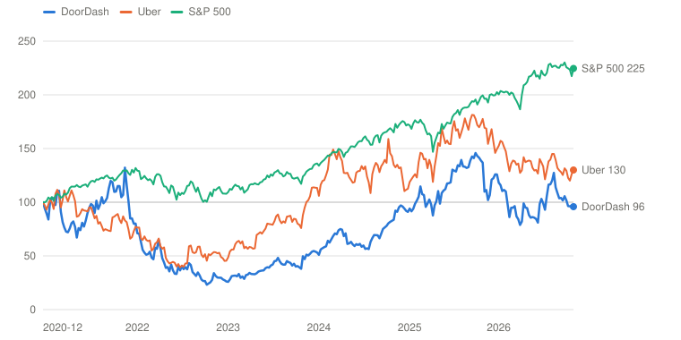
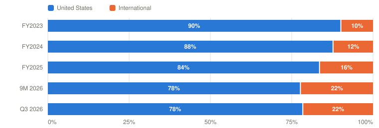

# DASH — DoorDash, Inc.

> **Schema** v7.0 · **Updated** 2026-11-12 · **Status** Active
> **Price** $178.26 verified Nov 11, 2026 close, 4:00 PM EST ([Yahoo](https://finance.yahoo.com/quote/DASH/)) · 52-wk $143.30–$239.00 · 37th %ile · −25.4% from high
> **Type** Three-sided local-commerce marketplace · **Stage** Scaling · **Cyclical** No · **Competence** Edge

## Verdict

**DoorDash grew orders 28% and agreed to buy Instacart for about $17 billion to give its DashMart warehouses the volume they need, but at $178.26 the probability-weighted case pays 6.2% a year against the 13% hurdle: Watch.**

🟡 **Non-holder: Watch (entry ≤$131)** · 🟡 **Holder: Hold**

| PW EV | PW return/yr | Compounding/yr | R/R | Entry | Trim | Avoid | EV / TTM Adj EBITDA | Yield | BAIT | Moat | Next |
|---|---|---|---|---|---|---|---|---|---|---|---|
| **$241** | **6.2% (<13%)** | 28.3% | 2.2:1 | ≤$131 | $241–$425 | ≥$425 | ≈21× (≈74× TTM GAAP EPS) | 0.0% | Double (B+A), Low-Moderate | Narrow, stable; grocery moat unproven | 📅 Q4 ~mid-Feb 2027 · Instacart vote and antitrust clearance (dates TBD) |

**Breaks if**: The grocery bet fails to pay: New Verticals is still not gross-profit positive in the Q4 2026 letter, or the Instacart deal closes with DoorDash's investment-grade rating lost or the stock consideration above the 25% cap. Then the largest deal in the company's history buys volume without profit.

⚠️ **Terminal-growth check**: implied perpetual growth exceeds the risk-free rate in Bull.

## The Call

The business is stronger than in August. Q3 orders grew 28% (17% without Deliveroo), contribution profit reached 5.2% of GOV and adjusted EBITDA was $1.06 billion, above the midpoint of the guide for the third quarter running. The stock is 24% lower, at $178.26. At that price a 9% return needs GAAP EPS of $11.43 in 2031 at 24 times, a third of the way from my Base ($9.86) to my Bull, and 13% needs $13.68. The probability-weighted value is $241, a return of 6.2% a year, and the price that returns 13% is $131. The price implies a Bear probability of only 11%. What the market may have wrong is the Instacart deal: it is about $17 billion, at least $12.75 billion of it in cash, bought to give a warehouse business, DashMart, volume it cannot disclose the cost of, and DoorDash says it will reinvest more than 100% of the synergies in year one. I value the deal at no value created. The number that proves or breaks it is New Verticals gross profit, which the CFO says is 'pretty close to breakeven' and is committed to turn positive by the end of 2026.

## What I'd Have To Be Wrong About

1. **That New Verticals, DashMart included, pays for itself.** Test: A statement in the Q4 2026 letter or call (about mid-February 2027) that New Verticals was gross-profit positive for Q4 or the second half. At the Q3 call the CFO said 'We are pretty close to being breakeven on a gross profit level' and had committed to positive by year end. **If Fail →** 10 points Base → Bear (PW EV $223, 4.6%/yr) → **Watch / Hold**, entry ≤$121.
2. **That the core keeps turning growth into profit.** Test: Q4 2026 adjusted EBITDA of at least $1.0 billion (guide $0.9–1.1 billion; Q3 was $1,060 million) and Q4 Marketplace GOV of at least $35.4 billion, both in the Q4 release (about mid-February 2027), with FY2026 GAAP operating margin of at least 6% in the 10-K. **If Fail →** 10 points Base → Bear (PW EV $223, 4.6%/yr) → **Watch / Hold**, entry ≤$121.
3. **That the deal is financed and cleared on the announced terms.** Test: Through the Q2 2027 10-Q (early August 2027): DoorDash keeps an investment-grade rating (it has said it is targeting one), stock consideration stays within the 25% cap, and no antitrust remedy or repricing changes what DoorDash is buying. The deal is not expected to close until the end of 2027 or the first half of 2028, so this is a test of the path, not the close. **If Fail →** 15 points Base → Bear (PW EV $215, 3.8%/yr) → **Watch / Hold**, entry ≤$117.

## Latest update: 2026-11-12 · Q3 and the $17 billion Instacart agreement: a stronger core, a bigger bet, a lower price

- Core delivers against the Q3 guide (adjusted EBITDA at or above the $950M low end) — ✅ Pass — Q3 adjusted EBITDA $1,060M against a $950M–$1.1B guide, above the midpoint; Q3 GOV $33.9B against a $33.0–34.0B guide, at the top
- New Verticals gross-profit positive by Q4 2026 — 🟡 Pending — CFO, Oct 29: 'We are pretty close to being breakeven on a gross profit level'; the commitment stands for year end
- U.S. share at or above 60% and no margin compression — 🟡 Pending — Contribution profit rose to 5.2% of GOV from 4.4% in Q1; U.S. share was not re-measured this pass

DoorDash reported the third quarter on October 29, the day after it agreed to buy Instacart. The quarter beat its own guide on every line that matters, adjusted EBITDA and GAAP net income set records, and the stock, at $233.50 on August 26, closed at $178.26 on November 11, 24% lower. It passed one of the three tests I carried from the old page, left the other two pending, and moved the question to whether $17 billion of volume pays for a warehouse business whose costs DoorDash does not disclose.

| | Q3 2026 | Q3 2025 | Against expectations |
|---|---|---|---|
| Total Orders | **993M** (+28%; +17% ex-Deliveroo) | 776M | |
| Marketplace GOV | **$33.9B** (+36%; +23% ex-Deliveroo) | $25.0B | Guide $33.0–34.0B, at the top |
| Revenue | **$4,616M** (+34%) | $3,446M | |
| Contribution profit | $1,780M (5.2% of GOV) | $1,268M (5.1%) | 4.4% in Q1 |
| Adjusted EBITDA | **$1,060M** (+41%) | $754M | Guide $950M–$1.1B, above the midpoint |
| GAAP net income | **$466M** (+91%) | $244M | Tax rate 3.9% |
| Free cash flow | $787M (+9%) | $723M | 74% of adjusted EBITDA, from 96% |

Sources: [Q3 release](https://www.sec.gov/Archives/edgar/data/0001792789/000179278926000062/proddashex991-pressrelease.htm), [10-Q](https://www.sec.gov/Archives/edgar/data/0001792789/000179278926000070/dash-20260930.htm), [call transcript](https://www.investing.com/news/transcripts/earnings-call-transcript-doordash-beats-q3-2026-estimates-as-shares-jump-6-93CH-4984252). I did not check results against consensus this pass.

**Guidance.** Q4 GOV of $35.4–36.4 billion and adjusted EBITDA of $900 million to $1.1 billion. The EBITDA midpoint is $1.0 billion, below the Q3 actual, which is consistent with the stated plan to reinvest. Stock compensation of about $1.2 billion and depreciation and amortization of about $1.2 billion (including $450 million of acquired-intangible amortization) for 2026, and a $700–800 million drag on reported 2026 free cash flow from year-end merchant-payment timing. From Q4 the company stops reporting results excluding Deliveroo.

**Management's points.** Tony Xu said grocery delivery "really is just a fraction of what its potential could be" and that DashMart orders are "near perfect" against "the low 90s" for third-party stores. The letter put the figures at 99%+ accuracy and more than 10 minutes faster, and said "Managing inventory inside a warehouse is a fixed cost business. Scale is a necessary (though insufficient) input." Chief financial officer Ravi Inukonda said New Verticals is "pretty close to being breakeven on a gross profit level," that Instacart "wanted to participate in the upside" through some stock in the deal, and that buybacks will stay "opportunistic." The letter reported U.S. restaurant GOV growth at its fastest for a third quarter since 2020 and grocery and retail growing at more than twice that pace.

**Pushback and non-answers.** Raymond James asked how large the DashMart footprint has to become; Xu answered with a sequence (density after close, lower warehouse cost, more SKUs, eventually every store) and said much of the real estate "in many ways, is already been designed for us," meaning grocers' own stores, and gave no site count or investment. Wolfe asked where $500 million of synergies comes from; Inukonda listed cross-listing, advertising, cross-selling software, density and opex, with more than 100% reinvested in year one. MoffettNathanson asked why use shares when DoorDash has been disciplined about buybacks; the answer was that Instacart wanted to share in the upside. Nobody got a DashMart number.

**What the 10-Q adds.** No share repurchases in Q3, after 6.8 million shares for about $1.0 billion in the first half at an average $155.25. The risk factor on self-operated retail now says using those sites "to enable fulfillment services on behalf of third-party merchants" has required and will require additional investment. Nine-month purchases of property and equipment were flat at $208 million while capitalized software rose to $375 million. The bridge loan is up to $13.0 billion for 364 days.

**The deal.** $65.00 a share, about $17 billion, a 26% premium to Instacart's Oct 22 close, at least 75% cash and no more than 25% stock (about 24 million shares, 5.5% of the count, at today's price). Expected to close at the end of 2027 or in the first half of 2028. Instacart's own Q3: 91.4 million orders (+10%), GTV $10.5 billion (+15%), adjusted EBITDA $342 million. Instacart stock traded near $57 against the $65 price within days.

**What it does to the debates.** The grocery debate changed shape. Before, the question was whether DashMart could earn its keep alone. Now DoorDash has told us it cannot, and the answer is to buy density. I model the deal as neither creating nor destroying value, and put its failure in the Bear. On earnings quality, the quarter was better than the headline: contribution profit per order rose 10% and operating income per order 34%, but a 3.9% tax rate and 85% higher amortization separate adjusted EBITDA from net income, and free cash flow grew 9% against EBITDA's 41%.

**Re-underwriting.** The old page's scenarios were set on August 26, before Q3 and the deal, at a $233.50 price. I rebuilt the model from the FY2025 and Q3 figures on GAAP earnings after stock compensation, with exit multiples of 18, 24 and 28 times. That produces a probability-weighted value near $241, a return of 6.2% a year from $178.26, and an entry price of $131. The August set showed about 1% a year at $233.50; the price has fallen faster than the value, which is why the return improved, but it is still half the hurdle. Bias check on the verb, which stays Watch / Hold: what changed is the price and the model basis, not the business case; the evidence that would have changed it, a Bear that is more likely, has not arrived; I did not let the lower price pull the verb up, because the hurdle is unmet at any price above $131; I checked the Base's first-year revenue ($20.7 billion for FY2027) against the $21.5 billion consensus the old page carried, and it is 4% lower; and I would write the same verb if I had held the stock since August.

**Scorecard.**

1. *Core delivers against the guide.* Pass. Adjusted EBITDA of $1,060 million was above the midpoint of the $950 million to $1.1 billion range.
2. *New Verticals gross-profit positive by Q4 2026.* Pending. "Pretty close to being breakeven." Replaced by test 1 on the page, now tied to the Q4 letter.
3. *U.S. share at or above 60% and no margin compression.* Pending. Margin passed (contribution profit 5.2% of GOV against 5.1%); share was not re-measured.

**Verb.** Watch, entry at or below about $131, for a non-holder; Hold for a holder. The earlier Watch band ($184–208) was set on the old model and is replaced.

---

## Deep Dive: DoorDash: Buying the Volume for a Warehouse

*Orders grew 28% and GAAP profit nearly doubled in the quarter the company agreed to pay $17 billion for Instacart. Management says the deal exists to give its own warehouses enough volume to pay. What does $178 assume, and does the volume earn its price?*

**Contents**: [Business Overview](#business-overview) · [Grocery, DashMart and the $17 Billion Question](#grocery-dashmart-and-the-17-billion-question) · [Earnings Quality: How Much of $1.06 Billion Reaches Owners?](#earnings-quality-how-much-of-106-billion-reaches-owners) · [Management, Capital Allocation and Incentives](#management-capital-allocation-and-incentives) · [Valuation and Model Assumptions](#valuation-and-model-assumptions) · [Final Words](#final-words) · [Appendix: The Numbers](#appendix-the-numbers) · [Sources](#sources)

In December 2020, within days of its IPO, DoorDash closed at $186.00. On November 11, 2026 it closed at $178.26. In between, revenue went from $2.9 billion to $17.1 billion over the last twelve months, quarterly orders reached 993 million, and the company went from a $558 million loss in 2023 to $935 million of GAAP profit in 2025. A buyer in December 2020 is down 4% in total return. Uber returned 30% over the same stretch and the S&P 500 125%.

The history is a rise, a collapse and a second rise. The stock fell to about a quarter of its starting value by October 2022 as pandemic orders normalized, and the company closed an all-stock deal for Wolt (about $8 billion at announcement `[link pending]`) on May 31, 2022; the diluted share count rose 10% that year. Then DoorDash cut its cost growth below its revenue growth, turned profitable, started a buyback, and bought Deliveroo for cash at the start of October 2025. The stock reached its weekly high that same month, 46% above where this series starts, and has given back a third since.

*Total return, weekly, December 10, 2020 = 100, through November 11, 2026. DoorDash closed at $186.00 on December 10, 2020; its weekly index high was 145.8 in the week of October 3, 2025 and its low 23.2 in October 2022. Source: Yahoo Finance adjusted closes. Built with Claude.*

| Date | DoorDash | Uber | S&P 500 |
|---|---|---|---|
| 2020-12-10 | 100 | 100 | 100 |
| 2021-12-10 | 85 | 68 | 130 |
| 2022-12-09 | 30 | 49 | 110 |
| 2023-12-01 | 52 | 106 | 131 |
| 2024-11-22 | 95 | 132 | 172 |
| 2025-11-21 | 102 | 154 | 193 |
| 2026-11-11 | 96 | 130 | 225 |

The latest chapter is the one the market is trading. On October 28, 2026, DoorDash agreed to buy Instacart for $65.00 a share, about $17 billion, at least 75% of it in cash, and announced it with a quarter in which revenue grew 34%, adjusted EBITDA 41% and GAAP net income 91%. It is the biggest deal in the company's history and arrives with the stock 24% below its Aug 26 level of $233.50. The deal was not a rescue or a defensive move, and management says so. It also is not obviously a bargain.

I think two questions decide the stock. The first is what the deal is really for. DoorDash says the answer is DashMart, its own warehouses, which deliver almost perfectly but, in the company's words, are "a fixed cost business" that needs more volume than DoorDash has. The question is whether $17 billion of someone else's volume makes those warehouses pay, and whether the combined company earns that back. The second is quieter. Adjusted EBITDA is now $3.5 billion a year, but stock compensation, amortization and a very low tax rate sit between that number and what owners keep. I start with the business. The grocery and DashMart debate comes first, with management's case in its own words and four holes in it. The earnings-quality debate follows. Then I look at management and capital allocation, which has just changed, and finish with the valuation: what $178 assumes and what 13% a year would need.

### Business Overview

DoorDash runs a three-sided marketplace. Consumers order, merchants (restaurants first, now grocers and retailers) fulfill, and Dashers deliver. It takes a share of each order's value in commissions and fees, plus advertising and subscription revenue, and it reports one segment. The disclosed unit is the order, and the money it handles is Marketplace gross order value, GOV. Revenue was 13.6% of GOV in Q3 (the Net Revenue Margin). In its own letters the company thinks in contribution profit, which is revenue less the direct cost of the order, shown here as a share of GOV.

| $ Million unless stated | Q3 2025 | Q4 2025 | Q1 2026 | Q2 2026 | Q3 2026 |
|---|---|---|---|---|---|
| Total Orders (M) | 776 | 903 | 933 | 970 | **993** |
| Total Orders growth | +21% | +32% | +27% | +27% | **+28%** (+17% ex-Deliveroo) |
| Marketplace GOV ($B) | 25.0 | 29.7 | 31.6 | 33.1 | **33.9** |
| GOV growth | +25% | +39% | +37% | +36% | **+36%** (+23% ex-Deliveroo) |
| **Revenue** | 3,446 | 3,955 | 4,036 | 4,454 | **4,616** |
| Revenue growth | +27% | +38% | +33% | +36% | **+34%** |
| Net Revenue Margin (revenue ÷ GOV) | 13.8% | 13.3% | 12.8% | 13.5% | 13.6% |
| GAAP gross profit | 1,689 | 1,911 | 1,944 | 2,223 | 2,311 |
| Contribution profit | 1,268 | 1,405 | 1,380 | 1,641 | **1,780** |
| Contribution profit, % of GOV | 5.1% | 4.7% | 4.4% | 5.0% | 5.2% |
| **Adjusted EBITDA** | 754 | 780 | 754 | 914 | **1,060** |
| Adjusted EBITDA, % of GOV | 3.0% | 2.6% | 2.4% | 2.8% | 3.1% |
| GAAP net income | 244 | 213 | 184 | 200 | **466** |
| Diluted shares (M) | 442 | 443 | 442 | 439 | 440 |

*Source: [Q3 2026 release, key metrics table](https://www.sec.gov/Archives/edgar/data/0001792789/000179278926000062/proddashex991-pressrelease.htm); local extract in raw/DASH/press-releases. Q3 2026 guide was GOV $33.0–34.0B and adjusted EBITDA $950M–$1.1B; the Q4 guide is GOV $35.4–36.4B and adjusted EBITDA $900M–$1,100M. Built with Claude.*

Three things stand out. Growth is fast and not slowing: GOV has grown 36% or more for three quarters. About a third of that is Deliveroo; excluding it, orders grew 17% and GOV 23%, and management will stop reporting that split from Q4, when the acquisition anniversaries. Second, contribution profit per dollar of GOV rose from 4.4% to 5.2% in two quarters, which is where the operating leverage is. Third, GAAP net income jumped from $200 million to $466 million in one quarter, but adjusted EBITDA did not double, so some of that jump is not operating, which the second debate takes up.

| Per order, $ | Q3 2025 | Q3 2026 | Change |
|---|---|---|---|
| Total Orders (M) | 776 | **993** | +28% |
| Marketplace GOV per order `[Derived]` | 32.24 | 34.18 | +6% |
| Revenue per order | 4.44 | **4.65** | +5% |
| GAAP gross profit per order | 2.18 | 2.33 | +7% |
| Contribution profit per order | 1.63 | **1.79** | +10% |
| Adjusted EBITDA per order | 0.97 | 1.07 | +10% |
| Stock compensation per order | 0.33 | 0.27 | −18% |
| Depreciation and amortization per order | 0.22 | 0.31 | +44% |
| **GAAP operating income per order** | 0.33 | **0.45** | +34% |
| Free cash flow per order | 0.93 | 0.79 | −15% |
| Customer, retention, CAC | n/d | n/d | MAUs and subscribers are reported yearly; mature-cohort order rates are described only as double-digit growth |

*Unit of value: an order. Per-order figures are the quarter's total divided by Total Orders `[Derived]`; Total Orders includes Drive and other non-marketplace orders while GOV is marketplace only, so GOV per order slightly understates the marketplace basket. Source: [Q3 2026 10-Q](https://www.sec.gov/Archives/edgar/data/0001792789/000179278926000070/dash-20260930.htm), [Q3 2026 release](https://www.sec.gov/Archives/edgar/data/0001792789/000179278926000062/proddashex991-pressrelease.htm). Built with Claude.*

Per order, DoorDash earned about $1.79 of contribution profit in Q3, up 10% in a year, and turned that into $0.45 of operating income, up 34%. The sharpest line is free cash flow per order, down 15%, while profit per order rose.

*Share of revenue by geography. Source: [FY2025 10-K](https://www.sec.gov/Archives/edgar/data/1792789/000179278926000013/dash-20251231.htm), [Q3 2026 10-Q](https://www.sec.gov/Archives/edgar/data/0001792789/000179278926000070/dash-20260930.htm). Built with Claude.*

| Period | United States | International | Total ($M) |
|---|---|---|---|
| FY2023 | 7,781 (90%) | 854 (10%) | 8,635 |
| FY2024 | 9,403 (88%) | 1,319 (12%) | 10,722 |
| FY2025 | 11,460 (84%) | 2,257 (16%) | 13,717 |
| 9M 2026 | 10,180 (78%) | 2,926 (22%) | 13,106 |
| Q3 2026 | 3,619 (78%) | 997 (22%) | 4,616 |

The geographic mix shifted because of Deliveroo. International was 16% of revenue in 2025 and 22% in the first nine months of 2026. DoorDash does not report profit by geography or category, so I model the two geographies on a shared gross margin and treat the split as a growth input, not a profit statement.

A few accounting points before the debates. Adjusted EBITDA excludes stock compensation (about $1.1 billion over the last twelve months, 6.6% of revenue) and depreciation and amortization (about $1.2 billion in 2026, of which about $450 million is the amortization of acquired intangibles). I treat stock compensation as a real cost and value the company on GAAP earnings, which already charge it. Second, the tax line is tiny: $19 million on $484 million of pre-tax income in Q3, a 4% rate, so GAAP earnings overstate what a normal-tax business would show. Third, free cash flow is lumpy because DoorDash holds merchant and Dasher money in transit; management guides 2026 reported free cash flow down $700–800 million from year-end timing. Fourth, the 2030 convertible notes carry no cash coupon, so interest expense is not a constraint today, and the company holds $6.8 billion of cash and investments. I use net cash of about $4.1 billion before the Instacart financing.

### Grocery, DashMart and the $17 Billion Question

DashMart is the one place in U.S. delivery where DoorDash holds inventory. Small warehouses closed to the public are leased, stocked and staffed by DoorDash, and its own employees pick the orders. In September 2025 it became DashMart Fulfillment Services: retailers keep ownership of the goods and DoorDash stores, picks and delivers them. [CVS and Party City launched first, Kroger was named as joining, and DoorDash cited more than 100 locations](https://about.doordash.com/en-us/news/doordash-unveils-dashmart-fulfillment-services). The Q3 2026 letter adds Giant Eagle and Albertsons and "thousands of high-quality products."

The disclosure is thin, and that is the first finding. DoorDash has given no site count since "more than 100" in September 2025, and the Q3 10-Q does not name DashMart. Orders, revenue, margin, capex and any fee DoorDash charges retailers have never been disclosed. What we have is management's account of why it is worth doing.

#### Management's narrative

The case, as DoorDash makes it, is that grocery delivery is not a good product yet and warehouses are what make it one. Tony Xu, the chief executive, on the Q3 2026 call, October 29, 2026:

> "Customers today are still being asked to pay a premium for imperfect delivery. The question is, how can we actually ensure that we offer perfect deliveries at the most affordable prices? ... we recognized that in order to offer the best possible service at the most affordable prices, we really needed to manage the inventory because stock-outs were a key issue. ... we are near perfect in our deliveries with DashMarts, but we are only in the low 90s in terms of our accuracy through the third party stores. There is a meaningful gap."
> — Tony Xu, Q3 2026 earnings call, October 29, 2026

The company's letter that day put the number on it: 99%+ fulfillment accuracy and deliveries more than 10 minutes faster on average. Then it said the quiet part:

> "Managing inventory inside a warehouse is a fixed cost business. Scale is a necessary (though insufficient) input into helping lower costs. This is one of the reasons we're attracted to Instacart, as it adds scale that is unique to our network."
> — DoorDash Q3 2026 shareholder letter, October 29, 2026

Asked by Raymond James how big the footprint has to get, Xu described a sequence, and not thousands of DoorDash warehouses:

> "None of these stores, as you probably know, are built for delivery. They were effectively built for browsing. ... How do we allow those stores to shine as the showrooms, and how do we actually build the correct square footage as the warehouse or the back-of-house infrastructure ... That is the vision of DashMart, but it is a sequencing process."
> — Tony Xu, Q3 2026 earnings call, October 29, 2026

The business case beyond DashMart is fair, too. In the U.S., grocery and retail GOV is growing at more than double the pace of restaurants, with double-digit order-rate growth in nearly all mature cohorts. DoorDash has integrated Wolt and Deliveroo, and the letter says international profit "exceeded our expectations." This is a company that does buy things and then run them.

#### Poking holes in it

The first hole is the quality claim, which is real and narrower than it sounds. The 99% is footnoted to "fulfillment accuracy for DashMart orders" and the speed comparison is DashMart orders against "all other grocery orders" in the same geographies, which is the same market but not the same basket. A DashMart carries a few thousand pre-selected items; a store-picked order can be anything. The "low 90s" for third-party stores is a spoken figure. I believe the gap exists. I cannot measure it for like-for-like baskets, and nobody outside DoorDash can.

The second is that we cannot see the cost, and the one time we could, it hurt. On the Q2 2022 call, then-chief financial officer Prabir Adarkar said ["roughly half of the increase in cost of sales as a percentage of GOV is driven by DashMart"](https://www.fool.com/earnings/call-transcripts/2022/08/05/doordash-inc-dash-q2-2022-earnings-call-transcript/) as sites opened ahead of volume. The Q3 2026 10-Q repeats the risk: DoorDash "may not be able to generate a sufficient number of orders to cover our fixed costs," and using these sites for third-party merchants "has required, and is expected to continue requiring, additional investment." Nine-month purchases of property and equipment were $208 million, flat on last year, so the spending is not large next to $2.2 billion of trailing free cash flow, but it is also not visible.

The third is that the volume arithmetic is modest. Suppose 100 sites each carry 3,000 orders a week, the throughput range I take from the dark-store benchmark MBI Deep Dives cites in its [DashMart piece](https://www.mbi-deepdives.com/dashmart/) (not independently verified). That is about 3.9 million orders a quarter, 0.4% of Q3's 993 million. Instacart did 91.4 million orders in Q3 at about $115 a basket; routing 1% of those through 100 sites adds about 700 orders a week to each [Derived]. That helps, and it is a quarter of the benchmark. The baskets are the other problem: a $115 average basket is a stock-up trip, and a warehouse of a few thousand items does not fill it. The model only works if the grocer's own store becomes the warehouse, which is Xu's "showroom" idea, and no one has shown that at scale.

The fourth is price. Instacart is growing orders 10% and gross transaction value 15%, with $342 million of adjusted EBITDA in the quarter, and $17 billion is about 12 times that quarter annualized [Derived]. DoorDash expects "$500 million or more of annual synergies, net of investments," and says it will reinvest more than 100% of them in year one, so the first full year after close adds nothing net. The cash comes from the balance sheet and a bridge loan of up to $13.0 billion; the stock part is capped at 25% and could be about 24 million new shares, 5.5% of the count [Derived]. Closing is not expected until the end of 2027 or the first half of 2028, and Instacart traded around $57 against the $65 price within days of the announcement ([Investing.com](https://www.investing.com/news/analyst-ratings/jefferies-cuts-instacart-stock-rating-on-doordash-acquisition-deal-93CH-4985270)), a market sign of closing risk and a long wait.

| Orders per week a DashMart needs to break even | $5 contribution/order | $8 | $11 |
|---|---|---|---|
| Annual fixed cost per site: $1.5M | 5,800 | 3,600 | 2,600 |
| $2.5M | 9,600 | 6,000 | 4,400 |
| $3.5M | 13,500 | 8,400 | 6,100 |
| **Reference: 100 sites, 3,000 orders a week each** | ≈3.9M orders a quarter | 0.4% of Q3 orders | — |
| Reference: 1% of Instacart's Q3 orders over 100 sites | ≈700 more a week per site | a quarter of the 3,000 benchmark | — |

*Illustrative. Breakeven orders per week = annual fixed cost ÷ (52 × contribution per order). DoorDash has never disclosed a DashMart's rent, labor, inventory cost or contribution per order, so every input is an assumption `[Estimate]`; the 3,000-a-week figure is the manual dark-store throughput MBI Deep Dives cites from McKinsey, not independently verified. Instacart's Q3 2026 orders are 91.4M ([Maplebear 8-K](https://www.sec.gov/Archives/edgar/data/0001579091/000119312526437014/d24470dex991.htm)). Source for the 100 sites: [DoorDash, Sep 30, 2025](https://about.doordash.com/en-us/news/doordash-unveils-dashmart-fulfillment-services); no later count has been disclosed. Built with Claude.*

Here is what a single site needs. The table is not an estimate, because nobody outside DoorDash knows a DashMart's rent, labor or contribution per order. It shows the breakeven throughput for a range of assumed costs. A site at benchmark throughput pays only with low fixed cost and high contribution per order, which is why management keeps saying "scale." On the best case in the grid, a quarter of the benchmark volume from Instacart is a start, not a finish.

Where I come out: DashMart is a strategic weapon with an unmeasured cost, too small to move the P&L either way, and the Instacart price is far larger than the program it is meant to fix. I treat the deal as a fair-price bet in the Base, neither creating nor destroying value, and put the Bear on it not being earned back. The first test is whether New Verticals reaches gross-profit breakeven by year end, as management has committed. At the Q3 call the chief financial officer said "We are pretty close to being breakeven on a gross profit level," which is progress and not yet the number.

#### Rings of profit

DoorDash does not report profit by category, so the rings are ordered by exposure to the grocery debate, with what is disclosed.

| Ring | What it is | Disclosed | Exposure to the grocery and DashMart debate |
|---|---|---|---|
| 1. U.S. restaurants, DashPass, advertising | The core: orders, subscriptions and merchant advertising | U.S. revenue $10.2B of $13.1B in nine months (78%); U.S. restaurant GOV growth at its fastest for a third quarter since 2020; DashPass cut transaction fees per order 9% in two years | **Low.** Funds the bet; its margin is the best evidence that scale pays |
| 2. International | Wolt and Deliveroo | International revenue $2.9B in nine months (22%), $997M in Q3 vs $520M; profit contribution 'exceeded our expectations' | **Low.** Integration risk, not grocery risk |
| 3. U.S. grocery and retail marketplace | Third-party store orders | Grows at more than twice the U.S. restaurant rate; accuracy 'low 90s' on store-picked orders (Xu); size undisclosed | **High.** The product the deal is meant to improve |
| 4. DashMart and Fulfillment Services | Self-operated warehouses; third-party inventory | More than 100 sites (Sep 2025); 99%+ accuracy; no orders, revenue or cost; New Verticals 'close to breakeven' on gross profit | **Highest.** A fixed-cost layer; under about 2% of orders on generous assumptions `[Estimate]` |

*DoorDash does not report profit by category or geography. Source: [Q3 2026 10-Q](https://www.sec.gov/Archives/edgar/data/0001792789/000179278926000070/dash-20260930.htm), [Q3 2026 letter](https://www.sec.gov/Archives/edgar/data/0001792789/000179278926000062/proddashex991-pressrelease.htm), [Q3 2026 call](https://www.investing.com/news/transcripts/earnings-call-transcript-doordash-beats-q3-2026-estimates-as-shares-jump-6-93CH-4984252). Built with Claude.*

The point is that most of the profit is far from the debate. U.S. restaurants, DashPass and advertising earn the money that funds the grocery and DashMart bet, and international is now more than a fifth of revenue. The risk is real and concentrated: it is the fixed-cost warehouse layer plus the integration of the largest deal DoorDash has attempted, funded in a way that leaves little room for a stumble in the core.

#### Where this differs from MBI's DashMart analysis

MBI and I agree on the shape: DashMart is not the main reason for the price, it is the clearest picture of the end state, fixed cost is the crux, and the likely end state is inventory inside the grocer's footprint. I could confirm its main facts against filings and calls, including the 99%+ and 10-minute figures, the sequencing language, the $500 million synergy path and the 2022 cost comment. MBI goes further than I can on the Instacart-side economics: its shopper-pay and error-compounding estimates, which I did not rebuild. I add three things: the provenance of the quality claim, a bound on how small DashMart is (under about 2% of orders even on generous assumptions), and the financing and dilution that come with the volume. Whether retailers pay DoorDash per unit for fulfillment, as third-party sellers do for Amazon's, is undisclosed; that decides if Fulfillment Services is a revenue line or a customer-acquisition cost.

### Earnings Quality: How Much of $1.06 Billion Reaches Owners?

The second debate is smaller in headline but sets the multiple. DoorDash reports adjusted EBITDA of $1.06 billion for Q3, up 41%. The question is what is left after the costs the adjustment removes.

#### Management's narrative

The company's view is that it reinvests in the product and that the profit shows up where it chooses. The letter says so about international, "contributions to total profitability that exceeded our expectations entering the quarter," and about the combined business with Instacart, where the chief financial officer said on the call:

> "The key for us, however, is how do you take some of the profit dollars and reinvest that back in the business to ultimately build a better product for consumers as well as grocers. Look, that's historically what we've done."
> — Ravi Inukonda, CFO, Q3 2026 earnings call, October 29, 2026

That is consistent with the record: contribution profit per order up 10% in a year, operating margin up from 7.5% to 9.6% in a year, and a Q4 guide of adjusted EBITDA of $900 million to $1.1 billion, whose midpoint is below the Q3 actual, with the reinvestment philosophy stated in advance.

#### Poking holes in it

The first hole is the bridge. Of $1,060 million of adjusted EBITDA, $442 million became GAAP operating income. Stock compensation took $268 million and amortization and depreciation $312 million, the latter up from $169 million a year ago because of Deliveroo.

| $ Million | Q3 2025 | Q3 2026 | Change |
|---|---|---|---|
| **Adjusted EBITDA** | 754 | **1,060** | +41% |
| Stock-based compensation | (258) | (268) | +4% |
| Depreciation and amortization | (169) | (312) | +85% |
| Other adjustments, residual `[Derived]` | (69) | (38) | — |
| **Income from operations** | 258 | **442** | +71% |
| Interest income and other, net | (10) | 42 | — |
| Pre-tax income | 248 | 484 | +95% |
| Income tax | (5) | (19) | 3.9% rate |
| Redeemable non-controlling interests | 1 | 1 | — |
| **Net income attributable to DoorDash** | 244 | **466** | +91% |
| Conversion of adjusted EBITDA to operating income | 43% | 42% | — |
| Net income at a 21% tax rate `[Estimate]` | — | ≈382 | — |

*Other adjustments are the residual between adjusted EBITDA less stock compensation and depreciation and amortization and GAAP operating income: payroll tax on stock compensation, legal, tax and regulatory items and restructuring. Q3 2025 other income included an $81M expense. Source: [Q3 2026 10-Q](https://www.sec.gov/Archives/edgar/data/0001792789/000179278926000070/dash-20260930.htm), [Q3 2026 release](https://www.sec.gov/Archives/edgar/data/0001792789/000179278926000062/proddashex991-pressrelease.htm). Built with Claude.*

The second is the tax rate. Pre-tax income was $484 million and the provision was $19 million. At a normal 21% rate Q3 net income would have been about $380 million, not $466 million. The low rate reflects past losses; my model moves it to 21% by 2031.

The third is cash. Free cash flow was $787 million in Q3, up 9%, while adjusted EBITDA rose 41%. Cash conversion fell from 96% of adjusted EBITDA to 74% in a year. Part of that is capitalized software and equipment (the two together were $583 million in nine months against $438 million), and management guides a $700–800 million drag in reported 2026 free cash flow from year-end payment timing. Neither is alarming. Together they mean that the growth in EBITDA is not yet growth in cash at the same rate.

The fourth is that the share count is only flat because of a buyback that has stopped. Diluted shares were 440 million in Q3 against 442 million a year earlier. DoorDash bought 6.8 million shares for about $1.0 billion in the nine months at an average $155.25, and bought none in Q3. Stock compensation is 6.6% of revenue and the Instacart stock component adds to the count, so the next year is dilutive unless the buyback resumes, and the company now needs its cash for the deal.

Where I come out: the operating leverage is genuine and the strongest evidence is contribution profit per order. I value the company on GAAP earnings that already charge stock compensation and amortization, taxed normally by the terminal year, and I do not give credit for adjusted EBITDA. That is why the multiple on FY2026 GAAP earnings looks so high and why I use 24 times in the Base.

### Management, Capital Allocation and Incentives

Tony Xu co-founded DoorDash in 2013 and has run it since. The company has two classes of stock, 24.0 million Class B shares with extra votes against 412.0 million Class A at September 30, held by founders and early insiders `[link pending: DEF 14A not read in this pass]`. The prior-tenure test is Xu against himself: the 2021–2022 company that paid in stock for Wolt at the top of the market, and the 2023–2026 company that cut costs, started a buyback and then paid cash for Deliveroo.

| Year | Deal | Price and form | What happened | Verdict |
|---|---|---|---|---|
| 2022 | Wolt (Finland) | About $8B in stock at announcement `[link pending]`; closed May 31, 2022 | Diluted shares +10% in 2022; international became a platform; Wolt is run alongside Deliveroo on a shared technology stack being unified in 2026 | Mixed |
| 2025 | SevenRooms | ≈$1.2B | Restaurant software, folded into the merchant stack; no separate disclosure of results | Too early |
| 2025 | Deliveroo (UK and Europe, Middle East) | ≈$3.9B cash; cash paid for acquisitions $4.15B in FY2025 ([10-K](https://www.sec.gov/Archives/edgar/data/1792789/000179278926000013/dash-20251231.htm)) | International revenue $1.32B (2024) → $2.26B (2025); Q3 2026 international growth 'accelerated'; ex-Deliveroo growth is the figure to watch | Good so far |
| 2026 | Instacart (agreement Oct 28) | $65.00/share, ≈$17B; ≥75% cash | Closing not before end-2027; antitrust clearance outstanding | Unclear |

*Source: [FY2025 10-K](https://www.sec.gov/Archives/edgar/data/1792789/000179278926000013/dash-20251231.htm), [Q3 2026 10-Q](https://www.sec.gov/Archives/edgar/data/0001792789/000179278926000070/dash-20260930.htm). Wolt and SevenRooms prices are from memory of announcements and carry `[link pending]`. Built with Claude.*

| $B, except per share | FY2021 | FY2022 | FY2023 | FY2024 | FY2025 | 9M 2026 | Cumulative |
|---|---|---|---|---|---|---|---|
| Revenue | 4.89 | 6.58 | 8.64 | 10.72 | 13.72 | 13.11 | — |
| Growth | +69% | +35% | +31% | +24% | +28% | +34% | — |
| Diluted EPS (GAAP) | −$1.39 | −$3.68 | −$1.42 | $0.29 | $2.13 | $1.93 | — |
| Operating cash flow | 0.69 | 0.37 | 1.67 | 2.13 | 2.43 | 2.53 | 9.83 |
| Capex incl. capitalized software | 0.24 | 0.35 | 0.32 | 0.33 | 0.61 | 0.58 | 2.43 |
| **Free cash flow** | 0.46 | 0.02 | 1.35 | 1.80 | 1.83 | 1.95 | **7.40** |
| Stock compensation | 0.49 | 0.89 | 1.09 | 1.10 | 1.05 | 0.85 | ≈5.46 |
| FCF less stock compensation | −0.03 | −0.87 | 0.26 | 0.70 | 0.78 | 1.10 | **≈1.94** |
| Buybacks | 0 | 0.40 | 0.75 | 0.22 | 0 | ≈1.0 | **≈2.37** |
| Buybacks ÷ stock compensation | 0 | 0.45× | 0.69× | 0.20× | 0 | ≈1.2× | 0.43× |
| Acquisitions (cash) | 0 | (0.07) | 0 | 0 | 4.15 | 0.06 | ≈4.14 |
| Debt (convertible notes) | 0 | 0 | 0 | 0 | 2.72 | 2.73 | — |
| Diluted shares (M) | 337 | 371 | 393 | 430 | 440 | 440 (Q3) | — |

*FCF = operating cash flow − purchases of property and equipment − capitalized software `[Derived]` (the company's own definition). Cumulative column is FY2021 to 9M 2026. Buybacks in 9M 2026: 6.8M shares at a $155.25 average, about $1.0B ([10-Q](https://www.sec.gov/Archives/edgar/data/0001792789/000179278926000070/dash-20260930.htm)); 2022 acquisitions were net cash acquired (Wolt was paid in stock). Source: [XBRL company facts](https://data.sec.gov/api/xbrl/companyfacts/CIK0001792789.json), [FY2025 10-K](https://www.sec.gov/Archives/edgar/data/1792789/000179278926000013/dash-20251231.htm), [Q3 2026 10-Q](https://www.sec.gov/Archives/edgar/data/0001792789/000179278926000070/dash-20260930.htm). Built with Claude.*

The cumulative column says two things. DoorDash has generated $7.4 billion of free cash flow since 2021 and issued $5.5 billion of stock compensation, so free cash flow after stock pay is $1.9 billion, about a quarter of the headline. And it has repurchased about $2.4 billion, 43% of the stock compensation, so buybacks have so far offset less than half the dilution. The share count rose 10% in 2022, the Wolt year.

The buyback timing is what I would want to see. The 6.8 million shares were bought at $155.25 on average in the first half, near the 52-week low of $143.30, and none in the third quarter. $4 billion of the $5 billion authorization remains. The Instacart deal now competes with it for cash. I grade DoorDash **Outsider-leaning, held on watch**: countercyclical buying in 2026 is the signature test and it passed, and the $17 billion deal at a 26% premium with the stock cheap by its own buyback prices is the test it now faces.

#### The incentives

| Component | Size | What it pays for | Status |
|---|---|---|---|
| **CEO Performance Award** | 10,379,000 performance-based RSUs granted Nov 2020; 9,341,100 still eligible at Sep 30, 2026 | Stock-price goals; vesting also needs service | No unrecognized expense remains ([10-Q](https://www.sec.gov/Archives/edgar/data/0001792789/000179278926000070/dash-20260930.htm)) |
| **Employee RSUs** | $2.5B unrecognized, over 2.69 years; $1.2B of stock compensation expected in 2026 | Retention; time-vested | SBC ≈6.6% of trailing revenue |
| **Annual cash bonus, other performance metrics** | Not read | — | DEF 14A not read in this pass (gap) |
| **Return on invested capital** | 0% (not seen as a metric) | — | Nothing read pays for it |

*The proxy statement was not read in this pass, so weights for the named executives are a gap; the CEO award and RSU balances are from the Q3 10-Q. Source: [Q3 2026 10-Q](https://www.sec.gov/Archives/edgar/data/0001792789/000179278926000070/dash-20260930.htm). Built with Claude.*

The CEO's reward is one large stock-price award and no cash bonus metric I could read in this pass, and nothing in it pays for return on capital. Xu's 10.4 million-share performance award vests on stock-price goals, and the company says it has no unrecognized expense left on it, so the cost has already been booked. Alignment is through the share price, and with $17 billion of acquired volume the price is exactly what depends on how he deploys capital. Against its own guidance, management is a consistent beater: adjusted EBITDA landed above the midpoint of the guided range in each of the last three quarters.

Is this the right team? On the record, yes for operations: they integrated two large acquisitions, drove contribution profit up and kept the logistics advantage. The open question is capital allocation at scale. The best evidence for the deal is that DoorDash has integrated Wolt and Deliveroo and I found no write-off of a large acquisition in this pass. The best evidence against is that this one is more than four times the size of the last cash deal, Deliveroo at about $3.9 billion.

| Promised | Where, when | Outcome |
|---|---|---|
| DashMart is 'a strong signal [of] product market fit'; its costs are in guidance | Q2 2022 call, Aug 5, 2022 (then-CFO Adarkar) | 🟡 Still no orders, revenue or cost disclosed in 2026; 'more than 100' sites in Sep 2025; the 2026 10-Q and letter call it a fixed-cost business needing scale |
| New Verticals gross-profit positive in the second half of 2026 | Q2 call, Aug 5, 2026 (CFO); reaffirmed Oct 29 | ⏳ 'Pretty close to being breakeven'; test 1 |
| Use the $5B buyback authorization | Authorized Feb 2025 | 🟡 $0 in 2025; 6.8M shares for about $1.0B in 9M 2026; none in Q3 |
| International: Deliveroo adds growth and profit | Q4 2025 letter, Feb 2026 (as cited in the prior page) | ✅ International revenue $520M → $997M in Q3; profit contribution 'exceeded expectations' |

*Guidance grade: **Consistent beater** against its own guide: adjusted EBITDA above the midpoint of the guided range in each of the last three quarters (Q1 $754M vs $675–775M, Q2 $914M vs $770–870M, Q3 $1,060M vs $950M–$1.1B). Source: [Q2 2022 call](https://www.fool.com/earnings/call-transcripts/2022/08/05/doordash-inc-dash-q2-2022-earnings-call-transcript/), [Q3 2026 call](https://www.investing.com/news/transcripts/earnings-call-transcript-doordash-beats-q3-2026-estimates-as-shares-jump-6-93CH-4984252), [Q3 2026 release](https://www.sec.gov/Archives/edgar/data/0001792789/000179278926000062/proddashex991-pressrelease.htm). Built with Claude.*

### Valuation and Model Assumptions

I value DoorDash at the end of FY2031 on GAAP earnings per share, which already charge stock compensation and amortization, and not on an adjusted figure. The model builds gross profit from two revenue lines, United States and International, each with its own growth rate, and applies a shared gross margin because DoorDash does not disclose profit by geography. Operating expenses are one line, as a share of revenue, covering sales and marketing, R&D, G&A and amortization. It adds about $170 million of interest income, taxes at 8% this year rising to 21%, and divides by diluted shares. FY2026 is the base year at about $18.0 billion of revenue: nine months reported plus a Q4 at the guide midpoint for GOV and a 13.5% net revenue margin. **The Instacart acquisition is not in the cases.** I treat it as value-neutral at the $17 billion price, because the stock market price already contains the deal; each $1 billion of value created or destroyed is worth about $3.50 a share by 2031 [Derived: $1 billion compounded at 9% for five years, over 436 million shares].

In the build below the segment margin rows are gross margins after cost of revenue (excluding D&A) and "Corporate and other" is all other operating expense.

| $ Billion | FY2025A | FY2026E | FY2027E | FY2028E | FY2029E | FY2030E | FY2031E |
|---|---|---|---|---|---|---|---|
| **United States revenue** | 11.5 | 13.9 | 16.0 | 18.4 | 21.2 | 24.4 | 28.0 |
|  YoY growth | — | 21.6% | **15.0%** | **15.0%** | **15.0%** | **15.0%** | **15.0%** |
|  Operating margin | 50.9% | 52.4% | 52.7% | 53.0% | 53.4% | 53.7% | **54.0%** |
|  Operating profit | 5.83 | 7.30 | 8.45 | 9.78 | 11.31 | 13.09 | 15.14 |
| **International revenue** | 2.3 | 4.0 | 4.6 | 5.3 | 6.1 | 7.0 | 8.1 |
|  YoY growth | — | 78.1% | **15.0%** | **15.0%** | **15.0%** | **15.0%** | **15.0%** |
|  Operating margin | 50.9% | 52.4% | 52.5% | 52.6% | 52.8% | 52.9% | **53.0%** |
|  Operating profit | 1.15 | 2.11 | 2.43 | 2.80 | 3.23 | 3.72 | 4.29 |
| Corporate and other | (6.26) | (8.23) | (9.16) | (10.18) | (11.31) | (12.55) | (13.91) |
| **Total revenue** | 13.7 | 18.0 | 20.7 | 23.8 | 27.3 | 31.4 | 36.1 |
| **Operating profit** | 0.72 | 1.19 | 1.72 | 2.39 | 3.22 | 4.25 | 5.52 |
|  Operating margin | 5.3% | 6.6% | 8.3% | 10.1% | 11.8% | 13.5% | 15.3% |
| Net income | 0.94 | 1.25 | 1.69 | 2.22 | 2.86 | 3.61 | 4.49 |
| Diluted shares (B) | 0.440 | 0.440 | 0.443 | 0.446 | 0.449 | 0.452 | 0.456 |
|  Net share change | — | — | +0.7% | +0.7% | +0.7% | +0.7% | +0.7% |
|  SBC (% of revenue) | — | 6.6% | 6.4% | 6.2% | 5.9% | 5.7% | 5.5% |
| **GAAP EPS (after SBC)** | $2.13 | $2.83 | $3.82 | $4.98 | $6.36 | $7.98 | $9.86 |
|  YoY growth | — | 33.0% | 34.7% | 30.6% | 27.6% | 25.4% | 23.6% |

*Bold cells are model inputs.*

In the Base, both geographies grow 15% a year, so revenue compounds to about $36 billion. The model holds the rate constant; in practice I expect about 20% in 2027 fading to about 10% by 2031. Gross margin rises from 52.4% to 53.5% on advertising and grocery mix. Operating expenses fall from about 46% of revenue to 38.5% as the global platform is finished and the Deliveroo integration ends, taking operating margin from about 7% to about 15%. Net share count rises about 0.7% a year as a partial buyback offsets stock pay. GAAP EPS rises from about $2.83 to $9.86, and at 24 times that is $237. Twenty-four times earnings is a lower multiple than DoorDash trades on today, and I use it because at the end of the Base growth has slowed to about 10% and the implied perpetual growth rate on it is 4.6%, just under the risk-free rate.

| Case | Prob. | 3P | United States growth / margin | International growth / margin | Net shares/yr | Per-share earnings FY2031 | CAGR | Exit multiple | Value | Return/yr | Implied g | Driving assumption |
|---|---|---|---|---|---|---|---|---|---|---|---|---|
| **Bull** | 25% | Plausible | +18.0% / 55.0% | +20.0% / 54.0% | +0.0% | $15.17 | 39.9% | 28.0× GAAP EPS (after SBC) | $425 | 19.0% | 5.2% | Grocery and retail reach restaurant-like frequency, ads and DashPass lift take rate, Deliveroo and Wolt scale: revenue about $42B (+19%/yr); gross margin 55% as grocery and DashMart absorb their fixed costs; opex falls to 35% of revenue, so operating margin reaches about 20%; buybacks offset stock pay; 28× GAAP EPS. |
| **Base** | 50% | Probable | +15.0% / 54.0% | +15.0% / 53.0% | +0.7% | $9.86 | 28.3% | 24.0× GAAP EPS (after SBC) | $237 | 5.8% | 4.6% | Growth fades from about 20% to about 10% over five years (about $36B of revenue, +15%/yr); gross margin drifts up to 54% on ads and grocery mix; opex falls to 38.5% of revenue as the global platform is finished and Deliveroo is integrated, so operating margin reaches about 15%; buybacks offset half of stock pay; 24× GAAP EPS. The Instacart deal is assumed value-neutral at the $17B price. |
| **Bear** | 25% | Probable | +9.5% / 51.0% | +10.0% / 50.0% | +1.1% | $3.56 | 4.7% | 18.0× GAAP EPS (after SBC) | $64 | -18.5% | 3.3% | Growth falls to about 10% a year (about $28B of revenue) as share is lost to Uber and Amazon and grocery needs continued price investment; DashMart and the Instacart integration keep gross margin near 51% and opex near 44%, so operating margin stalls near 7%; Instacart's price is not earned back; 18× GAAP EPS. |
| **Priced-in (9%/yr)** | — | diagnostic | +16.0% / 54.3% | +16.6% / 53.3% | +0.5% | $11.43 | 32.2% | 24.0× GAAP EPS (after SBC) | $274 | 9.0% | 4.6% | Solved along Base → Bull for 9%/yr |
| **Hurdle (13%/yr)** | — | diagnostic | +17.2% / 54.7% | +18.7% / 53.7% | +0.2% | $13.68 | 37.0% | 24.0× GAAP EPS (after SBC) | $328 | 13.0% | 4.6% | Solved along Base → Bull for 13%/yr |
| **Probability-weighted** | 100% |  |  |  |  |  |  |  | $241 | 6.2% |  |  |

The Bull is grocery and retail reaching restaurant-like frequency, advertising and subscriptions lifting take rate, and DashMart absorbing its fixed costs: $42 billion of revenue, operating margin near 20%, buybacks that offset stock pay and a 28 times exit: $425. Its implied perpetual growth rate is above the risk-free rate, so the Bull is a stretch case and I give it 25%. The Bear is share loss to Uber and Amazon, grocery that needs continued price investment, and DashMart and the Instacart integration holding operating margin near 7%: $64.

| Return math |  |
|---|---|
| PW return/yr vs. hurdle | **6.2% (<13%)**, of which 0.0% is the dividend yield. Entry ≤$131. 10-year Treasury 4.88%; the hurdle sits 8.1 points above it. |
| Compounding at a flat multiple | Base GAAP EPS compounds from ≈$2.83 in FY2026 to $9.86 in FY2031, 28.3% a year, with no dividend: that is the compounding rate at a flat multiple, and it is high because FY2026 is a thin-margin base (operating margin ≈7%) that the Base takes to ≈15%. Re-rating takes about 22 points a year off the Base return, because the exit at 24× is far below today's ≈63× FY2026 GAAP EPS. All of the gap to the hurdle is the multiple. |
| Optionality | None valued. |
| Price-implied expectations | At 9%, spot needs GAAP EPS of $11.43 in FY2031 at 24×: revenue near $38B and an operating margin near 17%, between my Base and Bull. At 13% it needs $13.68. |
| EPV floor | Earnings power today is thin on GAAP numbers: TTM operating income of $0.90B taxed at 21% is ≈$0.71B, or ≈$8B capitalized at 9%, plus ≈$4.1B of net cash: ≈$12B, about $28 a share. On adjusted EBITDA less stock compensation and about $0.75B of capex, taxed at 21%, it is ≈$18B, about $42 a share. Neither is a floor for a business that is reinvesting for growth; both show how much of the $178 is growth. |
| Base rate / 3P | Revenue of ≈$18B sits in the $12–25B bucket. The Base's 15% nominal growth (≈12.5% real) was achieved over five years by about 15% of companies this size; the Bull's 19% (≈16.5% real) by about 7%. Credit Suisse HOLT, 1950–2015, ([Base Rate Book](https://sorfis.com/wp-content/uploads/2021/09/The-Base-Rate-Book-Integrating-the-Past-to-Better-Anticipate-the-Future-September-2016.pdf)); survivorship makes the true odds somewhat lower. |
| Terminal-growth check | Implied perpetual growth on GAAP earnings at 9%: Bull 5.2%, Base 4.6%, Bear 3.3%, against a 4.88% ten-year Treasury yield (FRED, Nov 9, 2026). The Bull sits above it, so it is a stretch case. |
| Break-even and price-implied Bear odds | Break-even <0% against 25% assigned; price-implied 11% at 9%. |
| Year ten | Still growing at about 10% a year at the end of the Base, and the exit multiple assumes that continues into year ten; if growth falls to mid-single digits the multiple is doing the work. |
| R/R | **2.2:1** (Bull +138% / Bear −64%) The downside is share loss plus an unearned Instacart price at a normal multiple, not a broken business. |

*Computed rows come from model.json. Segment margin rows are gross margins after cost of revenue (excluding D&A), applied equally to both geographies `[Estimate]`; 'Corporate and other' is all other operating expense, D&A and restructuring. The Instacart acquisition is not in any case.*

Here is where the price stands. To earn an ordinary 9% a year from $178.26, the stock needs GAAP EPS of $11.43 in 2031 at 24 times, about a third of the way from my Base to my Bull. To earn 13% it needs $13.68, three quarters of the way. So the market is already paying for a result better than my Base, though by less than in August when the stock was $233.50.

Weighted 25% Bull, 50% Base and 25% Bear, the value is $241 and the annual return is 6.2%. The price at which the same case returns exactly 13% is $131. The break-even Bear probability is below zero, so the verb is not probability-fragile: even with no Bear the return stays under 13%. All of the shortfall is the multiple. GAAP earnings per share compound at 28.3% a year in the Base, a very high rate, because the base is a year of thin margins, and the stock earns far less because the multiple falls from about 63 times this year's earnings to 24 times.

This is an Edge case for me. I can judge the unit economics, the growth and the cost base. I cannot judge how much a warehouse costs to run or what Instacart's retailers will pay for fulfillment, because nobody has disclosed it, which is why the Bear carries 25% and the first test watches New Verticals gross profit.

### Final Words

DoorDash is one of the best operating businesses in this book. It grew orders 28% in the latest quarter, converts more of each dollar of GOV into profit each quarter, and holds $6.8 billion of cash. The stock has not rewarded that since 2020 because the multiples were high at the start and the costs between EBITDA and owners are large.

What the market has right is the price of the quality: at $178 it already assumes something between my Base and my Bull. What it may have too little of is the cost of the deal. $17 billion buys volume for a warehouse business whose costs DoorDash will not disclose, in a form that cannot add net profit for a year, closes no earlier than the end of 2027, and arrives with a stock that has fallen from $233.50 in August.

The verb is Watch for someone who does not own it, with an entry at $131. For someone who owns it, Hold: the stock is between that entry and my probability-weighted value, the core business is stronger than in August and nothing in the quarter breaks the case. The case for being wrong is the case for any compounder with falling margin of safety. DoorDash may reach the Bull's margins sooner, and the deal may be the grocery franchise Xu says it is.

What would change my mind has dates. The Q4 print in mid-February 2027 shows whether New Verticals reached gross-profit breakeven and whether adjusted EBITDA held above $1 billion. The Instacart vote and antitrust clearance through the second quarter of 2027 show whether the deal closes on the announced terms and a balance sheet that keeps its investment-grade rating. Here are the three tests, with their consequences fixed in advance:

*The three tests, with their pre-committed consequences, are listed at the top of this report under [What I'd Have To Be Wrong About](#what-id-have-to-be-wrong-about).*

### Appendix: The Numbers

The tables carry the framework's required numbers. The argument for each is in the chapters above.

#### Five-year record

| $B, except per share | FY2021 | FY2022 | FY2023 | FY2024 | FY2025 | TTM Q3 2026 |
|---|---|---|---|---|---|---|
| Revenue | 4.89 | 6.58 | 8.64 | 10.72 | **13.72** | 17.06 |
| Total Orders (M) | n/d | n/d | 2,161 | 2,583 | 3,172 | 3,799 |
| Marketplace GOV | n/d | n/d | 66.8 | 80.2 | 102.0 | 128.3 |
| Gross margin (revenue less cost of revenue ex-D&A) | n/d | n/d | 46.9% | 48.3% | 50.9% | 51.9% |
| Operating income | −0.45 | −1.12 | −0.58 | −0.04 | **0.72** | 0.90 |
| Operating margin | −9.2% | −17.1% | −6.7% | −0.4% | 5.3% | 5.3% |
| Adjusted EBITDA | n/d | n/d | 1.19 | 1.90 | 2.78 | 3.51 |
| Operating cash flow | 0.69 | 0.37 | 1.67 | 2.13 | 2.43 | 2.95 |
| **Free cash flow** | 0.46 | 0.02 | 1.35 | 1.80 | **1.83** | **2.20** |
| Stock compensation | 0.49 | 0.89 | 1.09 | 1.10 | 1.05 | 1.12 |
| **Owner earnings** (FCF − SBC) | −0.03 | −0.87 | 0.26 | 0.70 | **0.78** | **≈1.08** |
| Owner earnings per diluted share | n/m | n/m | $0.66 | $1.63 | $1.76 | ≈$2.45 |
| SBC % of revenue | 9.9% | 13.5% | 12.6% | 10.3% | 7.7% | 6.6% |
| SBC ÷ owner earnings | n/m | n/m | 4.2× | 1.6× | 1.4× | 1.0× |
| FCF ÷ adjusted EBITDA (conversion) | n/d | n/d | 113% | 95% | 66% | 63% |
| Diluted weighted shares (M) | 337 | 371 | 393 | 430 | 440 | 440 (Q3) |
| Net share change per year | n/m | +10% | +6% | +9% | +2% | −0.3% (Q3 y/y) |
| Buybacks ÷ SBC | 0 | 0.45× | 0.69× | 0.20× | 0 | ≈1.2× (9M) |
| Cash and investments | 5.41 | 3.92 | 4.66 | 6.18 | 6.34 | 6.79 |
| Debt (0% convertible notes due May 2030) | 0 | 0 | 0 | 0 | 2.72 | 2.73 |
| Net debt ÷ adjusted EBITDA | n/m | n/m | net cash | net cash | net cash (−1.3×) | net cash (−1.2×) |
| Interest coverage | n/m | n/m | n/m | n/m | n/m (no cash coupon) | n/m |
| Invested capital, operating `[Derived]` | 0.66 | 3.35 | 2.67 | 2.16 | 6.98 | 7.23 |
| NOPAT (operating income × 79%) `[Derived]` | −0.36 | −0.89 | −0.46 | −0.03 | 0.57 | 0.71 |
| ROIC (NOPAT ÷ year-end invested capital) | n/m | n/m | n/m | n/m | 8.2% | 9.8% |
| 3-year ROIIC |  |  |  |  | 40% (FY22→FY25) | 26% (FY23→TTM) |
| Capex incl. software ÷ NOPAT (reinvestment rate, ex-M&A) | n/m | n/m | n/m | n/m | 106% | 106% |

*Cycle position: not cyclical in the usual sense; order frequency is somewhat elastic to consumer spending. Invested capital = equity + debt + operating leases − cash and short- and long-term investments `[Derived]`; NOPAT uses a notional 21% tax because cash taxes are negligible. ROIC is under 10% and the 3-year ROIIC is flattered by a recovery from losses and by Deliveroo, so DoorDash does not meet the compounder test (ROIC ≥ 20%). The implied organic growth (ROIIC × reinvestment rate) of 26–40% overstates the 23% ex-Deliveroo growth for the same reason. TTM = Q4 2025 plus the first three quarters of 2026. GOV and orders for FY2021–22 and adjusted EBITDA before FY2023 were not rebuilt (n/d). Source: [XBRL company facts](https://data.sec.gov/api/xbrl/companyfacts/CIK0001792789.json), [FY2025 10-K](https://www.sec.gov/Archives/edgar/data/1792789/000179278926000013/dash-20251231.htm), [Q3 2026 10-Q](https://www.sec.gov/Archives/edgar/data/0001792789/000179278926000070/dash-20260930.htm), [Q3 2026 release](https://www.sec.gov/Archives/edgar/data/0001792789/000179278926000062/proddashex991-pressrelease.htm). Built with Claude.*

#### Growth levers

| Lever | Contribution now | Runway | Evidence | Management intent | Stage |
|---|---|---|---|---|---|
| Market growth | Local delivery category | 10+ yrs | U.S. restaurant GOV growth accelerated slightly in Q3 | 'Grocery delivery is still early in its adoption' | Proven |
| Share gain | Not disclosed | 5+ yrs | Not re-measured this pass; prior page cited ≈66% of U.S. food delivery (Bloomberg Second Measure) | Keep investing in product | Proven (U.S.) |
| Price and mix | DashPass cut transaction fees per order 9% in two years | 3–5 yrs | Net Revenue Margin 13.6% vs 13.8% | Lower consumer costs, reinvest | Proven |
| Attach / new products | U.S. grocery and retail GOV growing at >2× restaurants | 5+ yrs | Reservations +340% Q/Q in existing geographies; ads and autonomy not sized in the Q3 materials | Merchant services, AI, autonomy | Scaling |
| New geographies | International revenue $997M vs $520M | 5+ yrs | Deliveroo and Wolt accelerated Y/Y in Q3 | Diffuse operating insights | Scaling |
| M&A | Instacart ≈$17B, not before end-2027 | — | $500M+ synergies net of investment, >100% reinvested in year one | 'Play offense' (Xu) | **Option** (not in the cases) |
| Margin | Contribution profit 4.4% → 5.2% of GOV in two quarters | 3–5 yrs | Operating income per order +34% Y/Y | Reinvest part of the profit | Proven; the Base's main lever |
| Share count | Net −0.3% Y/Y; deal adds ≤5.5% | — | Buyback $1.0B in 9M, none in Q3 | 'Opportunistic' buybacks (CFO) | Neutral |

*Adjacency test: grocery and retail share customers and the Dasher network with the core; DashMart shares the network but adds a fixed-cost asset base. Source: [Q3 2026 letter](https://www.sec.gov/Archives/edgar/data/0001792789/000179278926000062/proddashex991-pressrelease.htm), [Q3 2026 call](https://www.investing.com/news/transcripts/earnings-call-transcript-doordash-beats-q3-2026-estimates-as-shares-jump-6-93CH-4984252). Built with Claude.*

The Base rests on international scale, advertising and grocery attach, and margin. The Bull adds grocery frequency. Instacart is not in the cases.

#### Moat, customer and profit pool

| Read | Call | Evidence |
|---|---|---|
| Mechanism | **Network economies** (consumers, merchants and Dashers on one platform) plus **scale economies** in delivery density; **switching costs** through DashPass | Orders density lowers fulfillment cost; Instacart's volume is sought for 'density across the grocery store network' |
| Trend | **Stable**; grocery unproven | U.S. restaurant growth accelerated; DashPass growth; grocery accuracy gap is claimed by the company, not measured outside it |
| Profit pool | DoorDash keeps about 13.6% of GOV as revenue and 5.2% as contribution profit; the rest goes to merchants and Dashers | Scale economies shared: the 9% fall in transaction fees per order over two years went to consumers; Dasher pay is the variable cost |
| Customer | Consumers who want local delivery in minutes; merchants who want demand without building it | Mature-cohort order rates up double digits (letter); retention, CAC and LTV not disclosed |

*7 Powers vocabulary (Helmer). Source: [Q3 2026 letter](https://www.sec.gov/Archives/edgar/data/0001792789/000179278926000062/proddashex991-pressrelease.htm). Built with Claude.*

#### Competitors

| Competitor | What they do | Read |
|---|---|---|
| Uber Eats / Uber One | U.S. delivery number two with a rides-and-delivery membership | Named by DoorDash's 10-Q among its competitors; no comparable U.S. warehouse business (MBI quoting Uber's CFO, not verified) |
| Amazon, Walmart | Own logistics, grocery and membership | Named by Xu as 'the world's biggest companies'; the 10-Q lists Amazon; heavy investment in grocery fulfillment (call summary) |
| Instacart (Maplebear) | U.S. grocery marketplace and enterprise software; Q3 orders 91.4M (+10%), GTV $10.5B (+15%) | To be acquired; trades below the offer |
| Prosus / Delivery Hero and local incumbents | International delivery | Named in the 10-Q; relevant to the international case |

*Share data are not re-measured here. Source: [Q3 2026 10-Q](https://www.sec.gov/Archives/edgar/data/0001792789/000179278926000070/dash-20260930.htm), [Maplebear Q3 2026 8-K](https://www.sec.gov/Archives/edgar/data/0001579091/000119312526437014/d24470dex991.htm), [Q3 2026 call](https://www.investing.com/news/transcripts/earnings-call-transcript-doordash-beats-q3-2026-estimates-as-shares-jump-6-93CH-4984252). Built with Claude.*

#### Risks and triggers

| Risk | Impact | Prob. | Priced in? | Would break the thesis if… |
|---|---|---|---|---|
| ⚠️ **Instacart: price, financing and integration** (≥$12.75B cash, ≤5.5% dilution, >100% of synergies reinvested in year one, close not before end-2027) | High | Med | **No**: not in my cases; value-neutral by assumption | Rating loses investment grade, stock above the 25% cap, or a remedy changes the deal (test 3) |
| ⚠️ **DashMart fixed costs**: volume may not cover them, as in 2022; undisclosed | Med | Med | **No** | New Verticals still not gross-profit positive in the Q4 letter (test 1) |
| ⚠️ **GAAP earnings quality**: SBC 6.6% of revenue, D&A up 85%, a 4% tax rate | High | Live | **Partly**: the model charges SBC and taxes at 21% by 2031 | Operating margin below 6% for FY2026 (test 2) |
| Gig-worker reclassification (federal or international) | Critical | 10% | Partly | Would end the variable-cost Dasher model; prior page's regulatory read not re-verified |
| Uber One and Amazon bundling | Med-High | 30% | Partly | U.S. share below 60% for two quarters |
| Commission caps (city, state, national) | Med | 35% | Partly | A national cap on take rate |
| Autonomy execution and liability (Dot, DoorDash Air) | Med | 20% | No | A grounding or Dot safety incident (prior page, Aug 2026) |
| Consumer slowdown | Med-High | 25% | Partly | Order growth below 20% ex-Deliveroo |
| Founder and dual-class control | Low | Certain | Yes | — |

*Filtered for materiality. The Q3 10-Q risk factor on self-operated businesses now also covers fulfillment services for third-party merchants; it was not diffed against the FY2025 10-K (logged in raw/DASH/SOURCES.md). Source: [Q3 2026 10-Q](https://www.sec.gov/Archives/edgar/data/0001792789/000179278926000070/dash-20260930.htm), [Q3 2026 release](https://www.sec.gov/Archives/edgar/data/0001792789/000179278926000062/proddashex991-pressrelease.htm). Built with Claude.*

Reflexive loops: stock compensation is paid in shares, so a lower price means more shares for the same pay, and the Instacart stock component is priced at an exchange ratio that moves with DoorDash's price. Ruin path: none within five years on the standalone balance sheet. The bridge loan is 364 days; I treat it as refinanced into notes as the company targets investment grade.

#### Catalysts

| Date | Catalyst | Why it matters |
|---|---|---|
| ✅ Oct 28–29 | Q3 results and the Instacart agreement | Scored in the update above |
| 📅 About mid-Feb 2027 `[Est.]` | Q4 results, FY2027 guide, FY2026 10-K | Tests 1 and 2; first guide with Instacart in view; the date is not yet announced |
| 📅 2027 (dates TBD) | Instacart stockholder vote, U.S. antitrust review, Canada and Israel approvals | Test 3; holders of about 19% of Instacart have agreed to vote in favor |
| 📅 Year-end 2026 | New Verticals gross profit positive; Dot at a high-single-digit share of Phoenix orders (prior page) | Test 1; autonomy milestone |
| 📅 End-2027 or 1H 2028 | Expected Instacart close | Bridge refinancing and the first synergy year |

*Source: [Q3 2026 release](https://www.sec.gov/Archives/edgar/data/0001792789/000179278926000062/proddashex991-pressrelease.htm), [Q3 2026 10-Q](https://www.sec.gov/Archives/edgar/data/0001792789/000179278926000070/dash-20260930.htm). Built with Claude.*

#### Sentiment and positioning

| Signal | Read |
|---|---|
| Price | $178.26 at the Nov 11 close; 52-week range $143.30–$239.00; market cap ≈$77.7B; was $233.50 on Aug 26, −24% |
| Analysts | After the Oct 29 print: Wedbush upgraded to Outperform, target $230; Wells Fargo Equal Weight $200; Needham Buy $235; UBS $213; BofA Buy $257 `[Analyst consensus]`. Aggregators show a mean target near $249 and roughly 41 of 51 Buy ratings, via search snippets, not verified |
| Short interest | Not read this pass (gap) |
| Insiders (90 days) | Form 4s not read this pass (gap) |
| Appearances (Aug 26 – Nov 12) | Q3 call Oct 29 (Xu, Inukonda); an internal Q&A on the deal filed with the SEC; no podcast or conference transcript found for Xu in the window. No later events page was read (gap) |
| BAIT | Double (B+A), Low-Moderate: the stock fell 24% on a deal and dilution concern while the quarter beat; the informational and technical edges are thin |

*Context only; none of it moves a verb. Source: [Yahoo Finance](https://finance.yahoo.com/quote/DASH/), [Investing.com analyst actions](https://www.investing.com/news/analyst-ratings/wedbush-upgrades-doordash-stock-rating-on-instacart-deal-93CH-4987677), [TradingView/StockTwits](https://www.tradingview.com/news/stocktwits:3896bdf71094b:0-doordash-s-17b-instacart-deal-draws-significant-street-attention-a-look-at-what-analysts-have-to-say/). Built with Claude.*

### Sources

[Q3 2026 release and shareholder letter (8-K Ex. 99.1, Oct 29, 2026)](https://www.sec.gov/Archives/edgar/data/0001792789/000179278926000062/proddashex991-pressrelease.htm) · [Q3 2026 letter extract](../../../raw/DASH/shareholder-letters/2026-Q3_letter_DashMart_extract.txt) · [Q3 2026 key-metrics extract](../../../raw/DASH/press-releases/2026-10-29_Q3-2026_metrics_extract.txt) · [Q3 2026 10-Q](https://www.sec.gov/Archives/edgar/data/0001792789/000179278926000070/dash-20260930.htm) · [Q3 2026 10-Q extract](../../../raw/DASH/filings/2026-Q3_10-Q_DashMart_extract.txt) · [Q3 2026 earnings call (Investing.com)](https://www.investing.com/news/transcripts/earnings-call-transcript-doordash-beats-q3-2026-estimates-as-shares-jump-6-93CH-4984252) · [Q3 2026 call extract](../../../raw/DASH/transcripts/2026-10-29_Q3-2026_call_DashMart_extract.txt) · [FY2025 10-K](https://www.sec.gov/Archives/edgar/data/1792789/000179278926000013/dash-20251231.htm) · [SEC XBRL company facts](https://data.sec.gov/api/xbrl/companyfacts/CIK0001792789.json) · [DashMart Fulfillment Services launch (Sep 30, 2025)](https://about.doordash.com/en-us/news/doordash-unveils-dashmart-fulfillment-services) · [Q2 2022 earnings call (Motley Fool)](https://www.fool.com/earnings/call-transcripts/2022/08/05/doordash-inc-dash-q2-2022-earnings-call-transcript/) · [Maplebear (Instacart) Q3 2026 8-K Ex. 99.1](https://www.sec.gov/Archives/edgar/data/0001579091/000119312526437014/d24470dex991.htm) · [MBI Deep Dives: DashMart](https://www.mbi-deepdives.com/dashmart/) · [Investing.com: Jefferies cuts Instacart rating (Instacart ≈$57)](https://www.investing.com/news/analyst-ratings/jefferies-cuts-instacart-stock-rating-on-doordash-acquisition-deal-93CH-4985270) · [Investing.com: Wedbush upgrades DoorDash](https://www.investing.com/news/analyst-ratings/wedbush-upgrades-doordash-stock-rating-on-instacart-deal-93CH-4987677) · [Yahoo Finance: DASH quote](https://finance.yahoo.com/quote/DASH/) · [FRED: 10-year Treasury yield (DGS10)](https://fred.stlouisfed.org/series/DGS10) · [Prior page: DoorDash, Aug 26, 2026 (git history)](https://github.com/kgajjala/rwh/blob/ec68fc0/wiki/tickers/DASH/DASH.md) · [Source gaps log](../../../raw/DASH/SOURCES.md)

---

*Analysis, not personal investment advice. Every figure traces to a linked primary source or carries a tag ([Estimate], [Analyst consensus], [Management guidance], [Derived]). No position sizing by design. Built from [report/](report/) by kg-investment-analysis v7; edit the sources there, not this file.*
