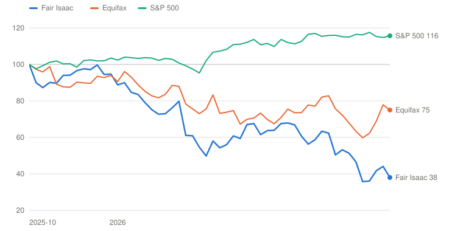
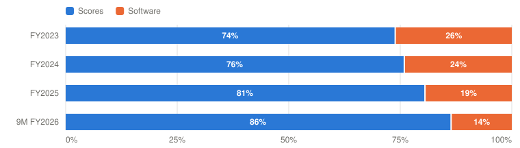
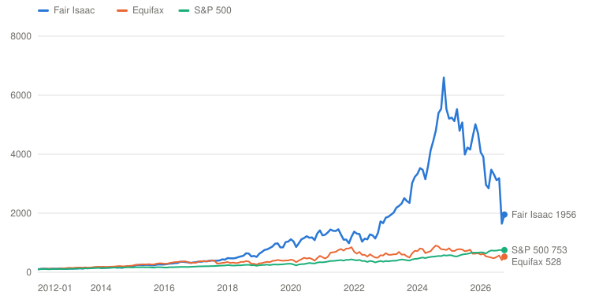

# FICO — Fair Isaac Corporation

> **Schema** v7.0 · **Updated** 2026-10-27 · **Status** Active
> **Price** $708.07 verified Oct 26, 2026 close, matched on Yahoo Finance and Motley Fool; about $704–710 in early trading Oct 27 ([Yahoo](https://finance.yahoo.com/quote/FICO/)) · 52-wk $586.05–$1,858.91 · 10th %ile · −61.9% from high
> **Type** Credit-score royalty (mortgage-heavy) and decision software · **Stage** Mature compounder · **Cyclical** No (mortgage-volume exposed) · **Competence** Edge

## Verdict

**The mortgage toll that lifted earnings 42% is frozen at $10 and under regulatory attack; at $708 the probability-weighted case returns 7.8% a year against the 13% hurdle, and even the Base earns less than that.**

🟡 **Non-holder: Watch (entry ≤$561)** · 🟡 **Holder: Hold**

| PW EV | PW return/yr | Compounding/yr | R/R | Entry | Trim | Avoid | FY26E non-GAAP P/E | Yield | BAIT | Moat | Next |
|---|---|---|---|---|---|---|---|---|---|---|---|
| **$1,033** | **7.8% (<13%)** | 12.2% | 3.3:1 | ≤$561 | $1,033–$1,768 | ≥$1,768 | ≈16.7× | 0.0% | Single (B) | Wide, narrowing | 📅 Nov 4 (Q4 FY26 + FY27 guide) |

**Breaks if**: Q4 mortgage-origination revenue (Q3: ~$285M) falls below ~$250M, or FHFA and the GSEs require a two-bureau credit report, which cuts royalties per loan by a third.

## The Call

The market has stopped paying for a second doubling, and that is reasonable. Mortgage royalties are 42% of revenue and about 55% of segment profit, and their growth this year was price: +97% on volume up a few percent. At $708 the price implies a Bear probability of only 24%, against my 35%, so the stock is not pricing the break. After a 62% fall it prices roughly my Base, with 2031 owner earnings per share of about $60.02 (10.8% a year). What the market has wrong is that this is cheap. My Base grows owner earnings per share 12% a year and still returns less than 13% once the multiple settles, because the toll is frozen at $10 in front of a $1 rival, Equifax guides mortgage volume down in 2027, and the pulls-per-loan question sits with the FHFA. The break-even Bear probability is 8%; I do not need to defend 35% for the verdict to hold. The one number that would shift me is the fiscal 2027 EPS guide on November 4 against the $47.24 consensus. A debt-funded buyback at $1,149 has also taken net debt to 3.7 times EBITDA ahead of a covenant step-down. Good business; the weighted case returns 7.8% and clears 13% only at $561.

## What I'd Have To Be Wrong About

1. **That earnings keep growing with the price frozen.** Test: in the Q4 FY2026 release and fiscal 2027 guide (Nov 4), non-GAAP EPS guided to at least $46 (consensus $47.24) and Q4 mortgage-origination revenue at least ~$250M (Q3: ~$285M). **If Fail →** cut Base 2031 owner earnings per share to $56, about 12% (PW EV $966, 6.4%/yr) → stays **Watch**, entry $525.
2. **That the regulators leave the three-bureau report alone and certify direct licensing.** Test: by the Q1 FY2027 print (late January 2027), no FHFA or GSE requirement for a two-bureau report has been published, the DLP holds its GSE certification, and the Preferred Program is reported to cover at least half of tri-merge volume. **If Fail →** move 15 points from Base to Bear (PW EV $908, 5.1%/yr) → stays **Watch**, entry $493.
3. **That the balance sheet delevers on schedule.** Test: in the FY2026 10-K (mid-November) and the Q1 FY2027 10-Q, total debt of $5.35B or less at September 30 and net debt ÷ adjusted EBITDA of 3.4× or less at December 31 against the 4.0× limit, with no repurchases in either quarter. **If Fail →** move 10 points from Bull to Bear (PW EV $894, 4.8%/yr) → stays **Watch**; the Outsider grade stays Anti-Outsider.

## Latest update: 2026-10-27 · Two falls in four weeks: the single grid and the Preferred Program

- Earnings keep growing with the price frozen — 🟡 Pending — resolves with the FY2027 guide on Nov 4
- Regulators leave the three-bureau report alone and certify direct licensing — 🟡 Pending — resolves by the Q1 FY2027 print, late January 2027
- The balance sheet delevers on schedule — 🟡 Pending — FY2026 10-K in mid-November; Dec 31 covenant test

FICO has had two bad days in four weeks, and they have different causes. On September 29 the stock fell 26.5% to $617.87 after the FHFA merged the Fannie Mae and Freddie Mac pricing grids and put VantageScore level with Classic FICO. On October 26 it fell another 13.2% to $708.07 after FICO announced a Preferred Program that holds its mortgage price at $10 for lenders who pull its score on every application. It is about 62% below its October 2025 close of $1,880.

The first fall was news about the business. The second was news about how far FICO is willing to go to defend it. A company that was expected to raise the mortgage price again by about 5% in 2027, according to Mizuho, has said instead that the price will be flat, and that it will hold the line by contract rather than by leverage over lenders. UBS notes that the $10 excludes funding, closed-loan and success fees, that the program starts on enrollment and does not depend on FHFA approval, and that the contractual commitments would survive a change in the credit-report structure. I read that as a real defense of volume and a ceiling on price.

Nothing in the numbers has moved since the July 29 print. Third-quarter mortgage volume grew a few percent, in line with the bureaus, and the CEO said there was no sign of pulls leaving. What has moved is the range of outcomes. Equifax said on October 20 that about 2,000 mortgage lenders now use VantageScore, that over 200 use it exclusively, and that it will hold the price at $1 through 2028. It also expects US mortgage volume to fall by a high single-digit percentage in 2027. Consensus fiscal 2027 EPS has fallen from $54.55 to $47.24 in 90 days.

The return math at $708.07 is what the page carries: a probability-weighted value of $1,033, a return of 7.8% a year against the 13% hurdle, and an entry of $561. Re-running it at the pre-announcement price of $815 gives a lower return, so the fall has made the stock more attractive without making it attractive enough. The break-even Bear probability is 8% against my 35%, so the verb does not depend on my probabilities, and the Base alone returns less than 13%. A fall to about $561 would change it.

There is no standing scorecard because this is the first page. The three tests I set are all open. The first resolves on November 4 with the fiscal 2027 guide: non-GAAP EPS of at least $46 and mortgage-origination revenue of at least about $250 million in the fourth quarter. The second resolves by the late-January print: no FHFA or GSE requirement for a two-bureau report, DLP certification in hand, and a disclosed enrollment of at least half of tri-merge volume. The third is the balance sheet: $5.35 billion of debt or less at September 30 and leverage at 3.4 times or less at December 31, against a covenant that steps down to 4.0 times on that date.

Appearances in the window: none found. I could not locate a CEO or CFO interview, podcast or conference transcript after the July 29 call, and the company has been quiet since the September 29 announcement apart from the Preferred Program release and the October 6 workforce-reduction filing. The 15% reduction in positions, with a $27 million charge in the fourth quarter, is the only visible management response beyond pricing. Insiders have not bought; the only Form 4 in the last 90 days is a small director sale on July 29.

The verdict stays Watch for someone starting, Hold for someone who owns it.

---

## Deep Dive: FICO: The Toll Booth and the Regulator

*The stock is down 62% from last October as Washington puts a $1 rival on the same pricing grid. FICO says lenders still pull its score. What does $708 assume about the $10 toll?*

**Contents**: [Business Overview](#business-overview) · [The Toll Booth and the Regulator](#the-toll-booth-and-the-regulator) · [Software: A Growing Platform Inside a Flat Segment](#software-a-growing-platform-inside-a-flat-segment) · [Lansing, Capital Allocation and Incentives](#lansing-capital-allocation-and-incentives) · [Valuation and Model Assumptions](#valuation-and-model-assumptions) · [Final Words](#final-words) · [Appendix: The Numbers](#appendix-the-numbers) · [Sources](#sources)

On September 29, 2026, FICO fell 26.5% in one session, from $840.89 to $617.87, which Barchart called its worst day on record. That morning the director of the Federal Housing Finance Agency, Bill Pulte, announced that Fannie Mae and Freddie Mac would price mortgages off a single grid that treats VantageScore, a rival credit score the bureaus sell for about a dollar, the same as the FICO Score. Four weeks later, on October 26, the stock fell another 13% after FICO said it would hold its mortgage price at $10 for lenders who agree to pull its score on every application. Last October it closed at $1,880. It is about $708 now.

The business behind that chart has never looked better. Revenue grew 26% in the June quarter to $674 million, the GAAP operating margin was 53.8%, and non-GAAP earnings per share of $12.18 rose 42%. Management guides fiscal 2026 to $42.43, against $29.88 a year earlier. Almost all of the improvement comes from one product. The FICO Score sold to mortgage lenders roughly doubled in price this year, and mortgage-origination royalties, which grew 97% in the quarter on volume that rose only a few percent, now make up 62% of Scores revenue and 42% of the whole company.

So the shares are down 62% from the October peak while Equifax is down 25% and the S&P 500 is up 16%.

*Total return including dividends, weekly, October 3, 2025 (the week of the October high) = 100, through October 27, 2026. Source: Yahoo Finance adjusted closes. Built with Claude.*

| Date | Fair Isaac | Equifax | S&P 500 |
|---|---|---|---|
| 2025-10-03 | 100 | 100 | 100 |
| 2025-12-05 | 97 | 90 | 102 |
| 2026-02-06 | 75 | 83 | 104 |
| 2026-04-17 | 58 | 83 | 107 |
| 2026-06-26 | 64 | 68 | 110 |
| 2026-09-04 | 50 | 76 | 116 |
| 2026-10-27 | 38 | 75 | 116 |

The market has concluded that a company that doubled the price of its main product in a year, and then watched its regulator put a one-dollar rival on equal footing, will not double it again and may have to give some back. I think that is mostly right. What I want to settle is narrower. How much of a $42 earnings stream is a toll that the government can reopen, and what does $708 pay for it?

I start with the business and where the money is made. The main chapter takes the mortgage toll and the regulator, with management's case in its own words, five holes in it, a per-100-pulls table and the rings of profit. A shorter chapter follows on Software, where a real platform business is growing inside a flat segment. Then I look at Will Lansing's record, the debt-funded buyback he made near the top, and what he is paid for. I finish with valuation, asking what the price assumes and what 13% a year would need. FICO reports its fourth quarter and gives fiscal 2027 guidance on November 4, so some of this will be tested within a week.

### Business Overview

FICO reports two segments. Scores licenses the FICO Score, a three-digit number between 300 and 850 that lenders use to decide who gets credit and at what price. A lender asks a credit bureau (Experian, TransUnion or Equifax) for a credit report and a score. The bureau runs FICO's algorithm on its own data and pays FICO a royalty per score. Mortgage lenders buy a "tri-merge" report that combines the files of all three bureaus, and each bureau's file carries its own score, so one borrower can carry three FICO royalties. FICO says it does not collect or store the consumer credit data behind the score and in most cases does not sell scores directly to lenders ([FY2025 10-K](https://www.sec.gov/Archives/edgar/data/814547/000081454725000030/fico-20250930.htm)). The three bureaus together were 51% of FY2025 revenue, and each was above 10%. Software sells decisioning and fraud tools to banks and others, now mostly under the FICO Platform brand, as SaaS or on-premises licenses.

| $ Million | FY2023 | FY2024 | FY2025 | 9M FY2025 | 9M FY2026 | Q3 FY2026 |
|---|---|---|---|---|---|---|
| **Scores** revenue | 774 | 920 | 1,169 | 857 | 1,238 | 459 |
|  Segment operating income | 681 | 813 | 1,026 | 753 | 1,117 | 417 |
|  Segment margin | 88.0% | 88.4% | 87.8% | 87.9% | 90.2% | **90.8%** |
| **Software** revenue | 740 | 798 | 822 | 618 | 639 | 215 |
|  Segment operating income | 241 | 258 | 248 | 192 | 176 | 55 |
|  Segment margin | 32.6% | 32.3% | 30.1% | 31.1% | 27.6% | 25.6% |
| **Total revenue** | 1,514 | 1,718 | 1,991 | 1,475 | 1,878 | 674 |
| Unallocated corporate expenses | (156) | (187) | (181) | (133) | (152) | (57) |
| Unallocated stock compensation | (124) | (149) | (157) | (124) | (142) | (52) |
| **GAAP operating income** | 643 | 734 | 925 | 688 | 999 | 363 |
|  GAAP operating margin | 42.5% | 42.7% | 46.5% | 46.6% | 53.2% | **53.8%** |
| GAAP diluted EPS | $16.93 | $20.45 | $26.54 | $20.12 | $28.12 | $10.45 |
| Non-GAAP EPS | — | — | $29.88 | $22.15 | $31.91 | $12.18 |

*Segment operating income excludes unallocated corporate costs, stock compensation and restructuring; the GAAP bridge for FY2023 also includes small amortization and asset-sale lines. Fiscal years end September 30. Non-GAAP EPS for FY2023 and FY2024 was not retrieved. Source: [FY2025 10-K](https://www.sec.gov/Archives/edgar/data/814547/000081454725000030/fico-20250930.htm), [Q3 FY2026 10-Q](https://www.sec.gov/Archives/edgar/data/814547/000081454726000030/fico-20260630.htm), [Q3 FY2026 release](https://www.sec.gov/Archives/edgar/data/814547/000081454726000031/exhibit991erq32026.htm). Built with Claude.*

Scores revenue rose from $774 million to $1,169 million in two years, at a segment margin of about 88%, and in the latest quarter it earned 90.8%. Software revenue grew 11% over the same two years and its profit fell in the last year. The result is that Scores supplied 74% of segment operating income in fiscal 2023 and 88% in the June quarter.

*Share of segment operating income before unallocated costs. Source: [FY2025 10-K](https://www.sec.gov/Archives/edgar/data/814547/000081454725000030/fico-20250930.htm), [Q3 FY2026 10-Q](https://www.sec.gov/Archives/edgar/data/814547/000081454726000030/fico-20260630.htm). Built with Claude.*

| Period | Scores | Software | Total ($M) |
|---|---|---|---|
| FY2023 | 681 (74%) | 241 (26%) | 922 |
| FY2024 | 813 (76%) | 258 (24%) | 1,071 |
| FY2025 | 1,026 (81%) | 248 (19%) | 1,274 |
| 9M FY2026 | 1,117 (86%) | 176 (14%) | 1,293 |

The company does not report mortgage revenue in dollars, but on the July 29 call CFO Steve Weber gave the shares: mortgage-origination scores were 71% of business-to-business revenue and 62% of total Scores revenue, with auto up 15% and cards, personal loans and other up 9%. I turn those into dollars below and tag them as derived.

| $ Million | Q3 FY2026 | Q3 FY2025 | Change | How I got it |
|---|---|---|---|---|
| **Mortgage-origination scores** | **285** | 144 | **+97%** | 62% of Scores revenue (call) `[Derived]`; prior year = current ÷ 1.97 |
| Other business-to-business scores | 116 | 125 | −7% | B2B = mortgage ÷ 71% = $401M, less mortgage `[Derived]`; the prior year holds a ~$16M one-off insurance-score renewal (+7% without it) |
| Business-to-consumer scores | 58 | 55 | +5% | Scores less B2B `[Derived]`; royalties from scores sold through the bureaus |
| **Scores revenue** | 459 | 324 | +41% | Reported |
| Software revenue | 215 | 212 | +2% | Reported; +10% excluding point-in-time and professional-services revenue (CFO) |

*Auto-origination revenue grew 15% and cards, personal loans and other originations 9% (CFO). Mortgage volume grew low single digits. Source: [Q3 FY2026 release](https://www.sec.gov/Archives/edgar/data/814547/000081454726000031/exhibit991erq32026.htm), [call](https://www.fool.com/earnings/call-transcripts/2026/08/07/fico-fico-q3-2026-earnings-call-transcript/). Built with Claude.*

A few accounting points before the debate. FICO guides on non-GAAP numbers, which exclude stock compensation ($188 million this year, or 7.4% of revenue, in the guide), restructuring and some tax items, so I value the business on owner earnings, which subtract the stock compensation. Fiscal 2026 ended on September 30 but has not been reported, so my base year is the guided year with the interest bill and share count of today: the $5.58 billion of debt carrying full-year interest, and the 21.5 million shares left after the accelerated repurchase settles. Last year's June quarter included a one-time $16 million insurance-score renewal, which flatters the comparison for the other lines. And the $10 price is the price to tri-merge resellers, which is not what a lender pays a bureau.

### The Toll Booth and the Regulator

Let me start with where things stand. Critics put the 2025 wholesale price FICO charged for a mortgage score at $4.95. For 2026 FICO set two ways to buy: $10 a score through a reseller, or a performance model at $4.95 plus a $33 charge when a loan closes, offered through a Direct License Program (DLP) that would let resellers buy from FICO without going through the bureaus ([National Mortgage News](https://www.nationalmortgagenews.com/news/ficos-new-pricing-program-met-with-cautious-optimism)). FICO says the average reseller price was already about $10, so the 2026 price is flat or lower. Senator Josh Hawley, in letters to FICO and the FTC on March 23, called it a doubling that could cost the industry about $500 million ([HousingWire](https://www.housingwire.com/articles/hawley-fico-mortgage-pricing/)). Whichever baseline is right, FICO's own revenue shows the answer, because mortgage-origination revenue nearly doubled on low-single-digit volume. The events of the past year, in order:

| Date | What happened | Stock |
|---|---|---|
| Oct 2025 | FICO sets its 2026 mortgage structure: $10 a score through resellers, or a performance model at $4.95 plus a $33 charge when a loan closes ([National Mortgage News](https://www.nationalmortgagenews.com/news/ficos-new-pricing-program-met-with-cautious-optimism)) | Closed at $1,880 on Oct 7 |
| Mar 2026 | TransUnion and Equifax cut VantageScore 4.0 to about $1 for mortgage lenders ([HousingWire](https://www.housingwire.com/articles/transunion-vantagescore-price-cut/)); Sen. Hawley writes to FICO and the FTC on Mar 23 ([HousingWire](https://www.housingwire.com/articles/hawley-fico-mortgage-pricing/)) | $1,285 on Mar 10 to $995 on Mar 24 |
| Jun 5, 2026 | $1.5B term loan funds an accelerated share repurchase at an average of about $1,137 ([8-K](https://www.sec.gov/Archives/edgar/data/814547/000119312526260817/d140061d8k.htm), [10-Q](https://www.sec.gov/Archives/edgar/data/814547/000081454726000030/fico-20260630.htm)) | About $1,100–$1,300 |
| Jul 29, 2026 | Q3: revenue +26%, mortgage-origination revenue +97%, guide raised to $2.53B; the DLP is still waiting on a GSE certification ([call](https://www.fool.com/earnings/call-transcripts/2026/08/07/fico-fico-q3-2026-earnings-call-transcript/)) | −17.0% next day to $1,139.54 |
| Sep 9, 2026 | FHFA opens VantageScore 4.0 to every approved Fannie Mae and Freddie Mac lender ([Equifax call](https://www.fool.com/earnings/call-transcripts/2026/10/20/equifax-efx-q3-2026-earnings-call-transcript/)) | $840 by Sep 28 |
| Sep 29, 2026 | FHFA director Pulte merges the two GSE pricing grids so VantageScore sits level with Classic FICO; Rocket Mortgage says VantageScore 4.0 becomes its preferred model in Q4 ([Yahoo/Barchart](https://finance.yahoo.com/real-estate/articles/fico-stock-plunges-26-worst-182349080.html)) | −26.5% to $617.87 |
| Oct 1–6, 2026 | Board commits to cut about 15% of positions; $27M charge in Q4 ([8-K](https://www.sec.gov/Archives/edgar/data/814547/000119312526415732/d127042d8k.htm)) | $690 on Oct 5 |
| Oct 20, 2026 | Equifax: about 2,000 mortgage lenders on VantageScore, 200+ exclusively; $1 price held through 2028; US mortgage volumes expected down a high single digit in 2027 ([call](https://www.fool.com/earnings/call-transcripts/2026/10/20/equifax-efx-q3-2026-earnings-call-transcript/)) | — |
| Oct 26, 2026 | FICO Preferred Program: $10 flat for lenders that pull FICO on every application, Classic FICO and 10T together ([Yahoo](https://finance.yahoo.com/markets/stocks/articles/fico-sinks-16-holds-mortgage-171747908.html)) | −13.2% to $708.07 |
| Nov 4 and Jan 1, 2027 | Q4 FY2026 and the fiscal 2027 guide; then FHA starts accepting Classic FICO, 10T and VantageScore 4.0 ([HousingWire](https://www.housingwire.com/articles/fico-preferred-program-analyst-reaction/)) | — |

*Prices are Yahoo Finance daily closes. Secondary sources are marked; FHFA, GSE and Preferred Program primary documents were not retrieved (see the source log). Built with Claude.*

#### Management's narrative

Lansing's case on the July 29 call has three parts. The first is that nothing is leaving. Asked by Wells Fargo's Jason Haas whether lenders in the VantageScore pilot were dropping FICO pulls, he said:

> "To your specific question, are we seeing volume loss? No, we are not, which suggests that they're pulling both scores."
> — Will Lansing, CEO, Q3 FY2026 earnings call, July 29, 2026

The second part is that VantageScore's appeal is mostly gaming and therefore capped. He called lender choice "bad policy because it encourages gaming," and when RBC's Ashish Sabadra asked how far VantageScore could go, he answered:

> "We don't anticipate more than the 20s for Vantage share because, as I said earlier, it's really tied to the gaming."
> — Will Lansing, CEO, Q3 FY2026 earnings call, July 29, 2026

The third is that FICO has done its part and is waiting on the government. The direct-license program was meant to go live in the first half of the calendar year, and Lansing told Craig Huber of Huber Research:

> "It's theoretical until it gets certified."
> — Will Lansing, CEO, Q3 FY2026 earnings call, July 29, 2026

Since then the company has added a fourth part, the Preferred Program announced on October 26. FICO will hold $10 for lenders and brokers who pull its score on every relevant application, for Classic FICO and FICO Score 10T together, and "flat year-over-year pricing" is how it describes it ([Yahoo Finance](https://finance.yahoo.com/markets/stocks/articles/fico-sinks-16-holds-mortgage-171747908.html)). Mizuho reads it as a defense against "waterfalling," the practice of pulling the cheaper score first and ordering FICO for only some loans ([HousingWire](https://www.housingwire.com/articles/fico-preferred-program-analyst-reaction/)). I agree with that reading and with Lansing on one more point, which is that Q3 shows no volume loss. Mortgage volumes were up a few percent, in line with what the bureaus reported.

#### Poking holes in it

The first hole is that the doubling was price, and price has stopped. Mortgage-origination revenue rose 97% in the quarter against volume growth of a few percent, so almost all of it was the new price. The Preferred Program is flat pricing by FICO's own description. Mizuho, which had assumed about 5% mortgage price growth for 2027, now models none. With the price frozen, mortgage revenue has to grow with volume, and Equifax told investors on October 20 that it expects US mortgage transaction volumes to fall by a high single-digit percentage in 2027 on current run rates ([Equifax Q3 call](https://www.fool.com/earnings/call-transcripts/2026/10/20/equifax-efx-q3-2026-earnings-call-transcript/)). FICO's own guide already points down. Revenue of $2.53 billion for the year leaves about $652 million for the fourth quarter, below the $674 million of the third, and Weber said the guide leaves out the performance-model revenue that would arrive if the DLP went live.

The second hole is that "pulling both scores" says little about what happens when it costs something to pull both. Today the lender pays for FICO and gets VantageScore free from the bureau. Equifax says about 2,000 mortgage lenders now use VantageScore in underwriting, seven times the number in April, that more than 200 use it exclusively, and that it expects more of them to move to paid VantageScore in the fourth quarter and 2027. Equifax also said it will hold VantageScore at $1 through 2028. The Preferred Program answers this by making dropping FICO pointless, because enrolled lenders pay for FICO on every application anyway. That is a contract, and a lender signs it only if the alternative is worse. It also fixes FICO's price at $10 in front of a $1 competitor for as long as the contract runs.

The third hole is that the events that decide the outcome belong to regulators. The DLP has waited on a government-sponsored enterprise's certification for months. FICO Score 10T is accepted for FHA loans from January 1, 2027, but is not yet eligible for delivery to Fannie Mae or Freddie Mac. And the FHFA has discussed replacing the three-bureau credit report with a two-bureau one. Equifax and what it calls "the vast majority of industry participants" oppose that, and I do not know how it ends. I do know the arithmetic. Royalties are paid per score, so two bureaus instead of three cuts the royalty on each loan by a third at an unchanged price. TD Cowen's Jaret Seiberg argued after September 29 that mortgage-backed securities investors still require a FICO score, which limits the damage. I believe that is the best argument for FICO's volume. It protects the number of loans carrying a FICO score and says nothing about how many scores are pulled per loan or at what price.

The fourth hole is that the "in the 20s" ceiling is a ceiling on gaming. It is not a ceiling on policy. Gaming, in Lansing's account, is a lender pulling both scores and submitting the better one. Rocket Mortgage, one of the largest lenders, has said it will make VantageScore 4.0 its preferred model for eligible loans from the fourth quarter, and a KBW analysis of August data found that about 99% of VantageScore mortgage volume came from Rocket and UWM ([HousingWire](https://www.housingwire.com/articles/gses-broaden-vantagescore-4-0-access-rocket-uwm-dominate-volume/)). That is two institutions making choices. Their volume is large, and I would not try to forecast their next move from arithmetic about consumers.

The fifth hole is political. A senator is asking the FTC to look at the price, the housing regulator has asked FICO publicly for "competitive pricing" on 10T ([National Mortgage News](https://www.nationalmortgagenews.com/news/gses-rocket-give-lenders-new-reasons-to-adopt-vantagescore)), and on October 5 a law firm announced an investigation of securities claims against the company ([GlobeNewswire](https://www.globenewswire.com/news-release/2026/10/05/3374907/3080/en/levi-korsinsky-notifies-investors-of-pending-investigation-into-securities-claims-involving-fair-isaac-corporation-fico.html)). None of that decides anything. All of it sits behind FICO's ability to raise the price again, which is the thing the earlier growth rate needed.

Where I come out is that FICO's mortgage royalty is a durable franchise and no longer a growing one. The score is embedded in underwriting, in GSE guidelines and in the way mortgage bonds are priced, and Q3 shows that nothing has left yet. I would not underwrite more than flat dollars from it for five years. The case that it falls sharply is a one-in-three event to me. Here is an illustration of what each outcome does to a block of revenue, using the terms FICO has published and the CEO's own 20-something ceiling.

| Outcome for the mortgage toll | Pulls paid (of 100) | Price | Revenue per 100 pulls | Change | EPS effect (base $42.42) |
|---|---|---|---|---|---|
| Today, flat price | 100 | $10 | $1,000 | — | — |
| Preferred Program holds; lenders also get VantageScore free | 100 | $10 | $1,000 | 0% | $0.00 |
| VantageScore replaces FICO on a quarter of pulls (the CEO's "in the 20s") | 75 | $10 | $750 | −25% | −$7.88 |
| Two-bureau report: two of three scores | 67 | $10 | $667 | −33% | −$10.50 |
| Both of the above | 50 | $10 | $500 | −50% | −$15.77 |
| Performance model, 15.3 closed loans per 100 pulls (break-even with $10) | 100 | $4.95 + $33 a close | $1,000 | 0% | $0.00 |
| Performance model, weak market: 10 closes per 100 pulls | 100 | $4.95 + $33 a close | $825 | −17.5% | −$5.52 |
| Performance model, strong market: 20 closes per 100 pulls | 100 | $4.95 + $33 a close | $1,155 | +15.5% | +$4.89 |

*Illustration, not a forecast. Prices are the 2026 structure in [National Mortgage News](https://www.nationalmortgagenews.com/news/ficos-new-pricing-program-met-with-cautious-optimism); I read the $33 as one charge per closed loan, although the trade press describes it as per borrower per score. EPS effects assume mortgage-origination revenue of about $1.0B in FY2026 `[Estimate]`, a 91% margin (the Scores segment margin), a 25.5% tax rate and 21.5M shares, so each 1% of mortgage revenue is worth about $0.32 a share. The 15.3 closes per 100 pulls is where $4.95 plus $33 per close equals $10 `[Derived]`. Built with Claude.*

The table gives the range. Everything except the first two rows removes part of the royalty from a business that keeps 91 cents of each dollar, which is why each 10% of mortgage revenue lost takes about $3.15 from earnings per share before any offset. The performance-model rows show something else. In that model FICO is paid when loans close, so its revenue follows funded loans and no longer follows pulls. In a weak market that is worse for FICO than the $10 flat price, and in a strong one it is better.

#### Rings of profit

The profit pool sorts by how directly it is exposed to this debate.

| Ring | Q3 revenue ($M) | % of revenue | Profit at segment margin ($M) | % of segment profit | The threat | Exposure |
|---|---|---|---|---|---|---|
| **1. Mortgage-origination scores** | 285 | 42% | 258 | **55%** | Single pricing grid, $1 VantageScore, a two-bureau report, Hawley and the FTC | Direct |
| **2. Other scores** (auto, cards, personal loans, other B2B, B2C) | 174 | 26% | 158 | 34% | The same pricing scrutiny; bureaus that undercut; no regulator aimed at it yet | Indirect |
| **3. Software** | 215 | 32% | 55 | 12% | Legacy migration, margin, AI; a separate debate | Separate |
| **Total** | 674 | 100% | 472 | 100% |  |  |

*Rings 1 and 2 are priced at the Scores segment margin of 90.8%, which is an assumption; the company does not disclose margin by product. Source: [Q3 FY2026 10-Q](https://www.sec.gov/Archives/edgar/data/814547/000081454726000030/fico-20260630.htm), [call](https://www.fool.com/earnings/call-transcripts/2026/08/07/fico-fico-q3-2026-earnings-call-transcript/). Built with Claude.*

More than half of segment profit sits in the ring the regulators are working on, another third is in scores that face no comparable pressure for now, and 12% is Software. The second ring is not safe. It is exposed to the same scrutiny of pricing, and the bureaus have shown with VantageScore that they will undercut. But no regulator has taken aim at auto or card scoring yet. If the first ring lost half its revenue and nothing else moved, segment profit would fall by about 27%, and the company would still earn a non-GAAP operating margin above 50%.

### Software: A Growing Platform Inside a Flat Segment

The second debate matters less to the stock. Software revenue grew 2% in the quarter and its segment margin fell to 25.6% from 32.0%, so segment profit fell in fiscal 2025 and is falling again this year. Underneath, two businesses are going in different directions.

| June 30 | 2026 | 2025 | Change |
|---|---|---|---|
| Software ARR ($M) | 816 | 742 | +10% |
| Platform ARR ($M) | **413** | 255 | **+62%** |
| Non-platform ARR ($M) | 403 | 486 | −17% |
| Platform share of ARR | 51% | 34% | +17 pts |
| Dollar-based net retention: total | 109% | n/d | — |
| Dollar-based net retention: platform / non-platform | 148% / 82% | n/d | — |
| ACV bookings, trailing twelve months ($M) | 128 | 92 | +39% |
| Software revenue growth: SaaS / on-premises / services | +21% / −16% / −24% | — | — |
| Software segment margin (quarter) | 25.6% | 32.0% | −6.4 pts |

*Prior-year ARR and bookings are `[Derived]` from the reported growth rates. Platform ARR growth excluding migrations is in the mid-30s (CFO). Source: [Q3 FY2026 release](https://www.sec.gov/Archives/edgar/data/814547/000081454726000031/exhibit991erq32026.htm), [call](https://www.fool.com/earnings/call-transcripts/2026/08/07/fico-fico-q3-2026-earnings-call-transcript/). Built with Claude.*

FICO Platform, the modular software for fraud, origination and customer management, is now the larger half of annual recurring revenue at $413 million, growing 62% (in the mid-30s excluding customers migrated from older products). Its dollar-based net retention is 148%. The older products are shrinking 17%, partly because FICO is retiring them. Lansing said some old products should be retired and "we're finally getting around to doing it," and Weber said that normalized for lumpy license revenue and services, Software revenue grew 10%.

I give management credit for the platform numbers. Bookings over twelve months were $128 million, up 39%. I give the segment less credit for profit. Costs grew about 11% against revenue growth of 2%, and the explanation (the FICO World event, cloud costs, investing ahead) is reasonable and also the thing a skeptic would say. The October 1 decision to cut about 15% of positions, with a $27 million charge in the fourth quarter and completion by the end of fiscal Q3 2027, is the clearest sign that management sees a margin problem ([8-K](https://www.sec.gov/Archives/edgar/data/814547/000119312526415732/d127042d8k.htm)). It is also the first time I can see FICO cutting its own cost base to defend earnings, and it came two days after the stock fell 26%.

On the AI question, I take Lansing at his word that "it's not yet because of AI" that platform is growing, and the next-generation release later this calendar year is the test. FICO's own description of its weakness is the useful one: "IP-rich and distribution-poor." The Accenture partnership addresses distribution. In my Base, Software grows 9.0% a year with margin rising to 32% as the platform scales and the layoffs work through. At today's profit the whole segment is about 12% of segment operating income, so even a good outcome here cannot rescue a bad one in Scores. It could decide whether the Base or the Bull is right.

### Lansing, Capital Allocation and Incentives

Will Lansing joined as CEO in January 2012, which makes this his fifteenth year. By the measure that matters to shareholders he is one of the better CEOs in my coverage.

*Total return including dividends, monthly, January 2012 (Will Lansing becomes CEO) = 100, through October 27, 2026. Source: Yahoo Finance adjusted closes. Built with Claude.*

| Date | Fair Isaac | Equifax | S&P 500 |
|---|---|---|---|
| 2012-01 | 100 | 100 | 100 |
| 2014-07 | 158 | 203 | 155 |
| 2017-01 | 342 | 322 | 192 |
| 2019-07 | 965 | 394 | 263 |
| 2022-01 | 1375 | 694 | 415 |
| 2024-07 | 4444 | 824 | 527 |
| 2026-10 | 1956 | 528 | 753 |

A dollar in FICO stock at the end of January 2012 is worth about $19.56 including dividends, against $7.53 for the S&P 500 and $5.28 for Equifax, an annual return of 22.3% over 14.7 years against 14.7% for the index. At the January 2025 high that dollar was worth about $66, and the stock has since given back about two-thirds of it. Most of the compounding came well before the 2026 price step. He built the score into the contract-like royalty it is today and bought stock heavily at low prices in fiscal 2021 and 2022. What is different now is the size of the bet.

The capital-allocation table shows the change. FICO pays no dividend, has made no acquisition of size since a $16 million one in fiscal 2019 [Derived from the cash-flow statements], and has spent its cash on repurchases.

| $ Billion | Revenue | YoY | Diluted EPS (GAAP) | Net income | SBC | Capex | FCF | Buybacks | Buybacks ÷ FCF | Net debt | Diluted shares (M) |
|---|---|---|---|---|---|---|---|---|---|---|---|
| FY2021 | 1.32 | +2% | $13.40 | 0.39 | 0.11 | 0.01 | 0.42 | 0.87 | 210% | 1.41 | 29.3 |
| FY2022 | 1.38 | +5% | $14.18 | 0.37 | 0.12 | 0.01 | 0.50 | 1.10 | 219% | 1.68 | 26.4 |
| FY2023 | 1.51 | +10% | $16.93 | 0.43 | 0.12 | 0.00 | 0.47 | 0.41 | 87% | 1.65 | 25.3 |
| FY2024 | 1.72 | +13% | $20.45 | 0.51 | 0.15 | 0.03 | 0.61 | 0.82 | 135% | 2.06 | 25.1 |
| FY2025 | 1.99 | +16% | $26.54 | 0.65 | 0.16 | 0.04 | 0.74 | 1.42 | 191% | 2.92 | 24.6 |
| 9M FY2026 | 1.88 | +27% | $28.12 | 0.66 | 0.14 | 0.03 | 0.75 | **3.05** | 406% | 5.33 | 23.5 |
| **Cumulative** | — | — | — | 3.02 | 0.80 | 0.12 | 3.48 | **7.67** | **220%** | +4.6 vs FY2020 | — |

*Capex is purchases of property plus capitalized software; FCF = operating cash flow less that capex, as the company defines it. Net debt is total debt less cash (Sep 30; Jun 30 for 9M FY2026). Diluted shares for FY2021–FY2025 are net income ÷ diluted EPS `[Derived]`. No dividend and no acquisition of size in the period. Source: [XBRL company facts](https://data.sec.gov/api/xbrl/companyfacts/CIK0000814547.json), [FY2025 10-K](https://www.sec.gov/Archives/edgar/data/814547/000081454725000030/fico-20250930.htm), [Q3 FY2026 release](https://www.sec.gov/Archives/edgar/data/814547/000081454726000031/exhibit991erq32026.htm). Built with Claude.*

Over the six periods repurchases of $7.67 billion were 2.2 times free cash flow of $3.48 billion and 2.5 times net income of $3.02 billion. The gap went on the balance sheet. Debt rose from $1.6 billion to $5.6 billion, the stockholders' deficit reached $4.1 billion, and net debt is up about $4.6 billion since the end of fiscal 2020. The Buffett $1 test returns "n/m" because retained earnings over the period are negative: more than all of the earnings were paid out, and the rest was borrowed.

The timing is the point. In fiscal 2021 and 2022 FICO spent $2.0 billion with the stock between $340 and $550. Since then the dollars rose with the price.

| Period | Repurchased ($B) | Shares (M) | Average price paid | Stock in the period | Read |
|---|---|---|---|---|---|
| FY2021 | 0.87 | n/d | n/d | $390–$553 (closes) | Inside the lows |
| FY2022 | 1.10 | n/d | n/d | $341–$523 | Countercyclical: $1.1B at the lows |
| FY2023 | 0.41 | 0.615 | $662 | $396–$910 | Slowed as the price rose |
| FY2024 | 0.82 | 0.606 | $1,375 | $825–$1,947 | Price paid doubled |
| FY2025 | 1.42 | 0.833 | $1,704 | $1,311–$2,382 | Near the highs |
| Q1–Q2 FY2026 | 1.09 | n/d | n/d | $995–$1,880 | Heavy into a falling stock |
| Q3 FY2026 (incl. $1.5B ASR) | **1.96** | 1.705 | **$1,149** | $922–$1,296 | Debt-funded; worth about $1.21B at $708 |
| Since June 30 | none | — | — | $592–$1,373 | CFO: cash to debt first |

*Average price is repurchase dollars ÷ shares for FY2023–FY2025 from the [FY2025 10-K](https://www.sec.gov/Archives/edgar/data/814547/000081454725000030/fico-20250930.htm) equity statement; Q3 FY2026 by month in the [10-Q](https://www.sec.gov/Archives/edgar/data/814547/000081454726000030/fico-20260630.htm) (April 166,545 shares at $1,039; May 488,341 at $1,211; June 1,055,475 at $1,137). The ASR is not settled; the final share count is set in Q4. Q1–Q2 dollars are nine-month cash ($3.05B) less Q3 `[Derived]`. Stock ranges are daily closes. Built with Claude.*

Lansing said Q3 repurchases exceeded three times the previous record quarter. They cost $1.96 billion at an average price of $1,149 for 1.705 million shares, which is worth about $1.21 billion at $708, a paper loss of roughly $0.75 billion. That was funded with a $1.5 billion term loan taken on June 5, so leverage has gone up as the price has come down. Net debt is now about 3.7 times adjusted EBITDA (4.3 times without adding back stock compensation), and the credit agreement's maximum consolidated leverage ratio steps down from 4.5 to 4.0 times on December 31, 2026 and to 3.5 times on December 31, 2027. The company says it is in compliance, and its covenant definition of EBITDA may be more generous than mine, so I do not know the exact headroom. I do know that headroom shrinks twice in the next fourteen months, that interest expense was $59.9 million in the quarter and will be higher in the fourth, and that about $1.8 billion falls due in May and June 2028 (the $900 million of notes plus the term loan's balance after scheduled payments).

I want to be fair to management on the ASR. In June the stock was at $1,137, already 40% below its highs, and the sell side still thought it cheap: even on the eve of the Preferred Program, JPMorgan's target was $1,530 and UBS's $1,100 ([Yahoo](https://finance.yahoo.com/markets/stocks/articles/fico-sinks-16-holds-mortgage-171747908.html)). Buying a stock with 40% earnings growth at about 27 times this year's earnings seemed reasonable when it was done. But the risk everyone was looking at, the regulator, was the one most likely to move the price, and the company chose to lever up on it. Weber said on July 29 that "it's probably not likely" that more shares will be bought beyond the ASR, and that cash goes to debt for now. That is the right answer, applied late.

#### What Lansing is paid for

| Component (Lansing, FY2025) | Share of target pay | What it pays for | Latest outcome |
|---|---|---|---|
| **Base salary** | 2.4% ($0.75M) | Fixed | Unchanged since FY2023 |
| **Annual cash incentive** | 2.4% | 50% adjusted revenue, 50% adjusted EBITDA, plus individual performance; 0–187.5% of target | $1.10M paid for FY2025 ($1.20M for FY2024) |
| **Performance units** | 31.8% | Adjusted revenue 50%, adjusted EBITDA 50%; three-year with interim earning; 0–200% | 150.2% of target earned |
| **Market stock units** | 31.8% | Total return against the S&P 500 (55th percentile for target); 0–200% | First tranche earned 0% (certified Dec 3, 2025) |
| **Restricted stock units** | 31.8% | Stock price; four-year vesting | — |
| **Return on invested capital** | 0% | Not in the plan; nor is free cash flow per share or leverage | — |
| **Total reported compensation** | — | Stock awards $34.1M in FY2025 | $36.0M FY2025 · $35.6M FY2024 · $66.3M FY2023 |

*Source: [2026 proxy statement](https://www.sec.gov/Archives/edgar/data/814547/000119312526024403/d27709ddef14a.htm). Built with Claude.*

The annual bonus and the performance units both pay on adjusted revenue and adjusted EBITDA, which a doubled mortgage price delivers: the 2025 performance units paid out at 150.2% of target. The one market-linked piece, the relative-TSR units, paid nothing for the first tranche. There is no return on invested capital, no free cash flow per share and no leverage measure. Lansing's total reported compensation was $36.0 million for fiscal 2025 and 95% of his target pay is equity. He owns 371,389 shares directly, worth about $263 million at the current price, and has sold small amounts nearly every month, the most recent 2,400 shares on November 10, 2025. I read the plan as paying for scale and pricing, which fits the strategy, and as saying nothing about the capital he spent buying shares.

My Outsider grade is **Anti-Outsider** on the latest cycle. The 2021–22 buying was countercyclical and exactly right, and that deserves credit. The behavior since fiscal 2024 reverses it: repurchase dollars rose from $0.8 billion at $1,375 to $1.4 billion at $1,704 to $3.0 billion this year, funded with debt, in a stock whose main risk was visible to everyone. The right action in the first half of 2026 was to hold the cash, and the wrong one was to buy.

Is Lansing the right manager for the next five years? He built the franchise, he is a good operator and he is honest on calls: he says plainly what is waiting on whom. The test now is whether he can defend the toll without a regulator's help and whether the board will tie his pay to something other than revenue.

### Valuation and Model Assumptions

For a business like this the right unit is the score pull and the right question is how long the royalty survives at its present price. I model it as two segments. Scores carries revenue growth and a segment margin and Software the same, with corporate costs as a share of revenue, a fixed interest bill that falls as debt is repaid, a tax rate, and net buybacks net of dilution. The result is non-GAAP EPS, and since that excludes $188 million of stock compensation, the exit multiple applies to owner earnings per share, which deduct it. FY2026 is calibrated to the guide: the model's base year gives non-GAAP EPS of $42.42 against management's $42.43, the difference being a full year of interest on the new debt, offset by the smaller share count.

The exit multiple needs a reason. I derive it from a 10% discount rate, a business whose owner earnings still grow 8% in year six and fade to 4% by year fifteen, and a payout near 100% because the business needs almost no capital. That gives about 19 to 20 times owner earnings, and I use 19 for the Base. The Bull gets 21 times, which implies perpetual growth right at the 5.0% ten-year Treasury yield, so I do not stretch it further. The Bear gets 11 times, near the 10 times that no growth at all would be worth.

| $ Billion | FY2025A | FY2026E | FY2027E | FY2028E | FY2029E | FY2030E | FY2031E |
|---|---|---|---|---|---|---|---|
| **Scores revenue** | 1.2 | 1.7 | 1.7 | 1.8 | 1.9 | 2.0 | 2.1 |
|  YoY growth | — | 43.2% | **4.2%** | **4.2%** | **4.2%** | **4.2%** | **4.2%** |
|  Operating margin | 87.8% | 90.0% | 89.8% | 89.6% | 89.4% | 89.2% | **89.0%** |
|  Operating profit | 1.03 | 1.51 | 1.57 | 1.63 | 1.69 | 1.76 | 1.83 |
| **Software revenue** | 0.8 | 0.9 | 0.9 | 1.0 | 1.1 | 1.2 | 1.3 |
|  YoY growth | — | 4.1% | **9.0%** | **9.0%** | **9.0%** | **9.0%** | **9.0%** |
|  Operating margin | 30.2% | 26.0% | 27.2% | 28.4% | 29.6% | 30.8% | **32.0%** |
|  Operating profit | 0.25 | 0.22 | 0.25 | 0.29 | 0.33 | 0.37 | 0.42 |
| Corporate and other | (0.18) | (0.21) | (0.22) | (0.23) | (0.24) | (0.25) | (0.26) |
| **Total revenue** | 2.0 | 2.5 | 2.7 | 2.8 | 3.0 | 3.2 | 3.4 |
| **Operating profit** | 1.09 | 1.52 | 1.60 | 1.69 | 1.78 | 1.88 | 1.99 |
|  Operating margin | 54.8% | 60.0% | 59.8% | 59.5% | 59.3% | 59.1% | 58.9% |
| Net income | 0.73 | 0.91 | 1.00 | 1.09 | 1.18 | 1.27 | 1.37 |
| Diluted shares (B) | 0.025 | 0.021 | 0.021 | 0.020 | 0.020 | 0.019 | 0.019 |
|  Net share change | — | — | -2.8% | -2.8% | -2.8% | -2.8% | -2.8% |
|  SBC (% of revenue) | — | 7.4% | 7.3% | 7.2% | 7.2% | 7.1% | 7.0% |
| **Non-GAAP EPS** | $29.88 | $42.42 | $47.81 | $53.52 | $59.62 | $66.16 | $73.20 |
|  YoY growth | — | 42.0% | 12.7% | 12.0% | 11.4% | 11.0% | 10.6% |
| **Owner earnings per share (after SBC)** | — | $35.93 | $40.82 | $46.00 | $51.51 | $57.41 | $63.77 |

*Bold cells are model inputs.*

In the Base, Scores revenue grows 4.2% a year and Software 9.0%, which makes the company 5.9% a year to $3.4B in 2031. Mortgage-origination royalties grow 1.5% a year at a flat $10, on a volume recovery roughly offset by leakage to VantageScore, and all other scores grow 8%. Scores keeps an 89% margin and Software's rises to 32%, corporate costs fall to 7.8% of revenue as the layoffs work through, and net shares fall 2.8% a year with the buyback resuming once the debt is down. Owner earnings per share grow 12.2% a year to $63.77 (non-GAAP EPS of $73.20), and at 19 times the 2031 value is $1,212. For comparison, the model has FY2027 at $47.81 against a consensus of $47.24 [Analyst consensus], so my Base is a little above the Street for next year.

| Case | Prob. | 3P | Scores growth / margin | Software growth / margin | Net shares/yr | Per-share earnings FY2031 | CAGR | Exit multiple | Value | Return/yr | Implied g | Driving assumption |
|---|---|---|---|---|---|---|---|---|---|---|---|---|
| **Bull** | 20% | Plausible | +7.6% / 91.0% | +12.0% / 36.0% | -3.3% | $84.21 | 18.6% | 21.0× owner earnings | $1,768 | 20.1% | 5.0% | The Preferred Program holds the mortgage toll: mortgage scores +5%/yr on a volume recovery and 10T charged on its own, other scores +11%/yr; Software +12%/yr; 21× owner earnings. |
| **Base** | 45% | Probable | +4.2% / 89.0% | +9.0% / 32.0% | -2.8% | $63.77 | 12.2% | 19.0× owner earnings | $1,212 | 11.3% | 4.5% | Mortgage score revenue grows 1.5%/yr at a flat $10 (volume recovery roughly offset by VantageScore and bi-merge leakage), other scores +8%/yr; platform growth outruns the non-platform decline; 19× owner earnings, the multiple a business still growing 8% a year after 2031 and fading to 4% justifies at 10%. |
| **Bear** | 35% | Probable | -3.5% / 85.0% | +5.0% / 28.0% | -1.0% | $34.78 | -0.7% | 11.0× owner earnings | $383 | -11.6% | 0.8% | The toll breaks: bi-merge cuts pulls per loan by a third and VantageScore takes 30%+ of pulls, so mortgage score revenue falls by half; 11× owner earnings. |
| **Priced-in (10%/yr)** | — | diagnostic | +3.4% / 88.6% | +8.6% / 31.6% | -2.6% | $60.02 | 10.8% | 19.0× owner earnings | $1,140 | 10.0% | 4.5% | Solved along Bear → Base for 10%/yr |
| **Hurdle (13%/yr)** | — | diagnostic | +5.2% / 89.5% | +9.5% / 32.5% | -3.0% | $68.66 | 13.8% | 19.0× owner earnings | $1,305 | 13.0% | 4.5% | Solved along Bear → Base for 13%/yr |
| **Probability-weighted** | 100% |  |  |  |  |  |  |  | $1,033 | 7.8% |  |  |

The Bear is a mechanism, not a mood. The toll breaks: a two-bureau report removes a third of pulls per loan and VantageScore takes more than a quarter of what remains, so mortgage revenue halves to about $0.5 billion, and the other scores and Software growth only partly offset it. Earnings per share stay flat at roughly $42 for five years. At 11 times owner earnings that is $383 a share, which sits just above the earnings-power value, so growth stops and the franchise holds. I give it 35%, above my usual 25%, for the reason given in the chapter above: in the last seven weeks the FHFA widened VantageScore access, merged the pricing grids and opened a discussion of the credit-report structure, and FICO's answer was to freeze its price.

| Return math |  |
|---|---|
| PW return/yr vs. hurdle | **7.8% (<13%)**, of which 0.0% is the dividend yield. Entry ≤$561. 10-year Treasury 5.00%; the hurdle sits 8.0 points above it. |
| Compounding at a flat multiple | Base per-share earnings growth 12.2% + 0.0% dividend = **12.2%**. Re-rating subtracts 0.8 points from the Base return: the multiple compresses. |
| Optionality | None valued. |
| Price-implied expectations | At 10%, spot needs 2031 owner earnings per share of $60.02 (non-GAAP EPS of $69.14), or 10.8% a year, at 19×. |
| EPV floor | $359 a share on FY2026's owner earnings held flat ($35.93 ÷ 10%). Growth pays for 49% of today's price. The Bear ($383) sits 7% above it because it keeps earnings flat at 11×. |
| Base rate / 3P | Revenue of $2.5B puts FICO in the $2–3B bucket, where 50.7% of companies grew sales at least 5% a year in real terms over five years and 23.8% grew at least 10% ([`compounding.md`](../../frameworks/compounding.md)). The Bull's 9.2% nominal (about 6.7% real) clears the 5% floor, so it is plausible. The Base's 5.9% nominal (about 3.4% real) is below it, so it is probable. Tiers: Bull plausible, Base probable, Bear probable. |
| Terminal-growth check | Implied perpetual growth on owner earnings at 10%: Bull 5.0%; Base 4.5%; Bear 0.8%. All below the risk-free rate. |
| Break-even and price-implied Bear odds | Break-even 8% against 35% assigned; price-implied 24% at 10%. |
| Year ten | Still growing at 8% in year six in the Base: the platform and other scores carry it while mortgage is flat, so the multiple is not doing the work. The risk is the reverse, that 19× is generous if the platform stalls. |
| R/R | **3.3:1** (Bull +150% / Bear −46%) The ratio is flattered by a Bull worth 2.5× spot; the Bear sits 46% below spot, so the downside is large too. |

*Computed rows come from model.json; EPV, base rate and year ten are the author's. Built with Claude.*

Here is where the price stands. To earn an ordinary 10% a year from $708, FICO needs 2031 owner earnings per share of $60.02, or non-GAAP EPS of $69.14, at 19 times. That is 10.8% a year from the 2026 base, a little below my Base and well above my Bear. In scenario terms the price implies a Bear probability of only 24%. So the market is not pricing the break. After a 62% fall it is pricing roughly my Base, and the part of the story it gets wrong is that the Base itself earns less than the hurdle.

To earn 13% a year the stock needs $68.66 of owner earnings per share ($78.49 of non-GAAP EPS), or 13.8% a year, which is about 8% above my Base. Weighted 20% Bull, 45% Base and 35% Bear, the value is $1,033 and the annual return is 7.8%. The price at which the same case returns exactly 13% is $561, and the stock is about 26% above it. Of the Base return, re-rating is a small drag: the multiple compresses from 19.7 to 19 times, so the compounding rate at a flat multiple is 12.2% a year. That is close to 13% and still short of it. The break-even Bear probability is 8%, far below what I assigned, which means the verdict does not depend on a probability I could be wrong about. Even a 20% Bear would leave the case short of 13%. The Base would have to be worth more, which would need price increases that I do not think the regulator will allow.

I should state what I cannot judge. The outcomes that decide this turn on decisions by the FHFA, the GSEs and perhaps the FTC, and I have no edge in forecasting them. I have widened the Bear for that reason and I would rather be wrong in the direction of caution.

### Final Words

FICO is one of the most profitable businesses I follow, and the stock fell because the market realized its best year came from a price increase that cannot be repeated. The market is right about that. It is wrong, I think, to treat the fall as an opportunity on the business alone, because at today's price it already pays for something close to my Base, which grows earnings about 12% a year on owner earnings and still falls short of 13% as a total return once the multiple settles at 19 times. What it has right is that volumes held in Q3 and that MBS investors still need a FICO score. What it has underweighted is that the franchise now depends on regulators' choices and on a balance sheet that gave up flexibility at the worst time.

I would own it at about $561, where the same case earns 13%. I would not buy at today's price, and I would not sell if I already held it, because the stock is below the $1,033 weighted value and well below the Bull. That is a Watch for someone starting and a Hold for someone who owns it.

Three things would change my view, each with a date. The fiscal 2027 guide on November 4 would need to hold earnings per share near the $47 consensus with a mortgage line that does not fall below about $250 million a quarter. The FHFA and the GSEs would need to leave the three-bureau report alone, and the DLP would need its certification, by the late-January print. And the balance sheet would need to get down to about $5.3 billion of debt by September 30 with leverage safely inside the 4.0 times that applies from the end of the year. Any one failing takes my estimate lower.

*The three tests, with their pre-committed consequences, are listed at the top of this report under [What I'd Have To Be Wrong About](#what-id-have-to-be-wrong-about).*

### Appendix: The Numbers

The tables carry the framework's required numbers. The argument for each is in the chapters above.

#### Five-year record

| $B, except per share | FY2021 | FY2022 | FY2023 | FY2024 | FY2025 | FY2026E |
|---|---|---|---|---|---|---|
| Revenue | 1.32 | 1.38 | 1.51 | 1.72 | **1.99** | ≈2.53 (guide) |
| Revenue growth | +1.7% | +4.6% | +9.9% | +13.5% | +15.9% | +27% |
| GAAP operating income | 0.51 | 0.54 | 0.64 | 0.73 | 0.92 | ≈1.30 `[Estimate]` |
| GAAP operating margin | 38.3% | 39.4% | 42.5% | 42.7% | 46.5% | ≈51% |
| GAAP diluted EPS | $13.40 | $14.18 | $16.93 | $20.45 | $26.54 | $36.86 (guide) |
| Non-GAAP EPS | — | — | — | — | $29.88 | $42.43 (guide) |
| Operating cash flow | 0.42 | 0.51 | 0.47 | 0.63 | 0.78 | ≈1.08 `[Estimate]` |
| Free cash flow (after capitalized software) | 0.42 | 0.50 | 0.47 | 0.61 | 0.74 | ≈1.05 `[Estimate]` |
| Stock compensation | 0.11 | 0.12 | 0.12 | 0.15 | 0.16 | ≈0.19 (guide) |
| **Owner earnings** (FCF − SBC) | 0.30 | 0.39 | 0.34 | 0.46 | **0.58** | ≈0.86 |
| Owner earnings per share | $10.4 | $14.7 | $13.5 | $18.2 | $23.7 | ≈$37.4 |
| Owner-earnings conversion (÷ GAAP net income) | 78% | 104% | 79% | 89% | 89% | ≈101% |
| Buybacks | 0.87 | 1.10 | 0.41 | 0.82 | 1.42 | 3.05 (9M) |
| Diluted shares (M) | 29.3 | 26.4 | 25.3 | 25.1 | 24.6 | ≈23.0 |
| Net share change | — | −9.9% | −4.2% | −0.8% | −2.0% | ≈−6.5% |
| SBC ÷ revenue | 8.5% | 8.4% | 8.2% | 8.7% | 7.9% | ≈7.4% |
| SBC ÷ free cash flow | 27% | 23% | 27% | 25% | 21% | ≈18% |
| Buybacks ÷ SBC | 7.8× | 9.6× | 3.3× | 5.5× | 9.0× | ≈16× |
| Invested capital (operating build) | 0.87 | 0.88 | 0.92 | 1.10 | 1.18 | ≈1.24 |
| NOPAT at a 25% tax rate | 0.38 | 0.41 | 0.48 | 0.55 | 0.69 | ≈0.98 |
| **ROIC** (on average capital) | 44% | 47% | 53% | 55% | **61%** | ≈81% |
| 3-year ROIIC | — | — | — | 75% | **97%** | ≈158% |
| Reinvestment rate (Δ capital ÷ NOPAT) | — | 3% | 9% | 31% | 12% | ≈7% |
| Net debt (debt − cash) | 1.41 | 1.68 | 1.65 | 2.06 | 2.92 | 5.33 (Jun 30) |
| Net debt ÷ adjusted EBITDA | 2.2× | 2.5× | 2.1× | 2.3× | 2.7× | 3.7× (LTM Jun) |
| Interest coverage (EBIT ÷ interest) | 12.6× | 7.9× | 6.7× | 6.9× | 6.9× | 6.1× (Q3); ≈3.9× pro forma |
| SBC-adjusted accruals (÷ average assets) | 5.3% | −1.4% | 5.5% | 1.8% | 1.7% | — |
| Beneish M-score | — | — | — | — | −2.65 (clean) | — |

*Fiscal years end September 30. Owner earnings = free cash flow less stock compensation; maintenance capex is all capex because the business is asset-light and growth capex is nil. Invested capital = total assets − cash − non-debt liabilities (an operating build), ROIIC and reinvestment as defined in the framework, all `[Derived]`; XBRL balance sheet totals differ from the 10-K by up to 1% in some years. NOPAT uses a flat 25% tax rate, the company's operating rate. EBITDA is GAAP operating income plus depreciation; adjusted also adds stock compensation. Pro forma coverage uses LTM operating income against $5.58B at 5.64%. The nearest maturity wall is about $1.8B in May and June 2028 ($900M of notes plus the term loan after scheduled payments). 3-year ROIIC for FY2026E uses the estimated NOPAT and capital. Source: [XBRL company facts](https://data.sec.gov/api/xbrl/companyfacts/CIK0000814547.json), [FY2025 10-K](https://www.sec.gov/Archives/edgar/data/814547/000081454725000030/fico-20250930.htm), [Q3 FY2026 10-Q](https://www.sec.gov/Archives/edgar/data/814547/000081454726000030/fico-20260630.htm). Built with Claude.*

Cycle position: not cyclical in the usual sense, but mortgage volumes drive Scores. Mortgage originations are low relative to history, which is the reason the Q3 volume of a few percent growth is not a recovery. Operating margin of 53.8% in the latest quarter is at the top of FICO's own range (42.5% in fiscal 2023).

#### Growth levers

| Lever | Contribution now | Runway | Evidence | Management intent | Stage |
|---|---|---|---|---|---|
| Market growth | Mortgage volume +low single digits in Q3; Equifax sees US mortgage volume down a high single digit in 2027 | Cyclical | [Equifax call](https://www.fool.com/earnings/call-transcripts/2026/10/20/equifax-efx-q3-2026-earnings-call-transcript/) | "Elevated interest rates and ongoing affordability challenges" weigh on originations (CEO) | Proven, cyclical |
| Share gain | None in mortgage; the 10T adopter program has 70 lenders and about 55% of top-50 volume | n/a | 10T is bundled free with Classic | 10T to come "into the mix" with Classic and Vantage | Option |
| Price and mix | The 2026 driver: mortgage revenue +97% on a few percent of volume | 0–1 yr; frozen at $10 for enrolled lenders | [Yahoo](https://finance.yahoo.com/markets/stocks/articles/fico-sinks-16-holds-mortgage-171747908.html) | "Everything is on the table" for 2027; non-mortgage pricing is getting "more surgical" | Proven, now frozen |
| Attach / new products | UltraFICO generally available since May; FICO 11 "in the lab"; next-gen FICO Platform (with fraud) due late 2026 | 3–5 yrs | New scores take about four years to establish (CEO) | UltraFICO 3 in development | Scaling / Option |
| New geographies | Americas 91%, EMEA 6%, Asia Pacific 3% of Q3 revenue; Scores revenue outside the Americas is $1.6M a quarter | Long | [10-Q](https://www.sec.gov/Archives/edgar/data/814547/000081454726000030/fico-20260630.htm) | — | Option (Software only) |
| M&A | None of size since fiscal 2019 | — | Cash-flow statements | — | None |
| Margin | Scores 90.8% (+3 pts y/y); Software 25.6% (−6 pts); 15% of positions cut, $27M charge | 1–2 yrs | 8-K Oct 6 | "Our long-term focus is on driving margin expansion" (CEO) | Scaling |
| Share count | Net −6.5% in FY2026E; paused for debt reduction; SBC 7.4% of revenue | 2–3 yrs after delevering | [Q3 10-Q](https://www.sec.gov/Archives/edgar/data/814547/000081454726000030/fico-20260630.htm) | "Using cash to pay down debt" near term (CFO) | Proven, paused |

*Source: [Q3 FY2026 release](https://www.sec.gov/Archives/edgar/data/814547/000081454726000031/exhibit991erq32026.htm), [call](https://www.fool.com/earnings/call-transcripts/2026/08/07/fico-fico-q3-2026-earnings-call-transcript/). Built with Claude.*

The Base rests on other scores growing 8% a year, mortgage royalties flat to slightly up, and the platform outgrowing the legacy decline. The Bull needs the Preferred Program to hold and the 10T and performance-model changes to add revenue.

#### Moat, customer and profit pool

| Read | Call | Evidence |
|---|---|---|
| Mechanism | **Switching costs** and **branding as the standard** | The score is written into lender underwriting, GSE guidelines and mortgage-bond pricing; MBS investors still require it (TD Cowen, [Yahoo](https://finance.yahoo.com/real-estate/articles/fico-stock-plunges-26-worst-182349080.html)); "used by 90% of top U.S. lenders" ([release](https://www.sec.gov/Archives/edgar/data/814547/000081454726000031/exhibit991erq32026.htm)) |
| Trend | **Narrowing** | FHFA single grid (Sep 29); VantageScore at ~$1 against $10; about 2,000 lenders on it, up 7× since April, and 200+ exclusively ([Equifax](https://www.fool.com/earnings/call-transcripts/2026/10/20/equifax-efx-q3-2026-earnings-call-transcript/)); 99% of VantageScore 4.0 mortgage volume at Rocket and UWM ([KBW via HousingWire](https://www.housingwire.com/articles/gses-broaden-vantagescore-4-0-access-rocket-uwm-dominate-volume/)). Offset: Q3 volume held and the Preferred Program locks enrolled lenders in |
| Profit pool | Moving toward lenders, bureaus and regulators | Equifax says about 45% of its mortgage revenue is FICO royalty passed through at no margin; FICO keeps ~91% on a royalty; the DLP would let resellers buy direct and the performance model ties FICO's pay to closings |
| Customer | Mortgage lenders and brokers, via bureaus and resellers | No retention metric exists because the score is mandatory in practice. The last price step roughly doubled the royalty and volume showed no response in Q3; the next test is whether enrolled lenders stay |

*7 Powers vocabulary (Helmer). Scale economies are not the mechanism; there is no shared-versus-harvested test to run. Rating: **Wide, narrowing.** Source as linked. Built with Claude.*

#### Competitors

| Competitor | Position | Threat |
|---|---|---|
| **VantageScore** (JV of the three bureaus) | About $0.99–$1 a mortgage score; accepted program-wide by the GSEs since Sep 9 and level on the pricing grid since Sep 29; ~2,000 lenders ([Equifax](https://www.fool.com/earnings/call-transcripts/2026/10/20/equifax-efx-q3-2026-earnings-call-transcript/)) | Highest. A free or near-free alternative owned by FICO's own channel |
| **Experian, TransUnion, Equifax** | 51% of FICO revenue (FY2025); also the owners of VantageScore; Lansing: "we're now competing in mortgage scores" | High. Partners and rivals at once |
| **In-house and alternative-data models** | Lender models, cash-flow scores; FICO's own UltraFICO targets the same ground | Low–Medium |
| **Software rivals** (Pega, SAS, NICE Actimize, Feedzai, Featurespace, ACI, IBM, Experian) | Per the [FY2025 10-K](https://www.sec.gov/Archives/edgar/data/814547/000081454725000030/fico-20250930.htm); FICO Platform ARR $413M | Medium |

*Source: [FY2025 10-K](https://www.sec.gov/Archives/edgar/data/814547/000081454725000030/fico-20250930.htm), [call](https://www.fool.com/earnings/call-transcripts/2026/08/07/fico-fico-q3-2026-earnings-call-transcript/). Built with Claude.*

#### Promises ledger

| Promised | Where, when | Outcome |
|---|---|---|
| Direct licensing of FICO scores (with 10T) live in the first half of calendar 2026 | Q1 FY2026 call, Jan 28, 2026 (summarized by [MarketBeat](https://www.marketbeat.com/earnings/reports/2026-1-28-fair-isaac-co-stock/); transcript not stored) | 🔴 Not live on Oct 27; waiting on a GSE certification; 10T not eligible for GSE delivery |
| Fiscal 2026 revenue of about $2.35B | Q4 FY2025 release, Oct 30, 2025 (trade press; release not stored) | 🟢 Raised to $2.45B in April and $2.53B in July (+8%) |
| A platform growing in the high-20s to 30s percent | Barclays conference, May 2024 ([secondary notes](https://roy60e.substack.com/p/fico-investment-flash-update-barclays-c0e)) | 🟢 Platform ARR +62%, mid-30s excluding migrations |

*No shareholder letters or investor-day targets were available; the ledger rests on calls (see the source log). Built with Claude.*

#### Risks and triggers

| Risk | Impact | Prob. | Priced in? | Would break the thesis if… |
|---|---|---|---|---|
| ⚠️ **The toll breaks**: a two-bureau report plus VantageScore takes a third to a half of mortgage royalties | High | Med (my 35%) | Partly (−62%) | FHFA or the GSEs publish a two-bureau delivery requirement, or Q4 mortgage-origination revenue falls below ~$250M |
| ⚠️ **The Preferred Program does not hold lenders** | Med–High | Med | Partly | Enrollment is below half of tri-merge volume by the Q1 FY2027 print |
| ⚠️ **Leverage into a covenant step-down**: 3.7× adjusted EBITDA against a 4.0× limit from Dec 31, 2026 and 3.5× from Dec 31, 2027 | High | Low–Med | 🔴 No | Debt above ~$5.35B at Sep 30, or EBITDA down 15% before year-end |
| ⚠️ **Price capped, volume falling**: Equifax sees US mortgage volume down a high single digit in 2027 | Med | High | Partly (consensus FY27 revenue +6%) | FY2027 revenue guide below ~$2.6B |
| **Political and legal**: Hawley letters, an administration publicly pressing for "competitive pricing", a law-firm investigation notice | Med | Med | 🔴 No | A formal FTC action or a price cap |
| **Software margin and migration**: segment margin 25.6%, down 6 points in a year | Low–Med | Med | Yes | Software margin below 25% in FY2027 |

*Filtered for materiality. Item 1A of the Q3 10-Q reports no material change from the FY2025 10-K; the FY2026 10-K (mid-November) will be diffed for new risks. Source: [Q3 10-Q](https://www.sec.gov/Archives/edgar/data/814547/000081454726000030/fico-20260630.htm), [Equifax call](https://www.fool.com/earnings/call-transcripts/2026/10/20/equifax-efx-q3-2026-earnings-call-transcript/), [Yahoo](https://finance.yahoo.com/markets/stocks/articles/fico-sinks-16-holds-mortgage-171747908.html). Built with Claude.*

Reflexive loops: confidence, because a lower price raises the cost of the equity-funded growth that FICO is not doing, and none of consequence otherwise. Ruin path: none inside five years if free cash flow stays near $1 billion. The pinch points are the covenant steps (4.0 times at December 31, 2026 and 3.5 times at December 31, 2027) and the $2.4 billion due in May and June 2028, which would need to be refinanced or repaid from cash flow in a year when earnings may be lower.

#### Catalysts

| Date | Catalyst | Why it matters |
|---|---|---|
| ✅ Oct 26 | Preferred Program announced | Test 1 and 2 are set against it |
| 📅 **Nov 4** | Q4 FY2026 results and fiscal 2027 guidance | First read on mortgage revenue after the freeze; EPS guide against the $47.24 consensus; debt at Sep 30 |
| 📅 Mid-Nov | FY2026 10-K | Covenant language, risk-factor changes, leverage |
| 📅 Dec 31 | Covenant steps down to 4.0× | Headroom shrinks |
| 📅 Jan 1, 2027 | FHA accepts Classic FICO, 10T and VantageScore 4.0 | First federal program with all three |
| 📅 ~Late Jan | Q1 FY2027 results (estimated) | Tests 2 and 3 resolve |
| 📅 Undated | DLP certification; 10T acceptance by Fannie and Freddie; any FHFA move on the two-bureau report | Each is a regulator's decision |
| 📅 Late CY2026 | Next-generation FICO Platform general availability | The Software option |

*Source: Yahoo Finance earnings calendar, [call](https://www.fool.com/earnings/call-transcripts/2026/08/07/fico-fico-q3-2026-earnings-call-transcript/), [HousingWire](https://www.housingwire.com/articles/fico-preferred-program-analyst-reaction/). Built with Claude.*

#### Sentiment and positioning

| Signal | Read |
|---|---|
| Analysts | Yahoo mean target $936 (range $490–$1,675); after Oct 26 UBS Neutral $942 (from $1,100), JPMorgan Neutral $900 (from $1,530) and Wells Fargo cut to Equal Weight, $735 (from $800) `[Analyst consensus]` ([Yahoo](https://finance.yahoo.com/markets/stocks/articles/fico-sinks-16-holds-mortgage-171747908.html)) |
| Consensus EPS | FY2026 $42.71, FY2027 $47.24 (was $54.55 90 days ago); 10 of 21 estimates cut in the last 30 days `[Analyst consensus]` |
| Short interest | Not retrieved |
| Insiders (90 days) | No purchases. One director sale of 967 shares on Jul 29. Lansing holds 371,389 shares directly and last sold 2,400 on Nov 10, 2025; Weber sold 1,426 on Dec 17, 2025 ([OpenInsider](https://openinsider.com/FICO)) |
| Legal | Levi & Korsinsky announced an investigation of securities claims on Oct 5, a solicitation and not a finding |

*Context only; none of it moves a verb. Source as linked. Built with Claude.*

### Sources

[Q3 FY2026 release (8-K Ex. 99.1, Jul 29)](https://www.sec.gov/Archives/edgar/data/814547/000081454726000031/exhibit991erq32026.htm) · [Q3 FY2026 10-Q](https://www.sec.gov/Archives/edgar/data/814547/000081454726000030/fico-20260630.htm) · [FY2025 10-K](https://www.sec.gov/Archives/edgar/data/814547/000081454725000030/fico-20250930.htm) · [2026 proxy statement (DEF 14A)](https://www.sec.gov/Archives/edgar/data/814547/000119312526024403/d27709ddef14a.htm) · [Q3 FY2026 call transcript (Motley Fool)](https://www.fool.com/earnings/call-transcripts/2026/08/07/fico-fico-q3-2026-earnings-call-transcript/) · [Q3 FY2026 call notes](../../../raw/FICO/transcripts/2026-07-29_Q3-FY2026_call-notes.txt) · [Equifax Q3 2026 call transcript (Motley Fool)](https://www.fool.com/earnings/call-transcripts/2026/10/20/equifax-efx-q3-2026-earnings-call-transcript/) · [Scuttlebutt notes](../../../raw/FICO/analyst-reports/2026-10_scuttlebutt-notes.txt) · [8-K, workforce reduction (Oct 6)](https://www.sec.gov/Archives/edgar/data/814547/000119312526415732/d127042d8k.htm) · [8-K, $1.5B term loan (Jun 8)](https://www.sec.gov/Archives/edgar/data/814547/000119312526260817/d140061d8k.htm) · [8-K, $1.0B senior notes (Mar 11)](https://www.sec.gov/Archives/edgar/data/814547/000119312526102450/d92566d8k.htm) · [HousingWire, Preferred Program analyst reaction](https://www.housingwire.com/articles/fico-preferred-program-analyst-reaction/) · [Yahoo Finance, FICO holds $10 (Oct 26)](https://finance.yahoo.com/markets/stocks/articles/fico-sinks-16-holds-mortgage-171747908.html) · [Yahoo Finance/Barchart, Sep 29 plunge](https://finance.yahoo.com/real-estate/articles/fico-stock-plunges-26-worst-182349080.html) · [Investing.com, single pricing grid (Sep 29)](https://www.investing.com/news/stock-market-news/fico-stock-drops-20-analysts-break-down-the-impact-of-fhfas-single-pricing-grid-4922853) · [HousingWire, GSEs broaden VantageScore access](https://www.housingwire.com/articles/gses-broaden-vantagescore-4-0-access-rocket-uwm-dominate-volume/) · [National Mortgage News, FICO's new pricing program](https://www.nationalmortgagenews.com/news/ficos-new-pricing-program-met-with-cautious-optimism) · [HousingWire, Hawley letters](https://www.housingwire.com/articles/hawley-fico-mortgage-pricing/) · [National Mortgage News, GSEs and Rocket on VantageScore](https://www.nationalmortgagenews.com/news/gses-rocket-give-lenders-new-reasons-to-adopt-vantagescore) · [GlobeNewswire, law-firm investigation notice (Oct 5)](https://www.globenewswire.com/news-release/2026/10/05/3374907/3080/en/levi-korsinsky-notifies-investors-of-pending-investigation-into-securities-claims-involving-fair-isaac-corporation-fico.html) · [HousingWire, TransUnion VantageScore price cut](https://www.housingwire.com/articles/transunion-vantagescore-price-cut/) · [XBRL company facts](https://data.sec.gov/api/xbrl/companyfacts/CIK0000814547.json) · [Yahoo Finance quote and estimates](https://finance.yahoo.com/quote/FICO/analysis/) · [FRED, 10-year Treasury (DGS10)](https://fred.stlouisfed.org/series/DGS10) · [Raw source log and gaps](../../../raw/FICO/SOURCES.md)

---

*Analysis, not personal investment advice. Every figure traces to a linked primary source or carries a tag ([Estimate], [Analyst consensus], [Management guidance], [Derived]). No position sizing by design. Built from [report/](report/) by kg-investment-analysis v7; edit the sources there, not this file.*
