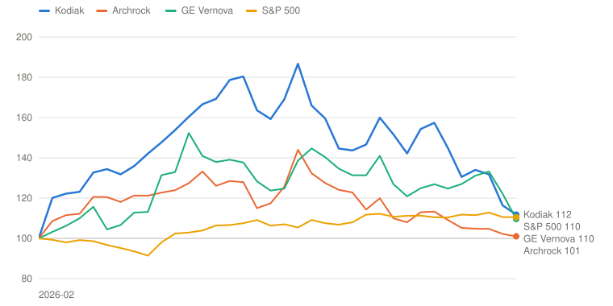
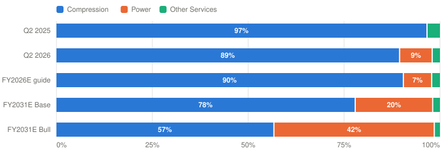

# KGS — Kodiak Gas Services, Inc.

> **Schema** v7.0 · **Updated** 2026-10-23 · **Status** Active
> **Price** $45.45 verified Oct 23, 2026, 12:14 PM ET (StockAnalysis $45.43) ([Yahoo](https://finance.yahoo.com/quote/KGS/)) · 52-wk $32.55–$77.68 · 29th %ile · −41.5% from high
> **Type** Contracted infrastructure: contract gas compression plus behind-the-meter power · **Stage** Mature compounder (compression) funding an early-growth power build · **Cyclical** Yes (gas activity) · **Competence** Edge

## Verdict

**A best-in-class compression fleet is funding a power build whose first anchor came in at six years on existing engines, not ten on new turbines; at $45 the probability-weighted case pays 11.3% a year against the 13% hurdle, so the selloff is close to an opportunity without yet being one.**

🟡 **Non-holder: Watch (entry ≤$42)** · 🟡 **Holder: Hold**

| PW EV | PW return/yr | Compounding/yr | R/R | Entry | Trim | Avoid | FY26E EV/EBITDA | Yield | BAIT | Moat | Next |
|---|---|---|---|---|---|---|---|---|---|---|---|
| **$64** | **11.3% (<13%)** | 9.1% | 4.2:1 | ≤$42 | $64–$131 | ≥$131 | ≈8.6× | 4.3% | Double (B+A) | Narrow, stable | 📅 early Nov (Q3, ≈Nov 3) |

**Breaks if**: credit-agreement leverage goes above 3.5× at the November or February print, or Kodiak issues primary equity to fund power. Then the build costs shareholders more than it earns, and 10 points move from the Base to the Bear.

⚠️ **Probability-fragile**: break-even Bear odds 21% against 30% assigned.

## The Call

Since September 16 Kodiak has fallen 22% while Archrock fell 6%. Three things did it. On September 21 the West Texas project that management had at limited notice to proceed was signed as a six-year, 76 MW deal served from the existing recip fleet, at an undisclosed price, and the stock lost 10% in four sessions while Archrock lost 3%. The ten-year Treasury went to 5.3%. And from October 14 Kodiak traded with the AI-power complex, as CoreWeave's bonds broke and Meta's spending outlook reopened the financing question; it fell 10% on October 22 alongside GE Vernova and Vistra. Compression, which earns most of the cash, had no news at all. The six-year term fails my first test as written, so I cut the Bull to 15% and take management's new-build economics out of the Base. What remains is a business compounding at about 9.1% a year at a flat multiple, 4.3 points of it the dividend, plus a power fleet priced near legacy rates. The price implies 37% Bear odds at a 10% discount rate; I assign 30%. That earns 11.3%, short of 13%, and the verb is probability-fragile: break-even Bear odds are 21%. Leverage at the Q3 print settles it.

## What I'd Have To Be Wrong About

1. **That new-build power earns its cost of capital.** Test: by the Q4 print (late February 2027), a signed contract of seven years or longer for at least 100 MW of the turbine fleet on order (not the existing recips), with management stating returns at or above its 15% unlevered target. **If Fail →** move 10 points from Bull to Bear (PW EV $53, 7.5%/yr) → **Watch**, entry $35; the 1.8 GW order becomes a funding burden rather than an option.
2. **That the build stays inside the balance sheet.** Test: credit-agreement leverage at or below 3.5× at both the Q3 (early November) and Q4 (February) prints, a FY2027 capex plan funded from discretionary cash flow, the ABL and notes, and no primary equity issued. **If Fail →** move 10 points from Base to Bear (PW EV $60, 9.9%/yr) → **Watch**, entry $39; the Outsider grade drops to Anti-Outsider for equity issued below May's $71.
3. **That compression pricing holds at peak utilization.** Test: Q3 and Q4 revenue per horsepower up at least 3.5% year over year (≥$24.40 by Q4), utilization ≥97.5% and compression adjusted gross margin ≥69% despite lube oil. **If Fail →** Base cut to $60 on 2% a year of price and a 66% margin (PW EV $60, 10.1%/yr) → **Watch**, entry $40.

## Latest update: 2026-10-23 · The anchor came in at six years, and Kodiak became an AI-power stock

- The anchor is real: a ten-year-plus West Texas contract at new-build pricing by February 2027 — 🔴 Fail — signed Sep 21 as six years, 76 MW, existing recips, price undisclosed; Bull 25% → 15%, Base power cut
- The build stays inside the balance sheet: leverage ≤3.5× at the next two prints, no equity below $71 — 🟡 Pending — 3.1× at June 30; first read at the Q3 print
- Compression pricing holds: revenue per hp ≥+3.5% YoY at ≥97.5% utilization, margin ≥69% — 🟡 Pending — Q2 +4.5% at 98.2% and 70.0%; first read at the Q3 print

Kodiak has fallen 22% since my September 16 page, from $58.41 to $45.45. Archrock fell 6% and USA Compression 3% over the same period. There has been no earnings report, guidance change or compression news. The decline came in three steps, and only the first was about Kodiak.

**September 21 to 25: the anchor.** Kodiak announced a six-year agreement to supply 76 MW of behind-the-meter power to a West Texas data center, served by about 40 recips from its existing fleet, starting in the fourth quarter, with revenue from Q1 2027 ([release](https://www.poweronline.com/doc/kodiak-gas-services-announces-power-supply-agreement-with-west-texas-data-center-0001)). The tenant is an investment-grade hyperscaler, and a GPU designer guarantees the lease. Pricing was not disclosed. This is almost certainly the "sub-100-megawatt" LNTP project from the August call, which management had framed against "10- to 15-year type contract terms." The stock lost 10% in four sessions while Archrock lost 3%. The September 28 S-3 adds a small overhang. It registers the DPS sellers' 2.4 million shares for resale, which is about 2% of the company and no new money.

**Late September to mid-October: rates and targets.** The ten-year Treasury rose from 4.95% to 5.31% by October 5. Barclays cut its target to $67, and later Citi and RBC each cut to $82, all keeping their ratings. The stock drifted down to about $52.

**October 14 to 22: the AI-power trade breaks.** CoreWeave's bonds fell to about a 15% yield, a hot inflation report pushed borrowing costs up, and on October 22 Meta's spending outlook reopened the question of who finances the AI build-out. Kodiak fell 10% that day, alongside GE Vernova (−11%), Vistra (−10%) and Bloom. Archrock lost 5%. By then Kodiak was trading as an AI-power stock, and the counterparty on its first data-center contract sits in exactly the part of the credit market that was under stress.

**Scorecard.** The first test, a ten-year-plus West Texas contract at new-build pricing by February, **fails** on term. I apply the pre-committed consequence. The Bull falls from 25% to 15%, and the Base loses management's new-build economics: power now reaches about 1 GW at about $40,000 per MW-month blended instead of 1.2 GW at $47,000. Separately, the migration to the current framework normalizes the terminal compression margin to 67%, because the business is cyclical and 70% is a record. The PW value falls from $84 to $64: about $17 from the failed test and $3 from normalization. The funding and pricing tests stay pending until the Q3 print in early November. The replacement test 1 asks for a turbine contract of seven years or more at stated 15% returns by February.

**The verdict.** At $45 the probability-weighted return is 11.3% including the 4.3% dividend, against 10.9% at $58 on the old cases, and the entry falls from $53 to $42. The verbs are unchanged: Watch for a non-holder, Hold for a holder. The price fell by about as much as the value, so the selloff has not yet created a 13% opportunity, though it is close. The case is probability-fragile, with break-even Bear odds at 21% against my 30%. What moves that most is leverage at Q3. If it stays at or below 3.5× and the FY2027 plan needs no new equity, I would lower the Bear and the stock would clear the hurdle near today's price.

---

## Deep Dive: Kodiak: The Anchor Came In Short

*The compression business has never been better. The first data-center anchor turned out to be six years on old engines, and since then the stock has traded like an AI-power stock. At $45, is the compressor franchise on sale, or is the power plan still priced too generously?*

**Contents**: [Business Overview](#business-overview) · [Power: Pipeline or Business?](#power-pipeline-or-business) · [Compression: Peak or Plateau?](#compression-peak-or-plateau) · [Management, Capital Allocation and Incentives](#management-capital-allocation-and-incentives) · [Valuation and Model Assumptions](#valuation-and-model-assumptions) · [Final Words](#final-words) · [Appendix: The Numbers](#appendix-the-numbers) · [Sources](#sources)

On Monday, September 21, Kodiak announced the contract its shareholders had been waiting for since February: behind-the-meter power for a West Texas data center whose tenant is an investment-grade hyperscaler. The stock fell. By Thursday it was down 10% from the previous Friday's close, while Archrock, its closest peer, lost 3%. The announcement had what the market wanted, a data center, a hyperscaler and a long-term contract. The problem was the fine print. It was 76 MW, served by about 40 reciprocating engines Kodiak already owned, for six years, at a price nobody disclosed.

The business was not the problem. Kodiak runs the best-utilized large-horsepower compression fleet in the United States. In the second quarter it raised compression prices 4.5% at a record 98.2% utilization and earned a 70% gross margin for the second quarter running. Adjusted EBITDA grew 22%, and guidance went up for the second time this year. Since September 16 there has been no company news about compression at all. Still, the stock has gone from $58.41 to $45.45, a 22% fall, while Archrock is down 6% and USA Compression 3%.

*Total return including dividends, weekly, February 2, 2026 (the week Kodiak announced the DPS power acquisition) = 100. Source: Yahoo Finance adjusted closes. Built with Claude.*

| Date | Kodiak | Archrock | GE Vernova | S&P 500 |
|---|---|---|---|---|
| 2026-02-02 | 100 | 100 | 100 | 100 |
| 2026-03-13 | 132 | 118 | 107 | 95 |
| 2026-05-01 | 167 | 133 | 141 | 104 |
| 2026-06-12 | 169 | 126 | 125 | 107 |
| 2026-08-07 | 147 | 114 | 131 | 112 |
| 2026-09-18 | 145 | 109 | 125 | 110 |
| 2026-10-23 | 112 | 101 | 110 | 110 |

The chart starts the week Kodiak announced it was buying Distributed Power Solutions (DPS) and repositioning itself as a power company for data centers. From then until late June the stock rose 87%, well ahead of GE Vernova, the bellwether for the AI-power trade. The whole gain has since gone. Kodiak is now about where Archrock, which never made the same pivot, ended up, and on October 22 it fell 10% in a single session alongside GE Vernova and Vistra. Mr. Market has stopped valuing Kodiak as a compression company. He prices it as a leveraged bet on data-center power. When that trade turned, the stock went with it.

That framing is half right, and the half that is right is uncomfortable. The question for the next five years is whether roughly $4 billion of power capex earns more than it costs. The September contract was the first real evidence on that question, and it was weaker than the case management made in August. The half that is wrong is compression, which earns about nine-tenths of the gross margin and is having its best year.

This piece starts with the business and a few accounting points, then spends most of its length on the power debate: what management promised, what September delivered, and what the economics of a megawatt look like on different contract terms. The second debate is whether compression is at a cyclical peak. Then come management, the capital record and incentives, and finally valuation: what does $45 assume, and what has to be true to earn 13% a year?

### Business Overview

Kodiak reports three segments. **Compression Infrastructure** owns and operates about 4.5 million horsepower of large natural-gas compressors under multi-year contracts, mostly in the Permian and Eagle Ford basins. Producers and midstream companies pay a monthly fee per horsepower to move associated gas into pipelines. **Power Infrastructure**, bought with DPS in April, owns 405 MW of reciprocating engines and turbines that generate electricity at oil-field microgrids, industrial sites and, increasingly, data centers. **Other Services** builds compressor stations and does overhauls, a low-margin, lumpy business.

| $ Million | Q2 2025 | Q1 2026 | Q2 2026 | FY2026 guide |
|---|---|---|---|---|
| **Compression Infrastructure revenue** | 293.5 | 307.0 | 315.1 | 1,250–1,280 |
|  Adjusted gross margin | 68.3% | 70.6% | 70.0% | 69.0–70.5% |
|  Revenue per hp-month | $22.78 | — | **$23.80** (+4.5%) | — |
|  Utilization | 97.2% | 98.0% | **98.2%** | — |
| **Power Infrastructure revenue** | — | — | 32.9 | 95–125 |
|  Adjusted gross margin | — | — | 64.5% | 60–70% |
|  Fleet / utilization | — | — | 405 MW / 89.6% | — |
| **Other Services revenue** | 29.3 | 38.8 | 43.1 | 125–160 |
|  Adjusted gross margin | 24.5% | 15.9% | 11.3% | 13–16% |
| **Total revenue** | 322.8 | 345.8 | **391.1** | ≈1,470–1,565 |
| **Adjusted EBITDA** | 178.2 | 190.1 | **216.8** | **830–860** |
| Discretionary cash flow | 116.4 | 126.5 | 163.3 | 570–600 |
| Free cash flow (company definition) | 70.3 | 37.0 | −87.5 | capex 805–895 |
| Net leverage (credit agreement) | — | 3.6× | 3.1× | "peaks in the mid-3s" |

*Adjusted gross margin is revenue less cost of operations before D&A. Discretionary cash flow is adjusted EBITDA less cash interest, cash taxes and maintenance capex. Source: [Q2 2026 release](https://www.sec.gov/Archives/edgar/data/1767042/000176704226000052/kgsq22026earningsrelease.htm), [Q2 10-Q](https://www.sec.gov/Archives/edgar/data/1767042/000176704226000055/kgs-20260630.htm). Built with Claude.*

Three things stand out in the recent quarters. Compression pricing is rising faster than costs even with lube oil, a big input, elevated by $100 crude. Power is small: $33 million of revenue a quarter, about 8% of the total. And free cash flow has turned negative because the capex budget roughly tripled this year to $805–895 million, half of it for power.

*Adjusted gross margin before D&A. FY2026 at guide midpoints; FY2031 from the model. Source: company filings, author's model. Built with Claude.*

| Period | Compression | Power | Other Services | Total ($M) |
|---|---|---|---|---|
| Q2 2025 | 200 (97%) | 0 (0%) | 7 (3%) | 207 |
| Q2 2026 | 221 (89%) | 21 (9%) | 5 (2%) | 247 |
| FY2026E guide | 882 (90%) | 72 (7%) | 21 (2%) | 975 |
| FY2031E Base | 1,110 (78%) | 288 (20%) | 27 (2%) | 1,425 |
| FY2031E Bull | 1,227 (57%) | 905 (42%) | 32 (1%) | 2,164 |

A few accounting points. Kodiak guides on adjusted EBITDA and discretionary cash flow (DCF). DCF is adjusted EBITDA less cash interest, cash taxes and maintenance capex, so it is the closest published figure to owner earnings before stock compensation, which runs about 2% of revenue. I value the company on DCF less SBC per share. The company's own free-cash-flow figure deducts growth capex as well, which is why it was −$87.5 million in Q2. DPS cost $726 million ($587 million cash plus 2.4 million shares), of which $345 million is goodwill, so reported returns on capital for power will look poor for years whatever happens. Finally, Kodiak eliminated its unused Series A preferred stock and filed an S-3 on September 28. The S-3 registers the DPS sellers' 2.4 million shares for resale, not new shares, and Kodiak receives nothing from it. It is an overhang of about 2% of the shares, not a capital raise.

### Power: Pipeline or Business?

Let me start with where things stand.

| Power | Q2 2026 actual | Management's new-build case | The September 21 contract |
|---|---|---|---|
| Unit of value | 1 MW of revenue-generating capacity | 1 MW of new turbine or recip capacity | 76 MW, about 40 recips from the existing fleet |
| Units | 363 MW revenue-generating of 405 MW (89.6%) | ≈1.8 GW secured by 2030, ~66% turbines; 1 GW of Baker Hughes turbines firm | 76 MW |
| Revenue per MW-month | ≈$30K | ≈$69K needed for the stated payback [Derived] | **Not disclosed** |
| Adjusted gross margin | 64.5% | 60–70% (FY2026 guide range) | n/d |
| Capital per MW | ≈$1.8M (DPS price ÷ 405 MW, incl. goodwill) | $1.2M equipment + ≈$1.5M balance of plant = **$2.7M** | Already owned |
| Contract term | Mostly shorter-term; extensions at higher rates | "10- to 15-year" typical; 7–8 years "depending on the deal" | **Six years** |
| Counterparty | Oil-field microgrids, commissioning power, industrial | Hyperscalers and data-center developers | Data-center operator; IG hyperscaler tenant; GPU designer guarantees the lease |

*Revenue per MW-month = segment revenue ÷ average revenue-generating MW ÷ 3. The new-build revenue figure is what a five-year payback on $2.7M per MW requires at a 65% margin. Source: [Q2 2026 release](https://www.sec.gov/Archives/edgar/data/1767042/000176704226000052/kgsq22026earningsrelease.htm), [Q2 call](https://www.fool.com/earnings/call-transcripts/2026/08/07/kodiak-gas-services-kgs-q2-2026-earnings-call-transcript/), [Sep 21 release](https://www.poweronline.com/doc/kodiak-gas-services-announces-power-supply-agreement-with-west-texas-data-center-0001). Built with Claude.*

#### Management's narrative

Management's case, made at length on the August 7 call, is that power is a return opportunity of a different order from compression, with the same operating skills. CFO John Griggs was asked whether the economics had held up after four months of customer conversations:

> "We spent a lot of time in the last 4 months refining, I'll call it, the unit/project economic model as well as kind of pressure testing that model with conversations with customers. The short answer is what we said before, we stand behind. The 5-year paybacks, 15% plus internal rates of return with the ability to kind of think about it differently depending upon duration and customer type, et cetera. Those all still hold."
> — John Griggs, CFO, Q2 2026 earnings call, August 7, 2026

CEO Mickey McKee added the contract terms:

> "As far as contract duration here, we're focusing on the longer-term contract duration. We're seeing pretty typically 10- to 15-year type contract terms in the preliminary discussions that we're having with customers. And there might be some instances where we would agree to a 7- or 8-year contract just depending..."
> — Mickey McKee, CEO, same call

He also described the first deal:

> "This first one on the limited notice to proceed that we have in place is relatively small because we don't have that much power to put to work in the first quarter, being 90% utilized. So it's kind of a sub-100-megawatt type deal, but with the ability to scale over time. So we like that as kind of a first bite-sized chunk to get on the board here."
> — Mickey McKee, same call

The rest of the case is demand. McKee pointed to hyperscaler capex up about 80% year over year and grid operators short of reserves. He said Kodiak had added about 2 GW of potential projects in a single month, that customers are "relatively agnostic to turbine versus recip power" because "speed to power" decides, and that Kodiak had secured about 1.8 GW of generating equipment for delivery by 2030, two-thirds of it turbines, including 1 GW of firm Baker Hughes orders. The target is 2 GW by the end of the decade.

That is a coherent plan. The engines are the same Caterpillar families Kodiak's technicians already maintain. Its edge in power is an operating record and a balance sheet, and both are real.

#### Poking holes in it

The first hole is the term. The September 21 contract matches the LNTP project on every disclosed point: West Texas, under 100 MW, a hyperscaler tenant, power in early 2027 with room to scale. It runs six years. That is shorter than the "10- to 15-year type contract terms" management described seven weeks earlier, and shorter than the seven or eight years it said it might accept in some cases. The first test on my previous page asked for ten years or more on this project at new-build pricing. Six years fails it as written, whatever the price turns out to be.

The second hole is the equipment. The contract is served by about 40 recips from the existing fleet, which McKee said "fits our available power fleet." That is sensible for Kodiak. It puts idle engines to work quickly, and most of their cost is already sunk. But it tells us nothing about the economics the plan depends on, which are new turbines at $2.7 million per MW. Not one megawatt of the 1.8 GW on order has been contracted publicly, and 1 GW of it is firm. The first anchor de-risked the old fleet, not the new one.

The third hole is the counterparty. The data-center operator has an investment-grade hyperscaler under contract, and a GPU designer guarantees its lease. That is the same credit structure that has been under stress since mid-October, when CoreWeave's bonds traded to about a 15% yield and the market started asking who ultimately pays for the AI build-out. On October 22, when Meta's spending outlook reopened that question, Kodiak fell 10% with GE Vernova, Vistra and Bloom. I don't think the guarantor is at risk. I do think a short contract with a developer is a weaker asset than a fifteen-year contract with a utility, and the market now prices it that way.

The fourth hole is pricing, which is undisclosed. The table below shows why it is the number that matters.

| Illustrative 1 MW, per year | Legacy fleet today | New build at management's returns | New build, six-year term, no residual | New build, six-year term, 50% residual |
|---|---|---|---|---|
| Capital per MW | $1.8M (purchase price) | $2.7M | $2.7M | $2.7M |
| Revenue per MW-month needed (65% margin) | $30K (actual) | **$69K** | **$91K** | $72K |
| EBITDA per MW-year | $235K | $540K | $713K | $559K |
| Simple payback | 7.7 yrs | 5.0 yrs | 3.8 yrs | 4.8 yrs |
| Return on capital | ≈13% cash yield | 15%+ unlevered IRR (management) | 15% IRR | 15% IRR |
| **Versus the legacy rate** | 1.0× | **2.3×** | **3.0×** | 2.4× |
| **Actual: Q2 2026 Power Infrastructure** | $32.9M revenue, 64.5% margin, ≈$30K per MW-month |  |  |  |

*Source: company filings and the Q2 call, author's estimates. Legacy capital is the DPS purchase price ($726M) ÷ 405 MW. The six-year columns solve for a 15% IRR over six years with zero or 50% equipment value at the end; they show how much of the return rides on re-contracting when the term is short. Built with Claude.*

Kodiak's acquired fleet earns about $30,000 per MW-month. Management's five-year payback on a $2.7 million new build needs about $540,000 of EBITDA per MW-year, which at a 65% margin means roughly $69,000 per MW-month, 2.3 times the legacy rate. On a six-year contract the arithmetic gets harder. If the equipment is worth nothing when the contract ends, earning 15% inside the term takes about $91,000 per MW-month. If it can be re-contracted for half its cost, it takes about $72,000. In other words, a short term moves the return from the contract to the renewal, and the renewal is a bet on what behind-the-meter power is worth in 2032. Customers who sign for six years are telling you they expect the grid, or something cheaper, to catch up.

Management is right that demand is enormous today, and I believe the pipeline exists. What I can't yet see is a customer willing to pay new-build returns on new-build terms. The evidence so far is the September contract.

Where I come out: the power plan has gone from an option priced on management's returns to a capital commitment whose returns are unproven. I cut the Bull, which assumes all 2 GW earn close to management's economics, from 25% to 15%. The Base now has about 1 GW built by 2031, contracted for six to ten years at roughly $40,000 per MW-month blended. That rate is above legacy but implies only about 10% returns on new builds. The test that would restore the old view is a turbine contract of seven years or more at stated 15% returns, by February.

#### Three rings of profit

As with every company where a new bet dominates the debate, it helps to sort the profit by exposure.

| Ring | Share of FY2026E adjusted gross margin | Margin | Main threat | Exposure to the power debate |
|---|---|---|---|---|
| **1 · Compression Infrastructure** | ≈91% | ≈70% | Gas cycle; lube oil; a peak-margin year | Low; take-or-pay, 98% utilized, ≈9% month-to-month |
| **2 · Power Infrastructure** | ≈7% | ≈65% | Contract term, counterparty credit, turbine cost | **All of it**; and ~$4B of capex rides on it |
| **3 · Other Services** | ≈2% | ≈14% | Lumpy station construction | Low |

*Shares of the FY2026 guide midpoints. Source: [Q2 2026 release](https://www.sec.gov/Archives/edgar/data/1767042/000176704226000052/kgsq22026earningsrelease.htm); exposure assessments are the author's. Built with Claude.*

The power debate concerns about 7% of this year's gross margin and about half of the next four years' capex. That is the right way to think about the risk: the profit at stake is small, but the capital at stake is large. If power earns only its cost of debt, the compression business still pays the dividend and services the debt. What shareholders lose is the money spent on turbines that earn less than they cost. The rings say the downside is a slower per-share compounder, not a broken company. The Bear case adds a gas downturn on top, and that is where the real downside sits.

### Compression: Peak or Plateau?

The second debate gets less attention because there is no news in it, but it carries more of the value. Compression earns about 90% of gross margin, and its margins are at a record.

| Compression | FY2022 | FY2023 | FY2024 | FY2025 | Q2 2026 |
|---|---|---|---|---|---|
| Adjusted gross margin | 65.5% | 65.1% | ≈66% | ≈68% | **70.0%** |
| Utilization | 99.9% | 99.9% | 96.5% | 97.7% | **98.2%** |
| Revenue-generating hp (M) | n/d | 3.26 | 4.25 | 4.35 | 4.41 |
| Revenue per hp-month | n/d | n/d | n/d | $22.78 (Q2) | **$23.80** |
|  Archrock, same quarter: adj. EBITDA growth / leverage |  |  |  |  | flat / 2.6× |

*FY2024–25 margins approximate (CSI Compressco consolidated from April 2024). Source: Kodiak 10-Ks ([FY2023](https://www.sec.gov/cgi-bin/browse-edgar?action=getcompany&CIK=0001767042&type=10-K)), [Q2 2026 release](https://www.sec.gov/Archives/edgar/data/1767042/000176704226000052/kgsq22026earningsrelease.htm), [Archrock Q2 2026 release](https://www.sec.gov/Archives/edgar/data/0001389050/000138905026000025/aroc-20260804xex99d1.htm). Built with Claude.*

The bull case for compression is straightforward. Permian gas production keeps rising with oil drilling, because the gas comes out of the ground with the oil. New pipelines will take another several billion cubic feet a day out of the basin by 2029, and every Bcf/d needs roughly 600,000 horsepower of compression. Large engines are about 200 weeks from order to delivery. Industry utilization is about 94%, and Kodiak's is 98%. When the product is that scarce, pricing goes up at renewal, and it has: +4.5% in Q2, with utilization rising at the same time. Archrock's decision to sign about 665,000 horsepower with one strategic customer for eight years suggests customers want to lock in capacity too.

My hesitation is the word "record." Kodiak's compression margin ran 65–66% in 2022–23 and is 70% today. The median since 2022 is about 66.5%. Some of that gain is structural: bigger units, predictive maintenance and the CSI Compressco integration. Some of it is the best supply-demand balance the industry has had in a decade. In 2015–16, when oil fell by half, industry utilization fell toward 80%. Kodiak's contracts are take-or-pay, which protects revenue, but repricing works in both directions at renewal. With oil above $100, a downturn doesn't look close. Still, a five-year valuation shouldn't assume the best year is the normal year.

So I treat Kodiak as cyclical and normalize the terminal compression margin to 67% in the Base. The Bull gets 69% and the Bear 64%. I keep price growth at about 3% a year in the Base, which is below the current pace. The third test checks whether pricing holds at the next two prints. If it slips below 3.5%, the peak was this year.

### Management, Capital Allocation and Incentives

Mickey McKee founded Kodiak and took it public in June 2023, with EQT as the sponsor. EQT sold its last shares in December 2025. John Griggs is CFO. The management team's record in compression is excellent: a fleet that grew from about 3.3 million revenue-generating horsepower at the end of 2023 to 4.4 million, utilization near 98% through the cycle, and two acquisitions, CSI Compressco (2024) and DPS (2026), integrated on schedule. Including dividends, the stock has returned about 225% since its first month of trading, roughly level with Archrock and nearly three times the S&P 500. Insiders own little. McKee holds about 300,000 shares and sells small amounts under a 10b5-1 plan.

#### The cash

| $ Million | Revenue | YoY | GAAP EPS | CFO | Capex | FCF | Dividends | % FCF | Buybacks | Acquisitions | Equity issued | Total debt | Dil. shares (M) |
|---|---|---|---|---|---|---|---|---|---|---|---|---|---|
| FY2022 | 708 | +17% | $1.80 | 220 | 259 | −39 | 0 | — | 0 | 0 | 0 | 2,720 | 59 |
| FY2023 | 850 | +20% | $0.29 | 266 | 220 | 46 | 30 | 65% | 0 | 0 | IPO | 1,791 | 68 |
| FY2024 | 1,159 | +36% | $0.56 | 328 | 337 | −9 | 134 | n/m | 40 | CSI ≈870 (mostly stock and assumed debt) | CSI units | 2,582 | 85 |
| FY2025 | 1,308 | +13% | $0.89 | 600 | 315 | 285 | 160 | 56% | 104 | 0 | 0 | 2,555 | 89 |
| H1 2026 | 737 | — | ≈$0.73 | 171 | ≈378 [Derived] | ≈−207 | ≈90 | n/m | 0 | DPS 726 (587 cash + 2.4M shares) | **836 at $71** | 2,780 | 101 |
| **Cum. FY2022–25** | 4,025 |  |  | 1,414 | 1,131 | 283 | 324 | 114% | 144 |  |  | −$165M | +51% |

*FCF = cash from operations − capex (not the company's definition). H1 2026 capex derived from discretionary cash flow less company-defined FCF plus maintenance capex. Source: [SEC XBRL company facts](https://data.sec.gov/api/xbrl/companyfacts/CIK0001767042.json), 10-Ks, [Q2 2026 10-Q](https://www.sec.gov/Archives/edgar/data/1767042/000176704226000055/kgs-20260630.htm). Built with Claude.*

Two things stand out. Over FY2022–25 Kodiak generated $283 million of free cash flow after all capex and paid out $468 million in dividends and buybacks. The gap was covered by the IPO and, more importantly, by issuing stock for acquisitions: diluted shares rose from 59 million to 89 million, then to 101 million this year after May's $836 million offering at $71. In the year the power plan began, the per-share story became an equity-funded story.

The second thing is that the 2025 buybacks were well timed. Kodiak repurchased $104 million at an average of $34.02, which is roughly the bottom of the five-year range, and raised the dividend twice. In 2026 the posture reversed. Kodiak bought nothing in the first half while the $150 million authorization runs out in December. It held the dividend flat and stopped tying it to cash flow, and buybacks became the last priority behind the dividend, the balance sheet and power capex. Raising equity at $71 to buy power assets at about five times EBITDA was good Outsider arithmetic *if* the assets earn what management says. September made that a bigger if.

I grade capital allocation **Reinvestor**. The countercyclical buyback in 2025 was textbook, but 2026 is a reinvestment program whose returns are not yet visible.

#### The incentives

From the [FY2025 proxy](https://www.sec.gov/cgi-bin/browse-edgar?action=getcompany&CIK=0001767042&type=DEF+14A):

| Component | Size / weight | What it pays for | Latest outcome |
|---|---|---|---|
| **Annual bonus** | 50% | Adjusted EBITDA | 2025 paid 119% of target |
|  | 20% / 10% / 20% | Safety (TRIR) / ERP implementation / individual |  |
| **Performance shares (60% of long-term pay)** | 30% | Discretionary cash flow | 2023 grant vested ≈160% |
|  | 30% | Net leverage |  |
|  | 30% | Absolute TSR | −42% from the $77.68 high |
|  | 10% | ESG |  |
| **Time-based units (40% of long-term pay)** | — | Vest over three years | Vesting |
| **Return on invested capital** | **0%** | Not measured anywhere in the plan | — |

*Source: [FY2025 proxy statement (DEF 14A)](https://www.sec.gov/cgi-bin/browse-edgar?action=getcompany&CIK=0001767042&type=DEF+14A). Built with Claude.*

The bonus is half adjusted EBITDA, which pays for growth whether or not it earns its cost. Power capex grows EBITDA from day one even at a 10% return. The performance shares are better balanced, with a leverage metric that cuts against an over-levered build and absolute TSR, now well below grant prices. Nothing measures return on capital or per-share value, in the year the company begins spending several times its profit on a new business. I don't think that makes management reckless. Griggs talks about returns more than most CFOs, and the leverage metric is a real brake. But the plan rewards size, and the September contract shows the trade-off it encourages: the fastest way to grow EBITDA was to put idle engines on a six-year deal.

#### The promises

| Promised | Where, when | Outcome |
|---|---|---|
| 150K hp a year of organic growth to ≈5.2M hp by 2030 | Q4 2025 call; March 2026 deck | ✅ 80K hp in H1, ≈170K on pace for 2026; 2027 deliveries half contracted |
| Dividend at ≈35% of discretionary cash flow, growing upper single digits | Prior calls; FY2025 proxy letter | 🟡 Retired on the Q2 call: "we can't tie the DCF to the dividend anymore"; $0.49 held flat |
| De-lever below 3.0× within six to eight quarters of DPS | DPS announcement deck, Feb 2026 | 🟡 3.1× in one quarter via $836M of equity, now guided to "peak in the mid-3s" |
| A long-term West Texas data-center contract, "more to share before the end of the year" | Q2 call, Aug 7, 2026 | 🔴 Delivered Sep 21 as six years on existing recips, against the "10- to 15-year" terms described on the same call |

*Source: company calls and decks; [Q2 call](https://www.fool.com/earnings/call-transcripts/2026/08/07/kodiak-gas-services-kgs-q2-2026-earnings-call-transcript/); [Sep 21 release](https://www.poweronline.com/doc/kodiak-gas-services-announces-power-supply-agreement-with-west-texas-data-center-0001). Built with Claude.*

**Guidance grade: Consistent beater.** The FY2026 EBITDA guide has been raised at both prints this year, and Q2 revenue beat consensus by 7%. The promises ledger is weaker than the guidance record. Compression growth is on track, but the dividend link was dropped, the deleveraging came from equity rather than cash flow, and the first power contract came in shorter than described.

Is McKee the right manager? For compression, clearly yes. For power the honest answer is that we don't know yet, and neither does he. The test is whether he will walk away from turbine deals that don't earn 15%, or sign shorter, cheaper ones to fill a fleet that is already on order. The incentive plan nudges toward the second.

### Valuation and Model Assumptions

I value Kodiak on owner cash flow per share: discretionary cash flow less stock compensation, divided by diluted shares, five years out, times an exit multiple. The model builds the three segments from revenue and adjusted gross margin, then deducts SG&A, cash interest, maintenance capex and cash taxes, which together appear in the model as "corporate and other." FY2026 is calibrated to the guide midpoints: $845 million of EBITDA and $585 million of DCF. The Base exit multiple of 9.6× owner cash flow is equivalent to about 9× EV/EBITDA, roughly where Archrock trades and where Kodiak would trade without a growth story. Here is the Base:

| $ Billion | FY2026E | FY2027E | FY2028E | FY2029E | FY2030E | FY2031E |
|---|---|---|---|---|---|---|
| **Compression Infrastructure revenue** | 1.3 | 1.3 | 1.4 | 1.5 | 1.6 | 1.7 |
|  YoY growth | 5.5% | **5.5%** | **5.5%** | **5.5%** | **5.5%** | **5.5%** |
|  Operating margin | 69.8% | 69.2% | 68.7% | 68.1% | 67.5% | **67.0%** |
|  Operating profit | 0.88 | 0.92 | 0.97 | 1.01 | 1.06 | 1.11 |
| **Power Infrastructure revenue** | 0.1 | 0.1 | 0.2 | 0.3 | 0.4 | 0.5 |
|  YoY growth | 34.3% | **34.3%** | **34.3%** | **34.3%** | **34.3%** | **34.3%** |
|  Operating margin | 65.0% | 64.0% | 63.0% | 62.0% | 61.0% | **60.0%** |
|  Operating profit | 0.07 | 0.09 | 0.12 | 0.17 | 0.22 | 0.29 |
| **Other Services revenue** | 0.1 | 0.1 | 0.2 | 0.2 | 0.2 | 0.2 |
|  YoY growth | 4.8% | **4.8%** | **4.8%** | **4.8%** | **4.8%** | **4.8%** |
|  Operating margin | 14.5% | 14.6% | 14.7% | 14.8% | 14.9% | **15.0%** |
|  Operating profit | 0.02 | 0.02 | 0.02 | 0.02 | 0.03 | 0.03 |
| Corporate and other | (0.39) | (0.42) | (0.46) | (0.51) | (0.56) | (0.63) |
| **Total revenue** | 1.5 | 1.6 | 1.8 | 1.9 | 2.1 | 2.3 |
| **Operating profit** | 0.58 | 0.62 | 0.65 | 0.69 | 0.74 | 0.79 |
|  Operating margin | 38.5% | 37.8% | 36.9% | 36.1% | 35.2% | 34.3% |
| Net income | 0.58 | 0.62 | 0.65 | 0.69 | 0.74 | 0.79 |
| Diluted shares (B) | 0.101 | 0.102 | 0.104 | 0.105 | 0.107 | 0.108 |
|  Net share change | — | +1.3% | +1.3% | +1.3% | +1.3% | +1.3% |
|  SBC (% of revenue) | 2.0% | 2.0% | 2.0% | 2.0% | 2.0% | 2.0% |
| **Discretionary cash flow per share** | $5.79 | $6.02 | $6.28 | $6.58 | $6.94 | $7.36 |
|  YoY growth | — | 4.0% | 4.4% | 4.8% | 5.4% | 6.1% |
| **Owner earnings per share (after SBC)** | $5.49 | $5.70 | $5.94 | $6.22 | $6.54 | $6.93 |

*Bold cells are model inputs.*

In the Base, compression grows about 5.5% a year on 3% pricing and modest horsepower growth at the normalized 67% margin. Power reaches about 1 GW by 2031 at roughly $40,000 per MW-month blended, and Other Services grows slowly. Owner cash flow per share grows about 4.8% a year to $6.93, held back by 1.3% annual dilution and higher interest on about $3.9 billion of net debt. The Base value is $67.

| Case | Prob. | 3P | Compression Infrastructure growth / margin | Power Infrastructure growth / margin | Other Services growth / margin | Net shares/yr | Per-share earnings FY2031 | CAGR | Exit multiple | Value | Return/yr | Implied g | Driving assumption |
|---|---|---|---|---|---|---|---|---|---|---|---|---|---|
| **Bull** | 15% | Possible | +7.0% / 69.0% | +66.1% / 65.0% | +7.0% / 16.0% | +2.6% | $10.58 | 14.0% | 12.4× owner earnings | $131 | 27.9% | 1.8% | 5.2M hp at $28.50 a month and a 69% margin; all 2 GW contracted at ≈$58K per MW-month blended, close to management's five-year payback; EBITDA ≈$1.9B at 10.5×, net debt ≈$4.6B, 115M shares. |
| **Base** | 55% | Probable | +5.5% / 67.0% | +34.3% / 60.0% | +4.8% / 15.0% | +1.3% | $6.93 | 4.8% | 9.6× owner earnings | $67 | 12.2% | -0.4% | Compression +3% a year on price to 5.0M hp at the normalized 67% margin; power reaches ~1 GW on six-to-ten-year contracts at ≈$40K per MW-month blended (new builds near 10% returns); EBITDA ≈$1.24B at 9×, net debt ≈$3.9B, 108M shares. |
| **Bear** | 30% | Probable | -1.6% / 64.0% | +14.3% / 60.0% | -1.8% / 12.0% | +1.3% | $3.67 | -7.7% | 6.8× owner earnings | $25 | -7.0% | -4.1% | Gas cycle turns in 2028 (utilization 88%, price flat at $24, margin 64%); ~700 MW built, 80% used at legacy rates as AI-backed counterparties retrench; EBITDA ≈$780M at 7.5×, leverage near 4×, dividend cut. |
| **Priced-in (10%/yr)** | — | diagnostic | +4.3% / 66.5% | +30.9% / 60.0% | +3.7% / 14.5% | +1.3% | $6.24 | 2.6% | 9.6× owner earnings | $60 | 10.0% | -0.4% | Solved along Bear → Base for 10%/yr |
| **Hurdle (13%/yr)** | — | diagnostic | +5.7% / 67.2% | +37.6% / 60.5% | +5.0% / 15.1% | +1.5% | $7.18 | 5.5% | 9.6× owner earnings | $69 | 13.0% | -0.4% | Solved along Base → Bull for 13%/yr |
| **Probability-weighted** | 100% |  |  |  |  |  |  |  |  | $64 | 11.3% |  |  |

| Return math |  |
|---|---|
| PW return/yr vs. hurdle | **11.3% (<13%)**, of which 4.3% is the dividend yield. Entry ≤$42. 10-year Treasury 4.99%; the hurdle sits 8.0 points above it. |
| Compounding at a flat multiple | Base per-share earnings growth 4.8% + 4.3% dividend = **9.1%**. Re-rating adds 3.1 points to the Base return (26% of it). |
| Optionality | None valued. |
| Price-implied expectations | At a 10% discount rate, spot needs FY2031 owner cash flow of $6.24 a share (2.6% a year on discretionary cash flow) at a 9.6× exit: about four-fifths of the way from the Bear to the Base. |
| EPV floor | ≈$55 per share: FY2026 owner cash flow of ≈$5.5 a share (discretionary cash flow less SBC) capitalized at 10% with no growth. Spot is about $10 below EPV, so the price gives the power build a negative value: it assumes the ≈$4B still to be spent earns less than its cost. The Bear ($25) sits below EPV because it adds a gas downturn to a stalled build. |
| Base rate / 3P | The Bull needs ≈17% nominal (≈14% real) revenue growth for five years from $1.5B; in the nearest base-rate bucket about 12% of companies sustain ≥15% real. Possible, not probable, which is the tier I give it. The Base needs ≈9% nominal, about the median for this size. |
| Terminal-growth check | Implied perpetual growth on owner earnings at 10%: Bull 1.8%; Base -0.4%; Bear -4.1%. All below the risk-free rate. |
| Break-even and price-implied Bear odds | Break-even 21% against 30% assigned — ⚠️ **probability-fragile**; price-implied 37% at 10%. |
| Year ten | Compression still adds 3–4% a year while engine lead times stay long; power's runway past 2030 depends on behind-the-meter staying a data-center default once grid interconnects catch up. In the Base the 9.6× exit is doing modest work; in the Bull most of the value is the power fleet's re-contracting. |
| R/R | **4.2:1** (Bull +189% / Bear −45%) |

The price is not demanding. To earn an ordinary 10% a year at a 9.6× exit, Kodiak needs FY2031 owner cash flow of about $6.24 a share, about 2.6% growth a year, roughly four-fifths of the way from my Bear to my Base. Holding the Bull-to-Base mix fixed, the price is consistent with a Bear probability of about 37%. I assign 30%. Capitalizing this year's owner cash flow with no growth at all gives about $55 a share, so at $45 the market gives the power build a negative value. It assumes the roughly $4 billion still to be spent will earn less than it costs.

To earn 13% a year, the stock needs about $7.18 of owner cash flow per share in 2031, slightly better than my Base, about a tenth of the way toward the Bull. Weighting the cases 15% Bull, 55% Base and 30% Bear gives about $64 and 11.3% a year including the 4.3% dividend. The price that clears the hurdle on the same cases is about $42. The verb is probability-fragile. The break-even Bear probability is 21%, within ten points of my 30%, so whether the selloff is an opportunity turns on how likely the Bear is. The funding test at the next two prints is what moves that number most.

**Confidence note (Competence: Edge).** I can judge compression economics and the balance sheet. I can't judge how long behind-the-meter generation stays the default for data centers once grid interconnects catch up, and that is what decides re-contracting values after six years. The scenarios are wide for that reason.

**Bias check.** The verbs are unchanged (Watch / Hold), so no verb-change check is required, but the entry moves from $53 to $42. That change is driven by evidence, a pre-committed test that failed, not by the price. The 22% fall made the stock cheaper. The September contract made the plan less valuable, by roughly the same amount.

### Final Words

Mr. Market has decided Kodiak is an AI-power stock, and on October 22 he sold it like one. He is half right. The power plan is now the most important capital-allocation decision in the company's history, and the first contract was weaker than what management described in August: shorter, on old engines, at an undisclosed price, with a counterparty whose credit depends on the AI build-out continuing. That deserves a lower value, and I have lowered mine.

He is wrong about the rest. Compression, about 90% of the gross margin, is at record pricing and utilization with no news against it. At $45 the stock trades below the value of today's owner cash flow with no growth at all, and it yields 4.3%. That is why the selloff is close to an opportunity. It isn't one yet, because the probability-weighted return of 11.3% still falls short of 13%, and because the margin of safety depends on how likely the Bear is, which I can't pin down to within ten points.

Three things would change my mind, and two of them come at the Q3 print in early November. Leverage at or below 3.5× with a FY2027 capex plan that needs no new equity would make the build self-funding. Compression pricing up at least 3.5% again would show this year's margins are a plateau rather than a peak. And by February, a turbine contract of seven years or longer at stated 15% returns would put the Bull back on the table. The price at which the numbers work today is about $42. For a holder the answer is Hold: the dividend is covered about three times and the downside is in the cycle, not the balance sheet.

Here are the three tests written as kill criteria, each with its consequence fixed in advance:

*The three tests, with their pre-committed consequences, are listed at the top of this report under [What I'd Have To Be Wrong About](#what-id-have-to-be-wrong-about).*

### Appendix: The Numbers

The tables below carry the framework's required numbers. The argument for each is made in the chapters above.

#### Five-year record

| $M | FY2021 | FY2022 | FY2023 | FY2024 | FY2025 | FY2026E |
|---|---|---|---|---|---|---|
| Revenue | 606 | 708 | 850 | 1,159 | **1,308** | 1,470–1,565 (guide) |
| Adjusted EBITDA | n/d | 399 | 438 | 610 | **715** | **830–860** |
| Adj. EBITDA margin | — | 56.4% | 51.5% | 52.6% | 54.7% | ≈56% |
| GAAP operating income | 189 | 222 | 244 | 249 | 340 | H1 231 |
| Interest expense | 85 | 166 | 223 | 197 | 198 | H1 99 |
| Net income | 181 | 106 | 20 | 50 | 81 | H1 70 |
| Cash from operations | 250 | 220 | 266 | 328 | 600 | H1 171 |
| Capex | 202 | 259 | 220 | 337 | 315 | **805–895** |
| Maintenance capex (company) | n/d | n/d | n/d | ≈70 | ≈75 | 80–90 |
| **Owner earnings (CFO − SBC − maintenance capex)** | — | — | — | ≈240 | **≈500** | ≈540 (DCF − SBC) |
| Revenue-generating hp (M, YE) | n/d | n/d | 3.26 | 4.25 | 4.35 | 4.41 (Q2) |
| Invested capital | n/d | 2,939 | 2,962 | 4,016 | 3,809 | 4,846 (Q2) |
| **ROIC** | — | 5.7% | 6.2% | 5.4% | **6.5% [7.7%]** | — |
| **3-yr incremental ROIC (FY22→25)** | — | — | — | — | **10.1% [15.4%]** | — |
| Reinvestment rate | — | — | — | ≈180% | 15% | ≈400% |
| SBC % of revenue | 0.2% | 0.1% | 0.7% | 1.5% | 1.9% | 2.0% (H1) |
| SBC ÷ owner earnings | — | — | — | 7.5% | 5.0% | ≈5.6% |
| Net debt ÷ adj. EBITDA | — | 6.8× | 4.1× | 4.2× | 3.6× | **3.1×** (Q2) |
| Interest coverage (EBIT ÷ interest) | 2.2× | 1.3× | 1.1× | 1.3× | 1.7× | 2.5× (Q2) |
| Diluted shares (M) | 59 | 59 | 68 | 85 | 89 | 101 (Q2) |
| Net share change | — | 0% | +15% | +25% | +5% | **+13%** |

*Source: [SEC XBRL company facts](https://data.sec.gov/api/xbrl/companyfacts/CIK0001767042.json), 10-Ks, [Q2 2026 release](https://www.sec.gov/Archives/edgar/data/1767042/000176704226000052/kgsq22026earningsrelease.htm). [Derived]: invested capital = equity + debt + lease liabilities − cash; NOPAT at a 25% normalized tax rate; brackets exclude FY2025's $61M of Mexico-exit and sales-tax charges. Owner earnings use the company's maintenance capex. Cycle position: compression margin 70.0% sits at the top of its FY2022–Q2 2026 range (65.1–70.6%, median ≈66.5%); the model's terminal margins are normalized to 67% in the Base. Built with Claude.*

#### Growth levers

| Lever | Contribution now | Runway | Evidence | Management intent | Stage |
|---|---|---|---|---|---|
| Market growth | ≈2–3 pts of compression revenue | 5+ yrs | Permian takeaway to 11.3 Bcf/d by 2029; industry utilization ≈94%; large-hp engine lead times >180 weeks | 150K hp a year to 5.2M by 2030 | Proven |
| Share gain | Small | — | Share comes from delivering units into a supply-constrained market | Opportunistic lease buyouts | Proven, small |
| Price and mix | **+4.5 pts** | 3–5 yrs | ≈9% of hp month-to-month reprices on renewal; utilization rose with the increase | "Pricing improvements" to offset lube oil | Proven |
| Attach / new products (power) | $33M a quarter at 64.5% | 5+ yrs | 405 MW → 2 GW plan; first data-center anchor six years; turbine fleet uncontracted | 300–500 MW a year | Scaling, unproven at new-build returns |
| New geographies | None | — | U.S.-only since the Mexico exit; power is sited at load | — | n/a |
| M&A | Episodic | — | CSI Compressco 2024, DPS 2026, both integrated on schedule | Fourth priority | Proven |
| Margin | +170 bps YoY | 1–2 yrs | 70% compression margin, above the ≈66.5% median | 69–70.5% guide | Near peak |
| Share count | +13% in 2026 | — | $836M raised at $71; $150M authorization unused, expiring Dec 31 | Repurchases "opportunistic" | Negative |

*Lever taxonomy per the framework. Source: [Q2 call](https://www.fool.com/earnings/call-transcripts/2026/08/07/kodiak-gas-services-kgs-q2-2026-earnings-call-transcript/), [Aug 2026 investor deck](https://ir.kodiakgas.com/news-events/presentations). Built with Claude.*

#### Moat, customer and profit pool

| Read | Call | Evidence |
|---|---|---|
| Mechanism | **Scale economies** + a **cornered resource** in equipment slots | Largest large-hp fleet; ~900 technicians and a Permian training campus (new 22-acre Midland hub opened Oct 21); the order book is the moat while engines are 200 weeks out |
| Trend | **Stable** | Compression: utilization, price and margin up together. Power: the first anchor's six-year term says customers, not Kodiak, hold the bargaining power on term |
| Profit pool | Operators capture it on renewal; OEMs on new builds; in power, the tenant and the guarantor | Turbine makers are sold out and pricing up; data-center developers ask for speed but sign short |
| Customer | Midstream and E&P operators: top ten >50% of compression revenue, >60% investment grade | Job: move associated gas without downtime. Power: speed to power for data centers; CAC/LTV n/d |

*7 Powers vocabulary (Helmer). Source: company filings and calls; assessments are the author's. Built with Claude.*

#### Competitors

| Competitor | Position | Threat |
|---|---|---|
| **Archrock (AROC)** | #2 U.S. contract compression; Q2 adj. EBITDA $212.6M flat, leverage 2.6×; signed ≈665K hp for eight years with a strategic customer; $1.4–1.6B of 2027–30 growth capex; $29.21, −6% since Sep 16 | Same model, lower leverage; also building distributed power |
| **USA Compression (USAC)** | #3, MLP, ≈8% distribution yield; entered power via J-W Power; −3% since Sep 16 | Slowest grower |
| **Private turbine fleets** | Infrastructure-capital-backed behind-the-meter developers | The real competition for data-center contracts |
| **OEMs and self-build** | Developers buying their own turbines and hiring operators | Caps the rent on equipment slots; an O&M opportunity for Kodiak |

*Source: [Archrock Q2 2026 release](https://www.sec.gov/Archives/edgar/data/0001389050/000138905026000025/aroc-20260804xex99d1.htm), Yahoo Finance prices to Oct 23; threat reads are the author's. Built with Claude.*

#### Risks and triggers

| Risk | Impact | Prob. | Priced in? | Would break the thesis if… |
|---|---|---|---|---|
| ⚠️ **Externally funded build**: ≈$4B of 2027–30 power capex; ABL floats; ten-year Treasury ≈5% | High | Med | Partly | Leverage above 3.5× at either of the next two prints, or primary equity (test 2) |
| ⚠️ **Power earns legacy rates**: the first anchor is six years on existing recips; turbine fleet uncontracted | High | Med | Mostly (Bull cut to 15%) | No turbine contract of seven years or longer by February (test 1) |
| ⚠️ **AI counterparty credit** `[NEW]`: the anchor's tenant is guaranteed by a GPU designer; neocloud bonds yield ≈15% | Med | Med | Partly (the Oct 22 rout) | A tenant or guarantor downgrade, or a deferred or cancelled deployment |
| **Compression cycle**: 98% utilization at a 70% margin; ≈83% of the fleet in the Permian and Eagle Ford | High | Low-Med | Partly | Utilization below 95% or price below +2% for two quarters (test 3) |
| **Lube oil at $100 crude**: ≈$18M a year headwind absorbed so far | Med | High | Partly | Compression margin below 68% |
| **Turbine cost and delivery**: $2.7M per MW all-in; tariffs flagged in the FY2025 10-K | Med | Med | Partly | All-in cost above $3M per MW, or 2027 deliveries slipping |
| **Dividend**: covered ≈3× by discretionary cash flow, no longer tied to it | Med | Low | Mostly | Cut, or held flat through 2027 |

*Reflexive loop: yes, mild. If the stock stays low, equity-funded power capex dilutes more, which lowers per-share value, so the funding test matters more than usual. Ruin path: none before the 2030 ABL maturity at leverage under 4×. Source: 10-K Item 1A, author's assessments. Built with Claude.*

#### Catalysts

| Date | Catalyst | Why it matters |
|---|---|---|
| ✅ Sep 21 | Six-year, 76 MW West Texas data-center contract ([release](https://www.poweronline.com/doc/kodiak-gas-services-announces-power-supply-agreement-with-west-texas-data-center-0001)) | Old test 1 fails; −10% in four sessions |
| ✅ Sep 28 | S-3ASR registering 2.4M DPS seller shares for resale ([S-3](https://www.sec.gov/Archives/edgar/data/1767042/000176704226000067/kodiak-formsx32026.htm)); Series A preferred eliminated | ≈2.4% overhang; no new money |
| ✅ Oct 14–22 | AI-infrastructure credit scare (CoreWeave bonds) and the Oct 22 AI-power rout | Kodiak −10% on Oct 22 with GE Vernova and Vistra |
| 📅 Oct 27–28 | Archrock Q3; GE Vernova Q3 | Peer compression pricing; turbine demand and pricing |
| 📅 **Early November (≈Nov 3)** | Kodiak Q3 and first FY2027 capex framing (date not yet announced) | Tests 2 and 3 |
| 📅 Dec 31 | $150M repurchase authorization expires | Renewal or lapse reads the capital-allocation grade |
| 📅 Late Feb 2027 | Q4, FY2027 guide, FY2026 10-K | Tests 1, 2 and 3; the leverage peak |

*Source: company releases and filings; market reports. Built with Claude.*

#### Sentiment and positioning

| Signal | Read |
|---|---|
| Analysts | Strong Buy (15), mean target $81 `[Analyst consensus]`; October cuts at Barclays ($72 → $67), Citi ($86 → $82) and RBC ($88 → $82), no three-firm cluster in a week |
| Short interest | 8.34M shares, 8.3% of float, flat month over month |
| Insiders (Form 4, since Sep 16) | 10b5-1 sales only, all small: CEO McKee 2,666 shares at $53.95 (Oct 5), COO Lenamon 1,000 at $53.25 (Oct 12), CIO Buhigas 3,663 at $58.14 (Sep 16); no purchases |
| Appearances (Sep 17 – Oct 23) | No conference or media appearance located; the Sep 21 release quote, the Oct 21 Midland campus opening and McKee joining Reworld's board (Oct 1) are the only management items. Q3 date not yet on the IR calendar |
| BAIT | Double (B+A): B Moderate (a 22% fall into an AI-financing narrative while compression peers fell 3–6%); A Moderate (the market prices Kodiak as AI-power beta, while earnings power of ≈$55 a share sits above the price). I and T Weak |

*Context only; none of it moves a verb. Source: [StockAnalysis](https://stockanalysis.com/stocks/kgs/statistics/), [EDGAR Form 4](https://www.sec.gov/cgi-bin/browse-edgar?action=getcompany&CIK=0001767042&type=4), [GuruFocus](https://www.gurufocus.com/news/9124358/kodiak-gas-services-inc-kgs-stock-down-37-but-still-overvalued-gf-score-81100), [CNN quote page](https://www.cnn.com/markets/stocks/KGS). Built with Claude.*

### Sources

[Q2 2026 earnings release (8-K Ex-99.1)](https://www.sec.gov/Archives/edgar/data/1767042/000176704226000052/kgsq22026earningsrelease.htm) · [Q2 2026 10-Q](https://www.sec.gov/Archives/edgar/data/1767042/000176704226000055/kgs-20260630.htm) · [Q2 2026 call transcript (Motley Fool)](https://www.fool.com/earnings/call-transcripts/2026/08/07/kodiak-gas-services-kgs-q2-2026-earnings-call-transcript/) · [Q2 2026 call transcript (Investing.com cross-check)](https://www.investing.com/news/transcripts/earnings-call-transcript-kodiak-gas-services-tops-q2-2026-revenue-forecast-93CH-4847197) · [West Texas power supply agreement, Sep 21, 2026](https://www.poweronline.com/doc/kodiak-gas-services-announces-power-supply-agreement-with-west-texas-data-center-0001) · [DCD on the West Texas contract](https://www.datacenterdynamics.com/en/news/kodiak-gas-services-to-supply-76mw-of-behind-the-meter-gas-power-to-west-texas-data-center/) · [Baystreet: Kodiak falls on the deal](http://baystreet.ca/articles/stockstowatch/124002/Kodiak-Falls-on-Deal-with-West-Texas-Data-Center) · [S-3ASR, Sep 28, 2026 (selling stockholders)](https://www.sec.gov/Archives/edgar/data/1767042/000176704226000067/kodiak-formsx32026.htm) · [8-K, Sep 28, 2026 (Series A elimination)](https://www.sec.gov/Archives/edgar/data/1767042/000176704226000063/kgs-20260928.htm) · [Baker Hughes turbine agreement, Jul 8, 2026](https://www.globenewswire.com/news-release/2026/07/08/3323943/0/en/Kodiak-Gas-Services-Baker-Hughes-Announce-Multi-Year-Gas-Turbine-Order-Agreement-to-Support-U-S-Data-Center-Growth.html) · [DPS closing 8-K](https://www.sec.gov/Archives/edgar/data/1767042/000176704226000033/kgs-20260401.htm) · [FY2025 proxy statement](https://www.sec.gov/cgi-bin/browse-edgar?action=getcompany&CIK=0001767042&type=DEF+14A) · [SEC XBRL company facts (KGS)](https://data.sec.gov/api/xbrl/companyfacts/CIK0001767042.json) · [Archrock Q2 2026 release](https://www.sec.gov/Archives/edgar/data/0001389050/000138905026000025/aroc-20260804xex99d1.htm) · [Morningstar: CoreWeave and data-center bonds slide](https://www.morningstar.com/bonds/coreweave-data-center-bonds-slide-capex-debt-overhang-concerns) · [24/7 Wall St.: GE Vernova slumps 11% on AI financing worries (Oct 22)](https://247wallst.com/investing/2026/10/22/ge-vernova-slumps-11-as-metas-spending-outlook-stokes-ai-financing-worries-vertiv-holdings-drops-7-eaton-slides-6/) · [CNBC market wrap, Oct 22, 2026](https://www.cnbc.com/2026/10/21/stock-market-today-live-updates.html) · [Energy Stock Channel: KGS oversold (Oct 15)](https://www.energystockchannel.com/article/202610/kodiak-gas-services-kgs-stock-enters-oversold-territory-as-rsi-falls-below-30-KGS10152026rsi.htm/) · [YourBasin: Midland facility opening (Oct 21)](https://www.yourbasin.com/news/kodiak-gas-services-hosts-ribbon-cutting-at-new-midland-facility/) · [StockAnalysis statistics](https://stockanalysis.com/stocks/kgs/statistics/) · [Yahoo Finance](https://finance.yahoo.com/quote/KGS/)

---

*Analysis, not personal investment advice. Every figure traces to a linked primary source or carries a tag ([Estimate], [Analyst consensus], [Management guidance], [Derived]). No position sizing by design. Built from [report/](report/) by kg-investment-analysis v7; edit the sources there, not this file.*
