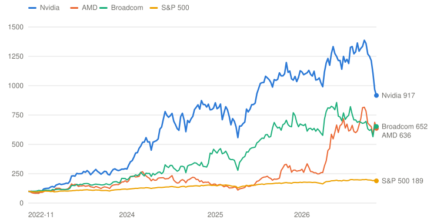
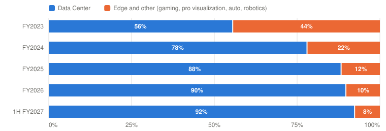

# NVDA — NVIDIA Corporation

> **Schema** v7.0 · **Updated** 2026-11-17 · **Status** Active
> **Price** $162.98 verified Nov 17, 2026, 6:09 PM EST, after hours, after the Q3 FY2027 release (regular-session close $155.46) ([Yahoo](https://finance.yahoo.com/quote/NVDA/)) · 52-wk $148.80–$243.37 · 15th %ile · −33.0% from high
> **Type** Fabless AI-infrastructure platform (accelerators, systems, networking, software) · **Stage** Scaling · **Cyclical** Yes · **Competence** Edge

## Verdict

**Nvidia has just raised next year's growth outlook to about 75%, yet after a one-third fall from its high and its founder's resignation the stock trades at about 10× next year's pre-print consensus EPS; my probability-weighted case, which assumes share falls toward 58% and revenue goes flat after FY2028, returns 13.6% a year at $162.98, just over the 13% hurdle: Initiate, probability-fragile.**

🟢 **Non-holder: Initiate (≤$167), fragile** · 🟢 **Holder: Add**

| PW EV | PW return/yr | Compounding/yr | R/R | Entry | Trim | Avoid | P/E | Yield | BAIT | Moat | Next |
|---|---|---|---|---|---|---|---|---|---|---|---|
| **$300** | **13.6% (≥13%)** | 12.5% | 6.4:1 | ≤$167 | $300–$537 | ≥$537 | 17.0× FY2027E · 10.2× FY2028 consensus (pre-print) | 0.6% | Double (B+A), Moderate | Wide; narrowing at the largest buyers | 📅 Q4 FY2027 ~late Feb 2027 (test 1) · CEO search · Hugging Face close |

**Breaks if**: The FY2028 outlook is cut below 70% growth or receivables pass 70 days of sales, hyperscale revenue falls two quarters running while Broadcom's AI revenue keeps its guide, or non-GAAP gross margin breaks below the 71% floor management set. Any of these says the share-break case is arriving, and each moves 10–15 points from Base to Bear.

⚠️ **Probability-fragile**: break-even Bear odds 26% against 25% assigned.

## The Call

The market is pricing FY2028 as close to the peak. At $162.98, a 10% return needs FY2032 EPS of $15.95 at 16 times, a little below my Base of $16.73, and my Base already has revenue going roughly flat after the guided jump to about $740 billion, as Google's TPU, AMD's Helios and Broadcom's custom chips take share at the largest buyers. What I think the price has slightly wrong is how much is left after that: even with share falling from about 83% of spending to about 58% and gross margin to 69%, buybacks and cash returns compound EPS at 11.9% a year, and the Bull, a platform that holds two-thirds of a growing market, is worth $537. Weighted, the value is $300 and the return 13.6%, so the price that returns 13% is $167. The verdict is probability-fragile: the break-even Bear probability is 26% against the 25% I assign, so one notch more pessimism on share, demand or the post-Huang roadmap turns it into a Watch. The first check, the FY2028 outlook, came back raised on November 17; the number that settles it over a year is hyperscale revenue against Broadcom's AI revenue.

## What I'd Have To Be Wrong About

1. **That FY2028 is the year management says it is, paid for in cash.** Test: Q4 FY2027 release and call (about late February 2027): the FY2028 outlook held at 70% growth or better (from about 75% now) and days sales outstanding at 70 or below (64 at Q3). **If Fail →** 15 points Base → Bear (PW EV $275, 11.7%/yr) → **Watch / Hold**, entry ≤$153.
2. **That share bleeds rather than breaks at the hyperscalers.** Test: Hyperscale revenue grows sequentially in Q4 FY2027 and Q1 FY2028 (reported about late February and late May 2027), as the CFO said it would reaccelerate in Q4 with Vera Rubin supply. Fail: two consecutive sequential declines while Broadcom's AI semiconductor revenue meets its own guide. **If Fail →** 10 points Base → Bear (PW EV $283, 12.3%/yr) → **Watch / Hold**, entry ≤$158.
3. **That the price umbrella holds while memory costs rise.** Test: Non-GAAP gross margin of at least 71.0% in Q4 FY2027 and at least 72.0% in Q1 FY2028 (management guided a bottom of 71–72% in Q4, then 72–73% in FY2028 as price increases take effect in Q1). **If Fail →** 10 points Base → Bear (PW EV $283, 12.3%/yr) → **Watch / Hold**, entry ≤$158.

## Latest update: 2026-11-17 · Q3 FY2027: beat, $130B guide, FY2028 raised to ~75%

- FY2028 is the year management says it is — ✅ Pass — Q4 guide $130.0B midpoint (≈$121B on 13 weeks) vs ≥$118B; FY2028 growth raised to ≈75% from 70%
- Share bleeds rather than breaks at the hyperscalers — 🟡 Pending — Q3 hyperscale +23% q/q to $60.1B, a good start; the test window is Q4 FY2027 and Q1 FY2028
- The price umbrella holds while memory costs rise — 🟡 Pending — Q3 74.9%; Q4 guided 71–72% and FY2028 72–73% reaffirmed; resolves late Feb and late May

Nvidia reported its third fiscal quarter of 2027 a few hours after the page above went up, and the number that mattered most moved the right way. Revenue was $115.8 billion against a $108 billion guide and about $109 billion of consensus, up 103% from a year ago. Non-GAAP EPS was $2.68 against about $2.47. The fourth-quarter guide is $130 billion, plus or minus 3%, which includes an extra week and no China compute; at thirteen weeks it would be about $121 billion, still above the bar I set. Then on the call Kress raised next year:

> "This combined with increased support from our supply base, we are raising our fiscal year 2028 outlook. We expect revenue to grow approximately 75% year-over-year, up from 70%, and off what is now a higher fiscal 2027 base. Our outlook considers data center readiness, the strength and durability of end customer demand, and our customers' access to capital."
> — Colette Kress, interim CEO and CFO, Q3 FY2027 earnings call, November 17, 2026 ([transcript](https://in.investing.com/news/stock-market-news/earnings-call-transcript-nvidia-tops-q3-2026-estimates-and-lifts-outlook-93CH-5711032))

Fiscal 2027 now comes out near $424 billion, so 75% on top of it is roughly $740 billion for fiscal 2028 `[Derived]`. The stock closed at $155.46 and traded at $162.98 after hours, up about 5%.

### What was reported, against the debates

**The share debate went Nvidia's way this quarter.** Hyperscale revenue, the line I watch against Broadcom, grew 23% sequentially to $60.1 billion, the fastest of the two Data Center subsegments, on what Kress called "the Vera Rubin ramp and sustained strength in Grace Blackwell." Vera Rubin generated nearly $20 billion in its first quarter of production shipments, and hyperscalers brought it into production in about a month, half the time Grace Blackwell took. Networking passed $21 billion. Frontier labs are expected to be about 15% of Data Center revenue this year. None of this says custom chips are not gaining at Google or Anthropic; it says that, in the quarter Vera Rubin shipped, Nvidia's largest buyers bought more of it than I expected.

**The financing debate got bigger, and the tone changed.** Supply commitments rose to $390 billion from $279 billion, with $203 billion due in fiscal 2028. Guarantees reached $118 billion at their maximum, including a new $9.5 billion of credit support for power and systems. Receivables went to 64 days of sales. Nvidia took a $1.8 billion impairment on its private stakes. Against that, Kress was noticeably more cautious than in August: Nvidia is "rigorously evaluating future investments, commitments, and guarantees," and on customer financing "a lot of things have changed over this last quarter." Asked by Bernstein's Stacy Rasgon whether the new disclosure that neocloud commitments only take effect once those customers secure their own financing was a change, she said: "Is it new? No. Did we change anything? No." I read the quarter as more exposure already signed, with less appetite to sign more.

**China is now worth less.** Q3 included $2.4 billion of licensed Hopper sales to China. Kress said Nvidia is "no longer shipping licensed Hopper data center products to China," and new Commerce Department rules restrict renting compute to Chinese firms. The Q4 guide carries none of it, so the sequential growth in the guide is all ex-China.

**Management.** The chair, Harvey Jones, opened the call: the board "does not intend to reinstate Jensen as CEO," has hired Heidrick & Struggles for the search, and has formed a National Security and Export Control Oversight Committee. He took no questions on the circumstances or the investigation. Huang said the same day he would be "honored" to return. Kress's answers were heavy on supply and customer support and light on strategy, which is what an interim CEO who is also CFO should sound like.

**Pushback and non-answers.** UBS's Tim Arcuri asked whether pricing power survives as frontier labs lean "even more aggressively on ASICs." Kress reaffirmed the 72–73% gross-margin range for fiscal 2028 and said long-term pricing is "something for the future." That reaffirms the near-term floor and says nothing about the competitive question. Asked about a slowdown in 2028, she pointed to customers asking for more supply "even in the last week." That is evidence about calendar 2027, not about what comes after.

### Scorecard and consequences

The first test passed on both legs. The other two resolve in late February and late May. A pass carries no pre-committed change, and I have not moved the probabilities. The demand evidence is better than my Base assumed, but the new negatives cancel it in my judgment: the national-security side of the CEO departure, the China rules and a larger signed balance-sheet exposure.

What I did change was where the evidence moved the inputs:

- fiscal 2027 base revenue to about $424 billion;
- Base Data Center growth from 11.6% to 12.5% a year, so the Base still plateaus at the new, higher fiscal 2028 level rather than declining from it;
- equity stakes to about $110 billion of carrying value;
- guarantees to $118 billion;
- the odds that China sales resume under license, cut from 20% to 15%.

The probability-weighted value is $300, the return 13.6% a year at $162.98, and the entry $167. The verb stays **Initiate (≤$167) / Add**, and it is still probability-fragile: the break-even Bear probability is 26% against the 25% I assign.

The replacement first test moves to the February print, where the fiscal 2028 outlook gets its first revision with a quarter of the year in view. I combine it with receivables, because a raised outlook paid for with longer terms is not the same thing as demand.

---

## Deep Dive: Nvidia: The Platform, the Price Umbrella and the Balance Sheet

*Revenue is now guided to grow about 75% next year, the stock is a third off its high, and the founder resigned last week. Every large buyer now has a second chip in volume. What does $163 assume, and is that enough?*

**Contents**: [Business Overview](#business-overview) · [The Platform Against the Chips Its Customers Design](#the-platform-against-the-chips-its-customers-design) · [Financing the Customers](#financing-the-customers) · [Management, Capital Allocation and Incentives](#management-capital-allocation-and-incentives) · [Valuation and Model Assumptions](#valuation-and-model-assumptions) · [Final Words](#final-words) · [Appendix: The Numbers](#appendix-the-numbers) · [Sources](#sources)

On November 30, 2022, OpenAI released ChatGPT. Nvidia had just finished a year in which revenue went nowhere, $27.0 billion against $26.9 billion the year before, and operating margin fell to 16% after a gaming and crypto inventory hangover. Four years later it is finishing a year that should end near $410 billion of revenue, fifteen times as much, with operating margins above 60%. The stock has done well but not that well: an investor on November 30, 2022 has made about 9 times their money in total return, against about 6.4 times in AMD, 6.5 times in Broadcom and 1.9 times in the S&P 500. Revenue outran the stock because the multiple came down.

*Total return, weekly, November 30, 2022 (the day ChatGPT launched) = 100, through November 17, 2026 (intraday). Nvidia's index peaked at 1,387 in October 2026 and stood at 917. Source: Yahoo Finance adjusted closes via prices.py. Built with Claude.*

| Date | Nvidia | AMD | Broadcom | S&P 500 |
|---|---|---|---|---|
| 2022-11-30 | 100 | 100 | 100 | 100 |
| 2023-07-28 | 276 | 146 | 167 | 113 |
| 2024-03-22 | 557 | 231 | 254 | 131 |
| 2024-11-22 | 839 | 178 | 311 | 150 |
| 2025-08-01 | 1027 | 221 | 550 | 158 |
| 2026-03-27 | 991 | 260 | 577 | 163 |
| 2026-11-17 | 917 | 636 | 652 | 189 |

The last six weeks are the part the market is trading. Nvidia's index peaked in early October. On November 5 the stock fell 9% in a sell-off of AI hardware names. On November 12 Jensen Huang, who co-founded the company in 1993 and ran it for 33 years, resigned as chief executive and director, effective immediately, after reports about his relationship with a woman suspected of ties to Chinese intelligence; the chief financial officer, Colette Kress, is interim CEO ([8-K](https://www.sec.gov/Archives/edgar/data/0001045810/000104581026000082/nvidiaannouncesceotransiti.htm)). On November 16 the Commerce Department required export licenses for five more countries and for data centers that rent compute to Chinese firms. The stock closed that day at $156.14 and traded at $154.60 this afternoon, 36% below its 52-week high, a few hours before the company reports its third fiscal quarter.

All this time the numbers kept rising. In August management guided revenue up about 70% in fiscal 2028, the first time it had given a full-year outlook, and called that number constrained by supply, with customer forecasts pointing to demand doubling. On the third-quarter call in November, Kress raised it to about 75%, off a higher base. Consensus for fiscal 2028 EPS has risen about a quarter in 90 days. At today's price the stock trades at 9.7 times that consensus.

So the question is not whether next year is good. It is what comes after it. Every large buyer of Nvidia systems now has a second chip in volume: Google's TPU, which Google now sells outright; Amazon's Trainium; AMD's Helios rack; and the custom chips Broadcom designs for six customers, whose revenue Broadcom expects to double in each of the next two years. Nvidia is also financing a growing share of its own demand. I start with the business and how it makes money per gigawatt. The key debate comes next: can a general-purpose platform hold its price and share against chips its customers design. The second debate is the balance sheet behind the growth. Then management, now without its founder, and the valuation: what $155 assumes and what 13% a year would need.

### Business Overview

Nvidia designs accelerated-computing systems and outsources their manufacture, mainly to TSMC for chips and packaging and to the three memory makers for HBM. Since fiscal 2027 it reports two market platforms. Data Center is GPUs, CPUs, networking, the Groq LPU and software, sold as chips, boards or whole racks to cloud providers and to everyone else. Edge Computing is workstations, PCs, gaming, cars and robots. Data Center was 93% of revenue in the latest quarter, and Nvidia splits it into Hyperscale and a group it calls ACIE: AI clouds (the neoclouds), industrial and enterprise customers, sovereign programs and AI start-ups.

| $ Billion unless stated | Q3 FY2026 | Q1 FY2027 | Q2 FY2027 | Q3 FY2027 | Q4 FY2027 guide |
|---|---|---|---|---|---|
| **Revenue** | 57.01 | 81.62 | 96.22 | **115.84** | 130.0 ± 3% (14 weeks) |
| Revenue growth, year over year | +62% | n/r | +106% | **+103%** | ≈+91% `[Derived]` |
| Data Center | 51.2 | 75.25 | 89.02 | **107.6** | n/d; no China compute assumed |
|  Hyperscale | 35.1 | 43.05 | 48.71 | 60.1 | n/d |
|  AI clouds, industrial and enterprise (ACIE) | 16.1 | 32.20 | 40.31 | **47.5** | n/d |
|  ACIE share of Data Center | 31% | 43% | 45% | 44% | n/d |
| Edge Computing | 5.8 | 6.37 | 7.20 | 8.2 | n/d |
| Gross margin (non-GAAP) | 73.5% | 75.0% | 75.0% | 74.9% | 71.0–72.0% |
| Operating expenses (non-GAAP) | 5.80 | 7.45 | 8.23 | 8.84 | ≈10.7 |
| **Operating income (non-GAAP)** | 36.10 | 53.78 | 63.96 | **77.88** | ≈82 `[Derived]` |
| Net income (GAAP), incl. equity-security gains | 31.91 | 58.32 | 59.69 | 65.29 | n/d |
| Diluted EPS (non-GAAP) | $1.27 | $1.87 | $2.22 | **$2.68** (consensus ≈$2.47) | n/d |
| Operating cash flow | 23.8 | 50.3 | 24.1 | 48.3 | n/d |
| Days sales outstanding | n/r | 45 | 60 | 64 | — |

*Fiscal years end in late January: FY2027 runs from late January 2026 to late January 2027, and its Q4 has 14 weeks. In Q2 FY2027 one company was reclassified from ACIE to Hyperscale and prior periods recast. GAAP net income includes gains on equity securities ($7.8B in Q2 FY2027, $1.8B in Q3 after a $1.8B impairment of private stakes). Q3 FY2027 includes $2.4B of Hopper shipments to China. Source: [Q3 FY2027 release](https://nvidianews.nvidia.com/news/nvidia-announces-financial-results-for-third-quarter-fiscal-2027), [CFO commentary, Q3 FY2027](https://s201.q4cdn.com/141608511/files/doc_financials/2027/Q327/Q3FY27-CFO-Commentary.pdf), [CFO commentary, Q2 FY2027](https://s201.q4cdn.com/141608511/files/doc_financials/2027/Q227/Q2FY27-CFO-Commentary.pdf) (text in raw/NVDA/press-releases). Built with Claude.*

Three things stand out. First, the growth is broad: ACIE grew 25% in the quarter against 13% for Hyperscale and is now 45% of Data Center revenue. Second, margins are at a peak. Gross margin held at 75% for two quarters and management has said it will fall to 71–72% in the fourth quarter. Third, cash lagged profit. Operating cash flow was $24.1 billion against $59.7 billion of net income because receivables rose to 60 days of sales and inventory to $31.6 billion.

*Share of revenue. Nvidia began reporting Data Center and Edge Computing as market platforms in FY2027; earlier years put gaming, professional visualization, automotive and OEM in the second bar, so the split is approximate `[Derived]`. Source: [XBRL company facts](https://data.sec.gov/api/xbrl/companyfacts/CIK0001045810.json), [CFO commentary, Q2 FY2027](https://s201.q4cdn.com/141608511/files/doc_financials/2027/Q227/Q2FY27-CFO-Commentary.pdf). Built with Claude.*

| Period | Data Center | Edge and other (gaming, pro visualization, auto, robotics) | Total ($B) |
|---|---|---|---|
| FY2023 | 15 (56%) | 12 (44%) | 27 |
| FY2024 | 48 (78%) | 13 (22%) | 61 |
| FY2025 | 115 (88%) | 15 (12%) | 130 |
| FY2026 | 194 (90%) | 22 (10%) | 216 |
| 1H FY2027 | 164 (92%) | 14 (8%) | 178 |

The unit that explains the business is the gigawatt of data-center capacity, and management now speaks in it. Nvidia's revenue per gigawatt has gone from about $18 billion with Hopper to about $25 billion with Grace Blackwell and about $40 billion with Vera Rubin, because each generation sells more of the rack: the CPU, the scale-up switch, the network cards, now a low-latency inference chip from the Groq license. Growth is gigawatts times dollars per gigawatt.

| Driver | Hopper | Grace Blackwell | Vera Rubin | Read |
|---|---|---|---|---|
| Nvidia revenue per gigawatt of capacity, $B | ≈18 | ≈25 | **≈40** | Kress and Huang, Q2 FY2027 call; Rubin now includes Vera CPU, NVLink, scale-out networking and the Groq LPU |
| Customer's all-in cost per gigawatt, $B | — | — | ≈50–60 | Huang: 'a 1 gigawatt AI factory costs about $50 billion' (GTC Berlin, Oct 21); ≈$60B 'today' (Q2 call) |
| Nvidia share of the customer's spend | — | — | ≈67–80% `[Derived]` | Content ÷ all-in cost |
| Custom-chip content per gigawatt (Broadcom), $B | — | ≈20–30 | ≈20–30 | Hock Tan, Broadcom Q3 FY2026 call, Sep 2, 2026 |
| **Implied gigawatts shipped by Nvidia `[Derived]`** | — | FY2027 ≈14 | FY2028 ≈18 | Data Center revenue ÷ blended $/GW (≈$26B FY2027, ≈$36B FY2028) |
| Neocloud installed capacity on Nvidia, GW | — | ≈3 (end-2025) | ≈8 (end-2026) | Kress, Q2 FY2027 call |
| Largest single commitment | — | — | OpenAI ≈12 GW | 'existing and planned commitments', Kress, Q2 FY2027 call |
| Customer block | — | — | — | Two direct customers were 22% and 14% of FY2026 revenue; five were 10–22% of receivables at Jul 26, 2026; retention, CAC and LTV not disclosed |

*Unit of value: one gigawatt of AI data-center capacity, which Nvidia itself uses. Growth splits into more gigawatts (units) and more dollars per gigawatt (content); since Hopper, content has more than doubled. Implied gigawatts are author's estimates `[Estimate]`. Source: [Q2 FY2027 call](https://s201.q4cdn.com/141608511/files/content_files/TRANSCRIPT_-NVIDIA-Corp-NVDA-US-Q2-2027-Earnings-Call-26-August-2026-5_00-PM-ET.pdf), [GTC Berlin keynote](https://blogs.nvidia.com/blog/gtc-berlin-2026-keynote/), [Broadcom Q3 FY2026 call summary](https://finance.yahoo.com/technology/ai/articles/broadcom-inc-avgo-q3-2026-110030403.html), [FY2026 10-K](https://www.sec.gov/Archives/edgar/data/1045810/000104581026000021/nvda-20260125.htm), [Q2 FY2027 10-Q](https://www.sec.gov/Archives/edgar/data/0001045810/000104581026000075/nvda-20260726.htm). Built with Claude.*

A few accounting points before the debates. GAAP net income now includes large gains and losses on Nvidia's equity stakes ($7.8 billion of net gains in the second quarter), so I value the company on earnings excluding them. From fiscal 2027 Nvidia's non-GAAP figures include stock compensation, so non-GAAP and GAAP operating income are within about 1% of each other, and stock compensation is about 2% of revenue. China data-center revenue is zero in the outlook. And the fiscal year ends in late January, so fiscal 2028 is roughly calendar 2027.

### The Platform Against the Chips Its Customers Design

Here is where things stand. By adding up what the chip vendors report, Nvidia takes about 83% of the money spent on AI accelerators and their networking in 2026. The companies' own guidance puts that near 80% in 2027 and 70–73% in 2028, because Broadcom's AI revenue is guided from $58 billion to about $115 billion to about $230 billion while Nvidia's guide is limited by supply.

| Vendor revenue, $B | 2026 | 2027 | 2028 | Basis |
|---|---|---|---|---|
| Nvidia Data Center | ≈379 | ≈645 | 750–850 | FY2027 from reported quarters, guide and consensus; FY2028 from the ≈70% outlook; 2028 my range `[Estimate]` |
| Broadcom AI semiconductors (custom XPUs ≈73%, networking the rest) | 58 | ≈115 | ≈230 | `[Management guidance]`, fiscal years ending about Nov 1 |
| AMD data-center AI | ≈13 | ≈35 | ≈60 | `[Estimate]`: AMD does not disclose; data center more than doubles in 2026, total revenue guided +80% in 2027 |
| Marvell, MediaTek, Alchip custom, specialists | ≈7 | ≈13 | ≈25 | `[Estimate]` |
| **Total** | ≈457 | ≈808 | ≈1,065–1,165 |  |
| **Nvidia share of spend** | **≈83%** | **≈80%** | **≈70–73%** | `[Derived]`; fiscal years differ, so ±3 points |
| Anthropic contracted capacity (≈11 GW) | Nvidia ≈42% | TPU ≈41% | Trainium ≈11%, AMD ≈7% | [TradingKey](https://www.tradingkey.com/analysis/stocks/us-stocks/262241466-anthropic-ipo-reveals-11gw-compute-footprint-nvidia-accounts-42-tradingkey) `[Estimate]`; the S-1 gives no split |
| OpenAI announced capacity (≈30 GW) | Nvidia ≈40% (12 GW) | Broadcom custom 10 GW | AMD 6 GW, Trainium 2 GW | `[Derived]` from the Nvidia call and deal announcements |
| TSMC CoWoS packaging, 2026 | Nvidia ≈55–60% | Broadcom ≈15% | AMD ≈10–11% | Morgan Stanley and DigiTimes via [ClusterBid](https://clusterbid.com/blog/gpu-supply-chain-2026-tsmc-cowos-nvidia-allocation-lead-times) `[Estimate, secondary]` |

*No audited share table exists for AI accelerators. This adds up what the vendors report; hyperscalers' in-house chips appear as their design partners' revenue, so nothing is counted twice. Third-party estimates of Nvidia's 2026 revenue share run 75–85%. China's domestic chips are excluded. Source: [Nvidia CFO commentary Q2 FY2027](https://s201.q4cdn.com/141608511/files/doc_financials/2027/Q227/Q2FY27-CFO-Commentary.pdf), [Broadcom Q3 FY2026 release](https://investors.broadcom.com/news-releases/news-release-details/broadcom-inc-announces-third-quarter-fiscal-year-2026-financial), [AMD Q3 2026 prepared remarks](https://newsroom.amd.com/documents/2026/11/84f4476b-f064-4f0f-957c-fe484853e178.pdf), [Marvell FQ2 2027 call](https://www.tradingkey.com/news/transcripts/262137259-tradingkey). Built with Claude.*

Two rows matter more than the totals. Anthropic and OpenAI, the two labs Nvidia has invested in most heavily, have each contracted only about 40% of their announced capacity on Nvidia. Nvidia is the largest supplier to both and the majority supplier to neither.

#### Management's narrative

Nvidia's answer is that it sells something different from a chip. Huang, asked on the August call about OpenAI's Jalapeño chip and Anthropic's TPU orders:

> "Well, we're building something very different. Whereas many of these XPUs are inference-specific chips for one cloud or one service, NVIDIA is a platform, an entire AI factory platform that spans the entire AI life cycle that you can use in any cloud. It's in every cloud. You can run anywhere. We'll help you set it up anywhere."
> — Jensen Huang, Q2 FY2027 earnings call, August 26, 2026

The second half of the argument is the customers who will never design a chip. Asked what drives the fiscal 2028 outlook, he split the market in two:

> "Most people see just hyperscalers. And that's half of the picture. The other half of the picture is what we call ACIE, and that's all the enterprise, the neoclouds, the sovereign AIs, that part of the world is invisible to everybody. And the reason for that is because they don't buy custom chips, they don't buy chips one at a time, they really need an entire factory platform built for them."
> — Jensen Huang, Q2 FY2027 earnings call, August 26, 2026

And Kress put the economics in one line, which is also the clearest statement of how Nvidia has grown faster than its customers' capex:

> "Since Hopper, our revenue opportunity has grown from roughly $18 billion per gigawatt to $25 billion with Blackwell, to $40 billion with Vera Rubin, which now spans Vera CPU, Rubin GPU, NVLink, InfiniBand or Ethernet and Groq LPU announced earlier this week."
> — Colette Kress, Q2 FY2027 earnings call, August 26, 2026

This is a strong case and much of it is true. Nvidia runs every major model, closed and open. Its systems are the ones lenders will finance, because they can be redeployed. The ACIE half grew 138% in a year and depends on Nvidia's full stack. And the company keeps shipping: Vera Rubin began production shipments in August, on the annual cadence it promised.

#### Poking holes in it

The first hole is that the largest buyers have already split their orders. Anthropic's IPO filing describes "a multi-chip compute architecture across AWS Trainium, Google TPUs, Nvidia GPUs, and AMD GPUs," and the press reading of it is that Nvidia capacity is the easiest for Anthropic to walk away from ([Tom's Hardware](https://www.tomshardware.com/tech-industry/artificial-intelligence/anthropics-ipo-filing-shows-most-of-its-compute-goes-to-r-and-d-not-serving-customers-company-details-massive-usd800-billion-in-tpu-and-gpu-contracts)). OpenAI has 10 GW of Broadcom custom chips, 6 GW of AMD and 2 GW of Trainium alongside about 12 GW of Nvidia. These are the customers whose usage is growing fastest.

The second is that the strongest alternative is no longer captive. Google Cloud's chief executive told the same Goldman conference Huang spoke at that "the size of our accelerator business, our TPU business, is more than twice that of the next largest hyperscaler," and that customers can now buy TPU systems "as a capital purchase" for their own data centers or rent them through a neocloud Google set up with Blackstone ([transcript](https://stockanalysis.com/stocks/googl/transcripts/737252-goldman-sachs-communacopia-technology-conference-2026/)). Oracle will resell them. Alphabet's inventory rose from $2.4 billion to $13.3 billion this year to stock TPU systems, and it expects most of that revenue in 2027. On SemiAnalysis's benchmark, Ironwood served tokens at $0.181 per million against $0.222 for Nvidia's B200 at one interactivity point, while Nvidia kept the lead in raw performance ([InferenceX](https://newsletter.semianalysis.com/p/tpu-inferencex-full-steam)). That is ACIE's territory, the half Huang called invisible.

The third is the price umbrella. Nvidia's $40 billion per gigawatt sits against $20–30 billion for a Broadcom custom chip, by Hock Tan's own range. A buyer that moves a gigawatt to custom silicon saves about $15 billion of capital, and the illustration below shows what that does to Nvidia if it happens at scale. The umbrella is also what funds the competition: AMD guides revenue up more than 80% in 2027, and Amazon says most of its Bedrock inference already runs on Trainium.

The fourth is software. CUDA was the lock. AMD's third-quarter remarks say an Anthropic engineer used Claude to bring a new model up on AMD racks over a weekend, a job that used to take months. Google is opening a PyTorch backend for TPUs and Amazon has open-sourced one for Trainium. For a lab with a few models and many engineers, the lock is now a few weeks of work. For an enterprise it is still a lock.

| Per gigawatt built, $B | Vera Rubin today | Price cut 15% | 40% of gigawatts go to custom chips | Both |
|---|---|---|---|---|
| Nvidia revenue per gigawatt built | 40.0 | 34.0 | 24.0 | 20.4 |
| Gross margin | 72% | 67% | 72% | 67% |
| **Nvidia gross profit per gigawatt built** | **28.8** | 22.8 | 17.3 | **13.7** |
| Change against today | — | −21% | −40% | −52% |
| Gigawatt growth needed to hold gross profit flat | — | +26% | +67% | +110% |
| Customer's saving per gigawatt moved to custom chips (content $40B → $25B) | — | — | ≈15 | ≈9 after the price cut |
|  Reference: actual Q2 FY2027 | 75.0% non-GAAP gross margin | FY2028 guide 72–73% | Broadcom content $20–30B/GW | — |

*Illustrative `[Estimate]`. A price cut lowers revenue per gigawatt with costs unchanged, so gross margin falls from 72% to 67%: (0.72 × 40 − 6) ÷ 34. The custom-chip column assumes Nvidia keeps its full content on 60% of the gigawatts built and none on the rest. Custom-chip content of $25B is the midpoint of Hock Tan's $20–30B range. Source: [Q2 FY2027 call](https://s201.q4cdn.com/141608511/files/content_files/TRANSCRIPT_-NVIDIA-Corp-NVDA-US-Q2-2027-Earnings-Call-26-August-2026-5_00-PM-ET.pdf), [Broadcom Q3 FY2026 call summary](https://finance.yahoo.com/technology/ai/articles/broadcom-inc-avgo-q3-2026-110030403.html). Built with Claude.*

Here is what that arithmetic says. A 15% price cut takes a fifth off Nvidia's gross profit per gigawatt. Losing 40% of the gigawatts to custom chips takes two-fifths. Both together halve it, and Nvidia would then need gigawatts to double just to stand still. That is the mechanism of my Bear and why my Base already concedes a few points of margin.

Where I come out: the platform argument holds where customers cannot build alternatives, and that half is the faster-growing one today. At the six or seven largest buyers the argument has already been partly lost, by the companies' own contracts. My Base has Nvidia's share of spending falling to about 58% by 2030 and gross margin to 69%. The first evidence will be Hyperscale revenue: Kress said it would reaccelerate in the fourth quarter as Vera Rubin supply grows. If it falls instead while Broadcom meets its guide, the share-break case is arriving.

#### Rings of profit

| Ring | What it is | Size | Exposure to custom chips and the TPU |
|---|---|---|---|
| 1. ACIE: neoclouds, sovereigns, enterprises, AI natives | Buyers who do not design chips; Nvidia sells them the whole factory, and sometimes the financing | 45% of Q2 FY2027 Data Center revenue; +138% y/y; sovereign tripled y/y | **Low today, rising from 2027**: Google now sells TPU systems outright and through Oracle and a Blackstone neocloud; AMD sells Helios through the same OEMs |
| 2. Hyperscale and lab training | Frontier pre- and post-training at Microsoft, Amazon, Meta, Oracle, OpenAI, xAI | Part of the 55% Hyperscale share; training vs inference not disclosed | **Medium**: Google trains on TPUs; Anthropic's first million TPUs were mainly for training |
| 3. Hyperscale and lab inference | Serving a handful of models at very large volume | Part of the 55%; the fastest-growing workload | **High**: TPU, Trainium (most of Bedrock), MTIA, Maia, Jalapeño and MI455X all aim here first |
| 4. Attach: networking, CPUs, Groq LPX | NVLink, Spectrum-X, InfiniBand, Vera and Grace, low-latency LPUs | Grace >$5B trailing; networking +18% q/q; Nvidia #1 in data-center Ethernet (20.4%) | **Medium**: rides on GPU wins; Broadcom Tomahawk and UALink compete on custom-chip racks |
| 5. Edge Computing | Workstations, PCs, gaming, auto, robotics | $7.2B in Q2 FY2027 (7.5% of revenue) | **Low** to custom chips; exposed to memory costs and the PC cycle |

*Nvidia reports Hyperscale and ACIE, not workloads, so rings 2 and 3 are split by judgment. Source: [CFO commentary, Q2 FY2027](https://s201.q4cdn.com/141608511/files/doc_financials/2027/Q227/Q2FY27-CFO-Commentary.pdf), [Q2 FY2027 call](https://s201.q4cdn.com/141608511/files/content_files/TRANSCRIPT_-NVIDIA-Corp-NVDA-US-Q2-2027-Earnings-Call-26-August-2026-5_00-PM-ET.pdf), [IDC Ethernet tracker, Q2 2026](https://www.idc.com/resource-center/blog/ethernet-switch-market-surges-43-4-to-18-9b-in-2q26-as-ai-infrastructure-demand-drives-record-datacenter-spending/). Built with Claude.*

The point of the rings is that the threat is real and concentrated. About 45% of Data Center revenue goes to buyers who do not design chips, and attach products ride along with the GPU. The exposed ring is inference at the largest buyers, which is the fastest-growing workload and the one every alternative chip targets first. From 2027 the protection around the first ring also thins, because Google and Amazon start selling their chips to the same neoclouds and sovereigns.

### Financing the Customers

The second debate is quieter and, for a ten-year holder, nearly as important. Nvidia is now part of how its customers pay for Nvidia systems.

| Oct 25, 2026, $ Billion | Amount | What it is | When it bites |
|---|---|---|---|
| Supply and capacity commitments | **390** | Mostly multi-year memory; up from $279B in July and $95.2B at Jan 25, 2026 | $69B in the rest of FY2027, **$203B in FY2028**, $92B FY2029: fixed if demand turns |
| Cloud service agreements, data-center leases, capex, equity commitments | 128 | Nvidia's own R&D compute ($28B), leases up to 20 years not yet commenced ($74B), $20B of committed investments | Mostly FY2032+ for the leases |
| Neocloud agreements | 32 | Take-or-pay on partners' capacity once financed and accepted, in exchange for a revenue share (formerly 'AI cloud agreements') | FY2028 onward |
| Guarantees, maximum exposure | **118.0** | $105B for SB Energy's 4.25 GW OpenAI campus in Ohio; $9.5B of power and systems credit support (new); $3.5B for neocloud land, power and shell | Phased in from FY2029 as sites become ready |
| Equity holdings | ≈110 | $65.5B non-marketable plus $44.2B public; $1.8B impairment of private stakes in Q3 | Marked to market each quarter |
| Accounts receivable | 81.0 | 64 days of sales, up from 60 and 45, on extended terms for investment-grade buyers | Now |
| Inventory | 39.7 | Up from $31.6B, for the Vera Rubin ramp | Now |
| **Against: cash and marketable debt securities** | 53.5 | After a record $28.1B returned in Q3 | — |
| Against: FY2027 revenue `[Derived]` | ≈424 | Three reported quarters plus the Q4 guide midpoint | — |

*Kress expects the labs Nvidia supports with its balance sheet to be 'roughly a quarter of our business next year' (August call). Commitments and guarantees are stated by fiscal year in the CFO commentary; equity holdings from the Q3 balance sheet. Source: [CFO commentary, Q3 FY2027](https://s201.q4cdn.com/141608511/files/doc_financials/2027/Q327/Q3FY27-CFO-Commentary.pdf), [Q3 FY2027 release](https://nvidianews.nvidia.com/news/nvidia-announces-financial-results-for-third-quarter-fiscal-2027), [FY2026 10-K](https://www.sec.gov/Archives/edgar/data/1045810/000104581026000021/nvda-20260125.htm). Built with Claude.*

#### Management's narrative

Kress addressed it directly in August, which I give the company credit for:

> "We recognize the scale of this support, and we know some will call this circular financing. We see it differently. ... And our risk is limited. The NVIDIA Compute platform is fungible and durable and can be redeployed to support other customers. For context, we expect demand from the AI labs for which we expect to leverage our balance sheet to contribute toward roughly a quarter of our business next year."
> — Colette Kress, Q2 FY2027 earnings call, August 26, 2026

Huang made the same point at the Goldman conference more briefly: "we put a little bit of money in, and a lot of money comes back," and the aim is to turn Nvidia compute into an "investable asset" financed by institutional capital ([transcript](https://stockanalysis.com/stocks/nvda/transcripts/740955-goldman-sachs-communacopia-technology-conference-2026/)). Nvidia has also arranged partnerships with six large asset managers to raise more than $500 billion of outside capital for lab infrastructure, so most of the money is not its own.

#### Poking holes in it

The first hole is size. The guarantees alone, $118 billion at their maximum in October, are about a quarter of this year's revenue, and they arrive from fiscal 2029, exactly when my Base has demand flattening. A guarantee on a data-center lease is called when the tenant cannot pay, which is the case where GPUs are also hardest to redeploy at a good price.

The second is the supply commitments. They rose from $95 billion in January to $279 billion in July and $390 billion in October, mostly multi-year memory, and $295 billion of them fall due in fiscal 2028 and 2029. Nvidia has been here in miniature: it took a $4.5 billion charge in the first quarter of fiscal 2026 when export controls stranded H20 inventory and purchase obligations. The same commitments that secure supply in a boom fix costs in a bust.

The third is quality of revenue. Receivables went from 45 to 60 days of sales in one quarter, and to 64 in the next, on extended terms for large buyers, and Kress's "roughly a quarter of our business next year" means roughly a quarter of fiscal 2028 revenue goes to customers who rely on Nvidia's balance sheet. That does not make the revenue fake. It does make it more cyclical than the headline growth suggests, and it means the equity stakes, carried at about $110 billion in October after a $1.8 billion impairment of private holdings, rise and fall with the same customers.

Where I come out: this is vendor financing at a scale I have not seen in a technology hardware company, and I treat it as a Bear amplifier, not a Base cost. In the Base it costs nothing, because the labs keep growing and pay. In the Bear it costs about $1.60 a share in guarantee losses, valued as an option line, and it is part of why the Bear multiple is 13 times. In November Kress signalled a slower pace: Nvidia is "rigorously evaluating future investments, commitments, and guarantees," and on customer financing "a lot of things have changed over this last quarter" (Q3 FY2027 call, November 17, 2026). I welcome that, but it changes nothing about what is already signed. The test I would watch is receivables: above 70 days of sales would say the terms are doing the selling.

### Management, Capital Allocation and Incentives

For 33 years management was Jensen Huang. He set the bets that made the company, CUDA in 2006, the data center long before it paid, the purchase of Mellanox in 2020, and the move from chips to whole racks, and he was its public voice on every one. The record since ChatGPT is in the opening chart: revenue up fifteen-fold, the stock up about nine. He resigned on November 12. The board has an independent investigation under way, a search for internal and external candidates, and, by the Financial Times's account, has approached Arm's chief executive, Rene Haas; Nvidia says it has not formally engaged anyone ([CNBC](https://www.cnbc.com/2026/11/16/nvidia-jensen-huang-return-tech.html)). The board chair said operations, customer commitments and the roadmap should "continue without interruption." On the third-quarter call he went further: the board "does not intend to reinstate Jensen as CEO," has retained Heidrick & Struggles for the search, and has formed a National Security and Export Control Oversight Committee of independent directors and outside advisers (Harvey Jones, Q3 FY2027 call, November 17, 2026). Huang said the same day he would be "honored" to return. Kress, the interim CEO, has been CFO since 2013 and is also keeping that job.

I cannot judge from outside how much of the roadmap lived in one person. I can say what to watch: whether the architecture and systems leads stay, whether Rubin Ultra ships in the second half of 2027, and who is named. Until then I treat the leadership change as a risk to the Bull, not as a change to the Base.

| Year | Deal | Price and form | What happened | Verdict |
|---|---|---|---|---|
| 2020 | Mellanox | ≈$6.9B cash `[link pending]` | Became the networking business: InfiniBand, then Spectrum-X; networking revenue +142% in FY2026 and Nvidia is now the largest data-center Ethernet switch vendor | Good |
| 2020–22 | Arm (attempted) | ≈$40B, mostly stock `[link pending]` | Abandoned in February 2022 under regulatory opposition; prepayment written off `[link pending]` | Poor (cost small, distraction large) |
| 2025 | Groq (non-exclusive license plus most of the team) | ≈$20B; $2.9B paid in 1H FY2027, $0.99B accrued at Jul 26, 2026 | Groq 3 LPX in full production; volume to Nebius from Q3 FY2027; LP40 planned with Feynman | Too early |
| 2025–26 | Equity stakes in AI labs, neoclouds and partners (OpenAI, Anthropic, xAI/SpaceX, CoreWeave, Nebius, Intel and others) | Nearly $50B in frontier labs; ≈$96B carried at Jul 26, 2026; $25B more committed | Demand tied to Nvidia systems; $7.8B of net gains in Q2 FY2027; two labs may list | Too early |
| 2026 | SB Energy PORTS-Pike guarantees for OpenAI | Up to $105B of credit support, phased from FY2029 | Each generation at the site 'could represent' $150–200B of Nvidia revenue (CFO commentary) | Too early |

*Mellanox and Arm prices are from the announcements as I recall them and carry `[link pending]`. Source: [FY2026 10-K](https://www.sec.gov/Archives/edgar/data/1045810/000104581026000021/nvda-20260125.htm), [Q2 FY2027 10-Q](https://www.sec.gov/Archives/edgar/data/0001045810/000104581026000075/nvda-20260726.htm), [CFO commentary, Q2 FY2027](https://s201.q4cdn.com/141608511/files/doc_financials/2027/Q227/Q2FY27-CFO-Commentary.pdf). Built with Claude.*

| $B, except per share | FY2022 | FY2023 | FY2024 | FY2025 | FY2026 | Q2 FY2027 | Cumulative FY2022–26 |
|---|---|---|---|---|---|---|---|
| Revenue | 26.91 | 26.97 | 60.92 | 130.50 | **215.94** | 96.22 | — |
| Growth | +61% | +0% | +126% | +114% | +65% | +106% | — |
| Diluted EPS (GAAP, split-adjusted) | $0.39 | $0.17 | $1.19 | $2.94 | **$4.90** | $2.46 | — |
| Operating cash flow | 9.11 | 5.64 | 28.09 | 64.09 | 102.72 | 24.1 | 209.65 |
| Capex | 0.98 | 1.83 | 1.07 | 3.24 | 6.04 | n/r | 13.16 |
| **Free cash flow** | 8.13 | 3.81 | 27.02 | 60.85 | **96.68** | n/r | **196.49** |
| FCF margin | 30% | 14% | 44% | 47% | 45% | — | — |
| Stock compensation | 2.00 | 2.71 | 3.55 | 4.74 | 6.39 | n/r | 19.39 |
| Dividends | 0.40 | 0.40 | 0.40 | 0.83 | 0.97 | ≈6 | 3.00 |
| Buybacks | 0 | 10.04 | 9.53 | 33.71 | 40.09 | ≈20 | **93.37** |
| Buybacks ÷ FCF | 0% | 264% | 35% | 55% | 41% | — | 48% |
| Average buyback price (split-adjusted) | — | ≈$16 `[Estimate]` | n/r | n/r | ≈$143 | n/r | — |
| Acquisitions (cash, net) | 0.26 | 0.05 | 0.08 | 1.01 | 1.54 | Groq $2.9B (1H) | 2.94 |
| Debt | 10.95 | 10.95 | 9.71 | 8.46 | 8.47 | ≈33.5 | — |
| Diluted shares (B, split-adjusted) | 25.35 | 25.07 | 24.94 | 24.80 | 24.51 | 24.26 | −3.3% over four years |

*Fiscal years end in late January (FY2026 = year to Jan 25, 2026). FCF = operating cash flow − purchases of property, equipment and intangibles `[Derived]`. Q2 FY2027 buybacks and dividends from the call ('$20 billion through share repurchases and $6 billion through our quarterly dividend of $0.25 per share'). The FY2023 average price is an estimate from the year's trading range. FY2026 average = $40.4B ÷ 282M shares. Remaining authorization $99.3B at Jul 26, 2026. Equity investments and the Groq license are outside 'acquisitions'. Source: [XBRL company facts](https://data.sec.gov/api/xbrl/companyfacts/CIK0001045810.json), [FY2026 10-K](https://www.sec.gov/Archives/edgar/data/1045810/000104581026000021/nvda-20260125.htm), [Q2 FY2027 10-Q](https://www.sec.gov/Archives/edgar/data/0001045810/000104581026000075/nvda-20260726.htm). Built with Claude.*

The cumulative column says two things. Nvidia generated $196 billion of free cash flow in five fiscal years and issued $19 billion of stock compensation, so owner cash was about $177 billion, and it returned $96 billion of it, mostly in buybacks, while the diluted share count fell only 3.3% because the price rose so fast. And the most countercyclical thing it did was the earliest: in fiscal 2023, the trough year, it bought back $10 billion, more than two and a half times that year's free cash flow, at prices I estimate near $16 a share on today's split basis. Since then the buyback has followed cash flow, $40 billion in fiscal 2026 at about $143 a share and $20 billion in the second quarter alone, with a policy of returning half or more of free cash flow.

What changed in 2026 is where the rest of the cash goes. About $96 billion now sits in equity stakes in customers and partners, and the balance sheet backs the guarantees described in the financing chapter. I grade Nvidia **Steward (not Outsider)**: one strong trough-buying year, then programmatic returns, with the marginal dollar going into financing demand rather than into its own shares at low prices.

#### The incentives

| Component | Size (FY2026) | What it pays for | Outcome |
|---|---|---|---|
| **Variable cash plan** | $3.0M target for the CEO | Revenue: threshold $100B, base $130B, stretch $160B (stretch cut from $190B after the H20 controls) | $215.9B actual; 200% payout, $6.0M |
| **Single-year PSUs** | $15.5M target | Non-GAAP operating income: base $71B, stretch $96B (cut from $120B) | $137.3B actual; CEO 150% |
| **Multi-year PSUs** | $15.5M target | Three-year TSR against the S&P 500: 50th percentile for target, 75th for maximum | 100th percentile (TSR +1,055%); CEO 150% |
| **Ownership** | Huang 870.6M shares, 3.58% (Mar 23, 2026); directors and officers 3.94% | Guideline: 10× salary for the CEO | Huang resigned Nov 12, 2026; his awards now follow the plan's separation terms (not read) |
| **Return on invested capital** | 0% | Not a metric in any plan | Nothing pays for capital efficiency, the $550B of commitments or the $118B of guarantees |

*Total target pay for the CEO was $35.5M, over 90% at risk, and all equity was PSUs. Stretch goals were set so far below results that every plan paid at or near the maximum. Interim CEO Colette Kress's terms were not disclosed in the Nov 12 8-K. Source: [2026 proxy (DEF 14A)](https://www.sec.gov/Archives/edgar/data/0001045810/000104581026000036/nvda-20260512.htm), [8-K, Nov 12, 2026](https://www.sec.gov/Archives/edgar/data/0001045810/000104581026000082/nvidiaannouncesceotransiti.htm). Built with Claude.*

The plan paid for revenue, operating income and relative stock return, and nothing in it paid for returns on capital. The goals were set well below what happened, so every component paid at or near its maximum. The plan did not encourage the build-up of commitments and guarantees, but nothing in it discouraged it either. With Huang gone, the next CEO's package is the first chance to add a capital-efficiency measure, and I will read it when it is filed.

Against its own guidance, management is a **consistent beater**: revenue and EPS have beaten consensus six quarters running, and the second quarter came in at $96.2 billion against about $91.7 billion expected.

| Promised | Where, when | Outcome |
|---|---|---|
| About $1 trillion of revenue over the three fiscal years FY2026–FY2028 (as analysts summarized the earlier outlook) | Bernstein's question on the Q2 FY2027 call, Aug 26, 2026, citing the prior outlook | ✅ On track and raised: FY2026 $215.9B, FY2027 ≈$410B `[Derived]`, FY2028 guided +≈70%, which Bernstein put at ≈$200B above the prior path |
| One new data-center platform a year; Vera Rubin in the second half of 2026 | GTC and Computex roadmaps, 2024–2026 | ✅ Rubin production shipments began August 2026, ≈20% of Q3 Data Center revenue guided; Rubin Ultra (2H 2027) not yet tested |
| Return 50% or more of free cash flow | Q2 FY2027 call, Aug 26, 2026 (Kress) | ✅ 60% year to date; 'we intend to increase and return excess free cash flow net of strategic uses' |
| Resume data-center sales in China (H20, then H200 under license) | Huang, repeatedly in 2025–2026 | 🔴 Hopper shipments to China under 1% of Data Center revenue; zero in the outlook |

*Guidance grade: **Consistent beater**. Revenue and EPS beat consensus for six straight quarters through Q2 FY2027 `[Analyst consensus]`, and Q2 revenue of $96.2B compared with ≈$91.7B expected. Source: [Q2 FY2027 call](https://s201.q4cdn.com/141608511/files/content_files/TRANSCRIPT_-NVIDIA-Corp-NVDA-US-Q2-2027-Earnings-Call-26-August-2026-5_00-PM-ET.pdf), [Yahoo Finance on the estimate record](https://finance.yahoo.com/markets/stocks/articles/why-nvidia-13-times-expected-160800388.html), [Bloomberg on H200 sales](https://www.bloomberg.com/news/articles/2026-08-26/nvidia-steps-back-into-china-market-with-first-h200-chip-sales). Built with Claude.*

Is this the right team? Through November 12, yes, on every operating measure in this report. The question now is whether the system Huang built runs without him. The best evidence for it is the depth of the bench that delivered Rubin on time and the fact that customers' purchase orders for it are already placed. The best evidence against is that the company was organized around one person to an unusual degree.

### Valuation and Model Assumptions

I value Nvidia at the end of fiscal 2032 (about January 2032), five fiscal years after the current one, on earnings per share excluding gains on equity stakes, which are close to its non-GAAP EPS and already charge stock compensation. The model builds revenue from Data Center and Edge Computing, applies one gross margin to both because Nvidia does not report margin by platform, and subtracts operating expenses as a share of revenue. It adds about $2 billion of net interest income, taxes at 16.5% rising to 17–18%, and divides by diluted shares after buybacks. The base year is fiscal 2027 at about $410 billion of revenue: two reported quarters, the third-quarter guide and fourth-quarter consensus. Nvidia is cyclical, so the terminal margins are through-cycle margins below today's: 72% gross in the Bull, 69% in the Base and 61% in the Bear, against about 74% for fiscal 2027.

| $ Billion | FY2026A | FY2027E | FY2028E | FY2029E | FY2030E | FY2031E | FY2032E |
|---|---|---|---|---|---|---|---|
| **Data Center revenue** | 193.7 | 393.0 | 442.1 | 497.4 | 559.6 | 629.5 | 708.2 |
|  YoY growth | — | 102.9% | **12.5%** | **12.5%** | **12.5%** | **12.5%** | **12.5%** |
|  Operating margin | 71.1% | 73.6% | 72.7% | 71.8% | 70.8% | 69.9% | **69.0%** |
|  Operating profit | 137.70 | 289.25 | 321.34 | 356.93 | 396.40 | 440.15 | 488.66 |
| **Edge Computing revenue** | 22.2 | 30.5 | 31.8 | 33.1 | 34.5 | 36.0 | 37.5 |
|  YoY growth | — | 37.4% | **4.2%** | **4.2%** | **4.2%** | **4.2%** | **4.2%** |
|  Operating margin | 71.1% | 73.6% | 72.7% | 71.8% | 70.8% | 69.9% | **69.0%** |
|  Operating profit | 15.78 | 22.45 | 23.10 | 23.76 | 24.44 | 25.14 | 25.85 |
| Corporate and other | (23.08) | (36.17) | (42.33) | (49.46) | (57.72) | (67.27) | (78.29) |
| **Total revenue** | 215.9 | 423.5 | 473.9 | 530.5 | 594.1 | 665.5 | 745.7 |
| **Operating profit** | 130.40 | 275.53 | 302.11 | 331.23 | 363.12 | 398.03 | 436.21 |
|  Operating margin | 60.4% | 65.1% | 63.7% | 62.4% | 61.1% | 59.8% | 58.5% |
| Net income | 120.07 | 231.74 | 253.02 | 276.25 | 301.59 | 329.22 | 359.34 |
| Diluted shares (B) | 24.514 | 24.250 | 23.668 | 23.100 | 22.546 | 22.004 | 21.476 |
|  Net share change | — | — | -2.4% | -2.4% | -2.4% | -2.4% | -2.4% |
|  SBC (% of revenue) | — | 2.2% | 2.2% | 2.2% | 2.2% | 2.2% | 2.2% |
| **EPS ex equity-security gains (≈ non-GAAP, after SBC)** | $4.90 | $9.56 | $10.69 | $11.96 | $13.38 | $14.96 | $16.73 |
|  YoY growth | — | 95.0% | 11.9% | 11.9% | 11.9% | 11.8% | 11.8% |

*Bold cells are model inputs.*

The model grows each segment at a constant rate, but the Base I have in mind is lumpy: revenue jumps about 75% in fiscal 2028 as guided, then grows little, as a market that keeps growing is offset by share falling to about 58% of spending. Data Center reaches about $710 billion and total revenue about $745 billion in fiscal 2032. Operating margin falls from about 65% to 58.5% as gross margin gives up five points and operating expenses rise to 10.5% of revenue. Buybacks retire a net 2.4% of shares a year. EPS rises from $9.56 to $16.73, and at 16 times that is $268. Sixteen times is about where the stock trades on this year's earnings, and an ordinary multiple for a business that has stopped growing but returns most of its cash.

| Case | Prob. | 3P | Data Center growth / margin | Edge Computing growth / margin | Net shares/yr | Per-share earnings FY2032 | CAGR | Exit multiple | Value | Return/yr | Implied g | Driving assumption |
|---|---|---|---|---|---|---|---|---|---|---|---|---|
| **Bull** | 25% | Plausible | +22.8% / 72.0% | +10.0% / 72.0% | -1.6% | $26.87 | 23.0% | 20.0× EPS ex equity-security gains (≈ non-GAAP, after SBC) | $537 | 27.6% | 4.8% | Boom demand and the platform holds: AI spending outside China reaches about $1.7 trillion by 2030 and Nvidia keeps about two-thirds of it, so Data Center revenue reaches about $1.1 trillion in FY2032 (+23%/yr from FY2027); gross margin settles at 72% as Rubin and Feynman keep their cost-per-token lead; opex 9% of revenue; buybacks retire a net 1.6% a year; 20× EPS. |
| **Base** | 50% | Probable | +12.5% / 69.0% | +4.2% / 69.0% | -2.4% | $16.73 | 11.9% | 16.0× EPS ex equity-security gains (≈ non-GAAP, after SBC) | $268 | 11.0% | 3.5% | Spending plateaus near the 2028 level and share bleeds to about 58%: revenue jumps about 75% in FY2028 as guided, then grows little, so Data Center revenue is about $710 billion in FY2032 (+12.5%/yr from FY2027, almost all of it in the first year); gross margin 69% as price is conceded to TPU and AMD; opex 10.5%; buybacks retire a net 2.4% a year; 16× EPS. |
| **Bear** | 25% | Probable | +0.6% / 61.0% | -1.3% / 61.0% | -2.9% | $8.06 | -3.3% | 13.0× EPS ex equity-security gains (≈ non-GAAP, after SBC) | $105 | -7.8% | 2.1% | Digestion and share break: capex falls about a third from its peak after FY2028 while custom chips reach training parity at the labs, so Data Center revenue drifts back to about $405 billion in FY2032; gross margin 61% on price cuts and stranded supply commitments; opex 14%; buybacks retire a net 2.9% a year at low prices; 13× trough-ish EPS. |
| **Priced-in (10%/yr)** | — | diagnostic | +11.5% / 68.7% | +3.6% / 68.7% | -2.5% | $15.95 | 10.8% | 16.0× EPS ex equity-security gains (≈ non-GAAP, after SBC) | $255 | 10.0% | 3.5% | Solved along Base → Bull for 10%/yr |
| **Hurdle (13%/yr)** | — | diagnostic | +14.3% / 69.5% | +5.2% / 69.5% | -2.3% | $18.26 | 13.8% | 16.0× EPS ex equity-security gains (≈ non-GAAP, after SBC) | $292 | 13.0% | 3.5% | Solved along Base → Bull for 13%/yr |
| Option: Equity stakes in AI labs and partners (≈$110B carrying value, Oct 25, 2026) | 100% | possible |  |  |  |  |  |  | $4 |  |  | valued as probability × value, outside the core |
| Option: China data-center sales resume under license (≈$20B/yr; licensed Hopper shipments stopped Nov 2026) | 15% | possible |  |  |  |  |  |  | $8 |  |  | valued as probability × value, outside the core |
| Option: Guarantee and take-or-pay losses in a bust (30% of $118B) | 25% | possible |  |  |  |  |  |  | $-2 |  |  | valued as probability × value, outside the core |
| **Probability-weighted** | 100% |  |  |  |  |  |  |  | $300 | 13.6% |  |  |

The Bull is boom demand plus a platform that holds: spending reaches about $1.7 trillion by 2030 and Nvidia keeps about two-thirds, so revenue passes $1.1 trillion, gross margin settles at 72%, and the stock is worth $537 at 20 times. Its implied perpetual growth is below the risk-free rate, so it is a high case rather than an impossible one, but only about 2% of companies above $25 billion of sales have grown this fast for five years. The Bear is digestion plus a share break: capex falls about a third from its peak after fiscal 2028, custom chips reach parity in training at the labs, revenue drifts back to about $435 billion, gross margin falls to 61% as supply commitments are absorbed, and at 13 times it is worth $105. That is close to the company's earnings power on this year's numbers.

The option lines sit outside the cases: the equity stakes at their carrying value, about $4 a share; a 20% chance of China sales resuming under license; and a 25% chance of guarantee losses in a bust.

| Return math |  |
|---|---|
| PW return/yr vs. hurdle | **13.6% (≥13%)**, of which 0.6% is the dividend yield. Entry ≤$167. 10-year Treasury 5.15%; the hurdle sits 7.9 points above it. |
| Compounding at a flat multiple | Base per-share earnings growth 11.9% + 0.6% dividend = **12.5%**. Re-rating subtracts 1.4 points from the Base return: the multiple compresses. |
| Optionality | Equity stakes in AI labs and partners (≈$110B carrying value, Oct 25, 2026): 100% × $4 = $4.5; China data-center sales resume under license (≈$20B/yr; licensed Hopper shipments stopped Nov 2026): 15% × $8 = $1.1; Guarantee and take-or-pay losses in a bust (30% of $118B): 25% × $-2 = $-0.4 |
| Price-implied expectations | At 10%, spot needs EPS of $15.95 in FY2032 at 16×, a little below my Base ($16.73): revenue near $690 billion, roughly the FY2028 guide held flat for four years, at a 58% operating margin. At 13% it needs $18.26, a fifth of the way from my Base to my Bull. |
| EPV floor | Earnings power with no growth: FY2026 operating income of $130.4B taxed at 15% and capitalized at 10% is ≈$1.11T, plus ≈$23B of net cash, ≈$47 a share. On FY2027's ≈$267B of operating income it is ≈$2.25T, ≈$93 a share. The Bear ($105) sits at FY2027 earnings power, and spot is about 1.7× it. |
| Base rate / 3P | FY2027 revenue of ≈$410B sits in the >$25B bucket. The Bull's ≈23% nominal growth (≈20% real) was achieved over five years by about 2% of companies this size, and none started this large; most of it is the guided, supply-committed FY2028. The Base's ≈11% nominal (≈8.5% real) was achieved by roughly 20%. Credit Suisse HOLT, 1950–2015 ([Base Rate Book](https://sorfis.com/wp-content/uploads/2021/09/The-Base-Rate-Book-Integrating-the-Past-to-Better-Anticipate-the-Future-September-2016.pdf)). 3P: Bull Plausible, Base and Bear Probable. |
| Terminal-growth check | Implied perpetual growth on earnings at 10%: Bull 4.8%, Base 3.5%, Bear 2.1%, all below the 5.15% ten-year Treasury yield (FRED, Nov 13, 2026). |
| Break-even and price-implied Bear odds | Break-even 26% against 25% assigned — ⚠️ **probability-fragile**; price-implied 40% at 10%. |
| Year ten | In the Base the business is not growing at year ten: it is a replacement cycle in which installed gigawatts are refreshed every four to six years and Nvidia holds about half, and the 16× multiple is carried by buybacks and cash returns, not growth. |
| R/R | **6.4:1** (Bull +230% / Bear −36%) The downside is a cyclical bust at a normal multiple, not a broken company; the Bear still earns $163B in FY2032. |

*Computed rows come from model.json. Segment margin rows are gross margins, applied equally to both segments `[Estimate]`; 'Corporate and other' is operating expense. EPS excludes gains on equity securities, so it is close to Nvidia's non-GAAP EPS, which now includes stock compensation.*

Here is where the price stands. To earn an ordinary 10% a year from $162.98, the stock needs fiscal 2032 EPS of $15.95 at 16 times, a little below my Base: the fiscal 2028 guide, held roughly flat for four years. To earn 13% it needs $18.26, a fifth of the way from my Base to my Bull.

Weighted 25% Bull, 50% Base and 25% Bear, plus the option lines, the value is $300 and the return is 13.6% a year. The price that returns exactly 13% is $167, just above today's price. The return is nearly all compounding: EPS grows 11.9% a year in the Base and the dividend adds 0.6%, while the multiple contributes nothing. That passes the re-rating test easily. It does not pass the fragility test. The break-even Bear probability is 26%, one point above the 25% I assign, and the market's price implies 40%. Ten points moved from Base to Bear take the return to about 12.5%. So the verb is Initiate by the rules, with the strongest possible warning attached: the answer depends on whether the Bear is one chance in four or one in three.

This is an Edge case for me. I can judge the unit economics, the customer contracts and the financing. I cannot judge from outside whether Nvidia's next two architectures keep a cost-per-token lead over TPU 8 and Jalapeño, or how much of the roadmap depended on Huang, and those two things decide the Bull.

Bias check, because the wiki's competition study written this morning read Watch: the change is driven by method and price, not by new evidence. That study ran the same scenarios to fiscal 2031, one year short of a five-year horizon; extending to fiscal 2032 adds a year of buybacks, and the study left out the option lines. The stock is also $1.50 lower. No input came from someone paid to hold the view, the verb does not follow analysts (who were bullish both times) or the price fall, and the five-year record carries more weight here than any quarter.

### Final Words

Nvidia is the best-positioned company in the most important buildout in computing, and its stock is down about a third from its high because the market has started to price what happens after the buildout peaks. The market has that right. Every large buyer now has a credible second chip, the alternatives are cheaper per gigawatt, Nvidia is financing a quarter of next year's demand, and the person who made every big bet just left.

What I think the price gets slightly wrong is how much is left even in an unexciting outcome. My Base has Nvidia losing about a third of its share and growing almost nothing after next year, and it still compounds EPS at about 11% a year through buybacks on a balance sheet with net cash. At $162.98 the probability-weighted case just clears the 13% hurdle.

The verb is Initiate for someone who does not own it, at or below $167, and Add for someone who does. It is probability-fragile, and I would say so to anyone acting on it. The first test, the fiscal 2028 outlook, passed on November 17. The three that would change my mind now, with consequences fixed in advance:

*The three tests, with their pre-committed consequences, are listed at the top of this report under [What I'd Have To Be Wrong About](#what-id-have-to-be-wrong-about).*

### Appendix: The Numbers

The tables carry the framework's required numbers. The argument for each is in the chapters above.

#### Five-year record

| $B, except per share | FY2022 | FY2023 | FY2024 | FY2025 | FY2026 | 1H FY2027 |
|---|---|---|---|---|---|---|
| Revenue | 26.91 | 26.97 | 60.92 | 130.50 | **215.94** | 177.84 |
| Gross margin (GAAP) | 64.9% | 56.9% | 72.7% | 75.0% | 71.1% | 75.0% |
| Operating income | 10.04 | 4.22 | 32.97 | 81.45 | **130.39** | 117.27 |
| Operating margin | 37.3% | 15.7% | 54.1% | 62.4% | 60.4% | 65.9% |
| R&D | 5.27 | 7.34 | 8.68 | 12.91 | 18.50 | n/r |
| Net income (GAAP) | 9.75 | 4.37 | 29.76 | 72.88 | 120.07 | 118.01 |
| Operating cash flow | 9.11 | 5.64 | 28.09 | 64.09 | 102.72 | 74.4 |
| **Free cash flow** | 8.13 | 3.81 | 27.02 | 60.85 | **96.68** | n/r |
| Stock compensation | 2.00 | 2.71 | 3.55 | 4.74 | 6.39 | n/r |
| **Owner earnings** (FCF − SBC) | 6.13 | 1.10 | 23.47 | 56.12 | **90.29** | n/r |
| Owner earnings per diluted share | $0.24 | $0.04 | $0.94 | $2.26 | $3.68 | n/r |
| SBC % of revenue | 7.4% | 10.0% | 5.8% | 3.6% | 3.0% | ≈2.2% `[Estimate]` |
| SBC ÷ owner earnings | 0.33× | 2.46× | 0.15× | 0.08× | 0.07× | — |
| FCF conversion (FCF ÷ net income) | 83% | 87% | 91% | 83% | 81% | — |
| Diluted shares (B, split-adjusted) | 25.35 | 25.07 | 24.94 | 24.80 | 24.51 | 24.26 (Q2) |
| Net share change per year | n/m | −1.1% | −0.5% | −0.5% | −1.2% | −1.0% (Q2 y/y) `[Derived]` |
| Buybacks ÷ SBC | 0 | 3.7× | 2.7× | 7.1× | 6.3× | — |
| Cash and marketable securities | 21.21 | 13.30 | 25.98 | 43.21 | 59.73 | 56.6 |
| Debt | 10.95 | 10.95 | 9.71 | 8.46 | 8.47 | ≈33.5 |
| Net debt ÷ EBITDA | net cash | net cash | net cash | net cash | net cash | net cash |
| Inventory | 2.61 | 5.16 | 5.28 | 10.08 | 21.40 | 31.6 |
| Invested capital `[Derived]` | 17.24 | 20.84 | 28.05 | 46.39 | 108.98 | n/r |
| NOPAT (operating income × 85%) `[Derived]` | 8.53 | 3.59 | 28.03 | 69.24 | 110.83 | n/r |
| **ROIC (NOPAT ÷ year-end invested capital)** | 49% | 17% | 100% | 149% | **102%** | — |
| 3-year ROIIC |  |  |  | 208% (FY22→FY25) | **122%** (FY23→FY26) | — |
| Reinvestment rate (Δ invested capital ÷ NOPAT) | n/m | n/m | n/m | 26% | 56% | — |
| Implied organic growth (ROIIC × reinvestment) |  |  |  | ≈54% | ≈68% | — |

*Cycle position: early-to-mid upcycle in AI data-center spending, with FY2023 (the year to January 2023) as the last trough: revenue flat and operating margin 16% after a crypto and gaming inventory correction. Invested capital = equity + debt + operating leases − cash and marketable securities `[Derived]`; FY2026 includes about $12.9B of equity securities and $20.8B of goodwill, so operating ROIC is higher. NOPAT uses a notional 15% tax. FY2026 reinvestment is mostly working capital (receivables, inventory, supply prepayments) and strategic investments, not plant. ROIC passes the 20% test in four of five years and ROIIC and reinvestment pass, but the runway test fails in my own Base, where growth is exhausted after FY2028, so I do not flag Nvidia as a high-ROIIC compounder. Splits: 4:1 in July 2021 and 10:1 in June 2024. Source: [XBRL company facts](https://data.sec.gov/api/xbrl/companyfacts/CIK0001045810.json), [FY2026 10-K](https://www.sec.gov/Archives/edgar/data/1045810/000104581026000021/nvda-20260125.htm), [CFO commentary, Q2 FY2027](https://s201.q4cdn.com/141608511/files/doc_financials/2027/Q227/Q2FY27-CFO-Commentary.pdf). Built with Claude.*

#### Growth levers

| Lever | Contribution now | Runway | Evidence | Management intent | Stage |
|---|---|---|---|---|---|
| Market growth | Top-five hyperscaler capex ≈$800B in 2026, ≈$1.3T expected in 2027 | 2–5 yrs | Kress, Q2 FY2027 call; Amazon and Alphabet both guide 2027 capex 'meaningfully' or 'significantly' higher | 'demand is much greater than 70%' (Huang) | Proven; cyclical |
| Share gain | Negative: ≈83% → ≈70–73% of spend by 2028 `[Derived]` | — | Labs split orders; Broadcom AI revenue doubling twice; AMD Helios in volume | Win ACIE and every cloud | Reversing |
| Price and mix | Content ≈$18B → ≈$25B → ≈$40B per gigawatt | 3–5 yrs | More of the rack each generation; price increases in Q1 FY2028 | 'after that, it's going to be higher' (Huang) | Proven |
| Attach / new products | Grace >$5B trailing; CPU revenue to more than double in FY2028; Spectrum-X 2.6× y/y; Groq LPX shipping | 5+ yrs | Q2 FY2027 call | Sell the whole AI factory, standalone Vera CPUs | Scaling |
| New geographies | Sovereign +35% q/q and tripled y/y; China ≈0 | 5+ yrs | Q2 FY2027 call; new export licenses for five countries (Nov 16) | Neutral partner to every sovereign | Scaling; China is an option |
| M&A | Groq license ≈$20B | — | LPX in production | Ecosystem stakes rather than large acquisitions | Option |
| Margin | Gross margin 75% → 71–72% bottom in Q4 FY2027 | — | Memory costs; price increases from Q1 FY2028 | 72–73% in FY2028 | Under pressure |
| Share count | −1.2% in FY2026 | Ongoing | $99.3B authorization | Return ≥50% of FCF | Proven |

*Adjacency test: CPUs, networking and LPUs share customers, systems and software with the GPU; the equity stakes and guarantees are financing, not adjacency, and are graded in the second debate. The Base rests on market growth through FY2028 and the share count; the Bull adds price and mix and attach. Source: [Q2 FY2027 call](https://s201.q4cdn.com/141608511/files/content_files/TRANSCRIPT_-NVIDIA-Corp-NVDA-US-Q2-2027-Earnings-Call-26-August-2026-5_00-PM-ET.pdf), [Amazon Q3 2026 call](https://www.fool.com/earnings/call-transcripts/2026/10/30/amazon-amzn-q3-2026-earnings-call-transcript/), [Alphabet Q3 2026 10-Q](https://www.sec.gov/Archives/edgar/data/0001652044/000165204426000084/goog-20260930.htm). Built with Claude.*

#### Moat, customer and profit pool

| Read | Call | Evidence |
|---|---|---|
| Mechanism | **Scale economies** in R&D and supply ($279B of pre-committed capacity is close to a cornered resource in memory and packaging) plus **switching costs** through CUDA and the full-stack system | Annual platform cadence; ≈55–60% of 2026 CoWoS; nearly all open models run on Nvidia first |
| Trend | **Narrowing at the largest buyers; stable elsewhere** | Anthropic and OpenAI ≈40% Nvidia by contracted capacity; Google sells TPUs outright from 2026; AI-written ports (Anthropic on AMD in a weekend) |
| Profit pool | Nvidia takes ≈67–80% of a gigawatt's cost at a 75% gross margin; custom-chip content is $20–30B per gigawatt | Scale economies shared: per-token cost falls each generation ('35x lower token cost' for Rubin vs Blackwell Ultra) while content per gigawatt rises, so customers keep the productivity and Nvidia keeps a bigger share of the capex |
| Customer | Hyperscalers (55%) who can build alternatives; ACIE buyers (45%) who cannot | Two direct customers 22% and 14% of FY2026 revenue; no retention, CAC or price-elasticity disclosure; last price increase announced for Q1 FY2028 |

*7 Powers vocabulary (Helmer). Counter-positioning against the hyperscalers (Nvidia does not run a competing cloud) is a third candidate that I fold into the ACIE argument. Source: [Q2 FY2027 call](https://s201.q4cdn.com/141608511/files/content_files/TRANSCRIPT_-NVIDIA-Corp-NVDA-US-Q2-2027-Earnings-Call-26-August-2026-5_00-PM-ET.pdf), [AMD Q3 2026 prepared remarks](https://newsroom.amd.com/documents/2026/11/84f4476b-f064-4f0f-957c-fe484853e178.pdf). Built with Claude.*

#### Competitors by product family

| Nvidia family | Competing now | Arriving 2027–28 | Threat |
|---|---|---|---|
| Blackwell / Blackwell Ultra (GB200, GB300 NVL72) | TPU v7 Ironwood (≈1 GW to Anthropic in 2026); Trainium 2 and 3; AMD MI355X; MTIA 300/400; Maia 200 | Superseded | High in inference at the largest buyers |
| Vera Rubin NVL72 (shipping since Aug 2026) | AMD MI455X in Helios racks at Anthropic, Meta, Microsoft, OpenAI and Oracle | TPU 8t/8i (broad external availability late 2027); OpenAI Jalapeño with Broadcom; Trainium 4 (sold outside AWS from late 2027); MTIA 450/500; Maia 300 | **High**: every large buyer has a second source in volume |
| Rubin Ultra / Kyber NVL144 (target 2H 2027) | — | AMD MI500 (multi-gigawatt talks with frontier labs); next TPU and Trainium | Medium-high; a slip to 2028 opens a window |
| Feynman (2028) | — | Successors of all the above | Too early |
| Groq 3 LPX | Cerebras (OpenAI contract >$20B for 750 MW); SambaNova | AMD with Taalas; Jalapeño on latency | Low in dollars; defensive |
| Vera / Grace CPUs | AMD EPYC Turin and Venice; Intel Xeon; Graviton, Axion, Cobalt | AMD Helion all-CPU racks | Nvidia is the challenger |
| NVLink (scale-up) | AMD Helios; Broadcom Tomahawk Ultra | UALink 1.0 products | Medium; open standard 1–2 generations behind |
| Spectrum-X and InfiniBand (scale-out) | Broadcom Tomahawk 6 through Arista, Cisco, Celestica and white boxes | Tomahawk 7 | Medium |
| China SKUs (H200) | Huawei Ascend 950; Cambricon | Ascend 960 | Lost for now; upside only |
| CUDA and the software stack | ROCm 10; JAX and TorchTPU; TorchNeuron | AI-written ports | Rising at the labs; low at ACIE buyers |

*Nvidia's FY2026 10-K names AMD, Huawei and Intel for accelerators, and Alibaba, Alphabet, Amazon, Baidu, Huawei and Microsoft for in-house designs. The full mapping and its sources are in the wiki's [competition study](../../insights/NVDA-accelerator-competition-2026-11-17.md). Source: [FY2026 10-K](https://www.sec.gov/Archives/edgar/data/1045810/000104581026000021/nvda-20260125.htm), [AMD Q3 2026 prepared remarks](https://newsroom.amd.com/documents/2026/11/84f4476b-f064-4f0f-957c-fe484853e178.pdf), [Tom's Hardware on Jalapeño](https://www.tomshardware.com/tech-industry/artificial-intelligence/hot-chips-2026-openais-jalapeno-ai-asic-unpacked-accelerator-developed-using-ai-achieves-efficiency-and-throughput-gains-against-power-hungry-blackwell), [Meta on MTIA](https://about.fb.com/news/2026/03/expanding-metas-custom-silicon-to-power-our-ai-workloads/). Built with Claude.*

#### Risks and triggers

| Risk | Impact | Prob. | Priced in? | Would break the thesis if… |
|---|---|---|---|---|
| ⚠️ **Custom chips and the TPU take inference at the largest buyers**, and Google and Amazon sell systems to ACIE buyers from 2027 | High | Live | **Partly**: my Base has share at ≈58% by 2030 | Hyperscale revenue falls two quarters running while Broadcom keeps its guide (test 2) |
| ⚠️ **Demand digestion after FY2028**: hyperscaler capex near 100% of operating cash flow, labs funded by vendors | Critical | 30% | **Partly**: the Bear has capex down a third | FY2028 outlook cut in February, or DSO above 70 (test 1) |
| ⚠️ **Balance-sheet support for customers**: $118B of guarantees, ≈$550B of commitments, ≈$110B of stakes, DSO 64 | High | 25% | **No**: not visible in consensus EPS; a −$1.60 option line in my model | A guarantee is called, or receivables rise above 70 days |
| ⚠️ **Leadership and talent after Huang's resignation** (Nov 12, 2026); board investigation and congressional inquiry continue `[NEW]` | High | Live | **Partly**: the stock fell about 5% around the news | Departures among the architecture and systems leads, or a Rubin Ultra slip into 2028 |
| Memory costs and price concessions compress gross margin | Med-High | Live | Partly; guided to 71–72% | Gross margin under 71% (test 3) |
| Export controls (China at zero; new licenses for Indonesia, Malaysia, Singapore, Thailand and Brazil, Nov 16) `[NEW]` | Med | Live | Yes for China; not for Southeast Asia | Licenses denied or slow for the five countries |
| Customer concentration: two direct customers 36% of FY2026 revenue | Med | Certain | Yes | — |
| Supply: CoWoS, HBM and wafers constrain the guide | Med | Live | Yes; the guide is supply-constrained | — |

*Filtered for materiality (CLAUDE.md R11). Item 1A of the FY2026 10-K warns that customers 'can use or develop their own solutions to replace those we are providing' and that supply-commitment risks 'have increased and may continue to increase'; a full year-over-year diff of Item 1A was not done (logged in raw/NVDA/SOURCES.md). Source: [FY2026 10-K](https://www.sec.gov/Archives/edgar/data/1045810/000104581026000021/nvda-20260125.htm), [8-K, Nov 12, 2026](https://www.sec.gov/Archives/edgar/data/0001045810/000104581026000082/nvidiaannouncesceotransiti.htm), [Fortune on the Nov 16 rule](https://fortune.com/2026/11/16/new-commerce-rule-nvidia-chip-singapore-malaysia-china/). Built with Claude.*

Reflexive loops: the labs Nvidia finances buy Nvidia systems, and their ability to raise money depends partly on the value of AI infrastructure, which Nvidia's results set; a fall in either feeds the other. Stock compensation is small at about 2% of revenue, so a lower share price does not create a dilution spiral. Ruin path: none within five years. Nvidia has net cash, and even fully called guarantees are less than one year of free cash flow at the fiscal 2027 run rate.

#### Catalysts

| Date | Catalyst | Why it matters |
|---|---|---|
| 📅 Nov 17, 2026, after the close | Q3 FY2027 results; first call under interim CEO Kress | Test 1: the Q4 guide and the FY2028 outlook |
| 📅 Early to mid-Dec 2026 `[Est.]` | Broadcom Q4 FY2026 results and FY2027 AI outlook | Custom-chip share for 2027 and 2028 |
| 📅 Open | Permanent CEO named; outcome of the board investigation | Roadmap and talent continuity |
| 📅 About late Feb 2027 `[Est.]` | Q4 FY2027 results, FY2026 10-K diff | Tests 1, 2 and 3; first quarter of the gross-margin bottom |
| 📅 1H 2027 | First Anthropic gigawatt on AMD; TPU 8 external availability ramp; Alphabet's 2027 TPU revenue | Share at the labs and in ACIE |
| 📅 2H 2027 | Rubin Ultra and Kyber; Trainium sold outside AWS; UALink products | Roadmap lead against MI500 |

*Source: [Q2 FY2027 call](https://s201.q4cdn.com/141608511/files/content_files/TRANSCRIPT_-NVIDIA-Corp-NVDA-US-Q2-2027-Earnings-Call-26-August-2026-5_00-PM-ET.pdf), [Amazon Q3 2026 call](https://www.fool.com/earnings/call-transcripts/2026/10/30/amazon-amzn-q3-2026-earnings-call-transcript/), [AMD Q3 2026 prepared remarks](https://newsroom.amd.com/documents/2026/11/84f4476b-f064-4f0f-957c-fe484853e178.pdf). Built with Claude.*

#### Sentiment and positioning

| Signal | Read |
|---|---|
| Price | $162.98 after hours Nov 17 (+4.8%; regular close $155.46) after the Q3 beat; 52-week range $148.80–$243.37; −33% from the high; market cap ≈$3.9T on 24.1B shares |
| Analysts | FY2028 consensus EPS ≈$15.91 and revenue ≈$692B, revised up about 24% in 90 days with no downgrades in the month; 59 of 62 rated Buy; mean target ≈$327 `[Analyst consensus]`. Some targets were cut on Nov 16 (names not given) |
| Short interest | ≈302M shares on Oct 15, 2026, about 1.3% of float and 2.9 days to cover; the largest short position in the S&P 500 by dollar value (S3) |
| Insiders (90 days) | Form 4s not read this pass (gap). Huang held 870.6M shares (3.58%) at Mar 23, 2026 |
| Appearances (Aug 26 – Nov 17) | Q2 call Aug 26 (Huang, Kress); Goldman Sachs Communacopia Sep 10 (Huang); GTC Berlin keynote Oct 21 (Huang); Q3 call Nov 17 (Kress as interim CEO, chair Harvey Jones, Ian Buck in Q&A). Huang statement Nov 17 that he would be 'honored' to return |
| BAIT | Double (B+A), Moderate: the stock fell 36% on a sector sell-off, the CEO's exit and a new export rule while estimates rose (behavioral); the market-share arithmetic in this report is analytical. No informational edge |

*Context only; none of it moves a verb. Source: [Yahoo Finance](https://finance.yahoo.com/quote/NVDA/), [CNBC live updates, Nov 17](https://www.cnbc.com/2026/11/17/nvidia-nvda-earnings-report-q3-2027.html), [Yahoo Finance on FY2028 estimates](https://finance.yahoo.com/markets/stocks/articles/nvidia-fiscal-2028-revenue-estimate-132028810.html), [Massive.com short interest](https://massive.com/quote/nvda), [Stocktwits on S3](https://stocktwits.com/news-articles/markets/equity/nvidia-stock-biggest-short-sp500-hsbc-beat-and-raise-quarter/cZXDZilReVR), [2026 proxy](https://www.sec.gov/Archives/edgar/data/0001045810/000104581026000036/nvda-20260512.htm). Built with Claude.*

### Sources

[Q3 FY2027 press release (Nov 17, 2026)](https://nvidianews.nvidia.com/news/nvidia-announces-financial-results-for-third-quarter-fiscal-2027) · [Q3 FY2027 press release extract](../../../raw/NVDA/press-releases/2026-11-17_Q3FY27_press_release.txt) · [CFO commentary, Q3 FY2027 (Nov 17, 2026)](https://s201.q4cdn.com/141608511/files/doc_financials/2027/Q327/Q3FY27-CFO-Commentary.pdf) · [CFO commentary extract, Q3 FY2027](../../../raw/NVDA/press-releases/2026-11-17_Q3FY27_CFO_commentary.txt) · [Q3 FY2027 earnings call transcript (Investing.com, AI-assisted, editor-reviewed)](https://in.investing.com/news/stock-market-news/earnings-call-transcript-nvidia-tops-q3-2026-estimates-and-lifts-outlook-93CH-5711032) · [Q3 FY2027 call extract](../../../raw/NVDA/transcripts/2026-11-17_Q3FY27_earnings_call_extract.txt) · [CNBC, Q3 FY2027 live updates (Nov 17, 2026)](https://www.cnbc.com/2026/11/17/nvidia-nvda-earnings-report-q3-2027.html) · [CFO commentary, Q2 FY2027 (Aug 26, 2026)](https://s201.q4cdn.com/141608511/files/doc_financials/2027/Q227/Q2FY27-CFO-Commentary.pdf) · [CFO commentary extract](../../../raw/NVDA/press-releases/2026-08-26_Q2FY27_CFO_commentary.txt) · [Q2 FY2027 earnings call transcript (FactSet, IR-hosted)](https://s201.q4cdn.com/141608511/files/content_files/TRANSCRIPT_-NVIDIA-Corp-NVDA-US-Q2-2027-Earnings-Call-26-August-2026-5_00-PM-ET.pdf) · [Q2 FY2027 call text](../../../raw/NVDA/transcripts/2026-08-26_Q2FY27_earnings_call.txt) · [Q2 FY2027 10-Q](https://www.sec.gov/Archives/edgar/data/0001045810/000104581026000075/nvda-20260726.htm) · [FY2026 10-K](https://www.sec.gov/Archives/edgar/data/1045810/000104581026000021/nvda-20260125.htm) · [2026 proxy statement (DEF 14A)](https://www.sec.gov/Archives/edgar/data/0001045810/000104581026000036/nvda-20260512.htm) · [8-K: CEO transition (Nov 12, 2026)](https://www.sec.gov/Archives/edgar/data/0001045810/000104581026000082/nvidiaannouncesceotransiti.htm) · [SEC XBRL company facts](https://data.sec.gov/api/xbrl/companyfacts/CIK0001045810.json) · [Goldman Sachs Communacopia, Huang (Sep 10, 2026)](https://stockanalysis.com/stocks/nvda/transcripts/740955-goldman-sachs-communacopia-technology-conference-2026/) · [GTC Berlin keynote (Oct 21, 2026)](https://blogs.nvidia.com/blog/gtc-berlin-2026-keynote/) · [Goldman Sachs Communacopia, Kurian (Sep 8, 2026)](https://stockanalysis.com/stocks/googl/transcripts/737252-goldman-sachs-communacopia-technology-conference-2026/) · [AMD Q3 2026 prepared remarks](https://newsroom.amd.com/documents/2026/11/84f4476b-f064-4f0f-957c-fe484853e178.pdf) · [Broadcom Q3 FY2026 release](https://investors.broadcom.com/news-releases/news-release-details/broadcom-inc-announces-third-quarter-fiscal-year-2026-financial) · [Broadcom Q3 FY2026 call summary (GuruFocus via Yahoo)](https://finance.yahoo.com/technology/ai/articles/broadcom-inc-avgo-q3-2026-110030403.html) · [Amazon Q3 2026 call](https://www.fool.com/earnings/call-transcripts/2026/10/30/amazon-amzn-q3-2026-earnings-call-transcript/) · [Alphabet Q3 2026 10-Q](https://www.sec.gov/Archives/edgar/data/0001652044/000165204426000084/goog-20260930.htm) · [CNBC: Google enlists partners to sell TPUs (Oct 28, 2026)](https://www.cnbc.com/2026/10/28/google-alters-cloud-playbook-turning-to-partners-to-sell-more-ai-chips.html) · [SemiAnalysis: TPU InferenceX](https://newsletter.semianalysis.com/p/tpu-inferencex-full-steam) · [SemiAnalysis: GTC 2026 roadmap](https://newsletter.semianalysis.com/p/nvidia-the-inference-kingdom-expands) · [Tom's Hardware: Anthropic's S-1 compute contracts](https://www.tomshardware.com/tech-industry/artificial-intelligence/anthropics-ipo-filing-shows-most-of-its-compute-goes-to-r-and-d-not-serving-customers-company-details-massive-usd800-billion-in-tpu-and-gpu-contracts) · [CNBC: calls for Huang's return (Nov 16, 2026)](https://www.cnbc.com/2026/11/16/nvidia-jensen-huang-return-tech.html) · [Fortune: Commerce remote-access rule (Nov 16, 2026)](https://fortune.com/2026/11/16/new-commerce-rule-nvidia-chip-singapore-malaysia-china/) · [Yahoo Finance: NVDA quote](https://finance.yahoo.com/quote/NVDA/) · [Yahoo Finance: FY2028 consensus](https://finance.yahoo.com/markets/stocks/articles/nvidia-fiscal-2028-revenue-estimate-132028810.html) · [FRED: 10-year Treasury yield (DGS10)](https://fred.stlouisfed.org/series/DGS10) · [Wiki study: Nvidia against the field (Nov 17, 2026)](../../insights/NVDA-accelerator-competition-2026-11-17.md) · [Wiki snapshot: AI circular deals (Oct 27, 2026)](../../insights/ai-circular-deals-2026-10-27.md) · [Source gaps log](../../../raw/NVDA/SOURCES.md)

---

*Analysis, not personal investment advice. Every figure traces to a linked primary source or carries a tag ([Estimate], [Analyst consensus], [Management guidance], [Derived]). No position sizing by design. Built from [report/](report/) by kg-investment-analysis v7; edit the sources there, not this file.*
