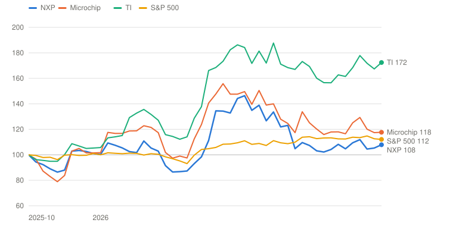
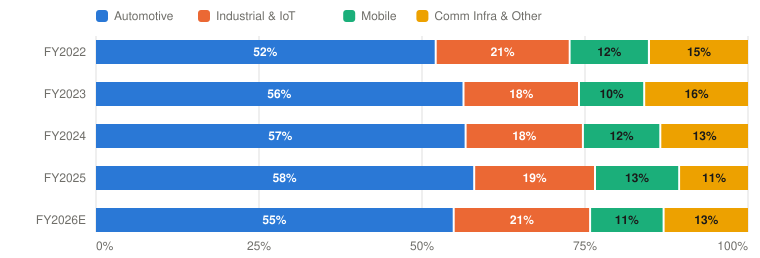
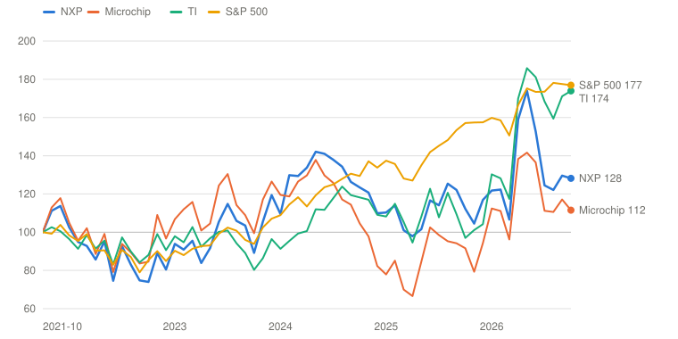

# NXPI — NXP Semiconductors N.V.

> **Schema** v7.0 · **Updated** 2026-10-25 · **Status** Active
> **Price** $234.92 verified Oct 23, 2026 close ([Yahoo](https://finance.yahoo.com/quote/NXPI/)) · 52-wk $183.00–$339.95 · 33rd %ile · −30.9% from high
> **Type** Analog, microcontroller and processor semiconductors for automotive and industrial, moving to a hybrid fab model · **Stage** Mature compounder · **Cyclical** Yes · **Competence** Edge

## Verdict

**NXP is a good franchise priced fairly for a recovery that is part content and part cycle: the probability-weighted case pays 6.2% a year against the 13% hurdle, so the answer is to wait for $171 or for proof of the Bull.**

🟡 **Non-holder: Watch (entry ≤$171)** · 🟡 **Holder: Hold**

| PW EV | PW return/yr | Compounding/yr | R/R | Entry | Trim | Avoid | 2026E non-GAAP P/E | Yield | BAIT | Moat | Next |
|---|---|---|---|---|---|---|---|---|---|---|---|
| **$292** | **6.2% (<13%)** | 10.2% | 2.1:1 | ≤$171 | $292–$441 | ≥$441 | ≈15.5× | 1.7% | None | Narrow, stable | 📅 Oct 27 (Q3) |

**Breaks if**: Third-quarter non-GAAP gross margin falls below 58.5% while channel inventory climbs above 12 weeks, which would show the 2026 margin was volume and restocking rather than price and mix.

⚠️ **Terminal-growth check**: implied perpetual growth exceeds the risk-free rate in Bull.

## The Call

At $234.92 and a 20 times owner-earnings exit, NXP needs 2031 non-GAAP EPS of $26.32 to earn an ordinary 10% a year. That is halfway between my Base of $22.53 and my Bull of $29.92, and no Bear probability gets the stock to 10%. I think the market is mostly right. The business is good and the recovery is real, with a third-quarter guide that implies revenue up 18% and an operating margin near 37%. What I think it underweights is how much of 2026 is cycle. Lead times above 16 weeks, doubled customer escalations and a channel back at 11 weeks all look like an upcycle, and the $3.42 billion of the fourth quarter of 2023, at the previous peak, is only 9% below today's guide. Stock compensation and restructuring leave owner earnings at 65% of non-GAAP EPS, so the 12.8 times the Street pays on 2027 is about 20 times on owner earnings. The probability-weighted case is $292, or 6.2% a year, below the 13% hurdle. The one number that would change the picture is third-quarter gross margin: 58.5% or better with channel inventory at 12 weeks or less says the margin is price and mix. The Bull's 22 times multiple implies perpetual growth above the Treasury yield, which I accept for the one case that is still growing 9% in year five.

## What I'd Have To Be Wrong About

1. **That the 2026 recovery is content and pricing, not restocking.** Test: at the Q3 print (Oct 27), channel inventory ≤12 weeks, days of inventory ≤160 and a Q4 revenue guide midpoint ≥$3.75B; at the Q4 print (early February 2027), a Q1 2027 guide no more than 8% below Q4. **If Fail →** move 10 points from Base to Bear (PW EV $276, 5.0%/yr) → stays **Watch**, entry falls to $162.
2. **That the margin gain is price and mix, not only volume.** Test: non-GAAP gross margin ≥58.5% in Q3 (Oct 27) and in the Q4 guide, and a Q1 2027 gross-margin guide ≥58% in early February. **If Fail →** cut the Base to the five-year median operating margin of 34.6% (owner EPS $13.85; PW EV $283, 5.5%/yr) → stays **Watch**, entry $166.
3. **That company-specific drivers are a third of revenue and still growing 20% or more.** Test: on the Q3 call (Oct 27), drivers ≥ one-third of revenue growing ≥20% year on year, the physical-AI funnel above the $1.5B reported in July and data-center revenue on pace for $500M or more in 2026. **If Fail →** move 10 points from Bull to Base (PW EV $277, 5.1%/yr) → stays **Watch**, the Bull's probability falls from 25% to 15%.

---

## Deep Dive: NXP, Content or Cycle

*The stock is back where it closed the night before its best day on record. What does $235 assume about how much of the recovery is content and how much is the cycle?*

**Contents**: [Business Overview](#business-overview) · [The Recovery: Content or Cycle?](#the-recovery-content-or-cycle) · [Fabs: 200 Basis Points for a $14 Billion Promise](#fabs-200-basis-points-for-a-14-billion-promise) · [Sotomayor, Capital Allocation and Incentives](#sotomayor-capital-allocation-and-incentives) · [Valuation and Model Assumptions](#valuation-and-model-assumptions) · [Final Words](#final-words) · [Appendix: The Numbers](#appendix-the-numbers) · [Sources](#sources)

On April 29, 2026, NXP's stock rose 25.6% in a day, from $230.39 to $289.25, [a record for the company](https://news.bloombergtax.com/international-trade/nxp-rallies-after-stronger-automotive-market-bolsters-forecast). The company had reported first-quarter results the evening before and guided the second quarter to $3.45 billion of revenue and about $3.50 of non-GAAP earnings per share, both well above what the Street had modelled ([Q1 call](https://www.fool.com/earnings/call-transcripts/2026/04/28/nxp-nxpi-q1-2026-earnings-call-transcript/)). Management said software-defined vehicles and physical AI were lifting demand, and that data-center revenue would more than double to over $500 million. The market took the whole package at face value. By late May the shares closed above $330 and touched a 52-week high of $339.95.

Then they gave it all back. NXP's [second-quarter report on July 28](https://www.sec.gov/Archives/edgar/data/0001413447/000141344726000044/nxp2q26exhibit991.htm) beat on revenue and earnings and guided the third quarter above consensus at the midpoint, but the range was wide and its low end sat below the Street. The stock fell 7% the next day, in what [the Motley Fool called](https://fool.com/investing/2026/08/10/why-nxp-semiconductors-stock-dropped-185-in-july) the worst month for semiconductors in more than a decade. UBS cut NXP to Neutral on August 3, citing the risk of a [China auto inventory correction](https://www.marketbeat.com/instant-alerts/nxp-semiconductors-nasdaqnxpi-cut-to-hold-at-ubs-group-2026-08-04/). Citi followed on October 8 and [lowered its target from $370 to $260](https://finviz.com/news/400162/nxp-semiconductors-shares-fall-26-after-citi-downgrade-and-110-price-target-cut). On Friday, October 23, the stock closed at $234.92, within 2% of the close the night before the April report.

The business did not give anything back. The second quarter came in at $3.50 billion, up 19%, with non-GAAP EPS of $3.61. The third-quarter guide is $4.11 of EPS at the midpoint, 17% above the $3.50 that set off the April rally. The comparison I find most useful starts on October 28, 2025, the day Rafael Sotomayor took over as CEO. Quarterly revenue has gone from $3.17 billion to a guided $3.75 billion and quarterly EPS from $3.11 to $4.11. A shareholder who bought the day before has earned 7.9% including dividends. The S&P 500 made 12.1% and Texas Instruments, which is running the same analog upcycle, made 72%.

*Total return including dividends, weekly, October 27, 2025 (the close before Rafael Sotomayor became CEO) = 100. TI = Texas Instruments. Source: Yahoo Finance adjusted closes through October 23, 2026. Built with Claude.*

| Date | NXP | Microchip | TI | S&P 500 |
|---|---|---|---|---|
| 2025-10-27 | 100 | 100 | 100 | 100 |
| 2025-12-19 | 103 | 102 | 105 | 100 |
| 2026-02-13 | 111 | 123 | 136 | 100 |
| 2026-04-17 | 98 | 124 | 138 | 104 |
| 2026-06-12 | 139 | 150 | 181 | 109 |
| 2026-08-21 | 103 | 120 | 160 | 113 |
| 2026-10-16 | 105 | 117 | 167 | 113 |
| 2026-10-23 | 108 | 118 | 172 | 112 |

This is the oldest argument in semiconductors. Is the recovery content or cycle? Management says about a third of revenue comes from company-specific growth drivers that are expanding in the mid-20s, mostly in software-defined cars and the industrial edge, and that these will carry the company to double-digit growth in 2026 and 2027. The other two-thirds is the core catalog of microcontrollers, analog and power parts, which grew in the high teens last quarter because customers had spent 2025 running down inventory. That part has a record of falling. Revenue dropped 7.6% from 2023 to 2025 and non-GAAP EPS fell 16%. Guided third-quarter revenue is only 10% above the fourth quarter of 2023, when revenue was still at its previous peak.

I start with the business and the accounting points a reader needs, then take the cycle-versus-content debate and break NXP's profit into rings by how exposed each is to it. A second chapter takes the fab strategy, which promises 200 basis points of gross margin in return for a purchase commitment that runs for 37 years. Then management, capital allocation and pay, and a valuation that asks what $235 assumes and what has to be true to earn 13% a year. NXP reports its third quarter on October 27 after the close, so the first of the tests in the front matter will be scored within days of this going up.

### Business Overview

NXP is a Dutch semiconductor company with about 32,000 employees, 11,000 of them in R&D, selling chips that process, connect and secure things. It reports one segment and four end markets. Automotive is 58% of revenue: microcontrollers and processors for the car's compute, radar chips, in-vehicle networking and secure access. NXP is the second-largest automotive chip supplier, with about 9.6% of a $74 billion market against Infineon's 12.8%, [per TechInsights data in Infineon's release](https://www.automotiveworld.com/news/infineon-retains-automotive-chip-market-top-spot/) (the NXP share is my reading of Infineon's slide, and it matches NXP's $7.1 billion of auto revenue). Industrial and IoT is 19%: the i.MX applications processors and MCX microcontrollers that run factory equipment, medical devices and smart glasses, sold mostly through distributors. Mobile is 13%: secure NFC and ultra-wideband chips for Apple and Samsung phones. Communication Infrastructure and Other is 11% of 2025 revenue, down from 15% in 2022, though it is growing again in 2026: RFID and secure-car chips are about half of the segment, plus two legacy lines, RF power amplifiers, which management is exiting, and digital networking, which has been declining for about eight years.

| $ Million | FY2022 | FY2023 | FY2024 | FY2025 | H1 2025 | H1 2026 |
|---|---|---|---|---|---|---|
| **Automotive** | 6,879 | 7,484 | 7,151 | 7,116 | 3,403 | 3,720 |
|  YoY | — | +8.8% | −4.4% | −0.5% | — | +9.3% |
| **Industrial & IoT** | 2,713 | 2,351 | 2,269 | 2,273 | 1,054 | 1,383 |
|  YoY | — | −13.3% | −3.5% | +0.2% | — | +31.2% |
| **Mobile** | 1,607 | 1,327 | 1,497 | 1,584 | 669 | 742 |
|  YoY | — | −17.4% | +12.8% | +5.8% | — | +10.9% |
| **Communication Infrastructure & Other** | 2,006 | 2,114 | 1,697 | 1,296 | 635 | 832 |
|  YoY | — | +5.4% | −19.7% | −23.6% | — | +31.0% |
| **Total revenue** | 13,205 | 13,276 | 12,614 | 12,269 | 5,761 | 6,677 |
|  YoY | +19.4% | +0.5% | −5.0% | −2.7% | — | +15.9% |
|  Non-GAAP gross margin | 57.9% | 58.5% | 58.1% | 56.8% | 56.3% | 57.6% |
|  Non-GAAP operating margin | 36.3% | 35.1% | 34.6% | 33.1% | 31.9% | 34.1% |

*NXP reports one segment, so operating margin is company-wide. H1 columns are the six months to June. H1 2025 and H1 2026 non-GAAP margins are revenue-weighted from the quarterly releases. FY2023 and FY2022 end-market revenue from the [Q4 2023 release](https://www.sec.gov/Archives/edgar/data/0001413447/000141344724000008/nxp4q23exhibit991.htm); FY2024 and FY2025 from the [FY2025 10-K](https://www.sec.gov/Archives/edgar/data/1413447/000141344726000008/nxpi-20251231.htm); H1 from the [Q2 2026 10-Q](https://www.sec.gov/Archives/edgar/data/1413447/000141344726000045/nxpi-20260628.htm). Automotive H1 2026 excludes MEMS Sensors from February 2. Built with Claude.*

Distributors sell 57% of NXP's revenue, and Avnet alone is 23% of the total, per the [FY2025 10-K](https://www.sec.gov/Archives/edgar/data/1413447/000141344726000008/nxpi-20251231.htm). No direct customer is above 10%. China is 17% of revenue by sales origin. Manufacturing is a hybrid. NXP owns older fabs in the Netherlands, Chandler and Austin, owns 61% of a Singapore fab with TSMC, and does about 80% of assembly and test itself. It plans to move front-end wafer supply from a little over half external to 80% external by 2030 through two new 300mm joint ventures, VSMC in Singapore (40% owned, production in 2027) and ESMC in Dresden (10% owned, production in 2028).

*Share of revenue by end market. NXP does not report profit by end market, so this is a revenue mix. FY2026E is H1 reported plus the Q3 guide and Q4 consensus, split by end market using management's segment guidance [Estimate]. Source: company filings. Built with Claude.*

| Period | Automotive | Industrial & IoT | Mobile | Comm Infra & Other | Total ($M) |
|---|---|---|---|---|---|
| FY2022 | 6,879 (52%) | 2,713 (21%) | 1,607 (12%) | 2,006 (15%) | 13,205 |
| FY2023 | 7,484 (56%) | 2,351 (18%) | 1,327 (10%) | 2,114 (16%) | 13,276 |
| FY2024 | 7,151 (57%) | 2,269 (18%) | 1,497 (12%) | 1,697 (13%) | 12,614 |
| FY2025 | 7,116 (58%) | 2,273 (19%) | 1,584 (13%) | 1,296 (11%) | 12,269 |
| FY2026E | 7,825 (55%) | 2,983 (21%) | 1,607 (11%) | 1,847 (13%) | 14,262 |

A few accounting points matter before the debate. NXP does not report profit by end market, so everything below about margins is company-wide. Non-GAAP earnings exclude stock compensation ($462 million, 3.8% of revenue in 2025), restructuring ($265 million, and it has been a charge in each of the last three years), purchase-accounting amortization and other items. Non-GAAP EPS for 2025 was $11.81 against GAAP EPS of $7.95. I value the company on owner earnings, which treat the stock compensation as a cost and include the cash cost of restructuring, so I give both numbers. The MEMS sensor business was sold to STMicroelectronics on February 2, 2026 for [$878 million in cash at close and a $627 million gain](https://www.sec.gov/Archives/edgar/data/1413447/000141344726000034/nxpi-20260329.htm). The gain is in first-quarter GAAP profit and not in non-GAAP. The business had about $300 million of revenue, so reported automotive growth is 4 to 5 points lower than the underlying figure through the end of 2026.

### The Recovery: Content or Cycle?

The table below puts the debate in numbers. Revenue growth has gone from negative to nearly 20% in a year, and the operating margin is guided to 36.9%, higher than at the 2022 peak. At the same time lead times, backlog and channel inventory all show the usual marks of an upcycle, and management's own words describe both a structural story and a cyclical one.

| Metric | FY2025 | Q1 2026 | Q2 2026 | Q3 2026 guide (mid) |
|---|---|---|---|---|
| Revenue ($M) | 12,269 | 3,181 | 3,496 | 3,750 |
|  YoY | −2.7% | +12.2% | +19.5% | +18% (21% ex-MEMS) |
| Non-GAAP gross margin | 56.8% | 57.1% | 58.0% | 58.5% |
| Non-GAAP operating margin | 33.1% | 33.1% | 35.1% | 36.9% |
| Non-GAAP EPS | $11.81 | $3.05 | $3.61 | $4.11 |
| Company-specific drivers (share of revenue, growth) | ~⅓, ~+10% | ~⅓, +18% | ~⅓, mid-20s% | n/g |
| Core catalog growth | n/g | +10% | high teens | n/g |
| Channel inventory (weeks) | 10 | 11 | 11 | 11 (assumed) |
| Days of inventory (incl. pre-builds) | 154 | 165 | 156 | n/g |
| Front-end utilization | high 70s | low 80s | low 80s | mid-80s (H2) |
| Lead times / book-to-bill | n/g | backlog rising | >16 weeks on much of portfolio; book-to-bill >1 | visibility into Q1 2027 |

*n/g = not given. Source: company releases and calls ([Q2 2026 release](https://www.sec.gov/Archives/edgar/data/0001413447/000141344726000044/nxp2q26exhibit991.htm), [Q2 call](https://www.marketbeat.com/earnings/reports/2026-7-29-nxp-semiconductors-stock/), [Q1 call](https://www.fool.com/earnings/call-transcripts/2026/04/28/nxp-nxpi-q1-2026-earnings-call-transcript/), [Q4 call](https://www.marketbeat.com/earnings/reports/2026-2-2-nxp-semiconductors-stock/)). Channel weeks for FY2025 are the Q4 2025 figure cited by an analyst on the call. The growth-driver share and growth rates are management's statements, not audited. Built with Claude.*

#### Management's narrative

Sotomayor and CFO Bill Betz made their case on the [second-quarter call](https://www.marketbeat.com/earnings/reports/2026-7-29-nxp-semiconductors-stock/) on July 28 and again with Sotomayor alone at the [Goldman Sachs Communacopia conference](https://www.investing.com/news/transcripts/nxp-at-goldman-sachs-conference-physical-ai-push-lifts-outlook-93CH-4894216) on September 9. The argument has five parts.

The first is that growth is content, not units. Betz said on the call that Western Tier 1 suppliers remain lean and have not restocked, and Sotomayor said automotive growth reflects the shift to software-defined architectures in which many small controllers are replaced by a smaller number of high-performance processors. NXP's automotive growth drivers were 47% of automotive revenue in the second quarter and grew in the low 20s. Automotive production is flat at about 92.6 million vehicles in 2026, a figure Jeff Palmer of investor relations took from S&P on the [fourth-quarter call](https://www.marketbeat.com/earnings/reports/2026-2-2-nxp-semiconductors-stock/), so the growth has to come from the content in each car.

The second is that visibility is long. Betz said backlog is growing for each of the next three quarters, that book-to-bill is above one and higher than last quarter, that lead times are above 16 weeks for much of the portfolio, and that there is a signal as far as 18 months out. Sotomayor said visibility now extends into the first quarter of 2027.

The third is that pricing has turned. After years of price declines in the low single digits, Sotomayor told Goldman's audience that the structural change is semiconductors becoming a larger share of the value of a system, and that selective price increases will build through the third and fourth quarters and into next year.

The fourth is that new products have barely started. The 5-nanometer S32N central-compute chips and the 16-nanometer S32K5 zonal processors do not ramp until late 2027, and revenue from them comes mostly after 2027. Data-center revenue, mostly control-plane chips for rack power, cooling and management, goes from $200 million in 2025 to more than $500 million this year. The physical-AI design-win funnel grew from over $1 billion to over $1.5 billion in a quarter and spans more than 200 customers.

The fifth is that the targets stand. Management reaffirmed 6–10% revenue growth through 2027, a gross margin of 57–63%, a non-GAAP operating margin of 34–40% and a goal of doubling non-GAAP EPS by 2030 from the 2024 base of $13.09. Betz said nothing had changed in the double-digit growth view for 2027.

#### Poking holes in it

The first hole is arithmetic. If a third of revenue grows 25%, that part adds about 8 points of growth. Second-quarter revenue grew 19.5%, so roughly 12 points came from the other two-thirds, the core, coming off a 2025 trough in which automotive revenue was flat and Communication Infrastructure fell 24%. The growth drivers are real and the company is right to emphasize them. They are not what moved the quarter.

The second hole is the record since the last peak. Third-quarter guidance of $3.75 billion is 9.6% above the $3.42 billion of the fourth quarter of 2023, and about 12% above it once the roughly $75 million a quarter of MEMS revenue is removed [Estimate]. That is 4% a year for two and three-quarter years, below the bottom of management's 6–10% range. Quarterly non-GAAP EPS of $4.11 against $3.71 is up 11%. Annual non-GAAP EPS was $14.01 in 2023 and the 2026 consensus is [$15.11](https://finance.yahoo.com/quote/NXPI/analysis/), up 8% in three years despite $3.3 billion of buybacks in that period.

The third hole is that management's own description of demand contains the usual signs of an upcycle. Betz told Truist's analyst that part of the backlog reflects customers ordering earlier and part reflects real demand. He also said customer escalations doubled in a quarter and late orders keep climbing. Channel inventory is at 11 weeks against 9 a year ago. That is management's target and not a sign of excess, but it does mean distributors are no longer a source of upside surprise. Peers read the same way. Texas Instruments [reported third-quarter revenue up 28%](https://www.sec.gov/Archives/edgar/data/0000097476/000009747626000165/q32026txnex99-eredgar.htm) and guided the fourth quarter to a midpoint flat with the third, in a quarter that is usually down. Microchip called its June quarter its [strongest for bookings in about four years](https://futurumgroup.com/insights/microchip-q1-fy-2027-earnings-beat-as-data-center-exposure-nears-1-billion/), with distributor inventory at 25 days and a restock expected. STMicroelectronics guided its third quarter [below consensus](https://investors.st.com/news-releases/news-release-details/stmicroelectronics-reports-q2-2026-financial-results). None of this says the recovery is ending. It says the part of it that comes from short lead times and thin inventories will fade when lead times and inventories normalize.

The fourth hole is the quality of the margin. Gross margin rose 150 basis points year on year in the second quarter, and Betz attributed it to mix, factory utilization and flow-through. Utilization is in the low 80s and is expected to reach the mid-80s in the second half. That is a volume effect and goes into reverse when volume does. Pricing, the other lever, was neutral in the quarter. Betz said at the start of the year that NXP models annual price declines in the low single digits, back-end inputs such as substrates and precious metals are inflating, and he expects foundry access fees to rise in 2027 when new agreements start. The 2026 gain in margin was earned on volume. The 2027 gain has to come from price and mix.

I want to be fair to management on three points. Automotive revenue was flat in 2025 in a year of flat production and heavy inventory digestion, so content was growing underneath. Reported automotive growth of 12% in the second quarter was 17% without MEMS. And NXP has met or beaten the midpoint of its own quarterly guidance ten quarters in a row, which I come back to in the management chapter. A company that is overstating a cycle does not usually do that.

The table below turns the debate into the economics of $100 of revenue. The first column is 2025, the second is the third-quarter guide, and the third is an illustration of what happens if volume falls 12% and utilization drops back to the high 70s, a larger version of the move from 2023 to 2025.

| Per $100 of revenue | FY2025 (actual) | Q3 2026 guide (mid) | Cycle turns (illustrative) |
|---|---|---|---|
| Cost of revenue (non-GAAP) | 43.2 | 41.5 | 44.0 |
| **Gross profit** | 56.8 | 58.5 | 56.0 |
| R&D, SG&A and other (non-GAAP) | 23.7 | 21.6 | 25.5 |
| **Non-GAAP operating profit** | 33.1 | 36.9 | 30.5 |
| Financial expense | (2.9) | (2.3) | (2.8) |
| Tax at ~18% | (5.4) | (6.2) | (5.0) |
| Minority and equity-accounted | (0.3) | (0.5) | (0.6) |
| **Non-GAAP net income** | 24.5 | 27.9 | 22.1 |
| Cash realization (75% of net income, after maintenance capex) | 18.4 | 20.9 | 16.6 |
| Stock compensation after tax | (3.1) | (2.5) | (3.0) |
| **Owner earnings per $100** | 15.3 | 18.4 | 13.6 |
| Revenue ($B, annualized) | 12.3 | 15.0 | 12.6 |
|  Owner earnings ($B) | 1.88 (reported: 1.78) | 2.76 | 1.71 |

*FY2025 from the [FY2025 10-K](https://www.sec.gov/Archives/edgar/data/1413447/000141344726000008/nxpi-20251231.htm) and [Q4 2025 release](https://www.sec.gov/Archives/edgar/data/0001413447/000141344726000003/nxp4q25exhibit991.htm); Q3 guide from the [Q2 2026 release](https://www.sec.gov/Archives/edgar/data/0001413447/000141344726000044/nxp2q26exhibit991.htm) (opex ≈$810M, financial expense $85M, NCI $15M). Cycle-turns column is the author's illustration [Estimate]: revenue 12% below the 2026 run-rate at $12.6B, opex dollars unchanged at ~$3.2B, gross margin 56% on high-70s utilization and price erosion. Cash realization uses the 0.75 conversion of non-GAAP net income to cash after maintenance capex [Derived]; stock compensation is deducted after tax. Rows are indicative and may not add because of rounding. Built with Claude.*

The point of the table is the size of the swing. Between 2025 and the third-quarter guide, owner earnings per $100 of revenue rise from about $15 to $18, and because revenue is higher too, annualized owner earnings rise from $1.8 billion to about $2.8 billion. In the illustration they fall back to about $1.7 billion. The business is more profitable in a good year than the average over the last five (an average of $2.2 billion), and a normal-sized cycle takes the run-rate back below that average. A buyer at $235 should be paying for the five-year average and the part of growth that is structural, not for the peak annualized run-rate.

My conclusion on the debate is that it is both, in about equal parts. The content story is large enough to carry the Base case through a downturn at a 6% revenue growth rate. The cycle is large enough that I will not capitalize 2026 or 2027 margins at face value. The Base case therefore gives NXP a normalized operating margin of 36.5%, above the 34.6% five-year median and below the 37% midpoint of management's range.

#### Rings of profit

NXP does not disclose profit by end market, so the rings below divide revenue by exposure to the debate. They are my estimates from management's disclosures.

| Ring | Share of 2026E revenue | What is in it | Growth now | Exposure to the debate |
|---|---|---|---|---|
| **1. Company-specific drivers** | ~33% (≈$4.7B) | S32 vehicle compute, radar, electrification and Ethernet; i.MX, RT and MCX processors; data-center control plane; UCODE RFID | Mid-20s% | Low. Design wins that take years to ramp; the biggest platforms add little before late 2027 |
| **2. Core auto and industrial** | ~51% (≈$7.3B) | Microcontrollers, analog, power management and standard processors sold through distributors and Tier 1s | High teens (off the 2025 trough) | High. Inventory, lead times, price and Chinese local suppliers decide it |
| **3. Mobile** | ~11% (≈$1.6B) | Secure NFC and ultra-wideband for Apple and Samsung phones | Flat to low single digits | Medium. Two customers; memory shortages constrain phone builds |
| **4. Fading lines** | ~5% (≈$0.65B) | RF power amplifiers (being exited) and digital networking | Declining | Certain. Management expects the decline to continue for at least two years |

*Author's split of [management disclosures](https://www.marketbeat.com/earnings/reports/2026-7-29-nxp-semiconductors-stock/): the one-third driver share is management's; ring 4 is 2025 Comm Infra revenue of $1.3B times the ~25% each that management attributes to digital networking and RF power [(Q4 call)](https://www.marketbeat.com/earnings/reports/2026-2-2-nxp-semiconductors-stock/); ring 3 is the model's Mobile line; ring 2 is the remainder [Estimate]. NXP does not disclose profit by ring. Built with Claude.*

About a third of revenue is ring one, and it is the part I would pay a premium for. The half of revenue in ring two earns the same company-wide margin, but its earnings are the ones that went from $14 to $12 to $15 of EPS in three years. Rings three and four are 16% of revenue and are not going to drive the stock. The structure matters for how I read the price. In a year when ring one grows 25% and the rest grows 3%, the company grows about 10%, the top of management's range and my Bull's pace. In a year when ring one grows half as fast, the company grows about 6%, which is my Base.

### Fabs: 200 Basis Points for a $14 Billion Promise

The second debate is about how NXP makes its chips, because it is the part of the margin story that management controls most directly.

Management's case is that the company is moving from a mix of owned fabs to a hybrid model in which the majority of wafers come from partner fabs on 300mm wafers and newer nodes. At the 2024 Analyst Day, as [summarized by Quartr](https://quartr.com/events/nxp-semiconductors-n-v-nxpi-investor-day-2024_o0UO2pd6), the aim was to move front-end production from about 50% external to 80% by 2030, consolidate 200mm fabs into 300mm facilities and keep back-end assembly 80% in house. Betz said on the first-quarter call that VSMC is about two-thirds through its investment cycle and ESMC about 30%, that tools are installed at VSMC and the ramp is beginning, and that the plan adds about 200 basis points of structural gross margin once the factories are loaded in 2028. Cumulative investment is about $2.4 billion, roughly 70% of the $3.4 billion planned.

The holes are in the contract terms. NXP owns 40% of VSMC and has committed to buy 40% of its capacity. The filings describe a [purchase commitment of about $14.1 billion over 37 years](https://www.sec.gov/Archives/edgar/data/1413447/000141344726000045/nxpi-20260628.htm), starting when wafer production begins, with a minimum loading of 80–90%. That is roughly $380 million a year of take-or-pay obligation, and it is in addition to $1.2 billion of capacity contributions and about $1.6 billion of equity. If demand falls, NXP pays for wafers it does not need, which is the reverse of the operating leverage management is selling. Equity-accounted losses from the joint ventures were $70 million in 2025 and management expects about $200 million over 2025 to 2027.

The return on the investment is also easy to size. Two hundred basis points on $14.3 billion of revenue is about $290 million of pre-tax profit, which is roughly 8% pre-tax on the $3.4 billion invested, and about 11% on the Base-case revenue of 2031 [Estimate]. That is a fair return, close to the 10% discount rate I use, and it is earned only at the end of the ramp and only if the plants are full. It is not an obvious bargain once the take-or-pay is counted as a cost, and it is not guaranteed that all of the margin gain stays. Foundry partners also have pricing power in a tight market: Betz expects access-fee pressure to appear in 2027, and he said front-end pricing is flat only within agreed envelopes.

I would not call the strategy wrong. Owning older fabs at 200mm in a world of 300mm costs money, and NXP has little choice but to consolidate. The cost of that consolidation is visible already, since inventory includes about nine days of pre-builds to cover factory moves, and restructuring has run at $106 million, $147 million and $265 million in 2023, 2024 and 2025. The Base case gives NXP the margin improvement at 36.5% but not all of it, and the Bear case has the plants under-loaded with margin at 32%.

### Sotomayor, Capital Allocation and Incentives

Sotomayor is 57, joined NXP in 2014 and ran its Mobile and Industrial and IoT businesses and then Secure Connected Edge. He became President in April 2025 and CEO on October 28, 2025, when Kurt Sievers retired, according to the [2026 proxy](https://www.sec.gov/Archives/edgar/data/1413447/000141344726000026/nxpi-20260427.htm). He is an internal successor who sat on the executive team that set the strategy he now runs. The best test of the strategy is the record of the last four years under Sievers.

*Total return including dividends, monthly, October 2021 = 100, through October 23, 2026. TI = Texas Instruments. Source: Yahoo Finance adjusted closes. Built with Claude.*

| Date | NXP | Microchip | TI | S&P 500 |
|---|---|---|---|---|
| 2021-10 | 100 | 100 | 100 | 100 |
| 2022-08 | 83 | 89 | 90 | 87 |
| 2023-06 | 105 | 124 | 100 | 99 |
| 2024-04 | 134 | 130 | 101 | 114 |
| 2025-02 | 114 | 85 | 115 | 136 |
| 2025-12 | 117 | 94 | 104 | 158 |
| 2026-10 | 128 | 112 | 174 | 177 |

Over five years NXP has earned 28% in total return while the S&P 500 earned 77% and Texas Instruments 74%. At the 2021 Analyst Day the company promised, according to [Investing.com's summary](https://www.investing.com/news/company-news/nxp-q2-2026-slides-record-results-ambitious-2030-targets-93CH-4818254), 8–12% revenue growth and then in 2024 lowered it to 6–10%. Revenue went from $11.1 billion in 2021 to $12.3 billion in 2025, which is 2.6% a year. The margin promises held, with the non-GAAP operating margin at 32.9% in 2021 and 33.1% in 2025 inside the 32–36% target. NXP delivered its margin and missed its growth, and I weigh the growth miss more heavily because 2026 is the first year the record has looked different.

#### The deals

The acquisitions are small relative to a $59 billion company and all of them are too recent to judge. The sale of the MEMS business is the best decision of the era in my view, because it sold a non-core business at about 3 times sales to a buyer that makes its own wafers.

| Year | Deal | Price | What happened | Verdict |
|---|---|---|---|---|
| 2025 | TTTech Auto | $766M cash ($675M net of cash acquired) | Closed Jun 17. Safety-critical middleware for software-defined vehicles; engineers are on the S32K5 zonal reference design, with customer sampling in Q3 2026 | Too early |
| 2025 | Aviva Links | $222M cash plus $26M of prior stakes | Closed Oct 24. Automotive high-speed serial links; customer awards in hand, production in 2028 | Too early |
| 2025 | Kinara | $284M cash | Closed Oct 27. Discrete neural processing units; management cites a physical-AI funnel above $1.5B and 200+ customers, with revenue in 2027–2028 | Too early |
| 2026 | MEMS Sensors sold to STMicroelectronics | $900M cash plus up to $50M earn-out; $878M received | Closed Feb 2. About $300M of revenue and 100 people, sold at about 3× sales; $627M gain; gross margin +10–20 bps; buyer makes its own wafers | Good |
| 2024–28 | VSMC (40%) and ESMC (10%) joint ventures | ~$1.6B equity and $1.2B capacity fees (VSMC); €500M (ESMC) | About $2.4B of ~$3.4B invested; $14.1B VSMC purchase commitment over 37 years | Unclear |
| 2025–26 | RF Power exit | ~$90M restructuring charge | Stops new RF power products; revenue expected to decline for at least two years | Mixed |

*Source: [FY2025 10-K](https://www.sec.gov/Archives/edgar/data/1413447/000141344726000008/nxpi-20251231.htm), [Q1 2026 10-Q](https://www.sec.gov/Archives/edgar/data/1413447/000141344726000034/nxpi-20260329.htm), [Q2 2026 10-Q](https://www.sec.gov/Archives/edgar/data/1413447/000141344726000045/nxpi-20260628.htm), [Q4 2025 call](https://www.marketbeat.com/earnings/reports/2026-2-2-nxp-semiconductors-stock/) and [Q2 2026 call](https://www.marketbeat.com/earnings/reports/2026-7-29-nxp-semiconductors-stock/). Verdicts are the author's. Built with Claude.*

#### The cash

NXP's stated policy is to return all excess free cash flow, keep net leverage under 2 times EBITDA and pay a dividend of about 25% of operating cash flow. It says it returned $22.7 billion between 2016 and 2025, about 95% of free cash flow, and reduced its diluted share count by 27%. Both are true and they are a good record by the standards of the industry.

| $ Billion | Revenue | YoY | Non-GAAP EPS | OCF | Capex | FCF | Dividends | % FCF | Buybacks | % FCF | Acquisitions | Total debt | Dil. shares (M) |
|---|---|---|---|---|---|---|---|---|---|---|---|---|---|
| 2021 | 11.1 | +28.5% | n/d | 3.08 | 0.77 | 2.31 | 0.56 | 24% | 4.02 | 174% | 0.02 | 10.7 | 275.6 |
| 2022 | 13.2 | +19.4% | n/d | 3.90 | 1.06 | 2.83 | 0.82 | 29% | 1.43 | 50% | 0.03 | 11.3 | 264.1 |
| 2023 | 13.3 | +0.5% | $14.01 | 3.51 | 0.83 | 2.69 | 1.01 | 37% | 1.05 | 39% | 0.00 | 11.2 | 261.0 |
| 2024 | 12.6 | −5.0% | $13.09 | 2.78 | 0.73 | 2.09 | 1.04 | 50% | 1.37 | 66% | 0.00 | 10.9 | 257.8 |
| 2025 | 12.3 | −2.7% | $11.81 | 2.82 | 0.40 | 2.43 | 1.03 | 42% | 0.90 | 37% | 1.18 | 12.2 | 254.3 |
| H1 2026 | 6.7 | +15.9% | $6.66 | 1.65 | 0.15 | 1.50 | 0.51 | 34% | 0.21 | 14% | 0.00 | 11.0 | 253.8 |
| **2021–2025** | 62.4 | — | — | 16.09 | 3.78 | 12.35 | 4.45 | 36% | 8.77 | 71% | 1.23 | — | −7.7% |

*FCF is NXP's non-GAAP free cash flow (operating cash flow less net capex); it excludes payments to the VSMC and ESMC joint ventures (about $0.8B in 2025), which are in investing cash flow. Buybacks are cash paid, including tax withholding on RSUs. Total debt at carrying value; 2021–2022 from XBRL, 2023–2025 from the 10-K. Source: [SEC XBRL company facts](https://data.sec.gov/api/xbrl/companyfacts/CIK0001413447.json), company releases ([Q4 2025](https://www.sec.gov/Archives/edgar/data/0001413447/000141344726000003/nxp4q25exhibit991.htm), [Q2 2026](https://www.sec.gov/Archives/edgar/data/0001413447/000141344726000044/nxp2q26exhibit991.htm)). The 2021–2025 row sums the flows; dividends and buybacks together are 107% of FCF and 118% of owner earnings, and net debt rose by $3.6B from 2020 to 2025 [Derived]. Built with Claude.*

The table shows two things. First, dividends and buybacks from 2021 to 2025 came to $13.2 billion, which is 107% of the $12.4 billion of free cash flow the company reports and 118% of the $11.2 billion of owner earnings I calculate after stock compensation and maintenance capex. The difference was funded with debt: net debt rose from $5.4 billion at the end of 2020 to $9.0 billion at the end of 2025, and 2021 was the clearest case, with a $4.0 billion buyback funded by $4.0 billion of new notes. Free cash flow as NXP reports it also excludes the equity and capacity payments to VSMC and ESMC, which are accounted for as investing. They reached about $0.8 billion in 2025 [Derived] and management's figures put them near $0.9 billion in 2026. Second, buybacks have been a large share of cash flow in good years and a small one in others, with little relationship to the price. The one clear exception is the last four quarters: $338 million in the fourth quarter of 2025 when the stock touched its low of $183, then about $100 million a quarter in the first half of 2026 as the stock rose toward $330.

My Outsider grade is Steward (not Outsider). The recent buying is countercyclical, but the 2021 to 2025 pattern tracks free cash flow rather than price (2021: $4.0 billion at about $195 a share, funded by $4.0 billion of new debt; 2022, when the stock hit its low in October: $1.4 billion), and the dividend has a mechanical link to cash flow. The policy is sensible and it keeps leverage in check. It is not the behavior of a manager who treats the buyback as a valuation decision.

#### The record

Management has been reliable on the near term. Over the last ten quarters NXP has met or beaten the midpoint of its own revenue and EPS guidance every time, and the beats have grown from nothing to about 1% of revenue and $0.08 to $0.11 of EPS in the last three. My guidance grade is Consistent beater, and the number that decides it is ten of ten. The beats are small on average, which says the ranges are set to be met and not to be exceeded by a wide margin. The same company missed its 2021 growth target by a large amount, so its forecasting is weakest over two to three years and strongest over one quarter.

| $M except EPS | Q1 24 | Q2 24 | Q3 24 | Q4 24 | Q1 25 | Q2 25 | Q3 25 | Q4 25 | Q1 26 | Q2 26 |
|---|---|---|---|---|---|---|---|---|---|---|
| Revenue guide (mid) | 3,125 | 3,125 | 3,250 | 3,100 | 2,825 | 2,900 | 3,150 | 3,300 | 3,150 | 3,450 |
| Revenue actual | 3,126 | 3,127 | 3,250 | 3,111 | 2,835 | 2,926 | ~3,170 | 3,335 | 3,181 | 3,496 |
|  Beat | +1 | +2 | 0 | +11 | +10 | +26 | ~+20 | +35 | +31 | +46 |
| EPS guide (mid) | $3.17 | $3.20 | $3.42 | $3.13 | $2.59 | $2.66 | $3.10 | $3.28 | $2.97 | $3.50 |
| EPS actual | $3.24 | $3.20 | $3.45 | $3.18 | $2.64 | $2.72 | $3.11 | $3.35 | $3.05 | $3.61 |
|  Beat | +$0.07 | $0.00 | +$0.03 | +$0.05 | +$0.05 | +$0.06 | +$0.01 | +$0.07 | +$0.08 | +$0.11 |

*Guide midpoints are the non-GAAP outlook tables in the prior quarter's release; actuals from each quarter's release. Releases: [Q1 24](https://www.sec.gov/Archives/edgar/data/0001413447/000141344724000040/nxp1q24exhibit991.htm), [Q2 24](https://www.sec.gov/Archives/edgar/data/0001413447/000141344724000074/s4nxp2q24exhibit991.htm), [Q3 24](https://www.sec.gov/Archives/edgar/data/0001413447/000141344724000087/nxp3q24exhibit991.htm), [Q4 24](https://www.sec.gov/Archives/edgar/data/0001413447/000141344725000009/nxp4q24exhibit991.htm), [Q1 25](https://www.sec.gov/Archives/edgar/data/0001413447/000141344725000027/nxp1q25exhibit991.htm), [Q2 25](https://www.sec.gov/Archives/edgar/data/0001413447/000141344725000103/nxp2q25exhibit991.htm), [Q3 25](https://www.sec.gov/Archives/edgar/data/0001413447/000141344725000118/nxp3q25exhibit991.htm), [Q4 25](https://www.sec.gov/Archives/edgar/data/0001413447/000141344726000003/nxp4q25exhibit991.htm), [Q2 26](https://www.sec.gov/Archives/edgar/data/0001413447/000141344726000044/nxp2q26exhibit991.htm). Q3 2025 revenue is shown to the nearest $10M (the release says $3.17B). Q1 2026 guide midpoints from the Q4 2025 release. Built with Claude.*

#### The incentives

| Component | Size / weight | What it pays for | Status |
|---|---|---|---|
| **Annual incentive: H1 revenue** | 20% of bonus | Revenue against target in the first half | Paid 0% (below threshold) |
| **Annual incentive: H1 non-GAAP gross margin** | 20% | Gross margin in the first half | Paid 0% |
| **Annual incentive: H2 revenue** | 20% | Revenue in the second half | 87.0% realization |
| **Annual incentive: H2 non-GAAP gross margin** | 20% | Gross margin in the second half | 66.9% realization |
| **Annual incentive: sustainability scorecard** | 20% | Non-financial goals; gated by a 34% non-GAAP operating margin | Paid 0% (gate missed) |
| **Annual incentive: result** | CEO target 170% of $1.05M salary | Short-term company results | **30.8% of target** ($549,780) |
| **Performance shares** | 70% of long-term value | Three-year relative TSR against 19 semiconductor peers; capped at 100% if TSR is negative | 2023 grant paid 50%; 2025 grant runs Oct 28, 2025 to Oct 27, 2028 |
| **Restricted shares** | 30% of long-term value | Retention; vest in thirds | Vesting |
| **Return on invested capital** | 0% | Not in any plan | — |

*Source: NXP 2026 proxy statement ([DEF 14A](https://www.sec.gov/Archives/edgar/data/1413447/000141344726000026/nxpi-20260427.htm)). Former CEO Sievers' 2025 bonus was $714,043. CFO Betz's was $210,980 on a 100% target. Directors and officers hold under 1% of shares. Built with Claude.*

Seventy percent of long-term pay depends on three-year relative total shareholder return and the annual bonus is 80% revenue and gross margin. Nothing in the plan pays for return on capital, free cash flow per share or owner earnings. That shapes behavior toward growth and gross margin, which is where the fab investment, acquisitions and RF clean-up all point, and away from the discipline of asking what the $3.4 billion of fab capital earns. The plan has teeth: the 2025 bonus paid 30.8% of target because first-half revenue and margin missed their thresholds and the operating-margin gate on the sustainability component was not met, and the 2023 grant of performance shares paid 50%. Sotomayor holds 13,837 shares, worth about $3.3 million, and directors and officers together hold less than 1%. That is thin ownership for a CEO who is the main internal advocate of the strategy.

Is Sotomayor the right manager? I think he is a competent steward of a good franchise and I have no evidence yet that he is a capital allocator. He has been CEO for a year, inherited the targets, closed three acquisitions in the months before he took the job, and has beaten guidance in each of his three quarters. The test he has not faced is a downturn with the VSMC take-or-pay in force and leverage near the 2 times limit.

### Valuation and Model Assumptions

NXP is a cyclical mature compounder, so I value it as owner earnings per share times a multiple in 2031, with the margin normalized and the cost of capital at 10%. The owner-earnings figure starts from non-GAAP net income, converts 75% of it into cash after maintenance capex (the average of 2023 to 2025 and the first half of 2026), and then deducts stock compensation. The conversion is lower than 1 because restructuring is a recurring cash cost, and because inventory and receivables have grown with revenue. It leaves owner earnings at about 65% of non-GAAP EPS.

| $ Billion | 2026E | 2027E | 2028E | 2029E | 2030E | 2031E |
|---|---|---|---|---|---|---|
| **Automotive revenue** | 7.8 | 8.4 | 9.0 | 9.6 | 10.3 | 11.0 |
|  YoY growth | 7.0% | **7.0%** | **7.0%** | **7.0%** | **7.0%** | **7.0%** |
|  Operating margin | 35.7% | 35.9% | 36.0% | 36.2% | 36.3% | **36.5%** |
|  Operating profit | 2.79 | 3.00 | 3.23 | 3.47 | 3.73 | 4.01 |
| **Industrial & IoT revenue** | 3.0 | 3.2 | 3.5 | 3.8 | 4.1 | 4.4 |
|  YoY growth | 8.0% | **8.0%** | **8.0%** | **8.0%** | **8.0%** | **8.0%** |
|  Operating margin | 35.7% | 35.9% | 36.0% | 36.2% | 36.3% | **36.5%** |
|  Operating profit | 1.06 | 1.16 | 1.25 | 1.36 | 1.47 | 1.60 |
| **Mobile revenue** | 1.6 | 1.6 | 1.6 | 1.6 | 1.6 | 1.6 |
|  YoY growth | 0.0% | **0.0%** | **0.0%** | **0.0%** | **0.0%** | **0.0%** |
|  Operating margin | 35.7% | 35.9% | 36.0% | 36.2% | 36.3% | **36.5%** |
|  Operating profit | 0.57 | 0.58 | 0.58 | 0.58 | 0.58 | 0.59 |
| **Comm Infra & Other revenue** | 1.8 | 1.9 | 2.0 | 2.1 | 2.2 | 2.2 |
|  YoY growth | 4.0% | **4.0%** | **4.0%** | **4.0%** | **4.0%** | **4.0%** |
|  Operating margin | 35.7% | 35.9% | 36.0% | 36.2% | 36.3% | **36.5%** |
|  Operating profit | 0.66 | 0.69 | 0.72 | 0.75 | 0.79 | 0.82 |
| Corporate and other | (0.00) | (0.00) | (0.00) | (0.00) | (0.00) | (0.00) |
| **Total revenue** | 14.3 | 15.1 | 16.0 | 17.0 | 18.1 | 19.2 |
| **Operating profit** | 5.09 | 5.42 | 5.78 | 6.16 | 6.57 | 7.01 |
|  Operating margin | 35.7% | 35.9% | 36.0% | 36.2% | 36.3% | 36.5% |
| Net income | 3.81 | 4.08 | 4.38 | 4.69 | 5.03 | 5.39 |
| Diluted shares (B) | 0.254 | 0.251 | 0.248 | 0.245 | 0.242 | 0.239 |
|  Net share change | — | -1.2% | -1.2% | -1.2% | -1.2% | -1.2% |
|  SBC (% of revenue) | 3.1% | 3.1% | 3.1% | 3.2% | 3.2% | 3.2% |
| **Non-GAAP EPS** | $15.01 | $16.28 | $17.65 | $19.14 | $20.77 | $22.53 |
|  YoY growth | — | 8.4% | 8.4% | 8.5% | 8.5% | 8.5% |
| **Owner earnings per share (after SBC)** | $9.83 | $10.66 | $11.57 | $12.56 | $13.63 | $14.79 |

*Base case. Highlighted cells are inputs. NXP reports one segment and does not disclose profit by end market, so the model applies one company-wide non-GAAP operating margin to every end market; margins move linearly from the 2026 estimate (35.7%) to the 2031 input (36.5%). Share count falls 1.2% a year net of dilution. Source: author's model (model.json). Built with Claude. Bold cells are model inputs.*

The Base case starts from the 2026 estimate of $14.3 billion of revenue, which combines the first half as reported, the third-quarter guide and the fourth-quarter consensus, and a non-GAAP EPS of $15.01 against a consensus of $15.11. Revenue grows 6.1% a year to $19.2 billion in 2031: automotive at 7% (the low half of management's 8–12%), Industrial and IoT at 8%, Mobile flat, and Communication Infrastructure at 4% as RF power fades and data-center and RFID chips grow. The operating margin settles at 36.5%. Net buybacks retire 1.2% of shares a year, which is what NXP managed from 2022 to 2025. That gives 2031 non-GAAP EPS of $22.53 and owner earnings per share of $14.79, valued at 20 times, or about 13 times non-GAAP EPS. The multiple is capped by the terminal-growth check. At a 10% discount rate, a multiple above about 21 times implies perpetual growth above the 4.96% ten-year Treasury yield.

The model ramps linearly to 2031, so its near years are conservative. The Street has 2027 EPS at $18.30, above even my Bull path for that year. It does not matter much for a 2031 valuation. If I take the Street's 2027 and grow it 6% a year with buybacks, I get 2031 EPS of about $24, a little above my Base, and the return at a 20 times owner multiple is about 8% a year, still short of the hurdle.

| Case | Prob. | 3P | Automotive growth / margin | Industrial & IoT growth / margin | Net shares/yr | Per-share earnings 2031 | CAGR | Exit multiple | Value | Return/yr | Implied g | Driving assumption |
|---|---|---|---|---|---|---|---|---|---|---|---|---|
| **Bull** | 25% | Plausible | +10.0% / 39.5% | +12.0% / 39.5% | -1.9% | $20.05 | 15.3% | 22.0× owner earnings | $441 | 15.2% | 5.2% | Management's own model delivered and extended: the S32N and S32K5 platforms ramp from late 2027, physical AI and the data-center control plane lift Industrial and Comm Infra, VSMC is fully loaded in 2028 and adds about 200 bps of gross margin, so the operating margin reaches the top of the 34–40% range (39.5%) and EPS roughly doubles the 2024 base by 2030. |
| **Base** | 50% | Probable | +7.0% / 36.5% | +8.0% / 36.5% | -1.2% | $14.79 | 8.5% | 20.0× owner earnings | $296 | 6.4% | 4.8% | The 2026 recovery is real but 2026–27 carry some cyclical catch-up. Automotive compounds 7% a year on content (the low half of management's 8–12%), Industrial 8%, Mobile is flat and Comm Infra grows 4% as RF Power fades. The operating margin settles at 36.5%, between the 34.6% five-year median and the 37% midpoint of management's range, because VSMC's 200 bps is partly given back to price and input costs. Net buybacks retire 1.2% of shares a year, as in 2022–2025. |
| **Bear** | 25% | Probable | +3.0% / 32.0% | +3.0% / 32.0% | -0.2% | $9.02 | -1.7% | 15.0× owner earnings | $135 | -8.7% | 3.1% | 2026–27 was the top of a restocking and pricing cycle. A 2028–29 downturn meets VSMC and ESMC take-or-pay volumes, utilization falls back to the high 70s, price erosion returns and local Chinese suppliers take the low end of the MCU range. Revenue grows 1.7% a year to about $15.5B, the operating margin is 32%, SBC stays near 4% of revenue and buybacks shrink to 1.5% of shares. The multiple returns to the 2022 trough. |
| **Priced-in (10%/yr)** | — | diagnostic | +8.6% / 38.1% | +10.2% / 38.1% | -1.6% | $17.48 | 12.2% | 20.0× owner earnings | $350 | 10.0% | 4.8% | Solved along Base → Bull for 10%/yr |
| **Hurdle (13%/yr)** | — | diagnostic | +10.0% / 39.5% | +12.0% / 39.5% | -1.9% | $20.04 | 15.3% | 20.0× owner earnings | $401 | 13.0% | 4.8% | Solved along Base → Bull for 13%/yr |
| **Probability-weighted** | 100% |  |  |  |  |  |  |  | $292 | 6.2% |  |  |

*Annual return = price change to the 2031 value plus today's 1.7% dividend yield. Values are owner earnings per share × the exit multiple. Mobile grows 3% / 0% / −4% and Comm Infra & Other 8% / 4% / −2% in the Bull / Base / Bear; one company-wide operating margin applies to all four end markets (39.5% / 36.5% / 32%). Per-share earnings and CAGR are owner earnings per share (non-GAAP EPS is in the model-build table). The Priced-in and Hurdle rows are solved by the model along the Base→Bull path at a 20× exit. Source: author's model. Built with Claude.*

The Bull is management's own model delivered. The new compute platforms ramp from late 2027, VSMC adds its 200 basis points, the operating margin reaches 39.5%, and 2030 EPS of about $26 matches the stated goal of doubling the 2024 figure. I give it 25% because the company missed its previous growth target by a wide margin but is on track for the current one. The Bear is the cycle without the content: a downturn in 2028 and 2029 meets the take-or-pay, margin falls to 32%, and the multiple returns to the 2022 trough. I give it 25% because the premortem is easy to write. The most likely reasons for a five-year flat return are that 2026 and 2027 are the top of the cycle, that the fabs carry costs the margin does not recover, and that SDV and physical-AI revenue arrives later than management hopes.

Here is what the price assumes. At $234.92, a 20 times owner multiple and a 10% return, NXP needs 2031 non-GAAP EPS of $26.32, which is owner earnings growing 12.2% a year. That is a little over half-way from my Base ($22.53) to my Bull ($29.92). No Bear probability earns even 10%, because the Base and Bull mix on its own returns slightly less than that. To earn the 13% hurdle the stock would need $29.91, which is the Bull.

The probability-weighted value is $292, a return of 6.2% a year including the 1.7% dividend yield, against a hurdle of 13%. Entry for 13% is $171. The compounding rate at a flat multiple is 10.2%, made up of owner-earnings growth of 8.5% a year and the dividend, which is already short of the hurdle. The lower multiple then changes the return by -3.8 pts, because 2026 owner earnings are capitalized at 24 times today and I use 20 times in 2031. The Base is a 10% compounder that gives up some of that to a lower multiple. To earn 13% it needs growth near the Bull, or a lower price.

Earnings power value is a cross-check. Five-year average owner earnings of $2.2 billion at a 10% discount rate give EPV of about $88 a share, so 63% of the price pays for growth. The Bear at $135 is above EPV because it assumes 1.7% revenue growth and a 15 times multiple.

I classify my competence in semiconductors as Edge. I can read the end-market disclosures, the cost structure and the capital allocation. I cannot judge the technical lead of the S32N platform against central-compute rivals, or the design-win pipeline that management quotes at $1.5 billion, and the Bull case depends on both.

| Return math |  |
|---|---|
| PW return/yr vs. hurdle | **6.2% (<13%)**, of which 1.7% is the dividend yield. Entry ≤$171. 10-year Treasury 4.96%; the hurdle sits 8.0 points above it. |
| Compounding at a flat multiple | Base per-share earnings growth 8.5% + 1.7% dividend = **10.2%**. Re-rating subtracts 3.8 points from the Base return: the multiple compresses. |
| Optionality | None valued. |
| Price-implied expectations | At 10%, spot needs 2031 non-GAAP EPS of $26.32 (owner earnings per share growing 12.2% a year) at a 20× owner-earnings exit, about halfway between the Base and the Bull. The perpetual form, g = r − (unlevered FCF ÷ EV), gives 10% − ($3.1B ÷ $67.0B) ≈ 5.4% [Derived], which is also above the Treasury yield. |
| EPV floor | $88 per share (five-year average owner earnings of $2.2B ÷ 10% ÷ 252M shares; $98 at 9%). 63% of the price pays for growth. EPV on an enterprise basis ÷ invested capital ≈ 1.6×, so NXP is a franchise. The Bear ($135) sits above EPV because it keeps 1.7% revenue growth and a 15× multiple (implied g 3.1%); a no-growth Bear would be about $90–100. |
| Base rate / 3P | The Bull needs 9.5% nominal revenue growth for five years, about 7% real. For companies with $12–25B of sales, 36% have reached 5% real growth over five years and 15% have reached 10%, so roughly three in ten reach 7%: plausible, not probable. The Base's 6.1% (about 3.5% real) is close to the middle of the reference class (median 2.9%). |
| Terminal-growth check | Implied perpetual growth on owner earnings at 10%: Bull 5.2%, Base 4.8%, Bear 3.1%, against a 4.96% Treasury. ⚠️ The Bull is above it. It is the only case still growing near 9% in year five, and at the Base's 20× the Bull would be worth $401 and the PW EV about $282, which leaves the verb unchanged. |
| Break-even and price-implied Bear odds | Break-even <0% against 25% assigned; price-implied <0% at 10%. |
| Year ten | Still growing in the Base: automotive content at 7% and Industrial at 8% have runway past 2031 as the S32N and S32K5 ramps run from late 2027, and a 20× owner multiple (about 13× non-GAAP EPS) does little of the work. In the Bull the growth is still near 9% in year five and the multiple is the generous part. |
| R/R | **2.1:1** (Bull +88% / Bear −42%) Spot sits well inside the Bear–Bull range, so the ratio is not mechanically flattered; the PW case still falls short of the hurdle because the Base is only about 26% above spot. |

*Computed rows come from model.json; EPV, base rate, year ten and the price-implied cross-check are the author's. Built with Claude.*

### Final Words

The market is right about the business and about the direction. NXP is a good franchise with a second-place auto position, a product cycle that has just turned in its favor, a decent record of beating its own guidance and a balance sheet that can carry a downturn. The April rally was a re-rating, and the multiple has since fallen back: the stock sits where it did before that report while the quarterly EPS guide is 17% higher.

Where I disagree with the Street is small. Analysts who pay 12.8 times 2027 earnings are treating the earnings as normal. I treat part of them as cycle, count stock compensation and restructuring as costs, and ask for a margin below the top of management's range. On those terms the stock pays about 6.2% a year. A buyer who wants a teens return has to believe the Bull, which is management's plan delivered on time. A buyer who wants to hold a good company through a cycle can be satisfied with the return.

My verbs follow the price. A buyer who does not own NXP should wait for $171, which is 27% below the current price, or for evidence that moves probability to the Bull. A holder should hold, and the Trim zone starts at $292. Three observations would change my view.

*The three tests, with their pre-committed consequences, are listed at the top of this report under [What I'd Have To Be Wrong About](#what-id-have-to-be-wrong-about).*

The first is that the recovery is content and pricing, not restocking, to be read from channel inventory, days of inventory and the fourth-quarter guide on October 27. The second is that the margin is price and mix and not only volume, read from the third-quarter gross margin and the fourth-quarter guide on the same date and the first-quarter guide in early February. The third is that the growth drivers are a third of revenue growing at least 20%, read from the same call and the data-center and funnel figures. Even if the second and third pass and I move ten points from Base to Bull, the return rises to only 7%. The decision is a price decision, which is why it ends at $171.

### Appendix: The Numbers

#### Five-year record

| $B, except per share | 2021 | 2022 | 2023 | 2024 | 2025 | 2026E |
|---|---|---|---|---|---|---|
| Revenue | 11.1 | 13.2 | 13.3 | 12.6 | **12.3** | 14.3 |
| Revenue growth | +28.5% | +19.4% | +0.5% | −5.0% | −2.7% | +16.2% |
| Non-GAAP operating income | 3.64 | 4.79 | 4.66 | 4.37 | 4.06 | 5.09 |
| Non-GAAP operating margin | 32.9% | 36.3% | 35.1% | 34.6% | **33.1%** | 35.7% |
| GAAP operating margin | 23.3% | 28.8% | 27.6% | 27.1% | 24.8% | — |
| Non-GAAP diluted EPS | n/d | n/d | $14.01 | $13.09 | **$11.81** | $15.01 (consensus $15.11) |
| GAAP diluted EPS | $6.79 | $10.55 | $10.70 | $9.73 | $7.95 | — |
| Operating cash flow | 3.08 | 3.90 | 3.51 | 2.78 | 2.82 | — |
| Capex | 0.77 | 1.06 | 0.83 | 0.73 | 0.40 | — |
| Non-GAAP free cash flow | 2.31 | 2.83 | 2.69 | 2.09 | 2.43 | — |
| Stock-based compensation | 0.35 | 0.36 | 0.41 | 0.46 | 0.46 | ~0.44 |
| **Owner earnings** [Derived] | 2.15 | 2.95 | 2.53 | 1.74 | **1.78** | 2.50 |
| Owner earnings per share | $7.79 | $11.19 | $9.67 | $6.76 | **$7.00** | $9.83 |
| Dividends | 0.56 | 0.82 | 1.01 | 1.04 | 1.03 | — |
| Buybacks | 4.02 | 1.43 | 1.05 | 1.37 | 0.90 | — |
| Invested capital [Derived] | 14.9 | 15.4 | 16.6 | 17.4 | 19.7 | — |
| ROIC, non-GAAP NOPAT [Derived] | 20.1% | 25.5% | 23.1% | 20.6% | **16.9%** | — |
| ROIC, GAAP NOPAT [Derived] | 15.2% | 20.8% | 18.7% | 16.2% | 12.3% | — |
| 3-year ROIIC, non-GAAP [Derived] | — | — | 113% (from the 2020 trough) | 23.5% | **−14.0%** (from the 2022 peak) | 5% peak to peak (2022–26E) |
| Reinvestment rate (% of NOPAT) | 37% | −16% | 33% | 17% | 49% | — |
| SBC % of revenue | 3.2% | 2.8% | 3.1% | 3.7% | 3.8% | 3.1% |
| SBC ÷ owner earnings | 16% | 12% | 16% | 26% | 26% | — |
| FCF ÷ non-GAAP net income | n/d | n/d | 73% | 62% | 81% | — |
| Owner-earnings conversion ((CFO − maint. capex) ÷ non-GAAP NI) | n/d | n/d | 80% | 65% | 75% | 75% (model) |
| Diluted shares (M) | 275.6 | 264.1 | 261.0 | 257.8 | 254.3 | 254.0 |
| Net share change | −2.9% | −4.2% | −1.2% | −1.2% | −1.4% | −0.1% |
| Buybacks ÷ SBC | 11.4× | 3.9× | 2.6× | 3.0× | 1.9× | — |
| Net debt ÷ EBITDA [Derived] | 1.9× | 1.4× | 1.4× | 1.5× | 1.9× | 1.5× (Q2 2026) |
| Interest coverage (GAAP EBIT ÷ interest) | 7.0× | 8.9× | 8.4× | 8.6× | 6.5× | — |
| Nearest maturity wall | — | — | — | — | — | $1.0B in 2027 vs. $3.2B cash |
| Earnings quality: SBC-adjusted accruals | −4.0% | −3.2% | −1.2% | +0.9% | −1.1% | — |
| Earnings quality: Beneish M-score (flag > −1.78) | — | — | — | −2.34 | −2.57 | — |

*Source: [SEC XBRL company facts](https://data.sec.gov/api/xbrl/companyfacts/CIK0001413447.json); non-GAAP operating income, EPS and free cash flow from the earnings releases (links in the guidance table). 2026E is the model's base year: H1 reported, Q3 guide midpoint, Q4 consensus. Derived rows: invested capital = equity + non-controlling interests + debt + leases − cash; NOPAT = operating income × (1 − tax), with non-GAAP NOPAT at 18% and GAAP NOPAT at the effective rate; owner earnings = operating cash flow − stock compensation − $0.58B of maintenance capex (Greenwald estimate: five-year capex less 24.5% of net PP&E to revenue times the revenue change); reinvestment = (capex − depreciation + acquisitions + change in net working capital) ÷ NOPAT; EBITDA = non-GAAP operating income + depreciation excluding intangibles. ROIIC uses year-end capital and depends on the starting point in the cycle. Net debt ÷ EBITDA for 2025 matches the company's 1.9×. NXP's own interest coverage (14.7×) uses adjusted EBITDA over net interest. n/d = not disclosed in the releases. Built with Claude.*

The 2023 and 2025 ROIIC figures sit on different parts of the cycle, which is why they point in opposite directions. Peak to peak, from 2022 to 2026E, non-GAAP NOPAT rises about $0.25 billion on $4.8 billion of added invested capital. That is a ROIIC of about 5% and it is the most important figure in the table. NXP earns a good return on its capital (17–25% on a non-GAAP basis) and has not been earning one on its new capital. The company therefore does not qualify as a high-ROIIC compounder and the Trim zone applies.

Cycle position: the non-GAAP operating margin of 35.7% expected for 2026 sits at the 94th percentile of the 2020–2026 range of 25.9% to 36.3%, above the 34.6% median of 2021–2025. The GAAP margin range over ten years is wider (−1.6% to 28.8%, median 24%) because of purchase-accounting amortization. Cyclical: Yes.

#### Driver tree

| Row | Automotive | Industrial & IoT | Mobile | Comm Infra & Other |
|---|---|---|---|---|
| Unit of value | A design-in on a vehicle platform (a controller, radar or gateway socket) | A design-in on a product line (an i.MX or MCX socket) | A design-in on a phone model (NFC, secure element, UWB) | A design-in on a card, tag or network port |
| Units | n/d. Proxy: S&P light-vehicle production ≈92.6M in 2026, flat | n/d | n/d | n/d |
| Revenue per unit | n/d. Proxy: auto revenue ÷ production ≈ $84 per vehicle in 2026E (≈$77 in 2025 at flat production) | n/d | n/d | n/d |
| Contribution per unit | n/d. Company non-GAAP operating margin 35.7% (2026E) | n/d | n/d | n/d |
| Payback per unit | n/d. R&D at 16–19% of revenue is the cost of the design pipeline | n/d | n/d | n/d |
| Growth split, last year | Units ≈0%; the rest is content and price/mix. Q2 2026 +12% reported, +17% ex-MEMS | Channel restocking plus i.MX/MCX content (+40% in drivers) | Seasonal; memory shortage caps unit builds | RFID and data center up; RF power and digital networking down |

*Source: [FY2025 10-K](https://www.sec.gov/Archives/edgar/data/1413447/000141344726000008/nxpi-20251231.htm), [Q4 2025 call](https://www.marketbeat.com/earnings/reports/2026-2-2-nxp-semiconductors-stock/) (S&P production figure), [Q2 2026 call](https://www.marketbeat.com/earnings/reports/2026-7-29-nxp-semiconductors-stock/). Proxies are the author's [Derived]; NXP does not disclose units or profit per unit. Built with Claude.*

#### Growth levers

| Lever | Contribution now | Runway | Evidence | Management intent | Stage |
|---|---|---|---|---|---|
| Market growth | ~0 pts in units; semiconductor value per vehicle rising | Indefinite | Light-vehicle production flat at ~92.6M; auto semiconductor market $74B in 2025 | Content, not units | Proven |
| Share gain | Auto share ~9.6% (#2 behind Infineon at 12.8%) | 3–5 yrs | Infineon widened its lead in 2025; NXP's S32 wins are multi-year | S32N and S32K5 wins, radar, Ethernet | Scaling |
| Price and mix | Selective increases from Q3 2026 after years of low-single-digit declines | 1–2 yrs | Q2 pricing neutral; increases build through Q4 and 2027 per Sotomayor (Sep 9) | Structural change in pricing | Option |
| Attach / new products | Drivers ≈⅓ of revenue growing mid-20s; data center $200M → >$500M | 5+ yrs | Auto drivers 47% of auto revenue, +low-20s; funnel >$1.5B, 200+ customers | Physical AI, SDV compute, data-center control plane | Scaling |
| New geographies | None; China ~17% of revenue | n/a | China grew modestly; local rivals strong in infotainment, ADAS, discretes and low-end MCUs | Win at architecture level, not component | Option |
| M&A | $1.27B spent on three deals in 2025; MEMS sold | 2–3 yrs | TTTech, Aviva, Kinara: production 2027–28 | High bar for larger deals | Option |
| Margin | Non-GAAP op margin 33.1% → 36.9% (Q3 guide) | 3 yrs | VSMC adds ~200 bps from 2028; model 57–63% GM, 34–40% op margin | 60%+ gross margin | Scaling |
| Share count | −1.2% net per year | Ongoing | Diluted shares 275.6M → 254.3M in 2021–2025; SBC 3.1–3.8% of revenue | Return all excess FCF | Proven |

*Source: [Q2 2026 call](https://www.marketbeat.com/earnings/reports/2026-7-29-nxp-semiconductors-stock/), [Q1 2026 call](https://www.fool.com/earnings/call-transcripts/2026/04/28/nxp-nxpi-q1-2026-earnings-call-transcript/), [Goldman Sachs fireside](https://www.investing.com/news/transcripts/nxp-at-goldman-sachs-conference-physical-ai-push-lifts-outlook-93CH-4894216), [FY2025 10-K](https://www.sec.gov/Archives/edgar/data/1413447/000141344726000008/nxpi-20251231.htm). Share data from [Infineon/TechInsights](https://www.automotiveworld.com/news/infineon-retains-automotive-chip-market-top-spot/) (NXP's share is the author's reading of Infineon's slide). Built with Claude.*

Auto content and the industrial edge carry the Base. Pricing and the data-center and physical-AI options carry the Bull. M&A and the fab margin sit in between.

#### Moat, customer and profit pool

| Read | Call | Evidence |
|---|---|---|
| Mechanism | **Switching costs** + **scale economies** | Automotive design cycles are long and functional-safety qualification locks in sockets; $2.4B of R&D (19% of revenue) and a hybrid manufacturing base. EPV ÷ invested capital ≈ 1.6×: a franchise, though far from a compounder |
| Trend | **Stable** | Pricing power is returning (selective increases) after years of declines; share steady at ~9.6% while Infineon gains; Chinese suppliers press the low end. Gross margin 56.8% → 58.5% on volume more than price |
| Profit pool | Shifting toward foundries and Tier 1s at the margin | Foundry access fees likely rise in 2027; back-end inputs inflating; SDV centralization moves value to high-performance compute where NXP has fewer years than rivals |
| Customer | OEMs and Tier 1s in auto; thousands of industrial buyers through distributors; Apple and Samsung in mobile | Distributors 57% of revenue, Avnet 23%; no direct customer above 10%; retention not disclosed (proxy: design-win lifetimes); last price move is selective and recent, so no volume response yet; CAC n/a |

*7 Powers vocabulary (Helmer). Source: [FY2025 10-K](https://www.sec.gov/Archives/edgar/data/1413447/000141344726000008/nxpi-20251231.htm), [Q2 2026 call](https://www.marketbeat.com/earnings/reports/2026-7-29-nxp-semiconductors-stock/); assessments are the author's. Rating: Narrow moat, stable. Built with Claude.*

#### Competitors

| Competitor | Position | Threat |
|---|---|---|
| **Infineon** | #1 in automotive semiconductors with 12.8% share and 36% of auto microcontrollers; record Q3 FY26 revenue of €4.17B, FY guide ≈€16.3B | High. Widening its lead; margin headwind from refocusing power parts is its own |
| **Texas Instruments** | ~7.8% of auto semiconductors; Q3 2026 revenue +28%, gross margin 64.2% | Medium. Analog and embedded rival with the best cost position; same upcycle |
| **STMicroelectronics** | ~6.2% of auto semiconductors; Q3 guide below consensus; now the owner of NXP's MEMS business | Medium, stable |
| **Microchip** | Strongest bookings in about four years; distributor inventory ~25 days | Medium in industrial MCUs; read-across for restocking |
| **Renesas, Qualcomm, Mobileye, NVIDIA** | Auto MCU, cockpit, ADAS and central-compute rivals; share not disclosed here | Medium to high in SDV compute |
| **Chinese local suppliers** | Strong in infotainment, ADAS, power discretes and low-end MCUs (Sotomayor, Sep 9) | Rising at the low end; NXP says it will not compete there |

*Source: [Infineon/TechInsights ranking](https://www.automotiveworld.com/news/infineon-retains-automotive-chip-market-top-spot/), [TI Q3 2026](https://www.sec.gov/Archives/edgar/data/0000097476/000009747626000165/q32026txnex99-eredgar.htm), [Infineon Q3 FY26](https://www.placera.se/pressmeddelanden/infineon-technologies-infineon-technolgies-ag-q3-fy-2026-concluded-with-record-sales-driven-by-strong-ai-business-further-significant-increase-in-revenue-and-margin-expected-in-q4-fy-2026-20260805), [ST Q2 2026](https://investors.st.com/news-releases/news-release-details/stmicroelectronics-reports-q2-2026-financial-results), [Microchip FQ1 2027](https://futurumgroup.com/insights/microchip-q1-fy-2027-earnings-beat-as-data-center-exposure-nears-1-billion/), [Goldman Sachs fireside](https://www.investing.com/news/transcripts/nxp-at-goldman-sachs-conference-physical-ai-push-lifts-outlook-93CH-4894216). Shares other than Infineon and NXP are readings of a company-produced slide [Estimate]. Threat reads are the author's. Built with Claude.*

#### Promises ledger

| Promised | Where, when | Outcome |
|---|---|---|
| 8–12% revenue growth, 55–58% gross margin and 32–36% operating margin | [2021 Analyst Day](https://www.investing.com/news/company-news/nxp-q2-2026-slides-record-results-ambitious-2030-targets-93CH-4818254) (as summarized by Investing.com) | 🔴 Growth: revenue $11.1B (2021) → $12.3B (2025), +2.6% a year. 🟢 Margins: non-GAAP gross margin 56.1% → 56.8%, operating margin 32.9% → 33.1% |
| 6–10% revenue growth to 2027, 57–63% gross margin, 34–40% operating margin; double non-GAAP EPS by 2030 from $13.09 | [2024 Analyst Day](https://quartr.com/events/nxp-semiconductors-n-v-nxpi-investor-day-2024_o0UO2pd6), reaffirmed on the Q1 and Q2 2026 calls | 🟡 On track: revenue +6.3% a year to 2026E, +8% to the 2027 consensus; EPS $11.81 → $15.0 in 2026E, but doubling needs 12% a year |
| Hybrid manufacturing: VSMC production in 2027, ESMC in 2028, front-end 80% external by 2030 | 2024 Analyst Day; Q4 2025 call | 🟢 VSMC described as ahead of schedule with tools installed; ESMC on plan |

*Source: company presentations as summarized by Investing.com and Quartr, and the earnings calls. The 2021 and 2024 decks themselves were not retrievable (see raw/NXPI/SOURCES.md). Built with Claude.*

#### Risks and triggers

| Risk | Impact | Prob. | Priced in? | Would break the thesis if… |
|---|---|---|---|---|
| ⚠️ **A cycle turn, not a content story**: lead times >16 weeks, doubled escalations and a channel back at 11 weeks all look like an upcycle; TI guides Q4 flat | High | Med | 🟡 **Partly**: 12.8× 2027E EPS discounts some of it, 24× owner earnings does not | Channel inventory above 12 weeks and a flat-to-down Q4 guide (test 1) |
| ⚠️ **Take-or-pay fabs**: VSMC $14.1B over 37 years at 80–90% minimum loading; ESMC to follow | High | Med | 🔴 **No** | Utilization falls below the mid-80s in a downturn, or JV losses exceed the ~$200M guided for 2025–2027 |
| ⚠️ **Margin given back**: foundry access fees (2027), back-end input inflation, annual price erosion | Med | Med | 🔴 **No** | Q3 gross margin under 58.5% or a Q1 2027 guide under 58% (test 2) |
| ⚠️ **China and geopolitics**: 17% of revenue; local rivals at the low end; Section 232 phase two; the Nexperia supply break | Med | Med | 🟡 **Partly** | China revenue turns down year on year, or phase-two tariffs cover automotive and industrial microcontrollers |
| ⚠️ **SDV and physical-AI ramps slip**: S32N and S32K5 revenue comes mostly after 2027; funnel not yet converted | Med | Med | 🔴 **No** (the Bull needs them) | Drivers fall below one-third of revenue or growth under 20% (test 3) |
| **Capital returns above cash generation**: 2021–2025 dividends and buybacks were 107% of FCF and 118% of owner earnings; net debt +$3.6B | Med | Low | 🟡 **Partly** | Net debt ÷ EBITDA back above 1.9× while buybacks continue |
| **Stock compensation and recurring restructuring** outside the headline EPS (SBC 3.8% of revenue; restructuring in each of 2023–2025) | Low | High | 🔴 **No** | Restructuring charges continue after the fab consolidation completes |
| **Distributor concentration**: Avnet 23% of revenue; channel swings amplify the cycle | Med | Med | 🟡 **Partly** | Avnet or channel inventory moves sharply on a single quarter |

*Filtered for materiality from the [FY2025 10-K](https://www.sec.gov/Archives/edgar/data/1413447/000141344726000008/nxpi-20251231.htm) risk factors (new in 2025: tariffs and Section 232, VSMC, the revolver restatement) and the calls; [Section 232 status](https://www.ghy.com/trade-compliance/us-25-percent-tariff-semiconductors-section-232/), [Nexperia](https://ioplus.nl/en/posts/nexperia-expects-an-end-to-chip-shortages). Assessments are the author's. Built with Claude.*

No reflexive loop applies: NXP has no funding need and a stock price that is not tied to its customers' confidence. There is no ruin path. The earliest maturity is $1.0 billion in 2027 against $3.2 billion of cash, $2.8 billion of trailing free cash flow and an undrawn $3 billion revolver. The nearest thing to one is the VSMC take-or-pay.

#### Catalysts

| Date | Catalyst | Why it matters |
|---|---|---|
| ✅ Apr 29 | Q1 2026 report; stock +25.6% to $289.25 | The re-rating that has since reversed |
| ✅ Jul 28 | Q2 2026: revenue $3.50B, EPS $3.61; Q3 guide $3.65–3.85B ([release](https://www.sec.gov/Archives/edgar/data/0001413447/000141344726000044/nxp2q26exhibit991.htm)) | Beat; low end of range read as soft; stock −7% |
| ✅ Sep 1 | $250M EIB loan for the Kuala Lumpur back-end expansion ([8-K](https://www.sec.gov/Archives/edgar/data/1413447/000141344726000051/nxpi-20260901.htm)) | Back-end capacity; cheap term funding |
| ✅ Sep 9 | Sotomayor at Goldman Sachs Communacopia ([transcript](https://www.investing.com/news/transcripts/nxp-at-goldman-sachs-conference-physical-ai-push-lifts-outlook-93CH-4894216)) | Pricing turn, physical AI, targets reaffirmed |
| ✅ Oct 8 | Citi to Neutral, target $370 → $260 ([Finviz](https://finviz.com/news/400162/nxp-semiconductors-shares-fall-26-after-citi-downgrade-and-110-price-target-cut)) | Second downgrade after UBS in August |
| 📅 **Oct 27**, after the close | Q3 2026 results and Q4 guide; call at 4:30pm EDT ([announcement](https://finviz.com/news/399191/nxp-semiconductors-announces-conference-call-to-review-third-quarter-2026-financial-results)). Consensus $3.76B and $4.12; guide $3.75B and $4.11 | Tests 1, 2 and 3. Options market implies about ±11% |
| 📅 Dec 1 | UBS Global Technology and AI Conference, Scottsdale ([NXP events](https://www.nxp.com/company/about-nxp/investor-relations/investor-events:NXP-INVESTOR-EVENTS)) | Next off-script CEO or CFO appearance on the calendar |
| 📅 Early Feb 2027 | Q4 2026 results and Q1 2027 guide | Tests 1 and 2: seasonality and margin |
| 📅 Late 2027 | S32N and S32K5 ramps; VSMC production begins | Bull case evidence |

*Source: company announcements and the NXP investor events page (partly behind a sign-in). The ±11% options-implied move is from Unusual Whales via a news summary [link pending]. Built with Claude.*

#### Sentiment and positioning

| Signal | Read |
|---|---|
| Analysts | Buy-leaning: about 30 analysts, mean target ~$306 (Finviz) `[Analyst consensus]`; UBS Neutral $270 (Aug 3), Citi Neutral $260 (Oct 8), Stifel Hold $265, JPMorgan $240. Consensus 2026E EPS $15.11 and 2027E $18.30 ([Yahoo Finance](https://finance.yahoo.com/quote/NXPI/analysis/)); Q3 estimates were revised up 17 to 2 over 30 days |
| Short interest | 6.79M shares, 3.0% of shares outstanding ([StockAnalysis](https://stockanalysis.com/stocks/nxpi/statistics/)); float short 2.7% (Finviz). Date and month-over-month change n/d |
| Insiders (90 days, Form 4) | No open-market purchases. Sales: Chief People Officer Jensen $0.8M at $240 (Oct 1), COO Micallef $0.2M at $226 (Sep 15). No CEO or CFO sales. Last purchase: director Southern, 225 shares at $225.48 (Dec 3, 2025) ([SecForm4](https://www.secform4.com/insider-trading/1413447.htm)) |
| 10-year Treasury | 4.96% (Oct 22, 2026; [FRED](https://fred.stlouisfed.org/graph/fredgraph.csv?id=DGS10)); context for the terminal-growth check only |
| BAIT | None. Behavioral is Moderate (a 31% drawdown into a semiconductor selloff) but short interest is low; Analytical cuts the other way, since owner earnings are below the non-GAAP figures the Street uses |

*Context only; none of it moves a verb. Built with Claude.*

### Sources

[FY2025 10-K](https://www.sec.gov/Archives/edgar/data/1413447/000141344726000008/nxpi-20251231.htm) · [Q2 2026 10-Q](https://www.sec.gov/Archives/edgar/data/1413447/000141344726000045/nxpi-20260628.htm) · [Q1 2026 10-Q](https://www.sec.gov/Archives/edgar/data/1413447/000141344726000034/nxpi-20260329.htm) · [2026 proxy statement (DEF 14A)](https://www.sec.gov/Archives/edgar/data/1413447/000141344726000026/nxpi-20260427.htm) · [Q2 2026 earnings release](https://www.sec.gov/Archives/edgar/data/0001413447/000141344726000044/nxp2q26exhibit991.htm) · [Q4 2025 earnings release](https://www.sec.gov/Archives/edgar/data/0001413447/000141344726000003/nxp4q25exhibit991.htm) · [Q3 2025 earnings release](https://www.sec.gov/Archives/edgar/data/0001413447/000141344725000118/nxp3q25exhibit991.htm) · [Q4 2023 earnings release](https://www.sec.gov/Archives/edgar/data/0001413447/000141344724000008/nxp4q23exhibit991.htm) · [Q4 2021 earnings release](https://www.sec.gov/Archives/edgar/data/0001413447/000141344722000004/nxp4q21exhibit991.htm) · [Q2 2026 call](https://www.marketbeat.com/earnings/reports/2026-7-29-nxp-semiconductors-stock/) · [Q1 2026 call](https://www.fool.com/earnings/call-transcripts/2026/04/28/nxp-nxpi-q1-2026-earnings-call-transcript/) · [Q4 2025 call](https://www.marketbeat.com/earnings/reports/2026-2-2-nxp-semiconductors-stock/) · [Goldman Sachs Communacopia, Sep 9, 2026](https://www.investing.com/news/transcripts/nxp-at-goldman-sachs-conference-physical-ai-push-lifts-outlook-93CH-4894216) · [8-K: EIB facility, Sep 2026](https://www.sec.gov/Archives/edgar/data/1413447/000141344726000051/nxpi-20260901.htm) · [8-K: Q3 dividend, Aug 2026](https://www.sec.gov/Archives/edgar/data/1413447/000141344726000047/nxpi-20260828.htm) · [8-K: notes redemption, Apr 2026](https://www.sec.gov/Archives/edgar/data/1413447/000141344726000016/nxpi-20260420.htm) · [SEC XBRL company facts](https://data.sec.gov/api/xbrl/companyfacts/CIK0001413447.json) · [Yahoo Finance: NXPI](https://finance.yahoo.com/quote/NXPI/) · [Yahoo Finance: analyst estimates](https://finance.yahoo.com/quote/NXPI/analysis/) · [StockAnalysis statistics](https://stockanalysis.com/stocks/nxpi/statistics/) · [Finviz quote](https://finviz.com/quote.ashx?t=NXPI) · [SecForm4: insiders](https://www.secform4.com/insider-trading/1413447.htm) · [FRED DGS10](https://fred.stlouisfed.org/graph/fredgraph.csv?id=DGS10) · [Bloomberg Tax: record 25% gain](https://news.bloombergtax.com/international-trade/nxp-rallies-after-stronger-automotive-market-bolsters-forecast) · [Motley Fool: July drop](https://fool.com/investing/2026/08/10/why-nxp-semiconductors-stock-dropped-185-in-july) · [MarketBeat: UBS downgrade](https://www.marketbeat.com/instant-alerts/nxp-semiconductors-nasdaqnxpi-cut-to-hold-at-ubs-group-2026-08-04/) · [Finviz: Citi downgrade](https://finviz.com/news/400162/nxp-semiconductors-shares-fall-26-after-citi-downgrade-and-110-price-target-cut) · [Investing.com: Q2 2026 slides and targets](https://www.investing.com/news/company-news/nxp-q2-2026-slides-record-results-ambitious-2030-targets-93CH-4818254) · [Quartr: Investor Day 2024 summary](https://quartr.com/events/nxp-semiconductors-n-v-nxpi-investor-day-2024_o0UO2pd6) · [Infineon / TechInsights: auto semiconductor ranking](https://www.automotiveworld.com/news/infineon-retains-automotive-chip-market-top-spot/) · [Texas Instruments Q3 2026 release](https://www.sec.gov/Archives/edgar/data/0000097476/000009747626000165/q32026txnex99-eredgar.htm) · [Infineon Q3 FY2026 release](https://www.placera.se/pressmeddelanden/infineon-technologies-infineon-technolgies-ag-q3-fy-2026-concluded-with-record-sales-driven-by-strong-ai-business-further-significant-increase-in-revenue-and-margin-expected-in-q4-fy-2026-20260805) · [STMicroelectronics Q2 2026 release](https://investors.st.com/news-releases/news-release-details/stmicroelectronics-reports-q2-2026-financial-results) · [Microchip FQ1 2027 (Futurum)](https://futurumgroup.com/insights/microchip-q1-fy-2027-earnings-beat-as-data-center-exposure-nears-1-billion/) · [Section 232 semiconductor tariffs](https://www.ghy.com/trade-compliance/us-25-percent-tariff-semiconductors-section-232/) · [Nexperia supply status](https://ioplus.nl/en/posts/nexperia-expects-an-end-to-chip-shortages) · [NXP investor events](https://www.nxp.com/company/about-nxp/investor-relations/investor-events:NXP-INVESTOR-EVENTS) · [Raw-source index and gaps](../../../raw/NXPI/SOURCES.md)

---

*Analysis, not personal investment advice. Every figure traces to a linked primary source or carries a tag ([Estimate], [Analyst consensus], [Management guidance], [Derived]). No position sizing by design. Built from [report/](report/) by kg-investment-analysis v7; edit the sources there, not this file.*
