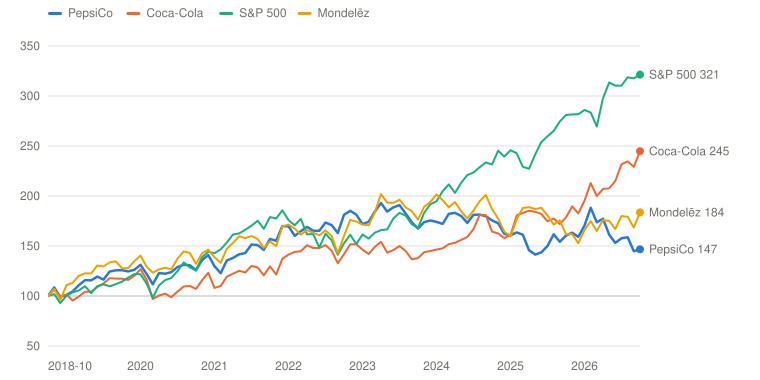
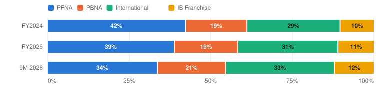

# PEP — PepsiCo, Inc.

> **Schema** v7.0 · **Updated** 2026-10-15 · **Status** Active
> **Price** $128.38 verified Oct 15, 2026 close ([Yahoo](https://finance.yahoo.com/quote/PEP/)) · 52-wk $123.47–$171.48 · 10th %ile · −25.1% from high
> **Type** Consumer staples — global convenient foods + beverages · **Stage** Mature ex-growth · **Cyclical** No · **Competence** Core · [published page](https://claude.ai/artifact/MKXM26B5j6B2euJRawonua)

## Verdict

**Both Oct 8 kill criteria failed: full-year guidance was cut, and North American snacks revenue slipped even as share rose. The pre-committed move to Watch applies; the probability-weighted case returns 11.0% against the 13% hurdle.**

🟡 **Non-holder: Watch (entry ≤$117)** · 🟡 **Holder: Hold**

| PW EV | PW return/yr | Compounding/yr | R/R | Entry | Trim | Avoid | FY26E core P/E | Yield | BAIT | Moat | Next |
|---|---|---|---|---|---|---|---|---|---|---|---|
| **$175** | **11.0% (<13%)** | 8.5% | 8.4:1 | ≤$117 | $175–$247 | ≥$247 | 15.3× | 4.6% | Single (B) | Wide, narrowing | 📅 Feb 2027 (Q4 + FY27 guide) |

**Breaks if**: the price investment in North American snacks never earns back margin: PepsiCo Foods North America revenue flat to down while volume share rises, with core margin still falling through 2027.

## The Call

The Oct 8 print failed both tests written the day before: core constant-currency EPS guidance fell to +1–2% from the low end of +4–6%, and PFNA net revenue slipped 0.3% even though volume share rose. Each failure was pre-committed to Watch, and the rebuilt case agrees: the probability-weighted value of $175 returns 11.0% a year, below the hurdle. The market had already priced worse; the stock rose 3.7% on the day. At $128 an ordinary 8% return needs only about 3.4% EPS growth, and in scenario terms a 62% Bear probability against our 38%. That gap is not yet an opportunity, because the evidence moved the wrong way: the price cuts are buying volume but not revenue, PFNA core profit fell 12%, and Q3's 3% core profit growth needed 4 points of tariff refunds. The case clears 13% only at $117. The number that settles it is the FY2027 guide in February.

## What I'd Have To Be Wrong About

1. **That the new cost programme is real money.** Test: by the Q4 release (early February 2027), PepsiCo quantifies the structural cost programme and the Elliott-committed North America supply-chain review, either as ≥$1B of savings or as a reaffirmed ≥100 bps 2026–28 core margin target. **If Fail →** move 7 points from Bull to Base (PW EV $171, 10.5%/yr) → **Watch** (entry $114).
2. **That 2026 is the trough year for earnings growth.** Test: FY2027 guidance in the Q4 release (February 2027) calls for at least +4% core constant-currency EPS. **If Fail →** Base EPS growth falls to 3% a year (PW EV $172, 10.6%/yr) → **Watch** (entry $115).
3. **That incremental returns recover.** Test: in the FY2026 10-K (February 2027), core operating margin is up year over year, capex is under 5% of sales, and owner earnings cover the dividend. This test is tracking to fail: core margin is −25 bps year to date and the Q4 North America margin is guided down. **If Fail →** move 7 points from Bull to Bear (PW EV $166, 9.8%/yr) → **Watch** (entry $111); the stage stays mature ex-growth.

## Latest update: 2026-10-14 · Q3 2026: guidance cut, both kill criteria fail

- Volume-for-price trade accretive (PFNA revenue ≥ prior year with share up) — 🔴 Fail — PFNA net revenue $6,504M vs. $6,526M (−0.3%) with volume share up; PFNA core cc operating profit −12%
- Back-half acceleration real (+4–6% guide reaffirmed) — 🔴 Fail — cut to +1–2% core cc EPS, from the low end of +4–6%
- Incremental returns recover — 🟡 Pending — FY2026 10-K, Feb 2027; tracking to fail (core margin −25 bps YTD)

The October 8 print failed both tests written the day before. Core constant-currency EPS guidance fell to +1–2% from the low end of +4–6%. PepsiCo Foods North America net revenue slipped 0.3% to $6.50 billion even though volume share rose, and PFNA core operating profit fell 12% in constant currency. Q3 organic revenue grew 3.1%, the best since Q4 2023, but almost all of it came from international (+8%), and 4 points of the 3% core profit growth were one-time tariff refunds ([release](https://www.sec.gov/Archives/edgar/data/77476/000007747626000050/q320268-kxexhibit991.htm)).

On the call, Laguarta was blunt about beverages ("We don't feel good about the beverage business") and, asked about splits and refranchising, said PepsiCo is "open to revisiting every option" ([transcript](https://www.benzinga.com/news/26/10/62244871/pepsico-q3-2026-earnings-call-complete-transcript)). CFO Steve Schmitt said commodity hedges, typically six to 12 months, are rolling off as input costs ramp.

Both consequences were applied as pre-committed: 10 points moved from Base to Bear, and Base EPS growth was cut to about 4% a year from a lower 2026 base. The non-holder verb moves from Initiate to **Watch**, and the holder verb from Add to **Hold**. The bias check: the change is evidence-driven, since both kill criteria failed and the price rose 1.3% over the window. Two new tests resolve with the February 2027 Q4 release; the third (incremental returns) is tracking to fail. The deep dive below was written on October 15 with these results in hand.

---

## Deep Dive: PepsiCo and the Price of Volume

*PepsiCo cut prices to win back North American snackers, and it worked on volume. The profit did not come with it. What does the stock price assume about whether it ever will?*

**Contents**: [Business Overview](#business-overview) · [North America Foods: The Affordability Debate](#north-america-foods-the-affordability-debate) · [Beverages: The Coke Question, Elliott and Refranchising](#beverages-the-coke-question-elliott-and-refranchising) · [Management, Capital Allocation and Incentives](#management-capital-allocation-and-incentives) · [Valuation and Model Assumptions](#valuation-and-model-assumptions) · [Final Words](#final-words) · [Appendix: The Numbers](#appendix-the-numbers) · [Sources](#sources)

When Ramon Laguarta became PepsiCo’s CEO on October 3, 2018, the stock was about $112 and PepsiCo was the rare consumer staple that had beaten its great rival. Over the eight years before he took over, PepsiCo returned 10.3% a year including dividends, against 8.6% for Coca-Cola. It was the better-run, more diversified company: Frito-Lay’s salty snacks, one of the best businesses in American consumer goods, subsidized a beverage business that was always a step behind Coke.

Eight years later the stock is $128, about 14% higher. Including dividends, a holder from day one of the Laguarta era earned 4.9% a year. Coca-Cola returned 11.8% a year over the same stretch, Mondelēz 7.9%, and the S&P 500 15.6%. The roles have flipped completely.

It isn’t that PepsiCo stopped growing. Revenue went from $64.7 billion in 2018 to $93.9 billion in 2025, and core EPS from $5.66 to $8.14. The problem is how that growth was made and what it cost. Through 2022–24 PepsiCo raised prices faster than almost anyone in food, and North American snack volumes went backwards. In 2026 it reversed course and cut prices to get the volume back. The volume came back. The profit didn’t. On October 8 PepsiCo cut its 2026 earnings guidance to 1–2% growth in constant currency, from the low end of 4–6%.

*Total return including reinvested dividends, monthly, October 2018 = 100. Source: Yahoo Finance adjusted closes. Built with Claude.*

| Date | PepsiCo | Coca-Cola | S&P 500 | Mondelēz |
|---|---|---|---|---|
| 2018-10 | 100 | 100 | 100 | 100 |
| 2020-02 | 122 | 116 | 112 | 129 |
| 2021-06 | 143 | 124 | 166 | 158 |
| 2022-10 | 181 | 142 | 153 | 160 |
| 2024-02 | 172 | 148 | 205 | 196 |
| 2025-06 | 144 | 182 | 254 | 188 |
| 2026-10 | 147 | 245 | 321 | 184 |

Mr. Market has no confusion about the last eight years. What it is unsure about is the next five. Is Frito-Lay still a franchise that can price, or has it become a price-taker that has to buy back its own customers? Is the beverage business ever going to close the gap to Coke, and if not, should PepsiCo stop owning trucks? And is the management team that presided over the slide the right one to fix it?

This piece takes those three questions in turn: the snack business first, then beverages and the refranchising debate that Elliott started, then management’s capital allocation and incentives. I finish with valuation, asking my usual question: what has to be true to earn 13% a year from here, and what is the current price already assuming?

### Business Overview

PepsiCo reports six segments. Two are in North America: PepsiCo Foods North America (PFNA: Frito-Lay plus Quaker) and PepsiCo Beverages North America (PBNA). Four are international: Europe, Middle East and Africa (EMEA), Latin America Foods, Asia Pacific Foods, and the International Beverages Franchise (IB Franchise), which sells concentrate to bottlers. North America is almost 60% of revenue but, so far this year, only 55% of segment profit.

| $ Million | FY2024 | FY2025 | 9M 2025 | 9M 2026 |
|---|---|---|---|---|
| **PepsiCo Foods North America** | 27,431 | 27,528 | 19,215 | 19,204 |
|  Core operating profit | 6,982 | 6,545 | 4,633 | 4,256 |
|  Core operating margin | 25.5% | 23.8% | 24.1% | 22.2% |
| **PepsiCo Beverages North America** | 27,769 | 28,197 | 19,999 | 21,340 |
|  Core operating profit | 3,104 | 3,285 | 2,564 | 2,643 |
|  Core operating margin | 11.2% | 11.7% | 12.8% | 12.4% |
| **EMEA** | 16,658 | 18,025 | 11,946 | 13,219 |
|  Core operating profit | 2,232 | 2,571 | 1,698 | 2,008 |
|  Core operating margin | 13.4% | 14.3% | 14.2% | 15.2% |
| **Latin America Foods** | 10,568 | 10,549 | 6,865 | 7,895 |
|  Core operating profit | 2,101 | 2,144 | 1,419 | 1,677 |
|  Core operating margin | 19.9% | 20.3% | 20.7% | 21.2% |
| **Asia Pacific Foods** | 4,549 | 4,629 | 3,139 | 3,492 |
|  Core operating profit | 391 | 464 | 410 | 531 |
|  Core operating margin | 8.6% | 10.0% | 13.1% | 15.2% |
| **International Beverages Franchise** | 4,879 | 4,997 | 3,418 | 3,748 |
|  Core operating profit | 1,708 | 1,856 | 1,328 | 1,530 |
|  Core operating margin | 35.0% | 37.1% | 38.9% | 40.8% |
| Corporate unallocated | (1,820) | (1,953) | (1,215) | (1,251) |
| **Total net revenue** | 91,854 | 93,925 | 64,582 | 68,898 |
| **Total core operating profit** | 14,698 | 14,912 | 10,837 | 11,394 |
|  Core operating margin | 16.0% | 15.9% | 16.8% | 16.5% |
| **Core EPS** | $8.16 | $8.14 | $5.88 | $6.15 |

*Core figures exclude restructuring, impairments, mark-to-market and acquisition charges, as PepsiCo reports them. Segment operating profit is before $1.3–2.0 billion of corporate unallocated costs. Source: [Q4 2025 release](https://www.sec.gov/Archives/edgar/data/77476/000007747626000009/q420258-kxexhibit991.htm), [Q3 2026 release](https://www.sec.gov/Archives/edgar/data/77476/000007747626000050/q320268-kxexhibit991.htm). Built with Claude.*

Two things in that table set up the rest of the piece. First, PFNA’s core margin has fallen from 25.5% in 2024 to 22.2% in the first nine months of 2026. That is the price cut showing up. Second, the international businesses are doing the opposite. EMEA, LatAm and APAC all expanded margins, and IB Franchise, the asset-light concentrate business, now earns a 41% margin. Laguarta made the point himself on the Q3 call: “year-to-date International is already 45% of our profit.”

*Share of core segment operating profit, before corporate costs. International = EMEA + LatAm Foods + Asia Pacific Foods. Source: company releases. Built with Claude.*

| Period | PFNA | PBNA | International | IB Franchise | Total ($M) |
|---|---|---|---|---|---|
| FY2024 | 6,982 (42%) | 3,104 (19%) | 4,724 (29%) | 1,708 (10%) | 16,518 |
| FY2025 | 6,545 (39%) | 3,285 (19%) | 5,179 (31%) | 1,856 (11%) | 16,865 |
| 9M 2026 | 4,256 (34%) | 2,643 (21%) | 4,216 (33%) | 1,530 (12%) | 12,645 |

A few accounting points before the debate. PepsiCo guides and pays its executives on “core” numbers, which leave out a lot: $1.9 billion of Rockstar brand impairments in 2025, $0.7 billion of Tropicana-related charges in 2024, and $0.7–1.0 billion a year of restructuring. Restructuring that recurs every year is, in my view, a cost of doing business, which is one reason owner earnings have averaged only about 80% of core net income over the last five years. Also, Q3 2026 core operating profit grew 3%, but 4 points of that came from tariff refunds that will not repeat. Excluding them, core profit fell.

### North America Foods: The Affordability Debate

Let me lay out where things stand. In 2025, PFNA’s organic volume fell 2% while effective net pricing rose 1%, so organic revenue fell 2%. This came after three years of heavy price increases. Shoppers, especially lower-income ones, traded down to private label or bought less. On the Q4 call in February, Laguarta called affordability “the biggest friction” in the category for low- and middle-income consumers, and PepsiCo started cutting prices on Lay’s, Doritos, Cheetos and Tostitos.

Through the first 36 weeks of 2026, PFNA volume rose 1% and effective net pricing fell 1%. Revenue was flat. In Q3 alone, volume rose 0.5%, price fell 1%, and revenue slipped 0.3% to $6.50 billion. Core operating profit, in constant currency, fell 12%.

#### Management’s narrative

Management’s case, as laid out on the [Q3 call](https://www.benzinga.com/news/26/10/62244871/pepsico-q3-2026-earnings-call-complete-transcript), is that the price reset is a deliberate volume bet that is working, and that value will follow volume:

> “The volume bet that we made in Snacks North America, especially with the price reset — we’re happy with the turnaround in the volume performance. If you think about last year, that business was low single-digit negative volume growth. This year we’re low single-digit positive volume growth. That is a major turnaround … We gained share in volume now for multiple quarters in Foods North America and Snacks North America. We’re starting to turn that into value share as well.”
> — Ramon Laguarta, Q3 2026 earnings call, October 8, 2026

The second leg of the argument is the portfolio. PepsiCo says it is building the snack aisle of the future: portion-control packs (100- and 120-calorie bags, now a $3 billion-plus business), a “permissible” portfolio of similar size (SunChips, Smartfood, PopCorners, Simply), Doritos Protein, and premium indulgence like Miss Vickie’s made with avocado oil. Laguarta’s view is that these platforms are where double-digit growth is, and that the core brands only need the right price and advertising to stay relevant.

The third leg is cost. Management is cutting corporate overhead and “every cost that is not linked to growth” to fund advertising, which rose by double digits in both US businesses in Q3. It has also signed a new marketing partnership with Publicis to spend that money more precisely.

It is a coherent story. The volume data supports it. So why did the stock still fall to a new low the day before the print?

#### Poking holes in it

The first hole is that volume share is not value share, and value share is what pays the dividend. PepsiCo has been gaining volume share for several quarters, by its own account, and still hasn’t converted it into revenue growth. To be fair, Laguarta says the conversion is starting. But the mechanics are unforgiving, and it helps to put numbers on them.

PepsiCo does not disclose PFNA’s cost structure, so let me build it from what we know. For every $1.00 of PFNA net revenue in 2025, PepsiCo earned about $0.24 of core operating profit. If roughly 45 cents of each dollar is variable cost (potatoes, corn, oil, packaging, freight and the variable part of delivery), each bag carries a contribution margin of about 55%. On those assumptions:

| Illustrative $1.00 of PFNA net revenue: core profit ~$0.24 | Volume change | Profit per original $1.00 | Profit change |
|---|---|---|---|
| Today (FY2025) | — | $0.238 | — |
| Price −1%, volume +0.5% (roughly 2026 so far) | +0.5% | $0.231 | -3% |
| Price −1%: volume needed to hold profit flat | **+1.9%** | $0.238 | 0% |
| Price −5%: volume needed to hold profit flat | **+10.0%** | $0.238 | 0% |
| Price −1%, volume +0.5%, input costs +3% | +0.5% | $0.217 | -9% |
| …plus fixed costs +4% (advertising up double digits) | +0.5% | $0.205 | -14% |
| …volume needed to hold profit flat in that world | **+6.8%** | $0.238 | 0% |
| **Actual: PFNA Q3 2026 core constant-currency operating profit** | +0.5% | — | −12% |

*Source: company filings, author’s estimates. PFNA core operating margin of 23.8% from FY2025 segment data; the 45% variable-cost share is an estimate. Built with Claude.*

Two things stand out. A 1% price cut needs about 2% more volume just to stand still, and PFNA has delivered about 1%. That alone is a small decline in profit. What turns a small decline into a 12% one is everything else happening at the same time. Commodity hedges, which PepsiCo runs six to 12 months out, are rolling off into a “new wave of inflation”, in Laguarta’s words, and advertising is up double digits. My illustrative fifth row, with 3% input inflation and 4% higher fixed costs, gets you to –14%, close to what PFNA actually reported in Q3. To hold profit flat in that world, PFNA would need about 7% volume growth. It has never done that in a mature year.

The second hole is the size of the pool. The best piece of scuttlebutt this year came from a rival. In September, Campbell’s reported that its snacks business (Kettle, Cape Cod, Snyder’s) saw organic sales fall 6% and operating earnings fall 34%. It took an impairment on two of its chip brands and cut its dividend for the first time since 2001. That supports PepsiCo’s claim that it is taking share from a weakened branded rival, not only from private label. It also says the US salty snack dollar pool is shrinking. Gaining share of a shrinking pool at lower prices is a way to defend a franchise. It is not a way to compound it.

The third hole is time. Laguarta himself doesn’t expect the consumer “to suddenly become, you know, in a much better place in the next 12, 18 months.” He also said management has put “guardrails” on how much pricing it will take next year to stay affordable. Read together, PFNA is going into 2027 with input costs rising and a self-imposed limit on passing them through. That combination squeezes margins. The productivity programme is meant to fill the gap, but it hasn’t been sized, and the ≥100 bps of margin expansion over 2026–28 promised in the Elliott settlement is so far running in reverse: core margin is down 25 bps year to date.

Then there is GLP-1. I have looked at this before and still think the category-level effect is far smaller than the effect on an individual user, around 1–2% of category volume so far. But it is one more reason the snack pool may grow more slowly than population plus inflation, which is exactly the regime in which price cuts don’t pay for themselves.

Where I come out: management is probably right that the price reset was necessary to defend the franchise, and probably too optimistic that it will be accretive soon. The defensible reading of 2026 is that Frito-Lay still has a moat. Its direct-store-delivery network and shelf control are as strong as ever. But the moat now earns about 22 cents on the dollar instead of 26, and the burden of proof has moved to management to show it can get back.

#### Four rings of profit

I find it useful to think of PepsiCo’s profit as four rings, ordered by how exposed each is to the North American price war and the consumer squeeze.

| Ring | Share of segment profit | Core margin | Main threat | Exposure to the squeeze |
|---|---|---|---|---|
| **1 · PepsiCo Foods North America** | 34% | 22.2% | Affordability, private label, input costs, GLP-1 | High, now |
| **2 · PepsiCo Beverages North America** | 21% | 12.4% | Soft-drink share loss to Coca-Cola; owned bottling and trucks | High; refranchising is the option |
| **3 · EMEA, LatAm and Asia Pacific** | 33% | 17.1% | Currency, emerging-market consumers | Low to moderate; volume-led growth |
| **4 · International Beverages Franchise** | 12% | 40.8% | Bottler health, currency | Low; the asset-light model Elliott wants for PBNA |

*Shares of core segment operating profit, first nine months of 2026. Source: company releases; risk assessments are the author’s. Built with Claude.*

The first ring, PFNA, is where the fight is, and it is a third of profit today, down from 42% two years ago. The second ring, PBNA, is a fifth of profit and has its own problem, which I come to next. The third and fourth rings, international, are now 45% of profit and growing. The international businesses are volume-led (EMEA, APAC and IB Franchise all grew volume this year), expanding margins and not in a price war.

That is the good news, and it is underappreciated. The bad news is that the stock is still priced and talked about as a North American company. About 55% of segment profit sits in the two rings with problems, and PepsiCo’s corporate overhead, its dividend commitment and almost all of its management attention are anchored there.

### Beverages: The Coke Question, Elliott and Refranchising

PBNA earned $3.3 billion of core operating profit on $28.2 billion of revenue in 2025, an 11.7% margin. That is low for a business with Pepsi, Mountain Dew and Gatorade in it, and the reason is structural. PepsiCo owns most of its North American bottling and distribution, while Coca-Cola refranchised its US bottlers between 2015 and 2018. Coca-Cola’s revenue fell by more than a quarter, and its margins and returns on capital rose sharply. PepsiCo kept the trucks.

Elliott, which disclosed a $4 billion position in September 2025, made this the centre of its case. From its [letter to the board](https://elliottletters.com/pepsico):

> “PBNA has underperformed its peers for more than a decade on both growth and margins. This long-term underperformance stems from several related strategic missteps, including self-inflicted share losses in soda, an underperforming vertically integrated bottling structure and a proliferation of new brands and SKUs that has strained focus and execution.”
> — Elliott Investment Management, letter to PepsiCo’s board, September 2, 2025

Elliott asked PepsiCo to evaluate refranchising PBNA’s bottling network, “as its closest peer has and as PepsiCo itself has done in years past.” PepsiCo’s December 2025 agreement with Elliott committed to SKU cuts, plant closures and a review of the North American supply chain by late 2026, but not to refranchising. Since then, Elliott’s 13F position has been flat for four quarters and it took no board seats.

What changed on October 8 is management’s tone. Laguarta was unusually blunt about beverages:

> “We don’t feel good about the beverage business. I think the beverage business, as we put in our remarks, we’re competing well in some platforms like hydration, like energy. We’re not competing well in soft drinks. So we’re putting all the urgency of the business and the focus in improving our performance in soft drinks.”
> — Ramon Laguarta, Q3 2026 earnings call

And when BNP Paribas’s Kevin Grundy asked directly whether the board would consider splitting North America from International, separating snacks from beverages, selling brands or refranchising bottlers, the answer went further than anything PepsiCo has said before:

> “We’re open to revisiting every option … we’re looking at whether there are opportunities to expand or accelerate some of the refranchising in some parts of the country where we have good partners and where it makes sense that that partnership will drive better execution and potentially better margin for the company.”
> — Ramon Laguarta, Q3 2026 earnings call

The plan management describes is a hybrid. In some regions, PepsiCo will integrate food and beverage distribution (“One North America”, piloted in Texas, which Laguarta says is working on the warehouse and transport side). In others, it will hand bottling to partners sooner. Internationally it already does this: PepsiCo has deepened its partnership with Carlsberg, which bought Britvic in the UK, and works with AB InBev in parts of Latin America.

How much is this worth? A refranchised PBNA would report much less revenue, a much higher margin and far less invested capital. The cash from selling bottling territories could fund buybacks or pay down debt. A business priced like Coca-Cola’s North American operation would be worth more than one priced like a trucking company with brands. So the option is real, and it is the most plausible source of upside on this page.

But I would be careful about putting it into the base case, for two reasons. First, refranchising is a one-time re-rating, not a compounding engine. It raises the multiple; it doesn’t make Pepsi gain share against Coke, which is the actual problem Laguarta just described. Second, PepsiCo has a history here. It spun off its bottlers in 1999 and bought them back in 2010, a cycle that cost shareholders transaction fees and years of management attention. The hybrid approach (some integration, some refranchising, region by region) is sensible on paper. It is also the kind of plan that takes five years to execute and is hard to hold anyone accountable for.

The bright spots in beverages are real but small next to soft drinks: Gatorade and Propel hydration grew this year, and the energy portfolio was rebuilt around Celsius and Alani Nu after PepsiCo handed its US Rockstar brand to Celsius. More on Rockstar shortly, because it is a useful window into how capital has been allocated.

### Management, Capital Allocation and Incentives

Laguarta joined PepsiCo in 1996, ran Europe and Sub-Saharan Africa, and became president in 2017 before succeeding Indra Nooyi. He has also been chairman since 2019. He brought in Steve Schmitt, Walmart US’s former CFO, as CFO in November 2025, specifically for cost and supply-chain discipline. Schmitt has been the more direct of the two on calls: on October 8 he said improving North America was taking longer than planned.

The comparison I keep coming back to is the eight years before Laguarta versus the eight years since. Nothing about PepsiCo’s brands changed. What changed is that a focused competitor, Coca-Cola, simplified its model, refranchised and concentrated on its core brand, while PepsiCo bought into new categories and raised prices.

#### The deals

Here is the M&A record of the Laguarta era. Cash spent on acquisitions totalled about $15.5 billion from 2018 to 2025.

| Deal | Year | Price | What happened | Verdict |
|---|---|---|---|---|
| **SodaStream** | 2018 | $3.2B | Agreed under Nooyi, closed in December 2018; not disclosed separately since | Unclear |
| **Rockstar Energy** | 2020 | $3.85B | $1.9B brand impairment in 2025; US and Canada rights passed to Celsius at a $0.5B value | Poor |
| **Pioneer Foods (South Africa)** | 2020 | $1.7B | Low-margin grains business; management now strips it out of food volume | Weak |
| **Be & Cheery (China)** | 2020 | $0.7B | Brand impaired in 2025 | Poor |
| **Tropicana, Naked and juice brands (sale)** | 2022 | $3.3B cash + 39% stake | Retained stake and receivables impaired in 2024 | Mixed |
| **Celsius stake** | 2022 / 2025 | $0.55B + $0.59B + US Rockstar | ~11% stake; PepsiCo distributes Celsius and Alani Nu | Too early |
| **Siete Foods** | 2025 | $1.2B | Grain-free Mexican-American snacks inside PFNA | Too early |
| **Poppi** | 2025 | $1.95B | Prebiotic soda inside PBNA | Too early |

*Source: company releases and 10-Ks; Celsius 2025 terms from the FY2025 10-K. Outcomes are the author’s assessment. Built with Claude.*

The pattern is buying growth in categories that were fashionable at the time: energy at the 2020 peak, sparkling water, gut-health soda and better-for-you snacks. Rockstar is the clearest misstep. PepsiCo paid $3.85 billion in 2020, wrote down $1.9 billion of the brand in 2025, and passed the US and Canadian rights to Celsius as part of a deal that made PepsiCo a minority investor and distributor in someone else’s energy brands. Pioneer Foods is South African, and its grains operation is almost certainly the “heavy, commodity-type” business that management now excludes when it describes global food volume. The Juice transaction was sensible strategically, but PepsiCo kept a 39% stake and receivables that it then had to impair.

The results show up in the returns. Invested capital rose about $10.6 billion over the last three years while after-tax operating profit fell, so the incremental return on that capital is negative (–3.2% by my calculation). Each dollar PepsiCo retained over 2021–25 is worth about 61 cents less in market value today, while the S&P 500 rose 87% over the same window.

#### The cash

| $ Billion | Revenue | YoY | Core EPS | OCF | SBC | Net capex | FCF | FCF margin | Dividends | % FCF | Buybacks | % FCF | Acquisitions | Dil. shares |
|---|---|---|---|---|---|---|---|---|---|---|---|---|---|---|
| 2018 | 64.7 | — | $5.66 | 9.4 | 0.26 | 3.1 | 6.3 | 9.7% | 4.9 | 79% | 2.0 | 32% | 1.5 | 1.43 |
| 2019 | 67.2 | 3.9% | $5.53 | 9.7 | 0.24 | 4.1 | 5.6 | 8.3% | 5.3 | 95% | 3.0 | 54% | 2.7 | 1.41 |
| 2020 | 70.4 | 4.8% | $5.52 | 10.6 | 0.26 | 4.2 | 6.4 | 9.1% | 5.5 | 86% | 2.0 | 31% | 6.4 | 1.39 |
| 2021 | 79.5 | 12.9% | $6.26 | 11.6 | 0.30 | 4.5 | 7.2 | 9.0% | 5.8 | 81% | 0.1 | 2% | 0.1 | 1.39 |
| 2022 | 86.4 | 8.7% | $6.73 | 10.8 | 0.34 | 5.0 | 5.9 | 6.8% | 6.2 | 105% | 1.5 | 26% | 0.9 | 1.39 |
| 2023 | 91.5 | 5.9% | $7.62 | 13.4 | 0.38 | 5.3 | 8.1 | 8.9% | 6.7 | 82% | 1.0 | 12% | 0.3 | 1.38 |
| 2024 | 91.8 | 0.4% | $8.16 | 12.5 | 0.36 | 5.0 | 7.5 | 8.2% | 7.2 | 96% | 1.0 | 13% | 0.3 | 1.38 |
| 2025 | 93.9 | 2.3% | $8.14 | 12.1 | 0.29 | 3.9 | 8.2 | 8.7% | 7.6 | 93% | 1.0 | 12% | 3.4 | 1.37 |
| 9M 2026 | 68.9 | +6.7% | $6.15 | 8.0 | 0.24 | 2.1 | 5.9 | 8.5% | 5.9 | 101% | 0.7 | 13% | 0.1 | 1.37 |
| **Cum. 2018–25** | 645.3 |  |  | 90.1 | 2.4 | 35.0 | 55.2 | 8.5% | 49.3 | 89% | 11.6 | 21% | 15.5 | −4% |

*FCF = operating cash flow – capital spending + proceeds from PP&E sales (PepsiCo’s definition). Acquisitions = cash paid for businesses and affiliate stakes. Source: [SEC XBRL company facts](https://data.sec.gov/api/xbrl/companyfacts/CIK0000077476.json), Q3 2026 release. Built with Claude.*

Since 2018, PepsiCo has generated $55 billion of free cash flow and paid out $49 billion in dividends, 89% of it. Buybacks took another 21% and acquisitions 28%, so the company spent about 138% of its free cash flow, with the gap covered by roughly $16 billion of additional net debt and the Juice proceeds. This year, through September, dividends alone exceeded free cash flow. The buyback has been cut from $2–3 billion a year before 2021 to a token $1 billion, and the share count has fallen only 4% in seven years.

Fifty-four consecutive dividend increases make PepsiCo a Dividend King, and I understand why no board wants to be the one that ends the streak. But a dividend that takes nearly all of owner earnings is not a sign of strength when the business needs reinvestment. It means any growth has to come from price and margin rather than retained capital, which is exactly where 2026 has disappointed.

#### The incentives

Laguarta’s 2025 annual cash incentive was $3.1 million, and his 2026 long-term award has a grant value of $19 million. Here is what that long-term pay rewards, from the [2026 proxy](https://www.sec.gov/Archives/edgar/data/77476/000130817926000169/pep015012_def14a.htm):

| Component | Weight | Metric | Latest outcome |
|---|---|---|---|
| **Annual cash incentive** | — | Organic revenue, core constant-currency EPS (or profit) change, free cash flow, relative market share | 2025: organic 1.7% vs 3.0% target; core cc EPS 0% vs 7.0%; FCF $10.0B vs $9.9B. Average NEO payout 77% |
| **Performance stock units (66% of long-term pay)** | 50% | 3-year average core constant-currency EPS change | 2023–25: 7.7% vs 7.2% target |
| **** | 50% | 3-year average organic revenue (price and volume count the same) | 2023–25: 4.4% vs 5.0% target. Units paid 88.4% |
| **Long-term cash (34% of long-term pay)** | 100% | 3-year total shareholder return vs proxy peers | 2023–25: 25th percentile, paid 50% |
| **Return on invested capital** | 0% | Not measured anywhere in the plan | — |

*Source: PepsiCo 2026 proxy statement, pages 9, 57 and 61. Built with Claude.*

Two things bother me here. First, organic revenue, half of the stock-unit formula, counts price and volume the same way. The 2023–25 award paid out at 88% of target partly because 2023’s price increases inflated organic growth, even though 2025 core EPS growth in constant currency was zero. A plan that pays the same for a point of price as for a point of volume rewarded exactly the pricing strategy that has now had to be reversed. Second, there is no return-on-capital metric anywhere. Nothing in the plan would have penalized Rockstar or rewarded refranchising. Relative TSR is there, and it worked as designed: the 2023 cash award paid only 50% because PepsiCo ranked at the 25th percentile of its peers.

So is Laguarta the right person to fix this? His record has real strengths. The international business he built is now 45% of profit and growing well, the Carlsberg-style partnerships are smart, and he has kept the balance sheet at A+. But the North American record is the record of a capable operator running a portfolio-and-pricing playbook that a more focused competitor beat. The new urgency is welcome. I note that it arrived after Elliott, after a 27% drawdown and after a guidance cut.

### Valuation and Model Assumptions

As always, I approach valuation by asking what I need to assume to earn a decent return, rather than by forecasting a single answer. My hurdle is 13% a year, including dividends, over five years. I also ask what the current price already assumes, using an 8% cost of equity for a wide-moat staple.

The model is a simple three-segment build: PFNA, PBNA and International, each with its own revenue growth and core margin, less corporate costs, interest and a 21% tax rate, down to core EPS. The 2031 price is core EPS times an exit multiple. Here is the Base case, with the inputs highlighted:

| $ Billion | FY2025A | FY2026E | FY2027E | FY2028E | FY2029E | FY2030E | FY2031E |
|---|---|---|---|---|---|---|---|
| **PepsiCo Foods North America revenue** | 27.5 | 27.5 | 27.8 | 28.1 | 28.3 | 28.6 | 28.9 |
|  YoY growth | — | -0.1% | **1.0%** | **1.0%** | **1.0%** | **1.0%** | **1.0%** |
|  Operating margin | 23.8% | 22.1% | 22.1% | 22.1% | 22.0% | 22.0% | **22.0%** |
|  Operating profit | 6.54 | 6.08 | 6.13 | 6.19 | 6.24 | 6.30 | 6.36 |
| **PepsiCo Beverages North America revenue** | 28.2 | 30.0 | 30.6 | 31.2 | 31.8 | 32.5 | 33.1 |
|  YoY growth | — | 6.4% | **2.0%** | **2.0%** | **2.0%** | **2.0%** | **2.0%** |
|  Operating margin | 11.7% | 11.5% | 11.5% | 11.5% | 11.5% | 11.5% | **11.5%** |
|  Operating profit | 3.29 | 3.45 | 3.52 | 3.59 | 3.66 | 3.73 | 3.81 |
| **International (incl. IB Franchise) revenue** | 38.2 | 42.0 | 44.1 | 46.3 | 48.6 | 51.1 | 53.6 |
|  YoY growth | — | 9.9% | **5.0%** | **5.0%** | **5.0%** | **5.0%** | **5.0%** |
|  Operating margin | 18.4% | 19.6% | 19.7% | 19.8% | 19.8% | 19.9% | **20.0%** |
|  Operating profit | 7.04 | 8.23 | 8.68 | 9.15 | 9.65 | 10.17 | 10.72 |
| Corporate and other | (1.95) | (1.99) | (2.03) | (2.07) | (2.11) | (2.15) | (2.20) |
| **Total revenue** | 93.9 | 99.5 | 102.5 | 105.6 | 108.8 | 112.1 | 115.6 |
| **Operating profit** | 14.91 | 15.77 | 16.30 | 16.86 | 17.44 | 18.05 | 18.69 |
|  Operating margin | 15.9% | 15.8% | 15.9% | 16.0% | 16.0% | 16.1% | 16.2% |
| Net income | 11.17 | 11.48 | 11.88 | 12.30 | 12.74 | 13.20 | 13.68 |
| Diluted shares (B) | 1.373 | 1.368 | 1.364 | 1.360 | 1.356 | 1.352 | 1.348 |
|  Net share change | — | — | -0.3% | -0.3% | -0.3% | -0.3% | -0.3% |
|  SBC (% of revenue) | — | 0.3% | 0.3% | 0.3% | 0.3% | 0.3% | 0.3% |
| **Core EPS** | $8.14 | $8.39 | $8.71 | $9.04 | $9.40 | $9.77 | $10.15 |
|  YoY growth | — | 3.1% | 3.8% | 3.8% | 3.9% | 3.9% | 4.0% |
| **Owner earnings per share (after SBC)** | — | $6.71 | $6.97 | $7.24 | $7.52 | $7.81 | $8.12 |

*Base case. Margins move linearly from the 2026 estimate to the 2031 input. FY2026E is calibrated to guidance (core EPS +2.5–3.5%, about $8.38). Source: author's model (model.json). Built with Claude. Bold cells are model inputs.*

In the Base case, PFNA grows 1% a year and holds a 22% margin, roughly where it is today. PBNA grows 2% and holds 11.5%. International grows 5% a year with margins edging up to 20%, so that by 2031 International earns more than half of segment profit. Core EPS reaches about $10.15, 3.9% a year, and at 19 times earnings (below PepsiCo’s historical 20–24 times) the stock is worth about $193.

Here are the other cases on the same model:

| Case | Prob. | 3P | PepsiCo Foods North America growth / margin | PepsiCo Beverages North America growth / margin | International (incl. IB Franchise) growth / margin | Net shares/yr | Per-share earnings FY2031 | CAGR | Exit multiple | Value | Return/yr | Implied g | Driving assumption |
|---|---|---|---|---|---|---|---|---|---|---|---|---|---|
| **Bull** | 22% | Plausible | +2.0% / 23.5% | +3.0% / 13.0% | +6.0% / 21.0% | -0.3% | $11.74 | 6.9% | 21.0× Core EPS | $247 | 18.6% | 4.0% | The affordability reset works: NA volume starts carrying revenue, the cost programme lifts margins, international compounds; core EPS ~7%/yr. 21× (26× owner earnings). |
| **Base** | 40% | Probable | +1.0% / 22.0% | +2.0% / 11.5% | +5.0% / 20.0% | -0.3% | $10.15 | 3.9% | 19.0× Core EPS | $193 | 13.1% | 3.6% | International carries growth; productivity roughly offsets NA price investment; core EPS ~4%/yr. 19× (24× owner earnings). |
| **Bear** | 38% | Probable | -1.0% / 20.0% | +1.0% / 10.0% | +3.5% / 19.0% | -0.3% | $8.41 | 0.0% | 13.6× Core EPS | $114 | 2.3% | 2.0% | Price cuts buy share but never margin; GLP-1 and private label shrink salty snacks; EPS flat at ~$8.4, then inflation-only growth. 13.6× core (17× owner earnings). |
| **Priced-in (8%/yr)** | — | diagnostic | +0.7% / 21.7% | +1.9% / 11.3% | +4.8% / 19.9% | -0.3% | $9.91 | 3.4% | 15.3× Core EPS | $152 | 8.0% | 2.6% | Solved along Bear → Base for 8%/yr |
| **Hurdle (13%/yr)** | — | diagnostic | +2.5% / 24.2% | +3.5% / 13.7% | +6.5% / 21.5% | -0.3% | $12.55 | 8.4% | 15.3× Core EPS | $192 | 13.0% | 2.6% | Solved along Base → Bull for 13%/yr |
| **Probability-weighted** | 100% |  |  |  |  |  |  |  |  | $175 | 11.0% |  |  |

*Annual return = price change to the 2031 value plus today's 4.6% dividend yield. Probabilities apply to Bull, Base and Bear; the Priced-in and Hurdle rows are solved by the model at today's 15.3× multiple. Built with Claude.*

| Return math |  |
|---|---|
| PW return/yr vs. hurdle | **11.0% (<13%)**, of which 4.6% is the dividend yield. Entry ≤$117. 10-year Treasury 5.24%; the hurdle sits 7.8 points above it. |
| Compounding at a flat multiple | Base per-share earnings growth 3.9% + 4.6% dividend = **8.5%**. Re-rating adds 4.6 points to the Base return (35% of it). |
| Optionality | None valued. |
| Price-implied expectations | At 8%, spot needs $9.91 of per-share earnings in the terminal year (3.4% a year) at 15×. |
| EPV floor | $65–75 per share (five-year owner earnings of $8.1B ÷ 8%; enterprise basis at the 14.2% median margin ≈$65); about 42% of the price pays for growth. The Bear ($114) sits above EPV because it keeps inflation-level growth after year five; a no-growth Bear would be ≈$75. |
| Base rate / 3P | The Bull needs ~4% nominal (~1.5% real) sales growth, the median for companies above $50B of sales: plausible. The Base reconciles to ~3% organic growth and a flat margin: probable. The Bear is now as probable as the Base, because 2026 is its first year of evidence. |
| Terminal-growth check | Implied perpetual growth on owner earnings at 8%: Bull 4.0%; Base 3.6%; Bear 2.0%. All below the risk-free rate. |
| Break-even and price-implied Bear odds | Break-even 20% against 38% assigned; price-implied 62% at 8%. |
| Year ten | Mature ex-growth: the value is a 3–4% grower's multiple plus the yield. Nothing in the growth levers changes that, so the terminal multiple does the work. |
| R/R | **8.4:1** (Bull +92% / Bear −11%). Flattered mechanically: spot sits only ~11% above the Bear. |

*Computed rows come from model.json; EPV, base rate and year ten are the author's. Built with Claude.*

The Priced-in row is the most useful one. At today’s 15.3 times multiple, $128 earns an ordinary 8% return if core EPS grows about 3.4% a year, to $9.91 in 2031: PFNA barely growing, PBNA growing 2% and International growing 5%. In other words, the market is pricing a PepsiCo that never gets North America back to growth but keeps International going. Holding my Bull-to-Base mix fixed, the price is consistent with a Bear probability of about 62%. I put it at 38%.

That sounds like an opportunity, and it partly is. The problem is the hurdle. To earn 13% a year without the multiple doing the work, PepsiCo would need about 8.4% EPS growth, to $12.55 in 2031: PFNA back to 2.5% growth at a 24% margin, PBNA at nearly 14% and International growing 6.5%. That is a better business than PepsiCo has been at any point in the last five years. Or it needs the Base case plus a re-rating from 15 to 19 times, and a thesis that rests on re-rating is a Watch, not a buy.

Weighting the cases 22% Bull, 40% Base and 38% Bear gives a value of about $175 in 2031, an annual return of 11.0% including the dividend. That is a respectable return for a staple, but it is below my 13% hurdle. The price at which the same case clears 13% is about $117, roughly 9% below today. For the case to clear the hurdle at today’s price, the Bear probability would have to fall to about 20%, and on the evidence of 2026 I can’t get there yet.

One cross-check on the downside. Capitalizing five-year average owner earnings at 8% with no growth gives an earnings-power value of $65–75 a share. That is the floor if PepsiCo never grows again and the franchise holds. The Bear case, at $114, sits well above it because it still assumes inflation-level growth after year five. So $128 is not an obviously cheap price for a business that has stopped growing. It is a fair price for one that grows slowly, with a 4.6% yield.

### Final Words

The Priced-in case is gloomier than I expected about North America, and fairly generous about International. That is the mirror image of how most people still talk about PepsiCo: as a North American snack and soda company with some overseas business attached. The numbers say it is becoming an international company with a North American problem.

The North American problem is real, though, and I don’t think the price investment has solved it. Volume has come back at a price that the business has not yet earned back, input costs are rising into a self-imposed pricing limit, and the dividend leaves no retained capital to absorb mistakes. The beverage business has just been described by its own CEO as uncompetitive in its largest category. The incentive plan rewarded the strategy that caused much of this.

What would change my mind? Three things, all due by February 2027. A FY2027 guide of at least 4% core constant-currency EPS growth would say 2026 was the trough. A sized structural cost programme, or a supply-chain review with a margin number attached, would make the margin lever credible. And a concrete refranchising plan, with the proceeds going back to shareholders, would turn the most interesting option on this page into something I could value.

Here are those three tests written as kill criteria, each with its consequence fixed in advance:

*The three tests, with their pre-committed consequences, are listed at the top of this report under [What I'd Have To Be Wrong About](#what-id-have-to-be-wrong-about).*

Until then, at $128 the valuation is undemanding but not cheap enough. I’ll watch from the sidelines, with $117 as the price at which the numbers work without a re-rating.

### Appendix: The Numbers

The tables below carry the framework's required numbers. The argument for each is made in the chapters above.

#### Driver tree

| Division | FY2025 organic volume | FY2025 pricing | FY2025 organic | 36 weeks 2026: volume / price / organic |
|---|---|---|---|---|
| PepsiCo Foods North America | −2% | +1% | **−2%** | +1% / −1% / **0%** |
| PepsiCo Beverages North America | −3.5% | +5% | +1% | −3% / +4% / +1% |
| International Beverages Franchise | 0% | +2% | +3% | +4% / +4% / +8% |
| EMEA | −3% | +9% | +6% | +3% / +4% / +7% |
| LatAm Foods | 0% | +4% | +4.5% | 0% / +4% / +4.5% |
| APAC Foods | +5% | −3% | +1.5% | +10% / −2% / +9% |
| **Total** | **≈−1.5%** | **≈+3.2%** | **+1.7%** | **+0.5% / +2% / +2.7%** |

*Unit = case volume. Source: [Q4/FY2025 release](https://www.sec.gov/Archives/edgar/data/77476/000007747626000009/q420258-kxexhibit991.htm), [Q3 2026 release](https://www.sec.gov/Archives/edgar/data/77476/000007747626000050/q320268-kxexhibit991.htm). Built with Claude.*

#### Five-year record

| $B, except per share | FY2021 | FY2022 | FY2023 | FY2024 | FY2025 | FY2026E |
|---|---|---|---|---|---|---|
| Net revenue | 79.5 | 86.4 | 91.5 | 91.9 | **93.9** | ≈99.5 |
| Organic revenue growth | ~+8% | ~+14% | ~+10% | ~+2% | **+1.7%** | ≈+3% |
| Operating income (GAAP) | 11.2 | 11.5 | 12.0 | 12.9 | **11.5** | — |
| Operating margin (GAAP) | 14.0% | 13.3% | 13.1% | 14.0% | **12.2%** | — |
| Core EPS | $6.26 | $6.73 | $7.62 | $8.16 | **$8.14** | **≈$8.38** |
| Diluted EPS | $5.49 | $6.42 | $6.56 | $6.95 | $6.00 | — |
| Operating cash flow | 11.6 | 10.8 | 13.4 | 12.5 | 12.1 | — |
| Capex | 4.6 | 5.2 | 5.5 | 5.3 | 4.4 | <5% of sales |
| Maintenance capex (est.) | 2.1 | 3.2 | 4.1 | 5.2 | 3.8 | — |
| **Owner earnings** | 9.3 | 7.2 | 9.0 | 6.9 | **8.0** | — |
| Owner earnings per share | $6.67 | $5.22 | $6.52 | $5.04 | **$5.83** | — |
| Owner-earnings conversion (÷ core NI) | 107% | 77% | 86% | 62% | **72%** | — |
| Dividends | 5.8 | 6.2 | 6.7 | 7.2 | 7.6 | 7.9 |
| Dividends ÷ owner earnings | 63% | 85% | 74% | **104%** | **96%** | — |
| Buybacks | 0.1 | 1.5 | 1.0 | 1.0 | 1.0 | 1.0 |
| Diluted shares (B) | 1.39 | 1.39 | 1.38 | 1.38 | **1.37** | ≈1.37 |
| Net share change | 0.0% | 0.0% | −0.7% | 0.0% | **−0.7%** | ≈−0.3% |
| SBC ÷ owner earnings | 3.2% | 4.7% | 4.2% | 5.2% | **3.6%** | — |
| Net debt incl. leases | 36.4 | 36.1 | 37.1 | 38.5 | **43.5** | — |
| Invested capital | 52.4 | 53.3 | 55.6 | 56.5 | 63.9 | — |
| **ROIC** (GAAP) | 16.6% | 18.1% | 17.3% | 18.4% | **14.6%** | — |
| ROIC (core) | — | — | — | — | 18.9% | — |
| **3-yr incremental ROIC** (GAAP) | — | — | — | — | **−3.2%** | — |
| Reinvestment rate (incl. $3.4B M&A) | — | — | — | — | ≈47% | — |
| SBC % of revenue | 0.38% | 0.39% | 0.42% | 0.39% | 0.31% | — |
| FCF conversion (FCF ÷ NI) | 92% | 63% | 87% | 75% | 93% | ≥80% |
| Net debt ÷ EBITDA (GAAP) | — | — | — | — | 2.9× | — |
| Net debt ÷ EBITDA (core) | — | — | — | — | 2.4× | — |
| Interest coverage | — | — | — | — | 10.3× | — |
| SBC-adjusted accruals ÷ assets | — | — | −4.1% | −2.6% | −3.4% | — |
| Beneish M-score (flag > −1.78) | — | — | −2.67 | −2.67 | −2.54 | — |

*Fiscal years end late December. Source: [SEC XBRL company facts](https://data.sec.gov/api/xbrl/companyfacts/CIK0000077476.json); core EPS and organic growth from releases; FY2026E from guidance [Management guidance]. Capital rows [Derived]: invested capital = equity + debt + operating leases − cash and short-term investments; owner earnings = CFO − SBC − maintenance capex (capex − 0.296 × Δ revenue). Built with Claude.*

The cycle position is not the issue (Cyclical: No). The FY2025 GAAP operating margin of 12.2% is a ten-year low (range 12.2–16.2%, median 14.2%) because of impairments; the core margin was 15.9%.

#### Q3 2026 and year to date

| $M, except EPS | Q3 2026 | Q3 2025 | Change | YTD 2026 | YTD change |
|---|---|---|---|---|---|
| Net revenue | **25,274** | 23,937 | +5.6% | 68,898 | +6.7% |
| Organic revenue | — | — | **+3.1%** | — | +2.7% |
| PFNA net revenue | **6,504** | 6,526 | **−0.3%** | 19,204 | −0.1% |
| PFNA core cc operating profit | — | — | **−12%** | — | −8% |
| Core operating margin | 16.9% | 17.3% | −35 bps | 16.5% | −25 bps |
| Core EPS | **$2.34** | $2.29 | +2% | $6.15 | +5% |
| Core constant-currency EPS | — | — | +1.5% | — | +2% |
| Operating cash flow | — | — | — | 7,950 | +45% |

*Source: [Q3 2026 release](https://www.sec.gov/Archives/edgar/data/77476/000007747626000050/q320268-kxexhibit991.htm), Oct 8, 2026. Built with Claude.*

#### Growth levers

| Lever | Contribution now | Runway | Evidence | Management intent | Stage |
|---|---|---|---|---|---|
| Market growth | ~0–1 pt | Indefinite | Developed-market volumes flat; Campbell's snacks −6% organic says the US salty pool is shrinking | Portfolio evolution | Proven |
| Share gain | + in NA snacks, revenue-neutral | 1–2 yrs | PFNA volume share up in every 2026 quarter; Q3 volume +0.5% against price −1% | Affordability packs, channel execution | Scaling (unpaid) |
| Price and mix | Negative in NA foods; +2 pts group | Exhausted in NA | PFNA effective net pricing −1% YTD; international pricing +4% | Reset price points | Proven (reversing) |
| Attach / new products | ~+1 pt | 3–5 yrs | Protein, fibre, functional hydration, zero sugar; Siete, Poppi | More innovation spend | Scaling |
| New geographies | **+8% organic international in Q3** | 5+ yrs | Every international segment grew; APAC volume +10% YTD; international margin +105 bps [secondary] | "Build upon the strength of International" | Proven |
| M&A | +1.7 pts reported in Q3 | Episodic | $3.4B in 2025, debt-funded | Bolt-ons | Proven (negative ROIIC, §1) |
| Margin | **Negative in 2026** | 2027–28 | Core margin −25 bps YTD; NA margin guided down in Q4; new structural cost cuts not yet sized | ≥100 bps 2026–28 (Elliott) | Behind plan |
| Share count | ~0.3%/yr net | Indefinite | $1.0B/yr buyback; dividend first | Dividend King | Proven |

*Source: company filings and calls. Built with Claude.*

#### Moat, customer and profit pool

| Read | Call | Evidence |
|---|---|---|
| Mechanism | **Branding** + **scale economies** | Several $1B+ brands; a direct-store-delivery network that controls shelf placement, where distribution *is* the barrier. ROIC of 15–19% against an 8% cost of capital puts EPV ÷ invested capital at ≈1.8–2.4: a franchise |
| Trend | **Narrowing** | Pricing power, the test that matters for a staple: FY2025 took +3.2% price and lost 1.5% of volume. 2026 gives price back (PFNA −1%) and wins volume, but not revenue |
| Profit pool | Shifting to retailers and private label in the trade-down | DSD is the counterweight to buyer power; snacks plus beverages gives negotiating leverage neither a pure snack nor a pure beverage company holds |
| Customer | Households buying affordable indulgence many times a week | Retention proxy is volume share: lost in FY2025, recovering in 2026 at a price. Repeat, CAC and LTV are n/d |

*7 Powers vocabulary (Helmer). Assessments are the author’s. Built with Claude.*

#### Competitors

| Competitor | Position | Threat |
|---|---|---|
| **Private label / value snacks** | Structurally advantaged in trade-down | The reason NA convenient-foods net pricing turned negative |
| **Campbell's** (Kettle, Cape Cod, Snyder's) | A leading branded salty-snack portfolio, now retreating | Weakening, not strengthening. In Q4 FY2026, snacks organic sales fell 6% and operating earnings 34%, and it cut its dividend 36% on Sep 3 ([247 Wall St](https://247wallst.com/investing/2026/09/04/campbells-just-cut-a-dividend-it-had-not-touched-since-2001-and-the-snack-aisle-is-why/)) [secondary] |
| **Coca-Cola** | Larger pure-play beverage company with a stronger international system | Beats PepsiCo in beverages standalone; PBNA volume −2% in Q3 |
| **Mondelēz** | Global snacking scale, weighted to sweet | Same shelf, same trade-down consumer; adjacent rather than head-on |
| **Celsius / functional upstarts** | Fast-growing energy and functional niches | Where beverage category growth actually is. See [CELH](../CELH/CELH.md) |

*Source: company filings and press; threat reads are the author’s. Built with Claude.*

#### Promises ledger

| Promised | Where, when | Outcome |
|---|---|---|
| Long-term algorithm: 4–6% organic revenue, high-single-digit core cc EPS | CAGNY, 2022–23 | 🔴 FY2024 ~+2% / +9%; FY2025 +1.7% / 0%; FY2026E ~+3% / +1–2% |
| FY2026: +4% to +6% core cc EPS | Q4 2025 release, Feb 2026; affirmed July | 🔴 Cut to +1% to +2% on Oct 8 |
| ≥100 bps core operating margin expansion 2026–28; 20% SKU cut; NA supply-chain review by late 2026 | Elliott agreement, Dec 2025 | 🔴 Year one going backwards: core margin −25 bps YTD, Q4 NA guided down; the review is unannounced |

*Source: CAGNY 2022–23, releases, the December 2025 Elliott agreement. Built with Claude.*

#### Risks and triggers

| Risk | Impact | Prob. | Priced in? | Would break the thesis if… |
|---|---|---|---|---|
| **Volume bought with price, permanently**: PFNA share up, revenue −0.3%, core profit −12% | High | **High** | Mostly: the price implies 63% Bear odds | PFNA revenue stays flat to down for two more quarters with core margin still falling (Breaks if) |
| **Margin programme slips a year**: ≥100 bps 2026–28 target, year one negative | High | Med-High | 🔴 Partly | The Q4 release gives no sized savings figure (test 1) or guides FY2027 below +4% (test 2) |
| **Input-cost inflation with tariff refunds non-recurring**: 4 pts of Q3 core profit growth were refunds | Med | Med-High | 🔴 **No** | FY2027 gross margin guided down |
| **Dividend at ~99% of owner earnings**; buybacks and M&A debt-funded | Med | Med | 🔴 **No**: the yield is read as safe | Owner earnings fall below the dividend in FY2026 while net debt ÷ EBITDA rises above 3× (test 3) |
| **Incremental return stays negative** | High | High | 🔴 **No** | FY2026 core margin down with capex above 5% of sales (test 3) |
| **GLP-1 plus private label shrink salty snacks** | High | Low-Med | Partly: the core of the discount | Category volumes decline for consecutive quarters independent of price |
| **Elliott-imposed strategy** with no board seat behind it | Med | Certain | Yes, structural | The supply-chain review lands without a quantified margin commitment (test 1) |
| ~~Back-half-loaded guide~~ | — | — | — | 🔴 *Realised Oct 8 (§1).* |
| ~~Elliott proxy battle~~ | — | — | ✅ | *Settled December 2025 without a proxy fight.* |

*Filtered for materiality. Assessments are the author’s. Built with Claude.*

No reflexive loop: there is no funding need, and the stock is not used as acquisition currency. No ruin path: maturities are covered by cash, FCF and A+ market access.

#### Catalysts

| Date | Catalyst | Why it matters |
|---|---|---|
| 📅 Late 2026, overdue | Elliott-committed North America supply-chain review | Feeds test 1 |
| 📅 Dec 1 | Joaquin Duato joins the board | Governance quality; not a thesis input |
| 📅 Early Feb 2027 | Q4/FY2026 release with FY2027 guidance | Resolves tests 1 and 2 |
| 📅 Feb 2027 | FY2026 10-K; expected 55th consecutive dividend increase | Resolves test 3; dividend versus owner earnings |
| ✅ Oct 8, 2026 | ~~Q3 2026 results~~ | **Delivered**: both kill criteria failed; verb to Watch |

*Source: company announcements. Built with Claude.*

#### Sentiment and positioning

| Signal | Read |
|---|---|
| Analysts | Consensus Hold (24), mean target $142.41, down from $148.64 before Q3; Barclays $133 → $126 (Equal Weight), JPMorgan $138 → $137 (Neutral) [Analyst consensus] |
| Short interest | 23.29M shares, 1.71% of float, down 10% month over month |
| Insiders (90 days, Form 4) | Directors’ code-A deferred-compensation awards on Oct 5; General Counsel sold 2,900 shares ($405K) on Jul 29; no open-market purchases at the low |
| BAIT | Single (B): a stock near its low that rose on a guidance cut; the share-gain analytical edge is not yet converting to revenue |

*Context only; none of it moves a verb. Source: [StockAnalysis](https://stockanalysis.com/stocks/pep/statistics/), [EDGAR Form 4](https://www.sec.gov/cgi-bin/browse-edgar?action=getcompany&CIK=0000077476&type=4). Built with Claude.*

### Sources

[Q3 2026 release (8-K Ex-99.1)](https://www.sec.gov/Archives/edgar/data/77476/000007747626000050/q320268-kxexhibit991.htm) · [Q4/FY2025 release](https://www.sec.gov/Archives/edgar/data/77476/000007747626000009/q420258-kxexhibit991.htm) · [FY2025 10-K](https://www.sec.gov/Archives/edgar/data/77476/000007747626000007/pep-20251227.htm) · [Q3 2026 call transcript (Benzinga)](https://www.benzinga.com/news/26/10/62244871/pepsico-q3-2026-earnings-call-complete-transcript) · [2026 proxy](https://www.sec.gov/Archives/edgar/data/77476/000130817926000169/pep015012_def14a.htm) · [Elliott letter](https://elliottletters.com/pepsico) · [Elliott agreement](https://www.pepsico.com/en/newsroom/press-releases/2025/pepsico-announces-priorities-to-enhance-shareholder-value-and-provides-preliminary-2026-outlook) · [SEC XBRL company facts](https://data.sec.gov/api/xbrl/companyfacts/CIK0000077476.json) · [Q3 call excerpts (raw)](../../../raw/PEP/transcripts/2026-10-08_Q3-2026_call-excerpts.txt) · [Q3 release (raw)](../../../raw/PEP/press-releases/2026-10-08_Q3-2026_earnings.txt) · [Campbell's dividend cut (247 Wall St)](https://247wallst.com/investing/2026/09/04/campbells-just-cut-a-dividend-it-had-not-touched-since-2001-and-the-snack-aisle-is-why/) · [Yahoo Finance](https://finance.yahoo.com/quote/PEP/) · [StockAnalysis](https://stockanalysis.com/stocks/pep/statistics/) · [Base rates](../../frameworks/compounding.md)

---

*Analysis, not personal investment advice. Every figure traces to a linked primary source or carries a tag ([Estimate], [Analyst consensus], [Management guidance], [Derived]). No position sizing by design. Built from [report/](report/) by kg-investment-analysis v7; edit the sources there, not this file.*
