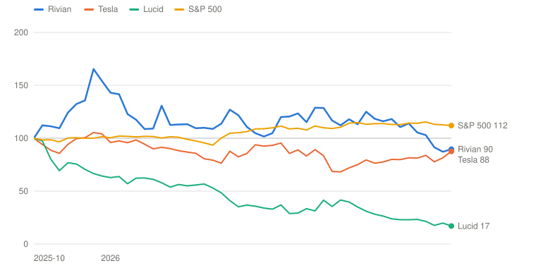
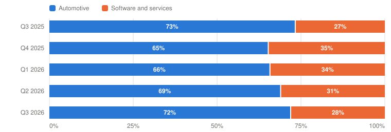

# RIVN — Rivian Automotive, Inc.

> **Schema** v7.0 · **Updated** 2026-10-31 · **Status** Active
> **Price** $12.16 verified Oct 30, 2026 close, matched on Yahoo Finance and StockAnalysis ([Yahoo](https://finance.yahoo.com/quote/RIVN/)) · 52-wk $11.38–$22.69 · 7th %ile · −46.4% from high
> **Type** Capital-intensive OEM (EVs) plus software and JV engineering services · **Stage** Scaling (pre-profit) · **Cyclical** Yes · **Competence** Edge

## Verdict

**The R2 is landing and the guide moved up, but $12.16 already needs the Bull: the probability-weighted five-year value is $10.26, a -3.4% a year return against the 13% hurdle, because about 6% a year of share-count growth sits between revenue growth and value per share.**

🟡 **Non-holder: Watch (entry ≤$5.57)** · 🔴 **Holder: Trim**

| PW EV | PW return/yr | Compounding/yr | R/R | Entry | Trim | Avoid | EV / FY26E sales | Yield | BAIT | Moat | Next |
|---|---|---|---|---|---|---|---|---|---|---|---|
| **$10.26** | **-3.4% (<13%)** | — | 1.0:1 | ≤$5.57 | $10.26–$22.00 | ≥$22.00 | ≈2.2× | 0.0% | Single (B) | Narrow, stable | 📅 Dec 9 (Autonomy & AI Day) · Feb (Q4) |

**Breaks if**: December does not exit at a positive automotive gross profit, which is also the condition for the first draw on the $4.5B DOE loan, or the next equity raise prices below $12.

⚠️ **Terminal-growth check**: implied perpetual growth exceeds the risk-free rate in Bull, Base.

## The Call

Rivian printed its best quarter: 19,248 deliveries (+46%), revenue of $2.155B (+38%), the R2 outselling both the R1 and the vans in its first full quarter, and a guide raised on deliveries, EBITDA and capex. The market, at $12.16 after a new 52-week low of $11.45 the day before, is not pricing failure. It is pricing something near the Bull: to earn even 11% a year the stock has to reach about $20 by 2031, a dollar short of our $22 Bull, and the price implies **less than zero** Bear odds. We assign the Bull 25%. What the bull story leaves out is the bridge from the company to the share. In the Base, revenue compounds 10% to $12.5B at a 4% EBIT margin, yet about $6.5B of cumulative burn and about $0.84B a year of stock pay lift the share count from 1.46B to about 1.95B, leaving about $6 a share. This year's 220M new shares came 39% from a $15.50 public offering, 38% from partners and 23% from employees. The number that settles the page is Q4 automotive gross profit excluding credits, due in February; management says December will exit positive but not the full quarter. The verb is not probability-fragile: no Bear probability, even zero, clears 13% from here.

## What I'd Have To Be Wrong About

1. **That the R2 turns automotive gross profit positive.** Test: Q4 2026 automotive gross profit, excluding regulatory credits, above $0 for the quarter, in the Q4/FY2026 release (February 2027). Q3 was $(161)M excluding credits. Management said on October 29 it intends to *exit* the quarter at a positive automotive gross profit and that I should not expect the full quarter, so I expect this to fail as written. **If Fail →** 10 points Base → Bear (PW EV $9.87, -4.1%/yr) → **Watch / Trim**, entry ≤$5.35.
2. **That the ramp is volume, not a launch spike.** Test: Q4 2026 deliveries of at least 23,193 in the January 2027 delivery release (the new guide of 67–70K implies 25.2–28.2K), and FY2027 delivery guidance with a midpoint of at least 95,000 in the February 2027 release. **If Fail →** 10 points Bull → Bear (PW EV $8.25, -7.5%/yr) → **Watch / Trim**, entry ≤$4.48.
3. **That funding stays strategic, not reflexive.** Test: through the Q2 2027 10-Q (early August 2027), no common or convertible offering below $12 outside the VW and Uber milestone agreements and employee plans, and a first DOE advance drawn. The stock closed at $12.16 on October 30. **If Fail →** Bear $2.00 → $1.50 and 5 points Base → Bear (PW EV $9.89, −4.1%/yr) → **Avoid / Exit**.

## Latest update: 2026-10-31 · Record quarter, raised guide, and a stock at the funding threshold

- R2 turns automotive gross profit positive — 🟡 Pending — Q3 automotive gross profit excluding credits $(161)M; management guides an exit-rate positive in Q4, not the full quarter; resolves in February
- The ramp is volume, not a launch spike — 🟡 Pending — Q3 deliveries 19,248; the guide of 67–70K implies Q4 of 25.2–28.2K; first half resolves in January
- Funding stays strategic, not reflexive — 🟡 Pending — no new offering; the stock is at the $12 threshold; the DOE draw is not open

Rivian reported the third quarter on October 29 after the close. The stock had closed that day at $11.45, its 52-week low, and rose 6.2% to $12.16 on Friday. The quarter was the best Rivian has had on volume and revenue, and it raised guidance. It was not a good quarter for the three tests I set on October 19, none of which it settled.

| | Q3 2026 | Q3 2025 | Against expectations |
|---|---|---|---|
| Deliveries | **19,248** | 13,201 | Record; +46%; analysts expected about 18–18.5K `[Analyst consensus]` |
| Revenue | $2,155M (+38%) | $1,558M | Beat `[Analyst consensus]` per [Investing.com](https://in.investing.com/news/stock-market-news/earnings-call-transcript-rivian-beats-q3-2026-estimates-as-r2-ramps-93CH-5666210) |
| Automotive gross profit | $(80)M | $(130)M | Includes $81M of credits and a tariff refund; $(161)M excluding credits |
| Software and services gross profit | $256M (42%) | $154M | More than all consolidated gross profit |
| Adjusted EBITDA | $(435)M | $(602)M | Worse than Q2's $(379)M on 58% more deliveries |
| Free cash flow | $(1,124)M | $(421)M | Largest burn of the last five quarters |
| Cash and short-term investments | $5,502M | $7,088M | $7.1B of liquidity pro forma for the October VW loan |

Sources: [Q3 release](https://www.sec.gov/Archives/edgar/data/1874178/000187417826000065/ex-9913q26rivianearningspr.htm), [call](https://www.fool.com/earnings/call-transcripts/2026/10/30/rivian-rivn-q3-2026-earnings-call-transcript/).

**Guidance.** Deliveries rise to 67,000–70,000 from 65,000–70,000, which implies 25,200–28,200 in Q4, a 31–47% step up from Q3. Adjusted EBITDA improves by $100 million at the midpoint to $(1.85) billion to $(1.75) billion, on credits, a tariff refund receivable and volume. Capex falls by $300 million at the midpoint to $1.40–1.50 billion, which management attributed to timing, including the Georgia plant.

**Management's points.** Scaringe said the ramp is gated by suppliers: "We can only ramp as fast as our slowest ramping supplier." Mulvey said cost of goods per vehicle stepped down about $12,000 in Q2, that automotive gross profit excluding credits was positive "on a cash basis," and that Rivian intends to exit December at a positive automotive gross profit:

> "I wouldn't expect the full quarter, but it does set us up really well as we continue to ramp R2."
> — Derek Mulvey, interim CFO, Q3 2026 earnings call, October 29, 2026

Autonomy+ has a take rate that "exceeded our expectations," undisclosed. The R2 trims remain $45,000 to about $57,000 despite memory inflation. Claire McDonough left as CFO on October 30; Mulvey is interim.

**Scorecard.** All three tests are pending, with the first two moving in different directions.
- *R2 turns automotive gross profit positive:* pending to February. The first read was a $(161) million automotive gross loss excluding credits, and management has said not to expect a positive full quarter. I expect this to fail as written.
- *The ramp is volume:* pending to January and February. The guide implies Q4 of 25,200 at the bottom, above the 23,193 bar, so the first half is on track.
- *Funding stays strategic:* pending to August 2027. There is no new offering. The stock closed at $12.16, 1.3% above the $12 line in the test.

**Return math at $12.16.** I migrated the page to the current framework with this update, so the model is new: the PW value is $10.26, the annual return is -3.4% against the 13% hurdle, and the entry is $5.57. The previous page had a PW value of $10.30 at $12.42, a return of −3.7% and an entry of $5.59, so the answer has not moved. The Bull, Base and Bear values are $22, $5.90 and $2, with probabilities of 25%, 45% and 30% and a 10% robotaxi optionality line of $15. The Q3 evidence supports the Base on volume and software and weakens it on cash, because the burn was larger than I had estimated and the improvement in EBITDA was mostly credits. Verdict unchanged: Watch for a non-holder, Trim for a holder. No bias check is needed.

**Balance sheet.** Cash of $5.5 billion plus the $1.0 billion Volkswagen term loan, $0.6 billion of revolver capacity and contracted partner money give about $7.1 billion of liquidity, roughly 20 months of burn at my $(4.3) billion estimate for 2026. The 2029 convertibles ($1.5 billion at $20.13) are the nearest wall.

**Appearances.** The Q3 call is the only management appearance I found between October 19 and today. Insiders: no purchases; Chief Administrative Officer Callahan's last sale was 15,000 shares at $15.00 on October 1.

---

## Deep Dive: Rivian: The Car Works. Who Pays for the Loss?

*The R2 outsold everything else Rivian makes in its first full quarter and the company raised guidance. The stock is 46% off its high anyway. What does $12 assume about the margin and about the share count?*

**Contents**: [Business Overview](#business-overview) · [The R2: Volume Is Here, the Margin Isn't Yet](#the-r2-volume-is-here-the-margin-isnt-yet) · [Who Pays for the Loss?](#who-pays-for-the-loss) · [Management, Capital Allocation and Incentives](#management-capital-allocation-and-incentives) · [Valuation and Model Assumptions](#valuation-and-model-assumptions) · [Final Words](#final-words) · [Appendix: The Numbers](#appendix-the-numbers) · [Sources](#sources)

On October 29, 2026, Rivian reported the best quarter in its history. It delivered 19,248 vehicles, 46% more than a year earlier. Revenue rose 38% to $2.155 billion. The R2, the cheaper SUV that began customer deliveries on June 9, outsold both the R1 and the delivery vans in its first full quarter. Management raised its delivery, EBITDA and capital-spending guidance. The stock had closed that day at $11.45, a new 52-week low, and rose 6.2% to $12.16 the next day. It is 46% below its 52-week high of $22.69.

The reasons are in the same press release. The company burned $1.12 billion of free cash flow in the quarter, more than in any of the previous four. Its shares outstanding rose from 1.24 billion in December to 1.46 billion in September, up 17.7%, most of it sold to partners and to the public at about $15.50. And the chief financial officer who set the R2 margin promise left the day after the call.

*Total return, weekly, October 31, 2025 = 100, through October 30, 2026. Source: Yahoo Finance adjusted closes. Built with Claude.*

| Date | Rivian | Tesla | Lucid | S&P 500 |
|---|---|---|---|---|
| 2025-10-31 | 100 | 100 | 100 | 100 |
| 2025-12-26 | 154 | 104 | 64 | 102 |
| 2026-02-20 | 112 | 90 | 54 | 101 |
| 2026-04-24 | 122 | 82 | 35 | 105 |
| 2026-06-26 | 115 | 83 | 33 | 108 |
| 2026-08-28 | 118 | 76 | 28 | 114 |
| 2026-10-23 | 87 | 82 | 20 | 113 |
| 2026-10-30 | 90 | 88 | 17 | 112 |

Over the last year the stock is down 10%, Tesla is down 12%, Lucid is down 83% and the S&P 500 is up 12%. Rivian has not been treated as a failing company. It has been treated as an expensive one.

The question this piece tries to answer has two parts. First, does the R2 make a vehicle that earns a gross profit, and when? Second, if it does, how much of the value lands on a share, given that the number of shares has risen about 18% in nine months and keeps rising? I start with the business and the Q3 numbers. The first debate takes the R2 margin, with management's case in its own words and five holes in it. The second takes the share count and the funding stack. Then I look at management, the financing record and the incentives, and finish with valuation: what $12.16 assumes, and what 13% a year would need. Rivian reports Q4 and gives its 2027 outlook in February, and holds an Autonomy and AI Day on December 9.

### Business Overview

Rivian designs and builds electric vehicles in Normal, Illinois, and reports two segments. Automotive sells the R1 pickup and SUV, the R2 SUV that started delivering in June, and the electric delivery van (EDV) bought mainly by Amazon. Software and services is a growing line of revenue from engineering services to the Volkswagen joint venture, the Autonomy+ driver-assist subscription, repair and maintenance, and used-vehicle sales. The unit of value is the delivered vehicle.

| $ Million | Q3 2025 | Q4 2025 | Q1 2026 | Q2 2026 | Q3 2026 |
|---|---|---|---|---|---|
| **Deliveries (vehicles)** | 13,201 | 9,745 | 10,365 | 12,194 | **19,248** |
| Production | 10,720 | 10,974 | 10,236 | 12,613 | 19,751 |
| Automotive revenue | 1,142 | 839 | 908 | 1,143 | 1,550 |
| Software and services revenue | 416 | 447 | 473 | 515 | 605 |
| **Total revenue** | 1,558 | 1,286 | 1,381 | 1,658 | **2,155** |
| Automotive gross profit | (130) | (59) | (62) | (36) | **(80)** |
| Software and services gross profit | 154 | 179 | 181 | 215 | **256** |
| **Gross profit** | 24 | 120 | 119 | 179 | 176 |
| Operating expenses | 1,007 | 953 | 1,000 | 1,015 | 1,057 |
| Adjusted EBITDA | (602) | (465) | (472) | (379) | (435) |
| Free cash flow | (421) | (1,144) | (1,075) | (849) | **(1,124)** |
| Cash and short-term investments | 7,088 | 6,082 | 4,830 | 5,310 | 5,502 |

*Automotive and software gross profit are revenue less cost of revenues by segment from the release. Regulatory credits were $108M in Q2 and $81M in Q3 (others n/d). Q3 automotive includes an undisclosed IEEPA tariff refund receivable. Source: [Q3 2026 release](https://www.sec.gov/Archives/edgar/data/1874178/000187417826000065/ex-9913q26rivianearningspr.htm). Built with Claude.*

The table carries the argument. Revenue is up 38% in a year, and gross profit is $176 million against $24 million. But the profit does not come from the vehicles. Software and services earned $256 million of gross profit in Q3, more than all of the consolidated gross profit, and automotive lost $80 million even though it includes $81 million of regulatory credits and a tariff refund. Meanwhile adjusted EBITDA fell back to $(435) million from $(379) million in Q2 on a 58% jump in deliveries, because the credits are shrinking and the R2 is expensive to ramp.

*Share of revenue. Source: [Q3 2026 release](https://www.sec.gov/Archives/edgar/data/1874178/000187417826000065/ex-9913q26rivianearningspr.htm). Built with Claude.*

| Period | Automotive | Software and services | Total ($M) |
|---|---|---|---|
| Q3 2025 | 1,142 (73%) | 416 (27%) | 1,558 |
| Q4 2025 | 839 (65%) | 447 (35%) | 1,286 |
| Q1 2026 | 908 (66%) | 473 (34%) | 1,381 |
| Q2 2026 | 1,143 (69%) | 515 (31%) | 1,658 |
| Q3 2026 | 1,550 (72%) | 605 (28%) | 2,155 |

A few accounting points. Regulatory credits are sold to other automakers and are close to pure margin: $108 million in Q2 and $81 million in Q3, with the former CFO saying in July that the credits fall away in the second half. The Q3 automotive figure also includes an IEEPA tariff refund receivable of undisclosed size. In the first quarter Rivian booked a $506 million gain when it deconsolidated its robotics subsidiary, Mind Robotics, after an outside funding round, and that gain is in other income, not in operations. Adjusted EBITDA excludes stock compensation of about $200 million a quarter. I treat that as a real cost, which is why my owner earnings are below every adjusted figure.

### The R2: Volume Is Here, the Margin Isn't Yet

Let me start with where things stand, per vehicle.

| Per delivered vehicle | Q2 2026 | Q3 2026 | Change |
|---|---|---|---|
| Deliveries | 12,194 | 19,248 | +58% |
| Automotive revenue excluding credits | $84.9K | **$76.3K** | −10% |
| Automotive cost of revenues | $96.7K | **$84.7K** | −12% |
| **Gross profit excluding credits** | −$11.8K | **−$8.4K** | +$3.4K |
| Of which R2 ramp cost (≈$100M in Q2, ≈$120M in Q3) | ≈$8.2K | ≈$6.2K | — |
| Gross profit excluding credits and ramp cost | ≈−$3.6K | ≈−$2.1K | — |
| Regulatory credits | $108M | $81M | falling |
| Software and services revenue / gross profit | $515M / $215M | $605M / $256M | +17% / +19% |
| Software and services gross margin | 42% | 42% | — |
| Share of software and services revenue from the Volkswagen JV | n/d | 59% ($354M) | — |

*`[Derived]` from the segment lines in the [Q3 2026 release](https://www.sec.gov/Archives/edgar/data/1874178/000187417826000065/ex-9913q26rivianearningspr.htm) and the [Q2 2026 presentation](https://www.sec.gov/Archives/edgar/data/0001874178/000187417826000053/ex-9922q26rivianearnings.htm); the ramp costs are management's figures ($120M in Q3, ≈$100M in Q2). Mulvey: R2 contributed about a $12,000 per-vehicle step down in cost of goods sold in Q2. The Q3 gross profit includes an IEEPA tariff refund receivable of undisclosed size, so the improvement is overstated. Built with Claude.*

#### Management's narrative

Management's case is that the R2 has done what it needed to do and the margin follows the volume. The press release says the R2 is "already the best-selling Rivian vehicle," outselling both R1 and EDV, and that the company is "improving 2026 guidance across all metrics." CEO RJ Scaringe named the constraint on the ramp, which is the supply base:

> "We can only ramp as fast as our slowest ramping supplier."
> — RJ Scaringe, CEO, Q3 2026 earnings call, October 29, 2026

Interim CFO Derek Mulvey explained the cost of the ramp and what comes next. The roughly $120 million of extra cost in the quarter compares today's conversion cost and depreciation with a two-shift operation, plus expedited freight that should wind off. He added that cost of goods per vehicle had stepped down about $12,000 in the second quarter and that, excluding credits, automotive gross profit "on a cash basis" was positive. Asked whether December would be a full quarter of positive automotive gross profit, he drew the line carefully:

> "We intend to exit the quarter at an Automotive gross profit. So I wouldn't expect the full quarter, but it does set us up really well as we continue to ramp R2."
> — Derek Mulvey, interim CFO, Q3 2026 earnings call, October 29, 2026

On pricing, Scaringe said the team has been finding offsets to commodity inflation, memory in particular, to hold the trims at a base price of about $45,000 and a top price of about $57,000. Autonomy+ has a take rate that "exceeded our expectations," though the company does not disclose it.

#### Poking holes in it

The first hole is the definition. "Excluding credits, on a cash basis" is not gross profit. Depreciation in cost of revenues was $166 million in the quarter. On the measure the income statement uses, automotive gross profit excluding the credits was a loss of $161 million, or about $8,400 on each vehicle. Management is entitled to its measure. I will test the one on the page.

The second hole is that Q3 was helped by items that do not repeat. Credits of $81 million and a tariff refund are inside the number. The CFO told investors in July that credits of $164 million in the first half would largely fall away in the second. Adjusted EBITDA was worse in Q3 than in Q2 on far higher volume, which is what you would expect if the improvement were mostly credits and mix.

The third hole is price and mix. Revenue per vehicle excluding credits fell 10% in one quarter, from $84.9 thousand to $76.3 thousand, as the R2 (launch edition $57,990, trims from $45,000) took a larger share of the mix. Cost per vehicle fell 12%, so the gross loss per vehicle narrowed from $11.8 thousand to $8.4 thousand. That is progress, and it was a step of $3.4 thousand against a gap to profit of $8.4 thousand. Cost has to fall by about a third from here in my Base to produce an 8% automotive margin at $58 thousand a vehicle.

| Illustrative automotive economics, per vehicle | Q3 2026 | FY2031 Bear | FY2031 Base | FY2031 Bull |
|---|---|---|---|---|
| Revenue per vehicle | $76.3K | ≈$55K | ≈$58K | ≈$60K |
| Cost of revenues per vehicle | $84.7K | ≈$55K | ≈$53K | ≈$52K |
| **Gross profit per vehicle** | −$8.4K | ≈$0 | **≈+$4.6K** | ≈+$8.4K |
| Automotive gross margin | −10.9% | 0% | 8% | 14% |
| Deliveries (a year) | ≈77K (Q3 annualized) | ≈116K | ≈143K | ≈201K |
| Automotive revenue | $5.5B (FY2026E) | $6.4B | $8.3B | $12.1B |
|  What has to happen to cost | — | −35% from Q3 | −37% from Q3 | −39% from Q3 |

*Author's illustration, `[Estimate]`: the model sets 2031 automotive revenue and gross margin; price and volume per vehicle are chosen so that they multiply to it. The Q3 mix is R1, vans and the first R2s at a $57,990 launch edition; management says R2 trims run from $45,000 to about $57,000 ([call](https://www.fool.com/earnings/call-transcripts/2026/10/30/rivian-rivn-q3-2026-earnings-call-transcript/)). Built with Claude.*

The fourth hole is the guidance itself. The new delivery range of 67,000 to 70,000 implies fourth-quarter deliveries of 25,200 to 28,200, a 31–47% jump from Q3. Mulvey and Scaringe both said the R2 will be a majority of those. Scaringe was candid that the ramp depends on every supplier moving at once. A miss on the bottom of that range would not be a collapse, but it would put the January delivery release in the middle of the second test.

The fifth hole is the verb. Management said it will exit December at a positive automotive gross profit and that I should not expect it for the quarter. My first test asks for the quarter, excluding credits. I wrote it that way when the company said it would be "positive at the 2026 exit," because an exit rate that never shows up in the quarterly number is not yet evidence that a car company makes money. I expect the test to fail as written. What I want to see is the first full quarter that does not.

Where I come out: the R2 is a real product that is selling, and the cost per vehicle is falling faster than I assumed in October. But the quarter's profit came from software, credits and a refund, and the Base case needs vehicle costs to fall by roughly another third before it earns the 8% margin it assumes. The company has a plan for most of that, and the Georgia plant is not yet part of it.

#### Rings of profit

The gross profit sorts by how durable it is.

| Ring | Q3 revenue ($M) | Q3 gross profit ($M) | The threat | Exposure |
|---|---|---|---|---|
| **1 · Software and services** | 605 | **256** | $354M of the revenue is the Volkswagen JV, which can roll off once VW vehicles reach production (2027+) | Medium; the profit that is real today |
| **2 · Regulatory credits and refunds** | 81 (credits) | 81 plus an undisclosed tariff refund | Credits fall away in H2 (CFO, July); the tariff refund is a one-off | High; not repeatable |
| **3 · Vehicles excluding credits** (R1, R2, vans) | 1,469 | (161) | R2 ramp cost, commodity inflation (memory), mix shifting to cheaper trims | **High; this is the debate** |
| **Consolidated** | 2,155 | 176 |  |  |

*Automotive gross profit of $(80)M includes $81M of regulatory credits, so vehicles excluding credits are $(161)M `[Derived]`. Source: [Q3 2026 release](https://www.sec.gov/Archives/edgar/data/1874178/000187417826000065/ex-9913q26rivianearningspr.htm). Built with Claude.*

Without the credits and the refund, Rivian's gross profit would be negative, and without the Volkswagen joint venture, software and services would be smaller too. Of the three rings, only the third one, the vehicles, is the thing that has to work for the stock to be worth more than $6.

### Who Pays for the Loss?

The second debate matters as much as the first, because a car company that earns a gross margin still has to bridge the losses before it does.

| Source of new shares, Dec 31, 2025 → Sep 30, 2026 | Shares (M) | Price | Share of the increase |
|---|---|---|---|
| Volkswagen (JV milestone equity) | 63 | $15.90 | 29% |
| Uber (robotaxi agreement) | 20 | $15.34 | 9% |
| Public offering (July) | 86.25 | $15.50 | 39% |
| Employees and other (RSUs, bonuses settled in stock) | ≈51 | — | 23% |
| **Total** | **≈220** (1,240 → 1,460) |  | **+17.7%** |

*Shares outstanding from the [Q3 2026 release](https://www.sec.gov/Archives/edgar/data/1874178/000187417826000065/ex-9913q26rivianearningspr.htm); partner and offering share counts from the 8-Ks and the [Q2 10-Q](https://www.sec.gov/Archives/edgar/data/0001874178/000187417826000054/rivn-20260630.htm); the employee line is the remainder `[Derived]`. Stock-based compensation was $634M in the first nine months (≈$0.84B a year, 4.7% of the market value). Built with Claude.*

Three things stand out. Rivian sold about $2.6 billion of stock in nine months at an average of about $15.50, which is $3.34 above today's price. The employee line is not a one-time item: stock compensation was $634 million in the first nine months, about $0.84 billion a year, which at $12.16 is 4.7% of the company's value paid in shares each year. And the 220 million shares add up to 17.7% of the company in nine months.

#### Management's narrative

Management's case is that funding is strategic and mostly spoken for. Volkswagen has committed up to $5.8 billion to the joint venture, of which $5.3 billion has been received, with $460 million expected in late 2027. Uber is investing in Rivian for robotaxis in tranches tied to milestones, with the second milestone, worth $250 million of equity, expected by year-end. And the Department of Energy loan of up to $4.5 billion remains available once the conditions are met. Including all of these, total available liquidity and targeted capital is around $13 billion, according to a [MarketBeat summary of the call](https://www.marketbeat.com/instant-alerts/transcript-what-rivian-automotive-rivn-said-on-its-q3-earnings-call-2026-10-29/).

| Source | $ Billion | Condition | Status |
|---|---|---|---|
| Cash and short-term investments (Sep 30) | 5.50 | — | Reported |
| Volkswagen non-recourse 10-year term loan | 1.00 | Fixed ≈6%; secured on the JV economics | Received in October ([8-K](https://www.sec.gov/Archives/edgar/data/1874178/000187417826000061/rivn-20261007.htm)) |
| Asset-based revolver capacity | 0.59 | Borrowing base | Undrawn |
| **Liquidity pro forma** | **7.10** |  | Company figure |
| Volkswagen JV equity still to come | 0.46 | By late 2027 | Contracted |
| Uber equity | up to 0.95 | Milestones, some on "proven autonomy quality"; next $250M expected by year-end | Pending |
| Department of Energy loan | up to 4.50 | Conditioned on positive gross margin for certain periods | No draw yet; conditions open |
| **2026E free cash flow** | **≈−4.3** | 9M: −$3.05B | Q3 alone −$1.12B |

*Liquidity and the VW loan from the [Q3 2026 release](https://www.sec.gov/Archives/edgar/data/1874178/000187417826000065/ex-9913q26rivianearningspr.htm); VW, Uber and DOE terms from the [call summary](https://www.marketbeat.com/instant-alerts/transcript-what-rivian-automotive-rivn-said-on-its-q3-earnings-call-2026-10-29/) and the earlier 8-Ks; the DOE condition is from the Q2 10-Q. The 2026E burn is nine months actual plus a Q4 estimate `[Estimate]`. Built with Claude.*

#### Poking holes in it

The first hole is that the DOE loan has a condition that the company has not yet met. The loan's first draw needs positive gross margin for certain periods, which is the test the first debate is about. If the car does not earn a margin, the cheapest large source of funding stays closed.

The second hole is price. The company raised $1.34 billion of equity in July at $15.50, which was 23% below the prior close, and the stock is now 22% below that. A raise at today's price costs about 28% more shares than the one in July for the same dollars. The third test asks that there be no offering below $12 through the second quarter of 2027, and the stock closed at $12.16.

The third hole is that the burn is large against the cash. Free cash flow in nine months was $(3.05) billion, and I estimate $(4.3) billion for the year. Pro forma liquidity of $7.1 billion is about 20 months of that burn, before the milestones and the DOE loan, and before whatever the Georgia plant costs when its capital spending is no longer deferred. The capex cut of $300 million at the midpoint is, in Mulvey's words, mostly timing.

The fourth hole is that a lower price makes the talent bill more expensive in shares. Stock compensation is paid in shares, so each fall in the stock increases the number of shares needed to pay the same people. That is the reflexive loop: a lower price means more shares for the same pay, and more shares weigh on the price. It is in the risks table, and it is why the Bear is a dilution case and not just a margin case.

The fifth hole is the convertible notes. Rivian has $1.5 billion of convertibles due in 2029, convertible at $20.13. If the stock is below that in 2029, they are repaid in cash or refinanced; at today's price, refinancing means more equity.

Where I come out: the funding is better than it was in May, because Volkswagen's term loan and the pending milestones remove the near-term cliff. A ruin path inside 18 months does not exist. But strategic money has already come in at $15.34–$15.90, and the next dollar from the market will come in at the price of the day. In the Base the share count reaches about 1.95 billion by 2031, which costs about 6% a year of per-share value.

### Management, Capital Allocation and Incentives

RJ Scaringe founded Rivian in 2009 and has run it since. He has built two partnerships that validate the technology, with Volkswagen and Uber, and he keeps control of the strategy. Chief financial officer Claire McDonough resigned effective October 30, the day after the Q3 results ([8-K](../../../raw/RIVN/filings/2026-08-27_8-K_CFO-transition.txt)). Derek Mulvey, vice president of finance, is interim CFO, and the search is open. The executive who negotiated the DOE terms and set the R2 margin promise leaves before either is tested, and she sold shares in August at $14.50 and $16.00 under a regular plan.

The record on promises is mixed. The 2027 adjusted EBITDA target from the June 2024 investor day was withdrawn in March 2026, five weeks after it was reaffirmed. The R2 deliveries did start on time. The 2026 guide has been raised twice. My grade for guidance is **Mixed**.

| 2026 financing | Date | Amount | Price | Read |
|---|---|---|---|---|
| Volkswagen JV equity | Apr | $1.0B | $15.90 | Partner money at a premium to today |
| Uber equity | May | $0.3B | $15.34 | Robotaxi milestone |
| Public offering | Jul 7 | $1.34B | $15.50 | 23% below the prior close |
| Mind Robotics Series A (deconsolidation) | Q1 | n/d | — | $506M accounting gain; $114M of cash left with the former subsidiary |
| Volkswagen term loan | Oct 7 | $1.0B | 6.03% | Non-recourse debt |
| **Capital stock issued, nine months** |  | **$2.62B** | avg ≈$15.5 | +220M shares |

*Cash proceeds from issuance of capital stock, nine months, from the [Q3 2026 release](https://www.sec.gov/Archives/edgar/data/1874178/000187417826000065/ex-9913q26rivianearningspr.htm); the individual events from the 8-Ks in `raw/RIVN/filings/`. Built with Claude.*

The financing record is the capital allocation record. Over 2026, Rivian raised about $2.6 billion of equity at about $15.50 and $1 billion of non-recourse debt. Every dollar of operating cash has been spent on the R2, the Georgia plant and autonomy, and none has been returned. The company's $34.8 billion of paid-in capital supports an $17.75 billion market value, which is **$0.51 of value for each $1 invested** `[Derived]`. The raise in July was opportunistic: the company sold into a rally that took the stock from $13.79 to $20.14 in seven weeks, not at the lows.

My Outsider grade is **Reinvestor**. All capital goes back into the business, which is appropriate for a company that has not yet earned a return, but nothing in the record suggests countercyclical discipline, and a buyback is not possible. The test of the grade is the next raise.

#### The incentives

| Component | Size | What it pays for | Status |
|---|---|---|---|
| **Founder performance award (Nov 2025)** | Up to ≈$4.6–5B at grant | Stock-price hurdles and operating milestones (per press coverage) | Metric weights not parsed from the DEF 14A `[link pending]` |
| **Annual equity (all employees)** | ≈$0.84B a year of stock compensation | Retention | Paid in shares, so a lower price costs more shares |
| **Return on invested capital** | 0% | Not a stated metric | — |

*Source: [TechCrunch on the founder award](https://techcrunch.com/2025/11/07/rivian-gives-rj-scaringe-a-new-pay-package-worth-up-to-5b/); the proxy itself was not parsed. Built with Claude.*

Scaringe's November 2025 award, worth up to about $4.6–5 billion at grant, vests on stock-price hurdles and operating milestones. I could not read the metric weights from the proxy `[link pending]`, so I cannot say whether any of it pays for returns on capital. Employees receive stock compensation of about $0.84 billion a year with no limit when the price falls. I read the plan as paying for the stock price, which fits a company whose funding depends on it, and as saying nothing about the number of shares.

### Valuation and Model Assumptions

Rivian has no earnings to capitalize, so I value it at the end of 2031 on revenue and margin and divide by the shares that scenario needs. The model builds automotive and software and services separately, each with a growth rate and a gross margin, and takes operating expenses off as a share of revenue. FY2026 is the base year at about $7.7 billion of revenue (nine months actual plus a Q4 consistent with the guide), a gross margin of about 9% and operating expenses of 54% of revenue. Terminal values are set outside the engine from each case's 2031 revenue and EBIT: the Bull at 25 times EBIT, the Base at 1.1 times sales, and the Bear as a dilution case. Shares follow each case's funding need.

| $ Billion | FY2025A | FY2026E | FY2027E | FY2028E | FY2029E | FY2030E | FY2031E |
|---|---|---|---|---|---|---|---|
| **Automotive revenue** | 3.8 | 5.5 | 6.0 | 6.5 | 7.0 | 7.6 | 8.3 |
|  YoY growth | — | 43.6% | **8.5%** | **8.5%** | **8.5%** | **8.5%** | **8.5%** |
|  Operating margin | -11.3% | -4.0% | -1.6% | 0.8% | 3.2% | 5.6% | **8.0%** |
|  Operating profit | -0.43 | -0.22 | -0.10 | 0.05 | 0.22 | 0.43 | 0.66 |
| **Software and services revenue** | 1.6 | 2.2 | 2.5 | 2.9 | 3.3 | 3.7 | 4.2 |
|  YoY growth | — | 41.3% | **14.0%** | **14.0%** | **14.0%** | **14.0%** | **14.0%** |
|  Operating margin | 37.0% | 41.5% | 42.2% | 42.9% | 43.6% | 44.3% | **45.0%** |
|  Operating profit | 0.58 | 0.91 | 1.06 | 1.23 | 1.42 | 1.65 | 1.91 |
| Corporate and other | (3.73) | (4.15) | (3.93) | (3.63) | (3.24) | (2.72) | (2.06) |
| **Total revenue** | 5.4 | 7.7 | 8.5 | 9.3 | 10.3 | 11.3 | 12.5 |
| **Operating profit** | -3.58 | -3.46 | -2.97 | -2.36 | -1.59 | -0.65 | 0.50 |
|  Operating margin | -66.5% | -44.9% | -35.1% | -25.2% | -15.5% | -5.7% | 4.0% |
| Net income | -3.65 | -3.54 | -3.05 | -2.44 | -1.67 | -0.73 | 0.42 |
| Diluted shares (B) | 1.186 | 1.460 | 1.548 | 1.640 | 1.739 | 1.843 | 1.954 |
|  Net share change | — | — | +6.0% | +6.0% | +6.0% | +6.0% | +6.0% |
|  SBC (% of revenue) | — | 11.0% | 10.0% | 9.0% | 8.0% | 7.0% | 6.0% |
| **GAAP EPS** | $-3.07 | $-2.42 | $-1.97 | $-1.49 | $-0.96 | $-0.39 | $0.22 |
|  YoY growth | — | -21.1% | -18.6% | -24.7% | -35.3% | -59.0% | -155.1% |

*Bold cells are model inputs.*

In the Base, the R2 fills Normal, the Georgia plant starts in late 2028, and revenue compounds about 10% a year to $12.5 billion. Automotive gross margin rises to 8%, software and services holds 45%, and operating expenses fall from 54% to 16.5% of revenue, which gives an EBIT margin of 4%. Equity value is 1.1 times sales less about $2.3 billion of net debt, spread over about 1.95 billion shares, or $5.90 a share.

| Case | Prob. | 3P | Automotive growth / margin | Software and services growth / margin | Net shares/yr | Per-share earnings FY2031 | CAGR | Exit multiple | Value | Return/yr | Implied g | Driving assumption |
|---|---|---|---|---|---|---|---|---|---|---|---|---|
| **Bull** | 25% | Plausible | +17.0% / 14.0% | +24.0% / 50.0% | +4.8% | $0.85 | n/m | override | $22.00 | 12.6% | 6.9% | Two plants near full rate: 2031 revenue ≈$18B (≈18.5%/yr), EBIT 9% ≈$1.6B at 25× ≈$41B of equity on ≈1.85B shares; the converts convert. |
| **Base** | 45% | Probable | +8.5% / 8.0% | +14.0% / 45.0% | +6.0% | $0.22 | n/m | override | $5.90 | -13.5% | 7.1% | R2 fills Normal and Georgia starts in late 2028: 2031 revenue ≈$12.5B (≈10%/yr), EBIT 4%, equity value 1.1× sales less ≈$2.3B net debt on ≈1.95B shares. |
| **Bear** | 30% | Probable | +3.0% / 0.0% | +8.0% / 38.0% | +10.5% | $-0.32 | n/m | override | $2.00 | -30.3% | n/a | R2 margin stalls in a shrinking EV market, the DOE draw slips and the company raises repeatedly below $10, or accepts a take-under: ≈2.4B shares. |
| Option: L4 robotaxi on Uber at scale plus a second platform-licensing deal | 10% | possible |  |  |  |  |  |  | $15.00 |  |  | valued as probability × value, outside the core |
| **Probability-weighted** | 100% |  |  |  |  |  |  |  | $10.26 | -3.4% |  |  |

The Bull has two plants near full rate, $18 billion of revenue and a 9% EBIT margin, worth $22.00. The Bear has the margin stalling in a shrinking market, the DOE draw slipping and repeated raises below $10, or a take-under, on about 2.4 billion shares: $2.00. I add an optionality line outside the core for Level 4 robotaxis on Uber at scale and a second platform-licensing deal, worth $15 a share with a 10% probability. That is $1.50 of the PW value. The core alone is worth $8.80.

| Return math |  |
|---|---|
| PW return/yr vs. hurdle | **-3.4% (<13%)**, of which 0.0% is the dividend yield. Entry ≤$5.57. 10-year Treasury 5.00%; the hurdle sits 8.0 points above it. |
| Optionality | L4 robotaxi on Uber at scale plus a second platform-licensing deal: 10% × $15.00 = $1.5 |
| Price-implied expectations | At 11% a year the stock must reach about $20.5 by 2031 (12.16 × 1.11^5), which needs the Bull (≈$18B of revenue at a 9% EBIT margin). Even with no Bear at all, the Bull-and-Base mix is worth $11.65. |
| EPV floor | n/m: earnings power is negative. Book value is ≈$3.9 a share (equity $5.7B ÷ 1.46B), so about 70% of the price pays for growth. The Bear sits below book because it is a dilution case. |
| Base rate / 3P | Revenue of $7.7B puts Rivian in the $7–12B bucket, where 3.6% of companies grew sales at least 20% a year in real terms for five years and 7.6% at least 15% ([`compounding.md`](../../frameworks/compounding.md)). The Bull's ≈18.5% nominal (about 16% real) is plausible but rare; the Base's ≈10% nominal (about 7.5% real) is probable, with Normal's capacity already built. Tiers: Bull plausible, Base probable, Bear probable. |
| Terminal-growth check | n/m on EPS. On EBIT, the Bull's 25× and the Base's ≈27.5× imply perpetual growth of about 6.7% and 7.2% at an 11% discount rate, above the 5.0% Treasury. Both still grow double digits at year five, so the multiple carries runway that the growth levers have to deliver. |
| Break-even and price-implied Bear odds | Break-even <0% against 30% assigned; price-implied <0% at 11%. |
| Year ten | Still growing at year ten in the Base (Georgia phase one, R3), but thin margins mean the terminal multiple, not the earnings, does the work. |
| R/R | **1.0:1** (Bull +81% / Bear −84%) The ratio is near 1:1 and the downside is dilution, not just a lower multiple: the Bear sits 84% below spot. |

*Computed rows come from model.json; terminal values are equity value per share set outside the engine (Bull EV 25× EBIT, Base EV 1.1× sales, Bear a dilution case), so EPS-based diagnostics are not defined. EPV, base rate and year ten are the author's. Built with Claude.*

Here is where the price stands. To earn an ordinary 11% a year from $12.16, the stock has to reach about $20.5 by 2031, which is almost the Bull. In scenario terms, the price implies a Bear probability below zero: even if the Bear had no weight at all, the Bull-and-Base mix is worth $11.65 before the optionality, below what the price needs. The market is not pricing failure; it is pricing success.

To earn 13% a year, the stock would have to reach about $22.40, which is above my Bull. Weighted 25% Bull, 45% Base and 30% Bear, and adding the optionality, the value is $10.26 and the annual return is -3.4%. The price at which the same case returns exactly 13% is $5.57. The break-even Bear probability is <0%, so the verb is not probability-fragile. I have no way to get a positive return out of these cases by moving weight from the Bear to the Base.

I should also say what I cannot judge. This is an Edge case. I can judge a manufacturing ramp and a funding stack. I cannot judge whether Rivian's autonomy stack reaches the quality that Uber's milestones require by 2028, which is why autonomy sits on the optionality line and not in the cases.

### Final Words

Rivian is a better company than it was in May, and the stock is not a better bet. The R2 sells, the cost per vehicle is falling, software and services earns a real profit, and the funding is safer than a quarter ago. The market has this right, and it is why the stock is not lower. What it has too little of is the share count. A company that sells 18% of itself in nine months to fund a loss, and pays another 4.7% a year in stock compensation, has to grow its value a great deal before a share is worth more than it is today. At $12.16 the price needs the Bull, and the Base earns about $6.

The verb is Watch for someone who does not own it, with an entry at $5.57, and Trim for someone who does, because the stock sits between my probability-weighted value and my Bull. The case for being wrong is real: the R2 could ramp faster, the DOE loan could open early and a software deal could add a second Volkswagen. But each of those is in the Bull, and the Bull is 25%.

What would change my mind has dates. A positive quarter of automotive gross profit excluding credits in February would make the Base more likely. Q4 deliveries of at least 23,193 in January and a 2027 guide with a midpoint of at least 95,000 would show a volume ramp and not a launch spike. And the third test, which has no offering below $12 through August 2027 and a DOE advance drawn, is the one the stock is nearest to failing today. Here are the three tests, with their consequences fixed in advance:

*The three tests, with their pre-committed consequences, are listed at the top of this report under [What I'd Have To Be Wrong About](#what-id-have-to-be-wrong-about).*

### Appendix: The Numbers

The tables carry the framework's required numbers. The argument for each is in the chapters above.

#### Five-year record

| $B, except per share | FY2021 | FY2022 | FY2023 | FY2024 | FY2025 | FY2026E |
|---|---|---|---|---|---|---|
| Revenue | 0.06 | 1.66 | 4.43 | 4.97 | **5.39** | ≈7.7 |
| Gross profit | −0.47 | −3.12 | −2.03 | −1.20 | **+0.14** | ≈0.68 |
| Gross margin | n/m | −188% | −46% | −24% | +2.7% | ≈+9% |
| Operating income (GAAP) | −4.22 | −6.86 | −5.74 | −4.69 | **−3.59** | ≈−3.5 |
| Adjusted EBITDA | — | — | — | — | — | **−1.85 to −1.75** (guide) |
| Operating cash flow | −2.62 | −5.05 | −4.87 | −1.72 | −0.78 | ≈−2.85 |
| Capex | 1.79 | 1.37 | 1.03 | 1.14 | 1.71 | **1.40–1.50** (guide) |
| Free cash flow | −4.42 | −6.42 | −5.89 | −2.86 | −2.49 | ≈−4.3 |
| Stock compensation | 0.57 | 0.99 | 0.82 | 0.69 | 0.74 | ≈0.84 |
| **Owner earnings** | −3.39 | −6.69 | −6.62 | −3.44 | **−2.30** | ≈−4.6 |
| Owner earnings per diluted share | n/m | −$7.33 | −$6.99 | −$3.39 | −$1.94 | ≈−$3.35 |
| SBC % of revenue | n/m | 59% | 19% | 14% | 14% | ≈11% |
| Equity raised (cash) | 16.2 (IPO + private) | 0.10 | 0 | 0 | 0.75 | **2.62 (9M)** |
| Diluted weighted shares (M) | 204 | 913 | 947 | 1,013 | 1,186 | **1,460 at Sep 30** |
| Shares outstanding, period end (M) | 900 | 926 | 968 | 1,131 | 1,240 | 1,460 |
| Net debt incl. leases | −16.6 | −10.0 | −4.5 | −2.8 | −1.0 | ≈−0.3 |
| Invested capital | 2.9 | 3.8 | 4.6 | 3.8 | 3.6 | ≈5.4 |
| **ROIC (operating loss ÷ invested capital)** | −147% | −178% | −124% | −124% | **−99%** | ≈−65% |
| 3-year ROIIC | — | — | — | — | n/m | n/m |
| Net debt ÷ EBITDA · coverage | n/m | n/m | n/m | n/m | n/m | n/m |

*Fiscal years end December. Owner earnings = operating cash flow − stock compensation − maintenance capex (≈ D&A) `[Derived]`; invested capital = equity incl. NCI + debt + operating leases − cash and short-term investments `[Derived]`. FY2026E is nine months actual plus the guide midpoints and a Q4 `[Estimate]`. Cycle position: no through-cycle history; terminal values use a mature OEM EBIT range of ≈5–7% `[Estimate]`. The nearest maturity wall is $1.5B of 2029 convertibles, convertible at $20.13. Source: [SEC XBRL company facts](https://data.sec.gov/api/xbrl/companyfacts/CIK0001874178.json), [Q3 2026 release](https://www.sec.gov/Archives/edgar/data/1874178/000187417826000065/ex-9913q26rivianearningspr.htm). Built with Claude.*

#### Growth levers

| Lever | Contribution now | Runway | Evidence | Management intent | Stage |
|---|---|---|---|---|---|
| Market growth | **Negative** | — | US EV sales down ~20–25% in H1 2026 after the $7,500 credit ended Sept 30, 2025 | — | Headwind |
| Share gain | R2 is most of the Q3 delivery growth: best-selling Rivian by volume | 5+ yrs | 57,000+ demo drives; Launch Edition conversion "above expectations" | Two R2 shifts at Normal; Georgia from late 2028 | Scaling |
| Price and mix | Negative to revenue per unit: $84.9K → $76.3K a vehicle in one quarter | 2027 | Trims from $45,000 to ≈$57,000 | Cheaper R2 trims early 2027 | Scaling |
| Attach / new products | Autonomy+ take rate "exceeded expectations" (not disclosed) | 5+ yrs | Point to Point early access in 2026; general release 2027; Third Dimension AI acquired | Autonomy and AI Day Dec 9; R3 after R2 | Option |
| New geographies | ≈0 | 2028+ | US-only; VW ID.1 launches in Europe in 2027 using the JV's architecture | No dated Rivian plan | Option |
| M&A | Third Dimension AI (small) | — | Simulation for autonomy | — | Option |
| Margin | **The Base case** | 5 yrs | Software and services at 42%; R2 cost step-down of ≈$12K a vehicle | Exit Q4 at positive automotive gross profit | Scaling |
| Share count | **Negative** (+17.7% in nine months) | Ongoing | ≈6% a year in the Base | No buyback possible | Headwind |

*Source: [Q3 2026 release](https://www.sec.gov/Archives/edgar/data/1874178/000187417826000065/ex-9913q26rivianearningspr.htm), [call](https://www.fool.com/earnings/call-transcripts/2026/10/30/rivian-rivn-q3-2026-earnings-call-transcript/). Built with Claude.*

The Base rests on R2 share gain and the margin lever. The Bull adds a second plant at full rate and software margins. Robotaxi and platform licensing beyond Volkswagen are optionality, valued in the Valuation chapter.

#### Moat, customer and profit pool

| Read | Call | Evidence |
|---|---|---|
| Mechanism | **Counter-positioning** (software-defined zonal architecture) plus brand | VW pays up to $5.8B for the JV rather than build its own; Uber chose R2 for robotaxis; the first JV output, the VW ID.1, launches in 2027 |
| Trend | **Stable** | Software and services gross profit $256M (+66%), but R1 volume is eroding and the vehicle business has not yet earned a margin |
| Profit pool | Suppliers and incumbents capture it; Rivian is negative at the vehicle level | Vehicles excluding credits: $(161)M gross profit in Q3 |
| Customer | Affluent, outdoor-oriented, often a first EV; fleets through the Amazon vans | R2 Launch conversion above plan (CEO); Amazon "double down" on vans; R1 needed lease cuts in 2026 |

*7 Powers vocabulary (Helmer). Rivian is not a scale-economies player at ≈70K units a year, so there is no shared-versus-harvested test to run. Rating: **Narrow, stable.** Built with Claude.*

#### Competitors

| Competitor | Position | Threat |
|---|---|---|
| **Tesla Model Y** | US EV leader; Rivian itself says only Tesla's FSD matches Point to Point | **High**: the R2's direct comparison, at lower prices |
| **GM** (Equinox EV, Silverado EV) | Largest legacy EV line-up | Medium: price at the R2 tier |
| **Hyundai / Kia** | Ioniq 5, EV9 | Medium |
| **Lucid** (Gravity) | Smaller, worse cash position; −83% in a year | Low; shows how the sector trades |

*Scuttlebutt: the R1 decline predates the R2 (Q1 sales −26.5% per Motor Intelligence `[Estimate]`). The US EV market shrank after the federal credit ended, so the R2 is a share story. Source: [call](https://www.fool.com/earnings/call-transcripts/2026/10/30/rivian-rivn-q3-2026-earnings-call-transcript/). Built with Claude.*

#### Promises ledger

| Promised | Where, when | Outcome |
|---|---|---|
| Adjusted EBITDA positive in 2027 | Investor Day, June 2024 | 🔴 Withdrawn March 2026 for autonomy R&D, five weeks after it was reaffirmed ([CFO Dive](https://www.cfodive.com/news/rivian-quietly-walks-back-2027-profitability-targets-ev/815354/)) |
| R2 customer deliveries in H1 2026 | FY2024–25 letters | ✅ June 9, 2026; R2 the best-selling Rivian by Q3 |
| Automotive gross profit positive at the 2026 exit | Q4 2025 call, reaffirmed Jul 30 and Oct 29 | 🟡 Reiterated as an exit-rate goal, not a full quarter (test 1) |

*Guidance grade: **Mixed.** Quarterly losses beat consensus in most recent quarters, but the multi-year profit targets keep moving. Source as linked and the calls. Built with Claude.*

#### Risks and triggers

| Risk | Impact | Prob. | Priced in? | Would break the thesis if… |
|---|---|---|---|---|
| ⚠️ **Reflexive funding and talent loop**: ≈$0.84B a year of stock compensation plus a funding gap, both paid in shares that cost more as the price falls | High | Ongoing | Partly: the price discounts failure, not dilution in the success case | Any common or convertible raise below $12 (test 3); the stock closed at $12.16 |
| ⚠️ **R2 gross margin stays negative at scale**, and the DOE first draw (conditioned on positive gross margin) slips | Critical | 35% | **No**: the price needs the Bull | Q4 automotive gross profit excluding credits not positive for the quarter (test 1) |
| ⚠️ **Credits and refunds fade**: $81M of credits plus a tariff refund inside Q3 gross profit | High | High (observed) | Partly | Q4 adjusted EBITDA worse than Q3's $(435)M on higher volume |
| ⚠️ **Software and services profit is concentrated in the VW JV** (59% of the revenue), which can roll off after VW vehicles reach production | High | 30% | No | Software and services gross profit below $200M a quarter in 2027 |
| US EV demand stays down after the credit ended; R1 erosion continues | High | 50% | Yes | FY2027 delivery guide midpoint below 95K (test 2) |
| CFO transition into the DOE draw and the 2027 plan | Medium | — | Partly | An external CFO not named by the FY2026 release |
| 2029 convertibles ($1.5B at $20.13) mature inside the window | Medium | 25% | Partly | Refinanced only with equity below $10 |

*Filtered for materiality. Item 1A of the Q3 10-Q (filed after the release) was not diffed. Source: [Q3 2026 release](https://www.sec.gov/Archives/edgar/data/1874178/000187417826000065/ex-9913q26rivianearningspr.htm), [call](https://www.fool.com/earnings/call-transcripts/2026/10/30/rivian-rivn-q3-2026-earnings-call-transcript/). Built with Claude.*

Reflexive loops: funding and talent, because a lower price means more shares for the same dollars and the same pay. Ruin path: none inside 18 months with $7.1 billion of liquidity pro forma; the ruin path is a closed capital market in 2028–29, with the convertibles due and the DOE draws suspended.

#### Catalysts

| Date | Catalyst | Why it matters |
|---|---|---|
| ✅ Oct 29 | Q3 results: record deliveries, guide raised ([release](https://www.sec.gov/Archives/edgar/data/1874178/000187417826000065/ex-9913q26rivianearningspr.htm)) | Tests 1–3 set against it |
| 📅 Oct 30 | CFO McDonough departs; Derek Mulvey interim CFO | Finance leadership into the DOE draw |
| 📅 ~Nov 6 | Q3 10-Q | Item 1A diff; DOE and convertible detail |
| 📅 **Dec 9** | Autonomy and AI Day | Point to Point timing; autonomy cost |
| 📅 YE2026 | Uber $250M milestone; second R2 shift volume; Point to Point early access | Funding and autonomy proof |
| 📅 Early Jan 2027 | Q4 deliveries | Test 2, first half (the guide implies 25.2–28.2K) |
| 📅 Feb 2027 | Q4/FY2026 results; FY2027 guide | Tests 1 and 2 |
| 📅 Early 2027 | Cheaper R2 trims; first DOE draw | Volume and test 3 |

*Source: company releases and calls. Built with Claude.*

#### Sentiment and positioning

| Signal | Read |
|---|---|
| Analysts | Hold consensus before the print (12 Buy / 9 Hold / 7 Sell), mean target ≈$19; Citi Neutral $18, TD Cowen Buy $21, Morgan Stanley Underweight `[Analyst consensus]`; post-print target changes not retrieved |
| Short interest | 164.1M shares, 11.2% of shares outstanding and 17.4% of float (StockAnalysis, Oct 30), down from 169M at Sep 30 |
| Insiders (90 days, Form 4) | No purchases. The last sales: Chief Administrative Officer Callahan, 15,000 shares at $15.00 on Oct 1; CFO McDonough, two August sales at $14.50–16.00, under 10b5-1 plans ([OpenInsider](http://openinsider.com/RIVN)) |
| Appearances (Oct 19 – Oct 31) | The Q3 call (Oct 29) only; no conference or media interview found |
| BAIT | Single (B): a 52-week low of $11.45 into the print, then +6.2%, with 17% of the float short. The analytical lens is Weak because the price already embeds the Bull; I and T Weak |

*Context only; none of it moves a verb. Source: [StockAnalysis](https://stockanalysis.com/stocks/rivn/statistics/), [MarketBeat](https://www.marketbeat.com/instant-alerts/price-rivian-automotive-nasdaq-rivn-stock-falls-46-heres-why-2026-10-16/). Built with Claude.*

### Sources

[Q3 2026 release (8-K Ex. 99.1, Oct 29)](https://www.sec.gov/Archives/edgar/data/1874178/000187417826000065/ex-9913q26rivianearningspr.htm) · [Q3 2026 release extract](../../../raw/RIVN/press-releases/2026-10-29_Q3-2026_earnings.txt) · [Q3 2026 call transcript, Q&A (Motley Fool)](https://www.fool.com/earnings/call-transcripts/2026/10/30/rivian-rivn-q3-2026-earnings-call-transcript/) · [Q3 2026 call notes](../../../raw/RIVN/transcripts/2026-10-29_Q3-2026_call-notes.txt) · [MarketBeat summary of the Q3 call](https://www.marketbeat.com/instant-alerts/transcript-what-rivian-automotive-rivn-said-on-its-q3-earnings-call-2026-10-29/) · [Q3 2026 deliveries release (Oct 2)](../../../raw/RIVN/press-releases/2026-10-02_Q3-2026_production-deliveries.txt) · [Q2 2026 results and 10-Q excerpts](../../../raw/RIVN/filings/2026-07-30_10-Q_Q2-2026_excerpts.txt) · [Q2 2026 presentation](https://www.sec.gov/Archives/edgar/data/0001874178/000187417826000053/ex-9922q26rivianearnings.htm) · [Q2 2026 10-Q](https://www.sec.gov/Archives/edgar/data/0001874178/000187417826000054/rivn-20260630.htm) · [CFO transition 8-K (Aug 27)](../../../raw/RIVN/filings/2026-08-27_8-K_CFO-transition.txt) · [VW term-loan 8-K (Oct 7)](https://www.sec.gov/Archives/edgar/data/1874178/000187417826000061/rivn-20261007.htm) · [Insiders and short interest notes](../../../raw/RIVN/filings/2026-10-18_insiders-and-short-interest.txt) · [Morgan Stanley Laguna notes (Sep 15)](../../../raw/RIVN/appearances/2026-09-15_morgan-stanley-laguna_scaringe.txt) · [SEC XBRL company facts](https://data.sec.gov/api/xbrl/companyfacts/CIK0001874178.json) · [CFO Dive: 2027 target withdrawn](https://www.cfodive.com/news/rivian-quietly-walks-back-2027-profitability-targets-ev/815354/) · [TechCrunch: founder award](https://techcrunch.com/2025/11/07/rivian-gives-rj-scaringe-a-new-pay-package-worth-up-to-5b/) · [StockAnalysis statistics](https://stockanalysis.com/stocks/rivn/statistics/) · [Yahoo Finance](https://finance.yahoo.com/quote/RIVN/) · [OpenInsider](http://openinsider.com/RIVN) · [Source log and gaps](../../../raw/RIVN/SOURCES.md)

---

*Analysis, not personal investment advice. Every figure traces to a linked primary source or carries a tag ([Estimate], [Analyst consensus], [Management guidance], [Derived]). No position sizing by design. Built from [report/](report/) by kg-investment-analysis v7; edit the sources there, not this file.*
