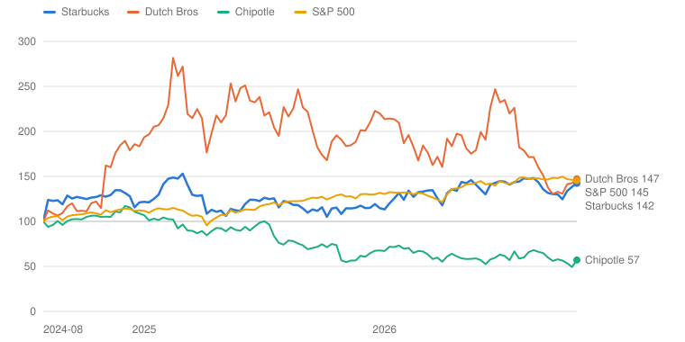
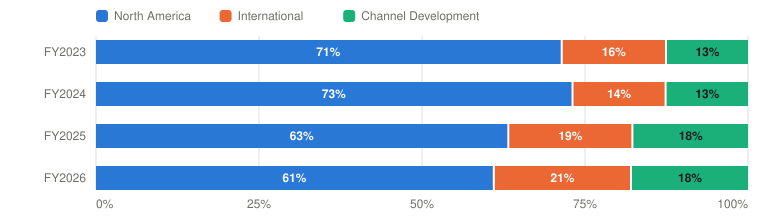
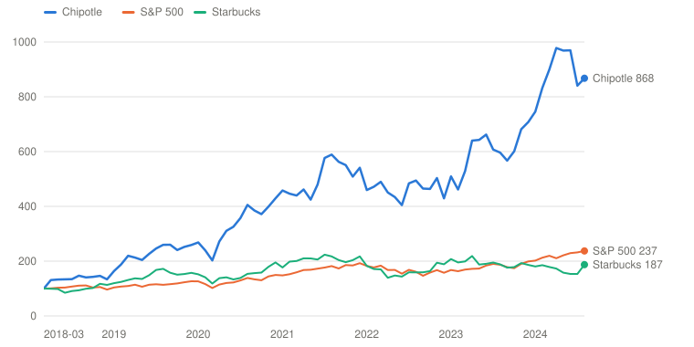

# SBUX — Starbucks Corporation

> **Schema** v7.0 · **Updated** 2026-10-31 · **Status** Active
> **Price** $103.67 verified Oct 30, 2026 close, matched on Yahoo Finance and StockAnalysis ([Yahoo](https://finance.yahoo.com/quote/SBUX/)) · 52-wk $77.99–$110.51 · 79th %ile · −6.2% from high
> **Type** Global specialty-coffee retail, shifting from company-operated toward licensed · **Stage** Turnaround · **Cyclical** No · **Competence** Core · [published page](https://claude.ai/artifact/1NjszwpatKsnc7JBwZpXuU)

## Verdict

**The margin turnaround is now proven and guided a year early, but at 32× next year's guide the price still assumes near-Bull margins; the probability-weighted case pays 4.4% a year against the 13% hurdle.**

🟡 **Non-holder: Watch (entry ≤$69)** · 🟡 **Holder: Hold**

| PW EV | PW return/yr | Compounding/yr | R/R | Entry | Trim | Avoid | FY27E non-GAAP P/E | Yield | BAIT | Moat | Next |
|---|---|---|---|---|---|---|---|---|---|---|---|
| **$114** | **4.4% (<13%)** | 14.3% | 1.1:1 | ≤$69 | $114–$145 | ≥$145 | ≈32× | 2.4% | Single (A) | Wide, stable | 📅 Jan 27 (Q1 FY27) |

**Breaks if**: Q1 FY2027 (late January) U.S. transactions turn negative against +3.0%, or the FY2027 guide of $3.15–3.25 is not reaffirmed, which would put the 13.5% margin out of reach.

## The Call

Niccol cleared every bar I set: Q4 U.S. comps of +7.7% against a 6.5% guide, a non-GAAP operating margin of 14.0% against my 13%, fiscal 2026 EPS of $2.72 against a $2.55–2.65 guide, and a fiscal 2027 guide of $3.15–3.25 that puts the low end of the fiscal 2028 margin target a year early. The market is right that the margin walk is real. It is too generous on what is left to earn: Q4 transactions slowed to +2.4% from +4.2% and ticket (+5.2%) now does most of the work, the fiscal 2027 comp guide is about 4% with 'pricing well below CPI', and the 53rd week adds about ten cents of the $3.20. At $104 no Bear probability earns even an ordinary 9% a year; the price needs fiscal 2031 non-GAAP EPS of about $5.48, close to our Bull. We give the Bear 25% because North America still earned a 12.0% GAAP margin for fiscal 2026 against 20.7% in fiscal 2023, and unit growth has been cut again (North America adds only 90–100 net new coffeehouses). The dividend is now covered, with about $1 billion of repurchases planned. Good business; the PW case returns 4.4% and clears 13% only at $69.

## What I'd Have To Be Wrong About

1. **That the guided margin walk keeps going.** Test: on the Q1 FY2027 call (January 27), the FY2027 guide of EPS $3.15–3.25 and a 13.5–14.0% margin is reaffirmed and Q1 North America comps are at or above +4%. **If Fail →** Base FY2031 EPS cut to ≈$4.30 (PW EV $109, 3.4%/yr) → stays **Watch**, entry $66.
2. **That traffic survives the toughest compare.** Test: Q1 FY2027 (January 27) U.S. transactions positive against Q1 FY2026's +3.0%, with the two-year stack still above +1%. (The Q4 leg passed: +2.4%.) **If Fail →** move 10 points from Base to Bear (PW EV $109, 3.4%/yr) → stays **Watch**, entry $66.
3. **That owner earnings cover the dividend and the buyback.** Test: in the FY2026 10-K (mid-November), owner earnings ≥ the ~$2.8B dividend (the preliminary estimate is ≈$3.5B) and a disclosed uplift sales lift against control stores by the Q1 FY2027 print; the ≈$1B FY2027 buyback is funded without new debt. **If Fail →** move 10 points from Base to Bear (PW EV $109, 3.4%/yr) → **Watch**; the Outsider grade drops to Anti-Outsider for a dividend and buyback funded by debt.

## Latest update: 2026-10-31 · A clean Q4 and a guide that pulls the margin target forward

- Margin walk holds without the refund — ✅ Pass — Q4 non-GAAP margin 14.0% against the 13% bar; FY2026 11.9%; FY2027 guide 13.5–14.0%, the low end of the FY2028 range
- Traffic survives the toughest compare — 🟡 Pending — Q4 leg passed (U.S. comps +7.7%, transactions +2.4%); Q1 FY2027 leg resolves January 27
- Owner earnings cover the dividend — 🟡 Pending — FCF $3.72B and owner earnings ≈$3.5B `[Estimate]` against $2.82B of dividends; uplift-lift disclosure and the 10-K are still owed

Starbucks reported the fourth quarter and fiscal 2026 on October 29 after the close. The stock had run from $97.87 on my last page to $105.51 into the print and then fell 1.7% to $103.67 on Friday. The quarter beat every bar I set. The fiscal 2027 guide is what matters for the price, and it is good but not cheap.

| | Q4 FY2026 | Q4 FY2025 | Against my bar |
|---|---|---|---|
| U.S. comparable sales | **+7.7%** | −0.3% | Bar: at or above the 6.5% guide |
| U.S. transactions | +2.4% | −0.9% | Positive; slower than Q3's +4.2% |
| U.S. ticket | +5.2% | +0.7% | Pricing and mix, including merchandise |
| Non-GAAP operating margin | **14.0%** | 9.5% | Bar: at least 13% |
| North America operating margin (GAAP) | 12.3% (about 16% non-GAAP) | 4.5% | |
| Non-GAAP EPS | $0.80 | $0.52 | Beat `[Analyst consensus]` per [Investing.com](https://www.investing.com/news/transcripts/earnings-call-transcript-starbucks-beats-q4-2026-eps-shares-slip-after-hours-93CH-4985343) |
| FY2026 non-GAAP EPS | $2.72 | $2.13 | Guide was $2.55–2.65 |

Sources: [Q4 release](https://www.sec.gov/Archives/edgar/data/829224/000082922426000154/sbux-09272026xearningsrele.htm), [call](https://www.fool.com/earnings/call-transcripts/2026/10/30/starbucks-sbux-q4-2026-earnings-call-transcript/).

**What management said.** CEO Brian Niccol put the year this way: "Back to Starbucks started as our turnaround plan. Now, it's our growth plan." More than 80% of North America company-operated coffeehouses had positive comps in the quarter, against fewer than half a year earlier, and 90-day active Rewards members reached a record 36 million. CFO Cathy Smith was candid about the part of the comp that looks less durable: transaction growth "moderated from Q3, particularly as we began to lap the growth from last year," and ticket growth came mostly from pricing and mix. On a two-year basis U.S. transactions improved to about +1.5% from +0.3% in Q3.

**The fiscal 2027 guide.** Revenue falls about 1% because China moved out of the consolidated figures, North America comps grow about 4%, the non-GAAP operating margin is 13.5–14.0% and EPS is $3.15–3.25, about 18% growth at the midpoint, including slightly more than ten cents from a 53rd week. Pricing "will remain focused and well below CPI," and the comp includes "a small contribution from uplifts and sales transfer from coffeehouse closures." Niccol said the company will reach the low end of the 13.5–15% margin target for fiscal 2028 in fiscal 2027, a year early. North America adds only 90–100 net new coffeehouses in fiscal 2027, about half of them licensed. Capital allocation changes: the dividend rose to $0.63 a quarter, and Smith said Starbucks expects to spend about $1 billion on share repurchases in fiscal 2027, the first since fiscal 2024. Capital spending is about 5% of revenue.

**Scorecard.**
- *Margin walk holds without the refund:* passed. Q4 non-GAAP margin was 14.0% against my 13% bar, the year was 11.9% against a guide above 11%, and the FY2027 guide already sits at the bottom of the FY2028 range.
- *Traffic survives the toughest compare:* the Q4 leg passed (+7.7% comps, +2.4% transactions). The Q1 FY2027 leg waits for the January 27 call against Q1's +3.0%.
- *Owner earnings cover the dividend:* pending the 10-K, but the numbers are in. Operating cash flow was $4.99 billion and capex $1.26 billion, so free cash flow was $3.72 billion against $2.82 billion of dividends paid; after stock compensation of $0.37 billion and my estimate of maintenance capex, owner earnings are about $3.5 billion `[Estimate]`. The dividend leg looks passed. The uplift-lift disclosure is still owed.

**Balance sheet and the Chipotle flag.** The China proceeds repaid $2.8 billion of debt, which fell to $13.3 billion, and net debt including leases fell from $21.9 billion to about $18.3 billion `[Derived]`. Nothing on the call touched the October Chipotle report, and I found no new statement from Niccol on it; the yellow flag stays because the first buyback in two years and a lower debt load are what would fund a deal.

**Return math at $103.67.** I rebuilt the base year on fiscal 2026 actuals with China as a licensed business for the full year. The Base now has fiscal 2028 EPS at $3.40, inside the bottom of management's $3.35–4.00 framework (it was $3.28, below it), and 2031 EPS of $4.71 against $4.53. The Bull multiple falls from 28 to 26 times because the 10-year Treasury, at 5.0%, no longer allows the higher one. The probability-weighted value is $114, against $114.5 before, and the annual return including the dividend is 4.4%, against 5.7%. The entry is $69. The Base is worth 4% more and the Bull and Bear are worth a little less, so value is flat, and with the price up 6% the return slipped. Verdict unchanged: Watch for a non-holder, Hold for a holder. No bias check is needed.

**Appearances.** The Q4 call is the only management appearance in the window. No CNBC or conference appearance by Niccol or Smith was found between October 20 and October 31. Brady Brewer, CEO International, sold 588 shares on October 20 under his regular plan.

**Earlier updates**: [2026-10-20 · The Chipotle episode, and a 3.7% rise into the print](report/updates/2026-10-20.md)

---

## Deep Dive: Starbucks, Priced for the Comeback

*Brian Niccol delivered a quarter that cleared every bar I set and guided fiscal 2027 EPS up 18%. The stock has gained 6% in two weeks. What does $104 assume about the margin that is still to come?*

**Contents**: [Business Overview](#business-overview) · [North America: Traffic Is Back. The Margin Isn’t.](#north-america-traffic-is-back-the-margin-isnt) · [International, and the Chipotle Episode](#international-and-the-chipotle-episode) · [Niccol, Capital Allocation and Incentives](#niccol-capital-allocation-and-incentives) · [Valuation and Model Assumptions](#valuation-and-model-assumptions) · [Final Words](#final-words) · [Appendix: The Numbers](#appendix-the-numbers) · [Sources](#sources)

On August 13, 2024, Starbucks announced that Brian Niccol would leave Chipotle to become its CEO. The stock rose 24.5% that day, from $77.03 to $95.90, the biggest one-day gain in the company’s history. The market didn’t wait for a plan. It paid for the man who had just turned Chipotle into one of the best-performing stocks in America.

Two years on, Niccol has done the thing he was hired to do. US transactions, which fell for eight straight quarters, have grown for four: +3.0%, +4.3%, +4.2% and +2.4%. Ticket is rising alongside traffic for the first time in years, and in the fourth quarter it did most of the work. Lines are moving faster, cafés are being refurbished, and Niccol likes to say the shine is back on Starbucks.

The stock is $103.67. Including dividends, a buyer at the close on announcement day has made about 14% in just over two years. The S&P 500 made 45% from the day before. Chipotle, the company Niccol left, has lost 43% of its value. Dutch Bros, the drive-thru chain taking younger customers from Starbucks, has done as well as the S&P.

*Total return including dividends, weekly, August 12, 2024 (the day before Niccol’s hiring was announced) = 100. Source: Yahoo Finance adjusted closes. Built with Claude.*

| Date | Starbucks | Dutch Bros | Chipotle | S&P 500 |
|---|---|---|---|---|
| 2024-08-12 | 100 | 100 | 100 | 100 |
| 2024-12-20 | 116 | 186 | 111 | 112 |
| 2025-05-09 | 106 | 218 | 89 | 107 |
| 2025-09-26 | 112 | 182 | 72 | 126 |
| 2026-02-06 | 134 | 196 | 70 | 132 |
| 2026-07-10 | 145 | 232 | 63 | 145 |
| 2026-10-30 | 142 | 147 | 57 | 145 |

Mr. Market believed in the turnaround before it started and still believes in it. The question for the next five years is narrower and harder. Traffic has come back. The margin has started to. North America earned a 20.7% operating margin in fiscal 2023 and 12.0% in fiscal 2026. Management’s target is a consolidated 13.5–15% by fiscal 2028, and on October 29 it guided fiscal 2027 to 13.5–14.0%, a year early. The stock, at about 38 times fiscal 2026 earnings and 32 times the fiscal 2027 guide, assumes it gets to the top of that range and keeps going.

This piece takes the margin question first, then the international business and October’s strange episode with Chipotle, then Niccol’s record, capital allocation and incentives. I finish with valuation, asking what has to be true to earn 13% a year from $104, and what the price already assumes. Starbucks reported fiscal Q4 and gave its fiscal 2027 guidance on October 29, and the page is written with those numbers in.

### Business Overview

Starbucks reports three segments. North America is the company-operated and licensed coffeehouses in the US and Canada: about 18,200 stores, three-quarters of revenue and most of the profit. International is now mostly licensed, after China moved into a joint venture with Boyu Capital in April. Channel Development is the packaged coffee business run with Nestlé under the Global Coffee Alliance, plus the ready-to-drink partnership with PepsiCo.

| $ Million | FY2023 | FY2024 | FY2025 | FY2026 | Q4 FY2026 |
|---|---|---|---|---|---|
| **North America** | 26,570 | 27,010 | 27,373 | 28,898 | 7,328 |
|  Operating income | 5,496 | 5,355 | 3,157 | 3,454 | 898 |
|  Operating margin | 20.7% | 19.8% | 11.5% | 12.0% | 12.3% |
| **International** | 7,488 | 7,339 | 7,820 | 6,744 | 1,306 |
|  Operating income | 1,231 | 1,046 | 950 | 1,191 | 257 |
|  Operating margin | 16.4% | 14.2% | 12.1% | 17.7% | 19.7% |
| **Channel Development** | 1,894 | 1,770 | 1,872 | 2,173 | 494 |
|  Operating income | 968 | 926 | 885 | 1,016 | 264 |
|  Operating margin | 51.1% | 52.3% | 47.3% | 46.8% | 53.5% |
| **Total net revenue** | 35,976 | 36,176 | 37,184 | 37,911 | 9,141 |
| **Consolidated operating income (GAAP)** | 5,871 | 5,409 | 2,937 | 3,691 | 992 |
|  Operating margin (GAAP) | 16.3% | 15.0% | 7.9% | 9.7% | 10.8% |
|  Operating margin (non-GAAP) | — | — | 9.9% | 11.9% | 14.0% |
| **Non-GAAP EPS** | $3.54 | $3.31 | $2.13 | $2.72 | $0.80 |

*GAAP segment operating income; FY2025, FY2026 and Q4 include restructuring and, in FY2026, a $536M gain on the China sale in consolidated results. Channel Development revenue in FY2026 is as reported in the release. FY2025 non-GAAP margin is FY2026's 11.9% less the 200 bps expansion. Corporate and other not shown. Source: [FY2025 10-K](https://www.sec.gov/Archives/edgar/data/829224/000082922425000114/sbux-20250928.htm), [Q4 FY2026 release](https://www.sec.gov/Archives/edgar/data/829224/000082922426000154/sbux-09272026xearningsrele.htm). Built with Claude.*

The table tells most of the story. North America’s revenue has kept growing, from $26.6 billion in fiscal 2023 to $28.9 billion in fiscal 2026, while its operating income fell from $5.5 billion to $3.5 billion. The decline came from a traffic slump, years of wage increases, the costs of Niccol’s reset and, in fiscal 2025 and 2026, restructuring. Meanwhile International’s revenue fell 14% and its margin jumped once China was deconsolidated, and Channel Development keeps earning about 45 cents on the dollar from Nestlé’s work.

*Share of GAAP segment operating income, before corporate costs. Source: company filings. Built with Claude.*

| Period | North America | International | Channel Development | Total ($M) |
|---|---|---|---|---|
| FY2023 | 5,496 (71%) | 1,231 (16%) | 968 (13%) | 7,695 |
| FY2024 | 5,355 (73%) | 1,046 (14%) | 926 (13%) | 7,327 |
| FY2025 | 3,157 (63%) | 950 (19%) | 885 (18%) | 4,992 |
| FY2026 | 3,454 (61%) | 1,191 (21%) | 1,016 (18%) | 5,661 |

A few accounting points. Starbucks guides on non-GAAP numbers that exclude restructuring, including the $270 million booked in the fourth quarter for the 250 North American closures. Q3’s 14.4% non-GAAP margin included about 80 basis points of one-time tariff refunds, which the 14.0% in Q4, without them, has now cleared. Fiscal 2027 is a 53-week year, and the guide includes about $700 million of revenue and slightly more than ten cents of EPS from the extra week. China now shows up as royalty and product revenue plus 40% of the JV’s profit. That is why Q3 China revenue was only $53 million, at an operating margin “above 100%,” as CFO Cathy Smith put it. And in fiscal 2018 Nestlé paid Starbucks $7 billion upfront for the packaged coffee business. That cash is long gone into buybacks, but it still shows up as deferred revenue that flatters Channel Development every year.

### North America: Traffic Is Back. The Margin Isn’t.

Let me start with where things stand.

| US, year over year | Q4 FY2025 | Q1 FY2026 | Q2 FY2026 | Q3 FY2026 | Q4 FY2026 | FY2027 guide |
|---|---|---|---|---|---|---|
| Comparable store sales | −0.3% | +4% | +7.1% | +7.9% | **+7.7%** | North America ≈+4% |
| Transactions | −0.9% | +3.0% | +4.3% | +4.2% | **+2.4%** | n/d |
| Average ticket | +0.7% | +1% | +2.7% | +3.6% | **+5.2%** | pricing well below CPI |
| **Two-year transactions** | — | n/a | +0.1% | +0.3% | **+1.5%** | — |
| North America operating margin (GAAP) | 4.5% | — | — | 13.6% | 12.3% (≈16% non-GAAP) | consolidated 13.5–14.0% |

*US comparable store sales, transactions and ticket. Two-year transactions compound the current quarter with the same quarter a year earlier. Source: Starbucks quarterly releases, the [Q4 FY2026 release](https://www.sec.gov/Archives/edgar/data/829224/000082922426000154/sbux-09272026xearningsrele.htm) and [call](https://www.fool.com/earnings/call-transcripts/2026/10/30/starbucks-sbux-q4-2026-earnings-call-transcript/). Built with Claude.*

#### Management’s narrative

Management’s case is that the operating fixes are working and the margin is following, as laid out on the July 29 call. Green Apron Service, the new labor model that put more people behind the counter, is hitting target service times “across every access point.” Uplifts, the roughly $150,000 refurbishments that bring back seating and warmth, show “transaction lift across access points, dayparts, formats, and customer segments.” And the margin has started to turn:

> “Crucially, both consolidated and North America operating margins expanded year-over-year, even without the impact of tariff refunds, underscoring the strengthening fundamentals of our operating model … When excluding the impact of tariff refunds, Q3 North America margin improved more than 100 basis points year-over-year.”
> — Cathy Smith, CFO, Q3 FY2026 earnings call, July 29, 2026

Smith also noted that pricing contributed “less than a point” of the 3.6% ticket growth, so the ticket gain came from delivery, food attach and drink modifications rather than menu price increases. Niccol was more colorful on CNBC in September: “The shine is back on Starbucks, and the experience is back in our coffeehouses.” He plans to finish about 1,500 uplifts by the end of fiscal 2026 and “thousands more” next year, on the way to 8,000–9,000. The October 29 results added the proof he needed: a 14.0% non-GAAP margin without refunds, fiscal 2026 EPS of $2.72 against a $2.55–2.65 guide, and a fiscal 2027 guide of $3.15–3.25.

#### Poking holes in it

The first hole is the size of the gap. North America’s GAAP margin fell about 9 points from fiscal 2023 and is back about one point at 12.0%, with Q4 at roughly 16% on a non-GAAP basis. The fiscal 2027 guide of 13.5–14.0% consolidated is credible because it needs only part of the lost margin back. The stock, as I’ll show, assumes more than that: the rest of the way to 20%.

The second hole is that the traffic recovery is mostly a recovery, and it is slowing. Q4’s +2.4% US transactions came against −0.9% a year earlier and followed +4.2% in Q3. Compounded over two years, traffic is up about 1.5%, better than Q3’s 0.3% but still less than the ticket gain alone in one quarter, which was 5.2%. CFO Cathy Smith said transaction growth “moderated from Q3, particularly as we began to lap the growth from last year,” and that pricing and mix drove the sequential ticket improvement. Starbucks has won back the customers it lost in 2025 and has begun to grow beyond them. The fiscal 2027 comp guide of about 4% is below this year’s 6.6% and includes a “small contribution from uplifts and sales transfer from coffeehouse closures.” The second test now asks whether Q1 transactions stay positive against +3.0%.

The third hole is the economics of the fix itself. Starbucks doesn’t disclose store-level profit, so let me build an illustrative US company-operated store from what we know:

| Illustrative US company-operated store | Per store, per year | Sales needed to pay for it | As a comp |
|---|---|---|---|
| Revenue (Q3 FY2026 run-rate) | $1.63M | — | — |
| Segment-level operating profit at 13.6% | $222K | — | — |
| Green Apron labor reinvestment (~$500M ÷ ~10,000 stores) | $50K | $111K | +6.8% |
| Uplift: $150K once, earning 15% a year pre-tax | $22.5K | $50K | +3.1% |
| **Both together** | $72.5K | $161K | **+9.9%** |
| Then, to lift margin from 13.6% to 16% (Base case), with costs per store flat | — | $135K more | +8.3% more |
| **Actual: US comp, Q3 FY2026 (about 1 point from price)** | — | — | +7.9% |

*Source: company filings, author’s estimates. Revenue per US store from Q3 FY2026; the labor figure spreads the $500M+ Green Apron investment across ~10,000 company-operated US stores; the 45% flow-through on extra sales and the 15% target return are estimates. Built with Claude.*

On those assumptions, the labor reinvestment alone needs about 7% more sales to pay for itself, and each uplift needs about 3% more to earn a reasonable return on its $150,000. Together that is roughly 10%.  The U.S. comp ran at 6.5% for the year, 7.7% in Q4, with ticket carrying most of the quarter, so the comp more than paid for the fix in fiscal 2026 and is now funding the margin recovery on top of it, partly through mix. That doesn’t mean the plan is failing. Labor is a one-time step up that sales grow into, and uplifts are spent once. But it does mean the margin path depends on traffic continuing to grow from here, not on what has already happened.

Then there is unit growth. Starbucks ended fiscal 2026 with 617 net new stores, ahead of its cut estimate, but closed about 250 North American company-operated stores in September, and the fiscal 2027 plan has North America adding just 90–100 net new coffeehouses, about half of them licensed. Management says it is redirecting resources toward uplifts. That makes sense, but it also means North American revenue growth will come almost entirely from existing stores. The young, drive-thru customer is the one Dutch Bros keeps winning.

Where I come out: management is right that the turnaround is real and right that fiscal 2028’s target is achievable, and it is now ahead of its own schedule. The margin is coming back faster than I assumed in October. What I still do not know is how much of the next 5 points of North America margin needs traffic that is already slowing. The burden is on the next four quarters.

#### Three rings of profit

As with PepsiCo, it helps to sort Starbucks’ profit by how exposed it is to the problem.

| Ring | Share of segment profit | Operating margin | Main threat | Exposure |
|---|---|---|---|---|
| **1 · North America** | 61% | 12.0% | Labor costs, traffic durability, Dutch Bros, 90–100 net new coffeehouses in FY2027 | High; this is the turnaround |
| **2 · International (≈90% licensed)** | 21% | 17.7% | China competition (Luckin, Cotti) now borne mainly by the JV; partner execution | Moderate; capital-light royalties |
| **3 · Channel Development** | 18% | 46.8% | Nestlé execution, coffee prices; revenue guided down about 10% in FY2027 | Low; a royalty on the brand |

*Shares of GAAP segment operating income, fiscal 2026. Source: [Q4 FY2026 release](https://www.sec.gov/Archives/edgar/data/829224/000082922426000154/sbux-09272026xearningsrele.htm); exposure assessments are the author's. Built with Claude.*

The North American ring is where the turnaround lives, and it is 60% of profit, down from 71% in fiscal 2023. The other two rings are capital-light and in decent shape. International is now about 90% licensed, so its profit is royalties plus product sales plus China JV income, with little capital at risk. Channel Development is Nestlé’s work and Starbucks’ brand.

That shift is the best thing that has happened to Starbucks’ returns on capital, and it was the right decision. It also means the company’s growth abroad now depends on partners: Boyu in China, a possible buyer in Japan, and licensees elsewhere.

### International, and the Chipotle Episode

China was the problem child of the last decade. Starbucks built about 8,000 stores there and then watched Luckin and Cotti undercut it on price. The April deal with Boyu valued the China business at a level that let Starbucks take about $2.5 billion of net proceeds, keep 40% of the JV and collect royalties. Boyu thinks the footprint can reach 15,000–20,000 stores. In September, Reuters and CNBC reported that Starbucks is considering selling a majority stake in Starbucks Japan at about a $3 billion valuation. These are sensible moves for a company that needs to bring its returns on capital back up. They trade operating earnings for cash and royalties at fair prices.

Then came October 8. The Financial Times reported that Starbucks had worked with advisers in recent months on a possible takeover proposal for Chipotle. Starbucks stock fell about 3% over two sessions. Four days later, a spokesperson told CNBC’s Jim Cramer that the company is “not buying Chipotle,” adding that the team was focused on Back to Starbucks and on sharing fiscal 2027 guidance this month. The stock recovered and has since risen to $98.

I don’t want to make too much of a deal that, by Starbucks’ own account, isn’t happening. But the episode is worth a paragraph because of what it says about temptation. Chipotle has lost almost half its value since Niccol left and is worth roughly $40 billion, so the logic for him is obvious: he knows the business intimately and it is cheaper than when he ran it. The logic for Starbucks shareholders is much weaker. Starbucks carries about $13 billion of debt after paying down $2.8 billion with the China proceeds. Its dividend took more than all of owner earnings in fiscal 2025, and its own turnaround is now past halfway. Paying cash for Chipotle would multiply that debt several times over and split management’s attention exactly when North America needs all of it. The denial was the right answer. That advisers were hired at all is a yellow flag.

### Niccol, Capital Allocation and Incentives

The Chipotle record is why the market paid 24.5% for Niccol in a day, so it deserves a careful look. He became Chipotle’s CEO in March 2018, when the company was still recovering from its food-safety crises, and left in August 2024.

*Total return including dividends, monthly, March 2018 = 100, through Niccol’s last month at Chipotle (August 2024). Source: Yahoo Finance adjusted closes. Built with Claude.*

| Date | Chipotle | S&P 500 | Starbucks |
|---|---|---|---|
| 2018-03 | 100 | 100 | 100 |
| 2019-04 | 213 | 114 | 137 |
| 2020-05 | 311 | 120 | 141 |
| 2021-06 | 480 | 172 | 206 |
| 2022-07 | 484 | 168 | 159 |
| 2023-08 | 596 | 187 | 188 |
| 2024-08 | 868 | 237 | 187 |

| Chipotle under Niccol | FY2017 (before) | FY2023 | FY2024 | Change, 2017→2023 |
|---|---|---|---|---|
| Revenue ($B) | 4.48 | 9.87 | 11.31 | 2.2× |
| Operating income ($B) | 0.27 | 1.56 | 1.92 | 5.8× |
| Operating margin | 6.0% | 15.8% | 17.0% | +9.8 pts |
| Net income ($B) | 0.18 | 1.23 | 1.53 | 6.8× |
| **Total return, Mar 2018 → Aug 2024** |  |  |  | **+768% (40%/yr)** |
| Starbucks over the same period |  |  |  | +87% (10%/yr) |
| S&P 500 over the same period |  |  |  | +137% (14%/yr) |
| Chipotle since Niccol left (Aug 12, 2024 → now) |  |  |  | −43% |

*Source: Chipotle 10-Ks via [SEC XBRL company facts](https://data.sec.gov/api/xbrl/companyfacts/CIK0001058090.json); stock returns from Yahoo Finance. Built with Claude.*

Unlike many celebrated CEO runs, almost all of Chipotle’s return under Niccol came from earnings, not from the multiple. Operating income rose almost six times as revenue doubled and the margin went from 6% to 16%. He did it with a playbook he is now running at Starbucks: fix throughput, simplify the menu, build the digital and mobile-order business, and market the brand hard. That gives me real confidence in the operating side of the Starbucks plan.

But there are two differences. First, Chipotle’s growth came largely from opening new restaurants at very high returns. Starbucks in the US is mature and is closing stores, so the growth lever Niccol leaned on most is the one Starbucks has least of. Second, Chipotle had no debt and paid no dividend, so all of its cash could go back into the business. Niccol inherited a very different balance sheet at Starbucks.

#### The cash

| $ Billion | Revenue | YoY | Non-GAAP EPS | OCF | Capex | FCF | Dividends | % FCF | Buybacks | % FCF | Acquisitions | Total debt | Dil. shares |
|---|---|---|---|---|---|---|---|---|---|---|---|---|---|
| FY2018 | 24.7 | — | $2.42 | 11.9 | 2.0 | 10.0 | 1.7 | 17% | 7.1 | 72% | 1.3 | 9.1 | 1.39 |
| FY2019 | 26.5 | 7.2% | $2.83 | 5.0 | 1.8 | 3.2 | 1.8 | 54% | 10.2 | 315% | 0.0 | 11.2 | 1.23 |
| FY2020 | 23.5 | -11.3% | $1.17 | 1.6 | 1.5 | 0.1 | 1.9 | n/m | 1.7 | n/m | 0.0 | 15.4 | 1.18 |
| FY2021 | 29.1 | 23.6% | $3.24 | 6.0 | 1.5 | 4.5 | 2.1 | 47% | 0.0 | 0% | 0.0 | 14.6 | 1.19 |
| FY2022 | 32.2 | 11.0% | $2.96 | 4.4 | 1.8 | 2.6 | 2.3 | 88% | 4.0 | 157% | 0.0 | 14.9 | 1.16 |
| FY2023 | 36.0 | 11.6% | $3.54 | 6.0 | 2.3 | 3.7 | 2.4 | 66% | 1.0 | 27% | 0.0 | 14.7 | 1.15 |
| FY2024 | 36.2 | 0.6% | $3.31 | 6.1 | 2.8 | 3.3 | 2.6 | 78% | 1.3 | 38% | 0.0 | 15.6 | 1.14 |
| FY2025 | 37.2 | 2.8% | $2.13 | 4.8 | 2.3 | 2.4 | 2.8 | 114% | 0.0 | 0% | 0.2 | 16.1 | 1.14 |
| FY2026 | 37.9 | +2.0% | $2.72 | 5.0 | 1.3 | 3.7 | 2.8 | 76% | 0.0 | 0% | — | 13.3 | 1.14 |
| **Cum. FY2018–25** | 245.4 |  |  | 45.8 | 16.0 | 29.8 | 17.6 | 59% | 25.3 | 85% | 1.5 | +$7.0B | −18% |

*FCF = operating cash flow − capital expenditure. FY2018 operating cash flow includes Nestlé’s ~$7.1B upfront payment for the Global Coffee Alliance. Non-GAAP EPS from company releases. Source: [SEC XBRL company facts](https://data.sec.gov/api/xbrl/companyfacts/CIK0000829224.json), Q3 FY2026 10-Q. Built with Claude. FY2026 from the [Q4 release](https://www.sec.gov/Archives/edgar/data/829224/000082922426000154/sbux-09272026xearningsrele.htm); the FY2027 plan is about $1B of repurchases.*

From fiscal 2018 through 2025, Starbucks generated about $30 billion of free cash flow, of which $7 billion was Nestlé’s one-time payment. It returned $43 billion: $25 billion in buybacks and $18 billion in dividends. The difference came from debt, which rose from $9 billion to $16 billion, and from equity, which went from a positive $5.8 billion in fiscal 2017 to a deficit of $8.4 billion. The share count fell 18%. Most of those buybacks, $17 billion in fiscal 2018 and 2019, happened at prices near or below today’s, so per share they were not bad trades. The cost came later. When traffic and margins broke in 2024–25, Starbucks had no retained earnings and a dividend it would not cut. In fiscal 2025 the dividend absorbed 118% of owner earnings. Buybacks have been zero since fiscal 2024, and the China proceeds went to paying down debt. For fiscal 2026 free cash flow was $3.7 billion against $2.8 billion of dividends, so the dividend took about 80% of owner earnings, and management plans about $1 billion of repurchases in fiscal 2027.

So the capital allocation question for Niccol has changed. In fiscal 2025 there was nothing spare to spend. In fiscal 2026 the dividend was covered and debt came down, and he is now restarting the buyback while also funding 8,000 uplifts at about 5% of revenue in capex. That is a reasonable plan if earnings hold. It is also why the Chipotle headline was jarring: the same cash would fund a deal.

#### The incentives

Niccol’s pay is unusual, and it matters for how he is likely to behave. From the [2026 proxy](https://www.sec.gov/Archives/edgar/data/829224/000121390026007780/ea0270973-01.htm):

| Component | Size / weight | What it pays for | Status |
|---|---|---|---|
| **Sign-on cash** | — | $10M, paid in FY2025 | Paid |
| **Replacement grant: performance units** | $48M (60% of $80M) | 3-year TSR vs. the S&P 500 from Sep 9, 2024; 40th percentile pays 50%, 65th pays 100%, 75th pays 200% | SBUX +12% vs. index +35% since Sep 9, 2024 (through Oct 30); 33rd percentile at FY2025 end, still tracking 0% |
| **Replacement grant: time-based units** | $32M (40% of $80M) | Vest over three years | Vesting |
| **Annual bonus** | 75% / 25% | Adjusted revenue and adjusted operating income / individual goals | FY2025 paid 54.8% of target |
| **Annual performance units (60% of yearly equity)** | 50% / 50% | 3-year adjusted EPS / comparable store sales, ±25% for relative TSR | — |
| **“Back to Starbucks” units** | $6M target | Strategy milestones; nothing vests without meaningful operating-cost cuts | — |
| **Return on invested capital** | 0% | Not measured anywhere in the plan | — |

*Source: Starbucks 2026 proxy statement. TSR since September 9, 2024 computed from Yahoo Finance adjusted closes through October 19, 2026. Built with Claude.*

The largest piece, the $48 million of performance units in his $80 million replacement grant, pays only if Starbucks’ total shareholder return beats at least 40% of the S&P 500 over the three years from September 2024. Through October 30, Starbucks has returned about 12% against about 35% for the index. At the end of fiscal 2025 it was tracking at the 33rd percentile, a zero payout. With 10 months to go, that is a very strong incentive to show fast, visible progress. Most of the time this alignment is good for shareholders. It can also tilt a CEO toward the bold move that changes the stock’s story quickly, which is one way to read the Chipotle adviser work.

The annual plan is the more conventional problem. Three-quarters of the bonus is adjusted revenue and adjusted operating income, and the regular stock units pay on adjusted EPS and comparable sales. None of it measures return on capital. That matters in a period when Starbucks is spending $150,000 a store on uplifts, $500 million a year on labor and, as of October, apparently looking at a $40 billion acquisition.

So is Niccol the right manager? On operations, I’d say yes, and he has the record to prove it. On capital allocation he hasn’t been tested yet, because he inherited a company with nothing spare. The asset-light moves (China, possibly Japan) are good. The Chipotle episode suggests that the first real test, when it comes, deserves close watching.

### Valuation and Model Assumptions

As with PepsiCo, I ask what has to be true to earn 13% a year from today’s price, and what the price already assumes at a 9% cost of equity. The model builds North America, International and Channel Development separately, each with revenue growth and an operating margin, then deducts corporate costs, interest and tax down to non-GAAP EPS. The base year is fiscal 2026 as reported ($2.72), pro forma for a full year of China as a licensed business. The 2031 value is EPS times an exit multiple, with 26 times as a normal multiple for a mature restaurant company. Here is the Base case, with inputs highlighted:

| $ Billion | FY2026E | FY2027E | FY2028E | FY2029E | FY2030E | FY2031E |
|---|---|---|---|---|---|---|
| **North America revenue** | 28.9 | 30.3 | 31.9 | 33.5 | 35.1 | 36.9 |
|  YoY growth | 5.0% | **5.0%** | **5.0%** | **5.0%** | **5.0%** | **5.0%** |
|  Operating margin | 13.2% | 14.1% | 14.9% | 15.8% | 16.6% | **17.5%** |
|  Operating profit | 3.81 | 4.27 | 4.75 | 5.28 | 5.85 | 6.45 |
| **International revenue** | 5.2 | 5.5 | 5.9 | 6.3 | 6.7 | 7.1 |
|  YoY growth | 6.5% | **6.5%** | **6.5%** | **6.5%** | **6.5%** | **6.5%** |
|  Operating margin | 20.0% | 20.2% | 20.4% | 20.6% | 20.8% | **21.0%** |
|  Operating profit | 1.04 | 1.12 | 1.20 | 1.29 | 1.39 | 1.50 |
| **Channel Development revenue** | 2.2 | 2.2 | 2.3 | 2.3 | 2.4 | 2.5 |
|  YoY growth | 2.5% | **2.5%** | **2.5%** | **2.5%** | **2.5%** | **2.5%** |
|  Operating margin | 47.0% | 46.8% | 46.6% | 46.4% | 46.2% | **46.0%** |
|  Operating profit | 1.02 | 1.04 | 1.06 | 1.08 | 1.11 | 1.13 |
| Corporate and other | (1.45) | (1.52) | (1.59) | (1.66) | (1.73) | (1.81) |
| **Total revenue** | 36.3 | 38.1 | 40.0 | 42.1 | 44.2 | 46.5 |
| **Operating profit** | 4.42 | 4.91 | 5.43 | 6.00 | 6.61 | 7.27 |
|  Operating margin | 12.2% | 12.9% | 13.6% | 14.3% | 15.0% | 15.6% |
| Net income | 3.07 | 3.44 | 3.83 | 4.26 | 4.72 | 5.21 |
| Diluted shares (B) | 1.140 | 1.133 | 1.126 | 1.120 | 1.113 | 1.106 |
|  Net share change | — | -0.6% | -0.6% | -0.6% | -0.6% | -0.6% |
|  SBC (% of revenue) | 0.9% | 0.9% | 0.9% | 0.9% | 0.9% | 0.9% |
| **Non-GAAP EPS** | $2.69 | $3.03 | $3.40 | $3.80 | $4.24 | $4.71 |
|  YoY growth | — | 12.6% | 12.1% | 11.8% | 11.5% | 11.2% |

*Base case. Highlighted cells are inputs; margins move linearly from the FY2026 estimate to the FY2031 input. Source: author’s model (model.json). Built with Claude. Bold cells are model inputs.*

In the Base case, North America grows 5% a year and its margin rebuilds to 17.5%, International grows 6.5% with a 21% margin, and the consolidated margin reaches about 15.6% by fiscal 2031. EPS grows about 11.8% a year to $4.71. The model moves margin in a straight line, so it has fiscal 2027 at about $3.03 against a guide of $3.15–3.25 that includes ten cents from the 53rd week, and fiscal 2028 at $3.40, at the very bottom of management’s $3.35–4.00 target. At 26 times, the stock is worth about $122 in 2031.

| Case | Prob. | 3P | North America growth / margin | International growth / margin | Channel Development growth / margin | Net shares/yr | Per-share earnings FY2031 | CAGR | Exit multiple | Value | Return/yr | Implied g | Driving assumption |
|---|---|---|---|---|---|---|---|---|---|---|---|---|---|
| **Bull** | 25% | Plausible | +6.0% / 18.5% | +8.0% / 22.0% | +4.0% / 47.0% | -1.2% | $5.59 | 15.7% | 26.0× Non-GAAP EPS | $145 | 9.4% | 5.0% | FY2028 at the top of the framework, then ~11%/yr on international royalties and North America margin near 18.5%; 26×, capped so implied growth stays under the 10-year Treasury. |
| **Base** | 50% | Probable | +5.0% / 17.5% | +6.5% / 21.0% | +2.5% / 46.0% | -0.6% | $4.71 | 11.8% | 26.0× Non-GAAP EPS | $122 | 5.8% | 5.0% | FY2027 at the guide ($3.15–3.25 including the 53rd week), then ~10%/yr as North America margin rebuilds toward 17.5% and licensing grows; 26×, a normal mature-restaurant multiple. |
| **Bear** | 25% | Probable | +3.5% / 14.5% | +4.5% / 19.0% | +0.0% / 44.0% | -0.2% | $3.34 | 4.4% | 20.0× Non-GAAP EPS | $67 | -6.0% | 3.8% | Traffic fades as the Back to Starbucks labor model's easy compares end; North America margin stalls near 14.5% and growth slows to ~4%; 20×. |
| **Priced-in (9%/yr)** | — | diagnostic | +5.9% / 18.4% | +7.8% / 21.9% | +3.8% / 46.9% | -1.1% | $5.48 | 15.3% | 26.0× Non-GAAP EPS | $142 | 9.0% | 5.0% | Solved along Base → Bull for 9%/yr |
| **Hurdle (13%/yr)** | — | diagnostic | +7.0% / 19.5% | +9.5% / 23.0% | +5.5% / 48.0% | -1.8% | $6.59 | 19.6% | 26.0× Non-GAAP EPS | $171 | 13.0% | 5.0% | Solved along Base → Bull for 13%/yr |
| **Probability-weighted** | 100% |  |  |  |  |  |  |  |  | $114 | 4.4% |  |  |

*Annual return = price change to the FY2031 value plus today’s 2.4% dividend yield. Probabilities apply to Bull, Base and Bear; the Priced-in and Hurdle rows are solved by the model along the Base→Bull path at a 26× exit. Source: author’s model. Built with Claude.*

| Return math |  |
|---|---|
| PW return/yr vs. hurdle | **4.4% (<13%)**, of which 2.4% is the dividend yield. Entry ≤$69. 10-year Treasury 5.00%; the hurdle sits 8.0 points above it. |
| Compounding at a flat multiple | Base per-share earnings growth 11.8% + 2.4% dividend = **14.3%**. Re-rating subtracts 8.4 points from the Base return: the multiple compresses. |
| Optionality | None valued. |
| Price-implied expectations | At 9%, spot needs $5.48 of per-share earnings in the terminal year (15.3% a year) at 26×. |
| EPV floor | $26–35 per share (five-year owner earnings of $3.6B ÷ 9%; enterprise basis at the 15.5% median margin ≈$26). About two-thirds of the price pays for growth. The Bear ($67) sits well above EPV because it keeps ~4% growth and a 20× multiple; a no-growth Bear would be ≈$35. |
| Base rate / 3P | The Bull needs only ~5–6% nominal (~3% real) revenue growth, the FY2028 target; for companies above $25B, 31.8% reach 5% real growth over five years, so it is plausible. The constraint is margin, not sales. |
| Terminal-growth check | Implied perpetual growth on owner earnings at 9%: Bull 5.0%; Base 5.0%; Bear 3.8%. All below the risk-free rate. |
| Break-even and price-implied Bear odds | Break-even <0% against 25% assigned; price-implied <0% at 9%. |
| Year ten | Still growing mid-single digits through licensed international stores and royalties; in the Bull the terminal multiple does much of the work. |
| R/R | **1.1:1** (Bull +40% / Bear −35%) |

*Computed rows come from model.json; EPV, base rate and year ten are the author's. Built with Claude.*

This is where Starbucks and PepsiCo part ways. With PepsiCo, the price was gloomier than my Base case. With Starbucks, it is more optimistic. To earn an ordinary 9% at a 26 times exit, Starbucks needs fiscal 2031 EPS of about $5.48, roughly 15.3% growth a year and a consolidated margin near 16.5%. That is most of the way to my Bull case. In scenario terms, even with no Bear at all, my Bull-to-Base mix doesn’t earn 9% from here. The market is pricing the comeback as close to certain.

To earn 13% a year, Starbucks would need about $6.59 of EPS in 2031, 19.6% growth a year with North American margins back above 20%. That is better than the business has been since fiscal 2023. Weighting the cases 25% Bull, 50% Base and 25% Bear gives a value of about $114 and an annual return of 4.4% including the dividend. The price at which the same case clears 13% is about $69. Capitalizing five-year average owner earnings with no growth gives an earnings-power value of only $26–35 a share, so about two-thirds of today’s price is paying for growth that hasn’t happened yet.

### Final Words

Starbucks is getting better. Customers are coming back, service is faster, the international business is lighter and more profitable, and the CEO has done this before at Chipotle. If you asked me which company I would rather own the business of in five years, PepsiCo or Starbucks, I would probably say Starbucks.

But the stock was paid for all of that on August 13, 2024, and nothing since has given it a reason to be paid again. At $104 the price assumes North American margins rebuild most of the way, ticket keeps carrying comps after transaction growth slows, and the dividend and the new buyback both get covered. Meanwhile management is spending heavily on labor and uplifts and, until a spokesperson said otherwise, was thinking about a $40 billion acquisition. That is a lot of things that have to go right for an ordinary return.

What would change my mind? The October 29 print answered the first question: the margin walk is real, and the guide pulled the 2028 target forward. Two questions remain, both due by late January. US transactions staying positive against the first quarter’s +3.0%, and a reaffirmed fiscal 2027 guide with the first buyback in two years funded from cash flow. Even both would make the Base case more likely without making the stock cheap. The price at which the numbers work for me is about $69. Until then I’ll watch, and I’ll be paying closer attention to capital allocation than to the coffee.

Here are the three tests written as kill criteria, each with its consequence fixed in advance:

*The three tests, with their pre-committed consequences, are listed at the top of this report under [What I'd Have To Be Wrong About](#what-id-have-to-be-wrong-about).*

### Appendix: The Numbers

The tables below carry the framework's required numbers. The argument for each is made in the chapters above.

#### Five-year record

| $B, except per share | FY2021 | FY2022 | FY2023 | FY2024 | FY2025 | FY2026 |
|---|---|---|---|---|---|---|
| Revenue | 29.1 | 32.3 | 36.0 | 36.2 | **37.2** | 37.9 |
| Operating margin (GAAP) | 16.8% | 14.3% | 16.3% | 15.0% | **7.9%** | 9.7% |
| Non-GAAP EPS | $3.24 | $2.96 | $3.54 | $3.31 | **$2.13** | $2.72 (non-GAAP) |
| GAAP EPS | $3.54 | $2.83 | $3.58 | $3.31 | $1.63 | $2.21 |
| Operating cash flow | 6.0 | 4.4 | 6.0 | 6.1 | 4.8 | 5.0 |
| Capex | 1.5 | 1.8 | 2.3 | 2.8 | 2.3 | 1.3 |
| Maintenance capex (est.) | 0.3 | 1.2 | 1.5 | 2.7 | 2.1 | ≈1.1 `[Estimate]` |
| **Owner earnings** | 5.4 | 3.0 | 4.2 | 3.1 | **2.3** | **≈3.5** `[Estimate]` |
| Owner earnings per share | $4.55 | $2.57 | $3.63 | $2.68 | **$2.05** | ≈$3.06 |
| Owner-earnings conversion (÷ non-GAAP NI) | 140% | 87% | 102% | 81% | 96% | ≈113% |
| Dividends | 2.1 | 2.3 | 2.4 | 2.6 | 2.8 | 2.8 |
| Dividends ÷ owner earnings | 39% | 76% | 58% | 85% | **118%** | 81% |
| Buybacks | 0 | 4.0 | 1.0 | 1.3 | 0 | 0 |
| Net debt incl. leases | 19.5 | 20.5 | 20.7 | 21.9 | 21.9 | 18.2 |
| Invested capital | 11.0 | 11.8 | 12.1 | 14.4 | 13.5 | n/d (10-K) |
| **ROIC** | 34.6% | 30.3% | 37.0% | 28.4% | **16.1%** | n/d |
| **3-yr incremental ROIC** | — | — | — | — | **Negative** (NOPAT −$1.4B on +$1.7B of capital) | n/d |
| SBC % of revenue | 1.1% | 0.8% | 0.8% | 0.9% | 0.9% | 1.0% |
| FCF conversion (FCF ÷ NI) | 108% | 78% | 89% | 88% | 132% | 147% GAAP (120% non-GAAP) |
| Net debt ÷ EBITDA (ex-leases) | — | — | — | — | 2.7× | 1.5× |
| Interest coverage | 10.4× | 9.6× | 10.7× | 9.6× | **5.4×** | 6.9× |
| SBC-adjusted accruals ÷ assets | −5.0% | −3.0% | −5.5% | −6.6% | −8.0% | — |
| Diluted shares (B) | 1.19 | 1.16 | 1.15 | 1.14 | **1.14** | 1.14 |
| Net share change | +0.8% | −2.5% | −0.9% | −0.9% | **0.0%** | 0.0% |
| SBC ÷ owner earnings | 5.9% | 9.0% | 7.1% | 10.0% | **13.9%** | 10.5% |

*Fiscal years end late September. Source: [SEC XBRL company facts](https://data.sec.gov/api/xbrl/companyfacts/CIK0000829224.json); non-GAAP EPS from releases. Capital rows are [Derived]: invested capital = equity + debt + operating leases − cash; owner earnings = CFO − SBC − maintenance capex (capex − 0.216 × Δ revenue). Built with Claude. FY2026 from the [Q4 release](https://www.sec.gov/Archives/edgar/data/829224/000082922426000154/sbux-09272026xearningsrele.htm); maintenance capex, owner earnings and net debt are `[Estimate]`/`[Derived]`; invested capital and ROIC wait for the 10-K. Net debt incl. leases = debt $13.3B + leases $9.1B − cash and investments $4.2B.*

#### Growth levers

| Lever | Contribution now | Runway | Evidence | Management intent | Stage |
|---|---|---|---|---|---|
| Market growth | ~1–2 pts | Indefinite | Away-from-home coffee grows low single digits | — | Proven |
| Share gain (traffic) | **+2.4%** U.S. transactions (Q4); +3.4% for FY2026 | 2–3 yrs | Five quarters of comp growth; 80%+ of company-operated stores with positive comps | Green Apron service, throughput | Scaling |
| Price and mix | **+5.2%** ticket (Q4) | Ongoing | Mix, food attach and merchandise now do most of the work | FY2027 pricing "well below CPI" | Proven (returning) |
| Attach / new products | Food attach, modifiers | 3–5 yrs | Protein, Refreshers, Matcha, bake case | Menu innovation | Scaling |
| New geographies | 617 net new stores in FY2026; ~1,200 in FY2027 | 10+ yrs | Mostly International (~1,100, China about half) as a licensor; North America 90–100 | >2,000 net new by 2028 | Option (China) |
| M&A / portfolio | Boyu done; Japan majority stake (~$3B) explored | 1–2 yrs | Conversions to licensed models | Asset-light | Scaling |
| Margin | 11.9% FY2026 → **13.5–14.0%** guided for FY2027 | To FY2028 | >$2B cost savings, over half achieved; uplifts; ~250 closures | **13.5–15% by FY2028**; low end in FY2027 | Scaling |
| Share count | 0 in FY2026 | 2027 | Repurchases resume at ≈$1B in FY2027 | Dividend first, then buybacks | Option |

*Source: company filings and the January 2026 investor day. Built with Claude.*

#### Moat, customer and profit pool

| Read | Call | Evidence |
|---|---|---|
| Mechanism | **Branding** + **scale economies** | The premium ritual brand; U.S. real-estate density; Rewards data; the Nestlé alliance royalty. EPV ÷ invested capital ≈ ROIC ÷ r ≈ 1.8: still a franchise, though half what it was in FY2023 |
| Trend | **Stable** (re-sharpening) | Pricing power is back (ticket +3.6% with traffic +4.2%), but North America margin is still ~7 pts below FY2023 |
| Profit pool | Shifting toward labor and licensees | $500M+ labor reinvestment; delivery lifts ticket at lower margin; China and potentially Japan move to partners |
| Customer | Daily-habit buyers, 35.5M U.S. Rewards members; the job is an affordable daily treat and a third place | The 2022–24 price increases cost traffic; the current ticket gain is mix, not list price; retention and cohort data n/d |

*7 Powers vocabulary (Helmer). Source: company filings; assessments are the author’s. Built with Claude.*

#### Competitors

| Competitor | Position | Threat |
|---|---|---|
| **Dutch Bros** | Fastest-growing U.S. drive-thru chain, skews young | Rising; the share-taker with younger consumers |
| **McDonald's (McCafé)** | Value and speed at breakfast | Medium, stable; a price ceiling in a trade-down |
| **Dunkin'** | Value and speed at breakfast | Medium, stable; a price ceiling in a trade-down |
| **Luckin, Cotti** | China value leaders | Now mainly the JV's problem; they cap royalty growth |
| **Independents / specialty** | Premium experience | Low at scale |

*Source: company filings and press; threat reads are the author's. Built with Claude.*

#### Promises ledger

| Promised | Where, when | Outcome |
|---|---|---|
| FY2023–25: 7–9% comps, 10–12% revenue growth, **15–20% non-GAAP EPS growth** a year | ["Reinvention" investor day](https://investor.starbucks.com/news/financial-releases/news-details/2022/Starbucks-Enters-New-Era-of-Growth-Driven-by-an-Unparalleled-Reinvention-Plan/default.aspx), Sep 2022 | 🔴 FY2025 EPS $2.13 vs. $2.96 in FY2022 |
| Return U.S. transactions to growth ("Back to Starbucks") | Niccol, from Oct 2024 | ✅ Q1–Q4 FY2026: +3.0%, +4.3%, +4.2%, +2.4% |
| FY2028: EPS $3.35–4.00, operating margin 13.5–15%, 5%+ revenue growth | [Investor day](https://finance.yahoo.com/news/starbucks-investor-day-back-starbucks-140638312.html), Jan 2026 | 🟢 Ahead of pace: FY2026 EPS $2.72 and a margin of 11.9%; FY2027 guided at $3.15–3.25 and 13.5–14.0% |

*Source: Starbucks investor days (2022, 2026) and releases. Built with Claude.*

#### Risks and triggers

| Risk | Impact | Prob. | Priced in? | Would break the thesis if… |
|---|---|---|---|---|
| ~~Refund-flattered margin~~ | — | — | ✅ | *RESOLVED Oct 29: Q4 non-GAAP margin 14.0% and the FY2027 guide sits at the bottom of the FY2028 range.* |
| ⚠️ **Reinvestment does not earn**: negative 3-yr ROIIC; 8–9K uplifts at ~$150K each | High | Med | 🔴 **No** | FY2026 ROIC does not recover above ~18%, or uplift returns stay undisclosed through FY2027 (test 3) |
| **Dividend above owner earnings** (118% in FY2025): the FY2026 numbers cover it (≈81% on my estimate), but the ≈$1B buyback and uplifts compete for the same cash | Med | Low–Med | Partly | Net debt rising to fund repurchases (test 3) |
| **Unit growth slowing**: North America adds only 90–100 net new coffeehouses in FY2027, about half licensed; 250 closures in September | Med | Observed | Partly | Comps rely on ticket and closures-transfer, with transactions under +1% for two quarters |
| **Competition for young consumers** (Dutch Bros) and on value (McDonald's) | Med | Med | Partly | U.S. transactions turn negative (test 2) |
| **Niccol key-person risk** | High | Low | Partly | Departure before FY2028 |
| **Capital-allocation drift**: advisers hired on a Chipotle bid (FT, Oct 8; denied Oct 12) | High | Low | 🔴 No | Any acquisition above ~$5B before North America margin is back above 15% |
| Coffee and dairy costs | Med | Med | Partly | An arabica spike not offset by ticket |
| ~~China operating drag~~ | — | — | ✅ | *DE-RISKED Apr 2026: Boyu JV closed.* |

*Filtered for materiality. Assessments are the author’s. Built with Claude.*

No reflexive loop: the company has no funding need and does not use its stock as currency. No ruin path: maturities are covered by cash flow and a $3.0B undrawn revolver.

#### Catalysts

| Date | Catalyst | Why it matters |
|---|---|---|
| ✅ Sep 22 | ~250 North America closures, $300M of charges, FY2026 openings ~440 ([8-K](https://www.sec.gov/Archives/edgar/data/829224/000082922426000145/sbux-20260922.htm)) | Margin-positive pruning; unit growth lower (§1) |
| ✅ Oct 8–12 | FT reports a possible Chipotle bid; Starbucks says it is "not buying Chipotle" | Capital-allocation flag (§4) |
| ✅ Oct 29 | Q4 FY2026 and the FY2027 guide ([release](https://www.sec.gov/Archives/edgar/data/829224/000082922426000154/sbux-09272026xearningsrele.htm)) | Tests 1 and 2 (Q4 leg) passed |
| 📅 Nov 13 / 27 | Dividend record date and payment, $0.63 | Sixteenth consecutive annual increase |
| 📅 Mid-November | FY2026 10-K | Test 3: owner earnings vs. dividend; uplift disclosure |
| 📅 **Jan 27, 2027** (tentative) | Q1 FY2027 | Tests 1 and 2: guide reaffirmed; transactions against +3.0% |
| 📅 FY2027 | Possible Japan stake process; repurchases resume (≈$1B) | Asset-light shift; first buyback since FY2024 |

*Source: company announcements. Built with Claude.*

#### Sentiment and positioning

| Signal | Read |
|---|---|
| Analysts | Consensus Buy (35), mean target $110.97 before the print `[Analyst consensus]`; FY2027 EPS consensus about $3.15 before the guide; post-print target changes not retrieved |
| Short interest | 43.68M shares, 3.84% of float (StockAnalysis, Oct 30) |
| Insiders (90 days, Form 4) | No open-market purchases; Brady Brewer (CEO International) sold 588 shares at $100.00 on Oct 20 under his regular plan |
| BAIT | Single (A): the analytical edge (negative three-year incremental returns through FY2025, a guide that includes a 53rd week, ticket-led comps) points the wrong way for a buyer, even after the margin proof |

*Context only; none of it moves a verb. Source: [StockAnalysis](https://stockanalysis.com/stocks/sbux/statistics/), [EDGAR Form 4](https://www.sec.gov/cgi-bin/browse-edgar?action=getcompany&CIK=0000829224&type=4). Built with Claude.*

### Sources

[Q4 FY2026 earnings release (8-K Ex-99.1, Oct 29)](https://www.sec.gov/Archives/edgar/data/829224/000082922426000154/sbux-09272026xearningsrele.htm) · [Q4 FY2026 call transcript (Motley Fool)](https://www.fool.com/earnings/call-transcripts/2026/10/30/starbucks-sbux-q4-2026-earnings-call-transcript/) · [Q4 FY2026 call notes](../../../raw/SBUX/transcripts/2026-10-29_Q4-FY26_call-notes.txt) · [Q4 FY2026 release extract](../../../raw/SBUX/press-releases/2026-10-29_Q4-FY2026-results.txt) · [Investing.com: Q4 FY2026 call transcript](https://www.investing.com/news/transcripts/earnings-call-transcript-starbucks-beats-q4-2026-eps-shares-slip-after-hours-93CH-4985343) · [FY2025 10-K](https://www.sec.gov/Archives/edgar/data/829224/000082922425000114/sbux-20250928.htm) · [Q3 FY2026 release](https://www.sec.gov/Archives/edgar/data/829224/000082922426000129/sbux-06282026xearningsrele.htm) · [Q3 FY2026 call transcript](https://s203.q4cdn.com/326826266/files/doc_financials/2026/q3/Q3-FY26-SBUX-Transcript.pdf) · [2026 proxy](https://www.sec.gov/Archives/edgar/data/829224/000121390026007780/ea0270973-01.htm) · [CNBC: Chipotle denial](https://www.cnbc.com/amp/2026/10/12/starbucks-denies-chipotle-takeover.html) · [SEC XBRL company facts (SBUX)](https://data.sec.gov/api/xbrl/companyfacts/CIK0000829224.json) · [SEC XBRL company facts (CMG)](https://data.sec.gov/api/xbrl/companyfacts/CIK0001058090.json) · [Yahoo Finance](https://finance.yahoo.com/quote/SBUX/)

---

*Analysis, not personal investment advice. Every figure traces to a linked primary source or carries a tag ([Estimate], [Analyst consensus], [Management guidance], [Derived]). No position sizing by design. Built from [report/](report/) by kg-investment-analysis v7; edit the sources there, not this file.*
