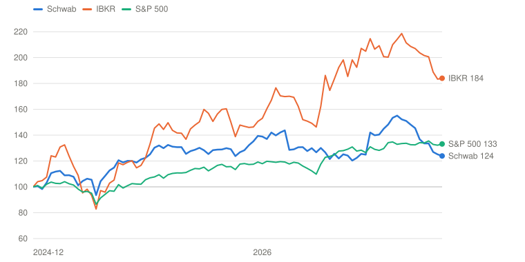
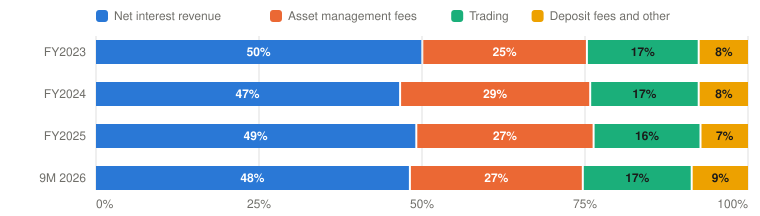
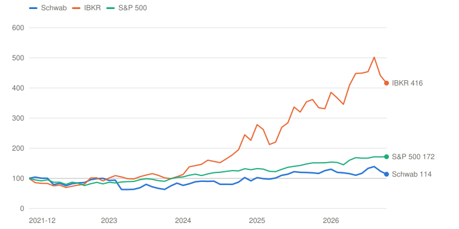

# SCHW — The Charles Schwab Corporation

> **Schema** v7.0 · **Updated** 2026-10-26 · **Status** Active
> **Price** $89.73 verified Oct 26, 2026 close, cross-checked on StockAnalysis ([Yahoo](https://finance.yahoo.com/quote/SCHW/)) · 52-wk $83.96–$114.53 · 19th %ile · −21.7% from high
> **Type** Brokerage and custody with an integrated bank · **Stage** Mature compounder · **Cyclical** No (rate-sensitive) · **Competence** Core

## Verdict

**Schwab printed a record quarter and guided its net interest margin lower, so I cut my value 8%; the price fell 11% over the same weeks, and the probability-weighted case now pays 13.2% a year against the 13% hurdle, a pass by a thin margin.**

🟢 **Non-holder: Initiate (entry ≤$91, probability-fragile)** · 🟢 **Holder: Add**

| PW EV | PW return/yr | Compounding/yr | R/R | Entry | Trim | Avoid | FY26E adj P/E | Yield | BAIT | Moat | Next |
|---|---|---|---|---|---|---|---|---|---|---|---|
| **$157** | **13.2% (≥13%)** | 10.9% | 7.2:1 | ≤$91 | $157–$232 | ≥$232 | ≈13.9× | 1.4% | Double (B+A) | Wide, stable | 📅 Oct 29 IMPACT · Jan 21 (Q4, est.) |

**Breaks if**: sweep cash excluding the long/short credits (Q3: $429.5B) falls below ~$415B at December 31 while the Fed is still hiking, or Q4 NIM prints under 3.15%.

⚠️ **Probability-fragile**: break-even Bear odds 26% against 25% assigned.

## The Call

The market is selling a record. Third-quarter adjusted EPS rose 29% to $1.69 and revenue 17%, and the stock fell 2.7% on the day, 7.5% over three sessions and is now 22% below its August high. It is reacting to a real change. Management moved full-year revenue and NIM to the low end of its July ranges, and the 25 to 30 bps of year-over-year NIM expansion the CFO described puts Q4 near 3.15 to 3.20%, about 10 bps under the 3.25 to 3.30% given in July. The headline sweep-cash figure hides the cause. Cash rose $7.1B only because long/short short credits rose $19.6B; without them it fell $12.5B in the quarter and is up 1.6% in a year while client assets grew 15%. Money-fund balances were flat and clients put cash into the market, so this is not 2023, but NIM now depends on old assets repricing, not on free cash growing.

I cut my five-year value 8%: Base EPS $10.15 at 16×, a multiple I now derive from a 9.5% cost of equity. The price fell further than the value, so the probability-weighted case returns 13.2% and clears 13% at $91. The price asks for only 5.1% a year of EPS growth, against 9.5% in my Base. The verb is probability-fragile: the break-even Bear odds are 26% against 25% assigned. December's cash balance excluding long/short settles it. The buyback fell to $0.5B at about $106 a share in the quarter, which keeps the Outsider grade at Steward.

## What I'd Have To Be Wrong About

1. **That cash holds without the long/short balances.** Test: transactional sweep cash less long/short short credits (Q3: $429.5B; June: $442.0B) stays at or above $415B at December 31 (Jan 21 release) and in the October and November monthly reports. **If Fail →** move 10 points from Base to Bear (PW EV $147, 11.9%/yr) → **Watch**, entry falls to $85.
2. **That NIM reaches the guided exit rate on stable funding costs.** Test: Q4 NIM at or above 3.15% in the Jan 21 release, and a January Winter Business Update that guides 2027 revenue growth to at least +8% (the low end of the high-single-digit framework) with positive operating leverage. **If Fail →** Base FY2031 EPS cut to ≈$9.00, NIM stuck near 3.1% (PW EV $147, 11.9%/yr) → **Watch**, entry $85.
3. **That asset gathering and capital return both hold.** Test: Q4 core net new assets at or above a 5% annualized rate (≈$165B) with Advisor Services at or above 5% after the September long/short curbs, and a Q4 buyback of at least $1.0B with adjusted Tier 1 leverage at or below 7.0% (Jan 21 release). **If Fail →** move 10 points from Bull to Bear (PW EV $140, 10.8%/yr) → **Watch**; the Outsider grade stays Steward and a second weak quarter moves it to Anti-Outsider.

## Latest update: 2026-10-26 · Record Q3, a lower NIM exit rate, and a stock down 7.5% in three sessions

- Sweep cash does not fall more than ~$15B in a quarter while the Fed hikes — ✅ Pass — +$7.1B to $492.8B on the letter; excluding long/short short credits it fell $12.5B, the closest call of the four
- Earnings step-up survives peak NIM (4Q26 NIM inside 3.25–3.30%) — 🔴 Fail — the CFO's 25–30 bps year-over-year expansion implies 3.15–3.20% against 2.90% a year earlier; the Base is cut and the multiple re-derived
- Core NNA and Advisor Services at or above 5% annualized — 🟡 Pending — Q3 core NNA 5.8%, Advisor Services about 8.4%; resolves with the Q4 print and the first full quarter after the September long/short curbs
- Buyback at about $1B a quarter or more — 🔴 Fail — $0.5B in Q3 (4.7M shares), half of Q2, with adjusted Tier 1 leverage at the 7.0% top of the range

Schwab reported the best quarter in its history on October 15 and the stock closed at $94.16, down 2.7% from $96.80. The next two sessions closed at $91.96 and $89.58, 7.5% below the pre-print close. It is $89.73 today, 22% under the August high of $114.53 and about 11% under the $101.14 on the last page.

| | Q3 2026 | Q3 2025 | Change | Against expectations |
|---|---|---|---|---|
| Net revenue | $7,171M | $6,135M | +17% | Press reports put it marginally under ~$7.2B; I could not verify a consensus figure |
| Adjusted EPS | $1.69 | $1.31 | +29% | $1.66 consensus `[Analyst consensus]` |
| Net interest revenue | $3,476M | $3,050M | +14% | +4% on Q2 |
| Net interest margin | 3.04% | 2.88% | +16 bps | +4 bps on Q2 |
| Adjusted pre-tax margin | 54.8% | 51.3% | +3.5 pts | Expenses +9% against revenue +17% |
| Net new assets | $192.4B | $134.4B | +43% | JPMorgan's Worthington had about $160B `[Analyst estimate]` |
| Buyback | $0.5B | n/d | | $1.0B in Q2 |

Sources: [Q3 2026 release](https://www.sec.gov/Archives/edgar/data/316709/000031670926000035/a3q26exhibit991.htm), [TIKR](https://www.tikr.com/blog/schwab-stock-falls-5-despite-record-190-billion-in-flows-heres-why).

The quarter was strong everywhere except the line the market watches most. NIM rose only 4 bps when the July guide had the fourth quarter at 3.25–3.30%. On the call Goldman's Alex Blostein asked where Q4 would land against that range. Mike Verdeschi answered with 25 to 30 bps of expansion over Q4 2025's 2.90%, which is 3.15–3.20%, and he did not repeat the old range. He also said full-year revenue and NIM would come in toward the low end of July's ranges because "loan growth has outpaced deposit growth." Expenses will also land at the low end, which is why EPS expectations barely moved: consensus is $6.44 for 2026 and $7.81 for 2027, within a nickel of the $6.49 and $7.83 on September 23.

The cash is the part I checked. Transactional sweep cash rose $7.1B to $492.8B, and Verdeschi said the rise reflected "an increase in the long/short strategy and organic growth, partially offset by clients reinvesting in markets." Schwab's own definition of the line includes the short credits in advisers' long/short accounts, which rose by $19.6B in the quarter, so the cash that earns the spread did not grow. The first debate below sets out the arithmetic and what it does to NIM. I accept his reading that clients put cash to work, because money-fund balances were flat, and I do not read this as the 2023 pattern.

On the other points, Rick Wurster said Schwab blocks agents that log in for clients but lets their own AI models connect through Schwab's authentication, that such traders have doubled in six months, and that they hold more cash than other active traders. That is the first evidence against the Altruist fear, and it is anecdotal. He said long/short growth was throttled in mid-September, when the minimum rose to $10M, that Advisor Services flows have shown no slowdown since, and that a proprietary long/short product is coming without a date. On capital, adjusted Tier 1 leverage ended at 7.0%, the top of the 6.75–7.00% range, because Schwab "allowed capital to build" to support clients. Bill Katz asked how the repurchase pace fits limited earning-asset growth, and the answer was priorities, not a number: lending first, then flexibility.

What this does to the debate: the franchise is intact and the earnings are still compounding, but the pace of NIM expansion now depends on lending and on old securities repricing, which is slower than free cash growth would have been. The cash test I set on the last page passed on its letter and passes on this evidence only narrowly, so I have moved its line to cash excluding long/short.

The scorecard consequences are applied as written. The NIM leg of the second test failed, so the Base is cut: FY2031 EPS from $10.35 to $10.15, and the exit multiple, which I now derive from a 9.5% cost of equity and a 23% return on equity, goes from 17× to 16×. The Bear is harsher, with a 2022–23 rerun worth $70 against $85. Probability-weighted value falls from $171 to $157 and the entry from $98 to $91. The buyback test failed, so the Outsider grade stays Steward and the third test now ties capital return to asset gathering.

The verb moves from Watch to Initiate, and it is price that moved it. My value fell 8%; the stock fell 11%, through a lower entry. Bias check: nobody paid to hold a view supplied an input; I would write Initiate with no previous page, but only barely, at 13.2% against 13%; analysts are cutting targets while I am cutting less than the price, so I am not following them; the deprival risk is that I am anchored to the $98 entry I set on September 23, and the stock is only now below a lower one; one quarter carries the change against a five-year record that has not changed. Because the break-even Bear odds are 26% against 25% assigned, I would treat the verb as Watch with a trigger if you read the cash numbers more darkly than I do.

Appearances in the window: the Fall Business Update (Oct 15, notes stored) and Wurster on Bloomberg Television on October 16 (a repost, no transcript retrieved). I found no CNBC or podcast appearance. Next are IMPACT on October 29 and the Winter Business Update in January. Insiders sold one block of $0.49M since September 23 and short interest is 1.05% of float, both in the Appendix.

---

## Deep Dive: Schwab: A Record Quarter and the Cash Under It

*Adjusted EPS rose 29% in the third quarter and the stock is 22% below its August high. The market is worried about cash, and the numbers back part of that worry. What does $89.73 already assume?*

**Contents**: [Business Overview](#business-overview) · [The Cash, and What It Funds](#the-cash-and-what-it-funds) · [The Engine That Gathers Assets](#the-engine-that-gathers-assets) · [Wurster, Capital Allocation and Incentives](#wurster-capital-allocation-and-incentives) · [Valuation and Model Assumptions](#valuation-and-model-assumptions) · [Final Words](#final-words) · [Appendix: The Numbers](#appendix-the-numbers) · [Sources](#sources)

On October 15, Schwab reported the best quarter in its history. Adjusted earnings per share were $1.69, up 29%. Revenue was $7.2 billion, up 17%. Clients added a record $192 billion of net new assets. The stock closed down 2.7% that day, and down 7.5% from the pre-print close three sessions later. It is $89.73 now, 22% below its August high, at 13.9 times the $6.44 of adjusted earnings expected for 2026.

The gap between the business and the stock is not new. Rick Wurster became CEO on January 1, 2025, taking over from Walt Bettinger, who stays as co-chairman with the founder, Charles Schwab. Since then adjusted EPS has gone from $3.25 to an expected $6.44, and revenue from $19.6 billion to about $28 billion. A shareholder who owned the stock on the last day of 2024 has made 24% including dividends. The S&P 500 made 33%. Interactive Brokers, which competes hardest for Schwab's active traders, made 84%.

*Total return including dividends, weekly, December 31, 2024 (the day before Wurster became CEO) = 100, through October 26, 2026. Source: Yahoo Finance adjusted closes. Built with Claude.*

| Date | Schwab | IBKR | S&P 500 |
|---|---|---|---|
| 2024-12-31 | 100 | 100 | 100 |
| 2025-04-11 | 104 | 97 | 91 |
| 2025-08-08 | 132 | 150 | 109 |
| 2025-11-21 | 124 | 139 | 113 |
| 2026-03-06 | 131 | 152 | 116 |
| 2026-07-10 | 142 | 215 | 131 |
| 2026-10-23 | 125 | 183 | 132 |
| 2026-10-26 | 124 | 184 | 133 |

The usual explanation is that Schwab's earnings are a rate trade. Net interest revenue is 48% of revenue, the Fed raised rates on September 16, its first increase since 2023, and the last time rates rose, in 2022 and 2023, clients moved cash out and the stock lost about 40% between month-ends. I take that reading seriously and want to check it against the balance sheet. What the check turns up is narrower than the fear. The headline cash number is flattered by one product, and the pace at which Schwab adds cheap funding has slowed. It does not show clients leaving.

This piece starts with the business and its segments. It then takes the cash and funding question, which is the debate that decides the stock, followed by the engine that gathers assets. After that come management's capital allocation and incentives, and valuation: what $89.73 already assumes, and what has to be true to earn 13% a year. Schwab reports the fourth quarter around January 21, and its 2027 scenario arrives the same day, so the three tests are close.

### Business Overview

Schwab reports two segments. Investor Services is the retail side: brokerage, trading, banking, retirement plans and stock-plan administration for about 40 million active accounts. Advisor Services is custody and clearing for roughly 16,000 independent advisory firms, with $5.8 trillion of client assets. Between them they hold $13.3 trillion, which management says is the most of any firm, and they run it at about 10 basis points of expense per dollar of assets.

| $ Million | FY2023 | FY2024 | FY2025 | 6M 2025 | 6M 2026 |
|---|---|---|---|---|---|
| **Investor Services** |  |  |  |  |  |
|  Net revenues | 14,650 | 15,558 | 18,999 | 9,080 | 10,605 |
|  Pre-tax income | 5,211 | 6,320 | 9,321 | 4,285 | 5,374 |
|  Pre-tax margin | 35.6% | 40.6% | 49.1% | 47.2% | 50.7% |
| **Advisor Services** |  |  |  |  |  |
|  Net revenues | 4,187 | 4,048 | 4,922 | 2,370 | 2,949 |
|  Pre-tax income | 1,167 | 1,372 | 2,138 | 973 | 1,483 |
|  Pre-tax margin | 27.9% | 33.9% | 43.4% | 41.1% | 50.3% |
| **Total net revenues** | 18,837 | 19,606 | 23,921 | 11,450 | 13,554 |
| **Total pre-tax income** | 6,378 | 7,692 | 11,459 | 5,258 | 6,857 |
|  Pre-tax margin | 33.9% | 39.2% | 47.9% | 45.9% | 50.6% |

*GAAP segment results, which include amortization of acquired intangibles. Segment pre-tax income sums to the consolidated total. The Q3 10-Q is not filed yet, so the latest segment split is six months. Source: [FY2025 10-K note 24](https://www.sec.gov/Archives/edgar/data/316709/000031670926000009/schw-20251231.htm), [Q2 2026 10-Q](https://www.sec.gov/Archives/edgar/data/316709/000031670926000031/schw-20260630.htm). Built with Claude.*

The table tells most of the story. Pre-tax margin in Investor Services went from 35.6% in FY2023 to 50.7% in the first half of 2026, and in Advisor Services from 27.9% to 50.3%, so the segment that was the weaker earner has caught up. Revenue grew 27% between FY2023 and FY2025 while expenses were flat at $12.5 billion, helped by the end of the TD Ameritrade integration, and 2026 expenses are growing about 9% against revenue growth of about 18%. Most of the margin gain is operating leverage on a fixed cost base.

| $ Million | FY2023 | FY2024 | FY2025 | 9M 2025 | 9M 2026 | 9M change |
|---|---|---|---|---|---|---|
| Net interest revenue | 9,427 | 9,144 | 11,750 | 8,578 | 9,977 | +16% |
| Asset management and administration fees | 4,756 | 5,716 | 6,506 | 4,773 | 5,497 | +15% |
| Trading revenue | 3,230 | 3,264 | 3,921 | 2,855 | 3,462 | +21% |
| Bank deposit account fees | 705 | 729 | 977 | 739 | 973 | +32% |
| Other | 719 | 753 | 767 | 640 | 816 | +28% |
| **Total net revenues** | 18,837 | 19,606 | 23,921 | 17,585 | 20,725 | +18% |
|  Adjusted pre-tax margin | — | 42.5% | 50.0% | 49.3% | 53.5% | +4.2 pts |

*Adjusted excludes amortization of acquired intangibles and acquisition costs. Source: [FY2025 10-K](https://www.sec.gov/Archives/edgar/data/316709/000031670926000009/schw-20251231.htm), [Q3 2026 release](https://www.sec.gov/Archives/edgar/data/316709/000031670926000035/a3q26exhibit991.htm), [Q4 2025 release](https://www.businesswire.com/news/home/20260121223561/en/Schwab-Reports-Record-4Q-and-Full-Year-2025-Results). Built with Claude.*

*Share of net revenue. Source: [FY2025 10-K](https://www.sec.gov/Archives/edgar/data/316709/000031670926000009/schw-20251231.htm), [Q3 2026 release](https://www.sec.gov/Archives/edgar/data/316709/000031670926000035/a3q26exhibit991.htm). Built with Claude.*

| Period | Net interest revenue | Asset management fees | Trading | Deposit fees and other | Total ($M) |
|---|---|---|---|---|---|
| FY2023 | 9,427 (50%) | 4,756 (25%) | 3,230 (17%) | 1,424 (8%) | 18,837 |
| FY2024 | 9,144 (47%) | 5,716 (29%) | 3,264 (17%) | 1,482 (8%) | 19,606 |
| FY2025 | 11,750 (49%) | 6,506 (27%) | 3,921 (16%) | 1,744 (7%) | 23,921 |
| 9M 2026 | 9,977 (48%) | 5,497 (27%) | 3,462 (17%) | 1,789 (9%) | 20,725 |

Net interest revenue is roughly half of revenue and has been for three years. Asset management and administration fees are a quarter, trading a sixth, and the remainder is deposit fees that Schwab earns from the banks that hold part of its clients' cash. The mix has shifted slightly toward trading and deposit fees in 2026 because those lines grew faster than interest revenue.

A few accounting points matter before the debate. Schwab guides on adjusted figures that exclude about $141 million a quarter of amortization of acquired intangibles and small acquisition costs, so Q3 GAAP EPS was $1.62 against $1.69 adjusted. I model on the adjusted basis because the pay plan uses it. Beginning in the fourth quarter of 2025, Schwab moved the margin loans and short credits in advisers' long/short accounts out of interest-earning assets and funding sources, and shows their income in "other interest revenue" at a fixed net yield. NIM from that quarter is therefore not comparable with earlier quotes. And the line called transactional sweep cash includes those short credits, which turns out to matter. Finally, Forge Global, the private-markets business bought for $636 million, has been consolidated since March 2026 and accounts for about 100 basis points of this year's expense growth.

### The Cash, and What It Funds

Let me start with where things stand.

| Unit: a client dollar and an account | Q3 2025 | Q4 2025 | Q1 2026 | Q2 2026 | Q3 2026 |
|---|---|---|---|---|---|
| Active brokerage accounts (M) | 37.96 | 38.51 | 39.10 | 39.80 | **40.26** |
| Client assets, quarter end ($T) | 11.59 | 11.90 | 11.77 | 13.08 | **13.33** |
| Net new assets ($B) | 134.4 | 158.2 | 139.9 | 118.7 | **192.4** |
| Annualized rate on beginning assets | 5.0% | 5.5% | 4.7% | 4.0% | **5.9%** |
| Revenue ÷ average client assets (bps) | 22.0 | 21.6 | 21.9 | 22.8 | 21.7 |
| Expense ÷ average client assets (bps) | 11 | 11 | 11 | 11 | 10 |
| Revenue per active account, annualized | $646 | $658 | $663 | $711 | $712 |
| Net interest margin | 2.88% | 2.90% | n/d | 3.00% | **3.04%** |
| Pre-tax margin (GAAP) | 49.2% | 50.2% | 49.2% | 51.9% | 52.7% |

*Unit of value: a client dollar and a funded account. Rates on beginning assets and revenue per account are `[Derived]` from the release tables (ending accounts). Q1 2026 NIM is not in the files I could extract. Source: [Q3 2026 release](https://www.sec.gov/Archives/edgar/data/316709/000031670926000035/a3q26exhibit991.htm), [Q4 2025 release](https://www.businesswire.com/news/home/20260121223561/en/Schwab-Reports-Record-4Q-and-Full-Year-2025-Results). Built with Claude.*

Client assets grew 15% in a year, partly from the market and partly from 5.8% annualized organic gathering. Revenue per dollar of assets has stayed near 22 basis points while expense per dollar slipped from 11 to 10, so earnings growth comes from more dollars and a slightly wider margin on each. That is the setup. The debate is whether NIM keeps rising, and what it takes to make it do so.

#### Management's narrative

Management's case, as Mike Verdeschi laid it out on the October 15 call, has four parts. First, Schwab is asset-sensitive and rates are higher, so NIM expands: about 25 to 30 basis points over the fourth quarter of 2025, and more in 2027. Second, the balance sheet has changed. Lending balances now exceed the securities portfolio, at spreads he called very favorable, and about $190 billion of securities still yield under 2% and will reprice upward as they mature. He put it plainly:

> "I do think about net interest margin as Fed funds plus."
> — Mike Verdeschi, CFO, Fall Business Update and Q3 call, October 15, 2026

Third, the cash is not leaving. Asked about the decline in September balances alongside a Fed hike, he said it was not "cash sorting in any way": clients put money to work as sentiment improved and IPOs priced, and the seasonal inflow starts in mid-November. Fourth, the rate sensitivity is favorable. Since the second quarter Schwab has measured it on a balance sheet that changes size with rates, and the 10-Q shows +100 basis points adding 3.6% to net interest revenue over twelve months and −100 basis points costing 1.6%.

I think most of that is right. The direction of NIM is up, the mix of assets is improving, and the 10-Q sensitivity is about as good as one could hope for in a bank. Where I part from the case is on how fast, and on what is paying for it.

#### Poking holes in it

The first hole is the cash number itself. Transactional sweep cash rose $7.1 billion to $492.8 billion, which Verdeschi attributed to growth in long/short strategies and organic gathering, partly offset by clients reinvesting. Schwab's own definition of the line includes the short credits in those long/short accounts, and the monthly activity report shows them rising from $43.7 billion at June 30 to $63.3 billion at September 30.

| $ Billion, quarter end | Q3 2025 | Q2 2026 | Q3 2026 | Change vs. Q3 2025 |
|---|---|---|---|---|
| **Where the money went** |  |  |  |  |
|  Bank loans | 53.6 | 67.0 | 72.3 | +18.7 |
|  Margin receivables (non-long/short) | 93.8 | 122.8 | 128.1 | +34.3 |
|  Available-for-sale and held-to-maturity securities | 199.0 | 193.1 | 185.6 | −13.4 |
|  Cash and segregated cash | 78.4 | 73.6 | 68.5 | −9.9 |
| **Where it came from** |  |  |  |  |
|  Bank deposits | 239.1 | 249.7 | 244.1 | +5.0 |
|  Payables to brokerage clients | 115.4 | 124.0 | 125.2 | +9.8 |
|  Payables to brokers and clearing organizations (repo, securities loaned) | 22.4 | 43.8 | 46.5 | +24.1 |
|  Other short-term borrowings | 6.5 | 13.9 | 14.2 | +7.7 |
|  Federal Home Loan Bank borrowings | 0.9 | 0.5 | 2.0 | +1.1 |
|  Long-term debt | 20.2 | 22.7 | 23.8 | +3.6 |
| **Total assets** | 465.3 | 517.3 | 520.7 | +55.4 |
|  Memo: receivables from brokers (securities borrowed, the matched side of the repo) | 4.7 | 22.0 | 27.2 | +22.5 |
| **The cash number** |  |  |  |  |
|  Transactional sweep cash (headline) | 425.6 | 485.7 | 492.8 | +67.2 |
|  Less long/short short credits | ≈2.8 | 43.7 | 63.3 | +60.5 |
| **Sweep cash excluding long/short** | ≈422.8 | 442.0 | **429.5** | +6.7 (+1.6%) |

*The Q3 2025 short-credit figure is the quarter's average ($2.8B), used because the month-end is not in the files; the exclusion is `[Derived]`. Schwab's own definition of transactional sweep cash includes the short credits. Source: [Q3 2026 release](https://www.sec.gov/Archives/edgar/data/316709/000031670926000035/a3q26exhibit991.htm) (balance sheet and September monthly activity report), [Q2 2026 release](../../../raw/SCHW/press-releases/2026-07-21_Q2-2026_earnings.txt). Built with Claude.*

Strip them out, as the bottom rows do, and sweep cash fell $12.5 billion in the quarter, 2.8%, and is up only 1.6% in a year while client assets grew 15%. Money-market fund balances were flat at $700.5 billion and total client cash slipped from 9.4% to 8.9% of assets over twelve months, mostly because assets rose. I accept Verdeschi's reading of why: clients bought ETFs and equities. What I cannot do is treat the headline as evidence that cheap funding is growing, because its source is a product Schwab has just capped.

The second hole is the speed of the repricing. Securities of $190 billion yielding under 2% sound like a coiled spring, and I understand why management leans on it. But in the twelve months to September the combined available-for-sale and held-to-maturity book shrank by only $13.4 billion, to $185.6 billion, and the held-to-maturity yield barely moved, from 1.70% to 1.72%. Moving $10 billion from that book into bank loans at the same funding earns about 2.7 percentage points, which is $271 million a year before tax, or about 12 cents of EPS. At the pace of the last year, that swap happens to roughly $13 billion a year, worth about 16 cents, or 2.5% of annual EPS. A good tailwind and a slow one. The cut to the fourth-quarter NIM guide says it is slower than the July scenario assumed.

The third hole is that the marginal dollar is not free. Lending rose $53 billion in a year, $34 billion of it in margin loans and $19 billion in bank loans. About $23 billion of that growth was funded by running down cash and securities, which is the accretive swap. Client cash on the balance sheet rose $15 billion. Borrowings rose $36 billion, although $24 billion of that is repo and securities-loaned funding with a matching $22.5 billion asset in securities borrowed, which earns its own spread. So roughly $14 billion of unmatched wholesale funding is paying for lending, at about 4%.

What that does to the economics is easiest to see in a table of one dollar.

| A dollar of client cash is put into… | Q3 yield | Spread if funded by a sweep deposit (0.23%) | Spread if funded by wholesale borrowing (4.06%) |
|---|---|---|---|
| Held-to-maturity securities | 1.72% | +1.49 pts | −2.34 pts |
| Available-for-sale securities | 2.31% | +2.08 pts | −1.75 pts |
| Cash at the Fed and segregated cash | 3.59% | +3.36 pts | −0.47 pts |
| Bank loans (Pledged Asset Line, mortgages) | 4.43% | +4.20 pts | +0.37 pts |
| Margin loans | 5.70% | +5.47 pts | +1.64 pts |
| **Memo: company net interest margin, Q3** | 3.04% |  |  |
| Moving $10B from held-to-maturity securities into bank loans, same funding |  | +2.71 pts = +$271M a year before tax, about +$0.12 of EPS |  |

*Illustrative. Yields and funding rates are Q3 2026 averages from the net interest revenue table (bank deposits 0.23%, other short-term borrowings 4.06%); real marginal funding mixes several sources, and the EPS effect uses a 23.1% tax rate and 1.73B shares. The estimates are mine. Source: [Q3 2026 release](https://www.sec.gov/Archives/edgar/data/316709/000031670926000035/a3q26exhibit991.htm). Built with Claude.*

A bank loan funded by a sweep deposit earns 4.20 points. The same loan funded with wholesale borrowing earns 0.37. A margin loan funded wholesale earns 1.64. When Verdeschi says NIM is Fed funds plus, he is right only while the marginal dollar of funding is cheap. The NIM trim in October is what the arithmetic predicts when loans outrun client cash. Each 10 basis points of NIM on about $470 billion of earning assets is $470 million before tax, about 21 cents of EPS, or 3% of next year's earnings, so the 10 basis points shaved from the fourth-quarter guide is worth roughly a 3% haircut to the 2027 starting point.

Where I come out: the direction is right and the pace is slower. Behind the Base's revenue growth I assume NIM peaks near 3.3% in 2027 and settles between 3.1% and 3.2% by 2031, as rates stop rising, securities reprice slowly, and lending grows faster than client cash. Behind the Bear I assume about 2.6%. Neither path needs cash to leave.

#### What the last rate cycle did

The Bear is easiest to picture by looking at what happened last time.

*Total return including dividends, monthly, December 31, 2021 = 100, through October 2026. Source: Yahoo Finance adjusted closes. Built with Claude.*

| Date | Schwab | IBKR | S&P 500 |
|---|---|---|---|
| 2021-12 | 100 | 100 | 100 |
| 2022-10 | 96 | 101 | 82 |
| 2023-08 | 72 | 116 | 97 |
| 2024-06 | 91 | 156 | 119 |
| 2025-04 | 101 | 220 | 122 |
| 2026-02 | 120 | 367 | 153 |
| 2026-10 | 114 | 416 | 172 |

From the end of 2021, Schwab's total return is 14%, against 72% for the S&P 500 and 316% for Interactive Brokers. The month-end index fell from 104 in January 2022 to 63 in March 2023 on the deposit-flight scare and the unrealized bond losses behind it. The balance sheet today is different in the ways that matter. Federal Home Loan Bank borrowings are $2.0 billion against $41 billion in mid-2023, adjusted Tier 1 leverage is 7.0%, and the rate model now builds in wholesale funding when deposits run off. But Schwab still carries $10.4 billion of accumulated other comprehensive losses, and the Bear in my model assumes a rerun in which cash sorts into money funds and is replaced at wholesale rates, equities fall a quarter, and the multiple compresses.

#### Three rings of profit

As with most financials, profit by revenue line is not disclosed, so I rank the revenue by how exposed it is to the debate above.

| Ring | Q3 2026 revenue ($M) | Share | Change vs. Q3 2025 | What moves it |
|---|---|---|---|---|
| **1 · Net interest revenue** | 3,476 | 48.5% | +14% | NIM and the funding mix; cash balances; securities running off at about $13B a year |
| **2 · Bank deposit account fees and other** | 624 | 8.7% | +50% | The net yield on third-party deposits; rate-linked and small |
| **3 · Trading revenue** | 1,158 | 16.1% | +16% | Daily trades (10.7M vs. 7.4M a year ago); revenue per trade fell 20% to $1.69 |
| **4 · Asset management and administration fees** | 1,913 | 26.7% | +14% | Client asset levels and mix; money funds at 0.27%, managed solutions at 0.31% |

*Share of Q3 2026 net revenue; profit by line is not disclosed, so rings are ranked by exposure to the cash and funding debate. Source: [Q3 2026 release](https://www.sec.gov/Archives/edgar/data/316709/000031670926000035/a3q26exhibit991.htm). Built with Claude.*

Ring one is half of revenue and is where the cash debate is fought. Ring four, a quarter of revenue, depends on client asset levels and fund mix, not on rates, so it is exposed to equity markets instead. Ring three is trading, which was 10.7 million daily trades in Q3 against 7.4 million a year earlier, with revenue per trade down 20%. Management called the engagement sustainable in July and now credits AI for part of it. The model has no separate trading line. It sits inside Investor Services, where the Base growth of 5.8% a year assumes trading roughly keeps pace with assets and the Bear's 2.5% assumes it shrinks. The rings show a risk that is real and concentrated, with about half of revenue directly exposed and half exposed mainly to markets.

### The Engine That Gathers Assets

Everything above is a story about the spread on assets Schwab already has. The other half of the earnings comes from gathering more of them, and in the third quarter that engine ran faster than at any time in the company's history.

| $ Billion | Q3 2025 | Q4 2025 | Q1 2026 | Q2 2026 | Q3 2026 |
|---|---|---|---|---|---|
| Investor Services net new assets | 52.7 | 60.4 | 54.1 | 38.5 | 72.3 |
| Advisor Services net new assets | 81.7 | 97.8 | 85.8 | 80.2 | **120.1** |
| **Total net new assets** | 134.4 | 158.2 | 139.9 | 118.7 | **192.4** |
|  Advisor Services, annualized on beginning assets | n/d | 7.8% | 6.6% | 6.2% | **8.4%** |
|  Long/short margin loans, quarter end | ≈3 (avg.) | n/d | n/d | 42.1 | **60.7** |
|  Long/short short credits, quarter end | ≈3 (avg.) | n/d | n/d | 43.7 | **63.3** |
|  New brokerage accounts (thousands) | 1,143 | 1,268 | 1,299 | 1,388 | 1,243 |

*Advisor Services rates are `[Derived]` on beginning-of-quarter Advisor Services assets. Schwab does not disclose how much of Advisor Services flow came from long/short clients. Source: [Q3 2026 release](https://www.sec.gov/Archives/edgar/data/316709/000031670926000035/a3q26exhibit991.htm), [Q2 2026 release](../../../raw/SCHW/press-releases/2026-07-21_Q2-2026_earnings.txt). Built with Claude.*

#### Management's narrative

Rick Wurster's case on the October 15 call was that growth is broad. Retail net new assets rose 39% year over year, the best third quarter on record, led by households with a dedicated financial consultant, who bring about three times the net new assets of comparable households without one. Advisor Services is the market leader, and in 2025 more than 1,100 firms added Schwab as custodian, over three times the number added by the next provider. Managed investing flows set a record at $24 billion. Wurster also argued that AI helps, not hurts: clients using AI models to trade through Schwab's interfaces have doubled in six months, and he said they hold more cash than other active traders.

#### Poking holes in it

The first hole is long/short. The strategies pair long positions with short positions, funded by margin loans against short credits, and advisers use them to harvest tax losses. Their margin loans at Schwab went from an average of $2.8 billion in Q3 2025 to an average of $51.4 billion in Q3 2026, and $60.7 billion at September 30. Advisor Services net new assets stepped up from $80.2 billion in Q2 to $120.1 billion in Q3, an annualized 8.4%, in the same quarter that those balances grew by roughly $19 billion each way. Schwab does not say how much of the flow came from long/short clients. Wurster himself said some of it did, and that growth accelerated beyond plan because a large competitor had less capacity; Fidelity paused new long/short accounts in December 2025. Schwab has since limited the share of an adviser's assets that can go into long/short in April, raised the minimum from $1 million to $10 million on September 16 and stopped taking new money into portfolio-margin accounts. September's core flow of $67.5 billion was the highest since March's $79.7 billion and above July and August, so the throttle has not yet shown up. The October report in mid-November is the first look.

The second hole is that the quarter's strength in Investor Services is partly seasonal. Its flows doubled from $38.5 billion in Q2 to $72.3 billion, but Q2 contains tax-payment season. New brokerage accounts fell 10% from the second quarter to 1.24 million.

The third is competition on the customers Schwab most wants. Interactive Brokers grew customer equity 27% and accounts 35% over the year, at a 78% pre-tax margin, from a base of $965 billion. Schwab's active accounts grew 6%. That is not a loss of share in assets, but it is the active, affluent trader moving toward a competitor with a different price and product.

The fourth is AI. On September 22 Altruist launched an AI agent aimed at advisers, and Schwab's stock fell 6.1% that day, which the press tied to the launch and to a reassessment of rate sensitivity. Schwab's answer, that it blocks agents that log in for clients and lets approved models connect under its authentication, with no authority to move money, is a coherent position. It also admits a threat: the control point is the login. Wurster described the daily report of blocked agents as small. Nothing in the flows yet supports the fear. Nothing in them yet rules it out.

Where I come out: the 5.8% organic rate is real and the franchise is the best at what it does. I plan on 5% going forward, taking long/short as a tailwind that is now being rationed. The second test measures that.

### Wurster, Capital Allocation and Incentives

Rick Wurster joined Schwab in 2016 to run its ThomasPartners and Windhaven subsidiaries, after careers at Wellington Management and McKinsey. He then ran Schwab's asset management businesses, became president in 2021, and CEO on January 1, 2025. The prior-tenure test therefore has no earlier chief-executive role to examine. The record that counts is the one in the opening chart: earnings nearly doubled in less than two years, the TD Ameritrade integration was completed on December 31, 2024, and the stock has lagged.

| Deal | When and what | What happened | Verdict |
|---|---|---|---|
| **TD Ameritrade** | Closed Oct 6, 2020; all-stock merger | Integration finished Dec 31, 2024: $1.9T of assets and 17M+ accounts converted, about $2.0B of run-rate cost synergies, about $2.5B of integration cost and capex, attrition below the deal case ([FY2025 10-K](https://www.sec.gov/Archives/edgar/data/316709/000031670926000009/schw-20251231.htm)) | Good |
| **USAA-IMCO brokerage** | 2020; $79.9B of client assets | Assets moved onto the platform (FY2021 10-K); no separate economics disclosed | Unclear |
| **Wasmer Schroeder** | 2020; $8.5B of client assets | Fixed-income separately managed accounts offered to retail from 2021; small | Unclear |
| **TD Group nonvoting shares** | Feb 2025; 19.2M shares for $1.5B at $77.98 | Retired the last TD overhang at $77.98, below today's $89.73 | Good |
| **Forge Global** | Mar 2, 2026; $636M cash and other consideration | Private-company access; about 100 bps of 2026 expense growth; no revenue disclosed ([Q2 10-Q](https://www.sec.gov/Archives/edgar/data/316709/000031670926000031/schw-20260630.htm)) | Too early |

*Source: company 10-Ks and 10-Q as linked; verdicts are the author's. Built with Claude.*

The deal record is good. TD Ameritrade moved 17 million accounts and $1.9 trillion of assets with attrition below plan and about $2.0 billion of cost savings, at a total integration cost of $2.5 billion. The February 2025 purchase of TD's remaining shares at $77.98 was a good price. Forge is too early to grade, and at $636 million is small against a $155 billion market value.

#### The cash

| $ Billion | Net revenue | YoY | Diluted EPS (GAAP / adj.) | Net income to common | SBC | Capex | Common dividends | Buybacks | Payout | Diluted shares (B) |
|---|---|---|---|---|---|---|---|---|---|---|
| FY2021 | 18.5 | +58% | $2.83 / n/a | 5.36 | 0.25 | 0.92 | 1.37 | 0.00 | 25% | 1.897 |
| FY2022 | 20.8 | +12% | $3.50 / n/a | 6.64 | 0.37 | 0.97 | 1.59 | 3.40 | 75% | 1.894 |
| FY2023 | 18.8 | −9% | $2.54 / n/a | 4.65 | 0.32 | 0.70 | 1.84 | 2.84 | 101% | 1.831 |
| FY2024 | 19.6 | +4% | $2.99 / $3.25 | 5.48 | 0.34 | 0.62 | 1.84 | 0.00 | 34% | 1.834 |
| FY2025 | 23.9 | +22% | $4.65 / $4.87 | 8.42 | 0.32 | 0.55 | 1.96 | 7.35 | 110% | 1.809 |
| 9M 2026 | 20.7 | +18% | $4.53 / $4.73 | 7.89 | n/d | 0.65 | ≈1.67 | 3.9 | ≈71% | 1.733 (Q3) |
| **FY2021–25 cumulative** | 101.6 |  |  | 30.54 | 1.59 | 3.74 | 8.59 | 13.58 | 73% | −4.6% |

*Net income to common is GAAP. Capex is purchases of property and equipment; 9M 2026 excludes the $0.63B software-license liability recorded in Q2. 9M dividends are `[Derived]` at $0.32 a share. Banks' operating cash flow swings with brokerage balances, so it is not shown. Source: [SEC XBRL company facts](https://data.sec.gov/api/xbrl/companyfacts/CIK0000316709.json), [Q3 2026 release](https://www.sec.gov/Archives/edgar/data/316709/000031670926000035/a3q26exhibit991.htm). Built with Claude.*

From FY2021 through FY2025 Schwab earned $30.5 billion for common shareholders and returned $22.2 billion to them, 73%, with the diluted share count falling 4.6%. In 2025 the payout was 110% because $7.3 billion went to buybacks, including $1.5 billion to TD. In 2026 it has been 71% through nine months and falling. The table shows a company that returns most of what it earns, went above 100% in two of the five years, and is now choosing to lend the difference.

| Quarter | Repurchased ($B) | Shares (M) | Average price paid | Stock range in the quarter | Read |
|---|---|---|---|---|---|
| Q4 2025 | 2.7 | 29.2 | $92.5 | $89.35–$102.28 | Bought through the range |
| Q1 2026 | 2.4 | n/d | ≈$99 | $90.51–$107.50 | Heavy near the middle of the range |
| Q2 2026 | 1.0 | 11.2 | $89.3 | $83.96–$100.76 | Cut by 58% in the quarter of the 52-week low |
| Q3 2026 | 0.5 | 4.7 | ≈$106 | $92.31–$114.53 | Small, near the highs |

*Average price paid is repurchase dollars divided by shares (rounded to $0.1B, so Q3 is ±$10). Q1 dollars are six-month ($3.4B) less Q2 ([Q2 10-Q](https://www.sec.gov/Archives/edgar/data/316709/000031670926000031/schw-20260630.htm)); the Q1 average is from the prior page. About $10.6B remains of the $20B authorization (`[Derived]`: $14.5B at December 31 less $3.9B). Source: [Q4 2025 release](https://www.businesswire.com/news/home/20260121223561/en/Schwab-Reports-Record-4Q-and-Full-Year-2025-Results), [Q3 2026 release](https://www.sec.gov/Archives/edgar/data/316709/000031670926000035/a3q26exhibit991.htm), price ranges from Yahoo Finance daily bars. Built with Claude.*

That is the right place to apply the Outsiders test, which asks whether a company buys more when the stock is cheap. Schwab bought $2.7 billion in the fourth quarter of 2025 at about $92 and $2.4 billion in the first quarter at about $99, and then cut to $1.0 billion in the quarter the stock made its 52-week low of $83.96, and to $0.5 billion in a quarter when it traded between $92 and $114. That is the opposite pattern of an Outsider. My grade is Steward (not Outsider).

I do not think the explanation is bad faith. Verdeschi's stated order is clients first and opportunistic returns after, and the economics support the order when funding is cheap. A $10 billion bank loan needs about $0.7 billion of Tier 1 capital at 7%. Funded by a sweep deposit it earns about $323 million after tax on that capital, a 46% return. Funded with wholesale borrowing it earns about $28 million, 4%. A buyback at today's price buys earnings at a 7.2% yield (all `[Derived]`, illustrative). So Verdeschi's priority is correct if the loans are funded by clients' cash and wrong if they are funded in the market, and the funding table above is the evidence on which one is happening. I count that as the same debate seen from the capital side.

#### The incentives

| Component (Wurster, 2025) | Size | What it pays for | Latest outcome |
|---|---|---|---|
| **Base salary** | $1.25M | Fixed | — |
| **Annual cash incentive** | $4.73M paid | 100% adjusted diluted EPS against the board-approved plan | 2025 EPS $4.87 against a $4.18 target; funded at 116.5% |
| **Performance RSUs** | $7.61M grant (60% of long-term pay) | Three-year average ROTCE excluding AOCI ÷ cost of equity | 2023–25 award: 20.27% ÷ 9.50% = 213%, paid 100% |
| **Stock options** | $5.08M grant (40% of long-term pay) | Share price | — |
| **Return on invested capital** | Inside the PBRSU | ROTCE ÷ cost of equity | Above the cap on the 2023–25 award |
| **Total, 2025 summary compensation table** | $18.76M |  |  |

*Source: [2026 proxy statement](https://www.sec.gov/Archives/edgar/data/316709/000119312526142826/d930509ddef14a.htm). Built with Claude.*

The cash bonus pays on adjusted EPS against a plan the board set at $4.18 for 2025. Actual EPS was $4.87, so the target sat 14% below the outcome in a year when rates did most of the work, and the bonus paid 116.5%. The performance shares are the better design: a three-year average ROTCE excluding the AOCI drag, divided by a 9.5% cost of equity. The 2023 to 2025 award came in at 213% of the hurdle and paid 100% of target. Nothing in the plan pays for NIM, deposit growth, funding mix or net new assets, and nothing penalizes diluting returns by lending against wholesale funding. That is the specific thing I would change.

So is Wurster the right manager? On operations I think the answer is yes: the integration is done, costs are flat, asset gathering is the best in the industry and the company has been candid about what it cannot control. His first real capital-allocation test is now, as lending replaces buybacks as the use of marginal capital. The guidance grade is Consistent beater on EPS, with a $1.69 print against a $1.66 consensus after a one-cent miss in the fourth quarter of 2025, and a revenue and NIM guide now at the low end of the July range for the first time this year.

### Valuation and Model Assumptions

For a financial, the right question is what the equity earns on tangible capital and how long it keeps doing so. I model Schwab on adjusted EPS by segment, with a cross-check on justified price to tangible book. Investor Services and Advisor Services each carry revenue growth and an adjusted pre-tax margin. Preferred dividends and a tax rate take them to net income to common, and net buybacks net of dilution take that to a per-share figure. FY2026 is calibrated to the $6.44 consensus. The 2031 value is EPS times an exit multiple.

The exit multiple needs a reason this time. I derive it from a 9.5% cost of equity, the one the proxy uses, 4% sustainable growth and a 23% return on equity, the average of the 25% reported and the 20% excluding AOCI. That gives a payout of 83% and a justified multiple of 0.83 × 1.04 ÷ (9.5% − 4%) = 15.7 times, which I round to 16. The prior page carried 17 times forward, a turn too generous, and I have corrected it. As a cross-check, the market value is 5.8 times average tangible common equity, against a justified 7.3 times at a 44% ROTCE, though that ROTCE falls if rates do. The Bull gets 19 times and the Bear 12.

| $ Billion | FY2025A | FY2026E | FY2027E | FY2028E | FY2029E | FY2030E | FY2031E |
|---|---|---|---|---|---|---|---|
| **Investor Services revenue** | 19.0 | 21.9 | 23.2 | 24.6 | 26.0 | 27.5 | 29.1 |
|  YoY growth | — | 15.5% | **5.8%** | **5.8%** | **5.8%** | **5.8%** | **5.8%** |
|  Operating margin | 51.3% | 53.6% | 54.1% | 54.6% | 55.0% | 55.5% | **56.0%** |
|  Operating profit | 9.74 | 11.76 | 12.55 | 13.40 | 14.30 | 15.26 | 16.29 |
| **Advisor Services revenue** | 4.9 | 6.2 | 6.7 | 7.2 | 7.8 | 8.4 | 9.0 |
|  YoY growth | — | 25.8% | **7.8%** | **7.8%** | **7.8%** | **7.8%** | **7.8%** |
|  Operating margin | 45.3% | 52.8% | 53.3% | 53.9% | 54.4% | 55.0% | **55.5%** |
|  Operating profit | 2.23 | 3.27 | 3.56 | 3.88 | 4.22 | 4.59 | 5.00 |
| Corporate and other | — | (0.00) | (0.00) | (0.00) | (0.00) | (0.00) | (0.00) |
| **Total revenue** | 23.9 | 28.1 | 29.9 | 31.8 | 33.7 | 35.8 | 38.1 |
| **Operating profit** | 11.97 | 15.03 | 16.11 | 17.28 | 18.52 | 19.86 | 21.29 |
|  Operating margin | 50.0% | 53.4% | 53.9% | 54.4% | 54.9% | 55.4% | 55.9% |
| Net income | 8.81 | 11.16 | 11.98 | 12.86 | 13.80 | 14.81 | 15.89 |
| Diluted shares (B) | 1.809 | 1.732 | 1.697 | 1.663 | 1.630 | 1.598 | 1.566 |
|  Net share change | — | — | -2.0% | -2.0% | -2.0% | -2.0% | -2.0% |
|  SBC (% of revenue) | — | 1.3% | 1.3% | 1.3% | 1.3% | 1.3% | 1.3% |
| **Adjusted EPS** | $4.87 | $6.44 | $7.06 | $7.73 | $8.47 | $9.27 | $10.15 |
|  YoY growth | — | 32.3% | 9.6% | 9.5% | 9.5% | 9.5% | 9.5% |

*Base case on an adjusted basis (before amortization of acquired intangibles and acquisition costs). Margins are adjusted pre-tax margins by segment, moving linearly from the FY2026 estimate to the FY2031 input; net income is to common after preferred dividends. Source: author's model (model.json). Built with Claude. Bold cells are model inputs.*

In the Base, Investor Services revenue grows 5.8% a year and Advisor Services 7.8%. Together that is 6.3% a year to $38.1B by 2031, with adjusted pre-tax margins rising from 53% to 56%, so expenses grow about a point slower than revenue. Net shares fall 2% a year. EPS grows 9.5% a year to $10.15. The model grows revenue at a constant rate, so it understates the front-loading that NIM and the securities roll will bring: it has FY2027 at $7.06, where consensus is $7.81. From that consensus the Base needs only 6.8% a year to reach 2031. At 16 times the 2031 value is $162.

| Case | Prob. | 3P | Investor Services growth / margin | Advisor Services growth / margin | Net shares/yr | Per-share earnings FY2031 | CAGR | Exit multiple | Value | Return/yr | Implied g | Driving assumption |
|---|---|---|---|---|---|---|---|---|---|---|---|---|
| **Bull** | 25% | Plausible | +7.8% / 57.0% | +10.5% / 56.5% | -3.2% | $12.19 | 13.6% | 19.0× Adjusted EPS | $232 | 22.3% | 4.0% | The mid-teens framework holds: revenue ~8%/yr as advice, lending and trading replace NIM, adjusted pre-tax margin to ~57%, buybacks ~3.9% of shares a year; 19×. |
| **Base** | 50% | Probable | +5.8% / 56.0% | +7.8% / 55.5% | -2.0% | $10.15 | 9.5% | 16.0× Adjusted EPS | $162 | 14.0% | 3.1% | NIM peaks near 3.3% in 2027 and settles ~3.1–3.2% by 2031; asset-linked fees compound ~10%; revenue ~6.3%/yr; expense ratio 46% to 44%; net buyback ~2%/yr; 16×, what a 23% return on equity, 4% growth and a 9.5% cost of equity justify. |
| **Bear** | 25% | Probable | +2.5% / 41.5% | +4.5% / 41.0% | -0.4% | $5.84 | -2.0% | 12.0× Adjusted EPS | $70 | -3.4% | 1.1% | A 2022–23 rerun: rates cut back toward 2.5%, cash sorts into money funds and is replaced with wholesale funding, equities fall a quarter; NIM toward 2.6%, expenses sticky, margin back to the FY2024–25 range; capital goes to lending, not buybacks; 12×. |
| **Priced-in (9.5%/yr)** | — | diagnostic | +4.5% / 50.3% | +6.5% / 49.8% | -1.4% | $8.27 | 5.1% | 16.0× Adjusted EPS | $132 | 9.5% | 3.1% | Solved along Bear → Base for 9.5%/yr |
| **Hurdle (13%/yr)** | — | diagnostic | +5.5% / 54.7% | +7.5% / 54.2% | -1.9% | $9.70 | 8.5% | 16.0× Adjusted EPS | $155 | 13.0% | 3.1% | Solved along Bear → Base for 13%/yr |
| **Probability-weighted** | 100% |  |  |  |  |  |  |  | $157 | 13.2% |  |  |

*Annual return = price change to the FY2031 value plus today's 1.4% dividend yield. Probabilities apply to Bull, Base and Bear; the Priced-in and Hurdle rows are solved by the model along the Bear→Base path at a 16× exit. Per-share earnings are adjusted EPS. Source: author's model. Built with Claude.*

| Return math |  |
|---|---|
| PW return/yr vs. hurdle | **13.2% (≥13%)**, of which 1.4% is the dividend yield. Entry ≤$91. 10-year Treasury 5.00%; the hurdle sits 8.0 points above it. |
| Compounding at a flat multiple | Base per-share earnings growth 9.5% + 1.4% dividend = **10.9%**. Re-rating adds 3.1 points to the Base return (22% of it). |
| Optionality | None valued. |
| Price-implied expectations | At 9.5%, spot needs $8.27 of per-share earnings in the terminal year (5.1% a year) at 16×. |
| EPV floor | $68 a share on 2026's earnings held flat ($11.2B ÷ 9.5% ÷ 1.73B), $44 on five-year average earnings (FY2022–26E). Growth pays for 24% of today's price on the first measure and 51% on the second. The Bear ($70) sits at the first because it keeps earnings roughly flat at 12×. |
| Base rate / 3P | Revenue of $28B puts Schwab in the >$25B bucket, where 31.8% of companies grew sales at least 5% a year in real terms over five years and the median is 2.0% ([`compounding.md`](../../frameworks/compounding.md)). The Bull's 8.4% nominal (about 5.9% real) is plausible. The Base's 6.3% nominal (about 3.8% real) sits above the median, carried by asset-linked fees that compound with markets and 5%+ organic gathering; it is the part I would trim first if the cash test fails. Tiers: Bull plausible, Base probable, Bear probable. |
| Terminal-growth check | Implied perpetual growth on owner earnings at 9.5%: Bull 4.0%; Base 3.1%; Bear 1.1%. All below the risk-free rate. |
| Break-even and price-implied Bear odds | Break-even 26% against 25% assigned — ⚠️ **probability-fragile**; price-implied 46% at 9.5%. |
| Year ten | Still growing: client assets compound on 5%+ organic gathering plus market returns without needing retained capital, and 16× is a mature-financial multiple, so the terminal multiple is not doing the work. |
| R/R | **7.2:1** (Bull +158% / Bear −22%) The ratio is flattered by a Bull worth 2.6× spot; the Bear sits only 22% below spot because I value it near current earnings power. |

*Computed rows come from model.json; EPV, base rate and year ten are the author's. Built with Claude.*

Here is where the price stands. To earn an ordinary 9.5% from $89.73 at a 16 times exit, Schwab needs 2031 EPS of $8.27, which is 5.1% a year from 2026, a growth rate halfway between my Bear and my Base. In scenario terms the price implies a Bear probability of 46%. For an investor, that is a gloomy price. It assumes the cash and funding concerns are mostly right.

To earn 13% a year, the stock needs $9.70, or 8.5% a year, which is a little below my Base. Weighted 25% Bull, 50% Base and 25% Bear, the value is $157 and the annual return including the dividend is 13.2%. The price at which the same case returns exactly 13% is $91, a little above where the stock trades. Of the Base return, about a fifth is re-rating from 13.9 to 16 times, so the compounding rate at a flat multiple is 10.9% a year, below the hurdle, and the verb leans on a modest multiple recovery. The break-even Bear probability is 26% against my 25%. That is the sense in which I call it fragile: just over one percentage point more of Bear weight turns Initiate into Watch. I will not pretend my probabilities are that precise, so the real content is that the stock is priced very close to where it earns the hurdle.

### Final Words

Schwab is better at its business than at any time in its history, and the stock is down because the best part of the earnings story, free cash growing and NIM rising on its own, has slowed. The market is right to see that. It is wrong to price as if the cash were leaving, since money-fund balances were flat and the cash that left went into the market. At $89.73 the stock assumes about 5.1% a year of EPS growth, against 32% this year and 21% expected next. I assume 9.5% a year in the Base and have cut my value 8% since the last page.

What I have right is the direction of NIM, the quality of the franchise, the cost position and the integration. What I have to be careful about is the funding of lending, the long/short flows Schwab is now rationing, and a buyback that fell from $2.4 billion to $0.5 billion in two quarters while the stock fell. The valuation lands almost exactly on the hurdle, so the stock is neither cheap nor dear for a patient owner. It is fairly priced to earn what I need, with no margin for error beyond my assumption that the Bear is a one-in-four event.

The three tests that would change my mind each resolve by January 21, 2027. Cash excluding long/short stays above $415 billion at the December 31 print. Q4 NIM prints at least 3.15% with a 2027 scenario that guides revenue growth to at least 8%. And core net new assets hold a 5% rate while the buyback returns to $1 billion. Any one failing takes the stock back to Watch at my numbers. The price at which the numbers work is about $91.

Here are the three tests, with their consequences fixed in advance:

*The three tests, with their pre-committed consequences, are listed at the top of this report under [What I'd Have To Be Wrong About](#what-id-have-to-be-wrong-about).*

### Appendix: The Numbers

The tables carry the framework's required numbers. The argument for each is in the chapters above.

#### Five-year record

| $B, except per share | FY2021 | FY2022 | FY2023 | FY2024 | FY2025 | FY2026E |
|---|---|---|---|---|---|---|
| Net revenue | 18.5 | 20.8 | 18.8 | 19.6 | **23.9** | ≈28.1 |
| Net interest margin | 1.45% | 1.78% | 1.98% | 2.12% | **2.74%** | ≈3.02% |
| Pre-tax margin, GAAP | 41.6% | 45.2% | 33.9% | 39.2% | 47.9% | ≈51.5% |
| Pre-tax margin, adjusted | n/a | n/a | n/a | 42.5% | 50.0% | ≈53.7% |
| Diluted EPS, GAAP | $2.83 | $3.50 | $2.54 | $2.99 | $4.65 | ≈$6.20 |
| Diluted EPS, adjusted | n/a | n/a | n/a | $3.25 | $4.87 | ≈$6.44 `[Analyst consensus]` |
| Common equity ex-AOCI (invested capital) | 47.4 | 49.5 | 49.9 | 54.0 | 53.6 | 55.6 (Q3) |
| ROCE, GAAP / ex-AOCI | 11.3% / 11.9% | 18.1% / 13.7% | 15.9% / 9.4% | 15.4% / 10.5% | 20.6% / 15.6% | ≈25% / 20% (Q3 annualized) |
| ROTCE, adjusted (company) | n/a | n/a | n/a | n/a | 38% | 44% (Q3) |
| 3-year incremental return on equity ex-AOCI | — | — | — | — | ~43% | ~107% |
| Capital returned ÷ net income to common | 25% | 75% | 101% | 34% | 110% | ≈71% (9M) |
| Reinvestment rate (1 − payout) | 75% | 25% | −1% | 66% | −10% | ≈29% (9M) |
| SBC % of revenue | 1.4% | 1.8% | 1.7% | 1.7% | 1.3% | — |
| SBC ÷ adjusted net income to common | — | — | — | 5.6% | 3.6% | — |
| Diluted shares (B) | 1.897 | 1.894 | 1.831 | 1.834 | 1.809 | 1.733 (Q3) |
| Net share change | — | −0.2% | −3.3% | +0.2% | −1.4% | −4.3% (Q3 y/y) |
| Buybacks ÷ SBC | 0× | 9× | 9× | 0× | 23× | — |
| Interest coverage (long-term-debt interest) | 21× | 20× | 9.9× | 10.1× | 14.7× | 14.9× (Q3) |
| FHLB advances at period end | n/a | 12.4 | 26.4 | 16.7 | 1.85 | 2.0 (Q3) |
| Adjusted Tier 1 leverage | n/a | n/a | n/a | n/a | 7.1% | 7.0% (target 6.75–7.00%) |

*Fiscal years end December 31. Invested capital for a bank-broker is common equity ex-AOCI (equity − preferred − AOCI), `[Derived]`, because AOCI moves with bond marks. 3-year incremental return = change in GAAP net income to common ÷ change in equity ex-AOCI (FY2022→FY2025, FY2023→FY2026E); FY2026E net income to common ≈$10.8B `[Derived]`. Net debt ÷ EBITDA does not apply to a bank; nearest long-term maturities (Q2 10-Q): $1.0B in 2026, $3.5B in 2027, $5.3B in 2029. Cycle position: the 9M 2026 pre-tax margin is the highest of the five years and 17 points above the FY2023 low. Source: [SEC XBRL company facts](https://data.sec.gov/api/xbrl/companyfacts/CIK0000316709.json), [FY2025 10-K](https://www.sec.gov/Archives/edgar/data/316709/000031670926000009/schw-20251231.htm), [Q3 2026 release](https://www.sec.gov/Archives/edgar/data/316709/000031670926000035/a3q26exhibit991.htm). Built with Claude.*

#### Growth levers

| Lever | Contribution now | Runway | Evidence | Management intent | Stage |
|---|---|---|---|---|---|
| Market growth | Client assets +15% y/y with the S&P 500 +14% | Indefinite, uncontrollable | Sep 30 client assets $13.33T | — | Proven |
| Share gain | **5.8%** annualized organic (Q3); 5.1% in FY2025 | 10+ yrs | 1,101 advisory firms added Schwab in 2025, more than three times the next provider | 5–7% through the cycle (2024 investor day) | Proven |
| Price and mix | NIM 2.88% → **3.04%** y/y | 1–2 yrs, then rate-set | $190B of securities under 2%, running off at about $13B a year | NIM expands in 2027 | Proven, cyclical |
| Attach and new products | Wealth flows +55%; managed investing $24B; Pledged Asset Line $37.3B (+59%) | 5+ yrs | 5% of retail households use advice; 31% say they would pay | Proprietary long/short; crypto; prediction markets | Scaling |
| New geographies | ~0 | — | US-focused | None | n/a |
| M&A | Forge, about 100 bps of 2026 expense growth | Episodic | Crypto transfer called an attractive M&A opportunity (Jul) | Bolt-ons | Option |
| Margin | ~800 bps of 2026 operating leverage | Through the cycle, harder from 54% | Expense ÷ assets 10 bps; developer productivity +25% from AI | Positive operating leverage through the cycle | Proven |
| Share count | −4.3% y/y diluted (Q3) | Ongoing, slowing | Q3 buyback $0.5B; about $10.6B authorized | Opportunistic after lending | Proven, lumpy |

*Source: [Q3 2026 release](https://www.sec.gov/Archives/edgar/data/316709/000031670926000035/a3q26exhibit991.htm), [Fall Business Update notes](../../../raw/SCHW/appearances/2026-10-15_fall-business-update_wurster-verdeschi.txt), [InvestmentNews](https://www.investmentnews.com/goria/custodian/schwabs-ria-business-keeps-growing-even-as-it-reins-in-long-short-strategies/268621). Built with Claude.*

The Base rests on organic asset gathering at 5%, asset-linked fees compounding with markets, and NIM holding near 3.1–3.2%. The Bull needs advice, lending and trading monetization to replace NIM once rates stop helping.

#### Moat, customer and profit pool

| Read | Call | Evidence |
|---|---|---|
| Mechanism | **Scale economies** + **switching costs** | Expense ÷ client assets of 10 bps; re-papering an RIA practice or an account's holdings is costly. Customers pay through the sweep rate, which is a spread, not a fee |
| Trend | **Stable** | Record NNA (5.8%) and 1.2M new accounts, but Fidelity paused new long/short accounts in December 2025 and Interactive Brokers' accounts grew 35% against Schwab's 6%; the AI-agent challenge has not shown up in flows yet |
| Profit pool | Shifting toward lending and away from free cash | Loan balances now exceed securities; $60.7B of margin loans are long/short; sweep cash excluding long/short is flat in a year |
| Customer | Self-directed investors, traders and about 16,000 RIAs | 40.3M active accounts; asset-transfer ratio about 1.8; households with a dedicated consultant bring about 3× the NNA (management). Retention is not disclosed; CAC and LTV n/d |

*7 Powers vocabulary (Helmer). Scale gains are shared on explicit fees (equity and bond funds and ETFs earn Schwab 7 bps of assets) and harvested in the cash spread, so the margin is not over-earned on fees but is on cash. Source: company filings and releases; assessments are the author's. Built with Claude.*

#### Competitors

| Competitor | Position | Threat |
|---|---|---|
| **Fidelity** (private) | Comparable scale; paused new long/short SMAs in December 2025 | Highest. The only rival that matches on every dimension; its December pause fits Wurster's remark that a large competitor had less capacity for long/short |
| **Interactive Brokers** | Q3: customer equity $964.7B (+27%), accounts 5.58M (+35%), 78% pre-tax margin | Medium, rising. Wins active and international traders; growing faster off a smaller base |
| **Robinhood** ([HOOD](../HOOD/HOOD.md)) | Young, mobile, moving into retirement and advice; stock −33% over the past year | Medium. A cohort risk over a decade |
| **Vanguard** (private) | Passive and IRA leader | Medium. Competes for rollovers, weak in trading |
| **Altruist · LPL · BNY Pershing** | RIA custody alternatives; Altruist launched an AI planning agent on Sep 22 | Medium. The first direct AI challenge to custody; no flow impact seen |
| **JPMorgan self-directed** | Bank-bundled brokerage | Medium. Reduces sweep friction |

*Source: [Interactive Brokers 3Q2026 release](https://www.morningstar.com/news/business-wire/20261015881618/interactive-brokers-group-announces-3q2026-results), [InvestmentNews](https://www.investmentnews.com/equities/schwab-tightens-tax-aware-long-short-account-rules-yet-again-extending-custodian-retreat-from-strategy/268064), company releases; threat reads are the author's. Built with Claude.*

#### Promises ledger

| Promised | Where, when | Outcome |
|---|---|---|
| Pay down bank supplemental funding and minimize its use | 2023 business updates; [2024 investor day](../../../raw/SCHW/investor-day/2024-05-22_Institutional_Investor_Day.txt) | ✅ FHLB $41B (mid-2023) → $2.0B; 🟡 up from $0.5B in Q2 |
| 5–7% organic asset growth through the cycle | 2024 investor day | ✅ 5.1% in FY2025; 5.8% in Q3 2026 |
| Adjusted Tier 1 leverage of 6.75–7.00% with growth plus opportunistic capital return | 2024 investor day | 🟡 7.0% at the top; buybacks $2.4B → $1.0B → $0.5B across Q1 to Q3 |
| Mid-teens EPS growth through the cycle | [2026 investor day](../../../raw/SCHW/investor-day/2026-05_Institutional_Investor_Day.txt); repeated Oct 15 | 🟡 FY2026 EPS about +32%, then the framework has to carry it once NIM stops helping |

*Source: Schwab investor days and releases as linked. Built with Claude.*

#### Risks and triggers

| Risk | Impact | Prob. | Priced in? | Would break the thesis if… |
|---|---|---|---|---|
| ⚠️ **Cash sorts again under higher rates**: 10-year at 5.0%, markets price more hikes; sweep cash excluding long/short already fell 2.8% in Q3 | High | Low–Med | Partly (the 22% fall) | That balance below ~$415B at December 31 |
| ⚠️ **Funding mix erodes NIM**: loans grew $53B in a year against $15B of client cash; wholesale-type funding up $36B, about $24B of it the matched repo book | Med | High (observed) | Partly: the guide was cut | Q4 NIM under 3.15% |
| ⚠️ **Long/short dependence**: $60.7B of margin loans and $63.3B of short credits; NNA contribution undisclosed; growth now throttled | Med | Med | 🔴 No | Q4 Advisor Services NNA under 5% annualized |
| **Capital return lags while the balance sheet grows**: Q3 buyback $0.5B, adjusted Tier 1 at 7.0% | Low–Med | Observed | Partly | A second quarter under $1B with leverage at 7.0% |
| **AI agents commoditize advice and cash** (Altruist); counter-evidence: LLM-connected traders hold more cash | Med | Med | Partly | Organic growth under 4% for two quarters |
| **Trading normalizes**: 10.7M daily trades against 7.4M a year ago; revenue per trade −20% y/y | Med | High (partial) | Partly | Trading revenue down more than 25% y/y |

*Filtered for materiality. New in the Q3 data: the funding-mix and long/short rows. Item 1A of the Q3 10-Q (due early November) will be diffed against the FY2025 10-K. Source: [Q3 2026 release](https://www.sec.gov/Archives/edgar/data/316709/000031670926000035/a3q26exhibit991.htm), [Q2 2026 10-Q](https://www.sec.gov/Archives/edgar/data/316709/000031670926000031/schw-20260630.htm), [FRED DGS10](https://fred.stlouisfed.org/series/DGS10). Built with Claude.*

Reflexive loops: activity, because revenue tracks market levels and trading, and confidence, because the 2023 deposit scare fed on the share price. Ruin path: none inside five years; adjusted Tier 1 leverage is 7.0%, long-term debt maturities are $1.0 billion in 2026 and $3.5 billion in 2027, and wholesale funding is diversified, though the $10.4 billion of unrealized losses in AOCI would matter in a forced sale.

#### Catalysts

| Date | Catalyst | Why it matters |
|---|---|---|
| ✅ Oct 15 | Q3 2026 and the Fall Business Update ([release](https://www.sec.gov/Archives/edgar/data/316709/000031670926000035/a3q26exhibit991.htm)) | Tests 1 and 2 of the prior page resolved |
| 📅 **Oct 27–28** | FOMC | A further hike would test the cash and NIM claims |
| 📅 **Oct 29** | Schwab IMPACT conference | Advisor-facing; watch long/short and AI comments |
| 📅 Early Nov | Q3 10-Q | Funding table, dynamic NII sensitivity, Item 1A diff |
| 📅 Nov 13 | Ex-dividend, $0.32 | Yield 1.43% |
| 📅 **Mid-Nov and mid-Dec** | October and November activity reports | Sweep cash, NNA after the long/short curbs: test 1 |
| 📅 Dec 8–9 | FOMC | Management's July scenario assumed a December hike |
| 📅 **Jan 21, 2027 (est.)** | Q4 2026 and the Winter Business Update with the 2027 scenario | All three tests |

*Source: Schwab and Federal Reserve calendars, Yahoo Finance. Built with Claude.*

#### Sentiment and positioning

| Signal | Read |
|---|---|
| Analysts | 24 polled, consensus Buy, mean target $117.59 (range $82–$147); post-print cuts at Morgan Stanley ($141 → $132), Goldman ($122 → $117), Deutsche ($130 → $125), BMO ($105 → $97, Hold); holds rose from 3 to 5 since September `[Analyst consensus]` |
| Consensus EPS | FY2026 $6.44, FY2027 $7.81 `[Analyst consensus]` |
| Short interest | 16.98M shares, 1.05% of float, −11.3% vs. the prior report, 2.1 days to cover (Oct 15) |
| Insiders (90 days, Form 4) | 23 filings, all sales, no purchases, about $135M: co-chairmen Schwab and Bettinger, directors Schwab-Pomerantz and Sneed, five officers. One filing since September 23: Hathi, $0.49M at $97.80 |

*Context only; none of it moves a verb. Source: [StockAnalysis](https://stockanalysis.com/stocks/schw/forecast/), [MarketBeat](https://www.marketbeat.com/stocks/NYSE/SCHW/short-interest/), [OpenInsider](http://openinsider.com/screener?s=SCHW&fd=90&xp=1&xs=1&cnt=100&page=1). Built with Claude.*

### Sources

[Q3 2026 release (8-K, Oct 15)](https://www.sec.gov/Archives/edgar/data/316709/000031670926000035/a3q26exhibit991.htm) · [Q3 2026 release (IR PDF)](https://content.schwab.com/web/retail/public/about-schwab/schw_8k_101526.pdf) · [Q3 2026 call and Fall Business Update transcript (Motley Fool via Mitrade)](https://www.mitrade.com/insights/news/live-news/article-8-2166885-20261016) · [Fall Business Update notes](../../../raw/SCHW/appearances/2026-10-15_fall-business-update_wurster-verdeschi.txt) · [Q4 2025 release (Business Wire)](https://www.businesswire.com/news/home/20260121223561/en/Schwab-Reports-Record-4Q-and-Full-Year-2025-Results) · [Q2 2026 release](https://www.sec.gov/Archives/edgar/data/316709/000031670926000027/a2q26exhibit991.htm) · [Q2 2026 10-Q](https://www.sec.gov/Archives/edgar/data/316709/000031670926000031/schw-20260630.htm) · [FY2025 10-K](https://www.sec.gov/Archives/edgar/data/316709/000031670926000009/schw-20251231.htm) · [FY2021–24 10-Ks](../../../raw/SCHW/filings/) · [2026 DEF 14A](https://www.sec.gov/Archives/edgar/data/316709/000119312526142826/d930509ddef14a.htm) · [2026 investor day deck](../../../raw/SCHW/investor-day/2026-05_Institutional_Investor_Day.txt) · [2024 investor day deck](../../../raw/SCHW/investor-day/2024-05-22_Institutional_Investor_Day.txt) · [Annual-report letters 2020–25](../../../raw/SCHW/shareholder-letters/) · [SEC XBRL company facts](https://data.sec.gov/api/xbrl/companyfacts/CIK0000316709.json) · [InvestmentNews: Schwab tightens long/short rules](https://www.investmentnews.com/equities/schwab-tightens-tax-aware-long-short-account-rules-yet-again-extending-custodian-retreat-from-strategy/268064) · [InvestmentNews: Schwab's RIA business keeps growing](https://www.investmentnews.com/goria/custodian/schwabs-ria-business-keeps-growing-even-as-it-reins-in-long-short-strategies/268621) · [ThinkAdvisor: proprietary long/short and AI](https://www.thinkadvisor.com/2026/10/15/schwab-plans-proprietary-long-short-product-touts-ai-advances/) · [TIKR: Schwab falls despite record flows](https://www.tikr.com/blog/schwab-stock-falls-5-despite-record-190-billion-in-flows-heres-why) · [Interactive Brokers 3Q2026 release](https://www.morningstar.com/news/business-wire/20261015881618/interactive-brokers-group-announces-3q2026-results) · [Yahoo Finance quote and price history](https://finance.yahoo.com/quote/SCHW/) · [StockAnalysis forecast](https://stockanalysis.com/stocks/schw/forecast/) · [MarketBeat short interest](https://www.marketbeat.com/stocks/NYSE/SCHW/short-interest/) · [OpenInsider Form 4 screener](http://openinsider.com/screener?s=SCHW&fd=90&xp=1&xs=1&cnt=100&page=1) · [FRED 10-year Treasury (DGS10)](https://fred.stlouisfed.org/series/DGS10) · [Base rates (compounding.md)](../../frameworks/compounding.md)

---

*Analysis, not personal investment advice. Every figure traces to a linked primary source or carries a tag ([Estimate], [Analyst consensus], [Management guidance], [Derived]). No position sizing by design. Built from [report/](report/) by kg-investment-analysis v7; edit the sources there, not this file.*
