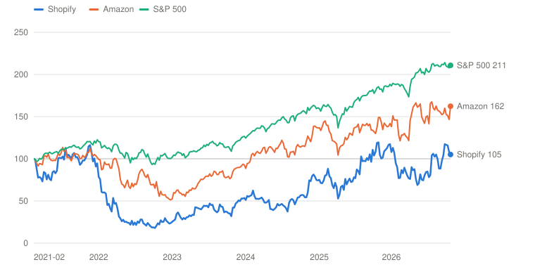
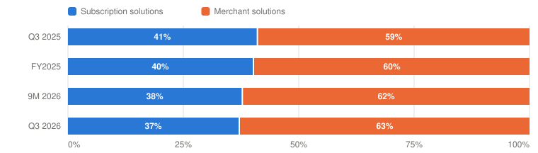

# SHOP — Shopify Inc.

> **Schema** v7.0 · **Updated** 2026-11-05 · **Status** Active
> **Price** $153.03 verified Nov 4, 2026 close, 4:00 PM EST; the overnight session showed $151.19 ([Yahoo](https://finance.yahoo.com/quote/SHOP/)) · 52-wk $94.00–$180.88 · 68th %ile · −15.4% from high
> **Type** Commerce platform: merchant software plus payments · **Stage** Scaling · **Cyclical** No · **Competence** Edge

## Verdict

**Shopify grew 32% again and every new shopping agent checks out with Shop Pay, but at $153.03 the stock sits at its February 2021 price on a still-rich multiple, and the probability-weighted case pays 6.4% a year against the 13% hurdle: Watch.**

🟡 **Non-holder: Watch (entry ≤$113)** · 🟡 **Holder: Hold**

| PW EV | PW return/yr | Compounding/yr | R/R | Entry | Trim | Avoid | EV / FY26E FCF | Yield | BAIT | Moat | Next |
|---|---|---|---|---|---|---|---|---|---|---|---|
| **$208** | **6.4% (<13%)** | 29.4% | 2.2:1 | ≤$113 | $208–$324 | ≥$324 | ≈64× (≈80× owner earnings) | 0.0% | Single (A) | Wide, widening; agent economics unproven | 📅 BFCM (early Dec) · Q4 ~mid-Feb 2027 |

**Breaks if**: Agents become a toll: Shopify discloses a fee or revenue share paid to an agent operator, or merchant-solutions gross margin falls below 37% for two quarters while management points to wallet or agent economics. Then the agent channel stops being new volume at today's take rate and becomes old volume at a lower one.

⚠️ **Terminal-growth check**: implied perpetual growth exceeds the risk-free rate in Bull, Base.

## The Call

The operating case got stronger again. Q3 revenue grew 32% against a low-thirties guide, GMV grew 30% in constant currency for the sixth straight quarter, and in the US Shopify's merchants are now taking nearly half of all incremental e-commerce. The agent question moved too. Muse, Instinct, Claude Duet and Grok Bot all launched with Shop Pay as the wallet, Shop Pay GMV grew 50%, and the president says agent orders carry the same merchant fees as the online store. What the market has right is the price of all this. At $153.03 the enterprise value is about 64 times this year's free cash flow and about 80 times owner earnings after stock pay. Per-share owner earnings can compound at 29.4% a year in my Base and the stock still earns 6.4%, because the multiple has to come down by more than half. Spot already sits between my Base and my Bull. What the market may have too little of is the economics question. Analysts asked three times on the call who gets paid when an agent completes the purchase, and the answer covered only the case where the agent sends the shopper to the merchant's own site. The Base and Bull exits assume growth well above GDP after 2031, which I accept because the Base is still growing close to 20% a year then. The verb is not probability-fragile. Even with no Bear at all, the Base and Bull mix does not reach 13%.

## What I'd Have To Be Wrong About

1. **That growth holds above 25% as comparisons harden.** Test: Q4 2026 revenue growth of at least 28% against the low-thirties guide, and a Q1 2027 revenue guide at a mid-twenties rate or better, both in the Q4 release (about mid-February 2027). Q3 delivered +32% on top of +32% a year earlier. **If Fail →** 15 points Base → Bear (PW EV $189, 4.3%/yr) → **Watch / Hold**, entry ≤$102.
2. **That agents stay a channel, not a toll.** Test: Through the Q2 2027 results (early August 2027): no disclosed fee or revenue share paid by Shopify to an agent operator on Shop Pay checkouts, and merchant-solutions gross margin of at least 37% in every quarter (38.5% in Q3 2026, 36.8% in the mix-heavy Q4 2025, so Q4 2026 is compared with that). An agent default that routes a named partner's checkouts away from Shop Pay also fails. **If Fail →** 15 points Base → Bear (PW EV $189, 4.3%/yr) → **Watch / Hold**, entry ≤$102.
3. **That gross profit keeps pace.** Test: FY2026 gross-profit growth of at least 25% and a free-cash-flow margin of at least 18% in the 10-K (February 2027). Nine months stand at +30% and 18.5%. **If Fail →** 10 points Base → Bear (PW EV $195, 5.0%/yr) → **Watch / Hold**, entry ≤$106.

## Latest update: 2026-11-05 · Q3: the sixth 30% quarter, and the agent toll question left open

- Growth holds above 25% (Q3 low thirties; Q1 2027 guide ≥25%) — 🟡 Pending — Q3 revenue +32% passes the first leg; Q4 guided to the low thirties; the Q1 2027 guide arrives with the Q4 print
- Agentic checkout runs through Shop Pay at Shopify's economics (Shop Pay GMV ≥40% or agent GMV disclosed) — ✅ Pass — Shop Pay GMV +50%; Muse, Instinct, Claude Duet and Grok Bot all use Shop Pay; agent orders "carry the same fees" (Finkelstein, TBPN). Agent GMV is still undisclosed and the fee-share question went unanswered, so test 2 is replaced with one on the economics
- Gross profit keeps pace (FY2026 GP ≥25%, FCF margin ≥18%) — 🟡 Pending — Nine months: gross profit +30%, FCF margin 18.5%; the Q4 guide (GP high twenties, FCF margin in line with Q4 2025) keeps both legs on track

Shopify reported the third quarter before the open on November 3. It delivered every line of its own guide, fell fractionally short of consensus on GMV and subscription revenue, and the stock dropped 8.7% to $142.57 before recovering 7.3% to $153.03 the next day. It passed one of the three tests I set on September 23, kept the other two on track, and left the question I care most about, who gets paid when an agent buys, unanswered.

| | Q3 2026 | Q3 2025 | Against expectations |
|---|---|---|---|
| GMV | **$119.1B** (+29%, +30% CC) | $92.0B | $120.0B consensus `[Analyst consensus]` |
| Revenue | **$3,742M** (+32%) | $2,844M | Low-thirties guide met; $3.74–3.75B consensus |
| Gross profit | $1,781M (+28%) | $1,391M | Mid-to-high-twenties guide met |
| Subscription gross profit | $661M (79.1% margin) | $571M (81.7%) | $680M consensus, a miss |
| Operating expenses | 32.4% of revenue | 36.8% | 33–34% guide beaten |
| Operating income | **$568M** (15.2%) | $343M (12.1%) | |
| Free cash flow | **$816M** (22%) | $507M (18%) | About 250 bps of the gain temporary, per the CFO |
| Adjusted EPS | $0.49 | $0.34 | $0.46–0.47 consensus |
| Buyback | $543M, 4.29M shares at ≈$127 | — | $2.5B authorization left |

Sources: [Q3 release](https://www.sec.gov/Archives/edgar/data/1594805/000159480526000067/exhibit991pressreleaseq320.htm), [10-Q](https://www.sec.gov/Archives/edgar/data/1594805/000159480526000068/shop-20260930.htm), [call transcript](https://www.fool.com/earnings/call-transcripts/2026/11/03/shopify-shop-q3-2026-earnings-call-transcript/), consensus from [CNBC](https://www.cnbc.com/2026/11/03/shopify-q3-2026-earnings-gmv.html) (LSEG, StreetAccount, FactSet).

**Guidance.** Q4 revenue growth in the low thirties with less than a point of currency headwind, against 29% constant-currency growth a year ago; gross profit in the high twenties; operating expenses at 29–30% of revenue, with marketing moved from Q3 and holiday infrastructure; stock compensation of $155 million; free-cash-flow margin in line with Q4 2025, about 19–20%. That would be the seventh straight quarter of revenue growth in the low thirties. Nothing was said about 2027.

**Management's points.** Finkelstein said personal agents "hit the mainstream" in the quarter, that Muse, Instinct, Claude Duet and Grok Bot all partner with Shopify, and that Q3 "was the first time we saw shoppers experimenting with delegated purchasing." Shop GMV more than doubled and Lululemon put Shop Pay on its North American store. Hoffmeister gave the share data I quote in the essay and said "To believe in Shopify, you really just need to believe in commerce." Shopify paid about $100 million for the shop.com domain, which Finkelstein called "a declaration that we're ready for more ambitious posture for Shop." And the chief financial officer split the free-cash-flow gain himself: about 150 basis points structural, the rest the marketing test, tax-receivable timing and the merchant-cash-advance reclassification, in roughly equal parts.

**Pushback and non-answers.** Three analysts asked about agent economics. Jefferies asked how the economics change with Shop Pay versus Meta's wallet; the answer was about traffic quality. Wolfe asked whether merchants pay a take rate or Shopify shares it with agents; Hoffmeister answered for an agent that sends shoppers to the merchant's site, where the economics "are exactly the same." Baird asked about monetizing Sidekick and Catalog; that half of the question was dropped. MoffettNathanson asked whether the 80% subscription gross-margin line still holds after two quarters below it; Hoffmeister said the philosophy had not changed and gave no number. Mahaney asked why Q4 free-cash-flow margin is not up sequentially as usual; the answer was marketing moved from Q3 into Q4 and infrastructure spend. Off the call, Finkelstein told TBPN that "agentic transactions carry the same fees the online store transactions do," which is a statement about merchants, and told CNBC he sees some pressure on consumers into the holidays.

**What the 10-Q adds.** The quarter's buyback was price-sensitive: 2.94 million shares in July at $122.13, then about 0.67 million a month at $134–139. Cash and marketable securities fell to $4.7 billion. The loan book reached $2.35 billion, up 32% since December. Shopify released $63 million of US tax valuation allowance, citing "sustained profits of its U.S. operations." It filed a new universal shelf (S-3ASR) alongside the 10-Q, with no offering announced. And the risk factors are unchanged from the 10-K.

**What it does to the debates.** On agents, the quarter was better than I expected on adoption and no clearer on economics. Every agent chose Shop Pay and merchant gross margin rose, which is the opposite of disintermediation so far. On margin, the operating gain was real but about half of it laps a loan-loss spike and a marketing pause.

**Scorecard.**

1. *Growth holds above 25%.* Pending. Q3 passes the first leg. The second leg, a Q1 2027 guide at 25% or better, comes in February; I add a Q4 floor of 28% to the same test.
2. *Agentic checkout runs through Shop Pay at Shopify's economics.* Pass. The test asked for Shop Pay GMV growth of at least 40% or a disclosure of agent GMV by the Q4 print, and failed only on an agent checkout off Shop Pay or a conceded fee share. Shop Pay cleared the bar, every new agent launched on it, and no fee share was disclosed. The pass is on adoption. Because the economics question went unanswered, the replacement test watches merchant gross margin and any fee paid to an agent operator through the Q2 2027 print.
3. *Gross profit keeps pace.* Pending, on track on the nine-month figures, and the Q4 guide keeps both legs above the bar.

**The verdict.** Valued on owner earnings after stock compensation, at $153.03 the probability-weighted value is $208, the return is 6.4% a year, and the price at which the same case earns 13% is $113. The verbs do not change: Watch for a non-holder, Hold for a holder.

---

## Deep Dive: Shopify: Five Times the Business, the Same Stock

*Revenue is nearly five times what it was in February 2021 and the stock is back at that week's price. The agents have arrived and every one of them checks out with Shop Pay. What does $153 assume, and who gets paid when an agent does the buying?*

**Contents**: [Business Overview](#business-overview) · [Agents: A New Front Door, or a Tollbooth?](#agents-a-new-front-door-or-a-tollbooth) · [The Margin: How Much of 15% Is Real?](#the-margin-how-much-of-15-is-real) · [Management, Capital Allocation and Incentives](#management-capital-allocation-and-incentives) · [Valuation and Model Assumptions](#valuation-and-model-assumptions) · [Final Words](#final-words) · [Appendix: The Numbers](#appendix-the-numbers) · [Sources](#sources)

On February 12, 2021, Shopify closed at $1,455 a share, $145.55 after the 2022 ten-for-one split. It had compounded about 75 times in five years, and the question for a new buyer was whether any of it was left. The answer, so far, is that the stock has not moved and the business has.

What happened next is the whole history of the company in miniature. The stock peaked at $169.06 in November 2021. Shopify paid about $2.1 billion, $1.75 billion of it in cash, for Deliverr in 2022 to build that fulfillment network, cut staff twice, lost $1.42 billion at the operating line in 2023, and sold the logistics business to Flexport for a stake. The stock bottomed at $25.67 in October 2022. Then the company did the unglamorous thing. It stopped trying to be Amazon, ran opex below revenue growth for three years, retired its convertible notes, and in February 2026 authorized its first buyback.

*Total return, weekly, February 12, 2021 = 100, through November 4, 2026. Shopify closed at $145.55 (split-adjusted) on February 12, 2021, peaked at $169.06 in November 2021 and bottomed at $25.67 in October 2022. Source: Yahoo Finance adjusted closes. Built with Claude.*

| Date | Shopify | Amazon | S&P 500 |
|---|---|---|---|
| 2021-02-12 | 100 | 100 | 100 |
| 2022-01-28 | 60 | 88 | 114 |
| 2023-01-06 | 25 | 52 | 102 |
| 2023-12-15 | 53 | 92 | 125 |
| 2024-11-22 | 74 | 120 | 160 |
| 2025-11-07 | 105 | 149 | 182 |
| 2026-10-30 | 108 | 147 | 208 |
| 2026-11-04 | 105 | 162 | 211 |

On November 4, 2026, the stock closed at $153.03, five percent above that February 2021 close. Over the same five and three-quarter years Amazon returned 62% and the S&P 500 111%. The business did not stand still. Revenue went from $2.9 billion in 2020 to $14.2 billion over the last twelve months, and free cash flow from $0.38 billion to $2.66 billion. Shopify's merchants now sell almost as much in one non-holiday quarter as they did in all of 2020. The stock has gone nowhere because the multiple of 2021 was absurd, and today's is only very high.

The latest quarter showed how the market trades it. Shopify reported on November 3. Revenue grew 32%, exactly what it guided, and GMV came in at $119.15 billion against a consensus of $120.03 billion `[Analyst consensus]`. The stock fell 8.7% that day and rose 7.3% the next. A 0.7% miss on one number moved the market value by $17 billion, then the next day moved it most of the way back.

The question I try to answer has two parts. The first is the one the market is trading on. Shopify's president says personal shopping agents are a new front door to commerce and that Shopify is everything behind it. If agents become the place where people decide what to buy, does Shopify stay the rail every order runs on at today's economics, or does it end up paying a toll to whoever owns the agent? The second is quieter. Operating margin rose three points in a year. How much of that is structural, and how much is a timing quirk the next two quarters give back? I start with the business. The first debate is the agents, with management's case in its own words and four holes in it. The second is the margin. Then I look at management and the capital-allocation record, which changed this year, and finish with the valuation: what $153 assumes, and what 13% a year would need.

### Business Overview

Shopify sells merchants the software to run a store and then sells them most of what the store needs. It reports two segments. Subscription solutions is the plan fee, from the Basic plan to Plus, plus variable platform fees, apps, themes and domains. Merchant solutions is everything that scales with what the merchant sells: Shopify Payments, currency conversion, Shopify Capital loans, shipping labels, POS hardware and advertising. The unit of value is a dollar of GMV, and the merchant who brings it. Shopify does not disclose its merchant count; monthly recurring revenue is the proxy.

| $ Million | Q3 2025 | Q4 2025 | Q1 2026 | Q2 2026 | Q3 2026 |
|---|---|---|---|---|---|
| GMV ($B) | 92.0 | ≈123.8 | 100.7 | 115.6 | **119.1** |
| GMV growth (reported; constant currency where disclosed) | +32% (+30% CC) | ≈+31% | +35% | +32% (+30% CC) | **+29% (+30% CC)** |
| Subscription solutions revenue | 699 | 777 | 750 | 802 | 836 |
| Merchant solutions revenue | 2,145 | 2,895 | 2,420 | 2,781 | 2,906 |
| **Revenue** | 2,844 | 3,672 | 3,170 | 3,583 | **3,742** |
| Revenue growth | +32% | +31% | +34% | +34% | **+32%** |
| Gross profit | 1,391 | 1,693 | 1,546 | 1,708 | 1,781 |
| Gross profit growth | n/d | +25% | +32% | +31% | +28% |
| Subscription gross margin | 81.7% | 81.0% | 80.3% | 79.7% | 79.1% |
| Merchant solutions gross margin | 38.2% | 36.8% | 39.0% | 38.4% | 38.5% |
| Operating expenses, % of revenue | 36.8% | 28.9% | 36.7% | 34.0% | 32.4% |
| Transaction and loan losses, % of revenue | 5.2% | 3.1% | 3.7% | 3.9% | 3.2% |
| **Operating income** | 343 | 631 | 382 | 488 | **568** |
| Operating margin | 12.1% | 17.2% | 12.1% | 13.6% | **15.2%** |
| Free cash flow | 507 | ≈719 | 476 | 654 | **816** |
| FCF margin | 18% | ≈20% | 15% | 18% | **22%** |
| Stock compensation incl. payroll tax | 116 | 125 | 138 | 133 | 147 |
| Share repurchases | — | — | n/d | ≈1,910 (H1) | 562 |

*Q4 2025 GMV and free cash flow are `[Derived]` from the FY2025 totals less the first nine months. H1 2026 repurchases are the nine-month cash figure less Q3 `[Derived]`; Q3 is cash paid ($543M of shares bought under the program). Q4 2025 GMV growth is against Q4 2024 GMV of about $94.5B `[Derived]`. From April 2026 merchant-cash-advance cash flows sit in investing, not operating, cash flow, which flatters FCF slightly. Source: [Q3 2026 release](https://www.sec.gov/Archives/edgar/data/1594805/000159480526000067/exhibit991pressreleaseq320.htm), [Q3 2026 10-Q](https://www.sec.gov/Archives/edgar/data/1594805/000159480526000068/shop-20260930.htm) (eight-quarter table), [Q2 2026 release](https://www.sec.gov/Archives/edgar/data/1594805/000159480526000046/exhibit991pressreleaseq220.htm). Built with Claude.*

The table carries the story. GMV has grown about 30% in constant currency for six straight quarters, and revenue a little faster, because Shopify takes a slowly rising share of each dollar: $3.14 of revenue per $100 of GMV, up from $3.09 a year ago. Gross profit grows a little slower than revenue because payments carry a lower margin than subscriptions. And operating expenses grew far more slowly than either, which is why the operating margin went from 12.1% to 15.2% in a year.

*Share of gross profit; segment revenue less segment cost of revenues `[Derived]`. Source: [Q3 2026 10-Q](https://www.sec.gov/Archives/edgar/data/1594805/000159480526000068/shop-20260930.htm) (eight-quarter table). Built with Claude.*

| Period | Subscription solutions | Merchant solutions | Total ($M) |
|---|---|---|---|
| Q3 2025 | 571 (41%) | 820 (59%) | 1,391 |
| FY2025 | 2,232 (40%) | 3,323 (60%) | 5,555 |
| 9M 2026 | 1,902 (38%) | 3,133 (62%) | 5,035 |
| Q3 2026 | 661 (37%) | 1,120 (63%) | 1,781 |

Merchant solutions now produces almost two-thirds of the gross profit. That matters for both debates. The merchant line is where the agent economics will show up, and it is also where the margin has held better than the subscription line, which has fallen for four quarters as Shopify pays for the AI models behind its merchant assistant, Sidekick.

A few accounting points before the debates. First, GAAP net income is not useful here. Shopify carries $5.4 billion of equity stakes, mostly in listed partners such as Affirm, Klaviyo and Global-E, and their marks moved net income by +$1.25 billion in Q2 and −$1.06 billion in Q1. I use operating income and free cash flow. Second, stock compensation is about 3.7% of revenue, which I treat as a real cost, so I value the company on owner earnings, free cash flow less stock compensation, rather than on free cash flow or adjusted EPS. Third, capex is about $10 million a year, so free cash flow is roughly operating cash flow; the one real capital use is the Shopify Capital loan book, $2.35 billion at September 30. Fourth, since April the cash flows from merchant cash advances sit in investing rather than operating cash flow, after Canada's rules pushed Shopify to switch them to loans. That flatters free cash flow a little, and the chief financial officer counted it among this quarter's temporary items.

### Agents: A New Front Door, or a Tollbooth?

Let me start with where things stand, per dollar of GMV.

| Per dollar of GMV and per merchant | Q3 2025 | Q3 2026 | Change |
|---|---|---|---|
| GMV ($B) | 92.0 | **119.1** | +29% (+30% constant currency) |
| Shopify Payments GMV ($B) and penetration | 60.2 · 65% | **81.4 · 68%** | +35%; +3 pts |
| Shop Pay GMV | n/d | n/d | **+50%** |
| Revenue per $100 of GMV (take rate) | $3.09 | **$3.14** | +5 bps |
| Merchant gross profit per $100 of GMV | $0.89 | **$0.94** | +5% |
| Subscription gross profit per $100 of GMV | $0.62 | $0.55 | −11% |
| MRR ($M); Plus share of MRR | 193 | **230 · 34%** | +19%; Plus MRR +18% |
| GMV by region (constant currency) |  | North America +28%, Europe +33% | International GMV +32% reported |
| Offline · B2B GMV |  | +30% · +74% | Locations +52%; 55% of new POS merchants new to Shopify |
| AI-referred traffic · orders |  | 2.6× · 3.3× | 74% of AI-attributed purchases outside the top 100 categories |
| Merchant count · retention · CAC | n/d | n/d | MRR is the proxy for merchants |

*Unit of value: the dollar of GMV and the merchant who brings it. Per-$100 figures are segment revenue or gross profit ÷ GMV `[Derived]`. Source: [Q3 2026 10-Q](https://www.sec.gov/Archives/edgar/data/1594805/000159480526000068/shop-20260930.htm), [Q3 2026 call (Motley Fool)](https://www.fool.com/earnings/call-transcripts/2026/11/03/shopify-shop-q3-2026-earnings-call-transcript/). Built with Claude.*

#### Management's narrative

Management's case is that agents add volume and run on Shopify's rails, so they make Shopify more valuable, not less. Harley Finkelstein, the president, opened the call with the quarter's agent news: Muse, Instinct, Claude Duet and Grok Bot all launched with Shopify integrated, "so our merchants checkouts are supported and buyers can use Shop Pay as their wallet." Asked by Jefferies how this changes the payment economics, he described the agent's role this way:

> "The quality of traffic is really, really quite high, and that we think is really, really important. But the agent is really just this new front door here. We are everything beyond that. So every new interface needs this commerce infrastructure running underneath it, and that's what we're doing."
> — Harley Finkelstein, President, Q3 2026 earnings call, November 3, 2026

Asked by Citizens what happens to the moat if commerce goes headless, he made the buyer-side argument:

> "In the new world of personal agents, shop is not just a wallet. It is your complete buyer profile. ... So the fact that we have 400 million shoppers already trusting Shop and Shop Pay, now that trust goes with them into every single agent."
> — Harley Finkelstein, Q3 2026 earnings call, November 3, 2026

Jeff Hoffmeister, the chief financial officer, gave the closest thing to an answer on economics when Wolfe Research asked whether merchants would pay a take rate or Shopify would share it with the agents:

> "If you start, for example, on Muse, and if you as a consumer then do a search which leads to a merchant which is using Shopify, then the economics to us are exactly the same. Essentially, this is another form of discovery."
> — Jeff Hoffmeister, CFO, Q3 2026 earnings call, November 3, 2026

And on TBPN the day of the print, Finkelstein said "Right now the current economics remain completely unchanged for Shopify merchants" and that "agentic transactions carry the same fees the online store transactions do."

The case is stronger than it sounds. Shop Pay GMV grew 50%, faster than GMV, and Lululemon, one of the most sophisticated direct sellers there is, added Shop Pay on top of its own stack in North America. Shopify's Catalog, which turns over a billion product pages into structured data with live prices and inventory, converts at twice the rate of general AI search, because an agent can read it. Three-quarters of AI-referred purchases came from outside the top 100 categories, which is where Shopify's long tail of merchants lives. And the broader share data is remarkable. Hoffmeister said US merchants' online sales grew at 23% a year over three years against 8% for US e-commerce, and that since the start of 2025 Shopify's merchants have captured nearly half of all incremental US e-commerce, from about a fifth three years ago. Every agent that has launched so far has chosen to plug in rather than build around.

#### Poking holes in it

The first hole is that the economics question was asked three times and answered only for the easy case. Jefferies asked how payment economics change depending on whether a shopper uses Shop Pay or Meta's wallet; the answer was about traffic quality. Wolfe asked whether Shopify would share economics with the agents; the answer covered an agent that sends the shopper to the merchant's own website. Baird asked whether Sidekick and Catalog would be monetized; the answer covered point of sale and the second half of the question was dropped. The case that matters is delegated purchasing, where the agent completes the order inside its own interface. Finkelstein called Q3 "the first time" shoppers experimented with it. That is precisely the case nobody described. "Same fees for merchants" is a statement about what merchants pay. It says nothing about whether Shopify pays anyone.

The second hole is that the volume is undisclosed and the best-quality data point is getting worse. Management said twice that the volume "is still small" and gave multiples instead: AI traffic 2.6 times, orders 3.3 times. At the Goldman Sachs conference on September 10, AI-referred shoppers were reported to convert about 80% better than organic search; on the Q3 call it was 64% better. A premium that narrows as usage broadens is what you would expect, and it means the early numbers flatter the channel.

The third hole is that the agent owners have their own ambitions. Meta, OpenAI and Google each own the customer's intent. Finkelstein's answer to how agents pick Shop Pay was that "this is about merit, and we believe that we can compete on merit." I believe that. But a wallet that has to be chosen on merit inside someone else's product is a weaker position than a checkout that is the default on the merchant's own site, and the $100 million Shopify just paid for the shop.com domain looks like a bet that consumers need to know the name.

The fourth hole is cost. Subscription gross margin has fallen four quarters in a row, to 79.1%, and Hoffmeister attributed the year-over-year fall "primarily" to "incremental AI spend on Sidekick." The 10-Q adds $40 million more of infrastructure and LLM costs in cost of revenue and $40 million more of compute in R&D in a single quarter. When MoffettNathanson asked whether the 80% trend line still holds, the answer was "No," meaning the philosophy had not changed, followed by no number. In fairness, Sidekick's cost per conversation fell 28% from Q2 to Q3 while conversations rose 14%, which is good evidence that the AI bill can be managed.

| Per $100 of GMV | Q3 2025 actual | Q3 2026 actual | Agent pays itself 0.3% of GMV | Agent checkout off Shop Pay |
|---|---|---|---|---|
| Merchant solutions revenue | $2.33 | $2.44 | $2.44 | ≈$0.73 |
| Merchant solutions gross profit | $0.89 | $0.94 | $0.64 | ≈$0.28 |
| Subscription gross profit | $0.62 | $0.55 | $0.55 | $0.55 |
| **Total gross profit** | $1.51 | $1.49 | $1.19 | ≈$0.83 |
| Operating expenses | $1.14 | $1.02 | $1.02 | $1.02 |
| **Operating profit** | $0.37 | $0.48 | $0.18 | ≈−$0.19 |
| What has to be true | — | Agents send shoppers to the merchant's store or check out with Shop Pay at today's fees | Shopify shares 30 bps of every agent order with the agent operator | The agent's own wallet wins the checkout; Shopify keeps the platform, loses the payment |

*Illustrative. The two right-hand columns are the author's scenarios `[Estimate]`, applied as if every order went that way, to show the sensitivity; in the model only part of GMV is exposed. The 0.3% fee is a placeholder, not a disclosed or reported figure. The off-Shop-Pay column assumes payments make up about 70% of merchant-solutions revenue and gross profit `[Estimate]`; Shopify does not split it. Opex is held at the Q3 2026 level per $100. Source: [Q3 2026 10-Q](https://www.sec.gov/Archives/edgar/data/1594805/000159480526000068/shop-20260930.htm). Built with Claude.*

Here is the arithmetic. Shopify earned about 48 cents of operating profit on every $100 of GMV in Q3. If agents take a 30-basis-point share of the orders they place, the same $100 earns 18 cents. If an agent's own wallet wins the checkout, Shopify keeps the subscription but loses most of the merchant gross profit on that order, and the order runs at a loss on today's cost base. Neither is happening, and both are placeholders. The table shows why the market reacts to every sentence about agents: on the orders it touches, the agent question is worth more than the whole operating margin.

Where I come out: I was more worried about disintermediation in September than I am now. Every agent that launched this quarter chose Shop Pay, and the merchant gross margin rose. But management avoided the delegated-purchase question each time it came up, and I take that as a sign the terms are not settled. My Base treats agents as a channel at today's fees, and my Bear gives the toll its weight. The test I set is on the merchant gross margin and on any disclosed fee share, because those are where a toll would show first.

#### Rings of profit

The gross profit sorts by how much each part depends on the agent question.

| Ring | Reported figure | The threat | Exposure |
|---|---|---|---|
| **1 · Subscriptions** (plans, Plus, variable platform fees, apps) | $661M of gross profit in Q3, 37% of the total; MRR $230M | Merchants pay for the plan whatever channel sells the goods; AI costs are compressing the margin (79.1%) | **Low** |
| **2 · Payments and services on merchant-owned traffic** (storefronts reached by search, social, email, direct; offline POS; B2B) | Most of the $1,120M of merchant gross profit; offline GMV +30%, B2B +74% | Card-network and processor costs, competition from Stripe-style rails | **Low–medium** |
| **3 · Payments on orders whose discovery moves into agents** | Not disclosed; management says "the volume is still small" | A fee share to the agent operator or a rival wallet at checkout | **High; this is the debate** |
| **4 · Capital, ads and the Shop app** (Shopify Capital, Shop Campaigns, shop.com) | Loan book $2.35B; Shop GMV more than doubled; Shop Campaigns orders more than doubled year to date | Credit losses in a downturn; ad budgets moving to the agents' own placements | Medium |
| **Consolidated** | Gross profit $1,781M, operating income $568M in Q3 |  |  |

*Shopify does not split merchant gross profit by product or channel, so the rings sort the reported figures by what each depends on. Source: [Q3 2026 release](https://www.sec.gov/Archives/edgar/data/1594805/000159480526000067/exhibit991pressreleaseq320.htm), [10-Q](https://www.sec.gov/Archives/edgar/data/1594805/000159480526000068/shop-20260930.htm), [call](https://www.fool.com/earnings/call-transcripts/2026/11/03/shopify-shop-q3-2026-earnings-call-transcript/). Built with Claude.*

The first two rings are most of the profit and are barely exposed. A merchant pays for the plan and the payments on its own storefront, its shops and its wholesale orders whatever happens in the agents. The third ring is the debate, small today and undisclosed. The fourth is where Shopify is trying to own some consumer demand itself, through the Shop app, shop.com and Shop Campaigns. The risk is real and concentrated: it sits on the share of future online orders that start inside an agent, which is a growing slice of a growing pie.

### The Margin: How Much of 15% Is Real?

The second debate is smaller in dollars and matters as much for the price, because at this multiple each point of margin is a lot of value.

#### Management's narrative

Management's case is that operating leverage is structural. Hoffmeister:

> "We continue to deliver operating leverage with operating expenses at 32% of revenue in the third quarter, down from 37% last year. Throughout the year, gross profit growth has outpaced operating expense growth by approximately 12 points each quarter."
> — Jeff Hoffmeister, CFO, Q3 2026 earnings call, November 3, 2026

On the merchant side, gross margin expanded for the third quarter running on "savings negotiated with partners across the full payments ecosystem," and the guide for the fourth quarter, operating expenses at 29–30% of revenue, implies another strong quarter.

#### Poking holes in it

The first hole is that about half the operating-margin gain this quarter will not repeat. The bridge below splits the 310 basis points. About 200 came from transaction and loan losses, which spiked to 5.2% of revenue a year ago and are now 3.2%. Another 200 came from sales and marketing, helped by a two-week pause in some US channels to test whether the spend was incremental, and "some of the reduced spend will effectively shift to Q4." Gross margin took 130 back.

| Q3 2026 vs Q3 2025 | Points of revenue | Repeats? |
|---|---|---|
| Gross margin | −130 bps | Yes: payments mix and AI cost, guided to continue |
| Transaction and loan losses | +200 bps | Mostly no: laps last year's 5.2% spike |
| Sales and marketing | +200 bps | Partly: a two-week US spend pause; some spend "will effectively shift to Q4" |
| R&D and G&A | +50 bps | Yes, though R&D grew 33% on AI compute and people |
| **Operating margin** | **+310 bps** (12.1% → 15.2%) |  |
| FCF margin (18% → 22%) | +400 bps | About 150 bps structural by the CFO's split; the rest, marketing test, tax-receivable timing and the cash-advance reclassification, temporary |

*The operating-margin split is `[Derived]` from the 10-Q line items. The FCF split is Jeff Hoffmeister's, on the [Q3 call](https://www.fool.com/earnings/call-transcripts/2026/11/03/shopify-shop-q3-2026-earnings-call-transcript/). Built with Claude.*

The second hole is in the cash flow, and the chief financial officer pointed it out himself, which I give him credit for:

> "I should point out that approximately 150 basis points of the year-over-year improvement in free cash flow margins stems from the structural operating discipline and expense leverage that we've been delivering. The remainder of the improvement results from items that are more temporary. The marketing test that we did this past quarter, the timing of certain tax receivables and the accounting change to merchant cash advances with each of these 3 being roughly equally sized."
> — Jeff Hoffmeister, CFO, Q3 2026 earnings call, November 3, 2026

So the structural free-cash-flow margin is about 19.5%, not 22%, and the Q4 guide, free-cash-flow margin "in line with Q4 of last year," agrees.

The third hole is that gross profit is growing four points slower than revenue, and the gap comes from two places at once: payments mix, which management has always flagged, and AI cost, which is new. The 10-Q says plainly that merchant-solutions growth "may cause in the future, a decline in our overall gross margin percentage." That is fine while opex keeps falling faster. It stops being fine when opex runs out of room.

The fourth hole is the loan book. Shopify Capital grew from $1.78 billion of loans and advances in December to $2.35 billion in September, 32% in nine months, and lending-related losses rose $83 million year to date. The quarter's loss rate improved because payments fraud fell. The book has never been through a consumer recession at this size, and Finkelstein acknowledged some pressure on consumers going into the holidays.

Where I come out: the leverage is real and well managed, and half of one quarter's gain is borrowed from the next. I build the Base on operating expenses falling from about 33% of revenue this year to 24% by 2031, which takes operating margin from about 14% to about 20% while gross margin drifts down. That is roughly the pace of the last two years, slowed down. The Bull assumes 21.5% opex and the Bear 28%.

### Management, Capital Allocation and Incentives

Tobi Lütke founded Shopify in 2006, after building an online store to sell snowboards, and still runs it with about 40% of the vote through a founder share. He did not speak on the call; Finkelstein and Hoffmeister run the public side. The prior-tenure test here is Lütke against himself: the 2021–2023 Shopify that tried to build Amazon's logistics, and the 2023–2026 Shopify that stopped.

The first version was a mistake, and an expensive one. The deal list below has two failed logistics acquisitions. Deliverr cost about $2.1 billion in 2022, and within a year the whole logistics business went to Flexport for a stake, with the write-down inside a 2023 operating loss of $1.42 billion. The second version is the one the table records: cost discipline, a convertible paid off in November 2025, and a business that turns almost all its operating income plus stock compensation into free cash.

| Year | Deal | Price | What happened | Verdict |
|---|---|---|---|---|
| 2019 | 6 River Systems (warehouse robotics) | n/d here | Folded into the logistics push; sold with it in 2023 | Poor |
| 2022 | Deliverr (fulfillment network) | ≈$1.75B cash in FY2022 acquisitions | Logistics sold to Flexport in 2023 for an equity stake; the FY2023 operating loss of $1.42B includes the write-down | **Poor** |
| 2019–2024 | Minority stakes (Affirm, Klaviyo, Global-E and others) | Partnership warrants and small cash checks | Carried at $5.4B at Sep 30, 2026; they swing GAAP net income by up to $1.2B a quarter | Good |
| 2026 | shop.com domain | ≈$100M (intangible $99M) | Shop app moves to shop.com as a consumer destination | Too early |

*Source: [XBRL company facts](https://data.sec.gov/api/xbrl/companyfacts/CIK0001594805.json) (acquisition cash, FY2023 operating loss), [Q3 2026 release](https://www.sec.gov/Archives/edgar/data/1594805/000159480526000067/exhibit991pressreleaseq320.htm) (equity investments, intangible purchase), [call](https://www.fool.com/earnings/call-transcripts/2026/11/03/shopify-shop-q3-2026-earnings-call-transcript/). 6 River Systems' price and the Flexport terms were not re-read for this report `[link pending]`. Built with Claude.*

| $B, except per share | FY2021 | FY2022 | FY2023 | FY2024 | FY2025 | 9M 2026 | Cumulative |
|---|---|---|---|---|---|---|---|
| Revenue | 4.61 | 5.60 | 7.06 | 8.88 | 11.56 | 10.50 | — |
| Growth | +57% | +21% | +26% | +26% | +30% | +33% | — |
| Diluted EPS (GAAP, incl. equity marks) | $2.29 | −$2.73 | $0.10 | $1.55 | $0.94 | $1.06 | — |
| Operating cash flow | 0.54 | −0.14 | 0.94 | 1.62 | 2.03 | 1.96 | 6.95 |
| Capex | 0.05 | 0.05 | 0.04 | 0.02 | 0.03 | 0.01 | 0.20 |
| **Free cash flow** | 0.49 | −0.19 | 0.91 | 1.60 | 2.01 | 1.95 | **6.75** |
| FCF margin | 10.5% | −3.3% | 12.8% | 18.0% | 17.4% | 18.5% | — |
| Stock compensation | 0.33 | 0.55 | 0.62 | 0.43 | 0.45 | ≈0.40 | ≈2.77 |
| Buybacks | 0 | 0 | 0 | 0 | 0 | **2.47** | **2.47** |
| Buybacks ÷ FCF | — | — | — | — | — | 127% | 37% |
| Acquisitions (cash, incl. domain) | 0.06 | 1.75 | 0.03 | 0.03 | 0.06 | 0.10 | 2.03 |
| Debt (convertible notes) | ≈0.92 | ≈0.92 | ≈0.92 | ≈0.92 | 0 (repaid Nov 2025) | 0 | — |
| Weighted diluted shares (M) | 1,274 | 1,266 | 1,296 | 1,302 | 1,305 | 1,299 (Q3: 1,291) | — |

*FCF = operating cash flow − purchases of property and equipment `[Derived]`. 9M 2026 stock compensation excludes payroll tax `[Estimate]`. 9M 2026 buybacks are the cash-flow figure; the average price is ≈$117 `[Derived: $1.93B at $114.63 in H1 plus $543M at ≈$127 in Q3]`. Convertible-note balances are approximate from the 10-Ks. Source: [XBRL company facts](https://data.sec.gov/api/xbrl/companyfacts/CIK0001594805.json), [Q3 2026 10-Q](https://www.sec.gov/Archives/edgar/data/1594805/000159480526000068/shop-20260930.htm). Built with Claude.*

The cumulative column says two things. First, Shopify has generated $6.75 billion of free cash flow since 2021 and issued about $2.8 billion of stock compensation over the same years, which until this year it never offset. Second, the buyback is new and it is large: $2.47 billion in nine months, more than the $1.95 billion of free cash flow in the same period, funded partly from the cash pile, which fell $1.1 billion to $4.7 billion.

The timing is what I would want from an outsider. The company bought $1.93 billion in the first half at an average $114.63, heaviest in May at $105.70, near the 52-week low of $94. In Q3 it bought 2.94 million shares in July at $122.13, then cut to about 0.67 million a month in August and September as the price rose to $134–139. That is a company buying more when the stock is cheaper. $2.5 billion of authorization remains. The new universal shelf, filed with the 10-Q, reads to me as a replacement of the Canadian base shelf Shopify already kept, and it matters only if it is used; the 10-Q says there is no agreement for a material acquisition. I grade Shopify **Outsider-leaning, strengthened**: countercyclical buying for three quarters running, no dividend, and no stock-funded deal since the logistics exit. Three quarters do not make a record, and the cash pile cannot fund a buyback above free cash flow for long.

#### The incentives

| Component | Size | What it pays for | Status |
|---|---|---|---|
| **Flex Comp** (all named executives) | One annual dollar amount, split by each executive between cash, options and RSUs | Retention and the share price; no metric | Unchanged in the [2026 circular](../../../raw/SHOP/filings/SHOP-Circular-2026.txt) |
| **Short-term incentive** | None | — | — |
| **Performance-vested equity** | None | — | All awards time-vest |
| **Return on invested capital** | 0% | Not a metric | — |
| **Founder control** | Founder share, about 40% of the vote | Tobi Lütke's alignment is ownership | Lead director Natale drew 9.6% against at the June AGM |

*Source: [2026 management information circular](../../../raw/SHOP/filings/SHOP-Circular-2026.txt). Built with Claude.*

The plan pays for nothing in particular. Each executive gets one dollar amount and chooses how much to take in cash, options or restricted stock, all time-vested, with no short-term bonus and no performance metric. Alignment runs only through the share price, which with a founder holding the vote is less bad than it sounds. But no one is paid for return on capital, and the last time the company had a lot of cash and a bold idea it bought a logistics network. Against its own guidance, management is a consistent beater: every line of the Q3 guide was met or beaten.

Is this the right team? On the evidence of the last three years, yes. They reversed a large strategic mistake quickly, they run the business with unusual cost discipline for a company growing this fast, and they started buying stock at the right prices. Lütke's record also says the company will make a big bet again. The question for the next five years is whether that bet is agents and consumer demand, the Shop app and shop.com, and whether it is paid for with the free cash or with the new shelf.

### Valuation and Model Assumptions

I value Shopify at the end of FY2031 on owner earnings per share: free cash flow after stock compensation. The model builds gross profit from the two segments, each with a growth rate and a gross margin, subtracts total operating expenses as a share of revenue, adds about $250 million of interest income, taxes it at 20–21%, and converts net income to owner earnings at 1.08 times, because cash conversion has run slightly ahead of book earnings `[Estimate]`. FY2026 is the base year at about $15.4 billion of revenue: nine months reported plus a Q4 at the low-thirties guide. The share count follows each case's buybacks against stock issuance. The $5.4 billion of equity stakes is added as a separate line, at carrying value.

In the build below, the segment margin rows are gross margins and "Corporate and other" is total operating expenses.

| $ Billion | FY2025A | FY2026E | FY2027E | FY2028E | FY2029E | FY2030E | FY2031E |
|---|---|---|---|---|---|---|---|
| **Subscription solutions revenue** | 2.8 | 3.3 | 3.9 | 4.5 | 5.3 | 6.2 | 7.3 |
|  YoY growth | — | 20.6% | **17.0%** | **17.0%** | **17.0%** | **17.0%** | **17.0%** |
|  Operating margin | 81.1% | 79.5% | 79.2% | 78.9% | 78.6% | 78.3% | **78.0%** |
|  Operating profit | 2.23 | 2.64 | 3.08 | 3.59 | 4.18 | 4.87 | 5.68 |
| **Merchant solutions revenue** | 8.8 | 12.0 | 14.9 | 18.3 | 22.7 | 28.0 | 34.6 |
|  YoY growth | — | 36.6% | **23.5%** | **23.5%** | **23.5%** | **23.5%** | **23.5%** |
|  Operating margin | 37.7% | 38.0% | 37.9% | 37.8% | 37.7% | 37.6% | **37.5%** |
|  Operating profit | 3.32 | 4.57 | 5.63 | 6.94 | 8.54 | 10.52 | 12.96 |
| Corporate and other | (4.09) | (5.02) | (5.80) | (6.69) | (7.69) | (8.80) | (10.04) |
| **Total revenue** | 11.6 | 15.3 | 18.7 | 22.9 | 28.0 | 34.2 | 41.8 |
| **Operating profit** | 1.47 | 2.19 | 2.90 | 3.83 | 5.03 | 6.59 | 8.60 |
|  Operating margin | 12.7% | 14.3% | 15.5% | 16.7% | 18.0% | 19.3% | 20.5% |
| Net income | 1.46 | 1.95 | 2.52 | 3.25 | 4.20 | 5.42 | 6.99 |
| Diluted shares (B) | 1.305 | 1.290 | 1.286 | 1.282 | 1.278 | 1.275 | 1.271 |
|  Net share change | — | — | -0.3% | -0.3% | -0.3% | -0.3% | -0.3% |
|  SBC (% of revenue) | — | 3.7% | 3.6% | 3.5% | 3.4% | 3.3% | 3.2% |
| **EPS ex equity-investment marks** | $1.12 | $1.51 | $1.96 | $2.53 | $3.28 | $4.25 | $5.50 |
|  YoY growth | — | 35.2% | 29.3% | 29.5% | 29.5% | 29.5% | 29.4% |
| **Owner earnings per share (after SBC)** | — | $1.64 | $2.11 | $2.74 | $3.54 | $4.59 | $5.94 |

*Bold cells are model inputs.*

In the Base, merchant solutions grows 23.5% a year and subscriptions 17%, so revenue compounds about 22% to $42 billion. The model holds the rate constant; in practice I expect it to start in the mid-to-high twenties and end in the high teens, and the five-year compound is what the value depends on. Gross margin drifts from 47% to about 45% on mix. Operating expenses fall from about 33% of revenue to 24%, taking operating margin from about 14% to about 20%. Buybacks roughly offset stock issuance. Owner earnings per share rise from about $1.64 to $5.94, and at 35 times that is $208. Thirty-five times owner earnings is a high multiple for a company of $42 billion in revenue, and I use it because at the end of the Base the business is still growing close to 20% a year with margin still rising.

| Case | Prob. | 3P | Subscription solutions growth / margin | Merchant solutions growth / margin | Net shares/yr | Per-share earnings FY2031 | CAGR | Exit multiple | Value | Return/yr | Implied g | Driving assumption |
|---|---|---|---|---|---|---|---|---|---|---|---|---|
| **Bull** | 25% | Plausible | +19.0% / 79.0% | +27.0% / 38.0% | -1.5% | $8.11 | 37.7% | 40.0× owner earnings | $324 | 16.2% | 6.3% | Agents and offline add GMV Shopify would not otherwise see: revenue about $47B (+25%/yr); merchant gross margin holds at 38% because agent checkouts carry the same fees; opex falls to 21.5% of revenue, so operating margin reaches about 23%; buybacks retire a net 1.5% of shares a year; 40× owner earnings. |
| **Base** | 50% | Probable | +17.0% / 78.0% | +23.5% / 37.5% | -0.3% | $5.94 | 29.4% | 35.0× owner earnings | $208 | 6.3% | 6.0% | Share gain, payments attach and international carry revenue to about $42B (+22%/yr compound); agents are a channel, not a toll; gross margin drifts down on mix; opex falls to 24% of revenue, so operating margin reaches about 20%; buybacks just offset stock pay; 35× owner earnings. |
| **Bear** | 25% | Probable | +11.0% / 76.0% | +16.0% / 35.0% | +0.3% | $3.06 | 13.4% | 25.0× owner earnings | $77 | -12.9% | 4.8% | Growth fades to about 15% a year (about $31B of revenue) as agents and Amazon take the discovery layer and a fee share; merchant gross margin falls to 35% and AI costs keep subscription margin falling; operating margin about 14%; 25× owner earnings. |
| **Priced-in (9%/yr)** | — | diagnostic | +17.8% / 78.4% | +24.9% / 37.7% | -0.8% | $6.73 | 32.7% | 35.0× owner earnings | $235 | 9.0% | 6.0% | Solved along Base → Bull for 9%/yr |
| **Hurdle (13%/yr)** | — | diagnostic | +19.0% / 79.0% | +26.9% / 38.0% | -1.5% | $8.06 | 37.6% | 35.0× owner earnings | $282 | 13.0% | 6.0% | Solved along Base → Bull for 13%/yr |
| Option: Equity stakes (Affirm, Klaviyo, Global-E and others) at Sep 30 carrying value, $5.4B | 100% | possible |  |  |  |  |  |  | $4 |  |  | valued as probability × value, outside the core |
| **Probability-weighted** | 100% |  |  |  |  |  |  |  | $208 | 6.4% |  |  |

The Bull is agents and offline adding volume Shopify would not otherwise see, $47 billion of revenue, merchant gross margin holding at 38% because agent checkouts carry today's fees, operating margin near 23%, net buybacks of 1.5% a year and a 40 times exit: $324. The Bear is the toll and a slower consumer, growth fading to about 15% a year, merchant gross margin at 35%, operating margin stuck near 14% and a 25 times exit: $77.

| Return math |  |
|---|---|
| PW return/yr vs. hurdle | **6.4% (<13%)**, of which 0.0% is the dividend yield. Entry ≤$113. 10-year Treasury 4.95%; the hurdle sits 8.1 points above it. |
| Compounding at a flat multiple | Base owner earnings per share grow from ≈$1.64 in FY2026 to $5.94 in FY2031, 29.4% a year, with no dividend: that is the compounding rate at a flat multiple. Re-rating takes about 23 points a year off the Base return, because the exit at 35× is well under half of today's ≈90× FY2026 owner earnings. All of the gap to the hurdle is the multiple. |
| Optionality | Equity stakes (Affirm, Klaviyo, Global-E and others) at Sep 30 carrying value, $5.4B: 100% × $4 = $4.2 |
| Price-implied expectations | At 9%, spot needs owner earnings of $6.73 a share in FY2031 at 35×: revenue of about $44B and an operating margin near 22%, between my Base and Bull. On free cash flow alone, EV of ≈$186B on ≈$2.9B prices about 18% growth for ten years at 9%, then 4%. |
| EPV floor | Owner earnings power today is ≈$2.1–2.3B. Capitalized at 9% that is ≈$24B, or about $19 a share, plus ≈$8 of cash and stakes: ≈$27 against $153. About 82% of the price pays for growth. The Bear's ≈$77 is about three times EPV, so even the Bear assumes the business keeps growing. |
| Base rate / 3P | Revenue of ≈$15B sits in the $12–25B bucket. The Base's ≈22% nominal growth (about 19–20% real) over five years is reached by roughly 3–4% of such companies, and the Bull's ≈25% by under 3% ([`compounding.md`](../../frameworks/compounding.md)). Shopify has been in that tail for a decade, which is why the Base is Probable rather than Plausible; the Bull is Plausible and the Bear Probable. |
| Terminal-growth check | Implied perpetual growth on owner earnings at 9%: Bull 6.3%, Base 6.0%, Bear 4.8%. The Bull and Base exceed the 4.95% Treasury, so their exit multiples assume Shopify is still growing well above GDP after 2031. I accept that for the Base because the business is still growing close to 20% in FY2031, but it is a real assumption. |
| Break-even and price-implied Bear odds | Break-even <0% against 25% assigned; price-implied 7% at 9%. |
| Year ten | Still growing in the low-to-mid teens at year ten on e-commerce share of retail, offline, B2B and international, with operating margin still rising, so the business compounds past the horizon; the 35× exit assumes exactly that. |
| R/R | **2.2:1** (Bull +112% / Bear −50%) The downside is a toll on the agent channel plus a normal growth company's multiple, not a broken business. |

*Computed rows come from model.json. The segment 'operating margin' rows in the model build are gross margins, and 'Corporate and other' is total operating expenses. EPV, base rate and year ten are the author's. Built with Claude.*

Here is where the price stands. To earn an ordinary 9% a year from $153.03, the stock needs owner earnings of $6.73 a share in 2031 at 35 times, which means about $44 billion of revenue and an operating margin near 22%. That sits a bit more than a third of the way from my Base to my Bull. To earn 13% a year it needs $8.06, which is my Bull. Put differently, the market price is already a good outcome, and the hurdle return needs the best one.

Weighted 25% Bull, 50% Base and 25% Bear, plus the stakes, the value is $208 and the annual return is 6.4%. The price at which the same case returns exactly 13% is $113. The break-even Bear probability is below zero, so the verb is not probability-fragile: even a world with no Bear does not get the return to 13% from here. All of the shortfall is the multiple. Owner earnings per share compound at 29.4% a year in the Base, a superb rate, and the stock earns a fraction of it because the exit multiple is well under half of today's.

This is an Edge case for me. I can judge the merchant economics and the cost base. I cannot judge how agent operators, card networks and wallets will split the economics of a checkout that happens inside a chat, because nobody has priced it yet, which is why the Bear carries 25% and the second test watches the merchant gross margin.

### Final Words

Shopify is one of the best businesses in this book, and the business has done everything the 2021 bulls hoped for except make the stock go up. It is still growing fast at $14 billion of revenue, taking share from the whole of US e-commerce, converting its operating income into cash, and buying its own stock at sensible prices. The agents that were supposed to threaten it have so far all chosen to plug into it.

What the market has right is the price of that excellence. At about 64 times this year's free cash flow, $153 already assumes something between my Base and my Bull, and the hurdle needs the Bull. What it may have too little of is the unanswered question: who gets paid when an agent completes the purchase. Management answered only the easy version of it.

The verb is Watch for someone who does not own it, with an entry at $113, about where the company itself was buying in the first half. For someone who owns it, Hold: the stock sits between that entry and my probability-weighted value, and nothing in the quarter breaks the business case. The case for being wrong is the case for any great compounder at a high multiple. Shopify has been in the top few percent of the growth reference class for a decade, and my Base may simply be too low.

What would change my mind has dates. The Q4 print in mid-February shows whether growth holds above 25% into 2027. The merchant gross margin each quarter through the August Q2 2027 print, and any disclosure of a fee to an agent operator, shows whether agents are a channel or a toll. And the FY2026 10-K shows whether gross profit kept pace. Here are the three tests, with their consequences fixed in advance:

*The three tests, with their pre-committed consequences, are listed at the top of this report under [What I'd Have To Be Wrong About](#what-id-have-to-be-wrong-about).*

### Appendix: The Numbers

The tables carry the framework's required numbers. The argument for each is in the chapters above.

#### Five-year record

| $B, except per share | FY2021 | FY2022 | FY2023 | FY2024 | FY2025 | TTM Q3 2026 |
|---|---|---|---|---|---|---|
| Revenue | 4.61 | 5.60 | 7.06 | 8.88 | **11.56** | 14.17 |
| Gross margin | 53.8% | 49.2% | 49.8% | 50.4% | 48.1% | 47.5% |
| Operating income | 0.27 | −0.82 | −1.42 | 1.08 | **1.47** | 2.07 |
| Operating margin | 5.8% | −14.7% | −20.1% | 12.1% | 12.7% | 14.6% |
| Operating cash flow | 0.54 | −0.14 | 0.94 | 1.62 | 2.03 | 2.68 |
| **Free cash flow** | 0.49 | −0.19 | 0.91 | 1.60 | **2.01** | **2.66** |
| Stock compensation | 0.33 | 0.55 | 0.62 | 0.43 | 0.45 | ≈0.52 |
| **Owner earnings** (FCF − SBC) | 0.15 | −0.74 | 0.29 | 1.17 | **1.56** | **≈2.14** |
| Owner earnings per diluted share | $0.12 | n/m | $0.22 | $0.90 | $1.19 | ≈$1.66 |
| SBC % of revenue | 7.2% | 9.8% | 8.7% | 4.8% | 3.9% | ≈3.7% |
| SBC ÷ owner earnings | 2.2× | n/m | 2.1× | 0.37× | 0.29× | ≈0.24× |
| Diluted weighted shares (M) | 1,274 | 1,266 | 1,296 | 1,302 | 1,305 | 1,291 (Q3) |
| Net share change per year | n/m | −0.6% | +2.4% | +0.5% | +0.2% | −1.1% |
| Buybacks ÷ SBC | 0 | 0 | 0 | 0 | 0 | ≈6× (9M) |
| Cash and marketable securities (long-term included from FY2025) | 7.77 | 5.05 | 5.01 | ≈5.5 | 6.75 | 5.25 |
| Equity stakes (equity and other plus equity method) | n/d | n/d | n/d | n/d | 5.18 | 5.45 |
| Invested capital, operating `[Derived]` | n/d | n/d | n/d | n/d | 1.54 | 2.05 |
| **ROIC** (NOPAT = 80% of operating income) | n/d | n/m | n/m | n/d | **≈76%** | **≈92%** |
| 3-year ROIIC |  |  |  |  | n/m (FY2022 NOPAT negative) | — |
| Reinvestment rate (net loan originations + acquisitions + capex ÷ NOPAT) |  |  |  |  | n/d | ≈70% (9M; mostly the loan book) |
| FCF ÷ (operating income + SBC) | 81% | n/m | n/m | 106% | 105% | 103% |
| Net debt ÷ EBITDA · coverage · nearest maturity | net cash | net cash | net cash | net cash | net cash; converts repaid | no debt |

*Owner earnings = free cash flow − stock compensation; capex is about $20–50M a year and D&A about $30M, so maintenance capex is immaterial. Invested capital (operating) = shareholders' equity − cash, marketable securities, long-term investments, equity and other investments and the equity-method stake `[Derived]`; equivalently loans, receivables, goodwill and other operating assets less payables and accrued liabilities. It is mostly the Shopify Capital loan book. Component history before FY2025 was not rebuilt (`n/d`). TTM stock compensation includes payroll tax `[Estimate]`. Cycle position: e-commerce demand is mildly cyclical; Shopify has not been through a consumer recession at this scale with a $2.35B loan book. Source: [XBRL company facts](https://data.sec.gov/api/xbrl/companyfacts/CIK0001594805.json), [Q3 2026 10-Q](https://www.sec.gov/Archives/edgar/data/1594805/000159480526000068/shop-20260930.htm). Built with Claude.*

#### Growth levers

| Lever | Contribution now | Runway | Evidence | Management intent | Stage |
|---|---|---|---|---|---|
| Market growth | ~8 pts | 10+ yrs | US e-commerce grew about 8% a year over three years (CFO) | "To believe in Shopify, you really just need to believe in commerce" | Proven |
| Share gain | ~20 pts | 5–10 yrs | US merchants' online sales +23% CAGR vs 8% for the market; nearly half of US incremental e-commerce since 2025 at about 14% share | Enterprise, luxury, offline | Proven |
| Price and mix (attach) | ~1–2 pts | 3–5 yrs | Take rate 3.09% → 3.14%; payments 65% → 68%; Plus 34% of MRR | Attach every service | Proven |
| Attach / new products | Offline +30%, B2B +74%, Capital book +32% in 9M | 5+ yrs | 55% of new POS merchants new to Shopify; Shop Campaigns orders more than doubled | Full stack, online and off | Scaling |
| New geographies | Europe +33% CC | 10 yrs | Local payment methods (OXXO), Shop app #1 in Japan's store the week of launch | "A lot more of this to come in 2027" | Scaling |
| AI and agent channels | Orders 3.3×, "still small" | Unknown | All major personal agents on Shop Pay; Catalog converts 2× general AI search | Be the commerce layer behind every agent | **Option** (in the Bull) |
| M&A | ≈0 | — | Deliverr failure; shop.com domain | None signalled; new shelf filed | n/a |
| Margin | Opex 37% → 32% of revenue | 3–5 yrs | Gross profit growth beat opex growth by about 12 points each quarter of 2026 | Discipline plus investment in AI | Scaling |
| Share count | −1.1% in a year | $2.5B authorization left | $2.47B bought in nine months at ≈$117 | Opportunistic | Proven (new) |

*Zook adjacency: every lever sells to the same merchants on the same rails; the Shop app and shop.com reach consumers, a new customer for Shopify, and are graded as an adjacency, not diversification, because they exist to send buyers to Shopify merchants. Source: [call](https://www.fool.com/earnings/call-transcripts/2026/11/03/shopify-shop-q3-2026-earnings-call-transcript/), [10-Q](https://www.sec.gov/Archives/edgar/data/1594805/000159480526000068/shop-20260930.htm). Built with Claude.*

The Base rests on share gain, attach and the margin lever. The Bull adds agent and offline volume that would not otherwise reach Shopify. The equity stakes are the only line valued outside the cases.

#### Moat, customer and profit pool

| Read | Call | Evidence |
|---|---|---|
| Mechanism | **Switching costs** (the merchant's whole stack) plus **network economies** (Shop Pay's saved buyers) | Enterprise replatforms (Alice + Olivia after Shop Pay became its top payment method; Omaha Steaks off a custom stack); 400 million Shop and Shop Pay users (management) |
| Trend | **Widening** | Merchants' share of incremental US e-commerce rose from about a fifth to nearly half in three years; Lululemon put Shop Pay on top of its own stack; every major personal agent launched with Shop Pay |
| Profit pool | Shopify captures the payments spread; **the agent layer is unpriced** | Merchant gross margin up three quarters running on processor savings; the fee split between agent operator, wallet and platform has not been disclosed by anyone |
| Customer | Merchants from first sale to enterprise; the job is to sell everywhere from one system | Retention and CAC/LTV not disclosed; MRR +19%; 43% more stores made a first sale within a day than three years ago (CFO) |

*7 Powers vocabulary (Helmer). Scale economies shared: processor savings have gone to Shopify's margin, not to merchant prices, so far. Source: [call](https://www.fool.com/earnings/call-transcripts/2026/11/03/shopify-shop-q3-2026-earnings-call-transcript/). Built with Claude.*

#### Competitors

| Competitor | Position | Threat |
|---|---|---|
| **Amazon** (marketplace, Buy with Prime, Alexa for Shopping) | Marketplace, Buy with Prime and Alexa for Shopping compete for the same shopper | Medium. Wants its own agent to be the front door |
| **Agent operators** (Meta Muse, OpenAI, Google, Anthropic, xAI) | Own consumer intent; partners today | Medium, rising. The fee question is open |
| **Stripe and other checkout rails** | Shopify Payments runs on processor partners | Low–medium. Could sell agentic checkout to non-Shopify merchants |
| **Salesforce / Adobe Commerce** | Enterprise incumbents | Low, falling. Losing luxury and enterprise migrations |
| **Wix · Squarespace · WooCommerce · BigCommerce** | SMB tools | Low |

*Scuttlebutt: competitors' results were not re-pulled for this report. Built with Claude.*

#### Promises ledger

| Promised | Where, when | Outcome |
|---|---|---|
| Build a fulfillment network (Deliverr) | Q2 2022 | 🔴 Sold to Flexport in 2023; the FY2023 operating loss included the write-down |
| Grow opex slower than revenue and expand FCF margin | 2022–23 letters | ✅ FCF margin −3% (FY2022) → 18.5% (9M 2026); opex 37% → 32% of revenue in a year |
| Q3 2026: revenue low thirties, gross profit mid-to-high twenties, opex 33–34% | Q2 call, Aug 5, 2026 | ✅ +32%, +28%, 32.4% |

*Guidance grade: **Consistent beater** against its own guide (every line of the Q3 guide met or beaten); against consensus, revenue and GMV were fractionally short (`[Analyst consensus]`, CNBC). Source: [Q2 2026 release](https://www.sec.gov/Archives/edgar/data/1594805/000159480526000046/exhibit991pressreleaseq220.htm), [Q3 2026 release](https://www.sec.gov/Archives/edgar/data/1594805/000159480526000067/exhibit991pressreleaseq320.htm), [XBRL](https://data.sec.gov/api/xbrl/companyfacts/CIK0001594805.json). Built with Claude.*

#### Risks and triggers

| Risk | Impact | Prob. | Priced in? | Would break the thesis if… |
|---|---|---|---|---|
| ⚠️ **Agents become a toll**: a fee share to agent operators, or a rival wallet at the agent's checkout | High | 30% | **No**: spot sits above the Base | A disclosed fee share, or merchant gross margin below 37% (test 2) |
| ⚠️ **Multiple compression**: ≈64× FCF, ≈80× owner earnings | High | Med | **No**: the core of the valuation | — (a valuation, not a thesis, break) |
| **Gross margin keeps sliding** on payments mix and AI cost (subscription margin down four quarters running) | Med | High (observed) | Partly | FY2026 gross-profit growth below 25% (test 3) |
| **Growth slows** as comparisons harden and the consumer weakens (management acknowledged pressure into the holidays) | Med | Med | Partly | Q1 2027 guide below the mid-twenties (test 1) |
| **Shopify Capital credit**: loans $2.35B, up 32% in nine months; lending losses +$83M | Med | Med | No | Lending losses outgrow the loan book for two quarters |
| **Dilution**: universal shelf filed Nov 3 | Low | Low | Yes | An equity raise or a large stock-funded acquisition |
| Founder control (founder share) | Low | Certain | Yes | — |

*Filtered for materiality; the 10-Q reports no material change to the FY2025 Item 1A risk factors, and the Item 1A diff was not re-run (logged). Reflexive loops and ruin paths: none; no debt, $5.25B of cash and marketable securities against a $2.35B loan book. Source: [10-Q](https://www.sec.gov/Archives/edgar/data/1594805/000159480526000068/shop-20260930.htm), [CNBC](https://www.cnbc.com/2026/11/03/shopify-q3-2026-earnings-gmv.html). Built with Claude.*

Reflexive loops: stock compensation is paid in shares, so a lower price means more shares for the same pay, which the buyback now offsets; and a falling stock would make the new shelf a more expensive source of capital for the next big bet. Ruin path: none within five years, with no debt and $5.25 billion of cash and securities.

#### Catalysts

| Date | Catalyst | Why it matters |
|---|---|---|
| ✅ Nov 3 | Q3 results and Q4 guide | Tests scored in the update above |
| 📅 Late Nov – early Dec | Black Friday / Cyber Monday GMV, usually published by Shopify | First holiday with personal agents live; Shop Pay share |
| 📅 About mid-Feb 2027 | Q4 results, Q1 2027 guide, FY2026 10-K | Tests 1 and 3; FY2026 owner earnings |
| 📅 Early Aug 2027 | Q2 2027 results | Test 2: merchant gross margin and any agent fee disclosure |
| 📅 Any time | An offering under the new shelf, or a large acquisition | Capital allocation and dilution |

*Source: [IR events](https://www.shopify.com/investors/events), [10-Q](https://www.sec.gov/Archives/edgar/data/1594805/000159480526000068/shop-20260930.htm). Built with Claude.*

#### Sentiment and positioning

| Signal | Read |
|---|---|
| Price | $156.22 before the print, −8.7% to $142.57 on Nov 3 on a GMV figure 0.7% under consensus, +7.3% to $153.03 on Nov 4. 52-week range $94.00–$180.88 |
| Analysts | Buy, 55 analysts; mean target $176.74, median $180, range $120–$220. Nov 3–4: UBS Hold $145 → $160, Morgan Stanley Buy $192, ATB Hold $168 → $170, Barclays Hold $145, Jefferies Buy $175 `[Analyst consensus]` |
| Consensus vs Q3 | Adjusted EPS $0.49 vs $0.46–0.47; revenue $3.74B vs $3.74–3.75B; GMV $119.15B vs $120.03B; subscription gross profit $661M vs $680M `[Analyst consensus]` |
| Short interest | 20.8M shares, 1.61% of float, 2.6 days to cover on Oct 15, +3% after +23% in the prior period |
| Insiders (90 days) | Form 144 notices Aug 5 – Sep 25; executed sales are reported on SEDI, not read (gap). No purchases seen. The Aug 31 Form 4 is Shopify's own Klaviyo warrant exercise |
| Appearances (Sep 23 – Nov 5) | Q3 call (Nov 3, Finkelstein and Hoffmeister); CNBC Squawk on the Street and TBPN (Finkelstein, Nov 3–4). Goldman Sachs Communacopia (Sep 10, Hoffmeister and Abrams) fell just before the window; read only in a secondary write-up. No Lütke appearance found. No upcoming IR event listed |
| BAIT | Single (A): the market trades the stock on a point of GMV while the decision is the five-year margin and the agent economics |

*Context only; none of it moves a verb. Source: [Yahoo Finance](https://finance.yahoo.com/quote/SHOP/), [StockAnalysis](https://stockanalysis.com/stocks/shop/forecast/), [CNBC](https://www.cnbc.com/2026/11/03/shopify-q3-2026-earnings-gmv.html), [MarketBeat](https://www.marketbeat.com/stocks/NASDAQ/SHOP/short-interest/), [EDGAR filing index](https://data.sec.gov/submissions/CIK0001594805.json). Built with Claude.*

### Sources

[Q3 2026 release (8-K Ex. 99.1, Nov 3)](https://www.sec.gov/Archives/edgar/data/1594805/000159480526000067/exhibit991pressreleaseq320.htm) · [Q3 2026 release extract](../../../raw/SHOP/press-releases/2026-11-03_Q3-2026_earnings.txt) · [Q3 2026 10-Q](https://www.sec.gov/Archives/edgar/data/1594805/000159480526000068/shop-20260930.htm) · [Q3 2026 10-Q extract](../../../raw/SHOP/filings/2026-11-03_10-Q_Q3-2026_extract.txt) · [Q3 2026 call transcript (Motley Fool)](https://www.fool.com/earnings/call-transcripts/2026/11/03/shopify-shop-q3-2026-earnings-call-transcript/) · [Q3 2026 call transcript (Investing.com, cross-check)](https://in.investing.com/news/stock-market-news/earnings-call-transcript-shopify-tops-profit-view-in-q3-2026-but-shares-fall-93CH-5675737) · [Q3 2026 call excerpts](../../../raw/SHOP/transcripts/2026-11-03_Q3-2026_earnings-call.txt) · [Shopify falls after GMV miss, CNBC (Nov 3)](https://www.cnbc.com/2026/11/03/shopify-q3-2026-earnings-gmv.html) · [Finkelstein on TBPN, Scuttlebutt (Nov 4)](https://daily.scuttlebutt.co/p/shopifys-harley-finkelstein-says) · [Earnings-day appearances notes](../../../raw/SHOP/appearances/2026-11-03_CNBC-TBPN_finkelstein.txt) · [Goldman Sachs Communacopia summary (Sep 10, secondary)](https://stellagent.ai/ja/insights/shopify-goldman-sachs-agentic-commerce-catalog) · [Q2 2026 release](https://www.sec.gov/Archives/edgar/data/1594805/000159480526000046/exhibit991pressreleaseq220.htm) · [Q2 2026 10-Q](https://www.sec.gov/Archives/edgar/data/1594805/000159480526000047/shop-20260630.htm) · [Q2 2026 call and window notes](../../../raw/SHOP/appearances/2026-08-05_Q2-call_finkelstein-hoffmeister.txt) · [2026 management information circular](../../../raw/SHOP/filings/SHOP-Circular-2026.txt) · [8-K buyback increase (Jun 2)](https://www.sec.gov/Archives/edgar/data/1594805/000159480526000028/shop-20260602.htm) · [FY2024 10-K](https://www.sec.gov/Archives/edgar/data/1594805/000159480525000039/shop-20241231.htm) · [XBRL company facts](https://data.sec.gov/api/xbrl/companyfacts/CIK0001594805.json) · [EDGAR filing index (S-3ASR, Form 144s)](https://data.sec.gov/submissions/CIK0001594805.json) · [IR events](https://www.shopify.com/investors/events) · [Price and 52-week range, Yahoo Finance](https://finance.yahoo.com/quote/SHOP/) · [Analyst forecasts, StockAnalysis](https://stockanalysis.com/stocks/shop/forecast/) · [Short interest, MarketBeat](https://www.marketbeat.com/stocks/NASDAQ/SHOP/short-interest/) · [10-year Treasury yield, FRED DGS10](https://fred.stlouisfed.org/series/DGS10) · [Source log and gaps](../../../raw/SHOP/SOURCES.md) · [Base rates](../../frameworks/compounding.md)

---

*Analysis, not personal investment advice. Every figure traces to a linked primary source or carries a tag ([Estimate], [Analyst consensus], [Management guidance], [Derived]). No position sizing by design. Built from [report/](report/) by kg-investment-analysis v7; edit the sources there, not this file.*
