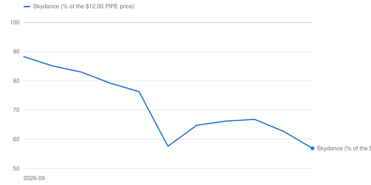
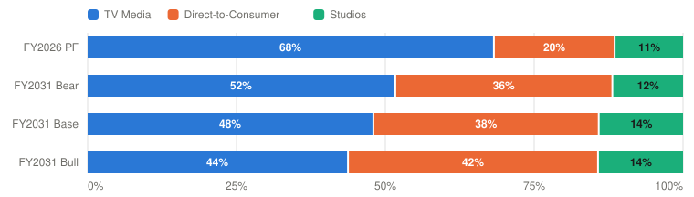

# SKYD — Skydance Corporation

> **Schema** v7.0 · **Updated** 2026-11-18 · **Status** Active
> **Price** $6.83 verified Nov 18, 2026, 10:47 AM ET (StockAnalysis real-time; the Yahoo quote page was stale at the Oct 27 print) ([Yahoo](https://finance.yahoo.com/quote/SKYD/)) · 52-wk $6.61–$17.16 · 2nd %ile · −60.2% from high
> **Type** Media conglomerate: linear TV networks, streaming subscriptions and film/TV studios · **Stage** Levered merger integration (mature ex-growth linear funding a streaming build) · **Cyclical** Yes (advertising, film slate) · **Competence** Edge

## Verdict

**Two studios, the deepest library in the business and $87 billion of debt: at $6.83 the probability-weighted case pays 6.5% a year against the 13% hurdle, because about $6 billion of synergies has to cover about $6 billion of new interest before shareholders keep anything.**

🟡 **Non-holder: Watch (entry ≤$5.04)** · 🟡 **Holder: Hold**

| PW EV | PW return/yr | Compounding/yr | R/R | Entry | Trim | Avoid | EV/EBITDA (FY26 PF) | Yield | BAIT | Moat | Next |
|---|---|---|---|---|---|---|---|---|---|---|---|
| **$8.14** | **6.5% (<13%)** | n/m (2026 base depressed by new interest; see Valuation) | 2.0:1 | ≤$5.04 | $8.14–$19.44 | ≥$19.44 | ≈9.2× [Derived] | 2.9% | Single (B, Mod) | Narrow, narrowing (linear) / stable (IP) | 📅 ~early Mar 2027 (Q4, FY2027 guide, pro forma financials) |

**Breaks if**: net leverage is still above 6× at the end of 2027, or Skydance issues equity below $12. Then the Bear is a funding loop and the stock is an option on the lenders' goodwill, not an investment.

## The Call

Skydance has fallen 43% below the $12 at which its new owners bought 3.9 billion shares six weeks ago, though the quarter it just reported beat guidance. The market is pricing the balance sheet, not the quarter: about $87 billion of gross debt, roughly $6 billion a year of interest and $20.3 billion maturing within five years. At $6.83 the price implies about a 17% chance of the Bear, where linear declines 9% a year, leverage breaches the 5.5× covenant and equity is raised. I put that at 30%, because the last merger of these same cable networks delivered its synergies and still shrank. The Base, where the savings mostly arrive but linear erosion eats half of it, is worth $8.20; management's plan in full is the Bull at $19.44. Weighted, that is $8.14 and 6.5% a year, below the 13% hurdle at any plausible Bear probability (break-even 3%). The one number that settles it is the 2027 guide in early March: adjusted EBITDA up from about $12.4 billion and free cash flow at or above breakeven after cost to achieve.

## What I'd Have To Be Wrong About

1. **That the synergy plan reaches the P&L faster than linear erodes.** Test: at the Q4 2026 print (~early March 2027), pro forma FY2026 adjusted EBITDA ≥$12.0B, FY2027 guidance of adjusted EBITDA ≥$13.5B, and FY2027 free cash flow guided at or above breakeven after cost to achieve ([source: Q3 call](https://www.fool.com/earnings/call-transcripts/2026/11/10/skydance-skyd-q3-2026-earnings-call-transcript/)). **If Fail →** move 10 points from Base to Bear (PW EV $7.37, 4.5%/yr) → **Watch**, entry $4.56; the holder verb becomes Exit if the guide also shows FY2027 FCF below zero.
2. **That linear declines at a manageable rate.** Test: pro forma TV Media revenue down no more than 8% year over year in each of Q1 and Q2 2027, excluding political advertising, and no top-tier sports package (NFL on CBS, March Madness, TNT's NHL/MLB) lost or cut at renewal. **If Fail →** Base cut to $7.28 on an 8% annual linear decline (PW EV $7.68, 5.3%/yr) → **Watch**, entry $4.75.
3. **That the balance sheet de-levers from cash flow, not from shareholders.** Test: net leverage on the company's definition at or below 5.5× at year-end 2027 and falling, the $0.05 quarterly dividend kept, and no primary equity issued below $12. Asset sales that retire debt at ≥10× EBITDA (DC, non-core networks) count as a pass. **If Fail →** move 10 points from Bull to Bear (PW EV $6.25, 1.2%/yr) → **Watch** for a non-holder and **Exit** for a holder; the funding loop is then live.

---

## Deep Dive: Skydance: Two Studios, One Balance Sheet

*David Ellison bought Warner Bros. Discovery with $57 billion of new secured debt and $47 billion of equity at $12 a share. Six weeks later the stock is $6.83. Is the market wrong about the plan, or right about the debt?*

**Contents**: [Business Overview](#business-overview) · [Six Billion of Savings Against Six Billion of Interest](#six-billion-of-savings-against-six-billion-of-interest) · [Is Streaming Big Enough to Replace Cable?](#is-streaming-big-enough-to-replace-cable) · [Management, Capital Allocation and Incentives](#management-capital-allocation-and-incentives) · [Valuation and Model Assumptions](#valuation-and-model-assumptions) · [Final Words](#final-words) · [Appendix: The Numbers](#appendix-the-numbers) · [Sources](#sources)

On Monday, October 5, 2026, Skydance's Class B stock closed at $9.78. The next morning the company closed its acquisition of Warner Bros. Discovery, paying $31.02 a share in cash, about $97 billion in all. To pay for it, Skydance sold 3.9 billion new shares at $12.00 to the Ellison family, RedBird, the sovereign funds of Saudi Arabia, Abu Dhabi and Qatar and a handful of others, and raised or assumed $72 billion of debt. Six weeks later the stock trades at $6.83. The people who wrote the $47 billion equity check are down 43%, and the stock has fallen to the bottom of its 52-week range.

The business did nothing to deserve that in those six weeks. Paramount's last standalone quarter, reported November 9, beat its own guidance: revenue up 5%, adjusted EBITDA of $1.0 billion against a top-of-range target, Paramount+ revenue up 21%. The stock rose 8.6% into the print and has fallen 21% since. The October 14 drop of 24% came on the day the shares began trading without the new warrants, which the NYSE valued at only $0.19 a share. The rest was selling.

*Weekly closes (Nov 18 intraday) as % of the $12.00 price paid by the October PIPE investors (= 100). Not dividend-adjusted; the Oct 14 ex-warrant reference adjustment was $0.19. Source: [StockAnalysis price history](https://stockanalysis.com/stocks/skyd/history/). Built with Claude.*

| Date | Skydance (% of the $12.00 PIPE price) |
|---|---|
| 2026-09-11 | 88 |
| 2026-09-25 | 83 |
| 2026-10-09 | 76 |
| 2026-10-23 | 65 |
| 2026-11-06 | 67 |
| 2026-11-18 | 57 |

What the market is pricing is not the quarter. It is the balance sheet that came with the deal. Skydance now carries about $87 billion of gross debt and expects to pay about $6 billion of interest a year, roughly ten cents of every dollar of revenue. Management's answer is a plan to take out costs of about the same size within three years while linear television keeps shrinking underneath it. The question for a five-year holder is simple to state. Do the savings outrun the interest and the decline of cable, so that something is left for the equity, or does the company spend the decade paying its lenders?

This piece starts with the business and a few accounting points a reader needs, because there are no clean combined numbers yet. Most of it is spent on the synergy plan against the debt, then on whether streaming is big enough to replace cable profits. Then come management, the capital record and the control structure, and finally valuation: what does $6.83 assume, and what has to be true to earn 13% a year?

### Business Overview

Skydance reports three segments. **TV Media** is CBS and its stations, the cable networks of both companies (TNT, TBS, CNN, Discovery, Food Network, HGTV, MTV, Nickelodeon, Comedy Central, BET and about 45 more) and international free-to-air channels. It earns affiliate fees from pay-TV distributors and advertising. **Direct-to-Consumer** is Paramount+, HBO Max and the free, ad-supported Pluto TV. **Studios** is Paramount Pictures, Warner Bros., New Line, DC, the television studios and the licensing of a library of about 15,000 films.

There are no reported combined numbers yet; Skydance will publish pro forma financials before its Q4 call. The table below is my estimate of a full combined 2026, built from Paramount's guidance and nine-month results and Warner Bros. Discovery's trailing figures.

| $ Billion, FY2026 [Estimate] | Paramount | Warner Bros. Discovery | Combined |
|---|---|---|---|
| **Direct-to-Consumer** |  |  |  |
|  Revenue | 10.2 | 12.3 | 22.5 |
|  Adjusted EBITDA | 1.1 | 1.9 | 3.0 |
|  Margin | 10.8% | 15.4% | 13.3% |
| **Studios** |  |  |  |
|  Revenue (net of WBD internal licensing) | 6.0 | 7.8 | 13.8 |
|  Adjusted EBITDA | 0.4 | 1.3 | 1.7 |
|  Margin | 6.7% | 16.7% | 12.3% |
| **TV Media** |  |  |  |
|  Revenue | 12.7 | 16.0 | 28.7 |
|  Adjusted EBITDA | 4.1 | 6.0 | 10.1 |
|  Margin | 32.3% | 37.5% | 35.2% |
| Corporate and eliminations | (1.7) | (0.7) | (2.4) |
| **Total revenue** | 28.9 | 36.1 | 65.0 |
| **Adjusted EBITDA** | 3.9 | 8.5 | 12.4 |
|  Margin | 13.5% | 23.5% | 19.1% |

*[Estimate] Author's full-year 2026 build. Paramount: 2026 adjusted EBITDA guide of $3.9B and nine-month segment results ([Q3 call](https://www.fool.com/earnings/call-transcripts/2026/11/10/skydance-skyd-q3-2026-earnings-call-transcript/), [trending-schedule summary](https://uk.investing.com/news/stock-market-news/skydance-q3-2026-slides-strong-results-investor-caution-remains-93CH-4969937)). WBD: trailing revenue $36.1B ([StockAnalysis](https://stockanalysis.com/stocks/wbd/financials/)), LTM adjusted EBITDA $8.8B less the $200M Q4 film headwind, Q2 2026 segment run rates ([WBD Q2 2026 release](https://www.sec.gov/Archives/edgar/data/1437107/000143710726000072/wbd2q26earningsrelease08.htm)). Combined pro forma financials will be published before the Q4 call. Built with Claude.*

*Segment adjusted EBITDA before corporate costs. FY2026 is the author's pro forma estimate; FY2031 from the model. Built with Claude.*

| Period | TV Media | Direct-to-Consumer | Studios | Total ($B) |
|---|---|---|---|---|
| FY2026 PF | 10 (68%) | 3 (20%) | 2 (11%) | 15 |
| FY2031 Bear | 6 (52%) | 4 (36%) | 1 (12%) | 12 |
| FY2031 Base | 8 (48%) | 6 (38%) | 2 (14%) | 16 |
| FY2031 Bull | 9 (44%) | 8 (42%) | 3 (14%) | 20 |

Three things stand out. TV Media earns about two-thirds of segment profit at a 35% margin, so the declining business pays for everything else. Streaming is now the largest growth line but earns only a 13% margin. And Studios is small in profit and lumpy: Warner Bros.' 2026 film slate has disappointed, and management expects up to $200 million less EBITDA than planned in Q4.

A few accounting points. **Adjusted EBITDA** excludes stock compensation, restructuring and transaction costs, so it overstates cash earnings; I deduct SBC as a cost. The **synergy target** is a run-rate figure "net of reinvestment," costs $4 billion of one-off cash to achieve, and is phased 30% by the end of 2027 and 70% by the end of 2028. Paramount's own results are split at August 7, 2025 into **Predecessor and Successor** periods because the Skydance merger revalued its assets, so year-over-year comparisons are pro forma. The **203 million streaming subscribers** management cites are Paramount+ plus HBO and HBO Max under each company's old definitions, without removing overlap; analysts estimate about 120 million unique payers. And from the Q4 report on, Skydance **stops disclosing quarterly subscribers** and moves to annual guidance.

### Six Billion of Savings Against Six Billion of Interest

Let me start with where things stand.

| $ Billion | FY2026 PF [Estimate] | FY2030 management plan | FY2031 my Base |
|---|---|---|---|
| Revenue | 65.0 | ≈79 (mid-single-digit growth) | 68.6 |
| Adjusted EBITDA | 12.4 | ≈20 (mid-20s margin) | 14.6 |
| Run-rate synergies in place | 0 (Paramount program ≈$2.7B already in base) | ≥6.0 | ≈4.5 net of erosion offsets |
| Interest | ≈6.0 | falling with paydown | ≈5.2 |
| Free cash flow | ≈0 after cost to achieve (2027 guide: breakeven or better) | ≥10 | ≈5.0 |
| Net leverage | ≈6.4× | <3× by end-2029 | ≈4.9× |

*Management targets from the [Q3 2026 call](https://www.fool.com/earnings/call-transcripts/2026/11/10/skydance-skyd-q3-2026-earnings-call-transcript/) and the shareholder letter as reported in the [10-Q write-up](https://ppc.land/skydance-faces-6bn-yearly-interest-bill-after-97bn-warner-takeover/) [Management guidance]. FY2026 PF and FY2031 Base are the author's model [Estimate]/[Derived]. Built with Claude.*

#### Management's narrative

Management's case is that it has already run this playbook once. David Ellison opened the November 9 call with the Paramount record:

> "Last year, we took over an underperforming business and made significant improvements. Through better content, more disciplined investment and a focus on efficiency, we beat our initial guidance and raised it throughout the year. We raised our efficiency target to more than $3 billion, over 50% above our original goal, and we're on track to deliver more than $2.7 billion in run rate savings by year-end."
> — David Ellison, Chairman and CEO, Q3 2026 earnings call, November 9, 2026

Co-CEO Ynon Kreiz, Mattel's former chief executive, who joined in October, laid out where the $6 billion comes from:

> "We are combining 2 global streaming services, 2 film and TV studio groups, 2 television portfolios and many overlapping corporate functions across a large cost base of more than $50 billion per year... The key areas include corporate overhead and real estate and facilities as well, where we expect to achieve at least $2.2 billion of savings... Just to give you an example, we have 5 sites in New York and 7 different sites in L.A."
> — Ynon Kreiz, Co-CEO, same call

CFO Dennis Cinelli addressed the debt directly:

> "Achieving our leverage targets does not require us to raise additional capital or divest assets. We will hit our leverage goals through our operating plan."
> — Dennis Cinelli, CFO, same call

The medium-term targets are mid-single-digit revenue growth, adjusted EBITDA margins in the mid-20s, at least $10 billion of free cash flow in 2030 and net leverage below 3× by the end of 2029. Until then, cash beyond reinvestment and the $0.05 quarterly dividend goes to debt.

This is a credible team on costs. Paramount beat every 2026 guide, the overlap is real (two of everything, on a cost base above $50 billion), and the target is about 12% of that base. I believe the run-rate number.

#### Poking holes in it

The first hole is that the savings and the interest are the same size. The 10-Q says annual interest payments are expected to be "approximately $6 billion," against about $1 billion at Paramount alone. At the end of year three, if every dollar of synergy arrives, the combined company has roughly paid for its new coupon and is back where the two companies stood before the deal, with nearly twice their combined $48 billion of debt. Shareholders get the upside only from what comes after: debt paydown that lowers the interest bill, and growth.

The second hole is that the last merger of this kind already happened, and the synergies were not the problem. When Discovery bought WarnerMedia in 2022, it cut costs hard and paid down about $20 billion of debt. Revenue still fell from $41.3 billion in 2023 to $36.1 billion over the twelve months to June 2026, and free cash flow from $6.2 billion to $2.2 billion. Linear networks lost 17% of revenue in Q2 2026 alone (much of it the NBA), with domestic pay-TV subscribers down 10%. The cost savings were real and the business still shrank under them. Skydance is buying the same networks a second time, plus Paramount's.

The third hole is the price of the plan. The $6 billion is net of reinvestment and costs $4 billion to achieve, with $1.5–2 billion in 2027, which is why management guides 2027 free cash flow only to "breakeven or better." The consent decree that cleared the deal requires 30 to 32 theatrical releases a year, $300 million a year more of U.S. production than 2025, both studio lots kept for five years and separate carriage negotiations for the two cable portfolios. Ellison said all of it was in the plan. The 10-Q says the commitments "will increase our costs" and "may also limit our ability to realize the synergies we expect."

The fourth hole is the margin target. Mid-20s adjusted EBITDA margins on about $80 billion of revenue means roughly $20 billion of EBITDA, about 60% more than today. That needs every dollar of synergy and roughly $2 billion of growth on top, while the segment earning two-thirds of the profit is shrinking 6–10% a year. It is possible. It is the Bull case, not the base case.

The table below turns the debate into a dollar of revenue.

| Per $1 of revenue | FY2026 PF [Estimate] | FY2030 management plan [Derived] | FY2031 my Base [Derived] | FY2031 Bull [Derived] |
|---|---|---|---|---|
| Adjusted EBITDA | $0.191 | $0.250 | $0.213 | $0.246 |
| Capex, content cash above amortization, other | ($0.070) | ($0.045) | ($0.045) | ($0.040) |
| Interest | ($0.092) | ($0.050) | ($0.075) | ($0.048) |
| Cash taxes | ($0.006) | ($0.030) | ($0.020) | ($0.033) |
| Stock compensation (after tax) | ($0.012) | ($0.010) | ($0.010) | ($0.010) |
| **Owner free cash flow** | $0.010 | ≈$0.12 | $0.063 | $0.115 |
| Reported or implied total | owner FCF ≈$0.7B | FCF ≥$10B on ≈$79B | owner FCF ≈$4.3B | owner FCF ≈$8.8B |

*Illustrative. FY2026 interest uses the ≈$6B annual run rate from the [10-Q](https://ppc.land/skydance-faces-6bn-yearly-interest-bill-after-97bn-warner-takeover/), not the pre-deal figure. The plan column spreads management's 2030 targets (mid-single-digit growth, mid-20s margin, ≥$10B FCF) across the same lines; the split of the non-EBITDA lines is the author's assumption. Bull and Base from the model. Built with Claude.*

Today a dollar of revenue leaves about a penny for owners after interest, taxes and stock pay. Management's 2030 plan leaves about 12 cents. My Base leaves about 6 cents in 2031, half of the plan, because the linear decline consumes about half of the synergies, as it did at WBD.

Where I come out: the cost plan is believable and the arithmetic still favors the lenders for at least three years. The equity becomes valuable only if linear declines slowly enough that synergies and streaming growth add to EBITDA rather than replace lost EBITDA. I give that outcome, management's plan in full, 20%.

#### Rings of profit

As with every company where one risk dominates, it helps to sort the profit by exposure.

| Ring | Share of FY2026 segment EBITDA [Estimate] | Margin | Threat | Exposure |
|---|---|---|---|---|
| 1. Cable networks (TNT, TBS, CNN, Discovery, Food, HGTV, MTV, Nickelodeon, Comedy Central, BET) | ≈50% (≈$7.5B) | ≈38% | Cord-cutting: WBD domestic pay-TV subscribers −10% in Q2 2026; carriage resets; sports rights inflation | High |
| 2. CBS network, stations, sports (NFL AFC, March Madness, Masters) | ≈18% (≈$2.6B) | ≈30% | Advertising cycle, retransmission terms, news-related regulation | Medium |
| 3. Studios and library (Paramount, Warner Bros., New Line, DC, TV studios) | ≈11% (≈$1.7B) | ≈12% | Slate volatility (WB Q4 −$200M); consent-decree output floor | Medium-low |
| 4. Streaming (Paramount+, HBO Max, Pluto TV) | ≈20% (≈$3.0B) | ≈13% | Scale vs. Netflix and YouTube; ARPU; churn | Benefits from ring 1's decline |

*[Estimate] Split of TV Media between cable and CBS is the author's; the company does not disclose it. CreditSights estimates traditional channels earn >70% of profit and "almost all the free cash flow" ([Barchart via Yahoo](https://finance.yahoo.com/media-advertising/articles/why-wall-street-worried-skydance-130002599.html)). Built with Claude.*

The inner ring, cable networks, earns about half of segment EBITDA and is the one in structural decline. CBS and sports are steadier because the NFL, March Madness and retransmission fees hold up better than general entertainment cable. Studios and streaming benefit from the same shift that hurts cable. The risk is concentrated, as it usually is in media, but here it sits under a capital structure built on the inner ring's cash flow. CreditSights' analyst estimates the traditional channels deliver more than 70% of the profit and "almost all the free cash flow." That is the ring the debt is really lent against.

### Is Streaming Big Enough to Replace Cable?

The second debate is whether the growth ring can get big and profitable enough, quickly enough, to replace the inner ring.

| Metric | Paramount DTC, Q3 2026 | WBD Streaming, Q2 2026 |
|---|---|---|
| Revenue | $2.51B (+11%); Paramount+ $2.134B (+21%) | $3.079B (+10%) |
| Subscribers | Paramount+ 82.2M (+6%) | ≈121M HBO + HBO Max [Derived: 203M − 82.2M] |
| Monthly ARPU | $8.69 (+14%) | n/d |
| Advertising | $542M (+13%) | $306M (+9%) |
| Adjusted EBITDA | $225M (9.0% margin) | $512M (16.6% margin, +75%) |
| EBITDA per subscriber per month [Derived] | ≈$0.91 | ≈$1.41 |

*Sources: [Q3 2026 10-Q and letter as reported](https://ppc.land/skydance-faces-6bn-yearly-interest-bill-after-97bn-warner-takeover/), [WBD Q2 2026 release](https://www.sec.gov/Archives/edgar/data/1437107/000143710726000072/wbd2q26earningsrelease08.htm). The 121M figure uses each company's old definitions and is not deduplicated. Built with Claude.*

The good news is momentum. Paramount+ revenue grew 21% in Q3, its fastest pace of the year, on 6% subscriber growth and a 14% rise in average revenue per user to $8.69 a month. Engagement is up more than 20%. HBO Max has grown revenue about 10% a year and its streaming EBITDA rose 75% in Q2 2026 to $512 million. Pro forma, combined DTC revenue grew 15% in Q3. And Kreiz said the quiet part plainly: "we know that our ARPU lags other players in the industry." A bundle of HBO Max and Paramount+ launches in early 2027, and the two services should share one technology platform within about a year of closing.

The bad news is profit and scale. Paramount's DTC segment earned a 9.0% EBITDA margin in Q3, down on the prior year, as UFC rights and originals cost more. Netflix had 325 million subscribers at the end of 2025; Skydance has perhaps 120 million unique payers. And Skydance will stop reporting subscribers from Q4, just as the numbers start to matter most. The illustrative arithmetic: at $8.69 of monthly ARPU, Paramount's DTC earned about $0.91 of EBITDA per subscriber per month in Q3 (the segment includes Pluto and BET+). Replacing the roughly $2.5 billion of cable EBITDA my Base loses over five years would take about 230 million more subscribers at that margin, about twice the combined base. So the gap has to close mostly through margin and price, from the bundle, from closing the ARPU gap and from running two services on one platform. That is the right path to bet on. It is also the one that a weak consumer or a churn spike would hit first.

My Base has DTC growing 7% a year to a 19% margin by 2031, which takes streaming from about a fifth of segment profit to about two-fifths. The Bull has 10% growth and a 23% margin, closer to the leaders. The second test below asks for the cable side of the trade: if linear revenue falls faster than 8% a year in the first half of 2027, streaming cannot keep up on any reasonable assumption.

### Management, Capital Allocation and Incentives

David Ellison founded Skydance Media in 2010 as a film co-financier and producer (the *Mission: Impossible* films, *Top Gun: Maverick*) and took control of Paramount in August 2025 with RedBird and his father's backing. Ynon Kreiz, Mattel's chief executive from 2018, joined as co-CEO in October; Dennis Cinelli is CFO. The team's public record as operators is fifteen months long. In that time Paramount beat and raised its guidance, lifted its efficiency target from $2 billion to more than $3 billion, signed UFC to Paramount+ and outbid Netflix for Warner Bros.

Control matters here more than at most companies. Harbor Lights Entertainment, owned about 77.5% by Ellison entities and 22.5% by RedBird, holds 100% of the voting Class A stock. Public SKYD shares are non-voting Class B. The Ellison family's economic stake fell from 47.1% to 35.0% with the October issue, but its control did not change. The related-party list is long: Skydance pays Oracle (chaired by Larry Ellison) for software and signed a six-year, $300 million cloud agreement in February 2026; a RedBird affiliate received a $110 million fee for advising on the merger and holds a transformation contract worth up to $12 million a year.

#### The deals

| Year | Deal | Price / terms | What happened | Verdict |
|---|---|---|---|---|
| 2025 | Skydance Media + Paramount Global (Ellison/RedBird take control of National Amusements) | Ellison family and RedBird capital; Paramount assets revalued Aug 7, 2025 | Guidance beaten and raised; efficiency target lifted to >$3B; stock from $13.21 (end-2025) to $6.83 | Mixed |
| 2025–26 | Telefe and Chilevisión sold | Undisclosed | Non-core international broadcasters exited; −2 pts of ad revenue | Good |
| 2026 | UFC rights to Paramount+ from January 2026 | Multi-year | Lifts DTC advertising and engagement; weighs on Q3 DTC margin | Too early |
| 2026 | Warner Bros. Discovery, outbidding Netflix | $31.02/share cash; $97.4B purchase consideration; ≈$110B EV, ≈12.5× LTM EBITDA; $2.8B Netflix break fee | Closed Oct 6; $47B equity at $12 + $57B new secured debt; stock −30% since | Too early (financing Poor) |
| 2026 | Warrants to pre-deal Class B holders | 470.7M ten-year warrants at $12.00 | NYSE reference adjustment $0.19/share; up to 9% dilution if in the money | n/a |

*Sources: [closing 8-K](https://www.stocktitan.net/sec-filings/PSKY/8-k-paramount-skydance-corp-reports-material-event-e1470761c887.html), [10-Q write-up](https://ppc.land/skydance-faces-6bn-yearly-interest-bill-after-97bn-warner-takeover/), [StockAnalysis ratios](https://stockanalysis.com/stocks/skyd/financials/ratios/). EV/EBITDA [Derived] from the company's ≈$110B deal value and WBD LTM adjusted EBITDA of $8.8B ([WBD Q2 release](https://www.sec.gov/Archives/edgar/data/1437107/000143710726000072/wbd2q26earningsrelease08.htm)). Built with Claude.*

#### The cash

Paramount's own record as a public company is the starting point, and it is weak.

| $ Million (Paramount standalone) | FY2021 | FY2022 | FY2023 | FY2024 | FY2025 | Cumulative |
|---|---|---|---|---|---|---|
| Revenue | 28,586 | 30,154 | 29,652 | 29,213 | 28,891 |  |
| Operating cash flow | 953 | 219 | 475 | 752 | 649 | 3,048 |
| Capex | (354) | (358) | (328) | (263) | (296) | (1,599) |
| **Free cash flow** | 599 | (139) | 147 | 489 | 353 | 1,449 |
| FCF margin | 2.1% | −0.5% | 0.5% | 1.7% | 1.2% | 1.0% |
| SBC | 192 | 172 | 177 | 245 | 273 | 1,059 |
| Dividends (incl. preferred) | 647 | 689 | 447 | 168 | 191 | 2,142 |
| Dividends % of FCF | 108% | n/m | 304% | 34% | 54% | 148% |
| Buybacks | 110 | 31 | 29 | 60 | 118 | 348 |
| Net debt (year-end) | 13,365 | 14,681 | 13,656 | 13,172 | 11,818 |  |
| Net debt / EBITDA | 3.0× | 4.6× | 6.1× | 4.5× | 4.4× |  |
| Diluted shares (M) [Derived] | 648 | 650 | 653 | 664 | 851 | 5,040 now |

*Source: S&P Global via [StockAnalysis financials](https://stockanalysis.com/stocks/skyd/financials/) and [ratios](https://stockanalysis.com/stocks/skyd/financials/ratios/). Diluted shares derived from net income ÷ EPS. FY2025 mixes Predecessor and Successor periods. Q3 2026 alone: operating cash flow $123M, FCF $31M after $174M of restructuring and transaction payments ([10-Q write-up](https://ppc.land/skydance-faces-6bn-yearly-interest-bill-after-97bn-warner-takeover/)). Built with Claude.*

Over 2021–25 Paramount generated $1.4 billion of free cash flow and paid $2.1 billion of dividends, and net leverage was 4.4× or higher in every year after 2021. The Ellisons inherited that, cut costs and improved it. Then they bought a company larger than Paramount with mostly borrowed money. For the public Class B holder the record is a 7.8-fold increase in diluted shares since 2021 (648 million to 5.04 billion) and net debt that rose from about $13 billion to about $80 billion.

I grade capital allocation **Anti-Outsider**. Winning a bidding war at about 12.5× Warner Bros. Discovery's trailing EBITDA, financed with new secured debt and new shares at more than six times EBITDA, is the opposite of the countercyclical, per-share discipline the framework rewards. The one thing in its favor is that the controlling family bought 1.24 billion of those shares itself, for $14.85 billion, at the same $12 price as everyone else.

#### The incentives

| Component | Weight or size | What it pays for | Latest outcome |
|---|---|---|---|
| Total CEO pay (aggregator) | ≈$63.2M, ≈98% bonus and equity | Mostly equity value | [link pending] DEF 14A CD&A not read |
| Annual bonus metrics | n/d | n/d | [link pending] |
| Long-term equity | Majority of pay | Share price | Underwater vs. the $12 PIPE |
| Controlling stake | Ellison ≈35% economic; 100% of votes via Harbor Lights (77.5% Ellison) | Equity value of ≈1.8B shares | Bought 1.24B shares for $14.85B at $12 |
| **Return on invested capital** | 0% (no ROIC metric disclosed) | — | — |

*Pay figure from [Simply Wall St](https://simplywall.st/stocks/pe/media/bvl-pskyus/paramount-skydance-shares/management) (aggregator, not the filing). Ownership from the [10-Q write-up](https://ppc.land/skydance-faces-6bn-yearly-interest-bill-after-97bn-warner-takeover/). The proxy's incentive metrics are a logged gap. Built with Claude.*

I could not read the compensation discussion in the proxy, so the incentive table has gaps; I have logged that rather than guess. What I can see is that pay is almost entirely equity, which aligns the CEO with the share price, and that the controlling shareholder's interest is the Class B price times about 1.8 billion economic shares, not a bonus. That is real alignment on value. It does not stop the controller from preferring a bigger company to a more valuable one, and the deal history suggests it did.

#### The promises

| Promise | When and where | What happened |
|---|---|---|
| Paramount efficiency savings of $2B, later raised to >$3B | Aug–Nov 2025, Paramount Skydance | On track: >$2.7B run rate by end-2026, remainder in 2027 ✅ |
| 2026 adjusted EBITDA at the high end of the range, $3.9B | 2026 guidance, raised mid-year | On track; Q3 $1.0B above the top of guidance ✅ |
| Leverage targets met "through our operating plan", without new capital or asset sales; <3× by end-2029 | Oct 6 close and Nov 9 call | Too early; 2027 FCF guided only to breakeven or better |

*Sources: [Q3 2026 call](https://www.fool.com/earnings/call-transcripts/2026/11/10/skydance-skyd-q3-2026-earnings-call-transcript/), [10-Q write-up](https://ppc.land/skydance-faces-6bn-yearly-interest-bill-after-97bn-warner-takeover/). Built with Claude.*

**Guidance grade: Consistent beater**, on a short record: five quarters of Paramount guidance met or beaten, with Q3 adjusted EBITDA above the top of its range. The Warner Bros. film slate missed in its first quarter under the new owners, and the merger promises are untested.

Is Ellison the right manager? For costs, technology and talent relationships, the evidence says yes. For capital allocation the evidence says he will pay up for scale. A holder is betting on the operator and accepting the dealmaker.

### Valuation and Model Assumptions

I value Skydance on owner free cash flow per share: segment adjusted EBITDA, less corporate costs, capital spending and the gap between content cash and content amortization, less interest and tax, less stock compensation, divided by diluted shares, five years out, times a multiple. The model carries those deductions in "corporate and other," while interest is carried as a declining common line, with case-specific interest folded into corporate. Base-year interest is the new run rate, not Paramount's historical figure. FY2026 is my combined pro forma estimate: revenue of $65 billion and adjusted EBITDA of $12.4 billion. Here is the Base:

| $ Billion | FY2026E | FY2027E | FY2028E | FY2029E | FY2030E | FY2031E |
|---|---|---|---|---|---|---|
| **Direct-to-Consumer revenue** | 22.5 | 24.1 | 25.8 | 27.6 | 29.5 | 31.6 |
|  YoY growth | 7.0% | **7.0%** | **7.0%** | **7.0%** | **7.0%** | **7.0%** |
|  Operating margin | 13.3% | 14.4% | 15.6% | 16.7% | 17.9% | **19.0%** |
|  Operating profit | 2.99 | 3.48 | 4.01 | 4.61 | 5.27 | 6.00 |
| **Studios revenue** | 13.8 | 14.2 | 14.6 | 15.1 | 15.5 | 16.0 |
|  YoY growth | 3.0% | **3.0%** | **3.0%** | **3.0%** | **3.0%** | **3.0%** |
|  Operating margin | 12.3% | 12.4% | 12.6% | 12.7% | 12.9% | **13.0%** |
|  Operating profit | 1.70 | 1.77 | 1.84 | 1.92 | 2.00 | 2.08 |
| **TV Media revenue** | 28.7 | 27.0 | 25.4 | 23.8 | 22.4 | 21.1 |
|  YoY growth | -6.0% | **-6.0%** | **-6.0%** | **-6.0%** | **-6.0%** | **-6.0%** |
|  Operating margin | 35.2% | 35.4% | 35.5% | 35.7% | 35.8% | **36.0%** |
|  Operating profit | 10.10 | 9.54 | 9.01 | 8.51 | 8.03 | 7.58 |
| Corporate and other | (6.96) | (6.37) | (5.80) | (5.24) | (4.68) | (4.12) |
| **Total revenue** | 65.0 | 65.3 | 65.8 | 66.5 | 67.4 | 68.6 |
| **Operating profit** | 7.84 | 8.41 | 9.06 | 9.79 | 10.62 | 11.54 |
|  Operating margin | 12.1% | 12.9% | 13.8% | 14.7% | 15.7% | 16.8% |
| Net income | 1.45 | 2.05 | 2.70 | 3.41 | 4.19 | 5.05 |
| Diluted shares (B) | 5.040 | 5.090 | 5.141 | 5.193 | 5.245 | 5.297 |
|  Net share change | — | +1.0% | +1.0% | +1.0% | +1.0% | +1.0% |
|  SBC (% of revenue) | 1.5% | 1.5% | 1.4% | 1.4% | 1.3% | 1.3% |
| **Free cash flow per share** | $0.29 | $0.40 | $0.53 | $0.66 | $0.80 | $0.95 |
|  YoY growth | — | 39.8% | 30.4% | 25.1% | 21.6% | 19.3% |
| **Owner earnings per share (after SBC)** | $0.14 | $0.25 | $0.38 | $0.52 | $0.66 | $0.82 |

*Segment "operating profit" is segment adjusted EBITDA. "Corporate and other" carries corporate costs, capex, content cash above amortization and case-specific interest differences; the common interest line (≈$6.0B in 2026, −3% a year) sits between "operating profit" and net income. "Net income" is therefore free cash flow before SBC; owner earnings deduct SBC after tax. FY2026 is the author's pro forma estimate. Bold cells are model inputs.*

In the Base, synergies mostly arrive but linear revenue falls 6% a year, streaming grows 7% to a 19% margin, and adjusted EBITDA reaches about $14.6 billion in 2031, a 21% margin. Free cash flow climbs to about $5 billion and net debt falls by about $8 billion after the $4 billion cost to achieve and the dividend, which leaves leverage near 4.9×, so the 3× target slips. Owner FCF per share reaches $0.82. At 10× that is $8.20, equivalent to about 7.9× EV/EBITDA, below the 12.5× Skydance paid for WBD and in line with a media company that is still shrinking.

| Case | Prob. | 3P | Direct-to-Consumer growth / margin | Studios growth / margin | TV Media growth / margin | Net shares/yr | Per-share earnings FY2031 | CAGR | Exit multiple | Value | Return/yr | Implied g | Driving assumption |
|---|---|---|---|---|---|---|---|---|---|---|---|---|---|
| **Bull** | 20% | Plausible | +10.0% / 23.0% | +5.0% / 15.0% | -4.5% / 38.0% | +1.6% | $1.62 | 64.3% | 12.0× owner earnings | $19.44 | 26.2% | 1.5% | Management's plan arrives: the $6B of synergies land in full, the Paramount+/HBO Max bundle lifts ARPU toward peers (DTC +10% a year at a 23% margin) and linear shrinks only 4.5% a year. Adjusted EBITDA ≈$19B (24% margin), FCF ≈$9.5B in 2031, net leverage ≈2.8×, warrants exercised. FY2031 owner FCF per share × 12 (≈8.5× EV/EBITDA). |
| **Base** | 50% | Probable | +7.0% / 19.0% | +3.0% / 13.0% | -6.0% / 36.0% | +1.0% | $0.82 | 43.4% | 10.0× owner earnings | $8.20 | 6.6% | 0.0% | Synergies mostly arrive, but linear revenue falls 6% a year and eats about half of them, as at WBD after 2022. DTC grows 7% a year to a 19% margin. Adjusted EBITDA ≈$14.6B (21%), FCF ≈$5B, net leverage ≈4.9× in 2031, so the 3× target slips. FY2031 owner FCF per share × 10 (≈7.9× EV/EBITDA). |
| **Bear** | 30% | Probable | +5.0% / 15.0% | +1.0% / 9.0% | -9.0% / 34.0% | +4.0% | $0.06 | -13.9% | 8.0× owner earnings | $0.51 | -37.5% | -2.2% | Linear falls 9% a year as sports and carriage renewals reset, the bundle fails to lift ARPU and synergies are spent defending share. Adjusted EBITDA ≈$10B, leverage above the 5.5× covenant, the dividend is cut and equity is raised (+4% shares a year); refinancing $20B of maturities keeps interest near $6B. FY2031 owner FCF per share × 8 (≈7.7× EV/EBITDA, generous for this case) stands in for the option value of a 7×-levered equity. |
| **Priced-in (10%/yr)** | — | diagnostic | +7.6% / 19.7% | +3.4% / 13.4% | -5.7% / 36.4% | +1.1% | $0.96 | 48.0% | 10.0× owner earnings | $9.61 | 10.0% | 0.0% | Solved along Base → Bull for 10%/yr |
| **Hurdle (13%/yr)** | — | diagnostic | +8.1% / 20.5% | +3.7% / 13.7% | -5.4% / 36.7% | +1.2% | $1.10 | 52.2% | 10.0× owner earnings | $11.04 | 13.0% | 0.0% | Solved along Base → Bull for 13%/yr |
| **Probability-weighted** | 100% |  |  |  |  |  |  |  |  | $8.14 | 6.5% |  |  |

*Exit multiples apply to FY2031 owner free cash flow per share (after SBC). Bull 12× ≈8.5×, Base 10× ≈7.9× and Bear 8× ≈7.7× EV/EBITDA on each case's 2031 net debt [Derived]. Priced-in and Hurdle are solved along Base→Bull at 10×. Built with Claude.*

| Return math |  |
|---|---|
| PW return/yr vs. hurdle | **6.5% (<13%)**, of which 2.9% is the dividend yield. Entry ≤$5.04. 10-year Treasury 5.00%; the hurdle sits 8.0 points above it. |
| Compounding at a flat multiple | n/m on the 2026 base. Owner FCF per share is depressed to ≈$0.14 by the new ≈$6B interest bill, so Base growth of 43.4% a year is recovery, not compounding, and the multiple falls from ≈50× to 10×. The honest measure: Base FY2031 owner FCF of $0.82 a share is ≈12% of today's price, plus the 2.9% dividend. |
| Optionality | None valued. |
| Price-implied expectations | At 10%, spot needs FY2031 owner FCF of $0.96 a share at a 10× exit, about a fifth of the way from the Base to the Bull. Perpetual cross-check: EV ≈$114B on ≈$6.2B of FY2026 unlevered FCF after tax [Estimate] implies g ≈4.6% a year forever, more than a business with a shrinking core has shown. |
| EPV floor | ≈$1.40 per share: FY2026 owner FCF of ≈$0.7B capitalized at 10% with no growth. On an enterprise basis (≈$12.4B EBITDA less ≈$4.6B of capex and content cash, after tax, at 10%) EPV is ≈$62B against ≈$80B of net debt, so the no-growth equity is worth nothing. About 80% of the price pays for synergies and growth. The Bear ($0.51) sits below EPV because it damages today's earnings power (linear −9% a year). |
| Base rate / 3P | The Bull needs ≈3.3% nominal (≈1% real) revenue growth from $65B; ≈27% of companies over $50B exceed 5% real, so revenue is not the stretch. The stretch is margin: adjusted EBITDA from 19% to 25% while the highest-margin segment shrinks. Bull Plausible, Base and Bear Probable. |
| Terminal-growth check | Implied perpetual growth on owner earnings at 10%: Bull 1.5%; Base 0.0%; Bear -2.2%. All below the risk-free rate. |
| Break-even and price-implied Bear odds | Break-even 3% against 30% assigned; price-implied 17% at 10%. |
| Year ten | In 2036 TV Media is still shrinking and streaming must carry most of the profit; the Base 10× exit implies no growth (implied g 0%), so the terminal multiple is not doing the work. The equity value is in debt paydown, not growth. |
| R/R | **2.0:1** (Bull +185% / Bear −92%). Mechanically flattered: the Bear is close to zero, so the ratio looks like 2:1 while the Bear costs almost all of the stake. |

*Discount rate 10% (levered, cyclical media). Hurdle 13%. Built with Claude.*

**What the price assumes.** To earn an ordinary 10% a year at a 10× exit, Skydance needs FY2031 owner FCF of about $0.96 a share, about a fifth of the way from my Base to my Bull. Holding the Bull-to-Base mix fixed, the price implies a Bear probability of about 17%. I assign 30%, because of the maturity wall and covenant described under the Appendix risks, and a largest segment that is shrinking. The market is more relaxed about the Bear than I am.

**What 13% needs.** To earn 13% a year the stock needs about $1.10 of owner FCF per share in 2031, more than a third of the way to the Bull, with the Bear at only 3%. Weighting the cases 20% Bull, 50% Base and 30% Bear gives about $8.14 and 6.5% a year including the 2.9% dividend. The price that clears the hurdle on the same cases is about $5.04. The verb is not probability-fragile: no plausible Bear probability gets this to 13% at $6.83.

The reason is the shape of the outcomes. The Bull is worth almost three times today's price and the Bear close to nothing, and that is what leverage does to an equity sitting on $80 billion of net debt. At 2.0:1 the reward-to-risk looks fair, but a 30% chance of losing almost everything needs a much larger reward than a Bull at 20% to clear a teens hurdle.

**Confidence note (Competence: Edge).** I can judge linear decline rates, streaming unit economics and the debt stack. I can't judge how the controlling family would act in the Bear, whether it would inject equity on terms fair to Class B holders or let lenders take control. That decides whether the Bear is worth $0.50 or $3.

**Bias check.** This is the first page on the ticker, so there is no prior verb. The 43% gap between the PIPE price and the stock is not evidence of value; the PIPE price was set by a formula with a $12 floor in February, before the debt was raised.

### Final Words

Mr. Market has decided Skydance is a debt story. He is right. At $6.83 the shares are a leveraged claim on a cost plan that management will probably deliver and a linear decline that nobody controls, and the first three years of savings belong to the lenders. The business underneath is better than the stock: the deepest library in the industry, CBS, the NFL and March Madness, two streaming services growing faster than the market, and a team that beat every target it set at Paramount.

What he may have wrong is how much downside is left. The price implies roughly a one-in-six chance of the bad outcome, and I think it is closer to one in three. That is why the probability-weighted return is only 6.5% a year, why a non-holder should wait, and why the entry, about $5.04, sits well below today's price. For a holder the answer is Hold: the Bull is real, management is doing what it said, and the first hard evidence is a few months away.

Three things would change my mind, all due in 2027. The 2027 guidance, due with the Q4 print in early March, has to show adjusted EBITDA growing and free cash flow at or above breakeven after cost to achieve. Pro forma linear revenue has to fall less than 8% a year in the first half of 2027. And net leverage has to fall toward 5.5× by year-end without new equity below $12. Here they are as kill criteria, each with its consequence fixed in advance:

*The three tests, with their pre-committed consequences, are listed at the top of this report under [What I'd Have To Be Wrong About](#what-id-have-to-be-wrong-about).*

### Appendix: The Numbers

The tables below carry the framework's required numbers. The argument for each is made in the chapters above.

#### Five-year record

| $B, except per share | FY2021 | FY2022 | FY2023 | FY2024 | FY2025 | FY2026 PF [Estimate] |
|---|---|---|---|---|---|---|
| Revenue | 28.59 | 30.15 | 29.65 | 29.21 | 28.89 | 65.0 |
| Revenue growth | +13.1% | +5.5% | −1.7% | −1.5% | −1.1% | n/m (merger) |
| Operating income (GAAP) | 4.00 | 2.83 | 1.82 | 2.53 | 1.89 | n/d |
| Operating margin | 14.0% | 9.4% | 6.1% | 8.6% | 6.5% | n/d |
| Adjusted EBITDA | n/c | n/c | n/c | n/c | n/c | 12.4 |
| Free cash flow | 0.60 | (0.14) | 0.15 | 0.49 | 0.35 | ≈0.7 owner FCF at new interest [Derived] |
| Owner earnings (FCF − SBC) | 0.41 | (0.31) | (0.03) | 0.24 | 0.08 | ≈0.7 |
| SBC % of revenue | 0.7% | 0.6% | 0.6% | 0.8% | 0.9% | ≈1.5% |
| SBC ÷ owner earnings | 47% | n/m | n/m | 102% | 341% | ≈140% |
| Diluted shares (M) | 648 | 650 | 653 | 664 | 851 | 5,040 |
| Net share change | — | +0.3% | +0.5% | +1.7% | +28% | +492% |
| Buybacks vs. SBC | 0.6× | 0.2× | 0.2× | 0.2× | 0.4× | none |
| Net debt | 13.4 | 14.7 | 13.7 | 13.2 | 11.8 | ≈80 |
| Net debt / EBITDA | 3.0× | 4.6× | 6.1× | 4.5× | 4.4× | ≈6.4× |
| ROIC (S&P definition) | 9.8% | 6.0% | 4.9% | 7.6% | 6.9% | n/m |
| 3-yr ROIIC [Derived] |  |  |  |  | negative | n/m |
| Reinvestment rate |  |  |  |  | ≈80% of NOPAT (content cash above amortization + capex) [Estimate] |  |
| Nearest maturity wall |  |  |  |  |  | $20.3B due within five years of Oct 2026 |

*FY2021–25 are Paramount standalone (S&P Global via [StockAnalysis](https://stockanalysis.com/stocks/skyd/financials/) and [ratios](https://stockanalysis.com/stocks/skyd/financials/ratios/)). n/c: not comparable across the 2025 Predecessor/Successor split. ROIIC: operating income fell from $2.83B (2022) to $1.89B (2025) while invested capital rose with the Aug 2025 fair-value step-up, so incremental returns are negative. FY2026 PF is the author's combined estimate. Interest coverage on the new structure ≈2× adjusted EBITDA. Built with Claude.*

Cycle position: Paramount's operating margin of 6.5% in 2025 sits at the bottom quarter of its 2021–25 range (median 8.6%). Advertising is about a quarter of combined revenue and moves with the economy, so I flag the company as cyclical and use structural, not peak, margins in every case.

#### Growth levers

| Lever | Current contribution | Runway (yrs) | Evidence | Management intent | Stage |
|---|---|---|---|---|---|
| Market growth | Streaming +; linear −6% to −10% | 5+ | WBD linear −17% (Q2 2026, NBA loss); Paramount TV Media −7% | "Conservatively plan for a structural decline" (Kreiz) | Proven (negative) |
| Share gain | Second only to YouTube in U.S. TV time (Nielsen) | 3–5 | Combined reach; CBS #1 in primetime ex-sports | Hold share across platforms | Proven |
| Price and mix | Paramount+ ARPU +14% | 5 | "Our ARPU lags other players" (Kreiz) | Bundle in early 2027; phase in pricing | Scaling |
| Attach / new products | Bundle, Pluto TV (75M MAU), games | 3–5 | Pluto on Paramount+ stack; 14 WB channels added | Unified service over time | Option |
| New geographies | HBO Max international launches | 5 | WBD Q2 streaming SG&A +14% on launches | Grow international ARPU | Scaling |
| M&A | Negative (deleveraging) | — | DC sale rumor unverified | Opportunistic non-core monetization | — |
| Margin | $6B run-rate synergies | 3 | Paramount program delivered >$2.7B | 30% by end-2027, 70% by end-2028 | Scaling |
| Share count | +492% in 2026; warrants up to +9% | — | 3.9B PIPE shares; 470.7M warrants at $12 | No buyback until <3× | Negative |

*Sources: [Q3 2026 call](https://www.fool.com/earnings/call-transcripts/2026/11/10/skydance-skyd-q3-2026-earnings-call-transcript/), [WBD Q2 2026 release](https://www.sec.gov/Archives/edgar/data/1437107/000143710726000072/wbd2q26earningsrelease08.htm), [10-Q write-up](https://ppc.land/skydance-faces-6bn-yearly-interest-bill-after-97bn-warner-takeover/). Adjacency test: streaming and studios share customers and content with the core; the bundle passes. Built with Claude.*

#### Moat, customer and profit pool

| Item | Read |
|---|---|
| Mechanism (7 Powers) | Cornered resource: the library and franchises (Harry Potter, DC, Game of Thrones, Top Gun, Mission: Impossible, Star Trek, SpongeBob; ≈40 billion-dollar franchises per Ellison). Scale: >$30B a year of content spend, the most in the industry. |
| Trend | Narrowing in linear (distribution moving to YouTube, Netflix and connected TV); stable for the IP, whose value rises as AI makes generic content cheaper |
| Who captures the margin | Shifting from networks to aggregators: YouTube holds a record 15.8% of U.S. TV time; Netflix has 325M subscribers. Skydance is a supplier to both and a competitor of both |
| Customer block | Buyers: pay-TV distributors (affiliate fees, rates still rising while subscribers fall), advertisers (sports commitments +20%), subscribers (Paramount+ ARPU $8.69, +14%; churn not disclosed; subscriber disclosure ends Q4 2026) |

*Sources: [Q3 2026 call](https://www.fool.com/earnings/call-transcripts/2026/11/10/skydance-skyd-q3-2026-earnings-call-transcript/), [10-Q write-up](https://ppc.land/skydance-faces-6bn-yearly-interest-bill-after-97bn-warner-takeover/), [Barchart via Yahoo](https://finance.yahoo.com/media-advertising/articles/why-wall-street-worried-skydance-130002599.html). Built with Claude.*

#### Competitors

| Company | Position | Relevance |
|---|---|---|
| Netflix (NFLX) | 325M subscribers (end-2025); walked from WBD and collected a $2.8B break fee | The streaming benchmark; also a licensing customer |
| Disney (DIS) | Parks plus Disney+/Hulu/ESPN; wiki page [DIS](../DIS/DIS.md) | Closest diversified peer; bundle partner |
| YouTube (GOOGL) | 15.8% of U.S. TV time | The aggregator taking linear's viewers and ad dollars |
| Comcast / NBCU and Fox | Fox closed its purchase of Roku on Nov 6, 2026 | Sports and broadcast rivals; distribution consolidating |
| Amazon MGM | Prime Video, NBA rights, James Bond | Deep-pocketed bidder for sports and talent |

*Sources: [Barchart via Yahoo](https://finance.yahoo.com/media-advertising/articles/why-wall-street-worried-skydance-130002599.html), [10-Q write-up](https://ppc.land/skydance-faces-6bn-yearly-interest-bill-after-97bn-warner-takeover/). Built with Claude.*

#### Risks and triggers

| Risk | Why it passes the materiality filter | Priced in? | Trigger I monitor |
|---|---|---|---|
| Leverage and refinancing: $87B gross debt, ≈$6B interest, 5.5× leverage covenant, first-lien 3.25×, coupons 6.3–9.1% | Worse than any peer; ruin path | Partly | Test 3: leverage ≤5.5× at end-2027 |
| Linear erosion outruns synergies (the WBD 2022–26 precedent) | Tied to a quantified test; not fully priced in my view | Partly | Test 2: TV Media revenue ≥ −8% YoY |
| Consent decree [NEW in 2026]: 30–32 films a year, +$300M U.S. production, both lots for five years, separate cable carriage talks; failure can force a Miramax sale and $30M per missing film | Limits synergies; the 10-Q says it "will increase our costs" | No | Film count and production spend in the 10-K |
| Control and related parties: non-voting Class B; Oracle and RedBird contracts; future equity could be issued to the controller on terms public holders do not vote on | Materially worse than peers | No | Any equity issuance or related-party contract above $100M |
| Studio slate and DC reset: WB film slate −$200M vs plan in Q4; DC co-chiefs replaced Nov 9 | Large discretionary bet on 30+ films a year | Yes | 2027 slate (Superman sequel, Minecraft, Lord of the Rings) |

*Risk factors from the [Q3 2026 10-Q as reported](https://ppc.land/skydance-faces-6bn-yearly-interest-bill-after-97bn-warner-takeover/) and the [closing 8-K](https://www.stocktitan.net/sec-filings/PSKY/8-k-paramount-skydance-corp-reports-material-event-e1470761c887.html). Prior 10-K Item 1A not diffed (logged gap). Built with Claude.*

**Reflexive loops and ruin paths.** Two loops apply. The funding loop: if leverage stalls above the covenant, the cure is equity, and the lower the price the more shares it takes. The confidence loop: the debt is rated BB (S&P) and Ba3 (Moody's), and management's investment-grade goal underpins its refinancing cost on $20.3 billion maturing within five years. The ruin path is a covenant or refinancing failure in a recession year; the controlling family's willingness to inject equity is the main mitigant and the main dilution risk.

#### Catalysts

| Date | Event | What would move the verdict |
|---|---|---|
| 📅 Dec 18 / Dec 25, 2026 | Dune: Part Three; HBO's Harry Potter series premieres | Q4 studio headwind no worse than $200M; HBO Max engagement |
| 📅 ~early Mar 2027 | Q4 2026 print, FY2027 guidance, pro forma financials | Test 1: EBITDA ≥$13.5B guided, FCF ≥ breakeven |
| 📅 Early 2027 | Paramount+ / HBO Max bundle launch | Pricing and uptake; first ARPU read |
| 📅 1H 2027 | Investor Day | Leverage path, synergy phasing, segment targets |
| 📅 Aug 2027 | EU deadline to exit the UIP distribution venture | Minor |
| 📅 End-2027 | 30% of synergies in run rate; net leverage read | Test 3 |

*Sources: [Q3 2026 call](https://www.fool.com/earnings/call-transcripts/2026/11/10/skydance-skyd-q3-2026-earnings-call-transcript/), [10-Q write-up](https://ppc.land/skydance-faces-6bn-yearly-interest-bill-after-97bn-warner-takeover/). Built with Claude.*

#### Sentiment and positioning

| Item | Read |
|---|---|
| Analysts | Consensus Hold, average target ≈$9.0 across 23 analysts [Analyst consensus]; Citi resumed at Buy, $10 (Oct 26); JPMorgan Neutral, $9 (Oct 23); Freedom Broker cut to $8.50 (Nov 17) |
| Short interest | 85.0M shares, 1.7% of shares out (mid-October), up from 78.4M |
| Insiders | Ellison family bought 1.24B shares for $14.85B in the October PIPE at $12; Elon Musk reported to have invested ≈$1B (Semafor, Oct 22; terms undisclosed). 90-day Form 4s not read (logged gap) |
| BAIT | Single (B, Moderate): a forced-feeling selloff after a 3.6× rise in share count and an ex-warrant day; analytical, informational and technical edges Weak |

*Sources: [StockAnalysis statistics](https://stockanalysis.com/stocks/skyd/statistics/), [StockAnalysis news feed](https://stockanalysis.com/stocks/skyd/history/), [Semafor](https://semafor.com/article/10/22/2026/elon-musk-makes-1-billion-investment-in-ellisons-skydance), [10-Q write-up](https://ppc.land/skydance-faces-6bn-yearly-interest-bill-after-97bn-warner-takeover/). Built with Claude.*

**Appearances (R9), October 6 – November 18, 2026:** the Q3 call on November 9 is the only management appearance with a transcript in the window. No conference or podcast appearances were found; an Investor Day is scheduled for the first half of 2027.

### Sources

[Q3 2026 earnings call transcript (Motley Fool), Nov 9, 2026](https://www.fool.com/earnings/call-transcripts/2026/11/10/skydance-skyd-q3-2026-earnings-call-transcript/) · [Q3 2026 10-Q, shareholder letter and call, detailed write-up (PPC Land)](https://ppc.land/skydance-faces-6bn-yearly-interest-bill-after-97bn-warner-takeover/) · [Q3 2026 trending schedules summary (Investing.com)](https://uk.investing.com/news/stock-market-news/skydance-q3-2026-slides-strong-results-investor-caution-remains-93CH-4969937) · [Q3 2026 results press release](https://www.prnewswire.com/news-releases/skydance-reports-third-quarter-2026-financial-results-for-paramount-skydance-302933823.html) · [Closing 8-K, Oct 6, 2026 (financing, PIPE, warrants)](https://www.stocktitan.net/sec-filings/PSKY/8-k-paramount-skydance-corp-reports-material-event-e1470761c887.html) · [Warner Bros. Discovery Q2 2026 earnings release (8-K Ex-99.1)](https://www.sec.gov/Archives/edgar/data/1437107/000143710726000072/wbd2q26earningsrelease08.htm) · [Paramount/Skydance financials 2021–2025 (S&P Global via StockAnalysis)](https://stockanalysis.com/stocks/skyd/financials/) · [Paramount/Skydance ratios 2021–2025 (StockAnalysis)](https://stockanalysis.com/stocks/skyd/financials/ratios/) · [Warner Bros. Discovery financials (StockAnalysis)](https://stockanalysis.com/stocks/wbd/financials/) · [SKYD price history (StockAnalysis)](https://stockanalysis.com/stocks/skyd/history/) · [SKYD statistics (StockAnalysis)](https://stockanalysis.com/stocks/skyd/statistics/) · [SKYD quote (Yahoo Finance; stale on Nov 18)](https://finance.yahoo.com/quote/SKYD/) · [Why Wall Street is so worried about Skydance's debt (Barchart, Oct 13, 2026)](https://finance.yahoo.com/media-advertising/articles/why-wall-street-worried-skydance-130002599.html) · [Elon Musk makes $1 billion investment in Ellison's Skydance (Semafor, Oct 22, 2026)](https://semafor.com/article/10/22/2026/elon-musk-makes-1-billion-investment-in-ellisons-skydance) · [Skydance falls as shares trade without warrant entitlement (24/7 Wall St, Oct 14, 2026)](https://247wallst.com/investing/2026/10/14/skydance-falls-16-as-shares-begin-trading-without-warrant-entitlement-netflix-and-disney-tick-up/) · [Paramount's $31 all-cash offer for WBD (MarketChameleon, Feb 27, 2026)](https://marketchameleon.com/articles/b/2026/02/27/paramount-all-cash-31-wbd-superior-status-details) · DEF 14A compensation discussion [link pending]

---

*Analysis, not personal investment advice. Every figure traces to a linked primary source or carries a tag ([Estimate], [Analyst consensus], [Management guidance], [Derived]). No position sizing by design. Built from [report/](report/) by kg-investment-analysis v7; edit the sources there, not this file.*
