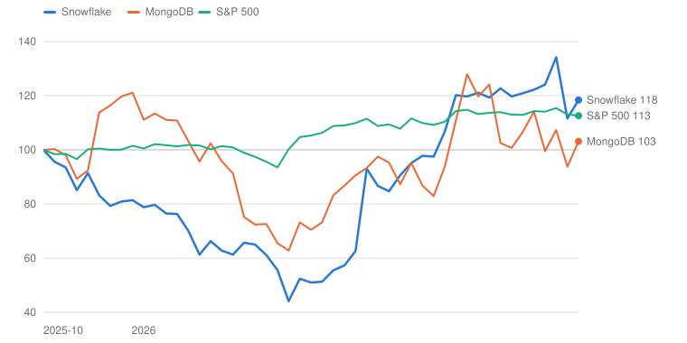
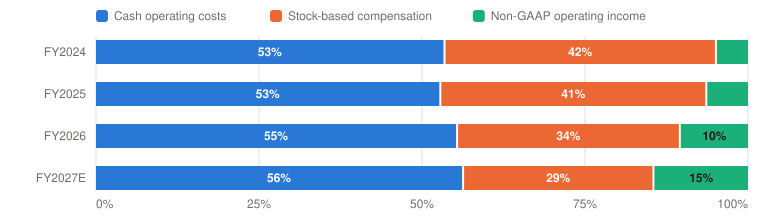

# SNOW — Snowflake Inc.

> **Schema** v7.0 · **Updated** 2026-10-24 · **Status** Active
> **Price** $325.43 verified Oct 23, 2026 close ([Yahoo](https://finance.yahoo.com/quote/SNOW/)) · 52-wk $118.30–$384.56 · 78th %ile · −15.4% from high
> **Type** Consumption-priced cloud data platform (AI Data Cloud) · **Stage** High growth, pre-owner-earnings · **Cyclical** No · **Competence** Edge

## Verdict

**The bears picked a falsifiable fight about agentic AI and lost it three quarters running, but at $325 the price needs FY2032 owner earnings about 40% above my Bull case just to return an ordinary 9%; the probability-weighted case pays -5.8% a year against the 13% hurdle.**

🟡 **Non-holder: Watch (entry ≤$131)** · 🔴 **Holder: Trim**

| PW EV | PW return/yr | Compounding/yr | R/R | Entry | Trim | Avoid | FY2027E EV/product rev | Yield | BAIT | Moat | Next |
|---|---|---|---|---|---|---|---|---|---|---|---|
| **$241** | **-5.8% (<13%)** | n/m (owner EPS negative today) | 0.3:1 | ≤$131 | $241–$396 | ≥$396 | ≈18× | 0.0% | Single (A), and it argues against owning | Moderate; widening in context, narrowing in storage | 📅 Dec 2 (Q3 FY2027) |

**Breaks if**: Stock-based compensation stays near 29% of revenue instead of falling toward the low teens, in which case owner earnings never turn positive at scale and no exit multiple on them is defensible.

⚠️ **Terminal-growth check**: implied perpetual growth exceeds the risk-free rate in Bull, Bear.

## The Call

The agentic bear case was specific and it is beaten: product revenue growth went 29% → 30% → 34% → 37%, net revenue retention turned up to 126%, and Ramaswamy says first-party AI contributed about half the acceleration. Consumption pricing was the right model for agents, because agents generate volume. None of that is the question now. Snowflake has never earned a dollar of owner earnings: FY2026 operating cash flow of $1,222M against $1,600M of stock issued, and SBC still ~29% of revenue. I value it on owner earnings, which are about −$0.86 a share this year, and cap the exit at 25× because anything higher implies perpetual growth above the 4.96% ten-year yield. On those terms the Bull alone returns 4.0% a year with certainty, so break-even and price-implied Bear odds are both negative: no probability weighting of my cases earns 9% from here. The price clears 13% at $131. Good business, wrong price; the verb is valuation, not thesis.

## What I'd Have To Be Wrong About

1. **That the AI revenue mix is not structurally margin-dilutive.** Test: in Q3 FY2027 (Dec 2, 2026), non-GAAP product gross margin ≥74.0% for the quarter and the FY2027 full-year guide held at 74.0% rather than cut again. **If Fail →** move 10 points from Base to Bear (PW EV $231, -6.6%/yr) → stays **Watch**, entry falls to $126.
2. **That the acceleration is a new baseline, not a migration burst.** Test: Q3 FY2027 product revenue growth of at least 37% (the guide is 37–38%), and an initial FY2028 guide at the Q4 print in late February 2027 of at least 30% growth. **If Fail →** move 10 points from Bull to Bear (PW EV $212, -8.2%/yr) → stays **Watch**, entry falls to $115.
3. **That the gap between cash flow and owner earnings is actually closing.** Test: the FY2027 10-K, due about March 2027, shows stock-based compensation at or below 26% of revenue (from 34.2% in FY2026) and diluted share count growth of 2% or less. **If Fail →** move 10 points from Bull to Base and 5 from Base to Bear (PW EV $227, -7.0%/yr) → stays **Watch**, entry falls to $123.

---

## Deep Dive: Snowflake: The Year the Market Changed Its Mind Twice

*Between November 2025 and April 2026 Snowflake lost 56% because investors decided AI would eat the data warehouse. Then it rose 169% because AI fed it instead. The business grew every quarter of both moves. At $325, what is left to pay for?*

**Contents**: [Business Overview](#business-overview) · [Did AI Eat the Warehouse, or Feed It?](#did-ai-eat-the-warehouse-or-feed-it) · [What AI Costs, and Who Gets Paid](#what-ai-costs-and-who-gets-paid) · [Ramaswamy, Capital Allocation and Incentives](#ramaswamy-capital-allocation-and-incentives) · [Valuation and Model Assumptions](#valuation-and-model-assumptions) · [Final Words](#final-words) · [Appendix: The Numbers](#appendix-the-numbers) · [Sources](#sources)

On November 3, 2025, Snowflake closed at $277.14, the highest price it had seen in almost four years. Five months later, on April 10, 2026, it closed at $121.11. The company lost 56% of its value in 110 trading days. Nothing broke. In the middle of that fall Snowflake reported two quarters: product revenue up 29% and then up 30%, remaining performance obligations up 37% and then up 42%, and the strongest quarter of new customer acquisition in its history. The business did not stumble once while the stock was cut in half.

What changed was the story investors told about the next decade. Through the winter of 2025 and into the spring of 2026 the market decided that powerful agentic models were about to make the governed data warehouse an expensive middleman. Aaron Katz, the CEO of ClickHouse, put the argument crisply in public: Snowflake's engine was built for the speed at which humans click through dashboards, and agents want queries that are far faster and far cheaper than that. Databricks raised money in December 2025 at a $134 billion valuation on roughly the same revenue Snowflake had, growing twice as fast, with AI revenue about ten times larger. Snowflake's own net revenue retention had fallen from 171% at its peak to 125%. On April 9, 2026, the whole software complex repriced in a single session on fears that managed agents from Anthropic and OpenAI would absorb the workflow layer: Cloudflare fell 12%, Snowflake 9%, ServiceNow 7%. Snowflake bottomed the next day.

Then it nearly tripled. On May 27, 2026, Snowflake reported product revenue up 34%, the largest sequential dollar increase in its history, announced a $6 billion multi-year commitment from AWS and raised full-year guidance. The stock rose 36.5% the following session, from $175.26 to $239.20. On September 2 it reported a third consecutive quarter of accelerating growth, 37%, raised guidance again, and rose 16.6%. It closed on October 23, 2026 at $325.43, up 169% from the April low and 17% above the November 2025 peak.

*Total return including dividends, weekly, October 31, 2025 = 100. Snowflake peaked at $277.14 on November 3, 2025, bottomed at $121.11 on April 10, 2026 and closed at $325.43 on October 23, 2026. Source: [Yahoo Finance](https://finance.yahoo.com/quote/SNOW/) adjusted closes. Built with Claude.*

| Date | Snowflake | MongoDB | S&P 500 |
|---|---|---|---|
| 2025-10-31 | 100 | 100 | 100 |
| 2025-12-26 | 81 | 121 | 102 |
| 2026-02-20 | 63 | 96 | 101 |
| 2026-04-24 | 51 | 70 | 105 |
| 2026-06-26 | 91 | 87 | 108 |
| 2026-08-28 | 119 | 124 | 114 |
| 2026-10-23 | 118 | 103 | 113 |

So the bears were wrong, and loudly wrong. AI did not route around the warehouse; it drove traffic into it. Sridhar Ramaswamy told analysts on the September call that Snowflake's own AI products "contributed approximately half of the acceleration that we are seeing." That is about as clean a refutation as a thesis ever gets in public.

This piece is about what comes after being right. I want to do three things. First, work out what actually caused the round trip, because the mechanism matters more than the moral: the collapse was not a judgment about AI so much as a judgment about a guidance number, and the guidance number was wrong for a reason that was knowable at the time. Second, take the second debate seriously, which is not whether AI grows Snowflake's revenue but what that revenue costs to serve and who gets paid out of it. Third, ask the only question that is left: at $325, having bought the recovery, what does the price assume? The answer is the uncomfortable part of this report.

### Business Overview

Snowflake sells compute and storage for enterprise data, metered. Customers buy capacity in advance under multi-year contracts and draw it down as they run queries, so revenue is consumption, not seats. In fiscal 2026, which ended January 31, 2026, product revenue was **$4,472.3 million**, up 29%, inside total revenue of $4,684 million. Professional services is the remainder and runs at about 4% of the total at roughly break-even; it exists to get workloads onto the platform, not to make money. There is one reportable segment.

|  | Q3 FY2026 | Q4 FY2026 | Q1 FY2027 | Q2 FY2027 |
|---|---|---|---|---|
|  Quarter ended | Oct 31, 2025 | Jan 31, 2026 | Apr 30, 2026 | Jul 31, 2026 |
| **Product revenue ($M)** | 1,158 | 1,230 | 1,330 | **1,492** |
|  Year-over-year growth | 29% | 30% | 34% | **37%** |
|  Net revenue retention | 125% | 125% | 126% | 126% |
|  Remaining performance obligations ($B) | 7.88 | 9.77 | 9.21 | 9.00 |
|  RPO year-over-year growth | 37% | 42% | 38% | 30% |
|  Customers >$1M trailing 12-month | 688 | 733 | 779 | 828 |
|  Net new customers added | — | 740 | 616 | 692 |
| GAAP operating margin | (27%) | — | (23.4%) | (17.0%) |
| Non-GAAP operating margin | 11% | 11% | 11.9% | **15.3%** |
|  Stock-based compensation ($M) | — | — | 434 | 456 |
| **Non-GAAP diluted EPS** | — | — | $0.40 | $0.62 |
| **Stock reaction, next session** | −11.4% | −1.9% | **+36.5%** | **+16.6%** |

*Company-reported key business metrics. Q1 FY2027 non-GAAP diluted EPS is [Derived] as the $1.02 first-half figure less Q2's $0.62. Q4 FY2026 SBC and GAAP operating margin not separately shown in the release. Stock reactions are the next full session's close-to-close change. Sources: [Q3 FY2026](https://www.sec.gov/Archives/edgar/data/1640147/000164014725000211/fy2026q3earnings.htm), [Q4 FY2026](https://www.sec.gov/Archives/edgar/data/1640147/000162828026011631/fy2026q4earnings.htm), [Q1 FY2027](https://www.sec.gov/Archives/edgar/data/1640147/000164014726000027/fy2027q1earnings.htm) and [Q2 FY2027](https://www.sec.gov/Archives/edgar/data/1640147/000164014726000033/fy2027q2earnings.htm) releases; prices from Yahoo Finance. Built with Claude.*

The company's own key metrics are the best short description of the business. As of July 31, 2026 there were **14,554 customers**, up from 13,245 six months earlier; 829 of the Forbes Global 2000, who together produced about 41% of revenue; 828 customers spending more than $1 million on a trailing twelve-month basis; and net revenue retention of **126%**, which had turned up from 125% at the January year-end. Remaining performance obligations were $9.0 billion with a weighted-average remaining contract life of 2.4 years, of which management expects about 54% to convert to revenue within twelve months.

Three accounting points matter before the argument starts, and the third is the one that decides this report.

The first is that consumption revenue is recognized as customers burn capacity, not as they sign. RPO therefore leads revenue, and the gap between RPO growth and revenue growth is a genuine signal rather than an artifact. In the quarter the stock fell 11%, RPO was growing 37% against revenue at 29%.

The second is that Snowflake guides on observed consumption. Brian Robins, the CFO, said it plainly on the September call: "As always, our forecast is based on observed consumption patterns." That is a conservative and defensible method, and it has a structural blind spot that I will come back to, because it is the single best explanation for both halves of the round trip.

The third is stock-based compensation. Snowflake's headline profitability is non-GAAP and excludes SBC. In fiscal 2026 SBC was **$1,600 million on $4,684 million of revenue, 34% of every dollar that came in**. The company reported non-GAAP operating income of $489.7 million that year and a GAAP operating loss of $1,435.2 million. In the second quarter of fiscal 2027 the pattern held: non-GAAP net income of $235.3 million against a GAAP net loss of $191.7 million, with $456.4 million of SBC-related charges in between. Every number in this report that describes Snowflake's profit will say whether it is before or after paying the people who produce it.

### Did AI Eat the Warehouse, or Feed It?

Let me start with where things stand.

| Phase | Period | Price | Move | Tag | What happened |
|---|---|---|---|---|---|
| 1. The AI Data Cloud peak | to Nov 3, 2025 | → $277.14 | four-year high | EXT-MARKET | The 2025 re-rating completes. Snowflake trades near 15× revenue on 29% growth; Databricks is about to raise at $134B. |
| 2. The first crack | Nov 3 – Dec 31, 2025 | → $219.36 | −21% | INT-FUND | Dec 3: Q3 beats, but Q4 is guided to 27% growth and a 7% operating margin. The stock falls 11.4% on Dec 4. |
| 3. The de-rating | Jan 1 – Mar 31, 2026 | → $150.82 | −31% | EXT-SECTOR | Feb 25: FY2027 guided to $5,660M, 27% growth, read as deceleration. Software multiples compress on AI-disruption fears. Mar 31: the CRO is replaced and guidance reaffirmed. |
| 4. Capitulation | Apr 1 – Apr 10, 2026 | → $121.11 | −20% | EXT-SECTOR | Apr 9: the sector reprices on managed-agent fears — Cloudflare −12%, Snowflake −9%, ServiceNow −7%. The 52-week low of $118.30 prints. |
| 5. The refutation | Apr 10 – Oct 23, 2026 | → $325.43 | **+169%** | INT-FUND | May 27: Q1 +34%, record sequential dollar growth, $6B AWS deal, guide raised; +36.5% next day. Sep 2: Q2 +37%, guide raised again; +16.6%. Oct 9 high of $368.89; Oct 16 −8.4% on sector AI-financing worries. |

*Closing prices from [Yahoo Finance](https://finance.yahoo.com/quote/SNOW/). Peak-to-trough was −56.3% over 110 trading sessions; trough-to-date +168.7%. Tags: INT-FUND = company fundamentals, EXT-SECTOR = sector repricing, EXT-MARKET = broad market. April 9 peer moves from [24/7 Wall St.](https://247wallst.com/investing/2026/04/09/net-down-12-snow-down-9-now-down-7-the-market-just-repriced-the-entire-software-sector-on-ai-agent-fears/). Built with Claude.*

Set the price phases against the quarterly table above and the drawdown makes no sense on fundamentals. Growth went 29%, 30%, 34%, 37% straight through it. Something other than the business was moving.

#### Management's narrative

Management's case is that AI is not a competing destination for enterprise data but a reason to put more of it in one governed place and then query it far more often. Ramaswamy has been consistent about the mechanism since the Q1 call in May:

> "AI is accelerating the value that people can get from the data that they have put into Snowflake … it in turn drives more consumption on the core data platform simply because it's much easier to get projects done."
> — Sridhar Ramaswamy, CEO, Q1 FY2027 earnings call, May 27, 2026

By September he was making the stronger, structural version of the claim:

> "Customers using AI on Snowflake consume more across the data platform, creating a structural multiplier for our business … Put simply, the agentic enterprise runs on Snowflake."
> — Sridhar Ramaswamy, CEO, Q2 FY2027 earnings call, September 2, 2026

The products carrying that claim are two, both renamed at Snowflake Summit in San Francisco in June 2026. **CoCo** is Cortex Code, a coding and data-engineering agent that understands the customer's own schema and semantics. **CoWork** is the former Snowflake Intelligence, an agentic workspace for business users. By the July quarter CoCo was in more than 9,100 accounts, having added over 2,000 in three months, and CoWork was in 5,800. Neither existed eighteen months ago.

The go-to-market facts support the narrative. In the July quarter Snowflake added 692 net new customers, up 32% year over year. Net revenue retention turned up. AWS signed a $6 billion, five-year commitment, more than double the prior agreement, with expanded joint selling. And Robins was explicit about where the upside in the model came from:

> "CoCo had the largest driver to the increase in our forecast."
> — Brian Robins, CFO, Q1 FY2027 earnings call, May 27, 2026

On the bear thesis specifically, management's answer is neutrality and gravity. Christian Kleinerman, who runs product, told Karl Keirstead of UBS that model neutrality is "absolutely" a competitive advantage because customers who committed to a single model provider have regretted it, and told Tyler Radke of Citi that the reason applications will not become their own data platforms is simple: "If I use three applications, I am not going to copy my data into three different platforms." Ramaswamy's version is more elegant: "as software gets easier and easier to create, it is the data and semantics that acquire more and more importance."

I think management is substantially right, and I want to say so before I argue with them. The bear case as stated in late 2025 was a claim about query economics that turned out to be a claim about the wrong variable. Agents do want cheaper queries. They also want vastly more of them, and they want them against governed, permissioned, semantically described data that an enterprise will actually let an autonomous process touch. Snowflake charges by consumption. More queries is more revenue even if each query is cheaper. The bears modelled the price and forgot the volume.

#### Poking holes in it

The first hole is that the collapse was never really about agent architecture, so the recovery does not vindicate as much as it appears to. Look at what the market was handed. On December 3, 2025 Snowflake beat on the quarter and guided Q4 product revenue to 27% growth with a 7% non-GAAP operating margin; the stock fell 11.4% the next day. On February 25, 2026 it beat again and guided **full-year fiscal 2027 product revenue to $5,660 million, 27% growth**, decelerating from the 30% it had just printed. The agentic-disruption essays were the explanation the market reached for, but the thing it was actually repricing was a guidance number that said growth was slowing. By September that same year, guidance for the same fiscal year was $6,070 million and 36%. The company beat its own initial full-year guide by $410 million and nine points of growth in six months.

That is not a forecasting accident; it is the predictable output of the method. Robins told analysts in May that CoCo was new, so there was no observed consumption behaviour to forecast from, and that the company now layers it into the model. A guidance philosophy anchored on observed consumption cannot, by construction, include a product that has not been consumed yet. In February 2026 Snowflake guided a year that excluded the contribution of the products its CEO was simultaneously describing as the future of the company, and the market read the resulting number as evidence that the future was not arriving. Both the fall and the recovery were the market marking to a forecast that was never trying to answer the question being asked of it.

The second hole is that the clean refutation is also a short one. We have three quarters of acceleration. Three quarters is a trend in a press release and a data point in a five-year thesis. Koji Ikeda of Bank of America asked the right question in September — whether AI consumption represents higher lifetime consumption or projects pulled forward — and Ramaswamy's answer was that "this is not merely projects being pulled forward," citing breadth and depth of use cases, while declining to share uplift numbers. That is an assertion, not a disclosure. Snowflake has not quantified AI revenue, has not given an AI net revenue retention figure, and has not said what share of the raised full-year guide is CoCo and CoWork beyond "approximately half of the acceleration." A migration burst, in which every large enterprise rebuilds its data foundation for agents over three or four years and then stops, looks exactly like this for exactly this long.

The third hole is that the adoption curve of the two breakout products is already diverging. CoCo went from roughly 7,100 accounts in April to 9,100 in July, up about 28% in a quarter. CoWork went from roughly 5,200 to 5,800, which Ramaswamy described on the call as "up nearly 11% quarter-over-quarter." CoCo is a developer tool, sold into the people who were already Snowflake's users. CoWork is the one that was supposed to put the platform in front of every business user in the enterprise, and it is the one decelerating. The bull case for a structural multiplier rests more on CoWork than on CoCo, because an engineering productivity tool makes existing workloads cheaper to build while a business-user agent creates new ones.

The fourth hole is competitive and has not gone away because Snowflake's quarter was good. Databricks was raising at $134 billion in December 2025 on about $4.8 billion of run-rate revenue growing over 55%, with net revenue retention above 140% and AI revenue above $1 billion against Snowflake's roughly $100 million at the time. Those are not numbers that get refuted by one good Snowflake quarter; they say the category is growing fast enough for both and that the faster grower is taking the harder workloads. Ramaswamy himself conceded the point at Summit, acknowledging that differentiating data platforms is getting harder.

So let me turn the debate into arithmetic. Snowflake does not disclose unit economics, so the table below builds an illustrative customer from what the company does disclose, and then asks what AI does to it.

| Illustrative $1M customer | Pre-AI (FY2026) | With AI today | If AI mix triples |
|---|---|---|---|
| Core platform consumption | $1,000,000 | $1,040,000 | $1,000,000 |
| First-party AI products (CoCo, CoWork, Cortex) | — | $40,000 | $316,000 |
| **Total product revenue** | **$1,000,000** | **$1,080,000** | **$1,316,000** |
|  Core gross margin | 76% | 76% | 76% |
|  AI gross margin [Estimate] | — | 55% | 55% |
| Gross profit | $760,000 | $812,400 | $933,800 |
| **Blended gross margin** | **76.0%** | **75.2%** | **71.0%** |
| **Memo: reported / guided product gross margin** | 76% (FY2026) | 74.0% (FY2027 guide) | 71% (my Bear) |

*Author's illustration, not company disclosure. The AI revenue uplift is [Derived] from the acceleration itself: product growth rose 8 points between Q3 FY2026 and Q2 FY2027, and Ramaswamy said on the [Q2 call](https://stockanalysis.com/stocks/snow/transcripts/681381-q2-2027/) that first-party AI contributed "approximately half of the acceleration," so roughly 4 points of revenue is first-party AI and 4 points is AI-driven core pull-through. The 55% AI gross margin is an [Estimate] calibrated so the middle column lands near the company's own 74.0% FY2027 guide; the gap is cloud cost inflation. The right-hand column shows why Robins cut the margin guide and why the Bear uses 71%. Built with Claude.*

The illustration says something the narrative does not. AI adds revenue per customer, and it adds it at a lower gross margin, so the gross profit per customer grows meaningfully less than the revenue does. Management has now put that in the guidance: Robins cut the full-year non-GAAP product gross margin outlook to 74.0% from 75.0%, and said why — "This revised outlook includes a higher revenue mix from fast-growing AI workloads … which carry a lower contribution margin today." The word doing the work is *today*. The bull case needs inference costs to fall faster than AI mix rises. Ramaswamy's August 18 appearance on Bloomberg, where he argued that the next phase of enterprise AI is about economics and model routing rather than always reaching for the largest model, is management telling you they know this is the fight.

Where I come out: the bears lost the argument they picked, and they picked the wrong one. AI is a genuine demand tailwind for a consumption-priced data platform, and I would now underwrite high-teens-to-twenties revenue growth for several years with reasonable confidence. The debate that is actually open is not whether the revenue comes. It is what fraction of it ever reaches an owner, which is the subject of the next chapter.

#### Rings of profit

It helps to sort Snowflake's gross profit by how exposed each part is to the agentic thesis.

| Ring | Share of gross profit | Gross margin | Exposure to the agentic thesis | Read |
|---|---|---|---|---|
| Core warehousing and analytics | ~55% | ~78% | Agents query it more, not less; governance and row-level access are the barrier to entry | Safe, and the beneficiary |
| Data engineering and Snowpark | ~20% | ~74% | CoCo makes pipelines cheaper to build, which cuts hours but raises throughput | Mixed; volume should win |
| Storage and data sharing | ~15% | ~85% | Open Iceberg tables break the format lock-in that made this the best margin | Most exposed; margin pool erodes |
| First-party AI (CoCo, CoWork, Cortex) | ~10% | ~55% | The growth engine, and the thesis itself | Fastest-growing, worst margin |

*Shares of gross profit are the author's [Estimate]; Snowflake reports one segment and does not split gross profit by workload. Margins are [Estimate] calibrated to the 74.0% blended FY2027 guide. The point of the table is the ordering, not the decimals. Built with Claude.*

The reassuring reading is that roughly three-quarters of gross profit sits in core warehousing and engineering workloads that are sticky, governed and growing, and that the AI ring is additive rather than substitutive. The uncomfortable reading is that the ring growing fastest is the one with the worst margin, and the ring with the best margin — storage and the data-sharing network — is the one most exposed to open table formats. Snowflake's own answer to Iceberg has been to embrace it: Iceberg v3 support and bidirectional read/write through the Horizon Catalog on Apache Polaris, announced at Summit. That is the right strategic call and it is also an admission that storage lock-in is finished as a profit engine. What replaces it has to be the context and governance layer, which is exactly what Ramaswamy says he is building.

### What AI Costs, and Who Gets Paid

Here is the second debate, and in my view the one that decides the stock.

Snowflake generated $1,222 million of operating cash flow in fiscal 2026 and spent $102 million on property and equipment, for $1,120 million of free cash flow at a 24% margin. On that basis it is a cash machine with no capital needs. In the same year it issued **$1,600 million** of stock to its employees. Subtract the stock from the cash and the business consumed $480 million.

That is not a one-year artifact. Owner earnings, defined as operating cash flow less SBC less capital expenditure, have been negative in every year of Snowflake's public life and were more negative in fiscal 2026 than in fiscal 2024.

*Total revenue split three ways. Non-GAAP operating income as reported ([FY2025 and FY2026](https://www.sec.gov/Archives/edgar/data/1640147/000162828026011631/fy2026q4earnings.htm)); FY2024 is [Derived] as GAAP operating loss plus SBC and acquired-intangible amortization. FY2027E uses the guided 14.5% non-GAAP operating margin on $6,070M of product revenue plus ~$232M of services [Estimate], with SBC of $1,840M [Estimate] from the $890M first-half run-rate. Cash operating costs are the residual. Built with Claude.*

| Period | Cash operating costs | Stock-based compensation | Non-GAAP operating income | Total ($M) |
|---|---|---|---|---|
| FY2024 | 1,500 (53%) | 1,168 (42%) | 138 (5%) | 2,806 |
| FY2025 | 1,915 (53%) | 1,479 (41%) | 232 (6%) | 3,626 |
| FY2026 | 2,594 (55%) | 1,600 (34%) | 490 (10%) | 4,684 |
| FY2027E | 3,548 (56%) | 1,840 (29%) | 914 (15%) | 6,302 |

| $M | FY2022 | FY2023 | FY2024 | FY2025 | FY2026 |
|---|---|---|---|---|---|
| Operating cash flow | 110 | 546 | 848 | 960 | **1,222** |
|  Less: capital expenditure | (16) | (25) | (35) | (46) | (102) |
| **Free cash flow** | 94 | 521 | 813 | 914 | **1,120** |
| Less: stock-based compensation | (605) | (862) | (1,168) | (1,479) | (1,600) |
| **Owner earnings** | **(511)** | **(341)** | **(355)** | **(565)** | **(480)** |
|  SBC as % of revenue | 49.6% | 41.7% | 41.6% | 40.8% | **34.2%** |
|  Buybacks | — | — | 592 | 1,932 | 874 |
|  Buybacks ÷ SBC | — | — | 51% | 131% | 55% |
|  Diluted shares (M) | 300 | 319 | 328 | 333 | 337 |
| Net share change | — | +6.3% | +2.8% | +1.5% | +1.2% |

*Fiscal years end January 31; FY2026 ended January 31, 2026. Owner earnings = operating cash flow − SBC − capital expenditure, [Derived]. Capital expenditure is so small that essentially all of it is maintenance. Source: [SEC XBRL company facts](https://data.sec.gov/api/xbrl/companyfacts/CIK0001640147.json). Built with Claude.*

The trend inside that table is genuinely improving: SBC has fallen from 49.6% of revenue in fiscal 2022 to 34.2% in fiscal 2026 and is running near 29% in the first half of fiscal 2027. Operating leverage is real — the non-GAAP operating margin went 6% in fiscal 2025, 10% in fiscal 2026, and is guided to 14.5% this year, with the September raise taking it up a point mid-year. Management deserves credit for this; it is a disciplined company now in a way it was not three years ago.

But the gap has to close a very long way. For Snowflake to earn the 13% a year this framework requires, the arithmetic is not that the margin keeps improving. It is that a business which has never produced a dollar of owner earnings produces several billion of them inside five years.

There is a second cost, related and easier to see. Snowflake has spent **$3,398 million on buybacks since fiscal 2024** — $592 million, then $1,932 million, then $874 million — and the diluted share count has gone up every year anyway, from 300 million in fiscal 2022 to 337 million in fiscal 2026, with 352.8 million shares outstanding as of August 21, 2026. The buyback is not returning capital. It is paying, partially, for the dilution the compensation plan creates. In fiscal 2025 the company spent $1,932 million on repurchases against $1,479 million of SBC, bought back 131% of its own stock issuance, and still ended the year with more shares than it started. Then in September 2026 it raised **$3.75 billion of 0% convertible notes**, $2 billion due 2029 convertible at about $500.38 and $1.75 billion due 2031 at about $483.98, spending $383.5 million on capped calls to push effective dilution out to $820.30 and $548.3 million to retire part of the 2027 notes. A company with $4.3 billion of cash and investments and no capital needs borrowed $3.75 billion. The honest description of Snowflake's capital structure is that it funds its compensation bill with a mix of cash flow, buybacks and convertible paper, and manages the share count at the margin.

None of this makes Snowflake a bad business. It makes it an unusual one. The conventional compounder frame does not apply here, and the Appendix shows why: invested capital, built the standard way as equity plus debt plus operating leases less cash and investments, was **negative $120 million** at the fiscal 2026 year-end and $584 million at the July quarter-end. Snowflake's customers fund it through deferred revenue; it needs essentially no capital to grow. Return on invested capital is not a meaningful number on a base that straddles zero, and there is no reinvestment-rate-times-incremental-return engine to underwrite. The constraint on this business has never been capital. It is the income statement, and specifically what it costs to employ the people who build the product.

So the second debate reduces to one question: is 34% of revenue going to employees in stock a feature of a company that is still scaling, which falls to 12% as it matures, or a feature of competing with Databricks, OpenAI and every hyperscaler for the same few thousand engineers, which does not fall nearly that far? The last five years say the first. The AI talent market says the second. I have assumed something between them, closer to the first, and it is the most consequential assumption in this report.

### Ramaswamy, Capital Allocation and Incentives

Sridhar Ramaswamy became CEO on February 28, 2024, in one of the more abrupt successions in enterprise software. Frank Slootman retired the day the company also cut its guidance; the stock fell about 20%. Ramaswamy had joined only through Snowflake's acquisition of Neeva, the search startup he founded after fifteen years at Google, where he ran the advertising business as it grew into the largest cash engine in technology. He had been at Snowflake for less than a year.

Judged on operations, the appointment has worked. The company he inherited was growing 29% with a 6% non-GAAP operating margin, a declining retention rate and no credible AI product. It is now growing at the rate shown in the quarterly table above, with a 15% operating margin, retention that has turned up, and two AI products that between them touch roughly 15,000 accounts. He shipped over 430 new capabilities in fiscal 2026 and more than 330 in the first half of fiscal 2027. Whatever one concludes about the stock, the product and go-to-market execution over the last two years has been very good.

#### The deals

| Year | Target | Price | What it brought | Verdict |
|---|---|---|---|---|
| FY2024 | Neeva | ~$185M | Sridhar Ramaswamy and a search team; he became CEO ten months later | Good — the cheapest CEO search in software |
| FY2025 | Datavolo, Night Shift | undisclosed | Data pipelines and Iceberg tooling | Too early |
| FY2026 | Crunchy Data | ~$250M [Estimate] | Postgres, sold as Snowflake Postgres for agent-facing transactional workloads | Too early; strategically coherent |
| FY2026 | Select Star, TensorStax | undisclosed | Metadata/context cataloguing; AI data engineering inside CoCo | Too early |
| FY2027 | Observe (closed Feb 2, 2026) | undisclosed | Observability; entry to a $50B+ IT-operations market. Seller's CEO Jeremy Burton sat on Snowflake's board and resigned Jan 30, 2026 | ⚠️ Related party; approved by a special committee. Unclear |
| FY2027 | Natoma (announced May 2026) | undisclosed | Enterprise Model Context Protocol platform, 20 employees; now shipping as Cortex AI Gateway | Good — small, fast, already in product |

*Acquisition spend from the cash flow statement: $363M (FY2023), $276M (FY2024), $30M (FY2025), $179M (FY2026). Individual prices are mostly undisclosed; the Crunchy Data figure is press-reported [Estimate]. Observe governance from the [8-K of January 28, 2026](https://www.sec.gov/Archives/edgar/data/1640147/000162828026004606/snow-20260128.htm). Built with Claude.*

The pattern is consistent and sensible: small, capability-led acquisitions that plug directly into the platform rather than buying revenue. Natoma, announced with the Q1 print, brought an enterprise Model Context Protocol platform and twenty employees, and is already shipping inside the Cortex AI Gateway. Observe is the exception and deserves a flag. It was a $50-billion-market entry into observability, and Jeremy Burton, Observe's CEO, sat on Snowflake's board until he resigned on January 30, 2026 in connection with the deal. The company handled it correctly — a special committee of independent and disinterested directors plus the audit committee approved it — but a related-party acquisition that takes the company into an adjacent market is the kind of thing worth watching rather than nodding through. On Chris Zook's adjacency test it passes on customers and data gravity and is unproven on capabilities.

#### The cash

| $M | FY2022 | FY2023 | FY2024 | FY2025 | FY2026 | Cumulative |
|---|---|---|---|---|---|---|
| Revenue | 1,219 | 2,066 | 2,806 | 3,626 | 4,684 | 14,401 |
|  Year-over-year growth | 106% | 69% | 36% | 29% | 29% | — |
| GAAP operating income | (715) | (842) | (1,095) | (1,456) | (1,435) | (5,543) |
| Operating cash flow | 110 | 546 | 848 | 960 | 1,222 | 3,686 |
|  Capital expenditure | 16 | 25 | 35 | 46 | 102 | 224 |
| **Free cash flow** | 94 | 521 | 813 | 914 | 1,120 | 3,462 |
| Stock-based compensation | 605 | 862 | 1,168 | 1,479 | 1,600 | 5,714 |
|  Acquisitions, net of cash | — | 363 | 276 | 30 | 179 | 848 |
|  Buybacks | — | — | 592 | 1,932 | 874 | 3,398 |
|  Buybacks as % of FCF | — | — | 73% | 211% | 78% | 98% |
|  Dividends | — | — | — | — | — | — |
| Diluted shares (M) | 300 | 319 | 328 | 333 | 337 | +12% |
| Stockholders' equity | 5,049 | 5,456 | 5,180 | 3,000 | 1,924 | −62% |

*Fiscal years end January 31. Source: [SEC XBRL company facts](https://data.sec.gov/api/xbrl/companyfacts/CIK0001640147.json) and the [FY2026 10-K](https://www.sec.gov/Archives/edgar/data/1640147/000164014726000008/snow-20260131.htm). After the quarter end, in September 2026, Snowflake issued $3.75B of 0% convertible notes due 2029 and 2031, spending $383.5M on capped calls and $548.3M retiring part of the 2027 notes. Built with Claude.*

The cumulative row is the argument. Since fiscal 2022, Snowflake has produced about $3.6 billion of free cash flow and issued about $5.7 billion of stock. It has spent $3.4 billion buying stock back and the share count has risen 12% anyway. It pays no dividend, which is correct. It now carries $3.75 billion of new convertible debt against $4.3 billion of cash and investments before that raise. There is no capital-allocation record here in the Thorndike sense, because there has been no free capital to allocate: the cash flow has gone to offsetting dilution. On the Outsiders vocabulary I grade Snowflake **Reinvestor, not Outsider** — the reinvestment is in people and product rather than plant, it has produced real growth, and the one countercyclical test that matters was failed rather than passed. In the quarter the stock bottomed near $121, Snowflake was not buying aggressively; the largest repurchase year was fiscal 2025, at prices well above today's lows.

#### The incentives

| Component | Weight or size | What it pays for | Latest outcome |
|---|---|---|---|
| FY2027 PRSU — core metric | 70% | Three-year product revenue growth against pre-set targets | Three-year cliff; first vest FY2029 |
| FY2027 PRSU — profitability | 15% | Non-GAAP operating margin, annual targets | FY2027 guide raised 13.5% → 14.5% |
| FY2027 PRSU — cash | 15% | Non-GAAP adjusted free cash flow | FY2027 guide 23% margin |
| Cash incentive bonus | Target % of salary, capped at 200% | Total revenue, semi-annual from FY2027 (quarterly product revenue in FY2026) | FY2026 pool funded at 103.0% of target |
|  **Return on invested capital** | **0%** | Not a metric in any plan | Defensible here: invested capital is ≈zero |
| ⚠️ CEO Performance Award (Jul 15, 2026) | 1,000,000 shares, 0.29% of the company | Five stock-price tranches — $324 / $375 / $427 / $479 / $531 — over 2 to 7 years, on a 90-day average, "to culminate in adding up to $100 billion of stockholder value" | Implies **8.4%–11.3% a year** from the $271.87 grant price. Every tranche pays below the 13% hurdle. Tranche 1 is already within reach |
| ⚠️ Say-on-pay | Advisory | Shareholder approval of NEO compensation | **Failed twice**: rejected in 2025, then 96.3M for / 124.5M against (44%) on Jun 29, 2026 — 16 days before the award above |

*Plan design from the [2026 DEF 14A](https://www.sec.gov/Archives/edgar/data/1640147/000164014726000019/snow-20260518.htm); the CEO award from the [8-K of July 15, 2026](https://www.sec.gov/Archives/edgar/data/1640147/000162828026048373/snow-20260715.htm); vote results from the [8-K of June 29, 2026](https://www.sec.gov/Archives/edgar/data/1640147/000164014726000032/snow-20260629.htm). Implied annual returns are [Derived] from the $271.87 close on the grant date over each tranche's performance period. Built with Claude.*

Two things stand out, and they point in opposite directions.

The first is that the annual plan is well constructed for this company's actual problem. The fiscal 2027 PRSU program sets product revenue at 70%, non-GAAP operating margin at 15% and non-GAAP adjusted free cash flow at 15%, on a three-year cliff, with the cash bonus moved onto total revenue so the two plans do not duplicate a metric. Margin and cash flow at 30% combined is a real counterweight to a growth metric, and the three-year cliff is a genuine improvement. There is no return-on-invested-capital metric, which for once is defensible, because invested capital is approximately zero.

The second is the grant that arrived on July 15, 2026. The Compensation Committee gave Ramaswamy a **1,000,000-share performance award**, 0.29% of the company, in five tranches with stock-price hurdles of $324, $375, $427, $479 and $531 over two to seven years, designed, in the filing's own words, "to culminate in adding up to $100 billion of stockholder value." The stock closed at $271.87 that day. Run the arithmetic on the tranches and the picture is unflattering: the first requires a 9.2% annual return over two years, the second 11.3% over three, the third 9.4% over five, the fourth 8.4% over seven and the top tranche 10.0% over seven. **Every tranche of the CEO's maximum payout pays out at a shareholder return below this framework's 13% hurdle**, and the largest tranches require the least. At today's price the first tranche is already effectively earned.

The context makes it worse rather than better. Snowflake's shareholders voted down executive compensation in 2025, and the proxy says why: the magnitude of the new CEO's grants and the fact that three-quarters of the value was in options the holders did not regard as performance-based. Then on June 29, 2026 they voted it down again — 96,340,999 for, 124,481,663 against, 44% support — and approved, against the board's position, a shareholder proposal requiring majority voting for directors. Sixteen days after that second rejection, the committee granted the mega-award. I do not think this is a company being looted; the grant has a ninety-day averaging test, deferred delivery, and a clawback. But a board that has twice been told its pay practices are wrong and responds within a month with a $100 billion milestone award is telling you where it thinks the balance of power sits.

Insiders have been selling into the recovery with both hands. In the ninety days to October 23, 2026, Form 4 filings show **$521.6 million of open-market sales and not one open-market purchase**. Frank Slootman, now a director, sold roughly $190 million across September 16–21 and October 19. Benoit Dageville, the co-founder, sold 50,000 shares on each of five separate occasions. Michael Speiser of Sutter Hill, Christian Kleinerman and the new CRO all sold. Most of this is almost certainly scheduled under 10b5-1 plans, and founders of a six-year-old public company diversifying is not a scandal. But the direction of travel is one-way, and it is happening at prices between $280 and $380.

So is Ramaswamy the right manager? On product and operations, clearly yes, and the last three quarters are his vindication as much as they are a refutation of the bears. On the question this report cares about — whether value created by the business reaches the people who own it rather than the people who work there — the record is not yet there, and the incentive architecture is not obviously pointed at fixing it.

### Valuation and Model Assumptions

I value Snowflake on owner earnings, not on the non-GAAP earnings the company reports, because the non-GAAP measure excludes stock-based compensation and SBC is this company's largest single expense. The model builds product revenue and professional services separately, each with a gross margin, deducts operating expense as a percentage of revenue, adds net interest income and taxes down to non-GAAP net income, then applies a cash-conversion factor of 1.30 to reflect that cash taxes are far below the book rate and capital expenditure is under 1% of revenue, and finally deducts stock-based compensation after tax. What is left is what an owner earned. Fiscal 2027 is calibrated to the guided $6,070 million of product revenue, a 74.0% product gross margin and a 14.5% non-GAAP operating margin. Here is the Base case, with inputs highlighted:

| $ Billion | FY2027E | FY2028E | FY2029E | FY2030E | FY2031E | FY2032E |
|---|---|---|---|---|---|---|
| **Product revenue** | 6.1 | 7.3 | 8.9 | 10.8 | 13.0 | 15.7 |
|  YoY growth | 21.0% | **21.0%** | **21.0%** | **21.0%** | **21.0%** | **21.0%** |
|  Operating margin | 74.0% | 74.2% | 74.4% | 74.6% | 74.8% | **75.0%** |
|  Operating profit | 4.49 | 5.45 | 6.61 | 8.02 | 9.73 | 11.81 |
| **Professional services and other revenue** | 0.2 | 0.3 | 0.3 | 0.3 | 0.3 | 0.4 |
|  YoY growth | 10.0% | **10.0%** | **10.0%** | **10.0%** | **10.0%** | **10.0%** |
|  Operating margin | 5.0% | 5.2% | 5.4% | 5.6% | 5.8% | **6.0%** |
|  Operating profit | 0.01 | 0.01 | 0.02 | 0.02 | 0.02 | 0.02 |
| Corporate and other | (3.59) | (4.13) | (4.75) | (5.44) | (6.22) | (7.09) |
| **Total revenue** | 6.3 | 7.6 | 9.2 | 11.1 | 13.4 | 16.1 |
| **Operating profit** | 0.91 | 1.33 | 1.88 | 2.60 | 3.53 | 4.74 |
|  Operating margin | 14.5% | 17.5% | 20.5% | 23.5% | 26.4% | 29.4% |
| Net income | 0.88 | 1.22 | 1.66 | 2.24 | 2.98 | 3.94 |
| Diluted shares (B) | 0.380 | 0.387 | 0.394 | 0.401 | 0.408 | 0.415 |
|  Net share change | — | +1.8% | +1.8% | +1.8% | +1.8% | +1.8% |
|  SBC (% of revenue) | 29.2% | 26.1% | 22.9% | 19.8% | 16.6% | 13.5% |
| **Non-GAAP EPS** | $2.32 | $3.15 | $4.22 | $5.58 | $7.30 | $9.47 |
|  YoY growth | — | 36.0% | 33.9% | 32.2% | 30.9% | 29.8% |
| **Owner earnings per share (after SBC)** | $-0.86 | $0.01 | $1.24 | $2.92 | $5.18 | $8.18 |

*Base case. Highlighted cells are inputs; margins and expense ratios move linearly from the FY2027 estimate to the FY2032 input. Two row labels are the engine's generic ones and mean something specific here: the per-segment "operating margin" is the **gross margin**, and "Corporate and other" is **total operating expense**, both on a non-GAAP basis. The exit multiple applies to **owner earnings per share**, not to non-GAAP EPS, because Snowflake's non-GAAP measure excludes stock-based compensation. Owner earnings = non-GAAP net income × 1.30 cash-conversion − after-tax SBC; the 1.30 factor reflects cash taxes far below the book rate and capital expenditure under 1% of revenue. Source: author's model (model.json). Built with Claude. Bold cells are model inputs.*

In the Base case product revenue compounds **21% a year** to about $15.7 billion in fiscal 2032, the product gross margin holds at 75%, the non-GAAP operating margin reaches roughly 29%, and SBC falls from 29% of revenue to 13.5%. Every one of those is an extension of the trend of the last five years rather than a break from it. Non-GAAP earnings per share reach $9.47 and owner earnings per share reach $8.18. At 25 times owner earnings the stock is worth $204 in fiscal 2032, against the current price.

| Case | Prob. | 3P | Product growth / margin | Professional services and other growth / margin | Net shares/yr | Per-share earnings FY2032 | CAGR | Exit multiple | Value | Return/yr | Implied g | Driving assumption |
|---|---|---|---|---|---|---|---|---|---|---|---|---|
| **Bull** | 30% | Plausible | +25.0% / 76.5% | +10.0% / 8.0% | +0.8% | $14.16 | n/m | 28.0× owner earnings | $396 | 4.0% | 5.2% | AI is a durable second S-curve. Product revenue compounds 25%/yr to about $18.5B as CoCo and CoWork pull new users and new workloads onto the platform; falling inference costs take product gross margin back to 76.5%; operating leverage lifts the non-GAAP operating margin to the mid-30s and SBC finally falls to 10.5% of revenue, so owner earnings become real money. |
| **Base** | 45% | Probable | +21.0% / 75.0% | +10.0% / 6.0% | +1.8% | $8.18 | n/m | 25.0× owner earnings | $204 | -8.9% | 4.8% | The AI step-up is real but fades from 36% toward the mid-teens by FY2031. Product revenue compounds 21%/yr to about $15.7B at a 75% gross margin, the non-GAAP operating margin reaches roughly 29%, and SBC grinds down to 13.5% of revenue, the trend of the last five years extended. |
| **Bear** | 25% | Probable | +11.0% / 71.0% | +5.0% / 3.0% | +3.4% | $0.96 | n/m | override | $105 | -20.2% | 8.0% | The FY2027 acceleration was a migration burst, not a new baseline: agent traffic settles onto cheaper engines and open Iceberg storage, growth falls to 11%/yr, AI mix holds product gross margin at 71%, and SBC stays above 20% of revenue because AI talent has to be paid in stock. |
| **Priced-in (9%/yr)** | — | diagnostic | +28.0% / 77.6% | +10.0% / 9.5% | +0.1% | $20.03 | n/m | 25.0× owner earnings | $501 | 9.0% | 4.8% | Solved along Base → Bull for 9%/yr |
| **Hurdle (13%/yr)** | — | diagnostic | +29.7% / 78.2% | +10.0% / 10.3% | -0.4% | $23.98 | n/m | 25.0× owner earnings | $600 | 13.0% | 4.8% | Solved along Base → Bull for 13%/yr |
| Option: Observe (observability) reaching scale in the $50B+ IT-operations market | 30% | possible |  |  |  |  |  |  | $14 |  |  | valued as probability × value, outside the core |
| **Probability-weighted** | 100% |  |  |  |  |  |  |  | $241 | -5.8% |  |  |

*Annual return is the price change to the FY2032 value; Snowflake pays no dividend, so there is no yield component. Values apply the exit multiple to owner earnings per share, except the Bear, which is floored at $105 — roughly 3.9× FY2032 revenue plus net cash — because its terminal owner earnings are near zero and a multiple of near-zero earnings is meaningless. The Priced-in and Hurdle rows are solved by the model along the Base→Bull path at a 25× exit. Source: author's model. Built with Claude.*

| Return math |  |
|---|---|
| PW return/yr vs. hurdle | **-5.8% (<13%)**, of which 0.0% is the dividend yield. Entry ≤$131. 10-year Treasury 4.96%; the hurdle sits 8.0 points above it. |
| Optionality | Observe (observability) reaching scale in the $50B+ IT-operations market: 30% × $14 = $4.2 |
| Price-implied expectations | At 9%, spot needs $18.20 of per-share earnings in the terminal year (n/a a year) at 25×. |
| EPV floor | No positive earnings-power value: five-year average owner earnings are **negative $450M**, so capitalizing them gives nothing. On the kindest cash-based floor — FY2027 adjusted free cash flow of about $1.45B capitalized at 9% with no growth — the figure is roughly $16B, or **$43 a share**, against a $114.7B market capitalization. Essentially the entire price is paying for growth and for a margin structure that does not exist yet. |
| Base rate / 3P | The Base needs 21% revenue growth a year for five years from a $6.1B base. In the Credit Suisse HOLT reference class, for companies above $25B of market value, roughly 10% sustain 20%+ nominal growth over five years; the best software franchises do it, so the Base is demanding but not heroic. The Bull's 25% is in the top few percent of the distribution. The binding constraint is not growth, though — it is the compensation line. |
| Terminal-growth check | Implied perpetual growth on owner earnings at 9%: Bull 5.2%; Base 4.8%; Bear 8.0%. ⚠️ Above the risk-free rate: Bull, Bear. |
| Break-even and price-implied Bear odds | Break-even <0% against 25% assigned; price-implied <0% at 9%. |
| Year ten | Still growing, probably low-to-mid teens, on enterprise AI adoption and the context layer. But in every case the terminal multiple is doing the majority of the work, because owner earnings start from below zero. That is the clearest signal that the price is a bet on a re-rating of profitability rather than on compounding. |
| R/R | **0.3:1** (Bull +22% / Bear −68%) |

*Computed rows come from model.json; EPV, base rate and year ten are the author's. Built with Claude.*

Two things in that table need saying out loud.

The first is the exit multiple, because it is doing more work than any other input and I have constrained it deliberately. At a 9% cost of equity, a multiple of 25 times owner earnings implies perpetual growth of 4.96%, which is exactly the current ten-year Treasury yield of 4.96%. Anything higher implies a business growing faster than the risk-free rate forever. The Bull case at 28 times already breaches that test, which the model flags. A reader who thinks Snowflake should exit at 40 or 50 times owner earnings will get a very different answer from this model, and that reader should know that is the assumption they are making, not a view about AI.

The second is that there is no compounding rate to report, in the ordinary sense. The return-math table shows the compounding row as not meaningful because Snowflake's owner earnings per share are **negative today**, at about −$0.86 in the base year. You cannot compute a growth rate from a negative base. The entire Base case value rests on a swing from −$0.86 to $8.18 of owner earnings per share in five years. That is the thesis, stated without decoration.

Now the two diagnostic cases. **To earn an ordinary 9% a year from here**, at that same exit multiple, Snowflake needs fiscal 2032 owner earnings of about $20.03 a share, against $14.16 in my Bull case. That is 41% above the Bull, and the solver only reaches it by extrapolating 74% of the way beyond Bull along the Base-to-Bull path. **To earn 13% a year**, it needs $23.98, about 70% above the Bull, which is 116% beyond it along the same path. Put differently: the price today does not merely assume the bulls were right about AI. It assumes they were right by a margin the model cannot reach without inventing a case I would not write down.

This produces the starkest output I have had from this framework. Weighting the cases 30% Bull, 45% Base and 25% Bear, and adding $4 a share for Observe reaching scale in the IT-operations market at 30% odds, gives a probability-weighted value of **$241** and an annual return of **-5.8%**. The break-even Bear probability is negative and so is the price-implied Bear probability, which is the model's way of saying that **even with no Bear case at all, a 30/45 mix of Bull and Base does not earn even 9% a year from here**. My Bull case alone, if it happened with certainty, returns 4.0% a year. The price at which the probability-weighted case clears the hurdle is **$131**, about where the stock traded in April.

The earnings-power floor is consistent with that. Capitalizing five-year average owner earnings at 9% gives no positive value at all, because the five-year average is negative. On the kindest cash-based floor, fiscal 2027 adjusted free cash flow of roughly $1.45 billion capitalized at 9% with no growth gives about $16 billion, or $43 a share, against a $114.7 billion market capitalization. Essentially all of today's price is paying for growth and for a margin structure that does not exist yet.

A confidence note, since the competence call here is Edge rather than Core. What I cannot judge from outside is how fast inference costs fall relative to AI revenue mix, and therefore whether the product gross margin troughs at 74% or keeps sliding. That single variable moves the Base case's terminal owner earnings by more than any other assumption except SBC.

### Final Words

Snowflake is a better business than it was two years ago and a much better business than the market believed it was in April. The bears picked a specific, falsifiable fight — that agentic AI would route enterprise queries around the governed warehouse — and they lost it in public, three quarters running. Consumption pricing turned out to be the right business model for an agent-driven world, because agents generate volume and Snowflake bills for volume. Ramaswamy has earned the credit he is getting for seeing that early and shipping against it.

The problem is that the market has now paid for all of it and then some. At $325.43 Snowflake trades at about eighteen times this year's guided product revenue and at no meaningful multiple of owner earnings, because owner earnings are still negative. To justify the price at an ordinary 9% return, the company needs fiscal 2032 owner earnings about 40% above my Bull case. The compensation structure that makes owner earnings negative is not obviously on a path to normality: shareholders have rejected the pay plan twice, the board responded with a 1,000,000-share award whose every tranche pays out below a 13% shareholder return, and insiders have sold $521.6 million into the rally without buying a share.

The round trip of the last year should make anyone humble about forecasting this stock, me included. I was not writing about Snowflake in April, and the honest thing to say is that the framework would have had me buying near the low and would now have me selling into the high, which is the correct behaviour for a method that anchors on value rather than narrative, but is also exactly the pattern that looks foolish if the business keeps surprising upward. It may. Three quarters of acceleration is not nothing.

What would change my mind? Three things, and the first of them resolves on December 2 when Snowflake reports the October quarter. A fourth consecutive acceleration with the product gross margin holding at or above 74% would tell me the AI mix is not structurally dilutive and would move weight from Bear to Bull. A fiscal 2028 guide above 30% growth, given a year earlier than the equivalent guide was given this year, would tell me management has fixed the forecasting blind spot that caused the round trip. And a fiscal 2027 10-K in March showing SBC below 26% of revenue with the share count flat would be the first evidence in this company's history that the gap between cash flow and owner earnings is actually closing. Until then the business is one I would like to own and the price is one I would not pay.

Here are the three tests written as kill criteria, each with its consequence fixed in advance:

*The three tests, with their pre-committed consequences, are listed at the top of this report under [What I'd Have To Be Wrong About](#what-id-have-to-be-wrong-about).*

### Appendix: The Numbers

The tables below carry the framework's required numbers. The argument for each is made in the chapters above.

#### Five-year record

| $M unless stated | FY2022 | FY2023 | FY2024 | FY2025 | FY2026 |
|---|---|---|---|---|---|
| Revenue | 1,219 | 2,066 | 2,806 | 3,626 | **4,684** |
| Revenue growth | 106% | 69% | 36% | 29% | **29%** |
| GAAP operating margin | (58.7%) | (40.8%) | (39.0%) | (40.2%) | **(30.6%)** |
| Non-GAAP operating margin | (8.2%) | 2.4% | 4.9% | 6.4% | **10.5%** |
| GAAP net income | (680) | (798) | (838) | (1,289) | (1,329) |
| GAAP diluted EPS | $(2.26) | $(2.50) | $(2.55) | $(3.86) | $(3.95) |
| Operating cash flow | 110 | 546 | 848 | 960 | 1,222 |
| Capital expenditure | 16 | 25 | 35 | 46 | 102 |
| **Owner earnings** (CFO − SBC − capex) | **(511)** | **(341)** | **(355)** | **(565)** | **(480)** |
| Invested capital [Derived] | n/d | n/d | n/d | n/d | **(120)** |
| ROIC | n/m | n/m | n/m | n/m | **n/m** |
| 3-year ROIIC | n/m | n/m | n/m | n/m | **n/m** |
| Reinvestment rate | n/m | n/m | n/m | n/m | **n/m** |
| SBC as % of revenue | 49.6% | 41.7% | 41.6% | 40.8% | **34.2%** |
| SBC ÷ owner earnings | n/m | n/m | n/m | n/m | **n/m** |
| Diluted shares (M) | 300 | 319 | 328 | 333 | **337** |
| Net share change | — | +6.3% | +2.8% | +1.5% | **+1.2%** |
| Buybacks against SBC | — | — | 51% | 131% | **55%** |
| Net cash and investments | n/d | n/d | n/d | n/d | **2,505** |
| Net debt / EBITDA | net cash | net cash | net cash | net cash | **net cash** |
| FCF conversion (FCF ÷ revenue) | 7.7% | 25.2% | 29.0% | 25.2% | **23.9%** |
| Accruals ratio | n/m | n/m | n/m | n/m | **n/m** |

*Fiscal years end January 31. Source: [SEC XBRL company facts](https://data.sec.gov/api/xbrl/companyfacts/CIK0001640147.json), the [FY2026 10-K](https://www.sec.gov/Archives/edgar/data/1640147/000164014726000008/snow-20260131.htm) and the [Q2 FY2027 10-Q](https://www.sec.gov/Archives/edgar/data/1640147/000164014726000037/snow-20260731.htm). Non-GAAP operating margin for FY2025 and FY2026 is as reported; FY2022–FY2024 is [Derived] as GAAP operating income plus SBC and acquired-intangible amortization. **Invested capital** is [Derived] as equity ($1,924M) + convertible notes ($2,280M) + operating leases ($461M) − cash and investments ($4,785M) = −$120M at January 31, 2026, and +$584M at July 31, 2026. Because invested capital straddles zero — customers fund the business through $3.3B of deferred revenue — ROIC, incremental ROIC and the reinvestment rate are not meaningful, and SBC ÷ owner earnings is undefined on negative owner earnings. This is why the high-ROIIC compounder flag does not apply. Built with Claude.*

Cycle position: not cyclical in the commodity sense, but consumption revenue is geared to enterprise IT budgets and to the AI capital-expenditure cycle, which is late-expansion. The October 16, 2026 selloff, when Snowflake fell 8.4% alongside Cloudflare and Datadog on AI-financing worries with no company-specific news, is a reminder that the whole complex now trades as one macro expression.

#### Growth levers

| Lever | Contribution now | Runway | Evidence | Management intent | Stage |
|---|---|---|---|---|---|
| Market growth | High | 5–10 yrs | Enterprise data and AI spend still expanding; 14,554 customers against a far larger installed base of warehouses | Core | Proven |
| Share gain | Moderate | 5+ yrs | 692 net new customers in Q2, +32% YoY; 829 of the Forbes G2000 | Core | Proven |
| Price and mix | Negative | — | Product gross margin guided down 75% → 74% on AI mix; tiered storage pricing and Iceberg reduce storage economics | Offset via model routing and inference cost | Headwind |
| Attach / new products | **High** | 3–5 yrs | CoCo in 9,100 accounts (+2,000 QoQ), CoWork in 5,800 (+11% QoQ); ~half the recent acceleration | The strategy | Scaling |
| New geographies | Low | 5+ yrs | Not separately disclosed; sovereign and regulated verticals called out in the 10-K | Secondary | Proven |
| M&A | Low | ongoing | $848M of acquisitions in five years, all capability-led; Observe is the one scale bet | Tuck-in | Option |
| Margin | **High** | 5+ yrs | Non-GAAP operating margin 6% → 10% → 14.5% guided; SBC 49.6% → 34.2% of revenue | Explicit: 15% of the PRSU plan | Scaling |
| Share count | Negative | — | $3.4B of buybacks and the share count still rose 12% in five years | Offset dilution, not shrink the count | Headwind |

*The Base case is carried by market growth, share gain and margin. The Bull additionally needs the attach lever — CoCo and CoWork — to keep compounding and the price/mix headwind to reverse as inference costs fall. Observe is the one lever valued as optionality outside the core. Adjacency test (Zook): Observe shares customers and data gravity with the core but not capabilities, so it is graded a genuine diversification. Built with Claude.*

#### Moat, customer and profit pool

|  | Read |
|---|---|
| **Mechanism (7 Powers)** | **Switching Costs**, primarily, reinforced by a weak **Network Economy** in the data-sharing marketplace and by **Cornered Resource** in the governance stack (role-based and row-level access control, replication) that Ramaswamy says "take a lot of time to develop." Not Scale Economies: Snowflake rents its compute from the hyperscalers it competes with. |
| **Trend** | **Mixed.** Widening in context and governance — the semantic layer, Horizon Context and Agent Identity are new and hard to replicate. Narrowing in storage: Snowflake's own adoption of Iceberg v3 and bidirectional Polaris catalogues deliberately dissolves format lock-in. Net revenue retention at 126% is up from 125% but down from 171% at the peak, which is the number that decides it. |
| **Profit pool** | The margin is shifting from storage (≈85% gross margin, eroding) to AI workloads (≈55%, growing). The hyperscalers capture the compute layer underneath; the $6B AWS commitment is Snowflake buying scale economics it cannot build. Model providers capture inference. Snowflake's claim on the pool is the context and governance layer between them. |
| **Customer** | Large enterprises; 829 Forbes Global 2000 accounts produce ~41% of revenue. The job is a governed single source of truth that an autonomous agent can be trusted against. Retention is measured in consumption, not seats, so the metric is NRR at 126%. The last disclosed price action was a margin-reducing mix shift, not a price increase. |
| **Rating** | **Moderate and genuine, but not wide.** Data gravity and governance make Snowflake very hard to rip out and quite easy to grow alongside; they do not stop Databricks taking the newest workloads, and they no longer protect the storage margin. |

*Vocabulary from [powers.md](../../frameworks/powers.md). Quotes from the Q1 and Q2 FY2027 calls. Built with Claude.*

#### Competitors

|  | Snowflake | Databricks | Hyperscaler native | ClickHouse / open engines |
|---|---|---|---|---|
| Revenue scale | $6.07B FY2027E product | ~$4.8B run-rate (Dec 2025) | Not disclosed separately | Much smaller |
| Growth | **36% guided** | **>55%** | n/d | n/d |
| Net revenue retention | 126% | >140% | n/d | n/d |
| AI revenue | ~$100M (Dec 2025); not since disclosed | >$1B run-rate | n/d | n/d |
| Valuation | $114.7B public, ~18× FY2027E product revenue | $134B private (Dec 2025), ~28× revenue | — | — |
| Strength | Governance, ease of use, installed base, model neutrality | Data science, open formats, AI-native workloads | Bundling, pricing, owning the compute | Query speed and cost per query |
| The threat to Snowflake | — | Takes the newest and hardest workloads | Commoditizes the layer Snowflake rents | The literal agentic bear case: agents want cheap fast queries |

*Databricks figures are press-reported around its December 2025 Series L and are not audited; via [SaaStr](https://www.saastr.com/databricks-vs-snowflake-at-5b-arr-same-revenue-2x-valuation-gap-heres-why/). The ClickHouse argument is its CEO Aaron Katz's public framing of the AI bear case. Snowflake valuation at the October 23, 2026 close. Built with Claude.*

#### Promises ledger

| Promise | When and where | What happened | Grade |
|---|---|---|---|
| FY2027 product revenue of $5,660M, 27% growth | Q4 FY2026 release, Feb 25, 2026 | Raised to $5,840M in May and $6,070M in September — beaten by $410M and 9 points inside six months | Beaten, but the miss was the forecast, not the business |
| FY2027 non-GAAP operating margin of 12.5% | Q4 FY2026 release, Feb 25, 2026 | Raised to 13.5% in May and 14.5% in September | ✅ Delivered |
| FY2027 non-GAAP product gross margin of 75.0% | Q4 FY2026 release, Feb 25, 2026 | Cut to 74.0% in September on AI workload mix | 🔴 Missed — the one guide that went the wrong way |

*Guidance grade over the last eight quarters: **Consistent beater on revenue and operating margin, misser on gross margin.** The one number that decides it: a $410M full-year revenue beat against its own initial guide, with a 100-basis-point gross margin cut alongside it. Sources: the FY2026 Q4, FY2027 Q1 and FY2027 Q2 releases. Built with Claude.*

#### Risks and triggers

| Risk | Impact | Prob. | Priced in? | Would break the thesis if… |
|---|---|---|---|---|
| ⚠️ SBC stays near 29–34% of revenue instead of falling to the low teens | Severe — owner earnings never turn positive | Medium | **No.** The market values Snowflake on revenue and pre-SBC free cash flow | FY2027 SBC comes in above 28% of revenue with the share count still rising |
| ⚠️ AI mix is structurally gross-margin dilutive | High — every point of product gross margin is ~$60M of FY2027 gross profit | Medium | Partly; the guide is already cut to 74.0% | Product gross margin falls below 73% with AI still accelerating |
| The acceleration is a migration burst | Severe — the Bear's mechanism | Medium-low | **No**, after three quarters of acceleration | Q3 or Q4 FY2027 growth decelerates sequentially with RPO growth below 25% |
| Databricks takes the AI-native workloads | High | Medium | Partly | Snowflake's NRR falls back below 120% while Databricks holds above 140% |
| Hyperscalers bundle a good-enough governed warehouse | High | Low-medium | No | AWS or Microsoft prices a competing product into an existing enterprise agreement at a discount Snowflake cannot match |
| Governance: two failed say-on-pay votes, a $100B CEO award, $521.6M of insider selling with no buying | Moderate — a valuation and trust discount, not an earnings event | Occurred | No | The board responds to a third rejection with another outsized grant |

*Filtered per the materiality test: boilerplate risk factors (generic cybersecurity, key personnel, third-party reliance, revenue fluctuation) are dropped even though the 10-K carries them. The AI-strategy risk factor is in the [FY2026 10-K](https://www.sec.gov/Archives/edgar/data/1640147/000164014726000008/snow-20260131.htm) Item 1A. Multi-year evolution: the FY2026 10-K's forward-looking language now names "a continually evolving market in which enterprises are increasingly adopting AI to perform core functions and significant disruption is being driven by AI," wording that did not appear before the drawdown. Built with Claude.*

Reflexive loop: yes, and it is worth naming. Snowflake pays a third of its revenue in stock and funds the offsetting buyback partly with convertible debt struck off the share price. A sustained fall in the stock raises the share count needed to pay the same people, raises cash compensation demands, and makes the converts harder to settle in stock. The April 2026 drawdown was not long enough to test this. No ruin path: $4.3 billion of cash and investments before the September raise, no coupon on the convertible notes, and the nearest maturity is the 2027 notes, which have been partially retired.

#### Catalysts

| Date | Event | What it tests |
|---|---|---|
| 📅 Dec 2, 2026 | Q3 FY2027 results | Test 1 and test 2: product gross margin at 74.0% and growth of 37–38% against the guide |
| 📅 Late Feb 2027 | Q4 and full-year FY2027 results, with the initial FY2028 guide | Test 2: whether the first FY2028 guide is above 30%, and whether the forecasting blind spot has been fixed |
| 📅 ~Mar 2027 | FY2027 10-K | Test 3: SBC as a percentage of revenue and the diluted share count |
| 📅 ~Jun 2027 | Snowflake Summit 2027 and the annual meeting | Whether a third say-on-pay vote goes against the board; CoWork adoption at scale |
| 💰 Ongoing | Buyback execution against the September convertible raise | Whether $3.75B of new paper funds repurchases at $325 or sits in cash |
| ⚠️ Unscheduled | A Databricks IPO | Would put a public multiple on the faster-growing comparable for the first time |

*Earnings date from [Yahoo Finance](https://finance.yahoo.com/quote/SNOW/). Built with Claude.*

#### Sentiment and positioning

|  | Reading |
|---|---|
| Analyst consensus | Buy; 12-month target $425.14 across 52 analysts, 31% above spot. UBS raised to a street-high $500; Phillip Securities cut to Accumulate at $423. |
| Short interest | 17.98M shares, about 5.2% of float — unremarkable, and far below where it sat during the drawdown. |
| Insiders (90 days to Oct 23, 2026) | **$521.6M of open-market sales, zero open-market purchases.** Frank Slootman (director, former CEO) ~$190M across Sept 16–21 and Oct 19; Benoit Dageville (co-founder) 50,000 shares on five separate dates; also Michael Speiser, Christian Kleinerman, Vivek Raghunathan, Mark Garrett and the new CRO. Mostly 10b5-1 plans. |
| BAIT | **Single (A).** No behavioral edge — the crowd is now correctly positive on the business. No informational edge — everything here is in filings. No technical edge. The only edge is analytical: whether you charge stock-based compensation as a cost. It argues against owning, not for it. |
| Position in the range | $325.43 against a 52-week range of $118.30–$384.56: the 82nd percentile, 15% below the high and 175% above the low. |

*Consensus and short interest from [stockanalysis.com](https://stockanalysis.com/stocks/snow/statistics/); insider data read from [SEC Form 4 XML](https://www.sec.gov/cgi-bin/browse-edgar?action=getcompany&CIK=0001640147&type=4) for the 90 days to October 23, 2026. None of this moves a verb. Built with Claude.*

Analysts are near-unanimously positive: the consensus twelve-month target is $425.14 across 52 analysts, 31% above spot, with UBS at a street-high $500. Insiders sold half a billion dollars of stock in the last ninety days and bought nothing. Neither fact is a reason for a verb; both are recorded because they describe who is on which side of this trade.

### Sources

[FY2026 10-K (year ended January 31, 2026)](https://www.sec.gov/Archives/edgar/data/1640147/000164014726000008/snow-20260131.htm) · [Q2 FY2027 10-Q (quarter ended July 31, 2026)](https://www.sec.gov/Archives/edgar/data/1640147/000164014726000037/snow-20260731.htm) · [2026 DEF 14A proxy statement](https://www.sec.gov/Archives/edgar/data/1640147/000164014726000019/snow-20260518.htm) · [Q3 FY2026 results, December 3, 2025](https://www.sec.gov/Archives/edgar/data/1640147/000164014725000211/fy2026q3earnings.htm) · [Q4 and FY2026 results, February 25, 2026](https://www.sec.gov/Archives/edgar/data/1640147/000162828026011631/fy2026q4earnings.htm) · [Q1 FY2027 results, May 27, 2026](https://www.sec.gov/Archives/edgar/data/1640147/000164014726000027/fy2027q1earnings.htm) · [Q2 FY2027 results, September 2, 2026](https://www.sec.gov/Archives/edgar/data/1640147/000164014726000033/fy2027q2earnings.htm) · [8-K: CEO Performance Award, July 15, 2026](https://www.sec.gov/Archives/edgar/data/1640147/000162828026048373/snow-20260715.htm) · [8-K: 2026 annual meeting vote results, June 29, 2026](https://www.sec.gov/Archives/edgar/data/1640147/000164014726000032/snow-20260629.htm) · [8-K: $3.75B convertible notes, September 28, 2026](https://www.sec.gov/Archives/edgar/data/1640147/000164014726000043/exhibit992-pricingpressrel.htm) · [8-K: CRO appointment and guidance reaffirmed, March 31, 2026](https://www.sec.gov/Archives/edgar/data/1640147/000164014726000013/ex991_pressreleasex033126.htm) · [8-K: Observe acquisition and director resignation, January 28, 2026](https://www.sec.gov/Archives/edgar/data/1640147/000162828026004606/snow-20260128.htm) · [SEC XBRL company facts (CIK 0001640147)](https://data.sec.gov/api/xbrl/companyfacts/CIK0001640147.json) · [Q2 FY2027 earnings call transcript, September 2, 2026](https://stockanalysis.com/stocks/snow/transcripts/681381-q2-2027/) · [Q1 FY2027 earnings call transcript, May 27, 2026](https://stockanalysis.com/stocks/snow/transcripts/568996-q1-2027/) · [Snowflake Summit 2026 keynote coverage (InformationWeek, June 5, 2026)](https://www.informationweek.com/ai-innovations/the-agentic-shift-at-the-snowflake-summit-finding-a-platform-s-right-to-win-) · [Snowflake Summit 2026 product recap (Constellation Research)](https://www.constellationr.com/insights/news/snowflake-summit-2026-context-custom-model-training-iceberg-v3) · [Ramaswamy on AI cost economics, Bloomberg Open Interest, August 18, 2026](https://www.bloomberg.com/news/videos/2026-08-18/snowflake-s-plan-to-cut-ai-costs-video) · [April 9, 2026 software sector repricing on agent fears (24/7 Wall St.)](https://247wallst.com/investing/2026/04/09/net-down-12-snow-down-9-now-down-7-the-market-just-repriced-the-entire-software-sector-on-ai-agent-fears/) · [Databricks vs. Snowflake at $5B ARR (SaaStr, December 2025)](https://www.saastr.com/databricks-vs-snowflake-at-5b-arr-same-revenue-2x-valuation-gap-heres-why/) · [Price, 52-week range and consensus (Yahoo Finance)](https://finance.yahoo.com/quote/SNOW/) · [10-year Treasury constant maturity (FRED DGS10)](https://fred.stlouisfed.org/series/DGS10)

---

*Analysis, not personal investment advice. Every figure traces to a linked primary source or carries a tag ([Estimate], [Analyst consensus], [Management guidance], [Derived]). No position sizing by design. Built from [report/](report/) by kg-investment-analysis v7; edit the sources there, not this file.*
