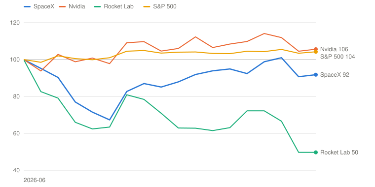
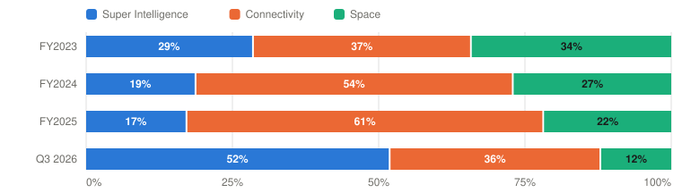

# SPCX — Space Exploration Technologies Corp.

> **Schema** v7.0 · **Updated** 2026-10-21 · **Status** Active
> **Price** $147.79 verified Oct 20, 2026 close; ≈$161 overnight after the Q3 print ([Yahoo](https://finance.yahoo.com/quote/SPCX/)) · 52-wk $104.83–$225.64 · 36th %ile · −34.5% from high
> **Type** Launch, LEO satellite connectivity and AI compute (Super Intelligence) under one roof · **Stage** Early growth · **Cyclical** No · **Competence** Outside

## Verdict

**SpaceX now earns real money, but at $148 the price already pays for my Base case of a compute business that keeps its pricing; the probability-weighted case returns 8.3% a year against the 13% hurdle.**

🟡 **Non-holder: Watch (entry ≤$120)** · 🟡 **Holder: Hold**

| PW EV | PW return/yr | Compounding/yr | R/R | Entry | Trim | Avoid | P/E on run-rate EPS | Yield | BAIT | Moat | Next |
|---|---|---|---|---|---|---|---|---|---|---|---|
| **$220** | **8.3% (<13%)** | 19.7% EPS, but the multiple halves | 3.0:1 | ≤$120 | $220–$510 | ≥$510 | ≈75× | 0.0% | Single (I) | Wide in launch and Starlink; none yet in compute | 📅 Tesla Q3 Oct 21; Flight 15 Nov |

**Breaks if**: Compute rental prices fall faster than the GPUs depreciate. Watch the Q1 2027 print against the $33–37B revenue guide, and the funding of a $35–40B capex quarter without selling stock low.

⚠️ **Terminal-growth check**: implied perpetual growth exceeds the risk-free rate in Bull, Base, Bear.

## The Call

Q3 settled the first question about SpaceX: the AI build earns money. Super Intelligence revenue rose to $7.6B from $0.8B a year ago, the segment made a profit, and management guided Q1 2027 revenue to $33–37B, roughly a $140B run-rate. The price settled the second question too, in the other direction. At $148, about 75 times run-rate earnings, the stock needs FY2031 EPS near $7.93 to earn an ordinary 10% a year. That is about 40% of the way from my Base case to my Bull. The Base assumes a 15 GW compute business whose rental price falls to a third of today's scarcity level, and on it the stock earns nothing. So the whole return rests on how long a watt of compute rents for $30–50 a year. Management's answer is that the price per watt is rising and short contracts capture it. Mine is that short contracts cut both ways, and that a $35–40B capex quarter has to be funded at whatever the stock price is. I give the Bear 25%; the price implies 12%. Excellent businesses, a price that leaves no room: 8.3% a year, clearing 13% only at $120.

## What I'd Have To Be Wrong About

1. **That compute pricing holds through the build.** Test: Q1 2027 revenue (reported late April 2027) inside the $33–37B guide, with Q4 2026 Super Intelligence revenue at or above $12B (late January 2027). **If Fail →** move 10 points from Bull to Bear (PW EV $172, 3.1%/yr) → **Watch**, entry $93.
2. **That the build funds itself without cheap equity.** Test: through the Q2 2027 10-Q (early August 2027), no common-stock sale beyond employee pay and announced acquisitions above 2% of shares, the investment-grade rating kept, and cash and securities above $40B. **If Fail →** move 10 points from Base to Bear (PW EV $209, 7.1%/yr) → **Watch**, entry $113; the reflexive funding loop is live.
3. **That Starship becomes a reusable launch system.** Test: both stages caught and a ship reflown by June 30, 2027 (Flight 15 in November is the first catch attempt). **If Fail →** move 10 points from Bull to Base (PW EV $184, 4.5%/yr) → **Watch**, entry $100; V3 Starlink and Mobile V2 slip a year.

## Latest update: 2026-10-21 · Q3 2026: compute turns profitable, and a Tesla merger is on the table

- Starlink ARPU stabilizes — ✅ Pass — consumer ARPU $66 → $69 in Q3, the first sequential rise in the disclosed series
- AI compute revenue arrives on schedule — ✅ Pass — Super Intelligence solutions and infrastructure revenue $7.0B, from $0.36B a year earlier; nameplate 1.7 GW
- Management explains Cursor and the cash burn — ✅ Pass — Cursor added $608M of revenue in six weeks, but $23B of its $60B price is retention stock pay; Q4 capex guided to $35–40B

SpaceX reported its second quarter as a public company after the close on October 20. Revenue was $14.6 billion, up 161% and about $1.8 billion above the roughly $12.8 billion consensus. Adjusted EBITDA was $8.8 billion, and diluted GAAP EPS was $0.35 against about $0.13 expected ([release](https://www.sec.gov/Archives/edgar/data/1181412/000162828026066482/spaceexplorationtechnologi.htm)). The stock closed at $147.79 before the print and traded near $161 overnight. This report uses the verified close, and a $161 open would lower the PW return by about two points without changing a verb.

| Q3 2026 | Reported | Consensus | Year ago |
|---|---|---|---|
| Revenue | **$14.58B** | ≈$12.8B `[Analyst consensus]` | $5.58B |
| Adjusted EBITDA | **$8.81B** | — | $2.17B |
| Diluted EPS (GAAP) | **$0.35** | ≈$0.13 `[Analyst consensus]` | $(0.36) |
| Capex | $19.59B | — | $6.88B |
| Starlink consumer subscribers | 13.6M | — | 7.2M |
| Nameplate compute | 1.7 GW | — | 0.6 GW |

*Source: Q3 release; consensus from [Benzinga](https://www.benzinga.com/quote/SPCX/earnings-forecasts) before the print.*

**What drove it.**
- **Super Intelligence revenue tripled from Q2 to $7.6 billion.** $608 million of it came from Cursor's first six weeks, and almost all the rest from cloud-services contracts as nameplate compute rose from 1.4 to 1.7 GW. The segment made $431 million of operating profit after $1.2 billion of Cursor stock pay, against a $1.3 billion loss in Q2.
- **Connectivity grew 69% with a 45% margin**, including about three points of one-time tariff refunds. Consumer ARPU rose for the first time in the disclosed series, to $69 from $66.
- **Space was roughly breakeven** on $1.8 billion of revenue.
- **Capex was $19.6 billion and cash fell about $10 billion in the quarter**, to $90 billion of cash and securities.

**Guidance.**
- **Q4 capex of $35–40 billion**, about double Q3.
- **Q1 2027 revenue of $33–37 billion**, which management said reflects "increased visibility into our compute contract pipeline."
- **The $100 billion December ARR goal**, reaffirmed.

Management chose to guide a quarter further out than it needed to. That reads as confidence, and it also sets a public bar for test 1.

**Management's points.**
- **Musk on compute.** He was "highly confident" of 10 GW of new compute in 2027 and "would be surprised" by fewer than 13 GW in total by the end of 2027. He prefers short contracts at spot prices because "the value of compute per watt will increase over time."
- **Johnsen on returns and funding.** Pricing is "slightly above the high end of the $30 to $50 per watt range," with paybacks under a year. Funding will come from operating cash, investment-grade debt and "the whole value chain."
- **Musk on revenue.** He put end-2027 ARR at "somewhere between $500 billion and $1 trillion." Shotwell's reply on the call was "On that crazy note." I give that path a 2% weight as an option line.
- **Musk on Tesla.** Both companies formed special committees, he is recused, and the deal is "not a certainty." He framed Tesla's required vote of 50% of all shares as "quite a high hurdle."

**What wasn't answered.** Nobody gave a 2027 capex figure or a funding mix for 10 GW. At industry costs near $40 billion per GW, 10 GW is about $400 billion. No one said how long the GPUs are depreciated over, and no one split cloud revenue by customer. These are the numbers the key debate turns on.

**What it does to the debate.** Q3 resolves the July page's open questions in management's favor: the compute revenue arrived, ARPU turned, and the Cursor cost is now disclosed. It also sharpens the main question. Blended Super Intelligence revenue per gigawatt was about $16.6 billion a year, a third of the headline rental price, and the company is about to more than double its capacity in two quarters. The build is now big enough that SpaceX's own supply moves the price it earns.

**The verdict.** I migrated the page to a segment model based on the guided run-rate, with competence Outside and the Bear weighted at 25%. PW EV is now about $220 a share, up from $185 in July, mostly because the Base starts from a $140 billion run-rate rather than $18.7 billion of 2025 revenue. The price rose about as much, so the PW return is 8.3% against 13%. The non-holder verb stays **Watch**, with entry at about $120, up from $110. The holder verb is **Hold**. The verb is unchanged, so no bias check was needed.

**Appearances in the window (July 13 – October 20).** Two earnings calls (Q2 on August 4 and Q3 on October 20) plus IPO-period media. I found no CEO podcast or conference transcript with strategy detail beyond the calls.

**Merger.** I treat it as an option line: about −$8 a share at 65% for the premium SpaceX would likely pay. The full exchange-ratio analysis is in the [merger study](../../insights/SPCX-TSLA-merger-exchange-ratio-2026-10-21.md).

---

## Deep Dive: SpaceX, Landlord to the AI Boom

*Four months after the largest IPO in history, renting computers has become SpaceX's biggest business. What does $148 assume about the price of a watt of compute, and what does a Tesla merger do to the answer?*

**Contents**: [Business Overview](#business-overview) · [Super Intelligence: A Toll Road or a Commodity?](#super-intelligence-a-toll-road-or-a-commodity) · [Starlink and Starship: The Part That Already Works](#starlink-and-starship-the-part-that-already-works) · [Musk, Capital Allocation and Incentives](#musk-capital-allocation-and-incentives) · [Valuation and Model Assumptions](#valuation-and-model-assumptions) · [Final Words](#final-words) · [Appendix: The Numbers](#appendix-the-numbers) · [Sources](#sources)

On June 11, 2026, SpaceX priced the largest initial public offering in history at $135 a share and raised about $86 billion. The stock closed its first day at $160.95. Four trading days later it touched $225.64, on the same day the company announced an all-stock purchase of Cursor, the AI coding tool. By August 3 it had traded as low as $104.83. Yesterday, October 20, it closed at $147.79 and then jumped about 9% overnight on its third-quarter results.

The business moved faster than the stock. A year ago SpaceX was a launch company with a satellite-internet business and a money-losing AI lab bolted on in February. In the third quarter of 2026 its Super Intelligence segment, the renamed AI business, brought in $7.6 billion of revenue, up from $0.8 billion a year earlier, and became the largest of the three segments. Total revenue rose 161% to $14.6 billion. Management then guided the first quarter of 2027 to $33–37 billion of revenue, which annualizes to about $140 billion.

Measured from its first close, the stock is down about 8%. Nvidia, the company that sells SpaceX most of its chips, is up 6% over the same weeks, the S&P 500 is up 4%, and Rocket Lab, the closest listed launch company, has halved.

*Total return, weekly, first-day close on June 12, 2026 = 100 (SpaceX closed at $160.95 against a $135 IPO price). Source: Yahoo Finance adjusted closes through October 20, 2026. Built with Claude.*

| Date | SpaceX | Nvidia | Rocket Lab | S&P 500 |
|---|---|---|---|---|
| 2026-06-12 | 100 | 100 | 100 | 100 |
| 2026-07-17 | 77 | 99 | 66 | 100 |
| 2026-08-07 | 83 | 109 | 81 | 104 |
| 2026-08-28 | 88 | 106 | 63 | 104 |
| 2026-09-18 | 95 | 108 | 63 | 103 |
| 2026-10-09 | 101 | 112 | 67 | 106 |
| 2026-10-20 | 92 | 106 | 50 | 104 |

So the market has been handed a lot of good news and has paid little more for it. I think the reason is the question this piece is about. SpaceX's new profits come from renting computers to AI labs at a price, about $50 a year for each watt of capacity, that exists because there are not enough of those computers. Management believes the scarcity will last and that short contracts let SpaceX capture whatever the price does next. If that is right, today's price is cheap. If compute becomes a commodity, as every rented technology before it has, the company is spending tens of billions a quarter to build a very large, very fast-depreciating landlord.

I take the compute question first, then Starlink and Starship, the part of SpaceX that already works. Then come Musk, the capital record and the incentives, which include a proposed merger with Tesla that the two boards' committees began studying this month. I finish with valuation: what $148 assumes, and what it would take to earn 13% a year from here.

### Business Overview

SpaceX reports three segments. **Space** is the launch business: Falcon 9, Falcon Heavy, Dragon and now Starship, flying for NASA, the Pentagon, commercial customers and SpaceX itself. **Connectivity** is Starlink: broadband to 13.6 million consumers in 174 markets, plus airlines, ships, governments (Starshield) and a growing direct-to-phone business. **Super Intelligence** is what came with xAI in February: the Colossus data centers in Memphis and Southaven, the Grok models and apps, X's advertising and, since August 14, Cursor.

| $ Billion | FY2023 | FY2024 | FY2025 | Q1 2026 | Q2 2026 | Q3 2026 |
|---|---|---|---|---|---|---|
| **Super Intelligence (AI)** | 2.96 | 2.62 | 3.20 | 0.82 | 2.56 | **7.56** |
|  Operating income | (3.97) | (1.56) | (6.36) | (2.47) | (1.26) | 0.43 |
|  Segment adj. EBITDA | 1.22 | 0.35 | (1.24) | (0.61) | 1.15 | **4.95** |
| **Connectivity (Starlink)** | 3.87 | 7.60 | 11.39 | 3.26 | 4.29 | **5.25** |
|  Operating income | 0.47 | 2.01 | 4.42 | 1.19 | 1.66 | 2.37 |
|  Operating margin | 12.1% | 26.4% | 38.8% | 36.5% | 38.6% | 45.1% |
| **Space (launch)** | 3.56 | 3.80 | 4.09 | 0.62 | 0.96 | 1.77 |
|  Operating income | (0.00) | 0.02 | (0.66) | (0.66) | (0.54) | (0.01) |
| **Total revenue** | 10.39 | 14.02 | 18.67 | 4.69 | 7.81 | **14.58** |
| **Operating income (GAAP)** | (3.51) | 0.47 | (2.59) | (1.94) | (0.14) | **2.79** |
| **Adjusted EBITDA** | 3.82 | 5.35 | 6.58 | 1.13 | 3.54 | **8.81** |
| **Capital expenditure** | 4.42 | 11.16 | 20.74 | 10.11 | 18.37 | **19.59** |

*FY2023–FY2025 include xAI and X as combined under common control. The AI segment was renamed Super Intelligence (SI) in Q3 2026. Q3 2026 SI operating income is after $1.22B of Cursor acquisition stock pay. Source: [prospectus](https://www.sec.gov/Archives/edgar/data/1181412/000162828026042639/spaceexplorationtechnologi.htm), [Q2 2026 release](https://www.sec.gov/Archives/edgar/data/1181412/000162828026052515/earningsreleaseq22608042.htm), [Q3 2026 release](https://www.sec.gov/Archives/edgar/data/1181412/000162828026066482/spaceexplorationtechnologi.htm). Built with Claude.*

The table tells the story of three different businesses. Space is roughly breakeven because Starship development runs through it. Connectivity turned from a 12% operating margin in 2023 to 45% in the third quarter, and it earns most of the company's operating profit. Super Intelligence lost $6.4 billion in 2025, then turned to a $0.4 billion operating profit in the third quarter, after $1.2 billion of Cursor stock pay, as rented capacity came online.

*Share of revenue by segment; FY2023–FY2025 include xAI and X. Source: [prospectus](https://www.sec.gov/Archives/edgar/data/1181412/000162828026042639/spaceexplorationtechnologi.htm), [Q3 release](https://www.sec.gov/Archives/edgar/data/1181412/000162828026066482/spaceexplorationtechnologi.htm). Built with Claude.*

| Period | Super Intelligence | Connectivity | Space | Total ($M) |
|---|---|---|---|---|
| FY2023 | 2,961 (29%) | 3,869 (37%) | 3,557 (34%) | 10,387 |
| FY2024 | 2,620 (19%) | 7,599 (54%) | 3,796 (27%) | 14,015 |
| FY2025 | 3,201 (17%) | 11,387 (61%) | 4,086 (22%) | 18,674 |
| Q3 2026 | 7,560 (52%) | 5,248 (36%) | 1,767 (12%) | 14,575 |

A few accounting points before the debate.

First, the 2023–2025 figures include xAI and X, which merged into SpaceX in February under common control, so the history mixes a rocket company with a social network.

Second, Q3 net income of $4.4 billion flatters the run-rate. It includes $1.0 billion of other income ($561 million from a related party), $873 million of interest income on the IPO cash and a $390 million tax benefit. Operating income was $2.8 billion.

Third, adjusted EBITDA of $8.8 billion excludes $2.4 billion of stock pay, half of it from Cursor. Of Cursor's $60 billion price, $23 billion is retention stock that will run through the income statement over about three years.

Fourth, the headline share count of 13.58 billion includes 1.3 billion restricted Class B shares granted to Musk that vest only with a million-person Mars colony or 100 terawatts of off-planet compute. They carry his votes but no economics I can value, so I use about 12.7 billion diluted economic shares.

### Super Intelligence: A Toll Road or a Commodity?

Let me start with where things stand.

| Super Intelligence | Q3 2025 | Q1 2026 | Q2 2026 | Q3 2026 | Q4 2026 guide |
|---|---|---|---|---|---|
| Nameplate compute, period end (GW) | 0.6 | 1.0 | 1.4 | **1.7** | 2.5–3.0 |
| SI solutions and infrastructure revenue ($B) | 0.36 | 0.48 | 2.19 | **7.02** | — |
| of which Cursor ($B) | — | — | — | 0.61 | — |
| Annualized revenue per average GW, ex-Cursor ($B) [Derived] | 2.9 | 2.1 | 7.3 | **16.6** | — |
| SI capex ($B) | 4.76 | 7.72 | 15.83 | 16.44 | Company: 35–40 |
| SI adjusted EBITDA ($B) | (0.43) | (0.61) | 1.15 | **4.95** | — |
| **SI operating income ($B)** | (1.72) | (2.47) | (1.26) | 0.43 | — |

*Revenue per GW divides annualized revenue by the average of opening and closing nameplate capacity; it blends rented capacity with capacity used for Grok's own training, which earns nothing directly. Source: [Q2](https://www.sec.gov/Archives/edgar/data/1181412/000162828026052515/earningsreleaseq22608042.htm) and [Q3](https://www.sec.gov/Archives/edgar/data/1181412/000162828026066482/spaceexplorationtechnologi.htm) releases; [Q3 call](https://www.fool.com/earnings/call-transcripts/2026/10/20/spacex-spcx-q3-2026-earnings-call-transcript/). Built with Claude.*

#### Management's narrative

Management's case is that compute is scarce, will stay scarce, and that SpaceX can build it faster than anyone. Musk said he spends four days a week in Memphis and that the company is turning on about 20,000 Nvidia GB300s a month. He said he is "highly confident" of 10 more gigawatts in 2027, for about 13 in total, and that there is a non-zero chance of more than 20. On pricing, he was explicit about the strategy:

> "Our approach is to rent at the — effectively the spot market rate as opposed to sign these long-term deals. Our belief is that the value of compute per watt will increase over time, not decrease... And if you look at, say, how are our short-term contracts renewing? Are they renewing at higher dollars per watt or lower? And we see them renewing at higher dollars per watt, not lower dollars per watt. We are also, frankly, hounded relentlessly by every hyperscaler and by dozens of smaller companies to rent more of our compute. So we could rent out our compute several times over if we said yes to everyone."
> — Elon Musk, Q3 2026 earnings call, October 20, 2026

CFO Bret Johnsen put numbers on it:

> "At current pricing, new compute deployments are generating a payback of less than a year. Pricing is currently tracking slightly above the high end of the $30 to $50 per watt range we were discussing just last quarter."
> — Bret Johnsen, CFO, Q3 2026 earnings call, October 20, 2026

Musk also explained why SpaceX can build faster than rivals. The bottleneck in new gas turbines is the cast blades and vanes, which turbine makers deliver 12–18 months after the rest of the machine. SpaceX already casts rocket-engine parts, so it is casting its own. If that works, it is the kind of advantage that is hard to copy. The backlog rose to $63 billion, $42 billion of it due within a year. Demand is not the problem.

#### Poking holes in it

The first hole is that short contracts cut both ways. Renting at spot is a great strategy while prices rise, and SpaceX says renewals are repricing upward. But it means none of today's revenue is protected when prices fall, and in rented technology they always have. The GPU price trackers this wiki follows put the median H100 rental near $3 an hour in mid-2026, against roughly $8 at the 2023 peak `[Estimate]`. The fall happened because more supply arrived, and supply is exactly what SpaceX, Oracle, CoreWeave and the hyperscalers are all building as fast as they can. Musk's argument that better models make each watt more valuable is plausible. It is also an argument that the AI labs keep most of that value, since they own the models and the landlord only owns the building.

The second hole is the size of the bill. Industry estimates put a gigawatt of GB300 or Vera Rubin capacity, including power and cooling, at about $40 billion `[Estimate]`. Ten more gigawatts in 2027 would therefore cost on the order of $400 billion. SpaceX ended September with $90 billion of cash and securities, after spending $19.6 billion on capex in the third quarter, and it has guided the fourth quarter to $35–40 billion. Johnsen named the sources: operating cash flow, the investment-grade debt market, and partners "on the vendor and customer side." Even if the guide comes in, I doubt operating cash flow in 2027 exceeds $70–80 billion `[Estimate]`. Somebody else's money has to pay for the rest, and the price of that money depends on the stock.

The third hole is depreciation. A payback of under a year is an EBITDA statement. GPU generations now turn over every 12–18 months, and SpaceX's own 2027 build is "primarily Rubin." A cluster that pays back in one year at today's price needs to keep renting near today's price for its whole useful life to earn a real return, and that life may be closer to four years than six.

The fourth hole is who the customers are. About half of the capacity serves SpaceX's own Grok and Grok Bot, which earn revenue only to the extent consumers and enterprises pay for them. Grok Bot has 800,000 paid weekly users, a good start but a small one. The rented half goes to a short list of AI labs, two of which (Anthropic and Google) compete with Grok. SpaceX is renting its rivals the tools to beat its own model, at a premium, for as long as there is no alternative.

Here is the arithmetic for a single gigawatt:

| Illustrative 1 GW of compute, $B per year | At today's ≈$50 per watt | If the price halves | Price −75%, 4-year chip life |
|---|---|---|---|
| Capex to build (chips, power, cooling) | 40 | 40 | 40 |
| Revenue if fully rented | 50.0 | 25.0 | 12.5 |
| Cash operating cost (power, staff, sites) | (4.0) | (4.0) | (4.0) |
| **EBITDA** | 46.0 | 21.0 | 8.5 |
| Payback on capex (years) | **0.9** | 1.9 | 4.7 |
| Depreciation (5-year life; 4-year in the last column) | (8.0) | (8.0) | (10.0) |
| **Operating profit** | 38.0 | 13.0 | (1.5) |
| Pre-tax return on the $40B | 95% | 33% | −4% |
| **Actual: Q3 2026 SI revenue per average GW, ex-Cursor** | 16.6 |  |  |

*Author's estimates, except the price and payback. CFO Bret Johnsen said on the Q3 call that pricing is 'slightly above the high end of the $30 to $50 per watt range' and that new deployments pay back in under a year. Capex per GW of about $40B is an industry estimate for GB300 and Vera Rubin clusters including power and cooling; the cash-cost line assumes about 8.8 TWh of power at roughly $60 per MWh plus site staff. The actual row blends rented and internal capacity. Built with Claude.*

At today's price a gigawatt earns a 95% pre-tax return on its capital. If the price halves, it is still a good business. If it falls 75% and the chips last four years, the gigawatt loses money. The last row is what actually happened in Q3. Blended across rented and internal capacity, Super Intelligence earned about $16.6 billion per gigawatt-year, a third of the headline rate, because half the capacity serves Grok and new halls take time to fill.

Where I come out: management is right that demand exceeds supply today and right that SpaceX builds faster than anyone. The business is real and, for now, highly profitable. But the price SpaceX is earning is a scarcity price, the contracts are designed to follow the market, and the build is so large that SpaceX will be part of the supply that ends the scarcity. My Base case assumes compute revenue per gigawatt falls to about a third of today's headline rate by 2031. That is roughly where Q3's blended number already sits.

#### Four rings of profit

It helps to sort SpaceX's profit by how exposed it is to that question.

| Ring | Share of Q3 segment adj. EBITDA | Margin | Main threat | Exposure to compute pricing |
|---|---|---|---|---|
| **1 · SI cloud services** (Anthropic, Google, others) | 56% (rings 1–2 together; split not disclosed) | EBITDA 66% for the segment | Rental prices normalize as supply catches up; short contracts reprice down | **High** |
| **2 · SI products** (Grok, Grok Bot, Cursor, X ads) | (in ring 1) | n/d | Competing with OpenAI, Anthropic and Google at the model layer; $23B of Cursor retention pay | Medium; compute is their input cost |
| **3 · Connectivity** (Starlink consumer, enterprise, Starshield) | 40% | EBITDA 67% | Amazon Leo; spectrum; ARPU dilution in new markets | Low |
| **4 · Space** (launch, Dragon, NSSL) | 4% | EBITDA 20% | Starship cost; Blue Origin | Low |

*Q3 2026 segment adjusted EBITDA: SI $4.95B, Connectivity $3.50B, Space $0.36B. Source: [Q3 release](https://www.sec.gov/Archives/edgar/data/1181412/000162828026066482/spaceexplorationtechnologi.htm); exposure is the author's assessment. Built with Claude.*

More than half of segment EBITDA now sits in the two rings most exposed to compute pricing. A year ago it was none. Starlink and launch, 44% of Q3 EBITDA, are the parts I would underwrite with the most confidence, and they are also the parts the market priced at the IPO, before the compute business existed in its current form.

### Starlink and Starship: The Part That Already Works

Starlink is one of the best businesses in the world, and the third quarter made it look better. Consumer subscribers rose 89% in a year to 13.6 million. Consumer ARPU, which fell in every period the IPO prospectus disclosed (from $99 a month in 2023 to $66 in Q1 2026), rose 5% to $69. Johnsen attributed the rise to mix, as growth came from developed markets. Enterprise and government revenue rose 91% to $2.1 billion. Connectivity's operating margin reached 45%, including about three points of one-time tariff refunds.

The growth levers are visible. Shotwell said Starlink is contracted on about 12,000 aircraft, nearly a quarter of the world's fleet, with three of the four major U.S. carriers signed. Starshield won more than $6 billion of multi-year Space Force contracts in the second quarter. Starlink Mobile reaches 22 million monthly users through carrier partners. SpaceX bought EchoStar's AWS-4 and H-block spectrum in 2025 and has now agreed to buy 800 MHz low-band spectrum, with a stated goal of becoming "a major mobile carrier in the United States" by early 2028. Musk went further:

> "I can say we do see a clear path to several hundred billion dollars a year in connectivity revenue."
> — Elon Musk, Q3 2026 earnings call, October 20, 2026

I don't underwrite that. But even my Base case has Connectivity compounding about 17% a year from its $26 billion run-rate at a 45% margin. That is a business worth several hundred billion dollars by itself.

What Starlink needs is capacity, and capacity depends on Starship. Flight 14 in September reached orbit for the first time and deployed 26 V3 satellites, adding about 26 terabits per second of downlink, roughly ten Falcon 9 launches' worth on a half-loaded rocket. Flight 15, expected in November, will try to catch both the booster and the ship. Musk called success "more likely than not" and said Starship should fly weekly in the first half of 2027. His Starship timelines have slipped before: the first operational flights were expected years earlier than September 2026. So I treat the 2027 cadence as Bull-case material and make full reuse by mid-2027 my third test.

The Space segment itself matters less than what it enables. Its revenue grew 6% in the third quarter to $1.8 billion and it lost $7 million. SpaceX flew 90% of the world's mass to orbit, China about 6%, everyone else 4%. The segment's job is to make satellites and, eventually, orbital data centers cheap to deploy. On that, its record is the best of any company in this wiki.

### Musk, Capital Allocation and Incentives

Musk founded SpaceX in 2002, and his record here is the strongest part of his record anywhere. Reusable boosters took the cost of reaching orbit from about $18,500 a kilogram, the historical average, to about $2,700 with the first Falcon 9 and lower since. Starlink went from nothing to the most profitable satellite business ever built. Gwynne Shotwell has run operations since the early years.

The record as a capital allocator for public shareholders is four months long, and it is mostly deals.

| Year | Deal | Price | What happened | Verdict |
|---|---|---|---|---|
| 2025 | EchoStar AWS-4 and H-block spectrum | ≈$17B, about half in SpaceX stock | FCC approved the license transfer in Q2 2026; the base for Starlink Mobile | Good (strategic) |
| 2026 (Feb) | xAI Holdings (xAI and X) | All-stock; xAI at $250B, SpaceX at $1T; 0.1433 SpaceX shares per xAI share | Became the SI segment; $1.8B of advertising and $1.4B of AI solutions revenue in 2025, against a $6.4B operating loss | Too early; it is now the thesis |
| 2026 (Jun–Aug) | Cursor (Anysphere) | $60B in stock: 391M Class A shares; $23B of it is retention stock pay over ~3 years | $608M of revenue in its first six weeks; Grok, Cursor and X Premium now sold as one plan | Unclear; struck the day of the all-time high |
| 2026 (Oct) | 800 MHz low-band spectrum | Not disclosed | Needed for building penetration in Starlink Mobile | Too early |
| 2026 (Oct) | Tesla, Inc. | Exploring; special committees formed, no terms | See the merger section | Pending |

*Source: [prospectus](https://www.sec.gov/Archives/edgar/data/1181412/000162828026042639/spaceexplorationtechnologi.htm); [8-K, Aug 14, 2026](https://www.sec.gov/Archives/edgar/data/1181412/000162828026056945/spcx-20260814.htm); [Q2](https://www.sec.gov/Archives/edgar/data/1181412/000162828026052515/earningsreleaseq22608042.htm) and [Q3](https://www.sec.gov/Archives/edgar/data/1181412/000162828026066482/spaceexplorationtechnologi.htm) releases; [xAI terms](https://www.implicator.ai/spacex-acquires-xai-in-1-25-trillion-deal-creating-worlds-most-valuable-private-company/); EchoStar price from press reports at signing [link pending]. Built with Claude.*

Two of these were struck at moments that suited the seller. The xAI merger valued Musk's own AI company at $250 billion against SpaceX's $1 trillion, with no premium either way, four months before the IPO. Cursor was announced on June 16, the day SpaceX hit its all-time high, paid in stock at that price, and $23 billion of it is retention pay. I don't know yet whether Cursor was a good purchase. Grok Enterprise customers above $1 million of run-rate revenue rose 50% in a quarter including Cursor, and the bundle with Grok and X Premium is sensible. What I do know is that the deal's cost to shareholders is closer to $60 billion of stock plus three years of dilution than to the $37 billion that the purchase accounting attributes to the business.

#### The cash

| $ Billion | Revenue | YoY | OCF | Capex | FCF | SBC | Net financing raised | Shares issued for deals | Diluted shares (B) |
|---|---|---|---|---|---|---|---|---|---|
| FY2023 | 10.4 | — | 4.5 | 4.4 | 0.1 | 0.7 | 0.4 | — | n/m |
| FY2024 | 14.0 | +35% | 5.8 | 11.2 | (5.4) | 0.8 | 11.8 | — | n/m |
| FY2025 | 18.7 | +33% | 6.8 | 20.7 | (14.0) | 1.9 | 26.4 | EchoStar (part) | 9.65 pro forma |
| 9M 2026 | 27.1 | +97% | 13.1 | 48.1 | (35.0) | 3.8 | 99.8 (IPO $85.7) | xAI; Cursor 391M | 12.48 (Q3) |
| **Cum. FY2023–9M 2026** | 70.2 |  | 30.2 | 84.4 | (54.2) | 7.2 | 138.4 |  |  |

*FCF = operating cash flow − capital expenditure. Net financing raised is cash from financing activities: IPO proceeds, debt (the $25B bond in June 2026), preferred and common sales, less repayments and $4.4B of 2026 repurchases. Earlier share counts are not comparable because preferred stock converted at the IPO. Source: [prospectus](https://www.sec.gov/Archives/edgar/data/1181412/000162828026042639/spaceexplorationtechnologi.htm), [Q3 release](https://www.sec.gov/Archives/edgar/data/1181412/000162828026066482/spaceexplorationtechnologi.htm). Built with Claude.*

Since 2023 SpaceX has generated about $30 billion of operating cash flow and spent $84 billion on capital projects. It has raised $138 billion from outside: the IPO, $25 billion of investment-grade bonds in June, preferred stock before the IPO and other debt. It has also issued stock for xAI, Cursor and EchoStar. Free cash flow in the first nine months of 2026 was minus $35 billion, and the fourth quarter alone will be worse. Management describes the spending as demand-led and fast-paying, and it may be. Either way, for at least the next two years the compute plan depends on capital markets staying open to SpaceX at good prices. The only repurchases, $4.4 billion of common and preferred stock in the first nine months of 2026, are not explained in the release.

**Outsider grade: Reinvestor, Anti-Outsider-leaning on M&A.** All cash goes back into the business, which is right if returns are as described. But the two large deals were paid in stock near peak valuations, and no capital is ever returned, the opposite of the countercyclical discipline the [Outsiders](../../frameworks/outsiders.md) test rewards.

#### The incentives

| Component | Size | What it pays for | Status |
|---|---|---|---|
| **Musk: Mars award** (Jan 2026) | 1.0B restricted Class B shares, 15 tranches | Market cap from $0.5T to $7.5T in $0.5T steps **and** a permanent Mars colony of at least one million people | Musk votes all of the shares now; none vests without the colony |
| **Musk: orbital-compute award** (Mar 2026) | 302M restricted Class B shares, 12 tranches | Market cap from $1.065T to $6.565T **and** non-Earth data centers delivering 100 TW of compute a year | Musk votes all of the shares now; none vests without the orbital compute |
| **CFO Bret Johnsen: options** | 4M options | 371,125 options vest for each $10B of adjusted EBITDA earned in 2025–2029 | None earned on FY2025 |
| **Gwynne Shotwell, President** | $85.8M in FY2025, mostly options | Service-based | Sold ≈342K shares at $151–155 on Sep 22 under a 10b5-1 plan |
| **Return on invested capital** | 0% | Not measured anywhere in the plans | — |

*Source: [prospectus](https://www.sec.gov/Archives/edgar/data/1181412/000162828026042639/spaceexplorationtechnologi.htm) (executive compensation and principal shareholders); [Form 4, Sep 24, 2026](https://www.sec.gov/Archives/edgar/data/1181412/000162828026063378/0001628280-26-063378-index.htm). Built with Claude.*

Musk's two awards are the most unusual incentive plans I have seen. Both pay only for things no company has done: a million people living on Mars, or 100 terawatts a year of compute in space. Both also require market-cap milestones that run to $7.5 trillion. Because the shares are issued now and Musk votes them, they give him about 84% of SpaceX's votes on about 42% of its economics. Like Tesla's 2025 award, they reward scale and ambition, and nothing in any SpaceX plan measures return on capital. For a company about to spend several hundred billion dollars, that gap matters more here than almost anywhere.

#### The Tesla question

On the Q3 call, Musk confirmed that SpaceX and Tesla have each formed special committees of independent directors to study a combination, at shareholders' request, and that he is recused:

> "Some people out there assume that a SpaceX and Tesla merger is a certainty. And I think that would be overstating it. Do I think it would be a good idea, yes... the special committees have not reached agreement on the terms of any transaction. And obviously, there's no guarantee that they will."
> — Elon Musk, Q3 2026 earnings call, October 20, 2026

For SpaceX holders the deal is mostly about price. SpaceX would most likely be the acquirer, and Tesla's holders control the vote that matters (50% of all outstanding Tesla shares). So any premium would flow from SpaceX's public holders to Tesla's. In the [exchange-ratio study](../../insights/SPCX-TSLA-merger-exchange-ratio-2026-10-21.md), I put the most likely terms at the market ratio plus a 10–20% premium. The probability-weighted outcome is about 2.66 SpaceX shares per Tesla share, a 42/58 split, and a 65% chance of closing. On those terms SpaceX holders give up about 4% of value if it closes. I carry that as an optionality line in the valuation. Musk owns about 42% of SpaceX and about 20% of Tesla, so his own money favors a SpaceX-friendly ratio; the Tesla vote pulls the other way.

The strategic case is real but overlapping: Terafab is already a three-way chip initiative with Tesla and Intel, Tesla sold xAI $430 million of Megapacks in 2025, and the two companies are building the Macrohard agent platform together. Most of those benefits are available by contract. My test for the deal is whether Tesla's committee insists on a majority-of-the-minority vote and SpaceX's committee holds the premium under 20%. If both happen, the committees did their jobs.

#### Promises

| Promised | Where, when | Outcome |
|---|---|---|
| 2028 revenue of $120–180B | IPO materials, May–June 2026 | 🟢 Ahead: the Q1 2027 guide of $33–37B annualizes to $132–148B, a year early |
| $100B of annualized revenue (December run-rate) by the end of 2026 | CFO, Q2 and Q3 2026 calls | 🟡 Reaffirmed in October; resolves in the Q4 print |
| Operational, reusable Starship | Musk's public targets from 2023 onward | 🟡 First orbital, revenue-earning flight in September 2026; full reuse not yet shown |

*Source: [S-1 notes](../../../raw/SPCX/filings/SPCX-S1-2026-notes.md), [Q3 call](https://www.fool.com/earnings/call-transcripts/2026/10/20/spacex-spcx-q3-2026-earnings-call-transcript/), [Q3 release](https://www.sec.gov/Archives/edgar/data/1181412/000162828026066482/spaceexplorationtechnologi.htm). Built with Claude.*

Management's financial promises have been kept so far, for two quarters, and the 2028 revenue target now looks conservative. Its engineering timelines have run late for years, but Starship reached orbit with a paying payload. So is Musk the right manager? For building, without question. For capital, the evidence is thin and points toward stock-funded expansion, and his incentives reward exactly that.

### Valuation and Model Assumptions

SpaceX is an early-growth company with three businesses of very different quality, so I build each segment separately: revenue growth and an operating margin, down to GAAP EPS after stock pay and dilution. I start from the exit run-rate (the Q1 2027 guide annualized, with Q3 margins) rather than from calendar 2026, whose $48 billion of revenue the company will have outgrown by January. The 2031 value is EPS times an exit multiple, 30× in the Base. Competence is Outside: Starship's reuse and the long-run price of compute are questions I can't answer with an edge. So Bull and Bear each get 25%, and the Bear includes the funding loop: equity sold low to finish the build. Here is the Base:

| $ Billion | FY2026E | FY2027E | FY2028E | FY2029E | FY2030E | FY2031E |
|---|---|---|---|---|---|---|
| **Super Intelligence revenue** | 106.0 | 125.8 | 149.4 | 177.3 | 210.4 | 249.8 |
|  YoY growth | 18.7% | **18.7%** | **18.7%** | **18.7%** | **18.7%** | **18.7%** |
|  Operating margin | 20.0% | 21.0% | 22.0% | 23.0% | 24.0% | **25.0%** |
|  Operating profit | 21.20 | 26.42 | 32.86 | 40.77 | 50.50 | 62.45 |
| **Connectivity revenue** | 26.0 | 30.4 | 35.6 | 41.6 | 48.7 | 57.0 |
|  YoY growth | 17.0% | **17.0%** | **17.0%** | **17.0%** | **17.0%** | **17.0%** |
|  Operating margin | 44.0% | 44.2% | 44.4% | 44.6% | 44.8% | **45.0%** |
|  Operating profit | 11.44 | 13.45 | 15.80 | 18.57 | 21.83 | 25.65 |
| **Space revenue** | 8.0 | 8.4 | 8.8 | 9.3 | 9.7 | 10.2 |
|  YoY growth | 5.0% | **5.0%** | **5.0%** | **5.0%** | **5.0%** | **5.0%** |
|  Operating margin | -5.0% | -2.0% | 1.0% | 4.0% | 7.0% | **10.0%** |
|  Operating profit | -0.40 | -0.17 | 0.09 | 0.37 | 0.68 | 1.02 |
| Corporate and other | (0.00) | (0.00) | (0.00) | (0.00) | (0.00) | (0.00) |
| **Total revenue** | 140.0 | 164.6 | 193.8 | 228.2 | 268.9 | 317.0 |
| **Operating profit** | 32.24 | 39.70 | 48.75 | 59.72 | 73.01 | 89.12 |
|  Operating margin | 23.0% | 24.1% | 25.2% | 26.2% | 27.2% | 28.1% |
| Net income | 25.21 | 30.95 | 37.87 | 46.20 | 56.24 | 68.31 |
| Diluted shares (B) | 12.700 | 12.954 | 13.213 | 13.477 | 13.747 | 14.022 |
|  Net share change | — | +2.0% | +2.0% | +2.0% | +2.0% | +2.0% |
|  SBC (% of revenue) | 8.0% | 7.6% | 7.2% | 6.8% | 6.4% | 6.0% |
| **GAAP EPS** | $1.98 | $2.39 | $2.87 | $3.43 | $4.09 | $4.87 |
|  YoY growth | — | 20.4% | 20.0% | 19.6% | 19.3% | 19.1% |
| **Owner earnings per share (after SBC)** | $1.69 | $2.03 | $2.44 | $2.91 | $3.48 | $4.14 |

*Base case. The first column is the exit run-rate (Q1 2027 revenue guidance of $33–37B annualized, with Q3 2026 segment margins), labelled FY2026E because the model counts five years from it; calendar 2026 revenue will be about $48B. Margins move linearly to the FY2031 inputs. GAAP EPS includes stock pay. Source: author's model (model.json). Bold cells are model inputs.*

In the Base, Super Intelligence grows about 19% a year to roughly $250 billion of revenue at a 25% operating margin. That is about 15 GW renting near $16 billion per GW-year, management's 13 GW arriving a year late with prices a third of today's. Starlink compounds about 17% a year at 45%, and Space grows slowly as Starship costs settle. Net dilution runs 2% a year. Run-rate EPS of $1.98 grows to $4.87 in 2031, about 19.7% a year, and at 30× the stock is worth about $146. That is roughly today's price.

| Case | Prob. | 3P | Super Intelligence growth / margin | Connectivity growth / margin | Space growth / margin | Net shares/yr | Per-share earnings FY2031 | CAGR | Exit multiple | Value | Return/yr | Implied g | Driving assumption |
|---|---|---|---|---|---|---|---|---|---|---|---|---|---|
| **Bull** | 25% | Plausible | +41.4% / 35.0% | +26.7% / 50.0% | +14.0% / 20.0% | +1.5% | $14.59 | 49.0% | 35.0× GAAP EPS | $510 | 28.1% | 7.4% | About 30 GW installed by 2031 renting near $20B per GW-year: Super Intelligence revenue about $600B at a 35% operating margin; Starlink compounds about 27% a year from its run-rate as V3 and Mobile V2 fill; Starship makes Space profitable. 35× a business still growing fast. |
| **Base** | 50% | Probable | +18.7% / 25.0% | +17.0% / 45.0% | +5.0% / 10.0% | +2.0% | $4.87 | 19.7% | 30.0× GAAP EPS | $146 | -0.2% | 7.0% | Management's 13 GW lands about a year late, then about 15 GW renting near $16B per GW-year as GPU prices deflate: Super Intelligence revenue about $250B at a cloud-like 25% margin; Starlink about 17% a year at 45%; 2% a year dilution from stock pay and funding. |
| **Bear** | 25% | Probable | +2.5% / 12.0% | +9.0% / 35.0% | -3.2% / -5.0% | +4.5% | $1.27 | -8.6% | 22.0× GAAP EPS | $28 | -28.4% | 5.9% | Compute turns into a commodity: rental prices fall faster than chips depreciate, Super Intelligence revenue stalls near $120B at a 12% margin, and the build is funded partly with equity sold low (4.5% a year dilution). Starlink keeps growing but cannot carry the price. |
| **Priced-in (10%/yr)** | — | diagnostic | +28.4% / 29.3% | +21.1% / 47.1% | +8.8% / 14.3% | +1.8% | $7.93 | 31.9% | 30.0× GAAP EPS | $238 | 10.0% | 7.0% | Solved along Base → Bull for 10%/yr |
| **Hurdle (13%/yr)** | — | diagnostic | +31.2% / 30.5% | +22.3% / 47.7% | +9.9% / 15.5% | +1.7% | $9.08 | 35.5% | 30.0× GAAP EPS | $272 | 13.0% | 7.0% | Solved along Base → Bull for 13%/yr |
| Option: Orbital compute and Musk's $500B+ ARR path | 2% | possible |  |  |  |  |  |  |  | $900 |  |  | Musk's end-2027 ARR target of $500B–$1T met and sustained, then orbital data centers on a reusable Starship; possible, not plausible |
| Option: Tesla merger: premium paid to Tesla holders | 65% | possible |  |  |  |  |  |  |  | $-8 |  |  | about a 4% transfer of value to Tesla holders if the deal closes on PW terms (see the merger chapter) |
| **Probability-weighted** | 100% |  |  |  |  |  |  |  |  | $220 | 8.3% |  |  |

*Annual return = price change to the FY2031 value (no dividend). Probabilities apply to Bull, Base and Bear; competence is Outside, so Bull and Bear each get at least 25%. The Priced-in and Hurdle rows are solved along the Base→Bull path at a 30× exit. Option lines are added to the PW value. Source: author's model. Built with Claude.*

| Return math |  |
|---|---|
| PW return/yr vs. hurdle | **8.3% (<13%)**, of which 0.0% is the dividend yield. Entry ≤$120. 10-year Treasury 5.15%; the hurdle sits 7.9 points above it. |
| Compounding at a flat multiple | Base run-rate EPS grows 19.7% a year to $4.87, but the multiple falls from about 75× to 30×, so the Base earns about nothing (-0.2% a year). There is no dividend or buyback; net dilution runs 2% a year in the Base. All of the PW return above the Base comes from the Bull's tail, not from compounding at a flat multiple. |
| Optionality | Orbital compute and Musk's $500B+ ARR path: 2% × $900 = $18.0; Tesla merger: premium paid to Tesla holders: 65% × $-8 = $-5.2 |
| Price-implied expectations | At 10%, spot needs $7.93 of per-share earnings in the terminal year (31.9% a year) at 30×. |
| EPV floor | About $20–25 a share: run-rate net income of roughly $25B at 85% owner-earnings conversion, capitalized at 10%, plus $51B of net cash. About 85% of the price pays for growth. The Bear ($28) sits just above EPV because it keeps Starlink growing while compute stalls. |
| Base rate / 3P | From a $140B run-rate, the Base grows revenue about 18% a year and the Bull about 38%; fewer than 2% of companies above $50B of sales have grown 20% a year in real terms for five years, so the Bull is possible-to-plausible only because the run-rate itself is brand new. The Base is probable only if the 2027 guide holds; it leans on management's own numbers. |
| Terminal-growth check | Implied perpetual growth at 10%: Bull 7.4%, Base 7.0%, Bear 5.9%, all above the 5.15% Treasury, so every case leans on growth beyond year five. I accept the flag for the Bull and Base, whose stories still grow at year five; the Bear's 22× is generous for a business whose compute stalls. |
| Break-even and price-implied Bear odds | Break-even <0% against 25% assigned; price-implied 12% at 10%. |
| Year ten | In the Bull, still growing at year ten on compute and Starlink Mobile. In the Base the terminal multiple does most of the work, since compute revenue per GW is assumed to fall. |
| R/R | **3.0:1** (Bull +245% / Bear −81%) |

*Computed rows come from model.json; EPV, base rate, year ten and the terminal-growth reading are the author's. Built with Claude.*

At a 10% cost of equity and a 30× exit, the price needs FY2031 EPS of about $7.93, roughly 31.9% growth a year from the run-rate. That is about 40% of the way from my Base to my Bull: a compute business that keeps most of today's pricing while it quadruples in size. In scenario terms, the price implies a 12% chance of the Bear against my 25%.

To earn 13% a year, SpaceX would need about $9.08 of EPS, more than halfway to the Bull. Weighting the cases 25/50/25 and adding the two option lines (Musk's $500 billion-plus revenue path at 2%, the Tesla premium at minus) gives about $220 a share and 8.3% a year. The price that clears the hurdle on the same cases is about $120. The Bull returns 28.1% a year and carries almost all of the upside; R/R is 3.0:1, but the Base earns nothing. Capitalizing today's earnings with no growth gives about $20–25 a share, so about 85% of the price pays for growth.

*Confidence note: I cannot judge Starship's path to rapid reuse, or how fast AI-compute rental prices normalize; both are frontier questions, which is why the scenario weights are wide.*

### Final Words

SpaceX is better than the market thought in July, when I first wrote about it at $145. The compute business turned profitable a quarter early, Starlink's prices turned up, and management's own revenue targets now look conservative. If you asked me which company in this wiki has the most remarkable set of businesses, I would probably say this one.

But the stock is back near where it was, so the improvement went into a higher bar. At $148 the price already assumes the compute business keeps a good part of its scarcity pricing while it grows several times over, and that it gets funded on good terms. That is possible. Management believes it, and it has delivered on everything financial it has promised so far. It is not a case I would pay for in advance, because the contracts that capture rising prices will also pass on falling ones, and the build is large enough to help make prices fall.

What would change my mind? The Q4 and Q1 prints will show whether $33–37 billion of quarterly revenue arrives with its margins intact. The next three quarters will show how a $35–40 billion capex quarter gets financed. Flight 15 and its successors will show whether Starship becomes the cheap, reusable rocket that every long-run plan here assumes. The price at which I would buy on today's cases is about $120. Until then I'll watch, and I'll watch the merger terms as closely as the rockets.

Here are the three tests written as kill criteria, each with its consequence fixed in advance:

*The three tests, with their pre-committed consequences, are listed at the top of this report under [What I'd Have To Be Wrong About](#what-id-have-to-be-wrong-about).*

### Appendix: The Numbers

The tables below carry the framework's required numbers. The argument for each is made in the chapters above.

#### Five-year record

| $B, except per share | FY2023 | FY2024 | FY2025 | 9M 2026 | Q3 2026 ann. |
|---|---|---|---|---|---|
| Revenue | 10.39 | 14.02 | 18.67 | 27.08 | **58.3** |
| Operating income (GAAP) | (3.51) | 0.47 | (2.59) | 0.71 | **11.2** |
| Net income | (4.63) | 0.79 | (4.94) | (0.41) | 17.6 |
| Adjusted EBITDA | 3.82 | 5.35 | 6.58 | 13.47 | 35.2 |
| Operating cash flow | 4.52 | 5.78 | 6.79 | 13.10 | — |
| Capex | 4.42 | 11.16 | 20.74 | 48.07 | 78.4 |
| Free cash flow | 0.11 | (5.39) | (13.95) | (34.97) | — |
| Depreciation and amortization | 2.64 | 3.82 | 6.70 | 8.93 | 14.6 |
| Share-based compensation (incl. acquisition-related) | 0.68 | 0.78 | 1.95 | 3.83 | 9.5 |
| SBC % of revenue | 6.5% | 5.6% | 10.4% | 14.2% | 16.2% |
| **Owner earnings** (CFO − SBC − D&A as maintenance) [Derived] | 1.21 | 1.17 | (1.86) | 0.33 | — |
| Net cash / (debt), ex-leases | n/d | (2.41) | 1.85 | **51.0** | — |
| Invested capital [Derived] | n/d | 29.9 | 41.0 | 127.3 | — |
| of which goodwill and intangibles | n/d | n/d | 13.4 | 54.8 | — |
| **ROIC** (NOPAT at 21% ÷ invested capital) [Derived] | n/m | 1.2% | −5.0% | — | **6.9%** (12.2% ex-goodwill) |
| **3-yr incremental ROIC** | — | — | — | — | n/m: NOPAT was negative in the base years |
| Diluted shares (B) | n/m | n/m | 9.65 pro forma | 12.48 (Q3 weighted) | ≈12.7 at quarter end |
| Interest coverage (EBIT ÷ interest) | neg. | 0.3× | neg. | 0.4× | 4.1× |
| SBC-adjusted accruals ÷ assets | — | — | — | −5.6% | — |

*FY2023–FY2025 include xAI and X. Invested capital = equity + redeemable preferred + debt and finance leases + operating leases − cash and marketable securities. Owner earnings use D&A as the maintenance-capex proxy, because a revenue-based split breaks when capex is 2.5× revenue. Q3 annualized multiplies the quarter by four. Source: [prospectus](https://www.sec.gov/Archives/edgar/data/1181412/000162828026042639/spaceexplorationtechnologi.htm), [Q2](https://www.sec.gov/Archives/edgar/data/1181412/000162828026052515/earningsreleaseq22608042.htm) and [Q3](https://www.sec.gov/Archives/edgar/data/1181412/000162828026066482/spaceexplorationtechnologi.htm) releases, [SEC XBRL company facts](https://data.sec.gov/api/xbrl/companyfacts/CIK0001181412.json). Built with Claude.*

Cycle position: not meaningful; the company has reported positive operating income in one full year of three, and its current margin reflects a business that did not exist eighteen months ago.

#### Growth levers

| Lever | Contribution now | Runway | Evidence | Management intent | Stage |
|---|---|---|---|---|---|
| Market growth | AI compute demand; LEO broadband demand | 5+ yrs | Musk: 'We could rent out our compute several times over' | 13 GW of compute by end-2027 | Scaling |
| Share gain | 90% of global mass to orbit | Indefinite | Q3 call; China ≈6%, everyone else ≈4% | Starship cadence weekly in H1 2027 | Proven |
| Price and mix | Starlink ARPU +5% QoQ; compute $/W above $50 | 1–3 yrs | Johnsen: renewals 'at higher dollars per watt' | Short contracts at spot | Scaling (compute) / Proven (Starlink) |
| Attach / new products | Starlink Mobile (22M users), aviation (12,000 planes contracted), Grok Bot (800K paid weekly users), Cursor | 5+ yrs | Q3 release and call | U.S. mobile carrier by early 2028 | Scaling |
| New geographies | 174 Starlink markets | 3–5 yrs | Vietnam, Uganda added in Q3 | — | Proven |
| M&A | xAI, Cursor, spectrum; Tesla under study | — | $60B Cursor at the stock's high | Vertical integration | Option |
| Margin | SI operating leverage | 2–3 yrs | SI EBITDA margin −53% → 66% in a year | — | Scaling |
| Share count | Dilution ≈2% a year | — | SBC 14% of revenue; $23B Cursor retention pay | No buyback program | Negative |

*Market growth, price and margin in Super Intelligence carry the Base; Starship-driven Starlink capacity carries the Bull. Source: Q3 2026 release and call. Built with Claude.*

#### Moat, customer and profit pool

| Read | Call | Evidence |
|---|---|---|
| Mechanism | **Scale economies** (launch) + **cornered resource** (spectrum and orbital shells, filled with satellites launched on its own rockets) in Starlink; in compute, a claimed **process power** in building power and cooling fast | 90% of mass to orbit; Starlink EBITDA margin 67%; Musk says in-house turbine blade casting brings power online 12–18 months sooner |
| Trend | **Widening** in launch and Starlink; **unproven** in compute | Starlink ARPU turned up while subscribers grew 89% a year; compute pricing is a scarcity rent until supply catches up |
| Profit pool | Nvidia captures most of the compute value chain's margin; SpaceX earns a rent on power, speed and scale | Q3 SI capex $16.4B against $4.95B of segment EBITDA; chips are most of the bill |
| Customer | Starlink: 13.6M consumers at $69/month plus airlines and governments; SI: Anthropic, Google and others on short contracts, with about half the capacity used internally | Retention and CAC not disclosed; ARPU and backlog ($63B, $42B within 12 months) are the proxies |

*7 Powers vocabulary (Helmer). Source: Q3 2026 release and call; assessments are the author's. Built with Claude.*

#### Competitors

| Competitor | Arena | Threat |
|---|---|---|
| **Amazon Leo (Kuiper)** | LEO broadband | Medium; well funded, years behind, launches partly on Falcon 9 |
| **AST SpaceMobile** | Direct-to-cell | Medium; partnered with AT&T and Verizon where Starlink Mobile wants to be a carrier |
| **Blue Origin, Rocket Lab, ULA** | Launch | Low today; New Glenn is the only heavy-lift alternative |
| **Oracle, CoreWeave, hyperscalers** | Rented AI compute | High over time; the same Nvidia supply and the same AI-lab customers |
| **OpenAI, Anthropic, Google** | Frontier models | High for Grok; two of them are also SpaceX compute customers |

*Source: company filings and press; threat reads are the author's. Built with Claude.*

#### Risks and triggers

| Risk | Impact | Prob. | Priced in? | Would break the thesis if… |
|---|---|---|---|---|
| ⚠️ **Compute price normalization**: short contracts reprice down as GPU supply catches up | Critical | Med | 🔴 **No**: the price implies 12% Bear odds | Q1 2027 revenue below $33B (test 1) |
| ⚠️ **Funding the build** (reflexive loop): Q4 capex $35–40B against $90B of cash; 2027 plan implies several hundred billion | High | Med | Partly | Equity sold below value or the IG rating lost (test 2) |
| ⚠️ **Musk key-person and control**: 84% of votes, no key-person insurance, CEO of Tesla too; the charter renounces some corporate opportunities | High | Low | Partly | Musk's time or a conflicted Tesla deal visibly costs SpaceX holders |
| ⚠️ **Tesla merger premium** paid from SpaceX holders | Med | Med | Partly | A premium above 20%, or a deal without a majority-of-minority vote at Tesla |
| **Starship** gates V3 Starlink, Mobile V2 and orbital compute | High | Med | Partly | No full reuse by mid-2027 (test 3) |
| **Customer concentration** in SI: a handful of AI labs, two of them competitors to Grok | Med | Med | No | A large customer walks at renewal |
| **Stock pay**: SBC 14% of revenue, Cursor's $23B vesting over 3 years | Med | Observed | Partly | SBC stays above 10% of revenue in 2028 |
| **Lockups and distributions**: further unlocks scheduled through June 2027; Valor distributed 42.8M shares in kind in September | Med | Certain | Partly | Disorderly trading around the Oct 25 and Nov 9 unlocks |
| ~~ARPU dilution in Starlink~~ | — | — | ✅ | *Eased Q3 2026: ARPU rose to $69 from $66.* |

*Filtered for materiality. Assessments are the author's. Built with Claude.*

Reflexive loop: **funding**. The compute plan needs outside capital for at least two years, and the lower the stock, the more shares that capital costs. The Bear carries 4.5% a year of dilution for this reason. Ruin path: none within five years. $51 billion of net cash and an investment-grade rating cover the bonds; the risk is dilution, and default is remote.

#### Catalysts

| Date | Catalyst | Why it matters |
|---|---|---|
| ✅ Oct 20 | Q3 2026 print and call; Q1 2027 guide $33–37B; merger committees disclosed | Update note |
| 📅 **Oct 21**, after the close | Tesla Q3 2026 print and call | Tesla's side of the merger; it resets the market ratio |
| 📅 Oct 25 and Nov 9 | Scheduled lockup releases (per IPO terms) | Supply |
| 📅 November | Starship Flight 15: first attempt to catch both stages | Test 3 |
| 📅 Dec 3 | Tesla annual meeting (no merger item on the agenda) | Barclays sees terms possibly before it |
| 📅 Late Jan 2027 | Q4 2026 print: the $100B ARR promise, Q4 SI revenue | Test 1 (first half) |
| 📅 Late Apr 2027 | Q1 2027 print against the $33–37B guide | Test 1 |

*Source: company releases and the Q3 call; lockup dates from the IPO terms as recorded in [post-IPO notes](../../../raw/SPCX/filings/SPCX-post-IPO-events-notes.md). Built with Claude.*

#### Sentiment and positioning

| Signal | Read |
|---|---|
| Analysts | Consensus Buy (38), mean target $222.71, range $118–$450 `[Analyst consensus]`; FY2027E EPS $1.99 predates the Q1 guide |
| Short interest | 181.0M shares, 7.1% of a 2.56B float, up 11.6% month over month; 2.0 days to cover |
| Insiders (90 days, Form 4) | Shotwell sold ≈342K shares (≈$52M) at $151–155 under a 10b5-1 plan; Valor (Gracias) distributed 42.8M shares to its partners; no open-market buying |
| BAIT | Single (I): the transcripts and filings say more than the headline (Cursor's $23B of stock pay, the per-watt price, the funding gap); behavioral and analytical edges are gone after the rebound from $105 |

*Context only; none of it moves a verb. Source: [StockAnalysis](https://stockanalysis.com/stocks/spcx/statistics/), [forecast](https://stockanalysis.com/stocks/spcx/forecast/), [EDGAR Form 4](https://www.sec.gov/cgi-bin/browse-edgar?action=getcompany&CIK=0001181412&type=4). Built with Claude.*

### Sources

[Q3 2026 release (8-K)](https://www.sec.gov/Archives/edgar/data/1181412/000162828026066482/spaceexplorationtechnologi.htm) · [Q2 2026 release (8-K)](https://www.sec.gov/Archives/edgar/data/1181412/000162828026052515/earningsreleaseq22608042.htm) · [Final prospectus (424B4)](https://www.sec.gov/Archives/edgar/data/1181412/000162828026042639/spaceexplorationtechnologi.htm) · [Q3 2026 call transcript](https://www.fool.com/earnings/call-transcripts/2026/10/20/spacex-spcx-q3-2026-earnings-call-transcript/) · [8-K: Cursor closing](https://www.sec.gov/Archives/edgar/data/1181412/000162828026056945/spcx-20260814.htm) · [SEC XBRL company facts (SPCX)](https://data.sec.gov/api/xbrl/companyfacts/CIK0001181412.json) · [Tesla 2026 proxy (related-party and ownership)](https://www.sec.gov/Archives/edgar/data/1318605/000110465926116700/tm267596-1_def14a.htm) · [CNBC Q3 live blog](https://www.cnbc.com/2026/10/20/spacex-spcx-earnings-live-updates-q3-2026html.html) · [Electrek on the merger](https://electrek.co/2026/10/20/tesla-and-spacex-take-first-step-towards-merger-would-dilute-all-shareholders/) · [Barclays view (INDmoney)](https://www.indmoney.com/blog/us-stocks/tesla-spacex-merger-barclays-shareholder-impact) · [RBC view (MarketWatch via iTiger)](https://www.itiger.com/news/2649858934) · [Merger exchange-ratio study (wiki)](../../insights/SPCX-TSLA-merger-exchange-ratio-2026-10-21.md) · [StockAnalysis statistics](https://stockanalysis.com/stocks/spcx/statistics/) · [Yahoo Finance](https://finance.yahoo.com/quote/SPCX/) · [FRED DGS10](https://fred.stlouisfed.org/series/DGS10)

---

*Analysis, not personal investment advice. Every figure traces to a linked primary source or carries a tag ([Estimate], [Analyst consensus], [Management guidance], [Derived]). No position sizing by design. Built from [report/](report/) by kg-investment-analysis v7; edit the sources there, not this file.*
