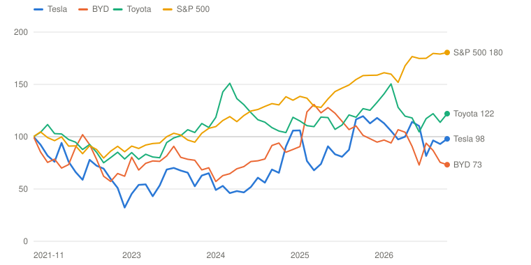
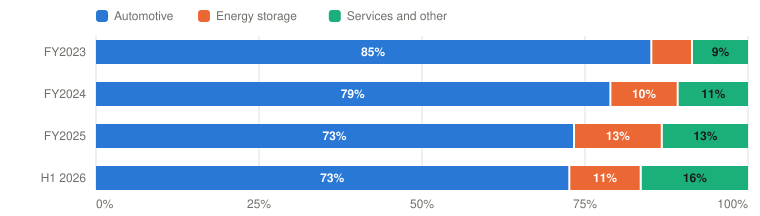

# TSLA — Tesla, Inc.

> **Schema** v7.0 · **Updated** 2026-10-21 · **Status** Active
> **Price** $373.71 verified Oct 20, 2026 close; Q3 results after the close on Oct 21 ([Yahoo](https://finance.yahoo.com/quote/TSLA/)) · 52-wk $297.38–$498.83 · 38th %ile · −25.1% from high
> **Type** Auto OEM and energy storage carrying an autonomy, robotics and AI-compute option · **Stage** Turnaround · **Cyclical** Yes · **Competence** Outside

## Verdict

**Tesla's car business now earns almost nothing and its autonomy business is real but small; at $374 the price assumes more than my Bull, and the probability-weighted case, merger premium included, is worth about $295.**

🟡 **Non-holder: Watch (entry ≤$160)** · 🔴 **Holder: Trim**

| PW EV | PW return/yr | Compounding/yr | R/R | Entry | Trim | Avoid | FY26E P/E | Yield | BAIT | Moat | Next |
|---|---|---|---|---|---|---|---|---|---|---|---|
| **$295** | **-4.6% (<13%)** | 39.6% EPS from a trough, but the multiple falls ~9× | 0.5:1 | ≤$160 | $295–$548 | ≥$548 | ≈215× non-GAAP (≈425× GAAP) | 0.0% | None | Narrow, narrowing in autos; optional Wide in autonomy | 📅 Q3 print Oct 21; ACEA Sep data; meeting Dec 3 |

**Breaks if**: Tesla discloses robotaxi economics at Tesla's own ~$0.30-a-mile cost target with a fleet growing toward 100,000 vehicles, or the SpaceX committees agree a premium above 20% for Tesla holders.

⚠️ **Terminal-growth check**: implied perpetual growth exceeds the risk-free rate in Bull, Base, Bear.

## The Call

Tesla has become two companies with one share price. The first builds cars and batteries: 486,532 deliveries in Q3 (−2% a year), auto gross margin ex-credits of 16.3% in Q2 and an operating margin of 1.4%, with BYD outselling it in Europe this year. The second is an autonomy and robotics company: about 1.5M paid FSD customers, a few hundred thousand unsupervised robotaxi miles, an Optimus line under construction. It has not yet disclosed a fleet size, a cost per mile or a revenue line. At $374 the stock is about 425 times this year's GAAP earnings. To earn even 10% a year it needs FY2031 EPS near $12.04, above my Bull's $10.96, which already has unsupervised robotaxis in 50+ metros. The probability-weighted case, including a 10% chance of Optimus at scale and a 65% chance of a SpaceX merger premium, is worth about $295: -4.6% a year. The merger is the nearest source of value for Tesla holders, worth about +6% if it closes on likely terms, but it is a one-time premium paid in a company whose own price assumes a great deal. Price-implied Bear odds are below zero; R/R is 0.5:1.

## What I'd Have To Be Wrong About

1. **That robotaxi economics exist and Tesla says so.** Test: the Q3 update (Oct 21) or the Q4 update (late January 2027) discloses a robotaxi fleet size and paid miles, plus a cost-per-mile or contribution figure. Continued silence while metros expand is the answer. **If Fail →** move 10 points from Bull to Bear (PW EV $246, -8.1%/yr) → stays **Watch / Trim**, entry $133; the autonomy case loses its evidence.
2. **That Optimus is production, not a press cycle.** Test: a unit count or weekly run-rate in the Q3 (Oct 21) or Q4 update; the Q2 update said production was 'anticipated later this year'. **If Fail →** the Optimus option falls to 5% (PW EV $282, -5.5%/yr) → stays **Watch / Trim**, entry $153.
3. **That Europe is a model-year gap, not brand damage.** Test: ACEA EU registrations for September through December (late October to late January) back above the prior year, with Tesla ahead of BYD in at least one month. **If Fail →** move 10 points from Base to Bear (PW EV $277, -5.8%/yr) → stays **Watch / Trim**, entry $150.

## Latest update: 2026-10-21 · Merger committees, a $30B credit line and a flat Q3, ahead of the print

- Robotaxi economics clear the bar and Tesla says so — 🟡 Pending — nothing filed on robotaxi since July 22; resolves in the Q3 update tonight
- Optimus is production, not a press cycle — 🟡 Pending — the Q3 delivery release (Oct 2) is silent on Optimus; resolves in the Q3 update
- Europe is a model-year gap, not brand damage — 🟡 Pending — EU registrations January–August: BYD 177,752, Tesla 142,165; September ACEA data due late October

Four things happened in the six weeks since the September 7 page, and Tesla reports Q3 after tonight's close.

**1. Q3 deliveries were flat** ([8-K, Oct 2](https://www.sec.gov/Archives/edgar/data/1318605/000162828026064366/exhibit991111111.htm)): 486,532 delivered and 464,391 produced, with 13.7 GWh of storage deployed. That is 2% fewer deliveries than a year earlier and 1% more than Q2. Production ran 22,000 units below deliveries, so inventory came down.

| Q3 2026 | Reported | Q2 2026 | Q3 2025 |
|---|---|---|---|
| Deliveries | **486,532** | 480,126 | 497,099 |
| Production | 464,391 | 451,758 | 447,450 |
| Storage deployed (GWh) | 13.7 | 13.5 | 12.5 |

*Source: Tesla Q3 2026 and Q2 2026 delivery releases and the Q2 2026 Update.*

**2. Tesla signed $30 billion of credit facilities on September 29** ([8-K](https://www.sec.gov/Archives/edgar/data/1318605/000162828026063820/tsla-20260929.htm)): a $20 billion three-year delayed-draw term loan, an $8 billion five-year revolver and a $2 billion 364-day revolver. They replace a $5 billion revolver and carry a $5 billion minimum-liquidity covenant. Tesla says it does not plan to draw in 2026. This is the capacity CFO Taneja described on the Q2 call for a capex cycle that "will grow for the next two to three years."

**3. The 2026 proxy came out on October 19** ([DEF 14A](https://www.sec.gov/Archives/edgar/data/1318605/000110465926116700/tm267596-1_def14a.htm)).
- **Meeting.** The annual meeting is December 3 and has three routine proposals. There is no merger item.
- **Ownership.** Musk beneficially owns 19.8%, with 207.5 million shares pledged.
- **Award in a change in control.** The 423.7 million unearned 2025-award shares would vest only for market-cap milestones actually reached, the first at $2 trillion, and would otherwise be forfeited.
- **SpaceX dealings.** Tesla holds about $2 billion of SpaceX stock at cost, from the xAI investment, and sold xAI $430 million of Megapacks in 2025.

**4. Merger committees.** On SpaceX's Q3 call (October 20), Musk confirmed that both boards have formed special committees of independent directors to study a merger. He called it "a good idea" but "not a certainty," and said Tesla would need 50% of all outstanding shares to approve it ([transcript](https://www.fool.com/earnings/call-transcripts/2026/10/20/spacex-spcx-q3-2026-earnings-call-transcript/)). TSLA rose 5.4% over October 19–20 and about 1.7% after hours. I priced the deal in a separate [exchange-ratio study](../../insights/SPCX-TSLA-merger-exchange-ratio-2026-10-21.md). The most likely outcome is the market ratio plus a 10–20% premium for Tesla holders, worth about +6% to them if it closes, with a 65% chance of closing.

**The scorecard.** All three September tests are pending.
- **Tests 1 and 2 resolve tonight.** These are robotaxi economics and Optimus units, both due in the Q3 update.
- **Test 3 resolves later.** Europe's January–August data shows BYD at 177,752 EU registrations against Tesla's 142,165. September ACEA figures arrive late this month.

No consequence is triggered yet. I carried all three tests forward unchanged, and the model now computes their consequences.

**The migration, and why the holder verb changes.** This page moves to the v7 segment model and full deep dive.
- **Bear.** The rebuild lowers it from $120 to about $57. A Bear in which the car business doesn't recover can't be valued on 2023-level earnings, and Tesla's EPV (five years of owner earnings plus net cash) is only about $34.
- **Base.** It falls from $330 to about $234, because autonomy at regional scale earns about $11 billion in 2031 on my unit economics.
- **Bull.** At $548 it now excludes Optimus, which moves to an option line with the merger premium.
- **Result.** PW EV is $295, below spot, so the holder zone moves from Hold to **Trim**. The non-holder verb stays **Watch**, with entry at $160.

The bias check is in the Valuation chapter. The change is driven by evidence and method rather than price, which is up only 5.5% since September 7.

**Appearances in the window (September 7 – October 20).**
- **Musk's merger remarks** on the SpaceX Q3 call (October 20).
- **The proxy's chair letter**, which mentions Terafab and "SI infrastructure."
- **No Tesla earnings call or investor event in the window.** The August 19 JPMorgan Fremont visit, which predates the window, remains the latest off-script disclosure.

---

## Deep Dive: Tesla, Priced for the Robots

*Since its 2021 peak Tesla's revenue has nearly doubled, its operating profit has fallen by a third and its stock has gone nowhere. Now Musk wants to fold it into SpaceX. What does $374 assume, and who gets paid if the merger happens?*

**Contents**: [Business Overview](#business-overview) · [Autonomy: The Business Inside the Price](#autonomy-the-business-inside-the-price) · [The Core: A Car Company Spending Like a Chip Company](#the-core-a-car-company-spending-like-a-chip-company) · [Musk, Capital Allocation and Incentives](#musk-capital-allocation-and-incentives) · [Valuation and Model Assumptions](#valuation-and-model-assumptions) · [Final Words](#final-words) · [Appendix: The Numbers](#appendix-the-numbers) · [Sources](#sources)

On October 25, 2021, Hertz said it would buy 100,000 Teslas, and Tesla's market value passed $1 trillion for the first time. At the end of that November the stock closed at about $382, split-adjusted. Yesterday, October 20, 2026, it closed at $373.71.

The business has changed a great deal in between. Tesla's revenue was $53.8 billion in 2021 and is $103.6 billion over the last twelve months. Operating income went the other way, from $6.5 billion to $4.4 billion, and diluted EPS from $1.63 to $1.08. Return on invested capital, 41% in 2022, was 7% last year. Tesla now sells about as many cars as it did in 2023, at lower prices, while spending about two and a half times as much on research as in 2021 and planning about four times as much on capital projects this year.

Including dividends, the S&P 500 has returned 81% since the end of November 2021. Toyota has returned 22%. BYD, which outsold Tesla in the European Union this year, is down 27%. Tesla is down 2%.

*Total return including dividends, monthly, end of November 2021 (Tesla's peak month) = 100, through October 20, 2026. Source: Yahoo Finance adjusted closes; BYD via its US ADR. Built with Claude.*

| Date | Tesla | BYD | Toyota | S&P 500 |
|---|---|---|---|---|
| 2021-11 | 100 | 100 | 100 | 100 |
| 2022-09 | 70 | 62 | 75 | 80 |
| 2023-07 | 70 | 91 | 99 | 103 |
| 2024-05 | 47 | 71 | 131 | 120 |
| 2025-03 | 68 | 131 | 110 | 129 |
| 2026-01 | 113 | 97 | 141 | 161 |
| 2026-10 | 98 | 73 | 122 | 180 |

The stock and the business parted ways because the market stopped valuing Tesla as a car company. At $374 the stock trades at about 215 times this year's expected non-GAAP earnings and about 425 times GAAP earnings. The price is for something else: robotaxis, the FSD software that drives them, Optimus humanoid robots, and the chips and data centers behind all three. Those are real programs. Cybercabs began charging fares in Austin on September 3, about 1.5 million customers pay for FSD, and an Optimus production line is going into the old Model S and X space in Fremont. But none of them yet shows up as a line in Tesla's financial statements.

And now there is a new variable. On October 20, on SpaceX's earnings call, Elon Musk confirmed that Tesla and SpaceX have formed special committees to study a merger. If it happens, Tesla holders become owners of a combined company that is mostly SpaceX.

This piece takes autonomy first, because that is what the price is for, then the car-and-energy core and its capital needs. Then come Musk, the capital record and the incentives, including what the merger means for a Tesla holder. I finish with valuation: what $374 assumes, and what it would take to earn 13% a year from here. Tesla reports its third quarter after the close tonight, so some of this will be tested within hours.

### Business Overview

Tesla reports revenue in three lines. **Automotive** is vehicle sales, regulatory credits, leasing and FSD. **Energy generation and storage** is mainly Megapack and Powerwall. **Services and other** is used cars, Supercharging, insurance, parts and service, and now the robotaxi network.

| $ Billion | FY2023 | FY2024 | FY2025 | Q1 2026 | Q2 2026 |
|---|---|---|---|---|---|
| **Automotive revenue** | 82.42 | 77.07 | 69.53 | 16.23 | 20.52 |
|  Energy generation and storage revenue | 6.04 | 10.09 | 12.77 | 2.41 | 3.14 |
|  Services and other revenue | 8.32 | 10.53 | 12.53 | 3.75 | 4.58 |
| **Total revenue** | 96.77 | 97.69 | 94.83 | 22.39 | **28.24** |
|  Gross margin | 18.2% | 17.9% | 18.0% | 21.1% | 16.8% |
|  Research and development | 3.97 | 4.54 | 6.41 | — | — |
| **Operating income (GAAP)** | 8.89 | 7.08 | 4.36 | 0.94 | **0.40** |
|  Operating margin | 9.2% | 7.2% | 4.6% | 4.2% | 1.4% |
|  Adjusted EBITDA | — | — | — | 3.67 | 3.27 |
| **Capital expenditure** | 8.90 | 11.34 | 8.53 | 2.49 | **5.79** |
| **Free cash flow** | 4.36 | 3.58 | 6.22 | 1.44 | (1.09) |

*Tesla does not report segment operating profit beyond automotive and energy gross profit. FY2025 segment revenue sums the quarterly updates. Source: [SEC XBRL company facts](https://data.sec.gov/api/xbrl/companyfacts/CIK0001318605.json), [FY2025 10-K](https://www.sec.gov/Archives/edgar/data/1318605/000162828026003952/tsla-20251231.htm), [Q2 2026 Update](https://www.sec.gov/Archives/edgar/data/1318605/000162828026049213/exhibit991.htm). Built with Claude.*

Two things stand out. Revenue was flat from 2023 to 2025 while operating income fell by half, because prices came down and research spending rose 61% in two years, to $6.4 billion. Then in 2026 revenue started growing again: the second quarter was a record at $28.2 billion, up 26%. Operating income still fell 57% that quarter, to $398 million, because operating expenses rose 47%. Tesla is in what it calls "its largest and most exciting period of investment," and the investment runs through the income statement before it shows up anywhere else.

*Share of revenue by segment. Source: Tesla 10-Ks and [quarterly updates](https://www.sec.gov/Archives/edgar/data/1318605/000162828026049213/exhibit991.htm). Built with Claude.*

| Period | Automotive | Energy storage | Services and other | Total ($M) |
|---|---|---|---|---|
| FY2023 | 82,419 (85%) | 6,035 (6%) | 8,319 (9%) | 96,773 |
| FY2024 | 77,070 (79%) | 10,086 (10%) | 10,534 (11%) | 97,690 |
| FY2025 | 69,526 (73%) | 12,771 (13%) | 12,530 (13%) | 94,827 |
| H1 2026 | 36,750 (73%) | 5,547 (11%) | 8,326 (16%) | 50,623 |

Storage is now 13% of revenue against 6% in 2023, and in Q1 2026 it earned about a fifth of gross profit.

A few accounting points before the debate.

First, Tesla's non-GAAP earnings exclude stock pay, about $2.8 billion in 2025. I use GAAP throughout.

Second, second-quarter net income of $1.1 billion included a $1.0 billion mark-up on Tesla's SpaceX shares. Tesla invested $2 billion in xAI in January, and the stake converted into SpaceX stock when the two merged. Without the mark-up, the core quarter was roughly breakeven.

Third, regulatory credits, once a pure-profit line, fell to $146 million in Q2 from $439 million a year earlier.

Fourth, the 3.95 billion shares on the cover include 423.7 million restricted shares from Musk's 2025 award. They are unearned, they vote proportionally with everyone else, and in a change in control they mostly vanish (more below). I use 3.54 billion diluted economic shares.

### Autonomy: The Business Inside the Price

Let me start with where things stand.

| Unit | Q3 2025 | Q4 2025 | Q1 2026 | Q2 2026 | Q3 2026 |
|---|---|---|---|---|---|
| Deliveries | 497,099 | 418,227 | 358,023 | 480,126 | **486,532** |
| YoY change | +7% | −16% | +6% | +25% | −2% |
| Storage deployed (GWh) | 12.5 | 14.2 | 8.8 | 13.5 | 13.7 |
| Paid FSD customers (M) | 1.04 | 1.10 | 1.28 | 1.48 | — |
| Auto gross margin ex-credits | — | — | 19.2% | 16.3% | — |
| Regulatory credits ($M) | — | — | — | 146 (vs 439) | — |
| Operating margin | 5.8% | 5.7% | 4.2% | 1.4% | — |
| **Capex ($B)** | 2.25 | 2.39 | 2.49 | 5.79 | >25 for FY2026 |

*YoY changes are against the same quarter a year earlier. Source: [Q2 2026 Update](https://www.sec.gov/Archives/edgar/data/1318605/000162828026049213/exhibit991.htm), [Q3 2026 deliveries release](https://www.sec.gov/Archives/edgar/data/1318605/000162828026064366/exhibit991111111.htm), [Q2 2026 call](https://www.shacknews.com/article/150109/tesla-tsla-q2-2026-earnings-call-transcript). Built with Claude.*

#### Management's narrative

Management's case is that autonomy has started, is safe, and is about to grow very fast. On the July 22 call, Ashok Elluswamy, who runs Tesla's AI software, put it this way:

> "We have driven more than 380,000 miles of unsupervised robotaxi now across six cities in two different states. We have had zero notable incidents... Since the beginning of this year, we have grown at double-digit growth rates to the number of unsupervised miles that the fleet drives every week... We expect that the time to launch to a new city will continue to trend towards zero towards an end where we operate in the entire states as a whole instead of going by a city by city."
> — Ashok Elluswamy, VP of AI, Q2 2026 earnings call, July 22, 2026

Musk added that FSD is now pulling demand for the cars themselves:

> "For a lot of people, they're actually buying Tesla full self-driving with a car attached as opposed to a car with FSD... So, clearly, the — this is a significant demand driver."
> — Elon Musk, Q2 2026 earnings call, July 22, 2026

Fifty-five percent of North American deliveries in Q2 came with an FSD subscription. FSD is now approved in the Netherlands, Lithuania, Estonia, Denmark and Belgium. The Cybercab, which has no steering wheel or pedals, began production in the second quarter and carries paying passengers in Austin. At a Fremont visit in August, Tesla told JPMorgan analysts it is aiming for a long-run Cybercab operating cost of about $0.30 a mile. If the fares stay anywhere near what people pay today, that is an exceptional business.

#### Poking holes in it

The first hole is that Tesla hasn't shown the business yet. A year after its first paid rides, the company has not disclosed how many robotaxis it runs, how many paid miles they drive, what a ride earns or what a mile costs. The 380,000 unsupervised miles are a cumulative figure. At 40,000–50,000 miles a year per car, that is about eight to ten vehicle-years of driving, roughly what a small taxi company in one city does in a year. Growing at double digits a week from a small base is still a small base. A business whose unit economics were good would, I think, show them; my first test is that it does.

The second hole is regulation. On September 3, the day Cybercab started charging fares, NHTSA opened audit AQ26002 into Tesla's self-certification that certain safety standards written for cars with steering wheels do not apply to it. Musk himself named the constraint on the Q2 call: "If we injure even one person, it will be worldwide headline news. And regulators will immediately clamp down on our activities." He is right, and it means the growth rate depends on a regulator as much as on the software.

The third hole is price. On a matched Austin route, a Cybercab ride cost $7.77 against $12.10 in a Tesla Model Y robotaxi. That suggests Tesla is pricing to fill the cars, which is sensible, but it also means the per-mile revenue in a mature market may be far below what an Uber driver charges today. Tesla has already removed the FSD purchase option in most markets in favor of subscriptions, which is good for recurring revenue and makes the near-term number smaller.

Here is an illustrative Cybercab:

| Illustrative Cybercab, per vehicle | At Tesla's cost target | At today's industry costs | In a fare war |
|---|---|---|---|
| Revenue per paid mile | $1.00 | $1.00 | $0.60 |
| Cost per mile (vehicle, energy, cleaning, insurance, remote support) | $0.30 | $0.60 | $0.40 |
| **Contribution per mile** | $0.70 | $0.40 | $0.20 |
| Paid miles per vehicle per year | 50,000 | 40,000 | 40,000 |
| Contribution per vehicle per year | $35,000 | $16,000 | $8,000 |
| Payback on a ~$30,000 vehicle (years) | **0.9** | 1.9 | 3.8 |
| Fleet needed for $11B of contribution (my Base, 2031) | ≈310,000 | ≈690,000 | ≈1,380,000 |
| **Actual: unsupervised robotaxi miles to date (July 2026, cumulative)** | 380,000 |  |  |

*Author's estimates, except the cost target and the actual row. The ≈$0.30-a-mile long-run cost target is what Tesla told JPMorgan at a Fremont site visit around August 19 ([raw note](../../../raw/TSLA/appearances/2026-08-19_JPMorgan_Fremont-site-visit.txt)); 380,000 miles is from VP of AI Ashok Elluswamy on the [Q2 call](https://www.shacknews.com/article/150109/tesla-tsla-q2-2026-earnings-call-transcript). Revenue per mile and vehicle cost are illustrative; Tesla has disclosed neither. Built with Claude.*

At Tesla's own cost target, a Cybercab pays for itself in under a year, and my Base case's 2031 autonomy profit needs about 310,000 of them. At today's industry cost structure it needs more than twice as many. In a fare war, it needs well over a million. The last row is the actual: 380,000 unsupervised miles by July. Each column is a plausible future. The question is which one, and Tesla's silence on costs is itself evidence.

Where I come out: the autonomy program is real and probably the most advanced camera-only system in the world, and its demand pull on FSD is visible in the numbers. I would not underwrite the per-mile economics until Tesla discloses them. My Base case has autonomy growing from about $1.6 billion of revenue this year to $23 billion in 2031 at a 50% margin. That is about 300,000 robotaxis and 5 million FSD subscribers, roughly what Tesla's cost target supports with a fleet the size of a large city's taxi market in each of a few dozen metros.

#### Four rings of profit

Sorting Tesla's profit by its exposure to that question shows how the price and the profit have separated.

| Ring | Share of FY2026E segment profit | Share of the price | Main threat | Exposure |
|---|---|---|---|---|
| **1 · Autonomy** (FSD subscriptions, robotaxi) | ≈14% | most of it | Disclosure, safety, regulators (NHTSA AQ26002), Waymo | **This is the debate** |
| **2 · Energy storage** (Megapack, Powerwall) | ≈30% | ≈10% | Price competition (CATL, Chinese integrators); margin guided to the low-to-mid 20s | Low; it sells to the AI build |
| **3 · Services and other** (used cars, Supercharging, insurance, parts) | ≈26% | ≈5% | Fleet growth stalls | Low |
| **4 · Vehicle sales** | ≈31% | ≈10% | BYD in Europe and Asia; price cuts; credits gone | High, already priced as a car company |

*Segment profit shares are the author's FY2026E estimates from the model's base year (Tesla discloses no segment operating profit). Shares of the price are rough: vehicles, storage and services at peer multiples are worth roughly a quarter of the market value. Built with Claude.*

About 14% of this year's segment profit comes from autonomy. Most of the market value is there. The other three rings (vehicles, storage and services), worth perhaps a quarter of today's price at peer multiples, earn most of the money. So the question for a Tesla owner is mostly about whether autonomy and robots grow into the price, and only a little about whether the car business recovers.

### The Core: A Car Company Spending Like a Chip Company

The car business got worse at the margin and better in volume this year. Deliveries in the second quarter were a record 480,126, up 25%, helped by the Model YL and by FSD demand. The third quarter was flat at 486,532, down 2% from a year earlier. China set records (wholesale up 25.6% through August), while Europe did the opposite. Through August, BYD registered 177,752 vehicles in the EU against Tesla's 142,165.

Auto gross margin excluding credits fell from 19.2% in Q1 to 16.3% in Q2. CFO Vaibhav Taneja said that was roughly flat once Q1's one-time warranty and tariff benefits were removed, and blamed commodity costs and the cost of subsidizing car loans as rates rose. I believe him, and it still leaves a car business with a 1–2% operating margin after the spending on the future.

Energy is the bright spot. Deployments were 13.5 GWh in Q2 and 13.7 GWh in Q3, and the backlog is strong, including sales to the data centers being built for AI: xAI alone bought $430 million of Megapacks in 2025. But the margin is falling. Storage gross margin went from 39.5% in Q1 to 20.4% in Q2, partly on a $240 million warranty charge, and Taneja said where he expects it to settle:

> "We had previously guided that ASPs for industrial storage is coming down amidst growing competition. Long term, we believe the energy business should normalize at a gross margin rate in the mid- to low 20% range."
> — Vaibhav Taneja, CFO, Q2 2026 earnings call, July 22, 2026

That is a good business, but it is a manufacturing margin.

Then there is the spending. Tesla expects more than $25 billion of capex in 2026, three times 2025's $8.5 billion, and Taneja was explicit that it keeps going:

> "CapEx will grow for the next two to three years as we expand our robotaxi fleet, expand our production capacity for Optimus, make investments for semiconductor fab, install solar manufacturing capacity and AI compute infrastructure... we are being opportunistic in securing certain debt facilities that will give us the capacity to borrow up to $30 billion."
> — Vaibhav Taneja, CFO, Q2 2026 earnings call, July 22, 2026

On September 29 Tesla signed those facilities: a $20 billion delayed-draw term loan, an $8 billion five-year revolver and a $2 billion 364-day revolver, with a $5 billion minimum-liquidity covenant. It says it does not plan to draw in 2026. Free cash flow was negative in Q2 for the first time since early 2024. With $43.5 billion of cash and investments, Tesla is in no danger. But a company whose core earns a 1–2% margin is now funding a chip fab (Terafab, with SpaceX and Intel), a humanoid robot, a robotaxi fleet, solar manufacturing and AI compute at the same time.

Optimus deserves its own sentence of caution, and Musk supplied it:

> "This is going to be the hardest product to scale manufacturing that we've ever made at Tesla because everything on the robot is new... Optimus will follow the sort of normal S-curve of a manufacturing ramp, but the initial portion of the S-curve will be quite flat and long."
> — Elon Musk, Q2 2026 earnings call, July 22, 2026

I take him at his word. Optimus at scale is not in any of my three cases. It is an option line: a 10% chance of a million-plus robots a year by 2031, worth about $250 a share if it happens.

### Musk, Capital Allocation and Incentives

Musk has run Tesla since 2008 and built the most valuable car company in the world from a sports-car startup. Between 2019 and 2022 he took it from losses to a 16.8% operating margin while growing revenue more than threefold, a record no other carmaker has matched. Since 2022 the record has run the other way: price cuts that bought volume and gave up margin, and a pivot of the company's resources toward autonomy and robots. A credible operating layer runs underneath him: Taneja, Tom Zhu in manufacturing, Lars Moravy in vehicle engineering, Elluswamy in AI. He is also CEO of SpaceX, which now owns xAI.

| Year | Deal | Price | What happened | Verdict |
|---|---|---|---|---|
| 2016 | SolarCity | ≈$2.6B in stock, plus its debt | Solar roof never scaled; discontinued in August 2026 per Electrek | Poor |
| 2019 | Maxwell Technologies | ≈$0.2B in stock | Dry-electrode know-how behind the 4680 cell, now >40 GWh in Texas | Mixed |
| 2026 (Jan–Mar) | xAI Series E → SpaceX Class A | $2.0B cash | Converted into SpaceX shares at the merger; a $1B mark-up in Q2 | Good so far; a related-party blemish |
| 2026 | Terafab (with SpaceX and Intel) | Not disclosed; development fab in Austin | Equipment ordered; test chip targeted mid-2027 | Too early |
| 2026 (Oct) | Merger with SpaceX | Exploring; special committees, no terms | See the merger section | Pending |

*Source: Tesla 10-Ks, [2026 proxy](https://www.sec.gov/Archives/edgar/data/1318605/000110465926116700/tm267596-1_def14a.htm) (related-person transactions), [Q2 2026 call](https://www.shacknews.com/article/150109/tesla-tsla-q2-2026-earnings-call-transcript), [SpaceX Q3 call](https://www.fool.com/earnings/call-transcripts/2026/10/20/spacex-spcx-q3-2026-earnings-call-transcript/), [Electrek](https://electrek.co/2026/10/20/tesla-and-spacex-take-first-step-towards-merger-would-dilute-all-shareholders/). Built with Claude.*

The deal record is short and mostly related-party. SolarCity was a rescue of a company Musk's cousins founded and Musk chaired, and its solar roof never scaled. The $2 billion xAI investment has so far been a good trade, a $1 billion mark-up in a quarter, but it was money from Tesla shareholders into another Musk company. Terafab is a three-way project with SpaceX and Intel whose spending and ownership have not been disclosed.

#### The cash

| $ Billion | Revenue | YoY | Diluted EPS | OCF | SBC | Capex | FCF | FCF margin | Dividends + buybacks | Acquisitions | Debt | Dil. shares (B) |
|---|---|---|---|---|---|---|---|---|---|---|---|---|
| FY2021 | 53.8 | +71% | $1.63 | 11.5 | 2.1 | 6.5 | 5.0 | 9.3% | 0 | 0 | 4.3 | 3.39 |
| FY2022 | 81.5 | +51% | $3.62 | 14.7 | 1.6 | 7.2 | 7.6 | 9.3% | 0 | 0 | 1.0 | 3.48 |
| FY2023 | 96.8 | +19% | $4.30 | 13.3 | 1.8 | 8.9 | 4.4 | 4.5% | 0 | 0.1 | 2.7 | 3.48 |
| FY2024 | 97.7 | +1% | $2.04 | 14.9 | 2.0 | 11.3 | 3.6 | 3.7% | 0 | 0 | 5.5 | 3.50 |
| FY2025 | 94.8 | −3% | $1.08 | 14.8 | 2.8 | 8.5 | 6.2 | 6.6% | 0 | 0 | 6.6 | 3.53 |
| H1 2026 | 50.6 | +21% | $0.45 | 8.6 | — | 8.3 | 0.4 | 0.7% | 0 | 2.0 (xAI) | 7.7 | 3.54 |
| **Cum. FY2021–25** | 424.6 |  |  | 69.2 | 10.3 | 42.4 | 26.7 | 6.3% | 0 | 0.1 | +2.3 | +4% |

*FCF = operating cash flow − capital expenditure. Debt excludes leases. FY2023 EPS includes a $5.9B deferred-tax valuation release. Source: [SEC XBRL company facts](https://data.sec.gov/api/xbrl/companyfacts/CIK0001318605.json), [Q2 2026 Update](https://www.sec.gov/Archives/edgar/data/1318605/000162828026049213/exhibit991.htm). Built with Claude.*

From 2021 through 2025 Tesla generated $69 billion of operating cash flow, spent $42 billion on capital projects and kept the rest: net cash ex-leases rose from $13.5 billion to $37.5 billion. It paid no dividends and bought back no stock. Shares outstanding rose 4%, and stock pay took 15–41% of owner earnings depending on the year. The problem is not the balance sheet, which is strong. Return on capital fell from 41% to 7% while invested capital doubled, so the last three years of reinvestment earned a negative incremental return. I don't hold that against the autonomy bets, which may yet pay. It does mean the five-year record gives no evidence yet that the new capital earns its cost.

**Outsider grade: Reinvestor.** No buyback and no dividend, so there is no countercyclical capital return to grade. All cash goes into the company's own projects, now at three times last year's pace, with $30 billion of debt capacity behind it. The grade holds until the capex cycle shows a return.

#### The incentives

| Component | Size | What it pays for | Status |
|---|---|---|---|
| **2025 CEO Performance Award** | 423.7M restricted shares, 12 tranches | Each tranche needs a market-cap milestone ($2T rising to $8.5T) **and** an operating milestone (20M cumulative vehicles, 10M FSD subscriptions, 1M Optimus, 1M robotaxis, or adjusted EBITDA from $50B to $400B) | None earned; voted proportionally by the company secretary; in a change in control only market-cap milestones count, and unearned shares are forfeited |
| **2018 CEO Performance Award** (restored) | 286.4M restricted shares, net of exercise | Already earned; Implementation Agreement (April 2026) requires service to Jan 19, 2028 | Vests early on a change in control |
| **Cash bonus** | None | — | — |
| **Return on invested capital** | 0% | Not measured anywhere in the plan | — |

*Musk beneficially owns 699.6M shares, 19.8% excluding the unearned award shares; 207.5M are pledged. Source: [2026 proxy](https://www.sec.gov/Archives/edgar/data/1318605/000110465926116700/tm267596-1_def14a.htm). Built with Claude.*

The 2025 award, approved by shareholders last November, is the largest pay package ever granted. It pays only if Tesla's market value reaches $2 trillion or more **and** Tesla hits operating milestones: 20 million cumulative vehicles, 10 million FSD subscriptions, a million Optimus robots, a million robotaxis, or adjusted EBITDA between $50 billion and $400 billion. It points Musk squarely at autonomy and robots, which is what shareholders voted for. Like the SpaceX plans, it does not measure return on capital, and it rewards scale over profit per share.

The 2026 proxy, filed October 19, matters for the merger in one specific way. In a change in control, unearned award shares become earned "based solely on market capitalization milestones," and the rest are forfeited. At any deal value below $2 trillion for Tesla, none of the 423.7 million shares would vest. Electrek's claim that the shares would be "delivered automatically" in a merger does not match the proxy. The 286 million restricted shares from the restored 2018 award would vest early, but they are already outstanding and voting.

#### The merger, from Tesla's side

On SpaceX's call, Musk was careful:

> "Both SpaceX and Tesla have formed special committees to discuss this idea at the request of shareholders... because I'm a conflicted party, I can't actually be in the discussions... particularly on the Tesla side, we will need a 50% vote of all shares, not just those who vote, but of all shareholders. And that's quite a high hurdle to try to achieve."
> — Elon Musk, SpaceX Q3 2026 earnings call, October 20, 2026

If it happens, SpaceX would most likely acquire Tesla for stock, so Tesla's holders are the sellers and their vote decides it. I set out how a banker would price it in a [separate study](../../insights/SPCX-TSLA-merger-exchange-ratio-2026-10-21.md). In short, public stock-for-stock deals are priced at the market ratio plus a negotiated premium, and the market ratio on a 30-day average is about 2.39 SpaceX shares per Tesla share, or 40% of the combined company for Tesla holders.

| Model | Premium to Tesla | SpaceX shares per Tesla share | Tesla : SpaceX | Probability | Tesla holders if it closes |
|---|---|---|---|---|---|
| 1. At-market merger of equals | 0–5% | 2.39–2.51 | 40–41 : 59–60 | 30% | +1.5% |
| **2. Market + control premium** | **10–20%** | **2.63–2.87** | **42–44 : 56–58** | **45%** | **+8.5%** |
| 3. Full takeover premium | 25–35% | 2.99–3.23 | 45–47 : 53–55 | 15% | +16.1% |
| 4. Earnings-based, SpaceX-favoured | −10% | 2.15 | 38 : 62 | 10% | −6.3% |
| **Probability-weighted** | ≈11% | ≈2.66 | 42 : 58 | 65% to close | +6.0% |

*Anchored on the 30-day VWAP ratio of 2.39 and economic shares (3.54B Tesla, 12.7B SpaceX). If the deal breaks I assume Tesla gives back about 6% of merger speculation [Estimate]. Full method in the [exchange-ratio study](../../insights/SPCX-TSLA-merger-exchange-ratio-2026-10-21.md). Built with Claude.*

I think a 10–20% premium is the most likely outcome. Tesla's committee needs something for moving holders from a company where Musk owns 19.8% into one he would control with a majority of the votes (Barclays estimates about 56%), and Tesla brings $36 billion of net cash to a company guiding to a $35–40 billion capex quarter. Three things cap the premium: no other bidder, Musk's own money (he owns about 42% of SpaceX), and Texas's safe harbor for committee-approved deals. Weighting the outcomes, Tesla holders gain about 6% if the deal closes. At a 65% chance of closing, that is worth about $16 a share in my valuation as an option line.

Two cautions. First, the premium is paid in SpaceX stock, whose own price assumes a lot. After the deal, a Tesla holder's five-year return is roughly 40% Tesla's and 60% SpaceX's. Second, the vote needs 50% of all outstanding shares. Musk's 19.8% counts unless the committee requires a majority-of-the-minority vote. The proxy also describes a new retail voting program that lets small holders vote automatically with their stated preferences. I'd want to see the majority-of-the-minority condition. It's the clearest protection Tesla's other holders could get.

#### Promises

| Promised | Where, when | Outcome |
|---|---|---|
| Over a million robotaxis on the road 'next year' | Autonomy Day, April 2019 [link pending] | 🔴 Unsupervised rides began in Austin in late 2025; fleet size undisclosed |
| Cybercab volume production in 2026 | Q4 2025 Update | 🟢 Production began at Giga Texas in Q2 2026; fares charged from September 3 |
| Optimus production 'later this year' | Q2 2026 Update, July 22 | 🟡 Press reports of a Fremont start; nothing filed by Tesla |

*Source: [Q2 2026 Update](https://www.sec.gov/Archives/edgar/data/1318605/000162828026049213/exhibit991.htm); [Cybercab launch notes](../../../raw/TSLA/clippings/2026-09-04_cybercab-austin-launch.txt). Built with Claude.*

On promises, Musk's record is consistent in one way: the things he promises arrive, years after he says they will. Robotaxis came about six years after "next year," Cybercab on schedule, Optimus later than this year's guide. That pattern is useful. It argues for owning the outcome when it is visible, not when it is promised.

Is Musk the right manager for Tesla? For building, yes; nobody else would have built it. For Tesla's other shareholders, the honest answer is that his attention, his incentives and now possibly Tesla itself are moving toward SpaceX. The committees' terms will tell us how much that costs.

### Valuation and Model Assumptions

I model Tesla in four pieces: automotive, energy, services, and autonomy carved out of the first and third. Each gets revenue growth and an operating margin, then unallocated AI and Optimus spending, interest income on the cash, and tax, down to GAAP EPS. FY2026 is calibrated to H1 actuals, Q3 deliveries and consensus revenue of about $107 billion. Tesla discloses no segment profit, so the segment margins are my estimates. Competence is Outside: the timing of unsupervised autonomy and its regulation are things I can't judge with an edge. So Bull and Bear each get at least 25%, and I put the Bear at 30% because the auto core's earnings have already fallen to a level the Bear only has to keep. The 2031 value is EPS times 50 in the Bull and Base (a premium for a business still compounding fast) and 27 in the Bear. Here is the Base:

| $ Billion | FY2026E | FY2027E | FY2028E | FY2029E | FY2030E | FY2031E |
|---|---|---|---|---|---|---|
| **Automotive revenue** | 74.0 | 77.0 | 80.0 | 83.2 | 86.6 | 90.0 |
|  YoY growth | 4.0% | **4.0%** | **4.0%** | **4.0%** | **4.0%** | **4.0%** |
|  Operating margin | 2.5% | 3.3% | 4.1% | 4.9% | 5.7% | **6.5%** |
|  Operating profit | 1.85 | 2.54 | 3.28 | 4.08 | 4.93 | 5.85 |
| **Energy storage revenue** | 12.5 | 15.0 | 18.0 | 21.6 | 25.9 | 31.1 |
|  YoY growth | 20.0% | **20.0%** | **20.0%** | **20.0%** | **20.0%** | **20.0%** |
|  Operating margin | 14.0% | 14.2% | 14.4% | 14.6% | 14.8% | **15.0%** |
|  Operating profit | 1.75 | 2.13 | 2.59 | 3.15 | 3.84 | 4.67 |
| **Services and other revenue** | 18.9 | 20.8 | 22.9 | 25.2 | 27.7 | 30.4 |
|  YoY growth | 10.0% | **10.0%** | **10.0%** | **10.0%** | **10.0%** | **10.0%** |
|  Operating margin | 8.0% | 8.4% | 8.8% | 9.2% | 9.6% | **10.0%** |
|  Operating profit | 1.51 | 1.75 | 2.01 | 2.31 | 2.66 | 3.04 |
| **Autonomy (FSD + robotaxi) revenue** | 1.6 | 2.7 | 4.6 | 7.9 | 13.4 | 22.7 |
|  YoY growth | 70.0% | **70.0%** | **70.0%** | **70.0%** | **70.0%** | **70.0%** |
|  Operating margin | 50.0% | 50.0% | 50.0% | 50.0% | 50.0% | **50.0%** |
|  Operating profit | 0.80 | 1.36 | 2.31 | 3.93 | 6.68 | 11.36 |
| Corporate and other | (3.21) | (3.35) | (3.51) | (3.72) | (3.99) | (4.36) |
| **Total revenue** | 107.0 | 115.5 | 125.5 | 137.9 | 153.5 | 174.3 |
| **Operating profit** | 2.70 | 4.43 | 6.68 | 9.75 | 14.12 | 20.56 |
|  Operating margin | 2.5% | 3.8% | 5.3% | 7.1% | 9.2% | 11.8% |
| Net income | 3.12 | 4.50 | 6.31 | 8.76 | 12.25 | 17.41 |
| Diluted shares (B) | 3.540 | 3.575 | 3.611 | 3.647 | 3.684 | 3.721 |
|  Net share change | — | +1.0% | +1.0% | +1.0% | +1.0% | +1.0% |
|  SBC (% of revenue) | 2.6% | 2.6% | 2.6% | 2.6% | 2.6% | 2.6% |
| **GAAP EPS** | $0.88 | $1.26 | $1.75 | $2.40 | $3.33 | $4.68 |
|  YoY growth | — | 42.8% | 38.7% | 37.6% | 38.4% | 40.7% |

*Base case. FY2026E is calibrated to H1 actuals, Q3 deliveries and consensus revenue of about $107B; segment margins are the author's estimates, since Tesla discloses no segment operating profit. Autonomy is carved out of automotive and services revenue. Corporate is unallocated AI, Optimus and Terafab spending. GAAP EPS includes stock pay. Source: author's model (model.json). Bold cells are model inputs.*

In the Base, autos grow 4% a year with the margin recovering to 6.5% as the investment phase eases, and storage grows 20% a year at 15%. Autonomy reaches about $23 billion of revenue at 50%. Revenue grows to about $174 billion and GAAP EPS from $0.88 to $4.68. At 50× that is about $234, below today's price.

| Case | Prob. | 3P | Automotive growth / margin | Energy storage growth / margin | Services and other growth / margin | Autonomy (FSD + robotaxi) growth / margin | Net shares/yr | Per-share earnings FY2031 | CAGR | Exit multiple | Value | Return/yr | Implied g | Driving assumption |
|---|---|---|---|---|---|---|---|---|---|---|---|---|---|---|
| **Bull** | 25% | Plausible | +8.0% / 9.0% | +28.0% / 17.0% | +14.0% / 12.0% | +110.0% / 55.0% | +2.0% | $10.96 | 65.5% | 50.0× GAAP EPS | $548 | 7.9% | 7.8% | Unsupervised robotaxi in 50+ metros with disclosed per-mile economics; FSD and robotaxi revenue about $65B; storage compounds 28% a year; auto margin rebuilds to 9%. Half the CEO award's tranches vest (2% a year dilution). 50× a business still growing over 20%. |
| **Base** | 45% | Probable | +4.0% / 6.5% | +20.0% / 15.0% | +10.0% / 10.0% | +70.0% / 50.0% | +1.0% | $4.68 | 39.6% | 50.0× GAAP EPS | $234 | -8.9% | 7.8% | Autonomy real but regional: about 300K robotaxis and 5M FSD subscribers make about $23B of revenue at 50%; storage 20% a year; auto margin back to 6.5%. The premium persists because the story keeps growing: 50×. |
| **Bear** | 30% | Probable | +2.0% / 5.0% | +15.0% / 13.0% | +8.0% / 9.0% | +25.0% / 45.0% | +1.0% | $2.10 | 18.9% | 27.0× GAAP EPS | $57 | -31.4% | 6.1% | Camera-only autonomy stays geofenced and supervised in most places; BYD holds price in Europe and Asia; auto margin recovers only to 5% as capex ends. A car-and-storage company with a brand premium: 27×. |
| **Priced-in (10%/yr)** | — | diagnostic | +8.5% / 9.3% | +28.9% / 17.2% | +14.5% / 12.2% | +114.7% / 55.6% | +2.1% | $12.04 | 68.7% | 50.0× GAAP EPS | $602 | 10.0% | 7.8% | Solved along Base → Bull for 10%/yr |
| **Hurdle (13%/yr)** | — | diagnostic | +9.1% / 9.7% | +30.3% / 17.6% | +15.1% / 12.6% | +121.5% / 56.4% | +2.3% | $13.77 | 73.3% | 50.0× GAAP EPS | $689 | 13.0% | 7.8% | Solved along Base → Bull for 13%/yr |
| Option: Optimus at scale | 10% | possible |  |  |  |  |  |  |  |  | $250 |  |  | a million-plus humanoid robots a year by 2031; possible, not plausible, given Musk's own warning that the ramp starts flat and long |
| Option: SpaceX merger premium | 65% | possible |  |  |  |  |  |  |  |  | $16 |  |  | about a 6% gain for Tesla holders if the deal closes on PW terms (see the merger chapter) |
| **Probability-weighted** | 100% |  |  |  |  |  |  |  |  |  | $295 | -4.6% |  |  |

*Annual return = price change to the FY2031 value (no dividend). Competence is Outside, so Bull and Bear each get at least 25%. The Priced-in and Hurdle rows are solved along the Base→Bull path at a 50× exit and land beyond the Bull. Option lines are added to the PW value. Source: author's model. Built with Claude.*

| Return math |  |
|---|---|
| PW return/yr vs. hurdle | **-4.6% (<13%)**, of which 0.0% is the dividend yield. Entry ≤$160. 10-year Treasury 5.15%; the hurdle sits 7.9 points above it. |
| Compounding at a flat multiple | Base GAAP EPS grows 39.6% a year from a trough of $0.88 to $4.68, but the multiple falls from about 425× to 50×, so the Base returns -8.9% a year. No dividend, no buyback, about 1% a year dilution. Every case loses money at a flat multiple path because today's multiple is not one any case can hold. |
| Optionality | Optimus at scale: 10% × $250 = $25.0; SpaceX merger premium: 65% × $16 = $10.4 |
| Price-implied expectations | At 10% and a 50× exit, spot needs FY2031 EPS of about $12.04 (68.7% a year), above the Bull's $10.96; at 13% it needs about $13.77. The price assumes Musk's robotaxi and robot plans largely arrive on time. |
| EPV floor | About $34 a share: five-year average owner earnings of about $8.4B capitalized at 10% (≈$24) plus net cash of about $10 a share ex-leases. About 90% of the price pays for growth. The Bear ($57) sits well above EPV because it keeps storage and autonomy growing. |
| Base rate / 3P | The Bull grows revenue about 19% a year from $107B; under 5% of companies above $50B have grown 15% a year in real terms for five years, so the Bull is plausible only on autonomy. The Base's 10% a year sits near the top decile, carried by storage and autonomy. |
| Terminal-growth check | Implied perpetual growth at 10%: Bull 7.8%, Base 7.8%, Bear 6.1%, all above the 5.15% Treasury. A 50× exit is only defensible for a business still compounding above 20% in 2031; I accept the flag for the Bull and Base and note that the Bear's 27× is generous. |
| Break-even and price-implied Bear odds | Break-even <0% against 30% assigned; price-implied <0% at 10%. |
| Year ten | In the Bull and Base, autonomy is still growing at year ten; the 50× exit assumes it. In the Bear the multiple does the work. |
| R/R | **0.5:1** (Bull +47% / Bear −85%) |

*Computed rows come from model.json; EPV, base rate, year ten and the terminal-growth reading are the author's. Built with Claude.*

To earn an ordinary 10% a year at a 50× exit, Tesla needs FY2031 EPS of about $12.04, more than my Bull's $10.96, which already has unsupervised robotaxis in 50-plus metros, about $65 billion of autonomy revenue and an auto margin back to 9%. To earn 13% it needs about $13.77. The price, in other words, assumes Musk's plans arrive roughly on his schedule, plus some of what the options pay.

Weighting the cases 25/45/30 and adding the two option lines (Optimus at scale, 10% at $250; the merger premium, 65% at $16) gives about $295 a share and -4.6% a year. The price at which that case earns 13% a year is about $160. R/R is 0.5:1: the Bull is 7.9% a year, the Bear -31.4%. Earnings-power value, five years of owner earnings with no growth plus net cash, is about $34 a share, so about 90% of the price pays for growth.

*Confidence note: I cannot judge how soon camera-only autonomy earns regulators' trust at scale, or how fast a humanoid robot can be manufactured; both are frontier questions, which is why the Bull and Bear are both wide.*

**Bias check** (holder verb Hold → Trim). *Incentive:* none of the inputs pushing the change comes from someone paid for the view; consensus is a Buy at $398. *Consistency:* I would write the same verb without a prior page, and I am not defending the old one. *Social proof:* the change runs against both the analysts and the recent price trend. *Deprival:* no fresh loss or gain drives it. *Availability:* the five-year record in the Appendix carries it more than any single quarter. The change is driven by evidence and method, not price, which rose only 5.5% since September 7. The segment model shows that a Bear in which the car business doesn't recover is worth about $57, not the $120 the earlier page assumed, and that my Base is below spot.

### Final Words

Tesla is doing more interesting things than at any time since the Model 3 ramp. Robotaxis carry paying passengers without anyone in the driver's seat, FSD is pulling car demand, storage is growing into the AI build, and an Optimus line is going in. If the autonomy economics are as good as Tesla's cost target implies, the business inside the price is enormous.

But the price already assumes that, and more. The stock needs earnings above my Bull case to earn an ordinary return. Meanwhile the parts I can measure, the cars, have gone from a 17% operating margin to under 2%, return on capital has fallen to 7%, and capex is tripling. The nearest source of value for a Tesla holder is not the robots but the merger premium, worth perhaps 6% if it comes, paid in a stock that is not cheap either.

What would change my mind? Tonight's Q3 update could disclose robotaxi economics or Optimus units; those are my first two tests. Europe's September-to-December registrations are the third. A merger at a premium well above 20%, with a majority-of-the-minority vote, would change the holder math. The price at which the numbers work for me is about $160. Until then, I'd watch as a non-holder, and as a holder I'd trim toward a position that doesn't depend on everything Musk has promised arriving on time.

Here are the three tests written as kill criteria, each with its consequence fixed in advance:

*The three tests, with their pre-committed consequences, are listed at the top of this report under [What I'd Have To Be Wrong About](#what-id-have-to-be-wrong-about).*

### Appendix: The Numbers

The tables below carry the framework's required numbers. The argument for each is made in the chapters above.

#### Five-year record

| $B, except per share | FY2021 | FY2022 | FY2023 | FY2024 | FY2025 |
|---|---|---|---|---|---|
| Revenue | 53.8 | 81.5 | 96.8 | 97.7 | **94.8** |
| Operating income (GAAP) | 6.52 | 13.66 | 8.89 | 7.08 | **4.36** |
| Operating margin | 12.1% | 16.8% | 9.2% | 7.2% | **4.6%** |
| Net income | 5.64 | 12.59 | 14.97 | 7.15 | 3.85 |
| Diluted EPS | $1.63 | $3.62 | $4.30 | $2.04 | $1.08 |
| Operating cash flow | 11.50 | 14.72 | 13.26 | 14.92 | 14.75 |
| Capex | 6.48 | 7.16 | 8.90 | 11.34 | 8.53 |
| Depreciation (maintenance proxy) | 1.91 | 2.42 | 3.33 | 4.12 | 5.03 |
| **Owner earnings** (CFO − SBC − depreciation) [Derived] | 7.47 | 10.74 | 8.12 | 8.80 | **6.89** |
| Owner earnings per share | $2.20 | $3.09 | $2.33 | $2.51 | $1.95 |
| Owner-earnings conversion (÷ net income) | 132% | 85% | 54% | 123% | 179% |
| Invested capital [Derived] | 18.8 | 26.2 | 40.6 | 47.3 | 51.0 |
| **ROIC** (NOPAT at 21%) [Derived] | 27.4% | 41.2% | 17.3% | 11.8% | **6.7%** |
| **3-yr incremental ROIC** | — | — | — | — | Negative (NOPAT −$7.4B on +$24.8B of capital, 2022→2025) |
| Reinvestment rate ((capex − depreciation) ÷ NOPAT) | 89% | 44% | 79% | 129% | **102%** |
| SBC % of revenue | 3.9% | 1.9% | 1.9% | 2.0% | 3.0% |
| SBC ÷ owner earnings | 28% | 15% | 22% | 23% | 41% |
| FCF conversion (FCF ÷ net income) | 89% | 60% | 29% | 50% | 162% |
| Net cash, ex-leases | 13.5 | 21.2 | 26.4 | 31.0 | 37.5 |
| Diluted shares (B) | 3.39 | 3.48 | 3.48 | 3.50 | 3.53 |
| Net share change | +4.3% | +2.7% | 0.0% | +0.6% | +0.9% |
| SBC-adjusted accruals ÷ assets | −6.5% | −0.8% | +3.7% | −5.0% | −6.2% |

*Invested capital = equity + debt + operating leases − cash and short-term investments; FY2023 equity is inflated by the $5.9B deferred-tax release. Depreciation stands in for maintenance capex because flat revenue makes the revenue-based split meaningless. Source: [SEC XBRL company facts](https://data.sec.gov/api/xbrl/companyfacts/CIK0001318605.json). Built with Claude.*

Cycle position: operating margin 4.6% in FY2025 and 1.4% in Q2 2026, against a ten-year range from −14% (2017) to 16.8% (2022) and a median near 5.5%, so below the median and near the bottom of the post-2020 range. I flag Tesla as cyclical (a capital-intensive OEM) and use through-cycle auto margins of 5–9% in the cases rather than the trough.

#### Growth levers

| Lever | Contribution now | Runway | Evidence | Management intent | Stage |
|---|---|---|---|---|---|
| Market growth | EV share gains in China and emerging markets; storage demand from data centers | 5+ yrs | China wholesale +25.6% YTD to August; storage +41% YoY in Q2 | Megapack 3 and Megablock in Houston | Proven (storage) |
| Share gain | Losing in Europe, gaining in China | — | EU Jan–Aug: BYD 177,752 vs Tesla 142,165 | Model YL, cheaper trims | Negative in Europe |
| Price and mix | ASPs down; Cybertruck +$5,000 | — | Q2 non-GAAP EPS fell on 'lower vehicle average selling prices' | — | Negative |
| Attach / new products | FSD subscriptions (55% NA attach), robotaxi, Semi, Cybercab, Optimus | 5–10 yrs | 1.48M paid FSD; Cybercab fares from Sep 3 | Subscriptions only in most markets | Scaling (FSD) / Option (Optimus) |
| New geographies | FSD approvals in the Netherlands, Lithuania, Estonia, Denmark, Belgium | 3–5 yrs | Q2 2026 Update | More EU approvals | Scaling |
| M&A | SpaceX merger | — | Committees formed Oct 2026 | — | Option |
| Margin | Operating margin 1.4% → ? | 3–5 yrs | Opex +47% YoY on Optimus, Cybercab, compute | 'Largest and most exciting period of investment' | Negative now |
| Share count | +0.5–1% a year; CEO award up to +12% if earned | — | Proxy | No buyback | Negative |

*Storage and FSD carry the Base; scaled robotaxi carries the Bull; Optimus at scale is an option line. Source: Q2 2026 Update and call, ACEA data via press. Built with Claude.*

#### Moat, customer and profit pool

| Read | Call | Evidence |
|---|---|---|
| Mechanism | **Scale economies** in batteries and vehicles; a **data** edge in driving (1.48M paid FSD customers and millions of FSD miles); **switching** via the Supercharger/NACS network | 82,357 Supercharger connectors; cathode, lithium and cell vertical integration |
| Trend | **Narrowing** in autos; **unproven but widening** in autonomy | Operating margin 16.8% (2022) → 1.4% (Q2 2026); BYD ahead in the EU; FSD attach 55% in North America |
| Profit pool | Moving to the cheapest battery maker in cars (BYD, CATL) and to software in autonomy | Regulatory credits down to $146M a quarter from $439M; storage gross margin guided down to the low-to-mid 20s |
| Customer | Car buyers increasingly buying FSD 'with a car attached' (Musk); utilities and data centers in storage | FSD purchase option removed in most markets; retention and CAC not disclosed |

*7 Powers vocabulary (Helmer). Source: Tesla filings and calls; assessments are the author's. Built with Claude.*

#### Competitors

| Competitor | Arena | Threat |
|---|---|---|
| **BYD** | EVs worldwide; batteries | High; outselling Tesla in the EU in 2026 |
| **Waymo** | Robotaxi | High; ahead on unsupervised miles and cities |
| **Xiaomi, Huawei-backed brands** | EVs in China | Medium; strong software and brand at lower prices |
| **CATL, Fluence, Chinese integrators** | Storage | Medium; driving storage prices down |
| **Figure, Unitree, Boston Dynamics** | Humanoid robots | Medium; Tesla's edge would be manufacturing scale |

*Source: company filings and press; threat reads are the author's. Built with Claude.*

#### Risks and triggers

| Risk | Impact | Prob. | Priced in? | Would break the thesis if… |
|---|---|---|---|---|
| ⚠️ **Autonomy disclosure gap**: no fleet, revenue or cost-per-mile line after a year of robotaxi service | Critical | Med | 🔴 **No**: the price implies <0% Bear odds | Silence through the Q4 update (test 1) |
| ⚠️ **NHTSA audit AQ26002** into Cybercab's self-certification | Critical | Med | No | NHTSA rejects the FMVSS exemptions, forcing a redesign or recall |
| ⚠️ **Europe turning structural**: BYD ahead year to date | High | Med | Partly | September–December registrations stay below last year (test 3) |
| ⚠️ **Capex outrunning cash**: >$25B in 2026, rising for 2–3 years; $30B of new credit lines | High | Med | Partly | FCF negative through FY2027 and the $20B term loan drawn |
| ⚠️ **A merger on poor terms for Tesla holders**: Musk owns ≈42% of SpaceX and 19.8% of Tesla | High | Low-Med | No | Terms at a discount to market, or no majority-of-the-minority vote |
| **Robotaxi incident** freezes rollout | Critical | Low-Med | No | Musk: 'if we injure even one person... regulators will immediately clamp down' |
| **Optimus capex without units** after Fremont's S/X lines were removed | Med | Med | No | No unit count by the Q4 update (test 2) |
| **Musk's attention and pledged shares**: 207.5M Tesla shares pledged; CEO of SpaceX | Med | Low | Partly | Margin calls in a drawdown, or a merger that makes Tesla a division |

*Filtered for materiality. Assessments are the author's. Built with Claude.*

Reflexive loop: **talent and currency**, mildly. Much of the pay and the merger itself run on the stock price. No funding loop yet: $36 billion of net cash ex-leases and $30 billion of undrawn facilities. Ruin path: none within five years; the $5 billion liquidity covenant is far from binding.

#### Catalysts

| Date | Catalyst | Why it matters |
|---|---|---|
| ✅ Sep 29 | $30B of credit facilities (8-K) | Capex funding |
| ✅ Oct 2 | Q3 deliveries 486,532 (−2%), storage 13.7 GWh | Update note |
| ✅ Oct 19 | 2026 proxy: meeting Dec 3; 3 proposals; no merger item | Governance |
| ✅ Oct 20 | SpaceX call: special committees formed | Merger option |
| 📅 **Oct 21**, after the close | Q3 2026 update and call | Tests 1 and 2 |
| 📅 Late October onward | ACEA registrations, September–December | Test 3 |
| 📅 Dec 3 | Annual meeting | Possible merger terms beforehand (Barclays) |
| 📅 Late January 2027 | Q4 2026 update | Tests 1 and 2 (second chance) |

*Source: Tesla filings; [SpaceX Q3 call](https://www.fool.com/earnings/call-transcripts/2026/10/20/spacex-spcx-q3-2026-earnings-call-transcript/). Built with Claude.*

#### Sentiment and positioning

| Signal | Read |
|---|---|
| Analysts | Consensus Buy (44), mean target $397.83, median $412.50, range $128–$600 `[Analyst consensus]`; FY2026E non-GAAP EPS $1.74, FY2027E $2.17 |
| Short interest | 70.9M shares, 2.5% of float, up 3% month over month; 1.8 days to cover |
| Insiders (90 days, Form 4) | Only tax-withholding sales on CFO Taneja's vested units; no open-market buying or selling by Musk |
| BAIT | None: no lens is Strong. Analytical is Moderate (GAAP vs non-GAAP, negative ROIIC); Informational is Moderate (the proxy's change-in-control terms, the credit lines); Behavioral and Technical are Weak |

*Context only; none of it moves a verb. Source: [StockAnalysis](https://stockanalysis.com/stocks/tsla/statistics/), [forecast](https://stockanalysis.com/stocks/tsla/forecast/), [EDGAR Form 4](https://www.sec.gov/cgi-bin/browse-edgar?action=getcompany&CIK=0001318605&type=4). Built with Claude.*

### Sources

[Q2 2026 Update (8-K)](https://www.sec.gov/Archives/edgar/data/1318605/000162828026049213/exhibit991.htm) · [Q3 2026 deliveries (8-K)](https://www.sec.gov/Archives/edgar/data/1318605/000162828026064366/exhibit991111111.htm) · [2026 proxy (DEF 14A)](https://www.sec.gov/Archives/edgar/data/1318605/000110465926116700/tm267596-1_def14a.htm) · [8-K: $30B credit facilities](https://www.sec.gov/Archives/edgar/data/1318605/000162828026063820/tsla-20260929.htm) · [FY2025 10-K](https://www.sec.gov/Archives/edgar/data/1318605/000162828026003952/tsla-20251231.htm) · [Q2 2026 call transcript](https://www.shacknews.com/article/150109/tesla-tsla-q2-2026-earnings-call-transcript) · [SpaceX Q3 2026 call (merger remarks)](https://www.fool.com/earnings/call-transcripts/2026/10/20/spacex-spcx-q3-2026-earnings-call-transcript/) · [SEC XBRL company facts (TSLA)](https://data.sec.gov/api/xbrl/companyfacts/CIK0001318605.json) · [NHTSA AQ26002](https://www.nhtsa.gov/press-releases/investigation-tesla-cybercab-self-certification) · [EU registrations Jan–Aug (web.de)](https://web.de/magazine/auto/eu-neuzulassungen-china-marke-byd-ueberholt-tesla-europa-42797686) · [Electrek on the merger](https://electrek.co/2026/10/20/tesla-and-spacex-take-first-step-towards-merger-would-dilute-all-shareholders/) · [Barclays view (INDmoney)](https://www.indmoney.com/blog/us-stocks/tesla-spacex-merger-barclays-shareholder-impact) · [RBC view (iTiger)](https://www.itiger.com/news/2649858934) · [Merger exchange-ratio study (wiki)](../../insights/SPCX-TSLA-merger-exchange-ratio-2026-10-21.md) · [StockAnalysis statistics](https://stockanalysis.com/stocks/tsla/statistics/) · [Yahoo Finance](https://finance.yahoo.com/quote/TSLA/) · [FRED DGS10](https://fred.stlouisfed.org/series/DGS10)

---

*Analysis, not personal investment advice. Every figure traces to a linked primary source or carries a tag ([Estimate], [Analyst consensus], [Management guidance], [Derived]). No position sizing by design. Built from [report/](report/) by kg-investment-analysis v7; edit the sources there, not this file.*
