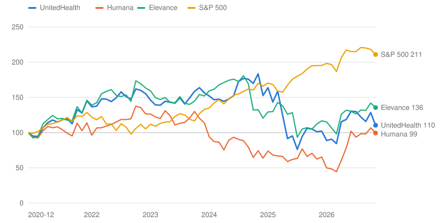
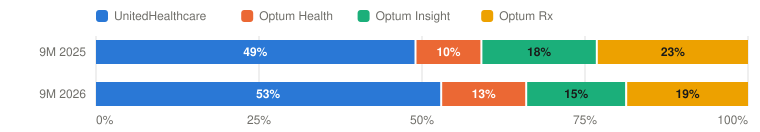

# UNH — UnitedHealth Group Incorporated

> **Schema** v7.0 · **Updated** 2026-11-19 · **Status** Active
> **Price** $349.91 verified Nov 18, 2026, 4:00 PM ET close (Yahoo, cross-checked StockAnalysis) ([Yahoo](https://finance.yahoo.com/quote/UNH/)) · 52-wk $255.97–$461.62 · 46th %ile · −24.2% from high
> **Type** Managed care: insurer (UnitedHealthcare) plus care delivery, PBM and health data (Optum) · **Stage** Turnaround (margin repair inside a mature franchise) · **Cyclical** Yes (underwriting cycle) · **Competence** Edge

## Verdict

**The repair is real and the CRUSH clawback is a bill worth about $7 a share probability-weighted, not the $62 the stock lost in two days; but even at $349.91 the probability-weighted case returns 8.8% a year against the 13% hurdle, so non-holders still wait for $288 and holders hold.**

🟡 **Non-holder: Watch (entry ≤$288)** · 🟡 **Holder: Hold**

| PW EV | PW return/yr | Compounding/yr | R/R | Entry | Trim | Avoid | FY26E adj P/E | Yield | BAIT | Moat | Next |
|---|---|---|---|---|---|---|---|---|---|---|---|
| **$471** | **8.8% (<13%)** | 13.5% (Base EPS growth is mostly margin repair) | 5.0:1 | ≤$288 | $471–$706 | ≥$706 | 17.1× [Derived] | 2.7% | Double (B+A), Moderate | Wide, narrowing | 📅 2027 outlook, by Dec 31; Fifth Circuit RADV ruling, pending |

**Breaks if**: the medical cost ratio's fall turns out to be reserve releases and benefit cuts rather than durable underwriting, or extrapolated RADV audits survive in court and reach back to PY2018. Either one turns a margin recovery into a regulated utility margin.

## The Call

UnitedHealth fell 15% in two sessions, from $412.02 on November 16 to $349.91 on November 18, after CMS proposed CRUSH, a rule that would extrapolate Medicare Advantage audit findings back to payment year 2018 with no fee-for-service adjuster. The bill is real but bounded. CMS puts recoveries at about $9 billion per payment year across the industry; at UnitedHealth's ~28% share that is ~$2.5 billion pre-tax a year, about $13 a share in present value if all nine back years are collected, and about $7 if, as I think, the rule has even odds in court [Estimate]. The market took $62 a share, about $56 billion. Cigna, which sold its Medicare Advantage book, fell 5% with it; most of the move is a sector de-rating on politics, not arithmetic. That does not make the stock cheap. I value the clawback as its own line (−$10 of FY2031 value) and move five points from Bull to Bear for a Congress and an agency now pulling the same way. The probability-weighted value is $471, 8.8% a year with the dividend, and spot implies about 32% Bear odds against my 30%. The market has gone from too hopeful to about right. The 2027 outlook, due before year-end, settles it: at $23 or above the Base holds; with an explicit RADV reserve, the Bear gains ground.

## What I'd Have To Be Wrong About

1. **That the recovery is underwriting, not reserve releases.** Test: in the Q4/FY2026 release (**mid-January 2027**), the full-year medical cost ratio is at or below 88.1% and adjusted EPS is at least $20.50 ([Q3 release](https://www.sec.gov/Archives/edgar/data/731766/000073176626000255/earningsrelease3q26unh.htm)). **If Fail →** the Base normalized margin falls to ≈6.8% (Base $477; PW EV $453, 8.0%/yr) → **Watch** (entry $277).
2. **That 2027 starts the 13–16% path, CRUSH included.** Test: the 2027 outlook (promised **before year-end 2026**, at the latest in the Q4 release) guides FY2027 adjusted EPS to at least $23.00 with no RADV charge carved out of adjusted earnings ([Q3 call](https://www.fool.com/earnings/call-transcripts/2026/10/13/unitedhealth-unh-q3-2026-earnings-call-transcript/)). **If Fail →** move 10 points from Base to Bear (PW EV $448, 7.7%/yr) → **Watch** (entry $274).
3. **That extrapolated RADV stays contested and no remedy breaks the integrated model.** Test: the Fifth Circuit rules for Humana in *Humana v. Kennedy* (argued Oct 5, 2026) or the CRUSH final rule drops the PY2018 start; and through the FY2026 10-K (**February 2027**) no DOJ complaint or settlement seeks structural separation or more than $5B ([CMS fact sheet](https://www.cms.gov/newsroom/fact-sheets/comprehensive-regulations-uncover-suspicious-healthcare-crush-proposed-rule-cms-6098-p), [STAT](https://www.statnews.com/2026/10/05/humana-medicare-advantage-radv-audits-lawsuit-hearing/)). **If Fail →** move 10 points from Bull to Bear (PW EV $428, 6.8%/yr) → **Watch** (entry $262); the CRUSH line is then valued at 80%, not 50%, which takes about $6 more off the PW EV.

## Latest update: 2026-11-19 · CRUSH: a $9 billion-a-year audit proposal and a $56 billion sell-off

- Full-year MCR ≤88.1% and adjusted EPS ≥$20.50 — 🟡 Pending — No print in the window; resolves with the Q4 release in mid-January 2027
- FY2027 guide ≥$23.00 — 🟡 Pending — Outlook not yet given; consensus ≈$23.3 [Analyst consensus] predates CRUSH
- No DOJ complaint or settlement seeking separation or >$5B — 🟡 Pending — Nothing filed; the CMS CRUSH proposal is a separate regulatory risk now folded into test 3

UnitedHealth closed at $412.02 on Monday, November 16. By Wednesday's close it was $349.91, down 15.1% in two sessions on 8 million and then 17 million shares, against about 4 to 5 million on a normal day. Nothing came from the company. The cause was a CMS proposal released on the Monday, and a senator's post on the Wednesday.

### What happened

On November 16 CMS proposed **CRUSH** (CMS-6098-P), a program-integrity rule across Medicare, Medicaid and the exchanges that it says would save "nearly $90 billion over 10 years" ([press release](https://www.cms.gov/newsroom/press-releases/cms-crush-proposed-rule-aims-reap-nearly-90-billion-taxpayers-savings-targeting-fraud-across)). The provision that moved the stock is the largest one. CMS would codify Medicare Advantage RADV audits with extrapolation and no fee-for-service adjuster, starting with payment year 2018 audits, and estimates it would collect about $9 billion per payment year on average ([fact sheet](https://www.cms.gov/newsroom/fact-sheets/comprehensive-regulations-uncover-suspicious-healthcare-crush-proposed-rule-cms-6098-p)). It would also require every provider billing an MA plan to enroll in traditional Medicare, and make fraud referrals mandatory. Comments close January 19, 2027.

The stock fell 5.4% on November 17. On November 18 Senator Warren wrote that UnitedHealth, CVS and Cigna "take a cut at every step," two weeks after Democrats won both chambers of Congress, and the stock fell another 10.2% while Humana fell 13% ([Yahoo Finance](https://finance.yahoo.com/healthcare/articles/unitedhealth-sinks-12-cms-fraud-194116346.html)).

### Is the move warranted?

Partly. The essay's chapter on the two days ([Two Days in November](#two-days-in-november-how-much-is-fear)) has the full argument; the short version:

- **The bill.** At UnitedHealth's ≈28% share, CRUSH means ≈$2.5 billion pre-tax per payment year, nine back years, ≈$13 a share in present value if all of it is collected, ≈$7 a share at the even odds I give it in court `[Estimate]`. Prospective years are biddable and sit in the margins.
- **The court.** The 2023 version of this rule was vacated in September 2025 for lack of proper notice; the Fifth Circuit heard the government's appeal on October 5 and, by STAT's account, seemed inclined to agree with Humana. CRUSH fixes the notice problem, not the actuarial-equivalence or retroactivity arguments.
- **The group.** Cigna, which owns no MA business, fell 4.9%; Elevance and Centene about 10%. About a third of UnitedHealth's fall was a sector re-rating on politics.
- **My numbers.** Counting the CRUSH line and a five-point shift from Bull to Bear for a Congress and an agency pulling the same way, my value fell by about a third of what the stock lost. About a third is a practical threat to earnings power; two-thirds is fear.
- **But the starting point matters.** At $412 the stock priced a Bear probability of about 2% on my case values. At $349.91 it prices about 32%; mine is 30%. The fall overshot the news and landed about at fair value. It is not yet cheap.

### What it does to the tests and the verdict

No standing test was resolved: the Q4 print, the 2027 guide and any DOJ action all lie ahead. CRUSH is folded into test 3, which now also requires the Fifth Circuit to rule for Humana, or the final rule to drop the 2018 start. Test 2 now asks that the 2027 guide not carve a RADV reserve out of adjusted earnings.

The probability-weighted value moves from $502 to $471, and the return at the new price rises from 8.3% to 8.8% a year, still below the 13% hurdle. **Verbs unchanged: non-holders Watch, with entry at $288; holders Hold.** The next fact is the 2027 outlook, promised before year-end.

Window checks (Oct 14 – Nov 18): no management appearance or company statement found; analysts cut targets modestly after the print (Raymond James $475 → $450, Baird $453 → $427) and none had published post-CRUSH estimates by Nov 18; short interest 1.56% of float, down from 1.78%; Form 4s not re-read (gap).

---

## Deep Dive: UnitedHealth: The Repair and the Referee

*Hemsley has rebuilt the margin faster than he promised. In two days in November the government proposed to claw back part of the last decade's Medicare Advantage revenue, and the stock gave back the whole post-earnings rally and more. How much of that is a bill, and how much is fear?*

**Contents**: [Business Overview](#business-overview) · [Can the Margin Come Back With the Referee Watching?](#can-the-margin-come-back-with-the-referee-watching) · [Two Days in November: How Much Is Fear?](#two-days-in-november-how-much-is-fear) · [Management, Capital Allocation and Incentives](#management-capital-allocation-and-incentives) · [Valuation and Model Assumptions](#valuation-and-model-assumptions) · [Final Words](#final-words) · [Appendix: The Numbers](#appendix-the-numbers) · [Sources](#sources)

On May 13, 2025, Andrew Witty resigned as chief executive of UnitedHealth Group, the company suspended a 2025 forecast of $29.50 to $30.00 of adjusted earnings per share, and Stephen Hemsley, who had built Optum and run the company until 2017, came back. The stock fell 18% that day. The year closed at $16.35 a share, 45% below the guide, with a medical cost ratio of 89.1% and an operating margin of 4.2%, the lowest in at least a decade.

Eighteen months later the repair is ahead of every promise Hemsley made. Guidance for 2026 has been raised three times, from above $17.75 to at least $20.50. The third-quarter medical cost ratio fell 150 basis points, Optum Health went from break-even to a 3.2% margin, and the company bought back $5 billion of stock. After the October 13 print the shares climbed from $377.76 to $424.98 in nine sessions.

Then, on Monday, November 16, the Centers for Medicare & Medicaid Services proposed a rule it calls CRUSH. Among much else, it would let CMS audit Medicare Advantage plans' diagnosis coding, extrapolate the error rate across a whole contract, and collect the overpayment for every year back to 2018. UnitedHealth fell 5.4% on Tuesday and 10.2% on Wednesday, to $349.91, on four times its usual volume. Two days took $56 billion off the market value, more than the whole post-earnings rally.

The business has not grown into its stock for a long time. Revenue rose from $257 billion in 2020 to about $449 billion this year, up 75%. Over the same stretch a dollar in UnitedHealth, with dividends, became $1.10. The S&P 500 more than doubled.

*Month-end total return, dividends reinvested, Dec 31, 2020 = 100; last point Nov 18, 2026. Source: [Yahoo Finance](https://finance.yahoo.com/quote/UNH/history/) via prices.py. Built with Claude.*

| Date | UnitedHealth | Humana | Elevance | S&P 500 |
|---|---|---|---|---|
| 2020-12 | 100 | 100 | 100 | 100 |
| 2021-12 | 145 | 114 | 146 | 129 |
| 2022-12 | 155 | 126 | 163 | 105 |
| 2023-12 | 156 | 114 | 152 | 133 |
| 2024-12 | 153 | 64 | 121 | 166 |
| 2025-12 | 102 | 65 | 117 | 195 |
| 2026-11 | 110 | 99 | 136 | 211 |

So the question is the same one the market has asked since 2025, with a sharper edge. Is the margin coming back, or is the referee taking it away? This piece first lays out the business and how its profit is earned. It then argues the debate that decides the stock: whether the margin can normalize with CMS, the Justice Department and now Congress pulling the other way. A separate chapter takes apart the two days in November, to say how much of the fall is a bill UnitedHealth will actually pay and how much is fear. After that come management and capital allocation, and the valuation. Finally, the question every chapter feeds: at $349.91, does the stock pay 13% a year?

### Business Overview

UnitedHealth is two companies that bill each other. **UnitedHealthcare** insures about 48 million people: employers' workers (on its own balance sheet or for a fee), Medicare Advantage seniors, and Medicaid enrollees for states. It keeps what is left of the premium after paying medical claims and running the plan, typically 3% to 6% of revenue. **Optum** sells to UnitedHealthcare and to everyone else. Optum Health employs or contracts with doctors and takes risk for about four million patients. Optum Insight runs claims software, payment integrity and the Change Healthcare clearinghouse. Optum Rx is a pharmacy benefit manager processing about 1.6 billion adjusted scripts a year.

| $ Billion | Q3 2025 | Q3 2026 | 9M 2025 | 9M 2026 |
|---|---|---|---|---|
| **UnitedHealthcare** |  |  |  |  |
|  Revenue | 87.1 | 86.3 | 257.8 | 258.6 |
|  Earnings from operations | 1.81 | 2.83 | 9.11 | 12.47 |
|  Operating margin | 2.1% | 3.3% | 3.5% | 4.8% |
| **Optum Health** |  |  |  |  |
|  Revenue | 25.4 | 22.9 | 75.0 | 70.5 |
|  Earnings from operations | 0.04 | 0.74 | 1.88 | 3.07 |
|  Operating margin | 0.2% | 3.2% | 2.5% | 4.3% |
| **Optum Insight** |  |  |  |  |
|  Revenue | 5.3 | 5.5 | 15.6 | 16.0 |
|  Earnings from operations | 0.92 | 1.28 | 3.29 | 3.61 |
|  Operating margin | 17.3% | 23.4% | 21.1% | 22.6% |
| **Optum Rx** |  |  |  |  |
|  Revenue | 39.7 | 39.9 | 113.3 | 114.0 |
|  Earnings from operations | 1.55 | 1.72 | 4.31 | 4.40 |
|  Operating margin | 3.9% | 4.3% | 3.8% | 3.9% |
| Eliminations (revenue) | (44.3) | (41.9) | (127.3) | (122.6) |
| **Consolidated revenue** | 113.2 | 112.7 | 334.4 | 336.4 |
| **Earnings from operations** | 4.32 | 6.56 | 18.58 | 23.54 |
|  Operating margin | 3.8% | 5.8% | 5.6% | 7.0% |

*GAAP, from the segment schedules of the [Q3 2026 release](https://www.sec.gov/Archives/edgar/data/731766/000073176626000255/earningsrelease3q26unh.htm); prior periods recast by the company for the Optum Financial realignment. Nine-month 2026 earnings include $415M of net divestiture and South American items removed from adjusted earnings.*

*GAAP segment earnings from operations, nine months to Sep 30. Source: [Q3 2026 release](https://www.sec.gov/Archives/edgar/data/731766/000073176626000255/earningsrelease3q26unh.htm). Built with Claude.*

| Period | UnitedHealthcare | Optum Health | Optum Insight | Optum Rx | Total ($B) |
|---|---|---|---|---|---|
| 9M 2025 | 9 (49%) | 2 (10%) | 3 (18%) | 4 (23%) | 19 |
| 9M 2026 | 12 (53%) | 3 (13%) | 4 (15%) | 4 (19%) | 24 |

Three accounting points matter before the debate.

First, **adjusted EPS excludes the amortization of acquired intangibles** and items such as the South American exit. The gap was about $1 a share in 2026; I use adjusted EPS in the model because the amortization is non-cash, but the acquisitions behind it were cash and are judged in the management chapter.

Second, **favorable reserve development flatters the ratio this year**. In the third quarter, $610 million of prior-period claims came in below the reserve, worth about 0.7 points of the medical cost ratio. In the second quarter it was $860 million. Releases are normal for an insurer that reserves conservatively, but they are not the same thing as a lower run-rate.

Third, **reported cash flow includes float**. Medical costs payable grow with premiums, so operating cash flow ran at 133% of net income in 2025. Strip out the reserve growth and owner earnings track net income almost one for one over five years (Appendix). I value on earnings, not on reported free cash flow.

### Can the Margin Come Back With the Referee Watching?

Where things stand after the third quarter:

| $B, except EPS | Q3 2025 | Q3 2026 | Change |
|---|---|---|---|
| Revenue | 113.2 | **112.7** | −0.4% |
| Medical cost ratio | 89.9% | **88.4%** | −150 bps |
| of which favorable prior-period development | — | 0.61 | ≈0.7 pts of MCR |
| Operating cost ratio | 13.5% | 12.8% | −70 bps |
| Adjusted EPS | $2.92 | **$4.69** | +61% |
| Medical members (M) | 50.13 | 48.30 | −3.6% |
| FY2026 adjusted EPS outlook | — | ≥$20.50 | from $19.50–20.00 |

*[Q3 2026 release](https://www.sec.gov/Archives/edgar/data/731766/000073176626000255/earningsrelease3q26unh.htm). Consensus adjusted EPS was ≈$4.15 `[Analyst consensus]`. The underlying ratio excluding development is ≈89.1% `[Derived]`.*

The repair has been bought with membership. Medical members fell 1.8 million in a year: Medicare Advantage down 10%, Medicaid down 10%. Revenue per member rose. Optum Rx processed 5% fewer scripts but earned $4.37 of operating profit on each one, up from $3.74 (Appendix, driver tree). That works once. The 2027 plan needs units to stop falling while the price per unit holds.

#### Management's narrative

Management's case is that 2026 reset the base and that the long-term growth algorithm resumes from it. Hemsley opened the third-quarter call with it:

> "Our third quarter performance reflects actions taken throughout 2026, driving meaningful progress and reinforcing our confidence to sustainably grow in 2027 and beyond within our 13%-16% long-term target growth range."
> — Stephen Hemsley, CEO, Q3 2026 earnings call, October 13, 2026 ([transcript](https://www.fool.com/earnings/call-transcripts/2026/10/13/unitedhealth-unh-q3-2026-earnings-call-transcript/))

The CFO then set the bar for 2027, carefully:

> "We view our 2026 adjusted EPS guidance of at least $20.50 as a solid run rate on which to grow. We would offer that current analyst consensus for 2027 may understate the opportunity ahead, and we see the lower end of our long-term 13%-16% growth rate as a more reasonable starting point."
> — Wayne DeVeydt, CFO, same call

The low end of 13% on $20.50 is about $23.17. On Medicare Advantage, the line CRUSH touches, Bobby Hunter, who runs government programs, said the margin will finish "near the top end of the 2%-4% range." Asked about the regulatory agenda, he was conciliatory:

> "What I want you to hear from us is we are supportive of modernization. We are supportive of reform that advances the program and ensures sustainability of the program. ... it all needs to be done with program stability at the forefront, and I am optimistic about what that looks like."
> — Bobby Hunter, CEO of UnitedHealthcare Government Programs, same call, in answer to KeyBanc

The word "audit" does not appear in the transcript. Neither do "risk adjustment" or the Justice Department.

Management deserves credit for what it has delivered. Three guidance raises in a year, a 150-basis-point improvement in the medical cost ratio, an operating cost ratio down 70 basis points, and a buyback double the original plan are not the work of a team that over-promises. Hemsley's own pay is one option grant that only pays if the stock rises.

#### Poking holes in it

**The first hole is that part of the recovery is reserves, and part is benefit cuts.** Strip out the $610 million of favorable development and the third-quarter ratio was about 89.1%, the same as full-year 2025. The 2026 Medicare Advantage margin came from pulling out of counties and cutting benefits, which is why 935,000 seniors left in nine months. A margin rebuilt that way is real, but it is not proof that underwriting has improved, and test 1 checks it in January.

**The second hole is that commercial trend has not broken.** Tim Noel, who runs UnitedHealthcare, said commercial medical cost trend is "still tracking north of 11%," above the 2026 pricing assumption, and that the long-term commercial margin targets will take longer to reach. Arbitration awards under the No Surprises Act reach 10 to 11 times Medicare rates in some cases. Every point of commercial trend not priced costs about $0.5 billion of profit on the risk book `[Estimate]`.

**The third hole is the one the market found on November 16: the referee wants some of the last eight years back.** Medicare Advantage plans are paid more for sicker members, and the plan's own coding of diagnoses decides how sick a member looks. RADV audits check a sample of charts against the medical record. Until now, CMS collected only the errors it found in the sample. CRUSH would codify extrapolating the sample's error rate to the whole contract, with no "fee-for-service adjuster" (an allowance for the fact that traditional Medicare's own records are imperfect), starting with payment year 2018. CMS estimates the collections at about $9 billion per payment year across the industry ([fact sheet](https://www.cms.gov/newsroom/fact-sheets/comprehensive-regulations-uncover-suspicious-healthcare-crush-proposed-rule-cms-6098-p)). UnitedHealth has the largest book, about 29% of enrollment in 2025, and coding intensity has long been the sharpest criticism of its Medicare business.

**The fourth hole is political, and it got bigger on November 3.** Democrats won both chambers. Senator Warren, who with Senator Hawley introduced the Break Up Big Medicine Act in February, wrote on November 1 that UnitedHealth "already sells your insurance, employs your doctor, and manages your prescriptions" ([TIKR](https://www.tikr.com/blog/we-need-to-break-up-big-medicine-warren-targets-unitedhealth-as-democrats-win-congress)). The bill would force an insurer or PBM to divest its providers within a year. It is unlikely to become law under this President, but it shapes every hearing, every DOJ settlement and every CMS rule for two years.

The CRUSH back-bill is the one hole that can be priced exactly, so here is the arithmetic:

| Line | Low | Mid | High | How it is built |
|---|---|---|---|---|
| Industry recoveries per payment year | $9.0B | $9.0B | $9.0B | CMS estimate, average per payment year |
| UnitedHealth share | 25% | 28% | 33% | ~29% of 2025 MA enrollment (KFF); higher end if its coding intensity is above average |
| UNH recoveries per payment year, pre-tax | $2.25B | $2.5B | $3.0B |  |
| After tax (23%), per share (≈0.87B shares) | $2.00 | $2.21 | $2.65 | ≈11% of FY2026 adjusted EPS at the mid |
| Back years at risk | PY2018–2026 | PY2018–2026 | PY2018–2026 | Nine payment years, collected 2027–2035 (Oppenheimer: mostly 2028–2030) |
| **Undiscounted, per share** | $18 | $20 | $24 |  |
| **Present value today at 9%** | $12 | **$13** | $16 | One payment year collected per year from 2027 |
| Probability the extrapolated back years survive in court | 50% | 50% | 50% | My estimate: CRUSH cures the 2025 notice defect, not the actuarial-equivalence or retroactivity arguments |
| **Probability-weighted cost, today** | $6 | **$7** | $8 | Against a $62 two-day fall |
| Same, in FY2031 dollars (the model's CRUSH line) |  | −$20 × 50% |  | Payments to 2031 compounded at 9%, later ones discounted to 2031 |

*`[Estimate]` throughout except the CMS figure ([fact sheet](https://www.cms.gov/newsroom/fact-sheets/comprehensive-regulations-uncover-suspicious-healthcare-crush-proposed-rule-cms-6098-p)). Share from [KFF via Healthcare Dive](https://www.healthcaredive.com/news/medicare-advantage-enrollment-2025-unitedhealth-humana/738048/). Litigation: [Crowell on the 2025 vacatur](https://www.crowell.com/en/insights/client-alerts/court-vacates-cmss-2023-final-rule-on-radv-audits), [STAT on the Oct 5 argument](https://www.statnews.com/2026/10/05/humana-medicare-advantage-radv-audits-lawsuit-hearing/). Prospective years (PY2027 on) are left out: plans can code and bid for them, so their cost sits in the Base and Bear margins rather than in this line.*

Two things in that table matter more than the totals. One is the court. CMS tried this in 2023; in September 2025 a federal judge in Texas vacated that rule because the final version had not been properly put out for comment ([Crowell](https://www.crowell.com/en/insights/client-alerts/court-vacates-cmss-2023-final-rule-on-radv-audits)). The government appealed; at the Fifth Circuit argument on October 5 the panel "seemed poised to toss the rule out, again" ([STAT](https://www.statnews.com/2026/10/05/humana-medicare-advantage-radv-audits-lawsuit-hearing/)). CRUSH is CMS re-running the process properly, which cures the notice problem. It does not cure the two arguments the district court never reached: that dropping the adjuster breaks the statute's requirement that plans be paid on an actuarially equivalent basis, and that applying a rule finalized in 2027 to payments made in 2018 is retroactive rulemaking. I give the back years even odds. The other is that only the back years are a pure loss. From payment year 2027 on, plans know the rules before they code and before they bid, and Oppenheimer's point, that plans would "build the cost into future bids," is right ([Yahoo Finance](https://finance.yahoo.com/healthcare/articles/unitedhealth-sinks-12-cms-fraud-194116346.html)). That cost shows up as thinner benefits and slower membership growth, and I carry it in the Base and Bear margins.

Where I come out: the margin is coming back, but not to where it was. The 2026 repair is real; I just do not believe it carries all the way to the 8.1% ten-year median now that CMS, DOJ and Congress all lean against the integrated model. My Base normalizes at about 7.2%, nearly a point below the median, and I have moved five points of probability from the Bull to the Bear since October, before counting the back-bill as its own line.

#### Rings of profit

| Ring | What it is | Share of 9M 2026 operating earnings | Exposure to CMS and Congress |
|---|---|---|---|
| 1. Untouched | Optum Insight (claims software, payment integrity) and employer ASO fees | ≈20% | Low. If anything, payment-integrity demand rises under CRUSH |
| 2. Repriceable | Commercial risk, Medicaid, the PBM | ≈35% | Medium. Trend and arbitration are priced annually; PBM pass-through by 2028 is already in the Base |
| 3. MA, prospective | Medicare Advantage margin on today's coding rules | ≈30% | High but biddable: coding rules and RADV are priced into the June bids from 2028 |
| 4. MA, retrospective | PY2018–2026 revenue already earned and spent | n/a (a liability, not a ring of profit) | Fixed: cannot be repriced, only litigated. ≈$13 a share in present value at full exposure |
| 5. Structural | Optum Health and Optum Rx owned by an insurer | ≈35% (overlaps 2 and 3) | Low odds, high impact: the Break Up Big Medicine Act or a DOJ remedy |

*Shares are author's estimates from the [Q3 release](https://www.sec.gov/Archives/edgar/data/731766/000073176626000255/earningsrelease3q26unh.htm) segment schedule; UnitedHealthcare is split between MA, commercial and Medicaid using segment revenue and stated margin ranges `[Estimate]`. Rings overlap, so shares do not sum to 100%.*

The rings show that the regulatory risk is real but concentrated. About a fifth of operating earnings, Optum Insight and the fee business, is untouched, and payment-integrity software may even benefit. The largest exposed ring, Medicare Advantage, is exposed mostly in a way that can be re-priced through annual bids. The part that cannot be re-priced, the PY2018–2026 back-bill, is a one-time liability, sized in the table above. The tail is the fifth ring: a forced separation of Optum Health and Optum Rx. That would rearrange the value rather than erase it, but it would end the strategy Hemsley built.

### Two Days in November: How Much Is Fear?

UnitedHealth fell $62 a share in two sessions. The way the group moved says most of that was not about UnitedHealth's bill.

| Ticker | Medicare Advantage exposure | Nov 16 | Nov 18 | Two days |
|---|---|---|---|---|
| **UnitedHealth** | Largest MA book, ~29% of enrollment; M&R ≈38% of UNH revenue | $412.02 | $349.91 | **−15.1%** |
| Humana | MA ≈77% of 2025 revenue | $461.25 | $385.78 | **−16.4%** |
| Elevance | Mid-size MA book; mostly commercial and Medicaid | $446.28 | $400.84 | −10.2% |
| Centene | Small MA book; Medicaid and exchanges | $74.77 | $67.45 | −9.8% |
| CVS (Aetna) | #3 MA book inside a PBM and retailer | $88.59 | $81.35 | −8.2% |
| Cigna | Sold its MA business in March 2025 | $300.16 | $285.37 | −4.9% |
| S&P 500 (SPY) | — | $739.95 | $730.20 | −1.3% |

*Daily closes from [Yahoo Finance](https://finance.yahoo.com/quote/UNH/history/). MA exposure: [KFF via Healthcare Dive](https://www.healthcaredive.com/news/medicare-advantage-enrollment-2025-unitedhealth-humana/738048/), [Yahoo Finance, Nov 18](https://finance.yahoo.com/healthcare/articles/unitedhealth-sinks-12-cms-fraud-194116346.html); M&R share from the [Q3 release](https://www.sec.gov/Archives/edgar/data/731766/000073176626000255/earningsrelease3q26unh.htm) [Derived]. UNH volume was 17.3M shares on Nov 18, about four times normal.*

**Start with what was not news.** UnitedHealth said nothing: no 8-K, no statement, no change to guidance. No conference appearance or media interview was found between October 14 and November 18. Mizuho called the audit proposal an "incremental negative for Medicare Advantage margins," and Oppenheimer called the selloff an overreaction, but no analyst I could find published a reduced earnings estimate. Short interest was 1.56% of float before the fall.

**Then look at who fell.** If the move were the CRUSH bill, it would scale with Medicare Advantage exposure. It roughly does at the top: Humana, with about three-quarters of its revenue in MA, fell 16%; UnitedHealth fell 15%. But Elevance and Centene, with small MA books, fell about 10%, and Cigna, which sold its Medicare Advantage business in 2025 and cannot owe a RADV dollar, fell 5% while the S&P 500 fell 1%. Senator Warren's post on November 18 named UnitedHealth, CVS and Cigna as companies that "take a cut at every step." About a third of UnitedHealth's fall was the whole managed-care group being re-rated on politics; the rest was specific to the large MA books.

**Now put the specific part against the bill.** The probability-weighted back-bill is about $7 a share today, $13 if the rule survives in full. My own valuation changes since October come to about $21 a share in today's money: the CRUSH line, −$10 of FY2031 value or about $7 today, and the five-point shift to the Bear, about $21 of FY2031 value or $14 today `[Derived]`. Even if I were wrong in the market's direction on everything (the rule survives, the back years are collected in full, and the Bear shift is twice what I made it), the damage would be about $40, still well short of the fall.

So, by my numbers, **about a third of the fall is a practical threat to earnings power and two-thirds is fear**: a sector de-rating on a Democratic Congress, and a market extrapolating from a proposed rule to a worst case that the last court to look at it set aside, if only on procedure.

There is a fairer way to say the same thing, and it is the one that matters for the decision. At $412 the stock was priced as if nothing could go wrong: on my case values, the price implied a Bear probability of about 2%. At $349.91 it implies about 32%. My own Bear is 30%. The market overreacted to the news, but it did so from a level that had no room for news at all, and it has landed about where I think the risk is. Fear moved the stock to fair, not to cheap.

### Management, Capital Allocation and Incentives

Stephen Hemsley was CEO from 2006 to 2017, the years in which Optum went from a cost center to half the company's profit and the stock nearly quadrupled. He came back in May 2025 as both chairman and CEO. Wayne DeVeydt, Anthem's CFO through its 2010s recovery, joined as CFO in September 2025. The segment heads have been replaced: Tim Noel at UnitedHealthcare, Krista Nelson at Optum Health, Patrick Conway at Optum. For four quarters this team has under-promised and over-delivered.

The problem it inherited was capital allocation, and the record is worth stating plainly.

#### The deals

| Year | Deal | Price | What happened | Verdict |
|---|---|---|---|---|
| 2022 | Change Healthcare | $13B | Closed after a DOJ suit; the Feb 2024 ransomware attack cost ≈$3B+ and exposed 190M people's data | Poor |
| 2022 | LHC Group (home health) | $5.4B | Folded into Optum Health; part of the value-based-care build now being shrunk | Mixed |
| 2023 | Amedisys (home health, hospice) | $3.3B | Closed Aug 2025 after divestitures; now Warren's example for the break-up bill | Too early |
| 2021–25 | Physician practices and value-based care (incl. Kelsey-Seybold, Atrius affiliations) | ≈$20B+ in all | Optum Health margin fell from ≈7% to break-even by 2025; turnaround now | Poor |
| 2025–26 | Optum UK sold; South America held for sale; Florida WellMed minority stake to TPG | Undisclosed | The new team is pruning, not buying | Good direction |

*Acquisition totals from the cash-flow statement in [SEC XBRL](https://data.sec.gov/api/xbrl/companyfacts/CIK0000731766.json); deal sizes from company announcements. Verdicts are mine.*

#### The cash

| $B | FY2021 | FY2022 | FY2023 | FY2024 | FY2025 | Cumulative |
|---|---|---|---|---|---|---|
| Revenue | 287.6 | 324.2 | 371.6 | 400.3 | 447.6 |  |
| Operating cash flow | 22.3 | 26.2 | 29.1 | 24.2 | 19.7 | 121.5 |
| Capex | 2.5 | 2.8 | 3.4 | 3.5 | 3.6 | 15.8 |
| Owner earnings ex-float | 17.4 | 19.0 | 22.6 | 18.7 | 11.4 | 89.1 |
| Dividends | 5.3 | 6.0 | 6.8 | 7.5 | 7.9 | 33.5 |
| Buybacks | 5.0 | 7.0 | 8.0 | 9.0 | 5.5 | 34.5 |
| Acquisitions | 4.8 | 21.5 | 10.1 | 13.4 | 4.5 | 54.3 |
| Net debt incl. leases | 26.6 | 34.5 | 37.8 | 52.7 | 54.9 | +28.3 |
| Diluted shares (M) | 956 | 950 | 938 | 929 | 911 | −4.7% |

*[SEC XBRL company facts](https://data.sec.gov/api/xbrl/companyfacts/CIK0000731766.json). Owner earnings ex-float = operating cash flow − SBC − maintenance capex − growth in medical costs payable `[Derived]`; see the five-year record.*

The cumulative column is the indictment. From 2021 to 2025 UnitedHealth earned $86 billion, paid $34 billion of dividends, bought back $35 billion of stock and spent $54 billion on acquisitions, partly with $28 billion of new net debt. Invested capital rose $39 billion while after-tax operating profit fell; the three-year incremental return on that capital was **−14.8%**. Goodwill is $110 billion of the $155 billion of invested capital. On the $1 retention test, the market value at the end of 2025 was $33 billion lower than at the end of 2020 on $18 billion of retained earnings: −$1.81 for each dollar kept, against an S&P 500 that rose 82%.

The new team is doing the opposite. It is selling Optum UK and South America, took a minority partner into Florida WellMed, and bought back $5 billion of stock in the first nine months of 2026 at $300 to $410. That earns an **Outsider-leaning** grade on countercyclical buybacks, capped by the deal record it inherited. Whether $5 billion a year is the right use of a balance sheet at 41.7% debt-to-capital, with a possible RADV liability ahead, is the question the 2027 plan has to answer.

#### The incentives

| Component | Size | Pays for | Latest |
|---|---|---|---|
| Hemsley salary | $1M | Showing up | No annual bonus |
| Hemsley option grant | Substantially all pay; cliff-vests 2028, plus a two-year hold | Share price above the 2025 strike | Granted at the trough; amended Feb 2026 |
| Other NEOs: annual plan | Metrics and weights `[link pending]` | Historically adjusted EPS, revenue, cash flow, plus quality and customer measures | Not read this pass (gap) |
| Other NEOs: long-term plan | `[link pending]` | Historically relative TSR and EPS growth | Not read this pass (gap) |
| Return on invested capital | 0% | Nothing | No ROIC or ROIIC metric found in any plan |

*[2026 annual meeting FAQ](https://www.unitedhealthgroup.com/content/dam/UHG/PDF/investors/2026/2026_Annual_Meeting_FAQs.6.3.26_230pm.pdf). The 2026 DEF 14A CD&A was not parsed; the NEO rows are logged as a gap.*

Hemsley is paid for the share price, through one option grant that cliff-vests in 2028 and must then be held two more years. That aligns him with a five-year holder better than any EPS target would. It also rewards the cheapest route to a higher price, which in 2026 was shrinking membership for margin. No part of any plan I could find pays for return on capital; on the record above, that omission is not academic. The other executives' metrics and weights come from a DEF 14A I did not parse this pass (logged as a gap).

#### The promises

| Promised | Where, when | Outcome |
|---|---|---|
| FY2025 adjusted EPS $29.50–30.00 | Investor conference, Dec 2024 | $16.35; guidance suspended May 2025 |
| FY2026 adjusted EPS >$17.75 | Q4 2025 release, Jan 2026 | ≥$20.50 after three raises |
| 2026 buyback ≈$2.5B; debt-to-capital ≈40% by year-end | Jan 2026; Wells Fargo, Sep 2026 | $5.0B done by Q3; 41.7% at Sep 30 |

*Company releases and the [Q3 call](https://www.fool.com/earnings/call-transcripts/2026/10/13/unitedhealth-unh-q3-2026-earnings-call-transcript/).*

**Guidance grade: Mixed.** The 2025 guide missed by 45%; every 2026 promise has been beaten. Is Hemsley the right manager? For the repair, yes; nobody knows the machine better. For the next decade, the open questions are succession (his options vest in 2028 and no successor is named) and whether a man who built the integrated model can run it under a government that wants it taken apart.

### Valuation and Model Assumptions

I value UnitedHealth on adjusted EPS five years out (FY2031), built from two segments: UnitedHealthcare and Optum's external revenue, with net interest held at about $4.2 billion and a 22% tax rate. Because the business is cyclical on the underwriting cycle, every terminal margin is a normalized, through-cycle margin, never this year's. The CRUSH back-bill is valued outside the cases as its own line.

| $ Billion | FY2026E | FY2027E | FY2028E | FY2029E | FY2030E | FY2031E |
|---|---|---|---|---|---|---|
| **UnitedHealthcare revenue** | 345.0 | 360.5 | 376.7 | 393.7 | 411.4 | 429.9 |
|  YoY growth | 4.5% | **4.5%** | **4.5%** | **4.5%** | **4.5%** | **4.5%** |
|  Operating margin | 3.9% | 4.1% | 4.3% | 4.5% | 4.7% | **4.9%** |
|  Operating profit | 13.46 | 14.78 | 16.20 | 17.72 | 19.34 | 21.07 |
| **Optum (external revenue) revenue** | 104.0 | 108.7 | 113.6 | 118.7 | 124.0 | 129.6 |
|  YoY growth | 4.5% | **4.5%** | **4.5%** | **4.5%** | **4.5%** | **4.5%** |
|  Operating margin | 13.8% | 14.0% | 14.3% | 14.5% | 14.8% | **15.0%** |
|  Operating profit | 14.35 | 15.26 | 16.22 | 17.23 | 18.31 | 19.44 |
| Corporate and other | (0.00) | (0.00) | (0.00) | (0.00) | (0.00) | (0.00) |
| **Total revenue** | 449.0 | 469.2 | 490.3 | 512.4 | 535.4 | 559.5 |
| **Operating profit** | 27.81 | 30.04 | 32.42 | 34.95 | 37.64 | 40.51 |
|  Operating margin | 6.2% | 6.4% | 6.6% | 6.8% | 7.0% | 7.2% |
| Net income | 18.41 | 20.16 | 22.01 | 23.98 | 26.09 | 28.32 |
| Diluted shares (B) | 0.903 | 0.888 | 0.873 | 0.858 | 0.843 | 0.829 |
|  Net share change | — | -1.7% | -1.7% | -1.7% | -1.7% | -1.7% |
|  SBC (% of revenue) | 0.2% | 0.2% | 0.2% | 0.2% | 0.2% | 0.2% |
| **Adjusted EPS** | $20.39 | $22.71 | $25.22 | $27.96 | $30.94 | $34.17 |
|  YoY growth | — | 11.4% | 11.1% | 10.9% | 10.6% | 10.4% |

*Optum revenue is consolidated revenue minus UnitedHealthcare (≈$104B in FY2026E), so its margin is on external revenue and includes intersegment profit. "Other" is net interest expense. FY2026E is the author's build to the ≥$20.50 guide `[Derived]`. Bold cells are model inputs.*

The Base grows revenue 4.5% a year, about half from medical inflation and half from Medicare enrollment, with membership flat to slightly up from 2027. The operating margin rises from about 6.2% to about 7.2%: UnitedHealthcare to 4.9% (Medicare Advantage in the middle of 2–4%, Medicaid back to low single digits, commercial priced to trend) and Optum to 15% on external revenue as Optum Health reaches the low end of 6–8%. Net buybacks retire 1.7% of shares a year. That gives FY2031 EPS of $34.17, 10.9% a year, at 15×, a managed-care multiple with a modest premium for Optum.

| Case | Prob. | 3P | UnitedHealthcare growth / margin | Optum (external revenue) growth / margin | Net shares/yr | Per-share earnings FY2031 | CAGR | Exit multiple | Value | Return/yr | Implied g | Driving assumption |
|---|---|---|---|---|---|---|---|---|---|---|---|---|
| **Bull** | 20% | Plausible | +6.0% / 5.5% | +6.0% / 16.5% | -1.7% | $41.56 | 15.3% | 17.0× Adjusted EPS | $706 | 17.7% | 2.9% | Management's 13–16% delivered: membership grows again from 2027, Medicare Advantage margins sit at the top of 2–4% and commercial reprices to target, Optum Health reaches 6–8%. Revenue grows 6% a year to ≈$601B at an 8.1% operating margin, the ten-year median. The RADV fight is won or settled small. FY2031 EPS × 17, below the 18–22× UNH earned before 2024. |
| **Base** | 50% | Probable | +4.5% / 4.9% | +4.5% / 15.0% | -1.7% | $34.17 | 10.9% | 15.0× Adjusted EPS | $513 | 10.6% | 2.2% | Margin normalizes to ≈7.2%, held below the median by PBM pass-through, arbitration awards and tighter MA coding rules priced into bids. Revenue grows 4.5% a year to ≈$559B. FY2031 EPS × 15, a managed-care multiple with a premium for Optum. |
| **Bear** | 30% | Probable | +3.0% / 3.7% | +3.0% / 12.5% | -0.9% | $23.20 | 2.6% | 12.0× Adjusted EPS | $278 | -1.8% | 0.6% | Regulation caps the margin near 5.8%: RADV extrapolation and coding rules cut MA revenue per member, a DOJ settlement or a forced PBM/provider separation strips integration profit, and a Democratic Congress legislates PBM economics. Revenue grows 3% a year to ≈$520B. FY2031 EPS × 12, the peer multiple. |
| **Priced-in (9%/yr)** | — | diagnostic | +4.2% / 4.7% | +4.2% / 14.5% | -1.5% | $31.73 | 9.2% | 15.0× Adjusted EPS | $476 | 9.0% | 2.2% | Solved along Bear → Base for 9%/yr |
| **Hurdle (13%/yr)** | — | diagnostic | +5.3% / 5.2% | +5.3% / 15.8% | -1.7% | $38.17 | 13.4% | 15.0× Adjusted EPS | $573 | 13.0% | 2.2% | Solved along Base → Bull for 13%/yr |
| Option: CRUSH: retroactive RADV recoveries, PY2018–2026 (FY2031 value) | 50% | possible |  |  |  |  |  |  | −$20 |  |  | valued as probability × value, outside the core |
| **Probability-weighted** | 100% |  |  |  |  |  |  |  | $471 | 8.8% |  |  |

*Exit multiples apply to FY2031 adjusted EPS. Interest held at ≈$4.2B; tax 22%. The CRUSH line is valued outside the cases at FY2031 value × 50%. Priced-in is solved along Bear→Base and Hurdle along Base→Bull, both at 15×. Built with Claude.*

| Return math |  |
|---|---|
| PW return/yr vs. hurdle | **8.8% (<13%)**, of which 2.7% is the dividend yield. Entry ≤$288. 10-year Treasury 5.15%; the hurdle sits 7.9 points above it. |
| Compounding at a flat multiple | Base per-share earnings growth 10.9% + 2.7% dividend = **13.5%**. Re-rating subtracts 2.9 points from the Base return: the multiple compresses. |
| Optionality | CRUSH: retroactive RADV recoveries, PY2018–2026 (FY2031 value): 50% × −$20 = −$10.0 |
| Price-implied expectations | At 9%, spot needs FY2031 EPS of $31.73 at 15×, about four-fifths of the way from my Bear to my Base. Perpetual cross-check: ≈$20B of unlevered owner earnings ex-float on a ≈$362B EV is a 5.5% yield, which at 9% prices ≈3.3% growth forever [Derived]. |
| EPV floor | $220–320 a share: five-year ex-float owner earnings of $17.8B ÷ 9% on an equity basis ($220), or the median 8.1% margin capitalized on an enterprise basis ($320). Spot is about 9% above the top of the range, so 9–37% of the price pays for growth. The Bear ($278) sits inside it. |
| Base rate / 3P | The Bull's 6% nominal (~3.5% real) revenue growth sits between the 1.5% median and the ≥5%-real threshold (≈27% of >$50B companies) ([compounding.md](../../../frameworks/compounding.md)): Plausible. The Base's ~2% real is the median: Probable. The Bear is Probable now that CMS and Congress pull the same way. |
| Terminal-growth check | Implied perpetual growth at 9%: Bull 2.9%, Base 2.2%, Bear 0.6%, all below the ≈5.15% ten-year Treasury. |
| Break-even and price-implied Bear odds | Break-even <0% against 30% assigned; price-implied 32% at 9%. |
| Year ten | Still growing at year ten: health spending and Medicare enrollment compound past 2036. The uncertainty is the regulated margin, not the runway. |
| R/R | **5.0:1** (Bull +102% / Bear −20%) The Bear is a regulated utility margin, not a broken company; it earns ≈$20B of net income in 2031. |

*Computed rows come from model.json. Adjusted EPS excludes intangible amortization; SBC is ≈0.2% of revenue, so EPS and owner earnings converge.*

**What the price assumes.** To earn an ordinary 9% a year from $349.91, the stock needs FY2031 EPS of $31.73 at 15×, which is 9.2% a year. That sits about four-fifths of the way from my Bear to my Base. In other words, the market now expects the margin to recover most of the way, but not all of it, with some of the regulatory damage landing.

**What the hurdle needs.** To earn 13% a year, it needs $38.17, or 13.4% a year at the same multiple, about halfway from my Base to my Bull. That is management's 13–16% delivered at the low end every year to 2031, with no regulatory setback. I would not underwrite that.

The probability-weighted value is $471, made of a core $481 and the CRUSH line at −$10. With the 2.7% dividend that is **8.8% a year**, below the hurdle. The entry price at which the same case returns 13% is **$288**. Even with no Bear at all, the Bull and Base alone return just under 13%, so the verb does not hinge on the Bear probability (break-even Bear odds <0%); this is not a probability-fragile call.

The compounding rate at a flat multiple is 13.5%, but most of the Base's EPS growth is a one-time margin repair from a trough, not a rate the business sustains. That repair is what the re-rating line in the return math nets against.

The cross-check is earnings power. With no growth, five years of ex-float owner earnings capitalized at 9% are worth about $220 a share; the median margin, capitalized, about $320. At $349.91 the stock is about 9% above the top of that range, so between a tenth and a third of the price pays for growth, down from 15–42% in October. That is the strongest argument for owning it, and it is why the Bear, at $278, is a regulated utility rather than a broken company.

*Confidence note (Edge): I cannot judge the Fifth Circuit's ruling, the content of the CRUSH final rule, the DOJ outcome or CMS policy after 2027. Those are the inputs that separate the Bull from the Bear.*

*Bias check (verb unchanged): the evidence that moved the probabilities, a proposed rule and a change of Congress, did not exist on October 14; the price fell after it, not before; I would make the same shift at $412; the Base inputs are unchanged; and the verb is still Watch / Hold.*

### Final Words

The market has two things right. UnitedHealth's margin is coming back, and the government that pays half its revenue is less friendly than it has been in a decade. It has one thing wrong, at least in its reflex. CRUSH is a bill of about $13 a share in present value if it survives in full, and I think it has even odds; the stock lost $62 in two days, and a managed-care company with no Medicare Advantage business fell a third as far.

That does not make UnitedHealth a buy. The fall took the stock from a price that allowed for almost no bad news to one that prices about the risk I see. At $349.91 the probability-weighted case returns 8.8% a year against a 13% hurdle. Non-holders should wait for $288 or for evidence that moves the case; holders can hold, because the downside to the Bear is now about a fifth and the value is inside the earnings-power range.

Three things would change my mind, and each is dated. The 2027 outlook, due before year-end, either confirms the 13% path at about $23 or tells me management is reserving for RADV. The Q4 release in mid-January shows whether the full-year cost ratio held without reserve releases. And the Fifth Circuit, any week now, decides whether extrapolated audits are even lawful.

*The three tests, with their pre-committed consequences, are listed at the top of this report under [What I'd Have To Be Wrong About](#what-id-have-to-be-wrong-about).*

### Appendix: The Numbers

#### Five-year record

| $B, except per share | FY2021 | FY2022 | FY2023 | FY2024 | FY2025 | FY2026E |
|---|---|---|---|---|---|---|
| Revenue | 287.6 | 324.2 | 371.6 | 400.3 | **447.6** | ≈449 |
| Growth | +11.8% | +12.7% | +14.6% | +7.7% | +11.8% | ≈0% |
| Medical cost ratio | 82.0% | 82.0% | 83.2% | 85.5% | **89.1%** | ≈88% |
| Operating income (GAAP) | 24.0 | 28.4 | 32.4 | 32.3 | **19.0** | ≈27 |
| Operating margin (GAAP) | 8.3% | 8.8% | 8.7% | 8.1% | **4.2%** | ≈6.2% adj |
| Adjusted EPS | $18.33 | $22.19 | $25.12 | $27.66 | **$16.35** | **≥$20.50** |
| Diluted EPS | $18.08 | $21.18 | $23.86 | $15.51 | $13.23 | ≥$19.50 |
| Operating cash flow | 22.3 | 26.2 | 29.1 | 24.2 | 19.7 | — |
| Maintenance capex (est.) | 1.6 | 1.8 | 2.0 | 2.7 | 2.3 | — |
| Owner earnings | 20.0 | 23.5 | 26.0 | 20.5 | 16.5 | — |
| of which float growth | 2.6 | 4.6 | 3.3 | 1.8 | 5.1 | — |
| **Owner earnings ex-float** | 17.4 | 19.0 | 22.6 | 18.7 | **11.4** | — |
| Ex-float owner earnings per share | $18.08 | $19.95 | $24.09 | $20.09 | **$12.47** | — |
| Ex-float conversion (÷ GAAP NI) | 100% | 94% | 101% | 130% | 94% | — |
| Invested capital | 101.6 | 116.0 | 132.2 | 150.9 | 155.0 | — |
| **ROIC** (GAAP, average capital) | 19.3% | 20.5% | 20.7% | 17.3% | **10.8%** | — |
| **3-yr incremental ROIC** | — | — | — | +11.1% | **−14.8%** | — |
| Reinvestment rate (Δ IC ÷ NOPAT) | 28% | 64% | 63% | 76% | 24% | — |
| Diluted shares (M) | 956 | 950 | 938 | 929 | 911 | ≈903 |
| Net share change | −0.5% | −0.6% | −1.3% | −1.0% | −1.9% | ≈−0.9% |
| SBC % of revenue | 0.28% | 0.29% | 0.29% | 0.25% | 0.22% | — |
| SBC ÷ owner earnings ex-float | 4.6% | 4.9% | 4.7% | 5.4% | 8.5% | — |
| Buybacks ÷ SBC | 6.3× | 7.6× | 7.6× | 8.8× | 5.7× | ≈5× |
| FCF conversion (FCF ÷ NI) | 115% | 116% | 115% | 144% | 133% | — |
| Net debt incl. leases | 26.6 | 34.5 | 37.8 | 52.7 | **54.9** | 48.5 (Sep 30) |
| Net debt ÷ EBITDA | 1.0× | 1.1× | 1.0× | 1.5× | **2.4×** | — |
| Interest coverage | 14.4× | 13.6× | 10.0× | 8.3× | **4.7×** | — |

*Fiscal years end December. [SEC XBRL company facts](https://data.sec.gov/api/xbrl/companyfacts/CIK0000731766.json); adjusted EPS from company releases; FY2026E `[Management guidance]` and `[Derived]`. Invested capital = equity incl. NCI + debt + operating leases − cash and short-term investments (long-term investments back medical reserves and stay in) `[Derived]`. Maintenance capex = capex − 0.029 × Δ revenue (Greenwald). Owner earnings = CFO − SBC − maintenance capex; ex-float also removes growth in medical costs payable. Diluted shares and SBC ratios `[Derived]` from XBRL.*

**Cycle position (Cyclical: Yes)**: the FY2025 operating margin of 4.2% is the bottom of the ten-year range (4.2–8.8%, median 8.1%). The range exceeds half the median, so terminal values use normalized margins. FY2026 runs at about 6.2% adjusted.

#### Driver tree

| Line | Units, Sep 30, 2026 | YoY | Q3 revenue | Revenue per unit | Contribution |
|---|---|---|---|---|---|
| Employer & Individual | 29.76M (7.58M risk, 22.18M fee-based) | −0.6% | $20.2B | ≈$226 per member-month | Margin flat YoY; trend above 11% |
| Medicare & Retirement | 7.61M MA + 4.25M Medicare Supplement | MA **−9.8%** | $42.4B | ≈$1,190 per member-month | MA margin near the top of 2–4% |
| Community & State | 6.70M | **−10.3%** | $23.7B | ≈$1,180 per member-month | Core margin ≈ −1%, the 2026 trough |
| **UnitedHealthcare** | **48.30M** | **−3.6%** | $86.3B | — | Operating margin **3.3%** (2.1%) |
| Optum Health | ≈4M fully accountable | −10% revenue | $22.9B | n/d | Margin 3.2% (0.2%); target 6–8% by 2028 |
| Optum Insight | — | +3% revenue | $5.5B | — | Margin 23.4% |
| Optum Rx | 393M adjusted scripts | −5.1% | $39.9B | ≈$102 per script | ≈$4.37 operating profit per script (from $3.74) |

*Unit = medical member (UnitedHealthcare) and adjusted script (Optum Rx). [Q3 2026 release](https://www.sec.gov/Archives/edgar/data/731766/000073176626000255/earningsrelease3q26unh.htm); per-unit figures `[Derived]`. 2026 is *fewer units, more per unit*; 2027 needs units to stop falling.*

#### Growth levers

| Lever | Contribution now | Runway | Evidence | Management intent | Stage |
|---|---|---|---|---|---|
| Market growth | US health spending ~5–6% nominal `[Estimate]` | Indefinite | Medicare enrollment growth; commercial trend above 11% | — | Proven |
| Share gain | **Negative in 2026** | — | MA −830K, Medicaid −765K, commercial −175K YoY; scripts −5% | "Very competitive" 2027 MA pricing (DeVeydt, Sep 9) | Reversing; 2027 is the test |
| Price and mix | **The 2026 engine** | 1–2 yrs | Revenue per member up while members fall; MCR −150 bps | Price for trend as it is | Proven |
| Attach / new products | Small | 3–5 yrs | D-SNP, C-SNP; Optum Insight payment-integrity tools | — | Scaling |
| New geographies | None | — | South America held for sale; UK sold | Exit | n/a |
| M&A | Reversing | — | $54B in 2021–25 at negative ROIIC | Tuck-ins only | Proven, value-destructive |
| Margin | **Carries the Base**: ≈6.2% → ≈7.2% | 2027–28 | Optum Health to 6–8%; Medicaid to target by end-2028; AI savings | 13–16% EPS growth from 2027 | Scaling; CRUSH and pass-through cap it |
| Share count | ~1.7%/yr net | Indefinite | ≥$5B 2026 buyback | Balanced capital return | Proven |

*[Q3 release](https://www.sec.gov/Archives/edgar/data/731766/000073176626000255/earningsrelease3q26unh.htm), [Q3 call](https://www.fool.com/earnings/call-transcripts/2026/10/13/unitedhealth-unh-q3-2026-earnings-call-transcript/), [Wells Fargo notes](https://www.investing.com/news/transcripts/unitedhealthcare-at-wells-fargo-conference-turnaround-gains-traction-93CH-4893633). Optum passes Zook's adjacency test (shared customers, data and cost with UnitedHealthcare); that integration is also what Congress and DOJ are probing.*

#### Moat, customer and profit pool

| Read | Call | Evidence |
|---|---|---|
| Mechanism | **Scale economies** + **cornered resource** (claims data) + **switching costs** | Largest US claims base gives provider-contracting leverage; Optum Insight sees rivals' claims; employer ASO contracts run multi-year |
| Trend | **Narrowing** | ROIC 20.7% (FY2023) → 10.8% (FY2025); MA members −10% YoY; PBM pass-through, prior-approval cuts, ACA rebates; now RADV extrapolation proposed back to 2018 |
| Profit pool | Shifting to providers, plan sponsors and the government | Arbitration awards 10–11× Medicare (Noel, Q3 call); rebates passed through; CMS sets about half the revenue and is now auditing the other side of it |
| Customer | Employers, CMS and states, individuals | High national-account retention; Optum Rx retention high-90s; 2026 repricing cost 1.8M members. CAC and LTV n/d |

*[Q3 call](https://www.fool.com/earnings/call-transcripts/2026/10/13/unitedhealth-unh-q3-2026-earnings-call-transcript/), [CMS fact sheet](https://www.cms.gov/newsroom/fact-sheets/comprehensive-regulations-uncover-suspicious-healthcare-crush-proposed-rule-cms-6098-p). **Scale economies shared or harvested?** 2026 harvested them; the promised competitive 2027 MA pricing would be the first sharing.*

#### Competitors

| Competitor | Position | Threat |
|---|---|---|
| **Humana** | MA pure play, plaintiff in *Humana v. Kennedy* | Fell more than UNH on CRUSH; if it wins the appeal, UNH wins too |
| **Elevance** | #2 commercial; Carelon services | Steadier underwriting, narrower model; the main commercial rival |
| **CVS (Aetna + Caremark)** | Insurer + #1 PBM + retail | The closest integrated analog, and a co-target of the break-up bill |
| **Cigna (Evernorth)** | PBM-heavy, out of MA since March 2025 | Competes for PBM and employer business; insulated from RADV |
| **Centene / Molina** | Medicaid and exchange specialists | Same Medicaid rate pressure; no Optum offset |

*Company filings; peer moves from [Yahoo Finance](https://finance.yahoo.com/quote/UNH/history/).*

#### Risks and triggers

| Risk | Impact | Prob. | Priced in? | Would break the thesis if… |
|---|---|---|---|---|
| ⚠️ **CRUSH: extrapolated RADV back to PY2018, no FFS adjuster** `[NEW]` | ≈$13/share PV at full exposure | 50% | **Over-priced**: the stock lost $62 in two days | The Fifth Circuit upholds extrapolation, or the final rule keeps PY2018 (test 3) |
| ⚠️ **Political: Democratic Congress, Break Up Big Medicine Act, PBM reform** `[NEW]` | Very high | Low | Partly: Cigna −5% on the same days | A separation bill passes either chamber, or PBM economics are legislated |
| **Reserve releases flatter the recovery**: $610M in Q3, $860M in Q2 | High | Med | Partly | Full-year MCR misses 88.1% (test 1) |
| **2027 framed low while MA keeps shrinking** | High | Med | Mostly, at $349.91 | FY2027 guide under $23 (test 2) |
| ⚠️ **DOJ**: Claritev antitrust probe; MA criminal and civil inquiries | Very high | Low-Med | 🔴 No: absent from the call | A complaint or settlement seeks structural relief or >$5B (test 3) |
| **Commercial trend above 11%** and arbitration awards | Med-High | Med-High | Partly | January 2027 renewals show commercial margin down again |
| **Optum Health relapse** | Med | Med | Partly | FY2026 segment earnings below $2B |
| **Succession**: Hemsley's options vest in 2028 | Med | Low | 🔴 No | He departs before the cliff |

*10-K Item 1A diff for FY2025 not read (gap). [CMS fact sheet](https://www.cms.gov/newsroom/fact-sheets/comprehensive-regulations-uncover-suspicious-healthcare-crush-proposed-rule-cms-6098-p); [TIKR on the break-up bill](https://www.tikr.com/blog/we-need-to-break-up-big-medicine-warren-targets-unitedhealth-as-democrats-win-congress). No reflexive loop: no equity funding need. No ruin path: maturities are serviceable from ≈$25B of operating cash flow, and the full CRUSH back-bill is ≈$20B after tax spread over nine years.*

#### Catalysts

| Date | Catalyst | Why it matters |
|---|---|---|
| 📅 By Dec 31, 2026 | 2027 outlook and membership guidance | Test 2; first read on whether management reserves for RADV |
| 📅 Pending | Fifth Circuit ruling, *Humana v. Kennedy* | Test 3: decides whether extrapolation survives at all |
| 📅 Jan 19, 2027 | CRUSH comment deadline | Industry and UNH comment letters size the claim |
| 📅 Mid-Jan 2027 | Q4/FY2026 release | Test 1 |
| 📅 Feb 2027 | FY2026 10-K (RADV disclosure, legal proceedings); CMS 2028 MA advance notice | Test 3; the 2028 rate path |
| 📅 Early Apr 2027 | CMS 2028 final rate notice | Bull versus Base margin |
| ✅ Nov 16, 2026 | ~~CMS CRUSH proposed rule~~ | **Delivered**: $9B per payment year, back to PY2018 |
| ✅ Nov 3, 2026 | ~~Midterms~~ | **Delivered**: Democrats won both chambers |
| ✅ Oct 13, 2026 | ~~Q3 2026 results~~ | **Delivered**: beat; FY2026 ≥$20.50 |

*Company and CMS calendars; court docket per [Benchlight](https://benchlight.org/courts/fifth-circuit/cases/25-11293-humana-v-kennedy).*

#### Sentiment and positioning

| Signal | Read |
|---|---|
| Price | $349.91 on Nov 18; 52-week range $255.97–$461.62; −24% from the high; market cap ≈$314B on 896M shares; EV ≈$362B |
| Analysts | Consensus Buy (26), mean target $476 ([StockAnalysis](https://stockanalysis.com/stocks/unh/statistics/)). In the window: Raymond James $475 → $450 (Oct 23); Baird Neutral $453 → $427; Barclays $441 → $440. No post-CRUSH changes indexed yet `[Analyst consensus]` |
| Short interest | 13.96M shares, 1.56% of float, down from 15.95M; it predates the sell-off |
| Insiders (90 days) | Form 4s not re-read this pass (gap). To Oct 14: no open-market purchases; small Optum CEO sales in August |
| Appearances (Oct 14 – Nov 18) | None found: no conference, no media hit, no company statement on CRUSH |
| BAIT | Double (B+A), Moderate. Behavioral: a 15% two-day fall on a proposed rule, with Cigna down 5% and no company news. Analytical: the probability-weighted CRUSH cost is ≈$7 a share against a $62 fall. Informational and technical weak |

*[StockAnalysis](https://stockanalysis.com/stocks/unh/statistics/), [Yahoo](https://finance.yahoo.com/quote/UNH/history/), [TIKR](https://www.tikr.com/blog/we-need-to-break-up-big-medicine-warren-targets-unitedhealth-as-democrats-win-congress).*

### Sources

[CMS fact sheet: CRUSH proposed rule (CMS-6098-P), Nov 16, 2026](https://www.cms.gov/newsroom/fact-sheets/comprehensive-regulations-uncover-suspicious-healthcare-crush-proposed-rule-cms-6098-p) · [CMS press release: CRUSH, Nov 16, 2026](https://www.cms.gov/newsroom/press-releases/cms-crush-proposed-rule-aims-reap-nearly-90-billion-taxpayers-savings-targeting-fraud-across) · [Crowell: court vacates CMS's 2023 RADV rule (Sep 2025)](https://www.crowell.com/en/insights/client-alerts/court-vacates-cmss-2023-final-rule-on-radv-audits) · [Crowell: CMS appeals Humana v. Becerra (Nov 2025)](https://www.crowell.com/en/insights/client-alerts/cms-appeals-humana-v-becerra) · [STAT: Fifth Circuit argument in Humana v. Kennedy, Oct 5, 2026](https://www.statnews.com/2026/10/05/humana-medicare-advantage-radv-audits-lawsuit-hearing/) · [Yahoo Finance: UnitedHealth sinks on CMS rule; Oppenheimer and Warren, Nov 18, 2026](https://finance.yahoo.com/healthcare/articles/unitedhealth-sinks-12-cms-fraud-194116346.html) · [Investing.com: why UnitedHealth is sliding (Mizuho), Nov 18, 2026](https://www.investing.com/news/stock-market-news/why-is-unitedhealth-stock-sliding-today-93CH-5036505) · [TIKR: Warren, the midterms and the Break Up Big Medicine Act, Nov 6, 2026](https://www.tikr.com/blog/we-need-to-break-up-big-medicine-warren-targets-unitedhealth-as-democrats-win-congress) · [KFF 2025 MA enrollment shares (via Healthcare Dive)](https://www.healthcaredive.com/news/medicare-advantage-enrollment-2025-unitedhealth-humana/738048/) · [Q3 2026 earnings release (8-K Ex-99.1)](https://www.sec.gov/Archives/edgar/data/731766/000073176626000255/earningsrelease3q26unh.htm) · [Q3 2026 earnings call transcript (Motley Fool)](https://www.fool.com/earnings/call-transcripts/2026/10/13/unitedhealth-unh-q3-2026-earnings-call-transcript/) · [Wells Fargo conference summary, Sep 9, 2026 (Investing.com)](https://www.investing.com/news/transcripts/unitedhealthcare-at-wells-fargo-conference-turnaround-gains-traction-93CH-4893633) · [UnitedHealthcare 2027 Medicare plans, Oct 1, 2026](https://www.unitedhealthgroup.com/newsroom/2026/2026-10-01-uhc-2027-medicare-plans-focus-on-affordability-simplicity.html) · [FY2025 results and 2026 outlook, Jan 27, 2026](https://www.unitedhealthgroup.com/newsroom/2026/2026-01-27-uhg-reports-2025-results-and-issues-2026-outlook.html) · [2026 annual meeting FAQ (Hemsley option grant)](https://www.unitedhealthgroup.com/content/dam/UHG/PDF/investors/2026/2026_Annual_Meeting_FAQs.6.3.26_230pm.pdf) · [FY2024 10-K](https://www.sec.gov/Archives/edgar/data/731766/000073176625000063/unh-20241231.htm) · [SEC XBRL company facts](https://data.sec.gov/api/xbrl/companyfacts/CIK0000731766.json) · [Bloomberg: DOJ Claritev probe expanded, Jul 14, 2026](https://www.bloomberg.com/news/articles/2026-07-14/doj-s-claritev-probe-intensifies-with-new-information-demands) · [Yahoo Finance price history](https://finance.yahoo.com/quote/UNH/history/) · [StockAnalysis statistics](https://stockanalysis.com/stocks/unh/statistics/) · [FRED 10-year Treasury (DGS10)](https://fred.stlouisfed.org/series/DGS10) · [Base rates (compounding.md)](../../../frameworks/compounding.md)

---

*Analysis, not personal investment advice. Every figure traces to a linked primary source or carries a tag ([Estimate], [Analyst consensus], [Management guidance], [Derived]). No position sizing by design. Built from [report/](report/) by kg-investment-analysis v7; edit the sources there, not this file.*
